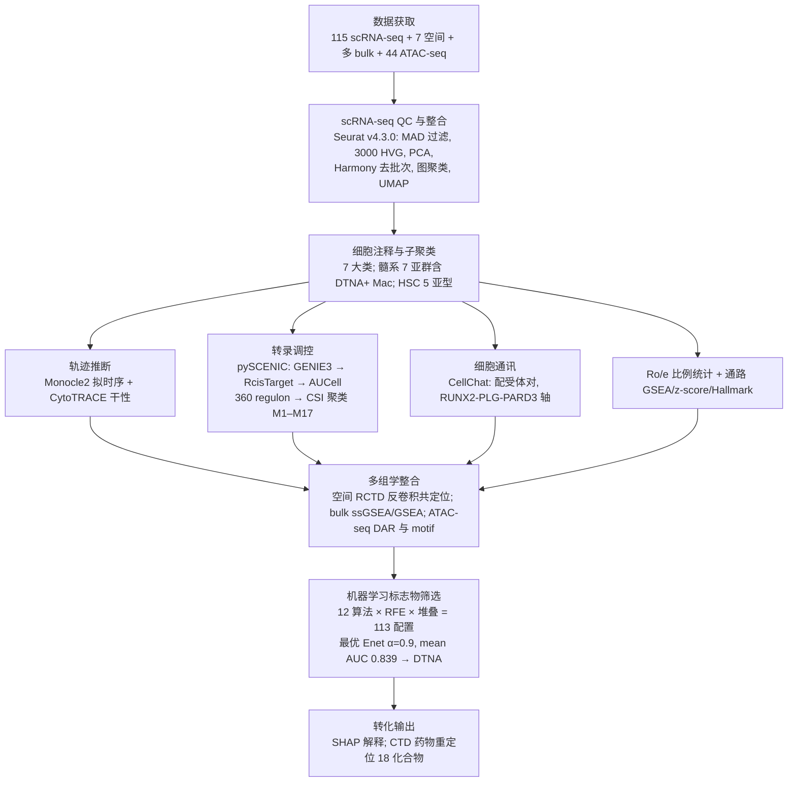

# 复现方案总目录与项目总览

> **目标文献**：Wen W, Liu Z, Tan W, et al. *Integrating multi-omics and machine learning systematically deciphers cellular heterogeneity and fibrotic regulatory networks in the progression from MASLD to MASH.* npj Digital Medicine (2026) 9:167. DOI: 10.1038/s41746-026-02352-8
>
> **本套文档的性质**：以博士生导师（PI）视角编写的、可逐行执行的复现操作方案（Reproduction Protocol）。每一篇文档包含：① 该模块对应的原文图表；② 生物学背景与科学问题；③ 算法原理与数学公式；④ 逐步可运行代码（R 4.3.0 / Python 3.10.11）；⑤ 参数解释与调参空间；⑥ 预期结果与质控（QC）检查点；⑦ 常见陷阱与排错。
>
> **阅读顺序**：按编号 01 → 11 顺序执行即为完整复现流水线；若只关心某一模块，可单独阅读对应文档（各文档开头注明前置依赖）。

---

## 一、文档清单（目录文件）

| 编号 | 文件名 | 内容一句话描述 | 对应原文图表 |
|---|---|---|---|
| 00 | `00_目录与复现总览.md` | 本文件：文档目录、全流程图、图表-文档映射、硬件与工期建议、全局质控点 | Fig. 1 |
| 01 | `01_环境搭建与数据获取.md` | R/Python 双环境安装、11 个 GEO 数据集 + SRA ATAC-seq 的下载与元数据整理、格式统一化 | Methods: Data acquisition；Suppl. Table 1–2 |
| 02 | `02_单细胞QC整合与七大细胞注释.md` | Seurat v4.3.0 质控（MAD 法）、Harmony 去批次、图聚类、UMAP、7 大细胞类型注释与验证队列复核 | Fig. 2A–E, S1A–B |
| 03 | `03_细胞比例Ro_e分析与代谢通路GSEA.md` | Ro/e 观察-期望比统计框架、各细胞类型在 Healthy/MASLD/MASH 与 eMASH/aMASH 的富集检验、代谢通路 GSEA 热图 | Fig. 2F–H；Suppl. Table 3 |
| 04 | `04_HSC五亚型细分与分化轨迹.md` | HSC 子聚类（qHSC/inHSC/aHSC/hep-like HSC/SMC）、DEG 火山图与 KEGG、Monocle2 拟时序 + CytoTRACE 干性原理与代码 | Fig. 3 |
| 05 | `05_髓系七亚群与DTNA+巨噬细胞鉴定.md` | 髓系子聚类（VCAM1⁺ KC、SAA1⁺ KC、DTNA⁺ Mac、VCAN⁺ Mon、mDC、pDC、MKI67⁺ Mac）、M2 极化/缺氧通路 z-score、Hallmark 与 irGSEA、髓系拟时序 | Fig. 4, Fig. 5A–D |
| 06 | `06_pySCENIC调控网络与CSI模块.md` | GRNBoost2/GENIE3、RcisTarget、AUCell 三步原理；360 regulon 的 CSI 聚类（M1–M17）、RSS 特异性评分、Venn 交集得 RUNX2 等 4 个 TF | Fig. 5E–G, S3 |
| 07 | `07_CellChat细胞通讯与RUNX2-PLG-PARD3轴.md` | CellChat 通讯概率推断、MASH vs MASLD 差异互作热图、PLG–PARD3 配受体对验证、bulk 数据集相关性（R=0.639/0.655）与 9 队列相关矩阵 | Fig. 6, S4 |
| 08 | `08_空间转录组RCTD反卷积与共定位.md` | spacexr/RCTD 原理（spot 表达 = 细胞类型参考谱的混合）、以 GSE166504 为参考对 GSE248077 反卷积、巨噬细胞-aHSC 空间共定位定量 | Fig. 2I, 7D–E, S2, S9, S10 |
| 09 | `09_bulk转录组ssGSEA纤维化评分与PLG分层.md` | ssGSEA 纤维化评分（HP_HEPATIC_FIBROSIS）、PLG 高/低分组（75 分位）DEG 与补体凝血级联 GSEA、乳酸代谢相关基因相关性 | Fig. 6E, 7A–C, S6 |
| 10 | `10_ATAC-seq染色质可及性与RUNX2结合位点.md` | ATAC-seq 全流水线（比对→去重→MACS2→DAR 差异可及区）、PLG 顺式调控元件、RUNX2 motif 富集（27 TFBS）、TSS 距离分布与 IGV 可视化 | Fig. S5, S11 |
| 11 | `11_机器学习113模型集成与SHAP解释.md` | 12 算法 × RFE × 堆叠集成的 113 配置网格、分层 10 折 CV、Enet(α=0.9) 最优（mean AUC=0.839）、SHAP 四图、CTD 药物重定位（18 个化合物） | Fig. 8, 9, S8 |
| 12 | `12_复现质控清单与批判性评述.md` | 全流水线 QC 检查点表（含原文报告数值）、常见故障排错表、以审稿人/导师视角的批判性评述与可扩展研究方向 | 全文 |

---

## 二、研究科学问题与全流程图

### 2.1 科学问题（一句话版）

在 MASLD（代谢功能障碍相关脂肪性肝病）向 MASH（代谢功能障碍相关脂肪性肝炎）进展过程中，**哪一类细胞亚群、通过哪条调控轴驱动纤维化？能否转化为无创诊断标志物？**

原文答案：
1. 七类肝细胞中，**单核/巨噬细胞**与**肝星状细胞（HSC）**在 MASH 中显著富集且空间共定位；
2. 髓系内部存在一个 **DTNA⁺ 巨噬细胞**亚群，MASH 特异富集，具 M2 极化 + 缺氧 + 促炎特征；
3. 拟时序显示其由 **Kupffer 细胞（VCAM1⁺ KC）分化而来**；
4. 转录调控核心为 **RUNX2**；DTNA⁺ 巨噬细胞经 **RUNX2–PLG–PARD3 轴**与活化 HSC（aHSC）互作，加剧纤维化（ATAC-seq 证实 RUNX2 结合 PLG 启动子/内含子）；
5. 集成机器学习（113 个模型）筛出 **DTNA 为区分 MASLD/MASH 的最优标志物**（Enet α=0.9，mean AUC = 0.839）。

### 2.2 全流程图（对应原文 Fig. 1）

### 2.3 原文图表 → 文档/代码模块映射

| 原文图 | 内容 | 复现所在文档 |
|---|---|---|
| Fig. 1 | 研究流程图 | 00 |
| Fig. 2A–B | 整合前后 UMAP（批次诊断） | 02 |
| Fig. 2C | 按疾病状态着色的 UMAP | 02 |
| Fig. 2D | 7 大细胞类型 UMAP | 02 |
| Fig. 2E | 7 大类型 marker DotPlot | 02 |
| Fig. 2F–G | 主要类型 Ro/e（三组 & eMASH/aMASH） | 03 |
| Fig. 2H | 各细胞簇代谢通路 GSEA 热图 | 03 |
| Fig. 2I | 空间 signature score 共定位 | 08 |
| Fig. 3A–D | HSC 5 亚型 UMAP/DotPlot/Ro/e | 04 |
| Fig. 3E–F | HSC DEG 火山图 + KEGG | 04 |
| Fig. 3G–J | CytoTRACE、拟时序轨迹、平滑热图 | 04 |
| Fig. 4A–C | 髓系 7 亚群 UMAP/DotPlot/Ro/e | 05 |
| Fig. 4D–G | 通路 z-score 热图、箱线图、Hallmark、irGSEA | 05 |
| Fig. 5A–D | 髓系 CytoTRACE、State 图、平滑热图 | 05 |
| Fig. 5E–G | regulon 模块热图、RSS Top10、Venn | 06 |
| Fig. 6A–D | CellChat 网络、差异互作热图、circle plot、PLG/PARD3 小提琴 | 07 |
| Fig. 6E–F | bulk 相关散点、9 队列相关矩阵 | 07 / 09 |
| Fig. 7A–C | PLG 高/低 DEG 火山图 + 补体凝血 GSEA | 09 |
| Fig. 7D–E | 空间共定位散点 | 08 |
| Fig. 8A | 113 模型 AUC 热图 | 11 |
| Fig. 8B–G | 各队列 ROC | 11 |
| Fig. 8H | 模型基因表达箱线图 | 11 |
| Fig. 9A–D | SHAP bar/beeswarm/waterfall/force | 11 |
| Fig. S1 | 验证队列（GSE166504）复核 | 02 / 03 |
| Fig. S2 | 空间反卷积补充 | 08 |
| Fig. S3 | regulon 模块补充（74 TF） | 06 |
| Fig. S4 | 其他数据集轴验证 | 07 |
| Fig. S5 | ATAC DAR、TFBS 注释、TSS 距离 | 10 |
| Fig. S6 | 乳酸代谢基因相关性 | 09 |
| Fig. S7 | 小鼠 HFHFD 队列 RUNX2 验证 | 02 / 09 |
| Fig. S8 | CTD 药物重定位 18 化合物 | 11 |
| Fig. S9–S10 | 空间共定位/PLG-PARD3 共表达补充 | 08 |
| Fig. S11 | 模型基因启动子 ±2 kb 可及性 IGV | 10 |

---

## 三、数据资产清单（复现所需全部输入）

| 组学 | 数据集 | 样本数 | 用途 | 获取方式 |
|---|---|---|---|---|
| scRNA-seq（发现队列） | GSE289173, GSE212837, GSE202379, GSE189600, GSE189175 | 115（Healthy 35 / MASLD 14 / MASH 66） | 主分析 | GEO supplementary（10x mtx/h5） |
| scRNA-seq（验证队列 + 空间参考） | GSE166504 | 38（HFHFD 小鼠 30 周 + 对照） | 验证、RCTD 参考图谱 | GEO supplementary |
| 空间转录组（10x Visium） | GSE248077 | 7（MASH） | RCTD 反卷积、共定位 | GEO supplementary |
| bulk RNA-seq / 芯片 | GSE126848, GSE135251, GSE167523, GSE48452, GSE66676, GSE89632, GSE164760, GSE162694, GSE24807 | 9 队列 | 纤维化评分、相关验证、ML 训练/验证 | GEO（GSEMatrix / 补充文件） |
| ATAC-seq | SRA PRJNA725028 | 44（MASH vs MASLD 肝穿） | DAR、RUNX2 motif、IGV | SRA fasterq-dump |

> **eMASH / aMASH 定义**（仅 GSE289173 具备纤维化分期）：eMASH = F0–2（无/轻度纤维化），aMASH = F3–4（进展期纤维化）；原文报告 9 例 eMASH、10 例 aMASH。

---

## 四、计算资源与工期建议（导师视角的经验值）

| 模块 | 内存峰值 | CPU | 参考耗时 | 备注 |
|---|---|---|---|---|
| scRNA 整合（57 万细胞） | 64–128 GB | 16 核 | 0.5–1 天 | Harmony 与 FindNeighbors 为内存瓶颈 |
| pySCENIC（360+ regulon） | 64 GB | 32–64 核 | 1–2 天 | GRNBoost2 可多线程；ctx 步骤最慢 |
| Monocle2 / CytoTRACE | 32 GB | 8 核 | 数小时 | Monocle2 为单线程 R |
| CellChat | 32 GB | 16 核 | 数小时 | 57 万细胞建议先按组（MASLD/MASH）子集 |
| RCTD（7 张 Visium） | 32 GB | 16 核 | 数小时 | full mode |
| ATAC-seq（44 样本） | 16 GB/样本并行 | 每样本 8 核 | 1–2 天 | 比对+MACS2 |
| ML 113 配置 × 6 队列 | 8 GB | 16 核 | 数小时 | 10 折 CV |

**建议**：整机 ≥128 GB 内存、≥32 核；或按模块拆分到集群节点。所有中间对象（Seurat rds、h5ad、peak 矩阵）落盘于 `data/processed/`，代码与输出分离（见 01 文档目录约定）。

---

## 五、全局质控点（Go/No-Go 门槛）

复现者在每个阶段结束时必须核对以下数值（允许抽样平台差异导致的 ±10% 波动，超出即回查）：

1. **QC 后细胞总数 ≈ 570,194**；七大类细胞数：hepatocytes 322,546；endothelial 93,372；T 64,205；mono/mac 37,907；HSC 26,073；cholangiocytes 20,910；B 5,181。
2. Harmony 后 UMAP 按 dataset 着色应**充分混合**，按疾病着色应**保留生物学分离**。
3. Ro/e：mono/mac 与 HSC 在 MASH > MASLD/Healthy；aHSC 在 aMASH > eMASH；DTNA⁺ Mac 在 MASH 升高、VCAM1⁺ KC 下降。
4. HSC 轨迹方向：qHSC → inHSC → aHSC / hep-like HSC / SMC；CytoTRACE 高分端为 qHSC。
5. 髓系轨迹方向：VCAM1⁺/SAA1⁺ KC → DTNA⁺ Mac；CytoTRACE 归一化 0–1。
6. SCENIC：显著 regulon ≈ 360；CSI 层次聚类模块数 = 17（M1–M17）；DTNA⁺ Mac 富集于 M2/M3/M10/M12（合计 74 TF）；Venn 交集 = {BHLHE41, RUNX2, BACH2, MEF2C}。
7. CellChat：PLG–PARD3 在 MASH 中 DTNA⁺ Mac→HSC 方向特异性增强。
8. bulk：fibrosis score–PLG R=0.639 (p=0.00011)；RUNX2–PLG R=0.655 (p=6.33e-5)（GSE126848）。
9. ATAC：DAR 上/下 = 145,812 / 10,567；PLG 顺式元件 7 个全落于上调簇；RUNX2 TFBS = 27。
10. ML：最优配置 = Enet(α=0.9)，跨队列 mean AUC = 0.839；SHAP mean|SHAP|：DTNA 0.100 > DHRS9 0.011 > TRPM2 0.009 > TESK2 0.007 > ARHGAP22 0.006 > ITGAX 0.004 > RUNX2 0.003 > AUTS2 0.002。

---

## 六、 reproducible research 规范（本套方案的工程约定）

1. **目录约定**（详见 01 文档）：`raw/ → processed/ → results/ → figures/ → code/ → logs/`。
2. **随机种子**：R 用 `set.seed(20260101)`；Python 用 `np.random.seed(20260101)`；Harmony/Seurat/UMAP 均受种子控制。
3. **会话信息**：每个脚本末尾 `sessionInfo()` / `pip freeze` 写入 `logs/`。
4. **版本钉死**：R 4.3.0、Python 3.10.11、Seurat 4.3.0（原文指定）；其余包版本见 01 文档版本表。
5. **统计约定**（原文 Methods）：连续变量正态→Pearson，否则 Spearman；两组比较→Wilcoxon rank-sum；*p<0.05, **p<0.01, ***p<0.001。
