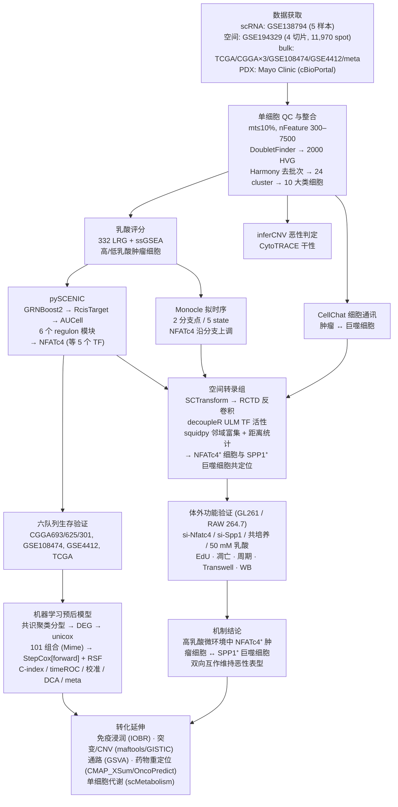

# 文献复现方案总目录与项目总览

> **目标文献**：Wang R, Wu W, Wu X, Yuan Y, Zhang Z, Chen J, Xie Y, Zhang L, Yu X, Zhang H, Xie Z. *Integrative single-cell and spatial transcriptomic analysis reveals a lactate-driven crosstalk between NFATc4⁺ tumor cells and SPP1⁺ macrophages in glioblastoma.* **Journal of Translational Medicine (2026) 24:1253.** DOI: [10.1186/s12967-026-08555-7](https://doi.org/10.1186/s12967-026-08555-7)
> （重庆医科大学附属第二医院神经外科；Received 2026-02-07 / Accepted 2026-06-26）
>
> **PDF 原件**：同目录下 `Integrative single-cell and spatial transcriptomic analysis reveals a lactate-driven crosstalk between NFATc4+ tumor cells and SPP1+ macrophages in glioblastoma (J Transl Med 2026, 24-1253).pdf`
>
> **本套文档的性质**：以博士生导师（PI）视角编写的、可逐步执行的**复现操作方案（Reproduction Protocol）**。全套共 15 篇文档，每篇包含：① 该模块的科学问题与证据链位置；② 生物学/算法原理与公式；③ 原文方法的逐句拆解；④ 逐步可运行代码（R 4.4.2 / Python 3.10）；⑤ 参数解释与调参空间（含"原文未写清 → 我方复现决策 + 备选方案"）；⑥ 预期结果与 QC 检查点（附原文报告数值）；⑦ 常见陷阱与排错表；⑧ 与原文图表的对应关系。
>
> **阅读顺序**：按编号 00 → 14 顺序执行即为一条完整流水线；也可按需单读某一模块（各文档头部注明"前置依赖"）。**建议先通读 14 号（背景知识精讲）与 13 号（质控与批判性评述）再动手**——前者建立知识图谱，后者告诉你这套结论的边界在哪里。

---

## 一、文档清单（目录文件）

> 📌 **开工前必读（两级规范）**：
> ① **通用规范 `../REPRO_SPEC.md` v2.0（L0）**——文献复现项目的**统一规范**，适用本仓库所有复现项目：工作流六阶段、目录与命名语法、
>    产物契约机制、环境与随机性、统计约定、文档写作规范、文献疏漏处理方法、变更控制与自检清单、诚实性红线。
> ② **项目规范 `PROJECT_SPEC.md` v1.0（L1）**——本项目的实例化：模块编号表、**产物契约表**、**术语与阳性判定唯一口径**、
>    D 表索引、环境与统计取值、偏离声明。
> **效力层级：L0 通用规范 > L1 项目规范 > 13 号 §一 / 本文件 §五 质控门槛（L2）> 各模块文档（L3）**（D 表权威位置 = 13 号 §八）。
> 任何文档与之冲突时，以高层级为准。

| 编号 | 文件名 | 内容一句话描述 | 对应原文图表 |
|---|---|---|---|
| **L0** | `../REPRO_SPEC.md` | **通用统一规范 v2.0（仓库级）**：适用于所有文献复现项目——工作流、目录/命名、产物契约机制、环境与随机性、统计、写作规范、文献疏漏处理方法、变更控制、诚实性红线 | — |
| **L1** | `PROJECT_SPEC.md` | **本项目规范 v1.0**：模块编号表、产物契约表（生产者/消费方）、术语与阳性判定唯一口径、D 表索引、环境与统计、偏离声明 | — |
| **00** | `00_目录与复现总览.md` | 本文件：文档目录、科学问题、全流程图、图表-文档映射、数据资产、算力与工期、全局质控门槛、工程规范 | Fig. 1 |
| **01** | `01_环境搭建与数据获取.md` | R/Seurat 5.3.0 与 Python 双环境搭建、逐包版本表、6 类数据源（GEO/TCGA/CGGA/cBioPortal）的下载与格式统一、**332 个 LRG 基因集的重建方案**、目录约定与校验 | Methods: Collection and integration of the data；Table S2 |
| **02** | `02_单细胞QC整合与十大类细胞注释.md` | QC（线粒体 ≤10%、nFeature 300–7500）、DoubletFinder 去双胞、2000 HVG、Harmony 去批次、24 cluster → **10 大类细胞**、inferCNV/scCATCH/CellTypist 注释、CytoTRACE 干性 | Fig. 2A–B, 2E–F |
| **03** | `03_乳酸代谢评分与高低乳酸亚群划分.md` | Warburg 效应与乳酸信号生物学、ssGSEA/AUCell/UCell 打分原理对比、**332 LRG 的语义辨析**、高低乳酸分组阈值方案与敏感性分析、与 glycolysis/hypoxia signature 的解耦验证 | Fig. S1；Methods「GSVA + ssGSEA」 |
| **04** | `04_pySCENIC转录因子调控网络与NFATc4发现.md` | GRNBoost2 → RcisTarget → AUCell 三步原理与 CLI、**6 个 regulon 模块**、差异 TF（**SPI1、NFATc4、HOXC9、POU3F3、FOXO1**）、NFATc4 调控网络与 TF 气泡图、NFAT 家族与 Ca²⁺/calcineurin 背景 | Fig. 3A–H |
| **05** | `05_拟时序轨迹与分支依赖基因.md` | Monocle2 DDRTree 与 Monocle3/Slingshot 对比、**2 个分支点 / 5 个 state**、NFATc4 沿第二分支升高、分支依赖基因 **AHCYL1 / CADPS**、state 依赖基因 GO（cell death / gliogenesis）、top100 热图 | Fig. S2A–G |
| **06** | `06_空间转录组反卷积与共定位.md` | Visium 数据结构与 SCTransform、**RCTD**（Poisson 混合模型）反卷积、decoupleR **ULM** 推断 TF 活性、high/low-lactate/non-tumor 三分区、**squidpy 邻域富集**与 SciPy 距离统计、11,970 个 spot 的共定位定量 | Fig. 4A–J；Fig. S3 |
| **07** | `07_细胞通讯CellChat与NFATc4-SPP1轴.md` | CellChat 概率模型（Hill 函数 + 质量作用）推导、配受体对与 SPP1 通路、scRNA 层与空间层通讯分析、SPP1⁺ TAM 的跨癌种背景、**"共定位 ≠ 因果"** 的证据边界 | Fig. 2C–D；Fig. 4D–E |
| **08** | `08_bulk队列整合与NFATc4生存分析.md` | TCGA/CGGA693/**CGGA325（原文写 CGGA625，官网无可溯源数据集，见 13 号决策 D5）**/CGGA301/GSE108474/GSE4412/meta 队列构建、KM + log-rank、Cox 与 PH 假设、**截断点选择偏差**、六队列生存一致性、Mayo PDX 验证 | Fig. 3D；Fig. S4A–C |
| **09** | `09_机器学习101组合预后模型.md` | 共识聚类分型 → DEG（\|log2FC\|>1, P<0.01）→ univariate Cox（P<0.001）→ **101 种 ML 组合**（Mime 框架）→ 最优 **StepCox[forward] + RSF**；C-index / timeROC / 校准 / DCA / meta 分析；**信息泄漏与过拟合的严格剖析** | Fig. 7A–F；Fig. S5 |
| **10** | `10_免疫浸润、突变与CNV基因组分析.md` | IOBR 多算法免疫浸润（MCPcounter/EPIC/xCell/CIBERSORT）、maftools 突变图谱与 TMB、**GISTIC 2.0** CNV（1/7/9 号染色体）、GSVA 通路富集 | Fig. 8A–E |
| **11** | `11_药物敏感性、CMAP重定位与单细胞代谢.md` | CMAP_XSum 药物重定位（**fasudil、imatinib**）、pRRophetic/oncoPredict 预测 IC₅₀（**A.443654、A.770041**）、CTRP/PRISM、**scMetabolism** 单细胞代谢（glycolysis/OXPHOS） | Fig. 9A–F |
| **12** | `12_体外功能验证实验方案.md` | GL261 / RAW 264.7 培养、**siRNA 序列与转染 SOP**、RT-qPCR（2^-ΔΔCt）、WB、EdU、Annexin V 凋亡、PI 周期、Transwell、**四种共培养构型**、50 mM 乳酸处理、统计与数据归档规范 | Fig. 5A–S；Fig. 6A–H |
| **13** | `13_复现质控清单、排错与批判性评述.md` | 32 项 QC 检查点表（含原文数值与 Go/No-Go）、25 项跨模块排错速查、**14 项 PI 裁决的复现决策登记表（开工前必读）**、以审稿人/导师视角的**批判性评述**（因果证据缺失、细胞系局限、模型过拟合、基因集语义漂移、无 in vivo 验证）与可扩展研究方向 | 全文 |
| **14** | `14_背景知识精讲与方法学原理速查.md` | GBM 分子病理、Warburg 效应与乳酸化、NFATc4/SPP1 生物学、46 篇参考文献导读；UMAP/Harmony/RCTD/SCENIC/ssGSEA/Cox/RSF/CMAP 等**方法学原理速查与失败模式** | 全文 |

---

## 二、科学问题与全流程图

### 2.1 科学问题（一句话版）

在胶质母细胞瘤（GBM）中，**乳酸代谢异质性最强的肿瘤细胞亚群由哪个转录因子驱动？它又通过怎样的微环境互作维持恶性表型、并能否转化为可用的预后工具？**

原文给出的答案链（这是复现时要逐一验证的命题）：

1. GSE138794 单细胞图谱中，GBM 微环境由 **10 大类细胞**组成，其中肿瘤细胞与巨噬细胞互作最频繁（Fig. 1、Fig. 2）。
2. 用 **332 个乳酸相关基因（LRGs）** 对肿瘤细胞做 ssGSEA 打分，可分为**高/低乳酸两个亚群**；pySCENIC 显示两组转录调控程序显著不同，**NFATc4** 是高乳酸亚群中最具代表性的 TF 之一（与 SPI1、HOXC9、POU3F3、FOXO1 并列）（Fig. 3）。
3. 拟时序显示 **NFATc4 在分化后期沿特定分支上调**，与侵袭表型相关（Fig. S2）。
4. 空间转录组（GSE194329）显示 **NFATc4⁺ 肿瘤细胞与 SPP1⁺ 巨噬细胞显著空间共定位**，且高乳酸区域的空间距离更近（Fig. 4）。
5. 六个独立队列中 **NFATc4 高表达普遍预后不良**；在 Mayo Clinic GBM PDX 中，SPP1⁺ 巨噬细胞 signature 与 NFATc4⁺ 肿瘤细胞 signature 强正相关（Fig. 3D、Fig. S4）。
6. 体外：**Nfatc4 敲低**抑制 GL261 增殖/迁移、诱导凋亡与周期阻滞；**Spp1 敲低**在巨噬细胞中同样抑制共培养肿瘤细胞；乳酸处理上调 NFATc4 —— 提示 **NFATc4–SPP1 双向轴**（Fig. 5、Fig. 6）。
7. 机器学习：基于 LRGs 的 **101 种组合模型**中 **"StepCox[forward] + RSF"** 最优（TCGA C-index 0.87、GSE4412 0.64、meta 0.62；5 年 AUC 0.976 / 0.905；pooled HR 1.82），高风险组表现为免疫浸润升高 + 染色体 1/7/9 改变更频繁 + 特定药物敏感性（Fig. 7–9）。

### 2.2 全流程图（对应原文 Fig. 1）



### 2.3 原文图表 → 文档映射

| 原文图 | 内容 | 复现文档 |
|---|---|---|
| Fig. 1 | 研究流程示意 | 00 |
| Fig. 2A | 12,618 细胞、24 cluster、10 大类细胞 UMAP | 02 |
| Fig. 2B | inferCNV 区分肿瘤/正常细胞 | 02 |
| Fig. 2C–D | CellChat 互作数量与强度（肿瘤↔巨噬） | 07 |
| Fig. 2E | 10 大类细胞比例堆叠柱状图 | 02 |
| Fig. 2F | CytoTRACE 干性打分 UMAP | 02 |
| Fig. 3A | 高低乳酸组 regulon 活性热图 | 04 |
| Fig. 3B | 6 个 regulon 模块的 UMAP | 04 |
| Fig. 3C | 组间差异 TF（SPI1/NFATc4/HOXC9/POU3F3/FOXO1） | 04 |
| Fig. 3D | 六队列 NFATc4 生存曲线 | 08 |
| Fig. 3E | NFATc4 调控网络 | 04 |
| Fig. 3F | regulon 聚类 | 04 |
| Fig. 3G | NFATc4 regulon 活性 UMAP（按乳酸分组） | 04 |
| Fig. 3H | TF 活性气泡图 | 04 |
| Fig. 4A | 乳酸分组与 NFATc4 活性的空间分布 | 06 |
| Fig. 4B | NFATc4⁺ 肿瘤细胞与 SPP1⁺ 巨噬细胞空间邻近 | 06 |
| Fig. 4C | 巨噬细胞浸润区域 | 06 |
| Fig. 4D–E | 空间数据 CellChat 互作 | 07 |
| Fig. 4F | 邻域富集 + 空间距离分析 | 06 |
| Fig. 4G–J | 最近邻距离分布、密度曲线（高/低乳酸） | 06 |
| Fig. 5A–D | siRNA 敲低效率（qPCR + WB） | 12 |
| Fig. 5E–L | EdU / 凋亡 / 周期 / Transwell（Nfatc4 敲低） | 12 |
| Fig. 5M–Q | 共培养：巨噬细胞迁移、M2 比例、SPP1 蛋白 | 12 |
| Fig. 5R–S | 乳酸处理上调 NFATc4 | 12 |
| Fig. 6A–H | 巨噬细胞 Spp1 敲低 → 共培养肿瘤细胞表型 | 12 |
| Fig. 7A | 101 种 ML 组合性能热图 | 09 |
| Fig. 7B–D | 火山图 / PCA / 两簇生存曲线 | 09 |
| Fig. 7E | 1/3/5 年 timeROC | 09 |
| Fig. 7F | 跨数据集 meta 分析森林图 | 09 |
| Fig. 8A | 免疫浸润热图 | 10 |
| Fig. 8B–C | 突变图谱与 oncoprint | 10 |
| Fig. 8D | 染色体 CNV 谱（1/7/9） | 10 |
| Fig. 8E | GSVA 通路富集 | 10 |
| Fig. 9A | CMAP_XSum top5 小分子 | 11 |
| Fig. 9B–D | 药靶相关性、药敏热图、IC₅₀ 箱线图 | 11 |
| Fig. 9E–F | scMetabolism 代谢通路活性 | 11 |
| Fig. S1 | 乳酸分数 vs glycolysis/hypoxia signature | 03 |
| Fig. S2A–G | Monocle 拟时序全套 | 05 |
| Fig. S3 | 另两个空间切片结果 | 06 |
| Fig. S4A–C | Mayo PDX 生存与 signature 相关性 | 08 |
| Fig. S5 | 校准曲线 + 1 年 DCA | 09 |
| Table S1 | RT-qPCR 引物 | 12 |
| Table S2 | 332 个乳酸相关基因 | 01 / 03 |

---

## 三、数据资产清单（复现所需全部输入）

| 组学 | 数据集 | 规模 | 用途 | 获取方式 |
|---|---|---|---|---|
| scRNA-seq | **GSE138794** | 5 个 GBM 样本 → QC 后 **12,618 细胞 / 24 cluster / 10 大类** | 主发现队列 | GEO supplementary（10x mtx/h5） |
| 空间转录组 | **GSE194329** | 4 个样本（GSM5833533–5833536），**11,970 spot** | RCTD 反卷积、共定位、TF 活性 | GEO supplementary（含 `spatial.tar.gz`，**必须下载**） |
| bulk RNA-seq | **TCGA-GBM** | ~150+ 样本 | 训练集、共识聚类、免疫/突变/药敏 | GDC / UCSC Xena / TCGAbiolinks（TPM） |
| bulk RNA-seq | **CGGA693 / CGGA325 / CGGA301** | 693 / 325 / 301 | 生存验证 | <http://www.cgga.org.cn/> |

> ⚠️ **关于 "CGGA625"**：原文正文与图注均写 "CGGA625"，但 CGGA 官网只提供 `mRNAseq_693`、`mRNAseq_325`、`mRNA-array_301` 三个可下载数据集，**"625" 无法溯源**。本方案统一采用 **CGGA325 替代**，并在所有图注中写作 `CGGA325 (CGGA625 replacement)`（详见 13 号文档决策 D5）。
| 芯片 | **GSE108474** | ~500（含非 GBM，需筛 GBM） | 生存验证 | GEO |
| 芯片 | **GSE4412** | 约 85（GEO 收录样本数；常被引为 84–85，以实际下载为准） | 生存验证 | GEO |
| 合并队列 | **meta-cohort** | 多队列合并（去批次） | 外部验证 | 自建（ComBat/removeBatchEffect） |
| PDX | **Mayo Clinic GBM PDX**（Vaubel 2020） | 面板级 | NFATc4 生存 + ssGSEA 共变 | cBioPortal |
| 基因集 | **332 LRGs**（原文 Table S2） | 332 | 乳酸评分、分型、建模 | Supplementary Table S2；不可得时见 01 号文档重建方案 |
| 细胞系 | **GL261**（小鼠 GBM）、**RAW 264.7**（小鼠巨噬） | — | 体外功能验证 | ATCC/国家细胞库；需支原体检测 |

**复现顺序上的一个现实提醒**：原文的 scRNA 结论全部来自**单一数据集 GSE138794（5 个样本、12,618 细胞）**。这是本套复现中**最脆弱的一环**——5 个样本不足以支撑"10 大类细胞、24 cluster、6 个 regulon 模块、高/低乳酸两亚群"这类群体级结论。导师建议：复现时**主动加入一个独立 GBM 单细胞数据集（如 GSE131928、GSE84465、GSE148196 等）做留出验证**，把"能否在第二个数据集里重现 NFATc4 高乳酸富集"作为本项目的第一优先级扩展（详见 13 号文档第五节）。

---

## 四、计算资源与工期建议（导师视角的经验值）

| 模块 | 内存峰值 | CPU | 参考耗时 | 备注 |
|---|---|---|---|---|
| 单细胞 QC + 整合（1–5 万细胞级） | 32–64 GB | 8–16 核 | 数小时 | 本文细胞数不大，Harmony/cluster 均轻量 |
| inferCNV | 32–64 GB | 8 核 | 2–6 小时 | 逐样本跑，滑窗与 HMM 耗时 |
| pySCENIC（GRNBoost2 → ctx → AUCell） | 32–64 GB | 16–32 核 | 6–24 小时 | `ctx`（motif 富集）为瓶颈，dask 并行 |
| CellChat（scRNA + 空间） | 16–32 GB | 8 核 | 1–3 小时 | `nboot=100` 时置换检验耗时线性增长 |
| RCTD（4 张 Visium） | 16–32 GB | 8–16 核 | 1–3 小时 | 原文**未报告 `mode`** → `full` 与 `doublet` 都要跑一遍比对；参考图谱细胞数影响内存 |
| Monocle2 拟时序 | 16–32 GB | 单线程 | 1–4 小时 | DDRTree 为单线程瓶颈 |
| bulk 队列整合 + 生存分析（6 队列） | 8–16 GB | 8 核 | 数小时 | 芯片数据 ID 映射最费时 |
| **ML 101 组合 × 5 队列** | 16–32 GB | 16 核 | 数小时–2 天 | 组合数 × 队列数 × 交叉验证，**最易超时**；建议 `future`/`furrr` 并行 |
| CMAP / oncoPredict / GISTIC | 16–32 GB | 8 核 | 数小时 | LINCS 与 GDSC 训练集下载体量大（数十 GB 级） |
| 体外实验 | — | — | 3–6 个月 | 细胞培养、转染、表型实验的生物学周期 |

**整机建议**：≥64 GB 内存、≥16 核；全套 dry-lab 复现约 **4–8 周**（含调试），若加入体外验证则 **3–6 个月**。
所有中间对象落盘于 `processed/`，代码与输出分离（目录约定见 01 号文档）。

---

## 五、全局质控点（Go/No-Go 门槛）

复现者在每个阶段结束时必须核对以下数值（允许抽样与平台差异导致的 **±10%** 波动，超出即回查）：

1. **单细胞 QC 后细胞数 ≈ 12,618**；cluster 数 ≈ **24**；细胞类型 **10 类**：neoplastic cells、macrophages、T cells、astrocytes、oligodendrocytes、stem cells、neurons、endothelial cells、ILCs、fibroblasts。
2. **inferCNV**：肿瘤细胞呈广泛染色体拷贝数改变；正常细胞（T 细胞/少突胶质细胞等）作为参考背景平稳。
3. **细胞周期**：多数肿瘤细胞处于 **G1 期**。
4. **CytoTRACE**：少突胶质细胞与成纤维细胞分数最高（分化潜能最高），肿瘤细胞与巨噬细胞较低。
5. **乳酸评分**：高/低两组分界清晰；乳酸分数与 glycolysis、hypoxia signature 的分布**不一致**（图 S1 定性结论）。
6. **pySCENIC**：高乳酸组显著升高 TF 列表包含 **NFATc4**（同组还有 SPI1、HOXC9、POU3F3、FOXO1）；regulon 模块数 ≈ **6**。
7. **拟时序**：分支点数 = **2**；state 数 = **5**；NFATc4 沿第二条分支（星形胶质细胞样分支）升高；AHCYL1 先升后降、CADPS 持续上调。
8. **空间转录组**：4 切片 spot 总数 ≈ **11,970**；SPP1⁺ 巨噬细胞 ↔ NFATc4⁺ 肿瘤细胞邻域富集 z-score 为正且显著；高乳酸组最近邻距离 **小于** 低乳酸组。
9. **生存分析**：六队列中"NFATc4 高表达预后差"的方向在多数队列成立（log-rank p 与 HR 需逐队列记录）。
10. **ML**：最优模型为 **StepCox[forward] + RSF**；**C-index：TCGA 0.87 / GSE4412 0.64 / meta 0.62**；**5 年 AUC：TCGA 0.976 / GSE4412 0.905**；**pooled HR 1.82（95% CI 1.64–2.02，p<0.001）**。
11. **免疫/基因组**：高风险组 macrophages、CD8⁺ T、NK 升高；高频突变为 TTN/TP53/PTEN/EGFR；高风险组 **97.7%** 样本含体细胞突变；CNV 集中于 1、7、9 号染色体。
12. **药物**：CMAP_XSum top 化合物包含 **fasudil / imatinib**；高风险组 **A.443654、A.770041** 预测 IC₅₀ 更低。
13. **体外**：siRNA 敲低效率 **> 60–70%**；Nfatc4 敲低后 EdU⁺ 比例↓、凋亡↑、S 期↓、迁移细胞数↓；共培养体系中 F4/80⁺CD206⁺ 比例↓。

> ⚠️ **导师批注（贯穿全程的判据）**：第 10 条里"训练集 0.87 vs 验证集 0.62–0.64"的落差，**不是**复现失败，而是原文模型的真实面貌。复现者应当在报告中如实呈现这一点，而不是通过反复调参把验证集数字"调到"好看。

---

## 六、reproducible research 规范（本套方案的工程约定）

1. **目录约定**（详见 01 号文档）：
   ```
   project/
   ├── raw/           # 原始下载数据（只读；geo/ tcga/ cgga/ cbioportal/ cistarget/ drug_response/）
   ├── processed/     # 中间对象（.rds / .h5ad / .qs）
   ├── results/       # 表格类结果（.csv / .xlsx；01–14 号文档按编号加前缀）
   ├── figures/       # 出图（.pdf + .png 双份，dpi=300）
   ├── code/          # 脚本（01_xxx.R / 02_xxx.py，与文档编号一一对应）
   └── logs/          # sessionInfo() / pip freeze / 运行日志 / DECISIONS.md
   ```
   > ⚠️ **注意**：本套文档正文统一使用 `raw/` 与 `processed/`（**不带 `data/` 前缀**）。早期草稿中出现的
   > `data/raw/`、`data/processed/` 均指同一处，按 13 号文档决策 D2 统一为无前缀写法。
2. **随机种子**：R `set.seed(20260101)`；Python `np.random.seed(20260101)`。UMAP、Harmony、聚类、K-means、GRNBoost2、RSF、置换检验全部受种子控制。**注意**：pySCENIC 的 GRNBoost2 在并行模式下即使设种子也可能有微小波动，需在报告中说明。
3. **会话信息**：每个脚本末尾 `sessionInfo()`（R）或 `pip freeze > logs/requirements.lock`（Python），连同运行命令一并归档。
4. **版本钉死**：原文指定 R 4.4.2 + Seurat 5.3.0；其余包版本以 01 号文档版本表为准。**Seurat 4.x 与 5.x 的 API 差异（`FindVariableFeatures` vs `FindVariableGenes`、`DimPlot` vs `Dimplot`）会在复现中反复制造报错，务必统一到 5.x 写法。**
5. **统计约定**（原文 Methods）：连续变量正态 → Pearson，否则 Spearman；两组比较 → Wilcoxon rank-sum；生存分析 → KM + log-rank；体外实验 → mean ± SD，两组 Student's two-tailed t-test，多组 one-way ANOVA；显著性标注 *p<0.05, **p<0.01, ***p<0.001, ****p<0.0001。
6. **写作与命名**：图文件名 = 原文图号（如 `fig3A_regulon_heatmap.pdf`），便于与原文逐图对照；所有结果表必须带样本量、检验方法与 p 值列。
7. **诚实性原则（本套方案的最高约束）**：凡是原文未写清、无法从数据中唯一确定的步骤，一律在文档中标注为「**复现决策**」，并写出备选方案；凡是复现结果与原文不一致的，记录在 13 号文档的对照表中，**不得为了"对上数字"而反向调参**。
8. **决策登记**：开工前先读 **13 号文档第八节的「复现决策登记表」（D1–D14，PI 已裁决）**，把该表复制到 `logs/DECISIONS.md`；其中 D3（meta-cohort 是否含 TCGA）、D5（CGGA625→325 替代）、D6（Transwell 板型）、D1（对象命名）会改变结论口径，必须在论文方法学中显式声明。
9. **规范遵从**：目录、命名、版本、统计写法以 **`../REPRO_SPEC.md`（L0 通用规范）** 为准；项目的产物契约、术语口径以 **`PROJECT_SPEC.md`（L1）** 为准。本文件 §六 与之一致，冲突时以规范为准。
   变更流程见 L0 §11.1；一致性自检用仓库脚本 **`../tools/repro_check.sh .`** 一键执行（清单见 L0 §11.4）。

---

## 七、推荐执行路径（三档）

| 档位 | 目标 | 覆盖文档 | 预计工时 |
|---|---|---|---|
| **A. 快速通路** | 只跑通"单细胞 → pySCENIC → NFATc4 → 生存 → ML 模型"主线 | 01 → 02 → 03 → 04 → 08 → 09 | 2–3 周 |
| **B. 完整 dry-lab** | 主线 + 空间转录组 + 通讯 + 免疫/基因组/药敏（全部生信文档，不含 12 号湿实验） | 01–11 + 13 | 5–8 周 |
| **C. 干湿结合** | B + 体外功能验证（可从 siRNA 敲低 + EdU/Transwell 起步） | 全部 01–14 | 3–6 个月 |

无论哪一档，**先读 13 与 14**：前者告诉你这批结论的证据强度，后者补齐你复现时需要的全部背景知识。
