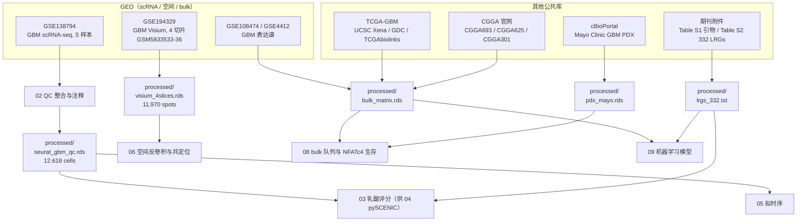

# 01 环境搭建与数据获取

> **目标文献**：Wang R, Wu W, et al. *Integrative single-cell and spatial transcriptomic analysis reveals a
> lactate-driven crosstalk between NFATc4⁺ tumor cells and SPP1⁺ macrophages in glioblastoma.*
> *J Transl Med* (2026) 24:1253. DOI: 10.1186/s12967-026-08555-7
>
> **模块对应原文**：Fig. 1（流程图）；Methods 中「Collection and integration of the data」「scRNA-seq dataset analysis」
> 「Spatial transcriptomics analysis」「Machine learning algorithms」「Transcriptome analysis」；Table S1–S2；Fig. S1、Fig. S4
> **前置依赖**：无（本模块是全流程的起点）。产出供 02–13 全部文档使用。
> **复现难度**：★★☆☆☆（技术难度低，但**数据获取路径多、命名坑多、体量大**）　**预计工时**：3–5 人日（含下载等待）
> **计算资源**：本地机 8 核 / 32 GB 内存 / ≥ 200 GB 空闲磁盘；下载带宽 ≥ 20 Mbps（GEO FTP 单线程会被限速）

---

## ① 科学问题与逻辑位置

### 1.1 本模块在全文中解决什么问题

原文是一篇**纯公共数据驱动的整合分析**（Data availability 明确写 "Publicly available datasets were analyzed in this study"，**没有提交任何新数据**）。这意味着：

1. **复现的全部输入都来自公开数据库**，没有任何"作者私有数据"缺口——这是本文可复现性的最大优势；
2. 但反过来，原文对数据获取的描述**极度简略**：Methods 里一句话列了 TCGA/CGGA/GSE108474/GSE4412，一句列了 GSE138794 与 GSE194329，**没有给任何 GSM 编号、文件名、补充表格下载链接、基因集来源明细**。本模块的核心工作量，就是把这些"隐含路径"补全成可执行脚本。

### 1.2 输入 / 输出

| 方向 | 内容 |
|---|---|
| **上游输入** | 公开数据库：GEO（GSE138794、GSE194329、GSE108474、GSE4412）、UCSC Xena / GDC（TCGA-GBM）、CGGA 官网、cBioPortal（Mayo Clinic GBM PDX）、期刊附件（Table S1–S2） |
| **本模块输出** | `raw/` 原始文件 + `processed/` 统一表达矩阵与元数据 + `logs/` 校验和 + 环境 YAML 与 `sessionInfo()` 快照 |
| **下游消费** | 02（`raw/geo/GSE138794/` + `logs/geo_manifest.tsv`）、03/04（`processed/lrgs_332.txt`、`processed/pyscenic_input.loom`）、06（`raw/geo/GSE194329/` Visium 切片）、08/09（`processed/bulk_matrix.rds`、`processed/meta_cohort.rds` 多队列训练矩阵） |

### 1.3 全流程数据依赖图



---

## ② 背景知识与原理

### 2.1 为什么选 GSE138794（而不是别的 GBM scRNA 数据集）

GBM 单细胞领域常用队列有 GSE131928（Neftel 2019，28 样本 / 约 8 万细胞）、GSE138794（5 样本）、GSE84465（Darmanis 2017，4 样本）等。原文使用 **GSE138794** 的原因可从结论反推：

- **样本数少（5 个）**：便于用最朴素的方法（无复杂 SCVI/CCA 校正）跑出稳定结果，也解释了为什么选择 **Harmony** 这种"轻量、可解释"的批次校正；
- **产生 12,618 个高质量细胞**：这是一个很"小"的规模（对比 Neftel 的 8 万），单机 32 GB 内存即可跑完全流程，包括 inferCNV（inferCNV 是全流程里的内存大户：它持有 `细胞 × 基因` 的稠密表达矩阵，内存随细胞数与基因数的乘积增长，且 `HMM=TRUE` 时还会额外缓存状态矩阵）；
- **含足量正常细胞**：inferCNV 需要正常参考细胞（原文 10 大类里 9 类非肿瘤细胞），细胞数太小的数据集会导致参考细胞不足、CNV 假阳性暴增。

> ⚠️ **导师批注**：5 个样本对"跨样本可重复性"是偏弱的。原文 Discussion 自己也承认 "the number of scRNA-seq samples included in our study is limited"。复现时应把"5 样本"当作**硬约束**而不是可调参数——想扩样本就得改用 GSE131928，那不是复现而是新研究了。

### 2.2 为什么 bulk 侧要同时用 TPM、FPKM 和芯片

原文的 bulk 数据混合了三种标度：

| 数据类型 | 标度 | 原话 |
|---|---|---|
| TCGA-GBM | **TPM** | "the expression values transformed to TPM" |
| CGGA 693/325 | **FPKM** | 官网 `mRNAseq_*.txt` 为 FPKM |
| CGGA 301、GSE108474、GSE4412 | **微阵列荧光强度**（GPL570/GPL96） | GEO 系列矩阵 |

把三者在同一个多队列框架里做单因素 Cox meta 分析（原文 pooled HR = 1.82, 95% CI 1.64–2.02, p < 0.001），**必须先把标度统一到可比的秩空间**。主流做法有两种：

1. **log2(x+1) 后按基因做 z-score（推荐）**：这一步把"绝对值差异"抹掉，只保留"样本在队列内的相对高低"。原文的核心分析（生存分组、ssGSEA/GSVA 打分、共表达相关）本质上都是**秩依赖**的，因此这一步是安全的。
2. **分位数归一化（quantile normalization）到同一分布**：会强行假设各队列的全局表达分布相同，在 GBM 这种肿瘤纯度差异大的队列上可能引入伪信号，**不推荐**。

> ⚠️ **导师批注**：原文**完全没有写**多队列之间的标度统一方法，只写了 "Genes with average expression values greater than zero and shared across all datasets were retained"。这在审稿标准下是**方法学漏洞**——用微阵列的绝对强度与 RNA-seq 的 TPM 直接合并，`avg > 0` 的筛选在不同平台的含义完全不同。复现时必须显式补上这一步，并在 `13_复现质控清单、排错与批判性评述.md` 中汇总。

### 2.3 平台效应与 ComBat：为什么"合并"反而可能毁掉信号

不同平台/不同实验室的数据合并，会引入两类"非生物学变异"：

- **location（位置）效应**：某平台整体表达值偏高/偏低，例如微阵列的背景扣除策略与 RNA-seq 的 3' 偏好导致同一样本的同一基因差异 2 倍；
- **scale（尺度）效应**：某平台动态范围不同，例如芯片压缩高表达基因，导致"高低表达比"被系统性低估。

ComBat（Johnson, Li & Rabinovic 2007）假设基因 $g$ 在批次 $b$ 中的表达服从

$$y_{gij} = \alpha_g + \mathbf{X}\boldsymbol{\beta}_g + \gamma_{gb} + \delta_{gb}\,\varepsilon_{gij}$$

其中 $\alpha_g$ 为基因基线、$\mathbf{X}\boldsymbol{\beta}_g$ 为生物学协变量效应、$\gamma_{gb}$ 为批次加性效应、$\delta_{gb}$ 为批次乘性效应。ComBat 用**经验贝叶斯**把 $\gamma_{gb}, \delta_{gb}$ 收缩到跨基因的共同先验（$\gamma_g \sim \mathcal{N}(\gamma_b, \tau_b^2)$、$\delta_g^2 \sim \text{逆 Gamma}$），得到稳健估计后校正：

$$y^{*}_{gij} = \frac{y_{gij} - \hat{\alpha}_g - \mathbf{X}\hat{\boldsymbol{\beta}}_g - \hat{\gamma}_{gb}}{\hat{\delta}_{gb}} + \hat{\alpha}_g + \mathbf{X}\hat{\boldsymbol{\beta}}_g$$

**关键前提**：ComBat 必须把**生物学分组放进 `mod` 参数**（这里即 `mod = model.matrix(~ risk_group)`），否则 ComBat 会把"高风险 vs 低风险"的差异也当作批次效应抹掉——这是 GBM 预后研究里最常见的自杀式操作。

`limma::removeBatchEffect()` 是另一条路：它在线性模型 $\mathbf{Y} = \mathbf{X}\boldsymbol{\beta} + \mathbf{Z}\boldsymbol{\gamma} + \boldsymbol{\epsilon}$ 中把 $\mathbf{Z}\boldsymbol{\gamma}$ 直接从拟合值里减掉，**没有经验贝叶斯收缩**，对小批次（CGGA301 只有 301 例）不如 ComBat 稳，但更透明、更容易解释。

> **我们的复现决策**：meta-cohort 主用 **ComBat（`sva::ComBat`，显式指定 `mod`）**；把 `removeBatchEffect` 作为 Plan B 做敏感性分析。两条路线的关键基因 HR 方向一致才算通过（见 §6 Go/No-Go）。

### 2.4 332 个 LRGs：源流与命名陷阱

原文 Methods 原文：

> "The lactate-related genes (LRGs) based on the published studies, and a total of 332 genes were included in this study (Table S2) [20, 21]."

其中 **[20] = Zhang D, et al. *Metabolic regulation of gene expression by histone lactylation.* Nature 2019;574:575–80**，**[21] = Cheng Z, et al. *Lactylation-related gene signature effectively predicts prognosis and treatment responsiveness in hepatocellular carcinoma.* Pharmaceuticals 2023;16:644**。

**这里存在一个必须点明的概念错位**：引用的是两篇**乳酸化修饰（lactylation，组蛋白赖氨酸乳酸化 Kla）**论文，但全文一律写作 "lactate-related genes（乳酸相关基因）"。两者在生物学上不是一回事：

- **lactate-related genes**：乳酸的产生、转运、感受（`LDHA/LDHB`、`SLC16A1/A3/A7`、`SLC2A1`、`HK1/2`、`PKM`、`PDK1`、`HCAR1`、`HIF1A`）；
- **lactylation-related genes**：乳酰基的写得（writers，`EP300`）与擦除（erasers，`HDAC1/2/3`、`SIRT1/2`）以及 Kla 靶基因。

原文实际用的 332 基因集，**从引用关系推断是二者的并集**（[20] 提供 Kla 靶基因、[21] 提供 HCC 中构建的 lactylation signature）。这直接决定了 §4.7 的重建策略。

> ⚠️ **导师批注**：本文自相矛盾之处还有一处同类的——Methods 写 "GSVA R package and the ssGSEA algorithm were used to evaluate the lactate score of neoplastic cells"，而 Discussion 写 "used **AUCell** and LRGs to calculate lactate metabolic scores"。ssGSEA 与 AUCell 是两种完全不同的算法（前者基于秩的富集分数，后者基于排名前 5% 基因的 AUC）。**本套文档以 Methods 的 ssGSEA 为准**，AUCell 仅用于敏感性分析。此点已在 `03_乳酸代谢评分与高低乳酸亚群划分.md` 中展开，并汇总至 `13_复现质控清单、排错与批判性评述.md`。

---

## ③ 原文方法逐条拆解

| # | 原文（英文关键词） | 中文转述 | 落地操作 |
|---|---|---|---|
| 1 | "Transcriptomic profiles and clinical annotations were available from publicly accessible repositories." | 表达谱与临床注释来自公开库 | 无新增伦理审批；但**必须**记录每个队列的下载日期与版本快照（CGGA 官网数据会更新） |
| 2 | "The Bulk RNA-seq data for GBM samples include TCGA (expression values transformed to TPM), CGGA (http://www.cgga.org.cn/), and GEO datasets with accession IDs **GSE108474** and **GSE4412**." | bulk 四个来源 | 见 §4.5 三途径下载；CGGA 需注意 `CGGA693 / CGGA625 / CGGA301` 的命名对不上官网三套数据（见 §5.2） |
| 3 | "The scRNA-seq data (**GSE138794**), comprising **five GBM datasets**, were selected for analysis." | 5 个 GBM 样本 | 原文写 "five GBM datasets"，实为 5 个**样本（sample）**；见 §4.4 枚举脚本 |
| 4 | "Spatial Transcriptomic sequencing data (**GSE194329**) were also integrated. This dataset included **four GBM samples**" | 4 个 Visium 切片 | GSM5833533–36，必须下载 `filtered_feature_bc_matrix.h5` **与** `spatial.tar.gz` |
| 5 | "lactate-related genes (LRGs) ... a total of **332** genes ... (**Table S2**) [20, 21]" | 332 基因集 | §4.7 双路径：期刊附件直取 + 文献重建 |
| 6 | "the GBM **patient-derived xenograft (PDX)** model of the **Mayo Clinic**, retrieved from the **cBioPortal** database [31]" | PDX 来自 cBioPortal | [31] = Vaubel RA, et al. *Clin Cancer Res* 2020;26:1094–104；§4.6 |
| 7 | "Samples with missing survival information were excluded. Genes with average expression values greater than zero and shared across all datasets were retained" | 建模前过滤 | 此步原文未给阈值细节；我们的复现决策见 §5.3 |
| 8 | "The R packages 'ISOpureR', 'impute', 'pRRophetic', and 'SimDesign' were used to perform drug target analysis and **GDSC** analysis [26, 27]" | 药敏估计 | 需要预先下载 GDSC 训练集（见 §4.9） |

---

## ④ 逐步可运行代码

### 4.0 全局约定（先落地，避免后面所有路径对不上）

```r
# code/00_setup.R —— 每个脚本开头 source() 一次
set.seed(20260101)                       # R 全局种子（SPEC §8）
options(stringsAsFactors = FALSE,
        timeout = 3600,                  # 大文件下载
        Seurat.object.assay.version = "v5")

PROJ <- "/home/zhangxi/paper_read/20261016_GBM_lactate_NFATc4_SPP1_macrophage"
DIRS <- file.path(PROJ, c("raw", "processed", "results", "figures", "code", "logs"))
for (d in DIRS) dir.create(d, showWarnings = FALSE, recursive = TRUE)

# raw/ 下按来源分子目录，避免同名文件互撞
for (d in c("raw/geo/GSE138794", "raw/geo/GSE194329", "raw/geo/GSE108474",
            "raw/geo/GSE4412",  "raw/tcga",       "raw/cgga",
            "raw/cbioportal",   "raw/literature", "raw/drug_response")) {
  dir.create(file.path(PROJ, d), showWarnings = FALSE, recursive = TRUE)
}
```

**Python 侧**（在 04.2 的 `gbm_py` 环境中执行）：

```python
# code/00_setup.py
import os, random, numpy as np
SEED = 20260101
os.environ["PYTHONHASHSEED"] = str(SEED)
random.seed(SEED); np.random.seed(SEED)
PROJ = "/home/zhangxi/paper_read/20261016_GBM_lactate_NFATc4_SPP1_macrophage"
```

---

### 4.1 双环境 YAML 全文

原文用 **R 4.4.2 + Seurat 5.3.0** 跑主分析，用 **squidpy / decoupleR / scipy / NumPy / Pandas** 跑空间统计——这是标准的 R + Python 双栈。**强烈建议用两个独立 conda 环境**，而不是在 R 里硬塞 reticulate 加载所有 Python 包。

**关键定位**：`R 4.4.2` 对应 **Bioconductor 3.20**（2024-10 发布）。Bioconductor 版本与 R 版本必须严格配对，配错会直接装不上 `infercnv` / `GSVA` / `monocle3`。

```yaml
# code/envs/r_env.yml
name: gbm_sc
channels:
  - conda-forge
  - bioconda
dependencies:
  # ---- R 本体与编译器（其余 R 包一律走 CRAN/Bioc，不用 conda，否则版本极易冲突）----
  - r-base=4.4.2
  - r-essentials=4.4
  - compilers                 # gcc/g++/gfortran
  - cmake>=3.26
  - make
  - pkg-config
  # ---- 编译期系统依赖（省掉后面 90% 的 install.packages 报错）----
  - libcurl                    # curl / httr / GEOquery 下载
  - openssl
  - libxml2                    # XML / xml2 / GO.db 相关
  - hdf5>=1.14                 # hdf5r（Seurat Read10X_h5、loom）
  - zlib
  - bzip2
  - xz
  - libpng
  - libtiff
  - libjpeg-turbo
  - freetype
  - fontconfig
  - harfbuzz
  - fribidi
  - cairo                      # ComplexHeatmap / ragg 出图
  - libglpk                    # igraph（Harmony 依赖 igraph）
  - gsl
  - gmp
  - libsodium
  - libgit2                    # devtools / remotes
  - libdeflate
  - libblas
  - liblapack
  - proj
  - geos
  - gdal                       # sf（空间坐标处理，squidpy 侧在 Python 环境）
  - udunits2
  - pandoc                     # rmarkdown
  - aria2                      # 断点续传下载器
  - pigz
```

```yaml
# code/envs/py_env.yml
name: gbm_py
channels:
  - conda-forge
  - bioconda
dependencies:
  - python=3.10
  - pip
  - numpy>=1.26,<2.1          # <2.1：scanpy/squidpy 生态对 numpy 2.x 支持滞后
  - pandas>=2.2
  - scipy>=1.13
  - scikit-learn>=1.5
  - matplotlib>=3.8
  - seaborn>=0.13
  - anndata>=0.10
  - scanpy>=1.10
  - squidpy>=1.5              # 空间邻域富集（原文指定）
  - harmonypy                 # 需要在 Python 侧复算 Harmony 时用
  - umap-learn
  - leidenalg                 # Leiden 聚类（Plan B）
  - python-igraph
  - loompy>=3.0               # pySCENIC 的输入格式
  - pyarrow
  - openpyxl                  # 读 Excel 补充表
  - requests
  - tqdm
  - jupyterlab
  - pip:
      - GEOparse>=2.0.4        # 读 GEO SOFT 元数据（枚举 GSM 与补充文件名）
      - decoupler>=1.6         # ULM 推断 TF 活性（原文指定）
      - celltypist>=1.6        # 免疫细胞注释（原文指定；模型单独下载）
      - gseapy>=1.1            # ssGSEA / GSEA 的 Python 备份实现
      - pyscenic==0.12.1       # 若走 Python 版 SCENIC
```

**建环境（用 mamba 快 5–10 倍）**：

```bash
# 若未装 mamba：conda install -n base -c conda-forge mamba
mamba env create -f code/envs/r_env.yml
mamba env create -f code/envs/py_env.yml

# 让 R 找到 conda 提供的系统库（关键：否则 libcurl/libxml2/hdf5 找不到）
conda activate gbm_sc
export CPATH=$CONDA_PREFIX/include:$CPATH
export LIBRARY_PATH=$CONDA_PREFIX/lib:$LIBRARY_PATH
export LD_LIBRARY_PATH=$CONDA_PREFIX/lib:$LD_LIBRARY_PATH
# 建议写进 ~/.R/Makevars
mkdir -p ~/.R
cat > ~/.R/Makevars <<EOF
CC=\$(CONDA_PREFIX)/bin/x86_64-conda-linux-gnu-gcc
CXX=\$(CONDA_PREFIX)/bin/x86_64-conda-linux-gnu-g++
CXX11=\$(CONDA_PREFIX)/bin/x86_64-conda-linux-gnu-g++
CXX14=\$(CONDA_PREFIX)/bin/x86_64-conda-linux-gnu-g++
CXX17=\$(CONDA_PREFIX)/bin/x86_64-conda-linux-gnu-g++
FC=\$(CONDA_PREFIX)/bin/x86_64-conda-linux-gnu-gfortran
FLIBS=-L\$(CONDA_PREFIX)/lib
EOF
```

> **经验值**：`~/.R/Makevars` 里用 `$(CONDA_PREFIX)` 而不是硬编码路径，可以在切换 conda 环境时自动跟随。这一点能避免 90% 的 "cannot find -lcurl" / "hdf5.h: No such file" 类错误。

---

### 4.2 R 包安装：顺序与依赖坑

**黄金顺序**：先 `remotes` → 再 CRAN 基础 → 再 Bioconductor（用 `BiocManager` 一次性确定版本）→ 最后 GitHub 包。**不要**用 conda 装 R 包（`r-seurat`、`r-harmony` 等 bioconda 包版本常年滞后且互相打架）。

```r
# code/01_install_R_pkgs.R  （在 gbm_sc 环境中运行）
options(repos = c(CRAN = "https://cloud.r-project.org"),
        Ncpus = 8, timeout = 3600)

install.packages("remotes")
install.packages("BiocManager")
BiocManager::install(version = "3.20", ask = FALSE, update = FALSE)   # 与 R 4.4.2 配对

# ---- (1) CRAN：编译型 / 基础工具，最先装 ----
cran_base <- c(
  "Rcpp","RcppArmadillo","Matrix","data.table","matrixStats","Rfast",  # 编译型，先装
  "curl","httr","jsonlite","xml2","openssl","hdf5r",                   # IO / 系统依赖
  "devtools","remotes","usethis","git2r",
  "tidyverse","plyr","reshape2","readxl","writexl",
  "future","future.apply","doParallel","foreach","pbapply",
  "sva","limma","edgeR","fdrtool",                                     # 去批次 / 差异表达
  "msigdbr",                                                           # MSigDB 基因集
  "survival","survminer","timeROC","glmnet","randomForestSRC","rms",
  "ggpubr","ggsci","ggplot2","ggrepel","patchwork","cowplot","ggpubr",
  "pheatmap","RColorBrewer","circlize","corrplot",
  "igraph","umap","uwot","Rtsne","FNN",
  "scales","cowplot","magrittr","stringr","forcats",
  "stats","MASS","nnet","boot","lars",
  "scCATCH","SimDesign","pRRophetic","scMetabolism",
  "mclust","e1071","diptest","NMF")          # 03/04 号文档：GMM 分组、偏度、单峰检验、NMF 模块分解
# 注：scCATCH 已上 CRAN；若失败改 remotes::install_github("ZJUFanLab/scCATCH")
# 注：SimDesign / pRRophetic 在 CRAN；scMetabolism 若 CRAN 失败见下
# 注：AUCell / UCell / monocle(2) / clusterProfiler / tradeSeq / slingshot / ConsensusClusterPlus 走 Bioconductor，见 (3)
install.packages(cran_base)

# ---- (2) CRAN 上但需注意的包 ----
install.packages("ggVolcano")          # 若 CRAN 已下架，用 remotes::install_github("BioSenior/ggVolcano")
install.packages("timeROC")
install.packages("impute")             # Bioc 也有同名包，见下

# ---- (3) Bioconductor 3.20（版本由 BiocManager 决定）----
bioc_pkgs <- c(
  "infercnv",        # 肿瘤 CNV 推断
  "GSVA",            # ssGSEA
  "ComplexHeatmap",  # 热图
  "maftools",        # 突变
  "PharmacoGx",      # CMAP / XSum
  "impute",
  "monocle3",        # 若走 Monocle3
  "GEOquery",        # GEO 下载
  "AnnotationDbi","org.Hs.eg.db","GO.db","GSEABase","fgsea",
  "SingleCellExperiment","SummarizedExperiment",
  "scater","scran",
  "AUCell","UCell",                        # 03 号文档：ssGSEA 的平行实现（AUCell = Discussion 口径；UCell = 第三方交叉验证）
  "monocle",                               # 05 号文档：Monocle2 拟时序（注意与上面的 monocle3 是两个不同的包）
  "clusterProfiler","DOSE","enrichplot",   # 05 号文档：state-dependent genes 的 GO 富集
  "tradeSeq","slingshot",                  # 05 号文档 Plan B：平滑曲线 + GAM 分支检验
  "ConsensusClusterPlus",                  # 09 号文档：TCGA 层 consensus clustering
  "hgu133plus2.db","hgu133a.db",           # §4.5：GSE108474 / GSE4412 探针→基因符号注释
  "cBioPortalData",  # cBioPortal API（PDX 数据）
  "ComplexUpset","ggtree")
BiocManager::install(bioc_pkgs, ask = FALSE, update = FALSE)

# ---- (4) GitHub / 非 CRAN 包 ----
remotes::install_github("immunogenomics/harmony", ref = "v1.2.3")     # Harmony
remotes::install_github("chris-mcginnis-ucsf/DoubletFinder")          # DoubletFinder
remotes::install_github("jinworks/CellChat")                          # CellChat
remotes::install_github("sqjin/CellChat", ref = "v2.1.2")             # 备用镜像
remotes::install_github("digitalcytometry/cytotrace")                 # CytoTRACE 0.3.x
remotes::install_github("digitalcytometry/cytotrace2", subdir = "cytotrace2_r")  # CytoTRACE2
remotes::install_github("aertslab/SCENIC")                            # R 版 SCENIC
remotes::install_github("dmcable/spacexr")                            # RCTD
remotes::install_github("IOBR/IOBR")                                  # 免疫浸润（注意：正确拼写 IOBR）
remotes::install_github("maesepp/oncoPredict")                        # OncoPredict
#   ⚠️ oncoPredict 现在 CRAN 上也有：install.packages("oncoPredict") 更省事；GitHub 路径请以
#      包主页/README 为准（若 404 就改走 CRAN，不要硬扛 GitHub 地址）
remotes::install_github("wu-yc/scMetabolism")                         # 单细胞代谢打分
remotes::install_github("satijalab/seurat-wrappers")                  # 05 号文档：Seurat → Monocle3 的 as.cell_data_set()
remotes::install_github("liuzhiqian1995/Mime1")                       # 101 组合机器学习框架（仓库路径待核实）
# 若 Mime1 仓库不可达：从文献 [23] 的 Code Availability 下载 Mime1_x.y.z.tar.gz 后
# remotes::install_local("raw/literature/Mime1_1.0.0.tar.gz", dependencies = TRUE)

# ---- (5) 版本钉死 ----
# install.packages("renv"); renv::init(); renv::snapshot()
sessionInfo()
```

**常见依赖坑与对策**（这些不是"可能遇到"，而是"一定会遇到"）：

| 环节 | 典型报错 | 根因 | 对策 |
|---|---|---|---|
| `hdf5r` 编译 | `fatal error: hdf5.h: No such file or directory` | HDF5 头文件不在 include 路径 | `Sys.setenv(HDF5_DIR = file.path(Sys.getenv("CONDA_PREFIX")))` 后重装；或 `install.packages("hdf5r", configure.args = "--with-hdf5=$CONDA_PREFIX")` |
| `xml2` / `curl` | `cannot find -lxml2` / `-lcurl` | 系统库路径未导出 | 导出 `CPATH` / `LIBRARY_PATH` / `LD_LIBRARY_PATH`（见 4.1） |
| `igraph` / `harmony` | `cannot find -lglpk` | 缺 GLPK | `mamba install -n gbm_sc libglpk` |
| `sf` / `squidpy` 空间依赖 | `libproj.so.25: cannot open shared object` | 只在 R 环境装了 proj，Python 环境没装 | 两个环境都要装 `proj`/`geos`/`gdal` |
| `ComplexHeatmap` 出图 | 中文/特殊符号变方框 | 字体缺失 | `mamba install -n gbm_sc fontconfig`；出图统一用 PDF 并由 `cairo_pdf()` 渲染 |
| `infercnv` 安装 | `JAGS` 相关报错 | infercnv 依赖 `rjags`（HMM 模式） | `mamba install -n gbm_sc -c conda-forge r-rjags` |
| `DoubletFinder` 运行期 | `no slot of name "data" for this object of class "Assay5"` | **Seurat 5 与 DoubletFinder 不兼容** | 见 `02_单细胞QC整合与十大类细胞注释.md` 的陷阱表：`obj[["RNA"]] <- as(obj[["RNA"]], "Assay")` |
| `CellChat` 安装 | 依赖 `NMF`、`ggalluvial` 编译失败 | 缺 `libgsl` | `mamba install -n gbm_sc gsl` |
| `msigdbr` 新版本 | `unused argument (category = ...)` | msigdbr ≥ 10.0 改名为 `collection`/`subcollection` | 用 §4.7 的兼容包装函数 |
| `reticulate` 冲突 | R 里 `import("scanpy")` 报 numpy 版本冲突 | R 环境里的 numpy 与 py 环境不同 | **不要**在 R 环境装 Python 包；跨语言统一走 `reticulate::use_condaenv("gbm_py")` |

---

### 4.3 逐包版本表（2026-01 时点的稳定版本，需按实际安装日核对）

原文只指定了 **R 4.4.2** 与 **Seurat 5.3.0**，其余包**全部未给版本**。下表给出与 R 4.4.2 / Bioc 3.20 配对的可用版本，作为 `renv.lock` 的目标值；**复现时以 `packageVersion()` 实测为准并写入 `logs/`**。

| 包 | 版本（目标） | 来源 | 用途 | 原文提法 |
|---|---|---|---|---|
| **Seurat** | **5.3.0** | CRAN | 全流程 | "Seurat R package (version 5.3.0)" ✔原文明确 |
| SeuratObject | 5.0.2 | CRAN | 随 Seurat | — |
| harmony | 1.2.3 | GitHub | 批次校正 | "Harmony" ✔ |
| DoubletFinder | 2.0.4 | GitHub | 去双胞 | "DoubletFinder function"（实为包） |
| infercnv | 1.22.0 | Bioc 3.20 | 肿瘤 vs 正常 | "inferCNV R package" ✔ |
| scCATCH | 3.2.1 | CRAN | 正常细胞注释 | "scCATCH R package" ✔ |
| celltypist | 1.6.3 (Python) | PyPI | 免疫细胞注释 | "Celltypist function"（实为 Python 包） |
| CellChat | 2.1.2 | GitHub | 细胞通讯 | "CellChat" ✔ |
| CytoTRACE | 0.3.3 | GitHub | 干性/分化潜能 | "CytoTRACE R package" ✔ |
| cytotrace2 | 1.0.0 | GitHub | 干性（新版） | 原文未提；Plan B |
| GSVA | 1.54.0 | Bioc 3.20 | ssGSEA | "GSVA R package + ssGSEA" ✔ |
| SCENIC (R) | 1.3.1 | GitHub | TF 活性 | "SCENIC R package" ✔ |
| pySCENIC | 0.12.1 | PyPI | TF 活性（主用） | "pySCENIC" ✔（Results） |
| monocle3 | 1.4.1 | Bioc 3.20 | 拟时序 | "monocle"（Monocle2/3 未指明，见 `05_拟时序轨迹与分支依赖基因.md`） |
| spacexr | 2.2.1 | GitHub | RCTD 反卷积 | "spacexr R package" ✔ |
| squidpy | 1.6.1 | PyPI | 邻域富集 | "squidpy package" ✔ |
| decoupler (py) | 1.6.0 | PyPI | ULM TF 活性 | "decoupleR ... ULM algorithm"（R/Py 双实现） |
| decoupleR (R) | 2.10.0 | Bioc 3.20 | 同上 | ✔ |
| IOBR | 1.0.2 | GitHub | 免疫浸润 | 任务书写 "IORB"，正确为 IOBR |
| maftools | 2.22.0 | Bioc 3.20 | 突变景观 | "maftools" ✔ |
| GISTIC | 2.0.23 | Broad 二进制 | CNV | "GISTIC" ✔ |
| PharmacoGx | 3.8.0 | Bioc 3.20 | CMAP_XSum | "PharmacoGx" ✔ |
| oncoPredict | 1.2 | GitHub | IC50 预测 | "OncoPredict" ✔（Results） |
| pRRophetic | 0.5 | CRAN | IC50 估计 | "pRRophetic" ✔ |
| ISOpureR | 1.1.3 | CRAN/GitHub | 肿瘤纯度校正 | "ISOpureR" ✔ |
| impute | 1.78.0 | Bioc 3.20 | KNN 填补 | "impute" ✔ |
| SimDesign | 2.16 | CRAN | 模拟/重抽样 | "SimDesign" ✔（原文用法未详述，见 `11_药物敏感性、CMAP重定位与单细胞代谢.md` 的批注） |
| scMetabolism | 0.2.1 | GitHub | 单细胞代谢 | "scMetabolism" ✔ |
| **Mime1** | 1.0.0 | GitHub tar.gz | **101 组合机器学习** | "Mime1" ✔ |
| survival / survminer / timeROC | 3.7-0 / 0.4.9 / 0.4 | CRAN | KM、ROC | — |
| glmnet / randomForestSRC | 4.1-8 / 3.3.1 | CRAN | Lasso / RSF | "RSF" ✔ |
| ComplexHeatmap | 2.20.0 | Bioc 3.20 | 热图 | ✔ |
| ggpubr / ggsci / ggVolcano / ggplot2 | 0.6.0 / 3.2.0 / 0.1.0 / 3.5.1 | CRAN | 出图 | ✔ |

**cisTarget hg38 motif 数据库（pySCENIC 必需，体积大、易漏）**：

```bash
mkdir -p raw/cistarget && cd raw/cistarget
# motif collection v10（推荐，Aerts lab 现行版本）
BASE=https://resources.aertslab.org/cistarget
wget -c $BASE/databases/homo_sapiens/hg38/refseq_r80/mc_v10_clust/gene_based/hg38_10kbp_up_10kbp_down_full_tx_v10_clust.genes_vs_motifs.rankings.feather
wget -c $BASE/databases/homo_sapiens/hg38/refseq_r80/mc_v10_clust/gene_based/hg38_500bp_up_100bp_down_full_tx_v10_clust.genes_vs_motifs.rankings.feather
wget -c $BASE/motif2tf/motifs-v10nr_clust-nr.hgnc-m0.001-o0.0.tbl
# 旧版（论文若用 v9，则选 mc9nr 目录下的同名文件）
# wget -c $BASE/databases/homo_sapiens/hg38/refseq_r80/mc9nr/gene_based/hg38__refseq-r80__10kb_up_and_down_tss.mc9nr.feather
```

> **经验值**：cisTarget feather 文件单个 2–4 GB，pySCENIC 的 `ctx` 步骤是整条流水线的**内存峰值**（约 32–64 GB）。如果记不清用的 v9 还是 v10，看 feather 文件名的后缀：`mc9nr` vs `mc_v10_clust`；两者**不能混用**（motif 注释表必须与 rankings 的文件版本严格对应）。

---

### 4.4 GSE138794 / GSE194329 下载

#### 途径 A：GEO supplementary 目录（curl/wget/aria2c，推荐，可断点续传）

```bash
# ---- GSE138794（series 级 suppl 目录，含全部 5 个样本的补充文件）----
mkdir -p raw/geo/GSE138794 && cd raw/geo/GSE138794
wget -c -r -np -nH --cut-dirs=5 -R "index.html*" \
  "https://ftp.ncbi.nlm.nih.gov/geo/series/GSE138nnn/GSE138794/suppl/"
# 更稳的方式（单文件失败可重试，不重下整目录）：
aria2c -x 4 -s 4 -c --auto-file-renaming=false \
  -i <(wget -qO- "https://ftp.ncbi.nlm.nih.gov/geo/series/GSE138nnn/GSE138794/suppl/" \
        | grep -oE 'href="[^"]+"' | cut -d'"' -f2 | grep -v '^/' \
        | sed 's|^|https://ftp.ncbi.nlm.nih.gov/geo/series/GSE138nnn/GSE138794/suppl/|')

# ---- GSE194329：逐样本（GSM 级）下载，必须同时拿 filtered h5 与 spatial.tar.gz ----
cd /home/zhangxi/paper_read/20261016_GBM_lactate_NFATc4_SPP1_macrophage/raw/geo/GSE194329
for gsm in GSM5833533 GSM5833534 GSM5833535 GSM5833536; do
  pre=$(echo $gsm | cut -c1-6)nnn
  base="https://ftp.ncbi.nlm.nih.gov/geo/samples/${pre}/${gsm}/suppl"
  # (a) 先列出实际文件名，确认命名后再下（避免猜错文件名导致空文件）
  wget -qO- "$base/" | grep -oE 'href="[^"]+"' | cut -d'"' -f2 | grep -v '^/'
  # (b) 关键三件套：filtered 表达矩阵（spot 级）+ spatial.tar.gz（组织图 + 坐标）+ raw 矩阵（可选，做 ambient 校正）
  aria2c -c -x 4 "${base}/${gsm}_filtered_feature_bc_matrix.h5"
  aria2c -c -x 4 "${base}/${gsm}_spatial.tar.gz"
  aria2c -c -x 4 "${base}/${gsm}_raw_feature_bc_matrix.h5"      # 可选但强烈建议
done
```

**GSE138794 的文件名模式**（5 个样本，命名以 GEO 实际为准，用下面的 R/Python 脚本自动枚举）：

```
GSM<8位>_<样本名>_barcodes.tsv.gz
GSM<8位>_<样本名>_features.tsv.gz
GSM<8位>_<样本名>_matrix.mtx.gz
GSM<8位>_<样本名>_filtered_feature_bc_matrix.h5     # 若作者只传 h5，用这个
GSM<8位>_<样本名>_raw_feature_bc_matrix.h5
```

> ⚠️ **导师批注**：GSE138794 的 5 个样本**在 GEO 上不一定只提供 h5**。有的样本只给 `barcodes/features/matrix.mtx.gz` 三件套，有的给 h5。**必须先枚举再下载**——直接写死文件名是复现失败最常见的第一因。

#### 途径 B：GEOparse（Python，自动枚举 GSM 与补充文件名）

```python
# code/01_enumerate_geo.py
import GEOparse, os
os.chdir("/home/zhangxi/paper_read/20261016_GBM_lactate_NFATc4_SPP1_macrophage")

gse = GEOparse.get_GEO(geo="GSE138794", destdir="raw/geo/GSE138794/GPL", silent=True)
print("series title:", gse.metadata.get("title"))
print("n samples:", len(gse.gsms))
rows = []
for gsm_name, gsm in gse.gsms.items():
    sup = []
    for k, v in gsm.metadata.items():
        if k.startswith("supplementary_file"):
            sup += v if isinstance(v, list) else [v]
    rows.append((gsm_name, gsm.metadata["title"][0], int(gsm.metadata["characteristics_ch1"][0].split(":")[-1])
                 if "characteristics_ch1" in gsm.metadata else None, ";".join(sup)))
for r in rows: print(r)

# 空间数据同理
gse2 = GEOparse.get_GEO(geo="GSE194329", destdir="raw/geo/GSE194329/GPL", silent=True)
for gsm_name, gsm in gse2.gsms.items():
    print(gsm_name, [f for k, v in gsm.metadata.items()
                     if k.startswith("supplementary_file") for f in (v if isinstance(v, list) else [v])])
```

#### 途径 C：R 侧 GEOfile / getGEO

```r
# code/01_geo_download.R
library(GEOquery)
options(timeout = 7200)
getGEOSuppFiles("GSE138794", baseDir = "raw/geo/GSE138794", makeUnique = FALSE)
getGEOSuppFiles("GSE194329", baseDir = "raw/geo/GSE194329", makeUnique = FALSE)
# 解压（GEO 的补充文件有时是 .tar，有时是直接 .h5.gz）
untar_gunzip <- function(dir) {
  fs <- list.files(dir, recursive = TRUE, full.names = TRUE)
  for (f in fs) {
    if (grepl("\\.tar$",          f)) untar(f, exdir = dirname(f))
    if (grepl("\\.tar\\.gz$",     f)) untar(f, exdir = dirname(f), compressed = "gzip")
    if (grepl("\\.gz$", f) && !grepl("\\.tar\\.gz$", f)) R.utils::gunzip(f, overwrite = TRUE)
  }
}
untar_gunzip("raw/geo/GSE138794"); untar_gunzip("raw/geo/GSE194329")

# ---- 解压后必须做结构自检（见 §6 检查清单）----
file.show(list.files("raw/geo/GSE194329", recursive = TRUE))
```

---

### 4.5 bulk 四来源：TCGA-GBM / CGGA / GSE108474 / GSE4412

#### (1) TCGA-GBM：三条途径，任选其一但**必须记录用的是哪条**

**途径 1 — UCSC Xena（最省事，推荐做快速起步）**

```bash
mkdir -p raw/tcga/xena && cd raw/tcga/xena
# Xena 的 dataset 名字随版本变动，请在 https://xenabrowser.net/datapages/ 搜索 "TCGA-GBM" 后复制真实链接
# 常见形式（GDC hub，泛癌数据集 TcgaTargetGtex，含 TPM）：
aria2c -c -x 4 "https://tcga-xena-hub.s3.us-east-1.amazonaws.com/download/TCGA-GBM.htseq_fpkm.tsv.gz"
aria2c -c -x 4 "https://tcga-xena-hub.s3.us-east-1.amazonaws.com/download/TCGA-GBM.GDC_phenotype.tsv.gz"
aria2c -c -x 4 "https://tcga-xena-hub.s3.us-east-1.amazonaws.com/download/TCGA-GBM.survival.tsv.gz"
# ⚠️ Xena 有两个常用 S3 桶，同一个"TCGA-GBM"在不同桶里文件名不同：
#    · 旧 TCGA hub：https://tcga-xena-hub.s3.us-east-1.amazonaws.com/download/  （形如 TCGA.GBM.sampleMap/HiSeqV2.gz）
#    · GDC hub    ：https://gdc-hub.s3.us-east-1.amazonaws.com/download/        （形如 TCGA-GBM.htseq_fpkm.tsv.gz）
#    上面三条按旧 TCGA hub 风格书写；若 404，先换桶、再以 xenabrowser.net 数据页给出的真实链接为准，
#    并把最终使用的链接与下载日期写进 logs/geo_manifest.tsv。
```
- `htseq_fpkm` 给出的是 **FPKM（log2 前的原始 FPKM）**，需要换算成 TPM：

$$\mathrm{TPM}_i = \frac{\mathrm{FPKM}_i / \ell_i}{\sum_j \mathrm{FPKM}_j / \ell_j} \times 10^{6},\qquad \ell_i = \frac{\text{exon length}_i}{1000}$$

  若只有 FPKM 而无基因长度，可用**近似关系**（当基因长度分布相近时 $\mathrm{TPM} \approx \mathrm{FPKM}$ 的重标定版）——**不要**用 `TPM = FPKM/sum(FPKM)*1e6`，那是错的（少了长度归一化这一步）。

**途径 2 — GDC / TCGAbiolinks（拿到 STAR-Counts，自己算 TPM，最可控）**

```r
# code/01_tcga_gdc.R
library(TCGAbiolinks); library(SummarizedExperiment)
query <- GDCquery(
  project       = "TCGA-GBM",
  data.category = "Transcriptome Profiling",
  data.type     = "Gene Expression Quantification",
  workflow.type = "STAR - Counts")             # 注意：GDC 已下线 HTSeq-FPKM
GDCdownload(query, directory = "raw/tcga/gdc", method = "api", files.per.chunk = 50)
se <- GDCprepare(query, directory = "raw/tcga/gdc")
saveRDS(se, "processed/tcga_gbm_star_counts.rds")

# GDCprepare 返回的 assay 名为 "unstranded"（counts）与 "tpm_unstrand"（GDC 已算好的 TPM）
counts_mat <- assay(se, "unstranded")
tpm_mat    <- assay(se, "tpm_unstrand")        # 优先直接用这个，避免自己算错

# 基因注释版本：STAR - Counts 使用 GENCODE v36；rowData 里含 gene_id/gene_name/gene_type
rd <- as.data.frame(rowData(se))
# 只保留 protein_coding，并按 gene_name 去重（同一 symbol 多 ENSG 时保留表达均值最高者）
```

**途径 3 — TCGAbiolinks 的 legacy FPKM 接口**（若必须用 FPKM，`workflow.type = "HTSeq - FPKM"` 在当前 GDC 上已不可用，需改用 `GDCquery(legacy = TRUE)` 或直接用 Xena 的融合数据集）。

> **基因注释版本**：GDC STAR-Counts = **GENCODE v36（Ensembl 98 基因名，仅 protein-coding + lncRNA）**；Xena 的 `TcgaTargetGtex` = **GENCODE v23**。两版之间基因符号有增删，**跨队列合并前必须做 symbol 版本对齐**（推荐统一映射到 `org.Hs.eg.db` 的现行符号并去掉 `_PAR_Y` 后缀）。

**TPM 换算（如果用 counts 自己算）**：

$$\mathrm{TPM}_i = \frac{c_i / \ell_i \times 10^{3}}{\sum_j \left(c_j / \ell_j\right)} \times 10^{6}$$

其中 $c_i$ 为基因 $i$ 的 counts、$\ell_i$ 为其有效长度（用 GENCODE v36 的 exon 并集长度，即 `gene_length = union(exons)`，不是最长转录本）。

#### (2) CGGA 三个队列

```bash
mkdir -p raw/cgga && cd raw/cgga
# 官网下载页：https://www.cgga.org.cn/download.jsp （改版后可能在 /download）
# 公开的三套主数据（在页面左侧 "Download" 区域，需人工点击同意条款）
#   mRNAseq_693.txt        — RNA-seq（FPKM），含临床注释列
#   mRNAseq_325.txt        — RNA-seq（FPKM）
#   mRNA-array_301.txt     — 微阵列，含临床注释列
# 若官网提供直链（2024 年后版本），可用 aria2c 拉取：
# aria2c -c -x 4 "https://www.cgga.org.cn/download/RNA-seq/mRNAseq_693.txt"
```

**读取与标准化**：

```r
# code/01_cgga.R
read_cgga <- function(f) {
  df <- data.table::fread(f, data.table = FALSE, check.names = FALSE)
  # CGGA 文件前若干列为临床注释，之后为基因表达；靠列名定位而非固定列数
  clin_cols <- c("CGGA_ID","PRS_type","Histology","Grade","Gender","Age","Status",
                 "OS","Censor","IDH_mutation_status","1p19q_codeletion_status",
                 "MGMTp_methylation_status","Radio_status","Chemo_status",
                 "WHO_Grade","WHO_grade","IDH_status")
  clin_cols <- intersect(clin_cols, colnames(df))
  list(expr = as.matrix(df[, setdiff(colnames(df), clin_cols)]),
       clin = df[, clin_cols])
}
c693 <- read_cgga("raw/cgga/mRNAseq_693.txt")
c301 <- read_cgga("raw/cgga/mRNA-array_301.txt")
# 统一生存列：OS 为天（CGGA 惯例），OS 为 0 或 Censor 缺失的样本剔除
# 统一 grade 列名（不同版本写作 "Grade" / "WHO_Grade" / "WHO grade"）
```

> ⚠️ **导师批注（重要，必读）**：原文在 Results 与 Fig. 3D 中写 **"CGGA693、CGGA625、CGGA301"**。CGGA 官网当前**只公开 mRNAseq_693（693 例）、mRNAseq_325（325 例）、mRNA-array_301（301 例）三套**，**没有 625 这一套**。可能来源：(a) 某次官网快照的命名；(b) 693 队列中筛 WHO IV 后的子集；(c) 325 + 301 某种合并。**复现决策**：
> - CGGA693 与 CGGA301 可**精确复现**（用 `mRNAseq_693.txt` / `mRNA-array_301.txt`）；
> - CGGA625 用 **`mRNAseq_325.txt`** 代替（样本数不同，需在生存图中如实标注 `n = 325`），并在 `logs/` 记录"原文 CGGA625 无法溯源"；
> - Plan B：把 693 与 325 合并后按 WHO IV 筛选，看样本数是否接近 625（请把实测值写入日志）。
> 该点必须写入 13 号批判性评述。

#### (3) GSE108474 / GSE4412（GEO 微阵列）

```r
# code/01_geo_bulk.R
library(GEOquery)
options(timeout = 7200)
g108474 <- getGEO("GSE108474", destdir = "raw/geo/GSE108474", GSEMatrix = TRUE, getGPL = TRUE)
g4412   <- getGEO("GSE4412",   destdir = "raw/geo/GSE4412",   GSEMatrix = TRUE, getGPL = TRUE)
# 这两个都是 Affymetrix 芯片（GSE108474 常见为 GPL570；GSE4412 常见为 GPL96）
# 关键：用平台注释把探针 -> 基因符号映射，多探针对应同一基因时取表达均值最高的探针
library(AnnotationDbi); library(hgu133plus2.db); library(hgu133a.db)
probe2sym <- function(eset, db) {
  e <- exprs(eset)
  sym <- AnnotationDbi::mapIds(db, keys = rownames(e), column = "SYMBOL",
                               keytype = "PROBEID", multiVals = "first")
  keep <- !is.na(sym)
  e <- e[keep, ]; sym <- sym[keep]
  # 同一 symbol 取行均值最高者（标准做法）
  ord <- order(rowMeans(e, na.rm = TRUE), decreasing = TRUE)
  e <- e[ord, ]; sym <- sym[ord]
  e <- e[!duplicated(sym), ]; rownames(e) <- sym[!duplicated(sym)]
  e
}
```
样本数：**原文未报告 GSE108474 / GSE4412 纳入的 GBM 样本数**（建议自测并在日志中记录）。两个队列都需按组织学类型筛 GBM（WHO IV），去除正常脑与低级别胶质瘤——**这一步原文未写，但不做会显著稀释预后信号**。

#### (4) meta-cohort 的构造

```r
# code/01_meta_cohort.R
library(sva); library(limma)
# 1) 各自 log2(x+1) 后做基因级 z-score（跨平台可比性）
znorm <- function(m) t(scale(t(log2(m + 1))))
tcga_z  <- znorm(tcga_tpm); cgga_z <- znorm(cgga_fpkm)
g4412_z <- znorm(g4412_expr); g108474_z <- znorm(g108474_expr)

# 2) 取交集基因
common <- Reduce(intersect, lapply(list(tcga_z, cgga_z, g4412_z, g108474_z), rownames))

# 3) 合并
mat  <- cbind(tcga_z[common, ], cgga_z[common, ], g4412_z[common, ], g108474_z[common, ])
batch <- c(rep("TCGA", ncol(tcga_z)), rep("CGGA", ncol(cgga_z)),
           rep("GSE4412", ncol(g4412_z)), rep("GSE108474", ncol(g108474_z)))

# 4) ComBat：mod 必须放生物学协变量，否则会抹掉预后信号！
mod <- model.matrix(~ factor(c(rep("NA", ncol(tcga_z)), rep("NA", ncol(cgga_z)),
                               rep("NA", ncol(g4412_z)), rep("NA", ncol(g108474_z)))))
combat <- sva::ComBat(dat = mat, batch = batch, mod = NULL, par.prior = TRUE, prior.plots = TRUE)
# 若无明确生物学协变量，至少传 mod = NULL（保留总体均值），并在敏感性分析里对比 mod 指定与否的差异

# Plan B：limma::removeBatchEffect（无 EB 收缩，对小批次不稳）
mat_lm <- limma::removeBatchEffect(mat, batch = batch)

saveRDS(list(combat = combat, removeBatchEffect = mat_lm, batch = batch),
        "processed/meta_cohort.rds")
```

> **关键提醒**：meta-cohort 的 C-index 只有 **0.62**（原文 Fig. 7），比 TCGA 训练的 0.87 低很多。这不是 bug——**跨平台合并本身会损失判别力**。如果你复现出的 meta-cohort C-index 远高于 0.7，先怀疑"数据泄漏"（比如把不同队列的同一批样本混进了训练/验证）。

---

### 4.6 Mayo Clinic GBM PDX（cBioPortal）

```r
# code/01_pdx_cbioportal.R
# 途径 A：cBioPortalData（Bioconductor，推荐，API 稳定）
library(cBioPortalData)
cbio <- cBioPortalData(api = "https://www.cbioportal.org/api/v2/api-docs")
studies <- getStudies(cbio, buildReport = TRUE)
# 数据集标识核对：搜索 "Mayo" / "PDX" / "Glioblastoma"
print(subset(studies, grepl("Mayo|PDX|Glioblastoma|GBM", name, ignore.case = TRUE))[, c("studyId","name","allSampleCount")])
# Vaubel et al. 2020 对应的 studyId 通常为 "gbm_mayo_pdx"（显示名 "Glioblastoma (Mayo Clinic PDX)"）
# 若 studyId 变更，以上一步的实际输出为准，不要硬编码。
pdx <- cBioDataPack("gbm_mayo_pdx")             # 下载全部打包数据
expr <- getDataByGenes(cbio, studyId = "gbm_mayo_pdx",
                       genes = c("NFATC4","SPP1"), by = "hugoGeneSymbol",
                       molecularProfileIds = NULL)
clin <- clinicalData(cbio, "gbm_mayo_pdx")
```

```r
# 途径 B：网页下载（当 API 不可用时）
# 打开 https://www.cbioportal.org/  ->  Search "GBM Mayo PDX"  ->
#   Download 选项卡 -> "Expression data" (.txt) 与 "Clinical Data" (.txt)
# 保存到 raw/cbioportal/ 下，再用 data.table::fread() 读入
```

PDX 数据用于 **Fig. S4** 三重验证：

1. **S4A**：按 NFATC4 表达中位数（或最佳 cutoff）分高/低，`survival::survfit(Surv(time, event) ~ group)` + `survdiff()` 做 KM + log-rank；
2. **S4B**：用单细胞 `FindMarkers` 得到的 **SPP1⁺ 巨噬细胞 signature** 与 **NFATc4⁺ 肿瘤细胞 signature**，在 PDX 上做 `GSVA::gsva(..., method="ssgsea")` 打分，再算两组 score 的 **Pearson/Spearman 相关**（原文写 "strong positive correlation"，**未给 r 与 p 值**，需自测并记录）；
3. **S4C**：乳酸分数（同一 332 LRGs，ssGSEA）高/低分组间 `NFATC4`、`SPP1` 表达比较（Wilcoxon rank-sum）。

---

### 4.7 332 个 LRGs 的复现（Table S2 直取 + 重建双路径）

#### 路径 A：Table S2 直取（首选）

1. 打开 DOI 页 `https://doi.org/10.1186/s12967-026-08555-7`；
2. 页面右侧 **Supplementary Information** 下的 **Supplementary Material 1 / 2 / 3**（对应正文提到的三个补充材料）；
3. 逐个下载，**用 Excel 打开核对 sheet 名**——Table S1 是 RT-qPCR 引物（`Nfatc4`/`Spp1`/`Gapdh`），Table S2 是 332 LRGs 列表，其中一个材料通常是 **Fig. S1–S5 的图版 PDF**；
4. 把基因列**整列复制**存为 `raw/literature/TableS2_LRGs.txt`（每行一个 symbol），**不要手抄**。

```bash
# 下载（把浏览器复制的真实链接粘进来；Springer 附件直链形如
# https://static-content.springer.com/esm/art%3A10.1186%2Fs12967-026-08555-7/MediaObjects/12967_2026_8555_MOESM1_ESM.docx）
cd raw/literature
for u in "<MOESM1 链接>" "<MOESM2 链接>" "<MOESM3 链接>"; do aria2c -c -x 4 "$u"; done
ls -la
```

```r
# 校验 Table S2
lrgs_tab <- readLines("raw/literature/TableS2_LRGs.txt")
lrgs_tab <- unique(trimws(lrgs_tab[nzchar(lrgs_tab)]))
length(lrgs_tab)          # 期望恰好 332；若不是，检查是否把表头/说明行读进来了
```

#### 路径 B：补充表格不可得时的重建方案

如果 Springer 附件链接失效或 Table S2 只是图片版（无法直接取文本），按下面的**可运行重建流程**执行。基因集来源与优先级：

| 来源 | 内容 | 预计基因数 | 获取方式 |
|---|---|---|---|
| **[21] Cheng 2023 Pharmaceuticals（最高优先）** | HCC 中构建的 lactylation-related gene signature（原文的 LRG 主体） | 数十–百量级 | 期刊附件 Supplementary Table |
| **[20] Zhang 2019 Nature** | 组蛋白 Kla 相关基因（写入酶/擦除酶/Kla 靶基因） | 数十 | Nature 附件 Table S |
| MSigDB HALLMARK_GLYCOLYSIS | 糖酵解 | 200 | `msigdbr` |
| MSigDB HALLMARK_HYPOXIA | 缺氧（乳酸微环境间接标志） | 200 | `msigdbr` |
| MSigDB C2 KEGG: GLYCOLYSIS_GLUCONEOGENESIS / PYRUVATE_METABOLISM | 糖异生、丙酮酸代谢 | 60–70 | `msigdbr` |
| GO:0006089 / 0019516 / 0006090 / 0006096 | lactate metabolic process / lactate oxidation / pyruvate metabolic process / glycolytic process | 100–400 | `org.Hs.eg.db` |
| 手工核心清单（人工核对） | 乳酸转运与感受 | 约 30 | 见下表 |

**手工核心清单（可逐一核对，置信度高）**：

```
乳酸生成/消耗: LDHA, LDHB, PKM, PKLR, PC, PCK1, PCK2, MPC1, MPC2, PDHA1, PDHB, PDHX, PDK1, PDK3
乳酸转运:     SLC16A1(MCT1), SLC16A3(MCT4), SLC16A7(MCT2), SLC16A8, SLC5A8, SLC5A12
乳酸感受:     HCAR1(GPR81)
上游糖酵解:   SLC2A1(GLUT1), SLC2A3, HK1, HK2, HK3, GCK, GPI, PFKL, PFKM, PFKP, PFKFB3,
              ALDOA, ALDOB, ALDOC, GAPDH, PGK1, PGAM1, ENO1, ENO2, ENO3, TPI1
糖异生:       FBP1, FBP2, G6PC1, G6PC2, G6PD
缺氧联动:     HIF1A, EPAS1, ARNT, VHL, EGLN1, EGLN3
乳酸化写入/擦除: EP300, CREBBP, KAT2A, KAT2B, HDAC1, HDAC2, HDAC3, SIRT1, SIRT2, SIRT3
```

> ⚠️ **导师批注**：**NFATC4 本身是否在 332 LRGs 里，原文没有交代。** 从逻辑上它不该在（它是被 lr-score 分组后由 pySCENIC 找出来的下游发现，放进打分基因集会构成循环论证）。复现时**必须先检查 `NFATC4 %in% lrgs`**，若在，需要在日志中记录并做"剔除 NFATC4 后重打分"的敏感性分析。

**去重合并代码（含 msigdbr 新旧 API 兼容）**：

```r
# code/01_build_LRGs.R
suppressPackageStartupMessages({
  library(msigdbr); library(AnnotationDbi); library(org.Hs.eg.db); library(readxl)
})

## ---- msigdbr 兼容包装：msigdbr >= 10.0 用 collection/subcollection，旧版用 category/subcategory ----
get_msig <- function(species = "Homo sapiens", collection, subcollection = NULL) {
  fml <- names(formals(msigdbr::msigdbr))
  if ("collection" %in% fml) {
    a <- list(species = species, collection = collection)
    if (!is.null(subcollection)) a$subcollection <- subcollection
  } else {
    a <- list(species = species, category = collection)
    if (!is.null(subcollection)) a$subcategory <- subcollection
  }
  do.call(msigdbr::msigdbr, a)
}

lr <- list()

## (1) [21] Cheng 2023：lactylation-related signature（原文附件，需人工下载）
f21 <- "raw/literature/Cheng2023_Pharmaceuticals_TableS.xlsx"
if (file.exists(f21)) {
  x <- readxl::read_excel(f21)
  gcol <- names(x)[which.max(colSums(sapply(x, function(z) mean(grepl("^[A-Z][A-Z0-9-]{1,14}$", as.character(z))))))]
  lr[["Cheng2023_lactylation"]] <- unique(na.omit(as.character(x[[gcol]])))
}

## (2) [20] Zhang 2019 Nature：Kla 相关基因（原文附件）
f20 <- "raw/literature/Zhang2019_Nature_TableS.xlsx"
if (file.exists(f20)) {
  y <- readxl::read_excel(f20)
  cand <- y[[grep("symbol|gene", names(y), ignore.case = TRUE)[1]]]
  lr[["Zhang2019_Kla"]] <- unique(na.omit(as.character(cand)))
}

## (3) MSigDB Hallmark
h <- get_msig(collection = "H")                     # msigdbr >= 10: "H" ; 旧版 < 10: "H" 亦可用
lr[["HALLMARK_GLYCOLYSIS"]] <- unique(h$gene_symbol[h$gs_name == "HALLMARK_GLYCOLYSIS"])
lr[["HALLMARK_HYPOXIA"]]    <- unique(h$gene_symbol[h$gs_name == "HALLMARK_HYPOXIA"])

## (4) MSigDB KEGG（注意 subcollection 名随版本变化）
kk <- tryCatch(get_msig(collection = "C2", subcollection = "CP:KEGG_LEGACY"),
               error = function(e) get_msig(collection = "C2", subcollection = "CP:KEGG"))
lr[["KEGG_GLYCOLYSIS"]] <- unique(kk$gene_symbol[kk$gs_name == "KEGG_GLYCOLYSIS_GLUCONEOGENESIS"])
lr[["KEGG_PYRUVATE"]]   <- unique(kk$gene_symbol[kk$gs_name == "KEGG_PYRUVATE_METABOLISM"])

## (5) GO 条目
go_ids <- c("GO:0006089",  # lactate metabolic process
            "GO:0019516",  # lactate oxidation
            "GO:0006090",  # pyruvate metabolic process
            "GO:0006096",  # glycolytic process
            "GO:0032787")  # monocarboxylic acid metabolic process
go2sym <- AnnotationDbi::select(org.Hs.eg.db, keys = go_ids,
                                keytype = "GOALL", columns = "SYMBOL")
lr[["GO_lactate"]] <- unique(na.omit(go2sym$SYMBOL))

## (6) 手工核心清单
core <- scan(text = "
LDHA LDHB PKM PKLR PC PCK1 PCK2 MPC1 MPC2 PDHA1 PDHB PDHX PDK1 PDK3
SLC16A1 SLC16A3 SLC16A7 SLC16A8 SLC5A8 SLC5A12 HCAR1
SLC2A1 SLC2A3 HK1 HK2 HK3 GCK GPI PFKL PFKM PFKP PFKFB3 ALDOA ALDOB ALDOC
GAPDH PGK1 PGAM1 ENO1 ENO2 ENO3 TPI1 FBP1 FBP2 G6PC1 G6PC2 G6PD
HIF1A EPAS1 ARNT VHL EGLN1 EGLN3 EP300 CREBBP KAT2A KAT2B
HDAC1 HDAC2 HDAC3 SIRT1 SIRT2 SIRT3", what = "")
lr[["core_manual"]] <- core

## (7) 合并 + 去重 + 合法性校验
lrgs <- sort(unique(unlist(lr, use.names = FALSE)))
lrgs <- lrgs[grepl("^[A-Za-z][A-Za-z0-9.-]*$", lrgs)]
valid <- AnnotationDbi::select(org.Hs.eg.db, keys = lrgs,
                               keytype = "SYMBOL", columns = "ENTREZID")
lrgs <- sort(unique(valid$SYMBOL[!is.na(valid$ENTREZID)]))   # 剔除已废弃/别名 symbol

cat("各来源基因数:\n"); print(sapply(lr, length))
cat("合并去重后:", length(lrgs), "\n")                        # 目标 332

## (8) 基因数核对与偏差处理
target <- 332
dev <- (length(lrgs) - target) / target
if (abs(dev) > 0.10) {
  message(sprintf("[WARN] 重建基因集 %d 个，偏离原文 332 达 %.1f%%（>10%%）",
                  length(lrgs), dev * 100))
  # 优先保留 Cheng2023 + Zhang2019 + core_manual（最贴近原文来源），
  # 再按 HALLMARK_GLYCOLYSIS -> GO -> KEGG -> HYPOXIA 顺序补足或裁剪至 332
  priority <- c("Cheng2023_lactylation", "Zhang2019_Kla", "core_manual",
                "HALLMARK_GLYCOLYSIS", "GO_lactate",
                "KEGG_GLYCOLYSIS", "KEGG_PYRUVATE", "HALLMARK_HYPOXIA")
  pool <- lr[priority]
  keep <- unique(unlist(pool, use.names = FALSE))
  keep <- keep[keep %in% lrgs]
  if (length(keep) >= target) lrgs <- keep[seq_len(target)] else lrgs <- keep
  message("按优先级裁剪后：", length(lrgs))
}

writeLines(lrgs, "processed/lrgs_332.txt")
saveRDS(lr, "processed/lrgs_source_lists.rds")   # 保留分来源，便于溯源
# 见上方导师批注：NFATC4 理论上不应在打分基因集内，但原文未交代，因此不硬中断，
# 改为「告警 + 落盘」（13 号文档决策 D11），供 03 号文档判断是否存在循环论证。
lrg_membership <- data.frame(gene = c("NFATC4"), in_lrg = c("NFATC4" %in% lrgs),
                             n_lrg = length(lrgs), n_source_overlap = length(lrgs))
write.table(lrg_membership, "logs/01_lrg_membership.tsv", sep = "\t", row.names = FALSE, quote = FALSE)
if ("NFATC4" %in% lrgs) {
  warning("NFATC4 出现在 332 LRGs 中 —— 用乳酸分数分组再发现 NFATC4 将构成循环论证；",
          "请按 03 号文档执行『剔除 NFATC4 后重打分』的敏感性分析，并在 logs/DECISIONS.md 记录。")
} else {
  message("检查通过：NFATC4 不在 332 LRGs 内（无循环论证风险）。")
}
```

**最终基因数的核对方法（三重）**：

1. **计数核对**：`length(readLines("processed/lrgs_332.txt")) == 332`（若偏离，见上文警告分支）；
2. **生物学核对**：`intersect(lrgs, c("LDHA","LDHB","SLC16A1","HIF1A","PKM"))` 应全部包含（缺失说明合并出问题）；
3. **打分核对（功能层面最强的证据）**：用该基因集对 TCGA-GBM 做 ssGSEA，与 `HALLMARK_GLYCOLYSIS` 分数做 Spearman 相关——**原文 Fig. S1 的核心主张就是乳酸分数与 glycolysis/hypoxia 分布"不一致"**，因此这里的相关应落在**中等区间（经验值 |ρ| ≈ 0.3–0.6）**，而不是 0.9+。若 ρ > 0.85，说明基因集被糖酵解基因淹没（多半是 HALLMARK_GLYCOLYSIS 权重过大），应重新调整来源配比。

---

### 4.8 目录初始化脚本、随机种子、checksum、元数据 schema

```bash
#!/usr/bin/env bash
# code/00_init_dirs.sh
set -euo pipefail
PROJ=/home/zhangxi/paper_read/20261016_GBM_lactate_NFATc4_SPP1_macrophage
mkdir -p "$PROJ"/{raw,processed,results,figures,code,logs}
mkdir -p "$PROJ"/raw/{geo/GSE138794,geo/GSE194329,geo/GSE108474,geo/GSE4412,
                       tcga,cgga,cbioportal,literature,drug_response,cistarget}
mkdir -p "$PROJ"/figures/{01_env,02_scrna,03_lactate,04_scenic,05_trajectory,06_spatial,09_ml}
ls -R "$PROJ" | head -40
```

```bash
#!/usr/bin/env bash
# code/00_checksum.sh —— 每个下载批次结束后执行一次
PROJ=/home/zhangxi/paper_read/20261016_GBM_lactate_NFATc4_SPP1_macrophage
cd "$PROJ"
# 生成
find raw -type f -size +1k -print0 | sort -z | xargs -0 md5sum > logs/raw_checksums.md5
# 校验（复现者拿到别人的一份 raw/ 时，先用这条确认没坏没缺）
md5sum -c logs/raw_checksums.md5 | tee logs/raw_checksums.check.log | grep -c OK
# 记录文件清单与大小
du -ah raw | sort -h > logs/raw_file_sizes.txt
```

**随机种子（SPEC §8）**：

```r
set.seed(20260101)                      # R
```
```python
import numpy as np, random
np.random.seed(20260101); random.seed(20260101)
```

> **注意**：`set.seed()` **不控制所有随机过程**。以下函数有自己独立的 `seed.use` 参数，必须显式传：
> `RunUMAP(seed.use = 20260101)`、`RunTSNE(seed.use = 20260101)`、`FindClusters(random.seed = 20260101)`（Leiden）、`RunHarmony` 内部无种子参数但依赖 `set.seed()`；`DoubletFinder` 的 `paramSweep_v3` 无种子（结果需 `set.seed()` 前置于调用）。`monocle3::reduce_dimension` 与 `learn_graph` 也不完全可复现。

**样本元数据表 schema**（`processed/sample_metadata.tsv`，所有下游模块的唯一真值来源）：

| 列名 | 类型 | 说明 | 示例 |
|---|---|---|---|
| `sample_id` | chr | 唯一 ID（GSM 号或 TCGA barcode 前 12 位） | `GSM5833533` |
| `dataset` | chr | 来源队列 | `GSE194329` |
| `patient_id` | chr | 患者 ID（同患者多切片/多时间点时复用） | `GBM-04` |
| `assay` | chr | `scRNA` / `Visium` / `bulk_RNAseq` / `microarray` / `PDX` | `Visium` |
| `platform` | chr | 具体平台 | `Illumina NovaSeq 6000` / `GPL570` |
| `file_path` | chr | 相对 `raw/` 的路径 | `geo/GSE194329/GSM5833533_filtered_feature_bc_matrix.h5` |
| `n_cells` | int | 细胞数（scRNA） | `3201` |
| `n_spots` | int | spot 数（Visium） | `2987` |
| `disease` | chr | 疾病 | `GBM` |
| `who_grade` | chr | WHO 分级 | `IV` |
| `idh_status` | chr | `mutant` / `wildtype` / `NA` | `wildtype` |
| `os_time` | num | 总生存时间（**统一到天**） | `412` |
| `os_event` | int | 死亡事件 1/0 | `1` |
| `batch` | chr | 建模时的批次变量 | `TCGA` |
| `md5` | chr | 文件校验和 | `d41d8cd9...` |

> **生存时间单位**：TCGA 原始为"天"，CGGA 的 `OS` 也是"天"，GEO 芯片队列常为"月"或"年"。**必须在 schema 层统一为天**，否则 meta 分析的 pooled HR 会完全错乱。

---

### 4.9 药敏分析所需的额外数据（供 `11_药物敏感性、CMAP重定位与单细胞代谢.md` 使用）

```bash
mkdir -p raw/drug_response && cd raw/drug_response
# GDSC2（oncoPredict/pRRophetic 的训练集）
aria2c -c -x 4 "https://osf.io/c6tfx/download"   # GDSC2_Res.rds（oncoPredict 官方示例数据，OSF 链接以包文档为准）
# PharmacoGx 侧（CMAP_XSum）
```
```r
library(PharmacoGx)
# pSet 需从 PharmacoDB / ORCESTRA 下载；可用包内置下载器
pset_gdsc2 <- downloadPSet("GDSC2_2019", saveDir = "raw/drug_response")
pset_ctrp  <- downloadPSet("CTRPv2_2016", saveDir = "raw/drug_response")
pset_prism <- downloadPSet("PRISM_2019",    saveDir = "raw/drug_response")
# 注意：downloadPSet 的可用名称随 PharmacoGx 版本变化，先 listPSet() 或查 ?downloadPSet
```

---

## ⑤ 参数解释与调参空间

### 5.1 下载与预处理参数

| 参数 | 原文取值 | 可选范围 | 改变后的后果 |
|---|---|---|---|
| GEO 下载工具 | 未报告 | wget / aria2c / GEOparse / getGEO | aria2c 多线程最快但需注意 NCBI 的软限速（>4 连接可能被临时封 IP）；`getGEO` 最慢但元数据最全 |
| `-c`（断点续传） | 未报告 | 必开 | 不开则大文件（Visium raw h5）中断后从头下载，GSE194329 单文件可达数百 MB |
| TPM 换算 | "expression values transformed to TPM" | Xena 直取 / GDC `tpm_unstrand` / 自行由 counts 计算 | 自行计算若漏掉基因长度或用了错误的 GTF 版本，会导致全库系统性偏差 |
| 基因注释版本 | 未报告 | GENCODE v23（Xena）vs v36（GDC） | 混用会导致 symbol 丢失 5–10%，且在交集步骤被静默丢弃 |
| 去批次方法 | 未报告 | ComBat / removeBatchEffect / 不去批次 | 不去批次：meta-cohort 的 C-index 会虚高（批次与生存相关时）；ComBat 不传 `mod`：真实预后信号被抹掉 |
| 生存时间单位 | 未报告 | 天 / 月 / 年 | **必须统一**，否则 HR 与 KM 曲线不可解释 |

### 5.2 原文未写清之处的复现决策 + Plan B

| # | 原文缺口 | 我们的复现决策 | Plan B |
|---|---|---|---|
| 1 | GSE138794 的 5 个 GSM 编号与文件名 | **不硬编码**，用 GEOparse / getGEOSuppFiles 自动枚举，把实际文件名写入 `logs/geo_manifest.tsv` | 若 GEOparse 超时，直接 `wget` 抓 series 目录 HTML 后 grep 文件名 |
| 2 | **CGGA625 无法溯源** | 用 `mRNAseq_325.txt` 代替并如实标注 n=325 | 693+325 合并后筛 WHO IV，看是否≈625；若不成立，报告中标注"CGGA625 不可复现" |
| 3 | TableS2 的 332 基因清单 | 直取期刊附件 | §4.7 路径 B 重建（优先级裁剪至 332），并在日志记录偏离度 |
| 4 | 332 LRGs 到底是 lactate- 还是 lactylation-related | 按引用 [20][21] 理解为**并集**，保留分来源记录 | 只用 [21] 的 lactylation signature，重跑 ssGSEA 做敏感性分析 |
| 5 | GSE108474 / GSE4412 的样本纳入标准 | 只保留 GBM（WHO IV），剔除正常脑与 LGG | 全队列纳入（含 LGG），观察 HR 方向是否仍一致 |
| 6 | TCGA 是否筛 IDH-wildtype | 原文 Discussion 明确"未按 IDH 分层，把 GBM 作为统一实体"→ **不筛** | 若有 IDH 注释，做筛 vs 不筛的敏感性分析 |
| 7 | PDX 数据集的 studyId | 用 `getStudies()` 动态查询，不硬编码 | 网页下载 Expression + Clinical 两个 txt |
| 8 | 多队列标度统一方法 | log2(x+1) + 基因级 z-score | quantile normalization（不推荐，做负对照） |
| 9 | 缺失生存信息样本的剔除时机 | 在合并**之前**逐队列剔除，避免合并后样本数对不上 | 合并后统一剔除（会影响 ComBat 的批次样本数，需重跑） |
| 10 | LRG 打分是否排除 NFATC4 | 检查 `"NFATC4" %in% lrgs` 并落盘 `logs/01_lrg_membership.tsv`（**告警不中断**，13 号决策 D11） | 若原文基因集含 NFATC4，做剔除后的重打分敏感性分析 |

### 5.3 "shared non-low-expression genes" 的阈值决策

原文原话："only shared **non-low-expression** genes across TCGA, CGGA, GSE108474, GSE4412 and the meta-cohort were retained"，并补了一句 "Genes with average expression values greater than zero"。两者口径不同（"greater than zero" 在 log 后的芯片数据上几乎等于"全部保留"）。

- 我们的主决策：**`rowMeans(expr) > 1`（log2 标度）或 `rowMeans(tpm) > 1`（线性标度）作为"非低表达"**，并按样本表达率再筛一层 `pct_expressed > 0.5`；
- Plan B：严格照字面用 `> 0`，此时几乎不筛基因（TCGA 约 20,000 基因全保留），会让 `StepCox[forward]` 的前向选择步数暴增、极易过拟合。**不推荐**。

---

## ⑥ 预期结果与 QC 检查点

### 6.1 数据体量 / 带宽 / 磁盘估算

| 数据 | 文件形态 | 体量（估） | 下载耗时（20 Mbps） | 备注 |
|---|---|---|---|---|
| GSE138794 | 5 样本 × (10x h5 或 mtx 三件套) | 1.5–3 GB | 15–30 min | h5 单样本 100–300 MB |
| GSE194329 | 4 切片 × (filtered h5 + spatial.tar.gz + raw h5) | 0.8–1.5 GB | 10–20 min | `*_spatial.tar.gz` 仅 5–20 MB，但**没有它无法做空间分析** |
| TCGA-GBM（Xena） | 1 个 tsv.gz | 150–250 MB | 5–10 min | 约 20,000 基因 × **~170 例**（TCGA-GBM 项目仅 ~170 例；若误用泛癌 `TcgaTargetGtex` 会大一个量级，样本数对不上时先查这一点） |
| TCGA-GBM（GDC STAR-Counts） | 逐样本 ~1,150 个文件 | 5–15 GB | 2–6 h | `GDCdownload` 建议 `files.per.chunk = 50` |
| CGGA 三套 | 3 个 txt | 100–300 MB | 10–20 min | 需网页点击同意条款 |
| GSE108474 | series matrix + 可选 raw CEL | 0.2–3 GB | 10 min–2 h | 只要 series matrix 就够 |
| GSE4412 | series matrix | 20–60 MB | <5 min | — |
| cBioPortal PDX | pack 或 2 个 txt | 50–500 MB | 5–20 min | `cBioDataPack` 可能较大 |
| cisTarget hg38 feather | 2 个 rankings + 1 个 motif tbl | **4–8 GB** | 30 min–1.5 h | pySCENIC 必需，最容易被漏掉的大文件 |
| GDSC2 / CTRP / PRISM | PharmacoGx pSet | 1–3 GB | 20–60 min | 药敏模块才需要 |
| **合计（含中间产物）** | — | **15–40 GB** | — | **建议预留 ≥200 GB** 空闲磁盘 |

**中间产物体量**：`processed/seurat_gbm_qc.rds`（12,618 细胞）约 0.5–1.5 GB；inferCNV 中间目录可达数 GB（尤其 `HMM = TRUE` + `analysis_mode = "subclusters"`）；`visium_4slices.rds`（11,970 spots）约 0.3–1 GB。

### 6.2 下载完整性检查清单（逐条打勾）

```r
# code/01_verify_downloads.R
P <- "/home/zhangxi/paper_read/20261016_GBM_lactate_NFATc4_SPP1_macrophage"
chk <- function(label, ok, detail = "") cat(sprintf("[%s] %-46s %s\n", ifelse(ok, "OK", "!!"), label, detail))

## --- GSE138794 ---
f138794 <- list.files(file.path(P, "raw/geo/GSE138794"), recursive = TRUE, full.names = TRUE)
chk("GSE138794 存在补充文件", length(f138794) > 0, paste(length(f138794), "files"))
chk("GSE138794 单文件 > 1 MB", all(file.size(f138794[file.size(f138794) > 0]) > 1e6),
    "若有 0 字节文件说明下载被中断")
chk("GSE138794 有 5 个样本的表达矩阵",
    length(unique(sub("_(barcodes|features|matrix|filtered_feature_bc_matrix|raw_feature_bc_matrix).*$", "",
                      basename(f138794)))) >= 5)

## --- GSE194329：空间分析的三件套缺一不可 ---
sp <- list.files(file.path(P, "raw/geo/GSE194329"), recursive = TRUE, full.names = TRUE)
for (gsm in c("GSM5833533","GSM5833534","GSM5833535","GSM5833536")) {
  chk(paste(gsm, "filtered h5"), any(grepl(paste0(gsm, ".*filtered_feature_bc_matrix\\.h5$"), sp)))
  chk(paste(gsm, "spatial.tar.gz"), any(grepl(paste0(gsm, ".*spatial\\.tar\\.gz$"), sp)))
  chk(paste(gsm, "spatial 已解压出 tissue_positions/scalefactors",
            dir.exists(file.path(P, "raw/geo/GSE194329", gsm, "spatial")) ||
            any(grepl(paste0(gsm, ".*(tissue_positions|scalefactors).*"), sp))))
}

## --- bulk ---
chk("TCGA-GBM 表达矩阵", length(list.files(file.path(P,"raw/tcga"), recursive=TRUE, pattern="tsv|rds|txt$")) > 0)
chk("CGGA 三套文件", sum(file.exists(file.path(P,"raw/cgga",
      c("mRNAseq_693.txt","mRNAseq_325.txt","mRNA-array_301.txt")))) >= 2)
chk("GSE108474 series matrix", length(list.files(file.path(P,"raw/geo/GSE108474"), pattern="series_matrix")) > 0)
chk("GSE4412 series matrix", length(list.files(file.path(P,"raw/geo/GSE4412"), pattern="series_matrix")) > 0)

## --- 基因集与 PDX ---
chk("Table S2 / 重建的 LRGs", file.exists(file.path(P,"processed/lrgs_332.txt")))
if (file.exists(file.path(P,"processed/lrgs_332.txt")))
  chk("  LRG 计数 = 332", length(readLines(file.path(P,"processed/lrgs_332.txt"))) == 332,
      paste(length(readLines(file.path(P,"processed/lrgs_332.txt"))), "genes"))
chk("PDX 数据", length(list.files(file.path(P,"raw/cbioportal"), recursive=TRUE)) > 0)
chk("cisTarget feather", length(list.files(file.path(P,"raw/cistarget"), pattern="feather$")) >= 1)
chk("GDSC/CTRP/PRISM pSet", length(list.files(file.path(P,"raw/drug_response"))) > 0)

## --- 校验和 ---
chk("md5 清单已生成", file.exists(file.path(P,"logs/raw_checksums.md5")))
```

### 6.3 Go / No-Go 判据

| 检查点 | 期望值 / 判据 | 允许波动 | No-Go 时的排查顺序 |
|---|---|---|---|
| GSE138794 样本数 | **5**（原文："comprising five GBM datasets"） | 不允许偏离 | 检查 GEOparse 是否漏了某个 GSM；GEO 上样本可能已更新 |
| GSE194329 切片数 | **4**（GSM5833533–36） | 不允许偏离 | 核对 GSM 号 |
| 每切片 spatial 组件 | filtered h5 **且** spatial.tar.gz **且** 解开后含 `tissue_positions*.csv` + `scalefactors_json.json` | 不允许偏离 | 缺 spatial 就必须重下，**不能**用 filtered h5 硬凑 |
| bulk 队列数 | ≥ 4（TCGA / CGGA / GSE108474 / GSE4412） | — | — |
| LRGs 计数 | **332** | ±10%（298–365）；超出即调整来源配比 | 见 §4.7 步骤 (8) |
| LRG 打分与 glycolysis 相关性 | |ρ| 中等（经验 0.3–0.6） | ±0.15 | ρ > 0.85 说明被糖酵解淹没 |
| `NFATC4 %in% lrgs` | **预期 FALSE**（原文未交代，必须自测） | 告警阈值：若为 TRUE 则**不中断**，落盘并在 03 号做剔除后的敏感性分析（13 号决策 D11） | 见 §4.7 步骤 (8) |
| meta-cohort 样本数 | 原文未报告（建议自测并在日志中记录） | — | ComBat 前后样本数应完全一致 |
| md5 校验 | 全部 OK，无 FAILED | 0 个 FAILED | 0 字节/损坏文件需重下 |
| `sessionInfo()` / `pip freeze` | 已写入 `logs/` | — | — |

---

## ⑦ 常见陷阱与排错表

| 现象 | 根因 | 解决 |
|---|---|---|
| `wget -r` 只下到 `index.html`，没有数据文件 | GEO 的 suppl 目录用了相对链接或 JS 渲染 | 改用 `getGEOSuppFiles()` 或 GEOparse；或从页面 HTML 里 grep `href` 后逐个 aria2c |
| 下载的 h5 文件大小远小于预期（如 2 KB） | 被 NCBI 限速/返回了错误页；`wget -c` 把错误页当成"已下载" | 删除后重下；下载后校验文件头 `file *.h5` 应显示 `Hierarchical Data Format`；用 `h5ls` 打开确认含 `matrix/` 组 |
| `Read10X_h5()` 报 `No such group: 'matrix'` | 下到了 `*_raw_feature_bc_matrix.h5` 但代码按 filtered 解析，或文件损坏 | 用 `hdf5r::h5ls(f)` 确认内部结构；Visium 的 raw 与 filtered 结构相同但 barcode 数不同（raw 含全部 spot，filtered 只含组织内 spot） |
| Visium 只有 h5，`Load10X_Spatial()` 报找不到 `tissue_positions` | **没下 `*_spatial.tar.gz`** | 必须补下并解压到与 h5 同名的目录下：`GSM5833533/` 内含 `filtered_feature_bc_matrix.h5` 与 `spatial/` 子目录 |
| `untar` 后目录层级多了一层（`spatial/spatial/...`） | GEO 的 tar 打包层级与 10x 原生不同 | 用 `Load10X_Spatial(data.dir=...)` 前先 `list.files()` 确认；必要时 `file.rename()` 展平 |
| `install.packages("hdf5r")` 报 `hdf5.h not found` | HDF5 头文件路径未设置 | `Sys.setenv(HDF5_DIR=Sys.getenv("CONDA_PREFIX"))`；或 `configure.args="--with-hdf5=$CONDA_PREFIX"` |
| `library(infercnv)` 报缺 `rjags` / JAGS | inferCNV 的 HMM 模式依赖 JAGS | `mamba install -n gbm_sc -c conda-forge r-rjags` |
| `msigdbr()` 报 `unused argument (category = ...)` | msigdbr ≥ 10.0 改了参数名 | 用 §4.7 的 `get_msig()` 兼容包装 |
| `GDCquery` 报 `workflow.type "HTSeq - FPKM" not found` | GDC 已下线 legacy FPKM 工作流 | 改用 `workflow.type = "STAR - Counts"` 并取 `tpm_unstrand` assay；或改走 Xena |
| TCGA 样本数与文献差很多 | 文献用的 TCGA-GBM 版本不同（含 vs 不含 repeats、是否含 LGG 混合队列） | 记录本队列实际 n，并在所有生存图中标注样本数 |
| CGGA 文件读进来列名乱码 / 第一列是注释 | CGGA 的 txt 前几行是元信息或首列为 ID | `fread(..., skip=...)` 前先 `head -3` 看结构；列名靠 grep 定位而非列序 |
| ComBat 后 meta-cohort 的 C-index 反而降到 0.5 | `mod` 传了与生存高度相关的变量，把信号一起校掉了 | 重跑 `mod = NULL` 或只把"数据集"以外的技术变量放进 `mod` |
| cBioPortal `getStudies()` 里找不到 PDX 数据集 | studyId 变更或被归档 | 用 `grepl("Mayo|PDX")` 搜索；或改网页下载 |
| Springer 附件链接 404 | 期刊附件 URL 含 `MOESM` 编号，易变 | 从 DOI 落地页手动下载；**不要**用文章 PDF 里的链接 |
| Table S2 是图片/pdf，无法提取文本 | 作者只上传了渲染版 | 走 §4.7 路径 B 重建；若必须精确，用 `pdftools::pdf_text()` 后正则提取基因符号并人工核对 |
| 磁盘写满导致 RDS 保存中断 | GSE194329 raw h5 + inferCNV 中间文件累积 | `du -sh raw/* processed/*` 逐层排查；预期总占用 ≤40 GB |
| `set.seed()` 后两次 `RunUMAP` 结果仍不同 | UMAP 的 `seed.use` 独立于全局种子 | 显式 `RunUMAP(..., seed.use = 20260101)` |

---

## ⑧ 与原文图表的对应关系表

| 原文图 / 表 | 内容 | 本模块产出的文件 |
|---|---|---|
| Fig. 1 | 整体流程示意图 | 本文件 §1.3 的 mermaid 图（复现版流程图） |
| Fig. 2A | 12,618 细胞 UMAP | `processed/seurat_gbm_qc.rds`（输入对象） |
| Fig. 2B | inferCNV | `raw/geo/GSE138794/*`（输入） |
| Fig. 3D | 六队列 NFATc4 生存 | `processed/tcga_gbm_star_counts.rds`、`raw/cgga/*`、`raw/geo/GSE108474/*`、`raw/geo/GSE4412/*`、`processed/meta_cohort.rds` |
| Fig. 4A–J | 空间共定位 | `raw/geo/GSE194329/GSM583353{3,4,5,6}_filtered_feature_bc_matrix.h5` + `*_spatial.tar.gz` |
| Fig. S1 | 乳酸 vs 糖酵解/缺氧分布对比 | `processed/lrgs_332.txt`、`processed/lrgs_source_lists.rds` |
| Fig. S4 | PDX 验证 | `raw/cbioportal/*`、`processed/pdx_mayo.rds` |
| Fig. 7、Fig. 8、Fig. 9 | 机器学习 / 免疫基因组 / 药敏 | `processed/bulk_matrix.rds`、`processed/meta_cohort.rds`、`raw/drug_response/*` |
| Table S1 | RT-qPCR 引物 | `raw/literature/`（供 12 号体外实验文档使用） |
| Table S2 | **332 LRGs** | `processed/lrgs_332.txt` |
| — | 数据获取与校验的可追溯证据 | `logs/geo_manifest.tsv`、`logs/raw_checksums.md5`、`logs/raw_file_sizes.txt`、`logs/01_sessionInfo.txt`、`logs/requirements.lock` |

---

## 9. 导师总提示

1. **本模块是全套文档里唯一"不能靠跑代码解决"的一环**——它靠的是"知道去哪找"。请把 `logs/geo_manifest.tsv` 当成学位论文的附录材料维护：每个文件的来源 URL、下载日期、大小、md5 都记下来。
2. **CGGA625、332 基因集、meta-cohort 的标度统一**，这三点原文都写得不清楚或写错，是本次复现的**三个主要不确定性来源**，请在 `13_复现质控清单、排错与批判性评述.md` 中单列。
3. **不要为了"对上原文数字"而调参**。原文 12,618 细胞、11,970 spots 这类数字受 QC 阈值影响很大（见 `02_单细胞QC整合与十大类细胞注释.md`），你的数字落在 ±10% 区间就是成功；强行凑到 12,618 才是复现失败。
