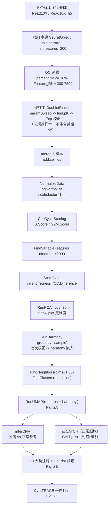

# 02 单细胞 QC 整合与十大类细胞注释

> **目标文献**：Wang R, Wu W, et al. *Integrative single-cell and spatial transcriptomic analysis reveals a
> lactate-driven crosstalk between NFATc4⁺ tumor cells and SPP1⁺ macrophages in glioblastoma.*
> *J Transl Med* (2026) 24:1253. DOI: 10.1186/s12967-026-08555-7
>
> **模块对应原文**：Fig. 2A–F（单细胞景观总览）、Fig. 2B（inferCNV）、Fig. 2E（细胞比例）、Fig. 2F（CytoTRACE）；
> Methods 中「scRNA-seq dataset analysis」全段
> **前置依赖**：01（需要 `raw/geo/GSE138794/` 下 5 个样本的 10x 矩阵；需要 `logs/geo_manifest.tsv` 确认文件名）
> **本模块产出**：`processed/seurat_gbm_qc.rds`（**12,618 细胞 / 24 cluster / 10 大类**）、`results/cluster_markers.csv`、
> `results/infercnv_out/`、`figures/Fig2A_umap_celltype.pdf`、`figures/Fig2B_infercnv.pdf`、`figures/Fig2F_cytotrace_umap.pdf`
> **复现难度**：★★★★☆（整条流水线最"重"的一环：QC 阈值、双胞、批次、注释四个自由度都可能把结论带偏）
> **计算资源**：32–64 GB 内存 / 16 核；参考耗时：QC + 整合 2–4 h，inferCNV 4–12 h（HMM 模式单线程瓶颈）

---

## ① 科学问题与逻辑位置

### 1.1 本模块在全文中解决什么问题

原文的全部机制结论都建立在一个前提上：**"neoplastic cells" 这个群体是被正确识别出来的**。整条证据链的第一块砖就是：把 12,618 个细胞分成 10 类，其中"肿瘤细胞"与"巨噬细胞"两类要足够干净，后续才能：

1. 在 neoplastic cells 内部按乳酸分数分高/低组（`03_乳酸代谢评分与高低乳酸亚群划分.md`）；
2. 在 neoplastic cells 内做 pySCENIC 找 NFATc4（`04_pySCENIC转录因子调控网络与NFATc4发现.md`）；
3. 在 neoplastic cells 与 macrophages 之间做 CellChat（`07_细胞通讯CellChat与NFATc4-SPP1轴.md`）；
4. 在空间数据上把这两类细胞的空间位置对上（`06_空间转录组反卷积与共定位.md`）。

> **一句话结论**：**注释错一类，后面全错**。GBM 单细胞里最容易出错的就是"肿瘤细胞 vs 星形胶质细胞 vs 少突胶质细胞"三者边界（它们共享 `GFAP`、`AQP4`、`S100B`、`APOE` 等大量基因），因此原文用 **inferCNV**（拷贝数异常）而不是单纯 marker 表达来定肿瘤细胞——这一步是本模块的技术核心。

### 1.2 输入 / 输出

| 方向 | 内容 |
|---|---|
| **上游输入** | `raw/geo/GSE138794/` 下 5 个样本的 10x 矩阵（h5 或 mtx 三件套） |
| **本模块输出** | `processed/seurat_gbm_qc.rds`（含 `seurat_clusters`、`celltype`、`percent.mt`、`S.Score/G2M.Score`、`cnv_score`、`cytotrace` 六组元数据） |
| **下游消费** | `03_乳酸代谢评分与高低乳酸亚群划分.md`（乳酸打分）、`04_pySCENIC转录因子调控网络与NFATc4发现.md`（pySCENIC）、`05_拟时序轨迹与分支依赖基因.md`（拟时序）、`07_细胞通讯CellChat与NFATc4-SPP1轴.md`（CellChat）、`06_空间转录组反卷积与共定位.md`（RCTD 参考谱）、`11_药物敏感性、CMAP重定位与单细胞代谢.md`（scMetabolism） |

### 1.3 流水线总览



---

## ② 背景知识与原理

### 2.1 为什么 `percentage of mitochondrial genes` 能用来做 QC

线粒体基因（人：`MT-` 前缀的 13 个蛋白编码基因 + 2 个 rRNA）的 mRNA 在**健康细胞**里占比很低（通常 <5%）。当细胞处于应激、凋亡早期或膜完整性受损时：

1. 胞质 mRNA 通过破损的膜漏失；
2. 线粒体膜电位下降、通透性转换孔开放，线粒体内容物释放；
3. 但 poly-A 捕获的 10x 建库仍然优先捕获残留的、转录量极高的线粒体转录本。

结果是 **`percent.mt` 升高 = 细胞状态差**。这个指标之所以有效，是因为它衡量的是"胞质 mRNA 的丢失程度"而非线粒体本身。
$$
\texttt{percent.mt}_i = 100 \times \frac{\sum_{g \in \mathcal{M}} c_{gi}}{\sum_{g} c_{gi}}
$$


**原文设定 ≤10%**。这个阈值对 GBM 而言是**偏宽松**的（GBM 是实体瘤，从手术到解离有数十分钟的热缺血，线粒体比例天然高于血液样本）。宽松的坏处是保留了部分濒死细胞；好处是保住了数量（12,618 这个数字与此直接相关）。

> ⚠️ **导师批注**：原文**只给了百分比，没给上限的绝对读长门限**，也没说用哪个基因集（`^MT-` 还是 `^mt-`）。复现时请在日志中记录 `PercentageFeatureSet(pattern = "^MT-")` 的结果，并报告 QC 前后的细胞数（原文**未报告 QC 前的细胞数**，属于必须自测的项）。

### 2.2 DoubletFinder：从 pANN 到人工双胞模拟

**问题**：10x 的油包水过程会把两个细胞包进同一个液滴，得到"双胞"——它的表达谱是两个细胞表达谱之和，在降维图上往往落在两个细胞群之间，会被误判成"中间态细胞"或"新亚群"。GBM 研究里最典型的误判是**"肿瘤细胞 + 巨噬细胞"双胞被当成一类独特的恶性细胞**。

**DoubletFinder 的核心思路**（McGinnis, Murrow & Gartner 2019, *Cell Systems*）：

1. **人工合成双胞**：随机抽样细胞对 $(a, b)$，把它们的 UMI 计数相加得到人工双胞的"表达谱"，混入真实细胞矩阵。人工双胞的动力学是随机混合，因此它们在 PCA 空间里会落在真实细胞群之间——这正是真实双胞该在的位置。
2. **构建最近邻并计算 pANN**：把所有细胞（真实 + 人工）投影到 PCA 前 `PCs` 维，对每个细胞取 $k$ 个最近邻，定义

$$\mathrm{pANN}_i = \frac{\left|\left\{ j \in \mathcal{N}_k(i) : j \ \text{是人工双胞} \right\}\right|}{k}$$

   `pANN` 高的真实细胞，其邻域被别人的人工双胞占据，说明它自己也处于"混合态"，因此被判为双胞。
3. **选 pK**：`pK` 是用于计算 pANN 的 PCA 邻域参数（DoubletFinder 的 `pK` 值实际控制的是一个基于 PCA 距离的核密度权重，而非直接的 k 值）。对每个候选 `pK`，计算**真实细胞 pANN 分布的 BCreal（bimodality coefficient，双峰系数）**：

$$\mathrm{BC} = \frac{\mathrm{skew}^2 + 1}{\mathrm{kurt} + \dfrac{3(n-1)^2}{(n-2)(n-3)}}$$

  正态分布时 $\mathrm{BC} = 1/3 \approx 0.333$；BC 越高越像"双峰"（真实细胞 vs 双胞两峰分离得越清楚）。`find.pK()` 取 **BCreal 最大**的 `pK`。
4. **估计期望双胞数并扣除同型双胞**：

$$n_{\text{Exp}} = \mathrm{round}\left(N \times r_{\text{双胞率}}\right),\qquad
n_{\text{Exp,adj}} = \mathrm{round}\left(n_{\text{Exp}} \times \left(1 - p_{\text{homotypic}}\right)\right)$$

  其中同型双胞比例按 `DoubletFinder::modelHomotypic(annotations)` 的定义——**注释频率的平方和**：

$$p_{\text{homotypic}} = \sum_{j=1}^{J}\left(\frac{n_j}{N}\right)^2$$

  $n_j$ 为第 $j$ 个 cluster 的细胞数。**记号不要记反**：`modelHomotypic()` 返回的就是这个平方和本身（官方文档原文："the homotypic doublet proportion is modeled as the sum of squared annotation frequencies"），**不是** $1-\sum(n_j/N)^2$。**为什么扣掉同型双胞**：两个**同类型**细胞（如两个肿瘤细胞）形成的双胞，其表达谱与单细胞几乎无法区分，强行去除会伤及真实细胞；而人工模拟的双胞本质上等价于"异型双胞"，因此只按 $1-p_{\text{homotypic}}$ 的比例保留可检测目标。

**默认双胞率**：10x 官方多重率（multiplet rate）表的经验值是**每 1,000 个加载细胞约 0.8%**——500 / 1,000 / 2,000 / 5,000 细胞分别对应 0.4% / 0.8% / 1.6% / 4.0%，到 ~10,000 细胞时约 **7.6%**。所以 12,618 细胞的常规起点是 **`rate ≈ 0.075–0.08`**（DoubletFinder vignette 里那个被到处抄用的 `0.075` 同样出自这张表）。原文**未报告双胞率、pK 值、被移除的双胞数**——三项都必须自测并在日志中记录。

> ⚠️ **导师批注（技术要点）**：`modelHomotypic` 的"扣同型"策略在**肿瘤**数据上是双刃剑。GBM 中 "肿瘤细胞 + 肿瘤细胞" 双胞恰恰是最常见的一类双胞，而它们会被 `modelHomotypic` 主动放过，最终被注释成正常肿瘤细胞。如果你的目标是"纯化肿瘤细胞群以做 CNV/拟时序分析"，建议**额外报告不加 homotypic 校正时的双胞数**，作为敏感性分析。

### 2.3 回归细胞周期：`S.Score/G2M.Score` 与 `vars.to.regress` 的取舍

**CellCycleScoring 的算法**（Seurat 实现，基于 Tirosh et al. 2016 的 `cc.genes`）：

1. 把所有基因按**平均表达量**分入 24 个 bin（使每个 bin 内基因表达水平相近）；
2. 对细胞 $i$、phase 基因集 $G_p$（$p \in \{S, G2M\}$）：

$$\text{Score}_{p,i} = \frac{1}{|G_p|}\sum_{g \in G_p}\left(x_{gi} - \bar{x}_{\text{bin}(g),\,i}\right)$$

  即"相位基因的表达减去同表达水平 bin 的对照基因均值"——这一步扣掉了"高表达基因天然偏高"的混淆；
3. 判定相位：若 $S\text{.Score} > 0$ 且 $S\text{.Score} > G2M\text{.Score}$ → S 期；若 $G2M\text{.Score} > 0$ 且 $G2M\text{.Score} > S\text{.Score}$ → G2M 期；否则 **G1 期**。

**为什么必须回归**：细胞周期是单细胞数据里最大的"技术-生物学混合"变异源。增殖中的肿瘤细胞会因 S/G2M 基因高表达而聚成一团，这团簇在生物学上无意义（它跨越了所有真实细胞类型），会污染聚类和下游的差异表达。

**两种回归方式的区别（关键）**：

| 方式 | 写法 | 效果 | 风险 |
|---|---|---|---|
| 回归两个分数 | `vars.to.regress = c("S.Score","G2M.Score")` | 把"S 期特征"和"G2M 期特征"分别抹掉 | **过度校正**：同时抹掉了细胞"是否在增殖"这个真实的恶性表型。GBM 里增殖性本身就是预后因素 |
| 回归分数差 | `vars.to.regress = "CC.Difference"`（`CC.Difference = S.Score − G2M.Score`） | 只抹掉"S 期 vs G2M 期"这个**相位**差异，保留"增殖强度"这一整体量 | 保留的增殖信号仍会形成小簇，需靠分辨率控制 |

Seurat 官方 vignette 推荐第二种（`CC.Difference`）。**原文只写了 "the impact of cell cycle was also regressed out"，没有说明用哪种**——这是一个必须记录的不确定性。

> **我们的复现决策**：主路径用 `CC.Difference`（保留增殖信号，与原文"多数肿瘤细胞处于 G1 期"的结论兼容）；Plan B 用 `c("S.Score","G2M.Score")` 跑一遍，比较 24 个 cluster 的稳定性。**注意**：`ScaleData` 的回归**只影响 PCA 用的 scale 数据**，不影响 `data` 层的表达值——所以后续做 marker 表达、ssGSEA 打分时用的仍是未回归的表达，这是正确的。

### 2.4 Harmony 的 soft k-means 迭代

Harmony（Korsunsky et al. 2019, *Nat Methods*）与 Seurat 的 CCA/RPCA 整合路线不同：它**不改表达矩阵，只校正 PCA 嵌入**。三个步骤交替迭代：

**步骤 1（聚类，soft k-means with batch-specific centroids）**——每个 cluster $k$ 在每个批次 $b$ 有一个自己的质心 $y_{kb}$，细胞的软分配为

$$R_{ki} = \frac{\pi_k \exp\!\left(-\|z_i - y_{k,b_i}\|^2 / \sigma\right)}{\sum_{k'} \pi_{k'} \exp\!\left(-\|z_i - y_{k',b_i}\|^2 / \sigma\right)},\qquad \sum_k R_{ki} = 1,\ R_{ki} \ge 0$$

$z_i$ 为细胞 $i$ 的 PCA 嵌入，$b_i$ 为其批次。**这是 Harmony 的精髓**：允许同一个生物学 cluster 在不同批次里"坐在不同的位置"，因此不会为了对齐而抹掉真实的生物学差异。

**步骤 2（最大化多样性的目标函数）**——在最大化聚类似然的同时，惩罚"每个 cluster 在不同批次间的质心差异"：

$$\mathcal{L} = \underbrace{\sum_{k}\sum_{i} R_{ki}\,\log \phi\!\left(z_i, y_{k,b_i}\right)}_{\text{聚类拟合}} \;-\; \lambda \underbrace{\sum_{k}\sum_{b} N_{kb}\,\left\| y_{kb} - \bar{y}_{k} \right\|^{2}}_{\text{批次混合惩罚}}$$

$N_{kb}$ 为批次 $b$ 在 cluster $k$ 的（加权）细胞数，$\bar y_k = \sum_b N_{kb} y_{kb} / \sum_b N_{kb}$。**注意两点**：(a) 惩罚项按 $N_{kb}$ 加权——大簇的批次差异被罚得更狠，小簇被放过，这正是 Harmony "保小簇"的原因；(b) $\lambda$ 由 `RunHarmony` 内部按批次与 cluster 结构自适应设定，用户不直接调。

> **记号说明**：上式按论文 Eq.(1)–(2) 的结构转述；harmony 的实际实现（`R/clustering.R` 的 `cluster_cpp` / `R/correction.R` 的 `moa` 与 `mu_cpp`）使用多类逻辑回归更新 $R$ 的线性批次项、并用 ridge 惩罚估计校正偏移，细节请对照源码与论文。

**步骤 3（校正）**——对每个 cluster $k$ 与批次 $b$，用 ridge 回归估计批次偏移 $\hat{O}_{kb}$，然后按软分配加权减掉：

$$z_i^{\text{new}} = z_i - \sum_{k} R_{ki}\,\hat{O}_{k,\,b_i}$$

三步交替直到 `max.iter.harmony`（默认 10 次）或收敛（`RunHarmony(..., plot_convergence = TRUE)` 可看收敛曲线）。

**Harmony 与 SCTransform 的关系（必须澄清的原文写法）**：原文写的是 `NormalizeData`（LogNormalize）+ Harmony，而 **SCTransform（Pearson 残差）是另一条完全不同的路线**，二者不应混用：

| 维度 | `NormalizeData` + `ScaleData`（原文路线） | `SCTransform` |
|---|---|---|
| 归一化 | 总 counts 缩放到 1e4 后 log1p | 负二项 GLM 的 Pearson 残差 |
| 方差稳定 | 靠 `ScaleData` 线性缩放 | 内建，按表达量建模 |
| 与 Harmony 组合 | 标准、被大量文献验证 | 可行，但需 `normalization.method = "SCT"` 且 `RunHarmony` 要传 `assay.use = "SCT"` |
| 对下游 ssGSEA 的影响 | 无（打分应基于 `data` 层） | 无（打分仍应用 `data`/`counts`，**不要**用 `scale.data`） |
| 原文用法 | ✔ 明确写 `NormalizeData` | ✘（原文仅在**空间数据**用了 SCTransform，见 `06_空间转录组反卷积与共定位.md`） |

**因此本模块严格走 `NormalizeData` + Harmony**，不要在单细胞模块引入 SCTransform——那会让"24 个 cluster"这个数字对不上。

### 2.5 UMAP vs t-SNE vs PCA：为什么 UMAP 是唯一能"看结构还能看全貌"的

| 方法 | 目标函数 | 保留什么 | 丢失什么 | 图上距离能解读吗 |
|---|---|---|---|---|
| **PCA** | $\max \mathrm{Var}(\mathbf{X}\mathbf{w})$，$\|\mathbf{w}\|=1$ | 全局线性方差 | 非线性流形（会把弯曲的细胞轨迹压成模糊一片） | 能，但只在局部近似 |
| **t-SNE** | $\mathrm{KL}(P \,\|\, Q)$，$q_{ij}\propto(1+\|y_i-y_j\|^2)^{-1}$ | **局部**邻域 | 全局结构（簇间距离无意义、簇内密度无意义） | **不能** |
| **UMAP** | 交叉熵 $\mathcal{L}=\sum_{i\neq j}\left[p_{ij}\log\frac{p_{ij}}{q_{ij}}+(1-p_{ij})\log\frac{1-p_{ij}}{1-q_{ij}}\right]$，$q_{ij}=\left(1+a\|y_i-y_j\|^{2b}\right)^{-1}$ | 局部 + **部分全局拓扑** | 精确距离与密度 | 大致能（簇间相对位置比 t-SNE 可靠，但仍不能说"距离 = 相似度"） |

UMAP 的高维相似度构造（这一步决定了 `n_neighbors` 的作用）：

$$p_{j|i} = \exp\!\left(-\frac{d(x_i, x_j) - \rho_i}{\sigma_i}\right)$$

其中 $\rho_i$ 是细胞 $i$ 到最近邻的距离（保证局部连通性），$\sigma_i$ 由二分搜索确定，使得 $\sum_j p_{j|i} = \log_2(\texttt{n\_neighbors})$。

- **`n_neighbors`**：调大偏向全局结构、细胞团糊在一起；调小偏向局部细节、簇被切碎。原文**未报告**取值 → 我们用 **30**（Seurat `RunUMAP` 的默认值 `n.neighbors = 30`；`umap-learn` 自己的默认是 15，两者不是一个默认值，不要混用）并做 15/30/50 的敏感性分析。
- **`min_dist`**：调小点更密集（簇更"球"），调大点分布更均匀（拓扑更忠实）。原文**未报告** → 用 **0.3**（Seurat `RunUMAP` 的默认值 `min.dist = 0.3`；`umap-learn` 的默认是 0.1）。

> ⚠️ **导师批注**：**UMAP 图上的"距离"不能用于定量论证**。原文 Fig. 2A 用 UMAP 展示 10 类细胞的分布是合适的（它只是可视化），但**不要**基于 UMAP 图去论证"肿瘤细胞离巨噬细胞有多近"——那必须靠 CellChat 的通讯概率（`07_细胞通讯CellChat与NFATc4-SPP1轴.md`）和空间数据（`06_空间转录组反卷积与共定位.md`）。

### 2.6 Louvain/Leiden 的分辨率与 24 个 cluster

Seurat 的 `FindClusters` 是在 `FindNeighbors` 建的 kNN 图上做**社区发现**。Louvain 的模块度优化目标：

$$Q = \frac{1}{2m}\sum_{i,j}\left[A_{ij} - \frac{k_i k_j}{2m}\right]\delta\!\left(c_i, c_j\right)$$

$A_{ij}$ 为邻接矩阵（Seurat 用的是 SNN 图，即共享最近邻的 Jaccard 相似度）、$k_i$ 为节点度、$m$ 为总边权、$c_i$ 为细胞 $i$ 的社区标签。`resolution` 参数引入一个可缩放的零模型：

$$Q_\gamma = \frac{1}{2m}\sum_{i,j}\left[A_{ij} - \gamma\,\frac{k_i k_j}{2m}\right]\delta\!\left(c_i, c_j\right)$$

- $\gamma$ 增大 → 惩罚"大簇"→ **cluster 数增多、簇变小**；
- $\gamma$ 减小 → **cluster 数减少、簇变大**；
- $\gamma \to 0$ 时所有节点合并为一个社区。

**这是"24 个 cluster"这个数字唯一的来源**。原文只写 "an appropriate resolution was selected"，**没有给出具体数值**——这是本模块最大的一个"必须自测并对齐"的参数。

**Leiden vs Louvain**：Leiden（Traag et al. 2019）修正了 Louvain 会产生"内部不连通社区"的缺陷，理论上更优；但**原文（Seurat 5.3.0 默认 `algorithm = 1`）用的是 Louvain**。复现时应使用默认值以对齐 cluster 数，把 Leiden 作为 Plan B。

---

## ③ 原文方法逐条拆解

原文「scRNA-seq dataset analysis」全段（逐句）与本模块操作的对应关系：

| # | 原文（英文关键词） | 中文转述 | 对应操作 | 参数 |
|---|---|---|---|---|
| 1 | "The data were imported into R (**version 4.4.2**) and analyzed with the Seurat R package (**version 5.3.0**)" | R 4.4.2 + Seurat 5.3.0 | 环境（`01_环境搭建与数据获取.md` §4.1） | 版本钉死 |
| 2 | "performed quality control on the data to remove low-quality samples" | 质控去除低质量**样本** | 实为**细胞**过滤（"samples" 用词不严谨） | — |
| 3 | "mitochondrial gene expression **not exceeding 10%**" | 线粒体 ≤10% | `subset(percent.mt <= 10)` | 10 |
| 4 | "**minGene = 300, maxGene = 7500**" | `nFeature_RNA` ∈ [300, 7500] | `subset(nFeature_RNA >= 300 & nFeature_RNA <= 7500)` | 300 / 7500 |
| 5 | "used the '**DoubletFinder**' **function** to eliminate the effect of doublets" | 去双胞 | `DoubletFinder::doubletFinder_v3()`，逐样本 | 原文未报告 pK/pN/rate |
| 6 | "the impact of cell cycle was also **regressed out**" | 回归细胞周期 | `CellCycleScoring` + `ScaleData(vars.to.regress=...)` | 原文未报告用哪种 |
| 7 | "'**NormalizeData**' function to normalize the data" | LogNormalize | `NormalizeData(normalization.method="LogNormalize", scale.factor=1e4)` | 1e4（默认） |
| 8 | "'**FindVariableGenes**' function to identify **2000** highly variable genes" | 2000 HVG | `FindVariableFeatures(nfeatures = 2000)`（**Seurat 5 无 `FindVariableGenes`**） | 2000 |
| 9 | "'**Harmony**' was applied to perform **dimensionality reduction, clustering, and batch effect correction**" | Harmony 做降维+聚类+去批次 | 实际顺序应为 **PCA → Harmony → FindNeighbors/FindClusters**；Harmony 本身不做聚类 | 见 §2.4 |
| 10 | "'**Run PCA**' function and '**FindNeighbors**' function were used to determine the **optimal K value**" | PCA + FindNeighbors 定 K | `RunPCA(npcs)` + `FindNeighbors(dims, k.param=20)`；**FindNeighbors 不"确定最优 K"，它用固定 `k.param=20` 建 kNN 图** | 20 |
| 11 | "an **appropriate resolution** was selected for visualization" | 合适分辨率 | `FindClusters(resolution = ?)`；原文未报告 | 需要网格搜索 |
| 12 | "'**Dimplot**' function was used to plot the **UMAP**" | UMAP 可视化 | `RunUMAP()` + `DimPlot()` | — |
| 13 | "'**inferCNV**' R package was used to **annotate and distinguish normal and tumor cells**" | inferCNV 区分肿瘤/正常 | §4.7 | cutoff/cluster_by_groups/... |
| 14 | "'**scCATCH**' R package was used to **annotate normal cells**, and the '**Celltypist**' function was used to annotate **immune cells**" | 双工具注释 | §4.8 / §4.9 | — |
| 15 | "'**CellChat**' R package was used to analyze cell-cell interaction" | 细胞通讯 | `07_细胞通讯CellChat与NFATc4-SPP1轴.md` | — |
| 16 | "'**CytoTRACE**' R package was used to analyze cell **stemness**" | 干性 | §4.10（Fig. 2F） | — |

**Results 第一段的原文数值（必须逐字对齐）**：

> "We analyzed scRNA-seq data from GSE138794, comprising **12,618** high-quality cells after rigorous quality control and doublet removal. Unsupervised clustering resolved **24** distinct clusters, which we annotated into **10** major cell types: **neoplastic cells, macrophages, T cells, astrocytes, oligodendrocytes, stem cells, neurons, endothelial cells, innate lymphoid cells (ILCs), and fibroblasts** (Fig. 2A)."
>
> "Cell cycle analysis revealed that **the majority of neoplastic cells resided in the G1 phase**, aligning with their heightened metabolic activity."
>
> "**InferCNV** analysis revealed **widespread chromosomal copy number alterations in neoplastic cells compared with normal reference cells**…"
>
> "**CytoTRACE** analysis indicated that **oligodendrocytes and fibroblasts possessed the highest differentiation potential**, whereas **neoplastic cells and macrophages displayed lower scores**, suggesting a more differentiated state (Fig. 2F)."

> ⚠️ **导师批注（写作规范问题）**：原文把包名当函数名的现象贯穿全段——"DoubletFinder **function**"（实为包）、"Celltypist **function**"（实为 Python 包）、"Dimplot"（正确拼写 `DimPlot`）、"Run PCA"（正确拼写 `RunPCA`）、`FindVariableGenes`（Seurat 5 中已更名为 `FindVariableFeatures`，`FindVariableGenes` 是 Seurat v2 时代的旧名）。这些都不影响结论，但**照着字面抄会跑不通**，本文所有代码使用 Seurat 5 的正确 API。

---

## ④ 逐步可运行代码

### 4.1 读取 5 个样本并建立 SeuratObject

```r
# code/02_01_read_qc.R
suppressPackageStartupMessages({
  library(Seurat); library(dplyr); library(data.table)
})
set.seed(20260101)
source("code/00_setup.R")     # 提供 PROJ / DIRS

RAW <- file.path(PROJ, "raw/geo/GSE138794")

## ---- 自动枚举 5 个样本（不硬编码 GSM 号，见 `01_环境搭建与数据获取.md`）----
manifest <- data.table::fread(file.path(PROJ, "logs/geo_manifest.tsv"))
sample_tbl <- unique(manifest[, .(sample_id = gsm, file = file_path, kind = file_kind)])

read_one <- function(sid) {
  fs <- manifest[gsm == sid, file_path]
  h5 <- fs[grepl("filtered_feature_bc_matrix\\.h5$", fs)]
  if (length(h5) == 1) {
    mtx <- Read10X_h5(file.path(PROJ, h5))
  } else {
    d <- unique(dirname(file.path(PROJ, fs)))
    d <- d[file.exists(file.path(d, "matrix.mtx.gz")) | file.exists(file.path(d, "matrix.mtx"))]
    mtx <- Read10X(data.dir = d[1])
  }
  if (is.list(mtx)) mtx <- mtx[["Gene Expression"]]   # 多模态数据只取 GEX
  obj <- CreateSeuratObject(counts = mtx, project = sid,
                            min.cells = 3, min.features = 200)
  obj$sample <- sid
  obj[["percent.mt"]] <- PercentageFeatureSet(obj, pattern = "^MT-")   # 人；若混小鼠数据用 "^mt-"
  obj[["percent.hb"]] <- PercentageFeatureSet(obj, pattern = "^HB[ABD]")
  obj
}

so_list <- lapply(sort(unique(manifest$gsm)), read_one)
names(so_list) <- sort(unique(manifest$gsm))

## ---- QC 前基线（原文未报告，必须自测并写日志）----
qc_pre <- do.call(rbind, lapply(names(so_list), function(s) {
  o <- so_list[[s]]
  data.frame(sample = s, n_cell_pre = ncol(o),
             median_nFeature = median(o$nFeature_RNA), median_pct_mt = median(o$percent.mt))
}))
fwrite(qc_pre, file.path(PROJ, "logs/02_qc_pre_summary.csv"))
print(qc_pre)

## ---- 原文 QC 阈值 ----
so_list_raw <- so_list                              # 备份"QC 前"对象，供 §6.2 统计被剔除细胞数
qc_filter <- function(o) {
  subset(o, subset = nFeature_RNA >= 300 & nFeature_RNA <= 7500 & percent.mt <= 10)
}
so_list <- lapply(so_list, qc_filter)

qc_post <- do.call(rbind, lapply(names(so_list), function(s) {
  data.frame(sample = s, n_cell_post = ncol(so_list[[s]]))
}))
print(qc_post); print(sum(qc_post$n_cell_post))     # 目标：QC+去双胞后合计 12,618
```

> **经验值**：`min.cells = 3` 与 `min.features = 200` 是**建库阶段**的粗筛（原文未报告），与后文的 300–7500 是两层不同的门限，两者不冲突。若把 `min.features` 直接设成 300，会与原文的"300–7500 同时设定"口径混淆。

### 4.2 DoubletFinder（含 Seurat 5 兼容处理）

```r
# code/02_02_doubletfinder.R
suppressPackageStartupMessages({ library(Seurat); library(DoubletFinder) })

run_doubletfinder <- function(obj, PCs = 1:20, rate = 0.075, res = 0.5, ncores = 8) {
  ## ---- (A) Seurat v5 兼容：Assay5 -> v3 Assay，否则 doubletFinder_v3 会报
  ##          "no slot of name \"data\" for this object of class \"Assay5\""
  obj[["RNA"]] <- as(object = obj[["RNA"]], Class = "Assay")

  ## ---- (B) DoubletFinder 要求：归一化 + HVG + Scale + PCA + 先聚类（modelHomotypic 需要 cluster 标签）
  obj <- NormalizeData(obj, verbose = FALSE)
  obj <- FindVariableFeatures(obj, selection.method = "vst", nfeatures = 2000, verbose = FALSE)
  obj <- ScaleData(obj, verbose = FALSE)
  obj <- RunPCA(obj, npcs = max(PCs), verbose = FALSE, seed.use = 20260101)
  obj <- FindNeighbors(obj, dims = PCs, verbose = FALSE)
  obj <- FindClusters(obj, resolution = res, verbose = FALSE, random.seed = 20260101)

  ## ---- (C) pK 扫描：对每个 pK 生成人工双胞 -> 计算 pANN -> 取真实细胞 pANN 的 BCreal 最大者
  set.seed(20260101)
  sweep_res   <- paramSweep_v3(obj, PCs = PCs, sct = FALSE, num.cores = ncores)
  sweep_stats <- summarizeSweep(sweep_res, GT = FALSE)
  bcmvn       <- find.pK(sweep_stats)                 # 返回 pK / BCreal / BCmmvn ...
  pK_use      <- as.numeric(as.character(bcmvn$pK[which.max(bcmvn$BCreal)]))

  ## ---- (D) 同型双胞校正
  hom_prop <- modelHomotypic(obj$seurat_clusters)     # = sum_j (n_j/N)^2（同型双胞比例）
  nExp     <- round(ncol(obj) * rate)                 # 7.5% 名义双胞数
  nExp_adj <- round(nExp * (1 - hom_prop))

  ## ---- (E) 执行
  obj <- doubletFinder_v3(obj, PCs = PCs, pN = 0.25, pK = pK_use,
                          nExp = nExp_adj, reuse.pANN = NULL, sct = FALSE)
  meta_col <- grep("^DF.classifications", colnames(obj@meta.data), value = TRUE)
  pann_col <- grep("^pANN",               colnames(obj@meta.data), value = TRUE)
  obj$doublet_class <- obj@meta.data[[meta_col]]
  obj$pANN          <- obj@meta.data[[pann_col]]

  attr(obj, "df_params") <- list(pK = pK_use, hom_prop = hom_prop,
                                 nExp = nExp, nExp_adj = nExp_adj,
                                 n_doublet = sum(obj$doublet_class == "Doublet"))
  obj
}

so_list_df <- lapply(so_list, run_doubletfinder)

## ---- 记录每个样本的双胞参数（原文未报告，必须自测写日志）----
df_log <- do.call(rbind, lapply(names(so_list_df), function(s) {
  p <- attr(so_list_df[[s]], "df_params")
  data.frame(sample = s, n_cell = ncol(so_list_df[[s]]), pK = p$pK,
             homotypic_prop = round(p$hom_prop, 4), nExp = p$nExp,
             nExp_adj = p$nExp_adj, n_doublet = p$n_doublet,
             doublet_rate_obs = round(p$n_doublet / ncol(so_list_df[[s]]), 4))
}))
fwrite(df_log, file.path(PROJ, "logs/02_doubletfinder_params.csv"))
print(df_log)

## ---- 只保留 singlet ----
so_list_clean <- lapply(so_list_df, function(o) subset(o, subset = doublet_class == "Singlet"))
print(sapply(so_list_clean, ncol)); print(sum(sapply(so_list_clean, ncol)))
```

**若 DoubletFinder 仍然报错**（Seurat 5 + DoubletFinder 2.0.3 的已知不兼容），按顺序尝试：

```r
## 方案 1（首选）：把 Assay5 转成 v3 Assay —— 已在上面的 (A) 步做完
## 方案 2：显式指定 Assay 的 layer 结构，避免 Seurat 5 的 "counts.1/counts.2" 分层
obj[["RNA"]] <- JoinLayers(obj[["RNA"]])
## 方案 3：在 R 4.4.2 + Seurat 4.4.0 的独立 conda 环境里单跑 DoubletFinder，把结果作为 meta.data 导回
##          mamba create -n gbm_df -c conda-forge r-base=4.4.2
##          install.packages("Seurat", repos="https://satijalab.r-universe.dev")  # Seurat 4.4.0
## 方案 4（Plan B 工具）：用 scDblFinder（Bioconductor）替代，天然兼容 SingleCellExperiment
sce <- as.SingleCellExperiment(obj)
sce <- scDblFinder::scDblFinder(sce, samples = "sample")   # 按样本独立模拟双胞
obj$scDblFinder_class <- sce$scDblFinder.class
## 注意：换工具会让"去双胞后细胞数"与原文 12,618 产生系统性偏差，须在日志中显式标注
```

### 4.3 合并 5 个样本 → 归一化 → 细胞周期 → HVG → PCA → Harmony → 聚类 → UMAP

```r
# code/02_03_integrate_cluster.R
suppressPackageStartupMessages({
  library(Seurat); library(harmony); library(ggplot2)
})
set.seed(20260101)

## ---- (1) 合并 ----
so <- merge(so_list_clean[[1]], y = so_list_clean[-1],
            add.cell.ids = names(so_list_clean), project = "GBM_GSE138794")
so <- JoinLayers(so)              # Seurat 5：merge 后会产生多层，必须合并回单层
print(table(so$sample)); print(ncol(so))

## ---- (2) 归一化（原文：NormalizeData）----
so <- NormalizeData(so, normalization.method = "LogNormalize",
                    scale.factor = 1e4, verbose = FALSE)

## ---- (3) 细胞周期打分（原文：regress out cell cycle）----
s.genes   <- Seurat::cc.genes.updated.2019$s.genes       # 用 updated.2019，不要用老 cc.genes
g2m.genes <- Seurat::cc.genes.updated.2019$g2m.genes
so <- CellCycleScoring(so, s.features = s.genes, g2m.features = g2m.genes, set.ident = FALSE)
so$CC.Difference <- so$S.Score - so$G2M.Score
print(table(so$Phase))
## Fig. 2 正文主张：多数 neoplastic cells 处于 G1 —— 该结论在注释完成后按 celltype 重新统计：
##   prop.table(table(so$celltype, so$Phase), margin = 1)

## ---- (4) HVG 2000（原文：FindVariableGenes -> Seurat 5 写作 FindVariableFeatures）----
so <- FindVariableFeatures(so, selection.method = "vst", nfeatures = 2000, verbose = FALSE)
top10 <- head(VariableFeatures(so), 10); print(top10)
writeLines(VariableFeatures(so), file.path(PROJ, "results/02_hvg2000.txt"))

## ---- (5) Scale + PCA（回归细胞周期）----
so <- ScaleData(so, features = rownames(so), vars.to.regress = "CC.Difference", verbose = FALSE)
so <- RunPCA(so, npcs = 50, verbose = FALSE, seed.use = 20260101)
ElbowPlot(so, ndims = 50) + ggtitle("Elbow (choose npcs)")
ggsave(file.path(PROJ, "figures/02_elbowplot.pdf"), width = 6, height = 4)

## ---- (6) Harmony 去批次 ----
so <- RunHarmony(so, group.by.vars = "sample", reduction = "pca", reduction.save = "harmony",
                 dims.use = 1:30, assay.use = "RNA", max.iter.harmony = 20,
                 plot_convergence = TRUE, verbose = FALSE)
## 批次诊断（必做）：整合前后各画一次按 sample 着色的 UMAP/PCA
p_before <- DimPlot(so, reduction = "pca",  group.by = "sample") + ggtitle("PCA: before harmony")
p_after  <- DimPlot(so, reduction = "harmony", group.by = "sample") + ggtitle("harmony embedding")
ggsave(file.path(PROJ, "figures/02_batch_diagnosis.pdf"), p_before | p_after,
       width = 12, height = 5)

## ---- (7) 图聚类 + UMAP ----
so <- FindNeighbors(so, reduction = "harmony", dims = 1:30, k.param = 20, verbose = FALSE)
so <- FindClusters(so, resolution = 0.6, algorithm = 1,        # 1 = Louvain（Seurat 5 默认）
                   random.seed = 20260101, verbose = FALSE)
so <- RunUMAP(so, reduction = "harmony", dims = 1:30,
              n.neighbors = 30, min.dist = 0.3, seed.use = 20260101, verbose = FALSE)
DimPlot(so, reduction = "umap", label = TRUE, repel = TRUE) + NoLegend()
ggsave(file.path(PROJ, "figures/02_umap_clusters.pdf"), width = 7, height = 6)
```

**分辨率网格搜索（用于对齐原文的 24 个 cluster）**：

```r
# code/02_03b_resolution_grid.R
grid <- c(0.1, 0.2, 0.3, 0.4, 0.5, 0.6, 0.8, 1.0, 1.2)
res_tbl <- do.call(rbind, lapply(grid, function(r) {
  x <- FindClusters(so, resolution = r, algorithm = 1, random.seed = 20260101, verbose = FALSE)
  data.frame(resolution = r, n_cluster = length(levels(x$seurat_clusters)))
}))
fwrite(res_tbl, file.path(PROJ, "logs/02_resolution_grid.csv"))
print(res_tbl)
# 选 n_cluster 最接近 24（22–26 视为通过）的分辨率，并把该 resolution 写回主脚本
```

### 4.4 cluster marker 与十大类细胞注释

```r
# code/02_04_markers_annotation.R
so <- readRDS(file.path(PROJ, "processed/seurat_gbm_qc_seurat5.rds"))

## 全部 cluster 的 marker（Wilcoxon；presto 可加速）
mk_all <- FindAllMarkers(so, only.pos = TRUE, min.pct = 0.25,
                         logfc.threshold = 0.25, test.use = "wilcox")
fwrite(mk_all, file.path(PROJ, "results/cluster_markers.csv"))

## 每个 cluster 的 top10
top10 <- mk_all %>% dplyr::group_by(cluster) %>%
  dplyr::slice_max(order_by = avg_log2FC, n = 10)
fwrite(top10, file.path(PROJ, "results/cluster_markers_top10.csv"))

## ---- 十大类 canonical marker（手工核对清单，见下文表 4.1）----
markers_10 <- list(
  "Neoplastic"       = c("SOX2","OLIG2","PTPRZ1","GFAP","VIM","NES","CD44","EGFR"),
  "Macrophage"       = c("PTPRC","CD68","CD14","AIF1","CSF1R","C1QA","C1QB","C1QC","SPP1","APOE"),
  "T cell"           = c("CD3D","CD3E","CD2","TRAC","IL7R","CD8A","CD4","LTB"),
  "Astrocyte"        = c("GFAP","AQP4","S100B","ALDH1L1","GJA1","SLC1A2","SLC1A3"),
  "Oligodendrocyte"  = c("MBP","PLP1","MOG","MAG","CNP","OPALIN","MOBP","CLDN11"),
  "Stem cell"        = c("NES","SOX2","PROM1","DLL3","HES1","FABP7","VIM"),
  "Neuron"           = c("RBFOX3","SYT1","SNAP25","NEFL","NEFM","MAP2","TUBB3","STMN2"),
  "Endothelial"      = c("PECAM1","VWF","KDR","CLDN5","CDH5","FLT1","ESAM"),
  "ILC"              = c("IL7R","KLRD1","NKG7","GZMB","NCAM1","KLRG1","TBX21"),
  "Fibroblast"       = c("DCN","COL1A1","COL1A2","COL3A1","LUM","PDGFRA","FBLN1")
)
DotPlot(so, features = unique(unlist(markers_10)), group.by = "seurat_clusters") +
  RotatedAxis() + theme(axis.text.x = element_text(size = 6))
ggsave(file.path(PROJ, "figures/02_dotplot_markers.pdf"), width = 20, height = 8)

## 每类细胞各自的特征图（Fig. 2 风格）
FeaturePlot(so, features = c("SOX2","CD68","CD3D","GFAP","MBP","PROM1","RBFOX3","PECAM1","IL7R","DCN"),
            ncol = 5, order = TRUE)
ggsave(file.path(PROJ, "figures/02_featureplot_10types.pdf"), width = 18, height = 7)
```

**表 4.1 十大类细胞的 canonical marker 与判据**

| 细胞类型（原文用词） | Canonical marker | 关键判据 / 易混点 |
|---|---|---|
| **neoplastic cells** | 无单一 marker；`SOX2`、`OLIG2`、`PTPRZ1`、`GFAP`、`VIM`、`CD44`、`EGFR`、`NES` | **必须由 inferCNV 的 CNV 分数判定**，不能只靠 marker。与 astrocyte/stem cell 严重重叠 |
| **macrophages** | `PTPRC`、`CD68`、`CD14`、`AIF1`、`CSF1R`、`C1QA/B/C`、`APOE`；亚群 `SPP1`、`SPP1` 高表达者为 SPP1⁺ TAM | 实际把 microglia（`P2RY12`、`TMEM119`、`CX3CR1`）也算进来了；原文未区分 → 建议报告两者比例 |
| **T cells** | `CD3D`、`CD3E`、`CD2`、`TRAC`、`IL7R`、`CD8A`、`LTB` | 需与 ILC/NK 通过 `CD3D/CD3E` 阴阳性区分 |
| **astrocytes** | `GFAP`、`AQP4`、`S100B`、`ALDH1L1`、`GJA1`、`SLC1A2/A3` | **与 neoplastic cells 最易混**：肿瘤细胞也高表达 `GFAP`。必须结合 CNV |
| **oligodendrocytes** | `MBP`、`PLP1`、`MOG`、`MAG`、`CNP`、`OPALIN`、`MOBP` | 相对干净；CytoTRACE 最高分群体（Fig. 2F） |
| **stem cells** | `NES`、`SOX2`、`PROM1`、`DLL3`、`HES1`、`FABP7` | 与 neoplastic 高度重叠；需确认该 cluster 不是肿瘤细胞的一个亚群（用 CNV 分数交叉验证） |
| **neurons** | `RBFOX3`(NeuN)、`SYT1`、`SNAP25`、`NEFL/M`、`MAP2`、`TUBB3`、`STMN2` | 正常脑组织残留 |
| **endothelial cells** | `PECAM1`、`VWF`、`KDR`、`CLDN5`、`CDH5`、`FLT1` | 注意 pericyte 也表达 `RGS5`/`ACTA2`，原文未单列 pericyte |
| **ILCs** | `IL7R`、`KLRD1`、`NKG7`、`GZMB`、`NCAM1`、`KLRG1`、`TBX21`；**`CD3D/CD3E` 阴性** | ILC 与 NK 在 scRNA 层面区分不稳定；原文把它们合为 ILC 一类，复现时**不要**强行再分 |
| **fibroblasts** | `DCN`、`COL1A1/1A2/3A1`、`LUM`、`PDGFRA`、`FBLN1` | CytoTRACE 高分群体（Fig. 2F）；在 GBM 中数量通常极少 |

### 4.5 24 个 cluster → 10 大类 的映射表（示例结构与核对方法）

```r
# code/02_05_mapping.R
# 用 marker 表 + inferCNV 结果，逐 cluster 填写（下表为**结构示例**，实际必须按自己的 marker 表填）
cluster2type <- c(
  "0"  = "Neoplastic", "1"  = "Neoplastic", "2"  = "Macrophage",
  "3"  = "T cell",     "4"  = "Neoplastic", "5"  = "Oligodendrocyte",
  "6"  = "Neoplastic", "7"  = "Macrophage", "8"  = "Astrocyte",
  "9"  = "Neoplastic", "10" = "Neoplastic", "11" = "Oligodendrocyte",
  "12" = "Neoplastic", "13" = "Macrophage", "14" = "T cell",
  "15" = "Neoplastic", "16" = "Endothelial","17" = "Neoplastic",
  "18" = "Neuron",     "19" = "Stem cell",  "20" = "Fibroblast",
  "21" = "Neoplastic", "22" = "ILC",        "23" = "Astrocyte"
)
stopifnot(length(cluster2type) == 24)                 # 必须恰好 24 个才能映射
so$celltype <- factor(cluster2type[as.character(so$seurat_clusters)],
                      levels = c("Neoplastic","Macrophage","T cell","Astrocyte",
                                 "Oligodendrocyte","Stem cell","Neuron",
                                 "Endothelial","ILC","Fibroblast"))
print(table(so$celltype))

## Fig. 2A：按细胞类型着色的 UMAP
DimPlot(so, group.by = "celltype", label = TRUE, repel = TRUE) + NoLegend()
ggsave(file.path(PROJ, "figures/Fig2A_umap_celltype.pdf"), width = 7, height = 6)

## Fig. 2E：比例堆叠柱状图
library(ggplot2)
prop_df <- as.data.frame(prop.table(table(so$sample, so$celltype), margin = 1))
ggplot(prop_df, aes(x = Var1, y = Freq, fill = Var2)) +
  geom_col() + labs(x = "Sample", y = "Proportion", fill = "Cell type") +
  scale_fill_manual(values = ggsci::pal_d3("category10")(10)) +
  theme_classic()
ggsave(file.path(PROJ, "figures/Fig2E_celltype_proportion.pdf"), width = 8, height = 5)
```

> **映射必须"可审计"**：把 `cluster → celltype` 的映射表、每个 cluster 的 top20 marker、CNV 分数中位数三列并排导出为 `results/02_cluster_annotation_evidence.csv`。**不要**只在代码里写一坨 `c("0"="Neoplastic", ...)` 就完事——后面审稿人一定会问"你凭什么说 cluster 12 是肿瘤细胞"。

### 4.6 逐 cluster 注释证据表生成

```r
# code/02_06_annotation_evidence.R
ev <- data.frame(
  cluster = levels(so$seurat_clusters),
  n_cell  = as.integer(table(so$seurat_clusters)),
  top1    = NA_character_, top2 = NA_character_, top3 = NA_character_,
  cnv_median = NA_real_, stringsAsFactors = FALSE
)
for (i in seq_len(nrow(ev))) {
  cl <- ev$cluster[i]
  t3 <- head(top10$gene[top10$cluster == cl], 3)
  ev[i, c("top1","top2","top3")] <- t3
  if ("cnv_score" %in% colnames(so@meta.data))
    ev$cnv_median[i] <- median(so$cnv_score[so$seurat_clusters == cl])
}
ev$celltype <- cluster2type[ev$cluster]
fwrite(ev, file.path(PROJ, "results/02_cluster_annotation_evidence.csv"))
print(ev)
```

### 4.7 inferCNV：肿瘤 vs 正常

```r
# code/02_07_infercnv.R
suppressPackageStartupMessages({ library(infercnv); library(Seurat); library(rtracklayer) })

## ---- (1) 输入 1：原始 counts 矩阵（必须用 counts，不能用 data/scale.data）----
counts <- GetAssayData(so, assay = "RNA", layer = "counts")
write.table(as.matrix(counts), file.path(PROJ, "results/infercnv_counts.txt"),
            sep = "\t", quote = FALSE, col.names = TRUE)

## ---- (2) 输入 2：注释文件（每行：barcode<TAB>细胞类型）----
annot <- data.frame(barcode = colnames(so), type = as.character(so$celltype))
write.table(annot, file.path(PROJ, "results/infercnv_annotations.txt"),
            sep = "\t", quote = FALSE, row.names = FALSE, col.names = FALSE)

## ---- (3) 输入 3：gene order file ----
## 方式 A：infercnv 内置的人类坐标（方便但需核对版本）
## ⚠️ 该函数在部分 infercnv 版本中并未导出；先确认它存在，并核对内置坐标的参考基因组版本
##    if (!exists("GeneOrderNameToCoordinate", where = asNamespace("infercnv"))) stop("用方式 B")
go <- infercnv::GeneOrderNameToCoordinate(gene.names = rownames(counts))
## 方式 B（推荐，可控）：从 GTF 自行构建
## gr <- rtracklayer::import("raw/reference/gencode.v36.annotation.gtf")   # 需先下载 GTF
## gr <- gr[gr$type == "gene"]
## go <- data.frame(gene = gr$gene_name,
##                  chr  = as.character(GenomicRanges::seqnames(gr)),
##                  start = GenomicRanges::start(gr),
##                  end   = GenomicRanges::end(gr))
write.table(go, file.path(PROJ, "results/infercnv_gene_order.txt"),
            sep = "\t", quote = FALSE, row.names = FALSE, col.names = FALSE)

## ---- (4) 建对象：ref_group_names 是"正常参考细胞" ----
## 选择策略（关键）：
##   ✔ 参考应包含：Oligodendrocyte、T cell、Astrocyte、Endothelial、Neuron、Fibroblast、ILC
##   ✔ 免疫细胞（Macrophage）也可作参考（原文把 macrophage 与 neoplastic 都单列，说明 macrophage 未被判定为肿瘤）
##   ✘ 绝不要把 Neoplastic 或 Stem cell 放进参考（会抹掉 CNV）
##   ✘ 参考细胞不能太少：每个参考类型建议 >= 200 细胞，总量 >= 总细胞的 10%
ref_groups <- c("Oligodendrocyte","T cell","Astrocyte","Endothelial",
                "Neuron","Fibroblast","ILC","Macrophage")
print(table(annot$type)[c("Neoplastic", ref_groups)])
# 若某参考类型 < 50 细胞，先合并（如 ILC + T cell -> Lymphocyte）再跑

infercnv_obj <- CreateInfercnvObject(
  raw_counts_matrix = file.path(PROJ, "results/infercnv_counts.txt"),
  annotations_file  = file.path(PROJ, "results/infercnv_annotations.txt"),
  delim             = "\t",
  gene_order_file   = file.path(PROJ, "results/infercnv_gene_order.txt"),
  ref_group_names   = ref_groups)

## ---- (5) 运行 ----
infercnv_obj <- infercnv::run(
  infercnv_obj,
  cutoff              = 0.1,               # 只保留平均表达 >= 0.1 的基因
  out_dir             = file.path(PROJ, "results/infercnv_out"),
  cluster_by_groups   = TRUE,
  denoise             = TRUE,
  HMM                 = TRUE,              # 需 rjags
  analysis_mode       = "subclusters",
  num_threads         = 8,
  plot_steps          = FALSE,
  no_plot             = FALSE,
  output_format       = "pdf")

## ---- (6) CNV 分数回到 Seurat 元数据（两种方式，任选）----
## 方式 A：infercnv >= 1.10 提供的便捷函数（参数以 ?add_to_seurat 为准）
so <- infercnv::add_to_seurat(infercnv_obj = infercnv_obj, seurat_obj = so)
# 生成 so$expr.data（矩阵）与 so$cnv_score（数值向量）
## 方式 B（等价的手工写法，更透明）：
expr <- infercnv_obj@expr.data                                   # 相对表达（正常参考的中位数=1）
so$cnv_score <- scale(colMeans(expr - 1))[, 1]                   # 每个细胞偏离 1 的平均幅度

## ---- (7) 阈值与肿瘤细胞判定 ----
## 用 2-means 或 Otsu 分出"无 CNV / 有 CNV"两群，再与 marker 结果交叉
km <- stats::kmeans(so$cnv_score, centers = 2, nstart = 25, iter.max = 100)
tumour_group <- names(which.max(tapply(so$cnv_score, km$cluster, mean)))
so$cnv_call <- ifelse(km$cluster == as.integer(tumour_group), "CNV+", "CNV-")
print(table(so$celltype, so$cnv_call))
## 期望：Neoplastic 压倒性地落在 CNV+；其余类型压倒性落在 CNV-。
## 若有"正常类型"大量落在 CNV+，说明参考细胞选择有问题（见 §7 陷阱表）。

## ---- (8) 出图（Fig. 2B 风格）----
pdf(file.path(PROJ, "figures/Fig2B_infercnv.pdf"), width = 14, height = 10)
infercnv::plot_cnv(infercnv_obj, out_dir = file.path(PROJ, "results/infercnv_out"),
                   cluster_by_groups = TRUE, plot_chr_scale = TRUE,
                   output_filename = "infercnv_full", custom_color_pal = NULL)
dev.off()

## ---- (9) CNV 分数投影到 UMAP（很好的自查图）----
FeaturePlot(so, "cnv_score", order = TRUE) + ggtitle("CNV score")
ggsave(file.path(PROJ, "figures/02_cnvscore_umap.pdf"), width = 7, height = 6)
```

### 4.8 scCATCH 注释正常细胞

```r
# code/02_08_scCATCH.R
library(scCATCH)

## 步骤 1：找每个 cluster 的 marker（scCATCH 内部的封装）
clu_markers <- findmarkergenes(object = so, species = "Human",
                               cluster = "all",
                               match_CellMatch = FALSE,
                               cancer = "Glioblastoma",   # 取值必须来自 scCATCH 的 cancertype 库
                               tissue = "Brain",          # 取值必须来自 tissuetype 库
                               cell_min_pct = 0.25,       # 注意形参名是 cell_min_pct，不是 min.pct
                               logfc.threshold = 0.25,
                               p_val = 0.05)              # 以上形参名以 CRAN 版 scCATCH 3.2.x 为准
# ⚠️ 某些教程里写的 `cancer_specific = TRUE` / `core.num = 8` 并不是 scCATCH 3.x 的形参，
#    照抄会报 "unused argument"；请以 ?findmarkergenes 的实际签名核对后再跑。
## 步骤 2：证据打分注释（基于 CellMatch 数据库的文献证据）
clu_ann <- scCATCH(object = clu_markers$clu_markers,
                   species = "Human",
                   cancer = "Glioblastoma",
                   tissue = "Brain",
                   cell_min_pct = 0.25, logfc.threshold = 0.25)
fwrite(clu_ann, file.path(PROJ, "results/scCATCH_annotation.csv"))
print(clu_ann)
```

> **关键**：`cancer` 与 `tissue` 两个参数**必须填**，否则 scCATCH 会在全库范围内匹配，导致把脑组织的细胞注释成肝细胞之类的离谱结果。原文写 "scCATCH was used to annotate **normal cells**"——**正确用法是先把 neoplastic cells 剔除（用 4.7 的 `cnv_call`），只对 CNV− 细胞跑 scCATCH**；对肿瘤细胞跑 scCATCH 一定会得到一堆错误标签，因为 CellMatch 库里没有"glioblastoma neoplastic cell"这种条目。

### 4.9 CellTypist 注释免疫细胞

**方式 A（Python，推荐）**：

```python
# code/02_09_celltypist.py
import scanpy as sc, celltypist, pandas as pd

# 模型下载（只需一次；离线环境需预先拷入 ~/.celltypist/data/models/）
celltypist.models.download_models(model="Immune_All_Low.pkl")
celltypist.models.download_models(model="Immune_All_High.pkl")
print(celltypist.models.get_all_models()[:5])

adata = sc.read_h5ad("/home/zhangxi/paper_read/20261016_GBM_lactate_NFATc4_SPP1_macrophage/"
                     "processed/gbm_immune_subset.h5ad")   # 只含非肿瘤细胞（见下）
pred = celltypist.annotate(adata, model="Immune_All_Low.pkl",
                           majority_voting=True,
                           over_clustering="seurat_clusters")
pred.predicted_labels.to_csv("results/celltypist_labels.csv")
# 模型只认免疫细胞；把肿瘤细胞喂进去会被强分成"Macrophage"/"T cell"类标签
```

**方式 B（R 内调用，reticulate）**：

```r
# code/02_09_celltypist.R
library(reticulate)
use_condaenv("gbm_py", required = TRUE)     # 指向 `01_环境搭建与数据获取.md` 的 py 环境
ct <- import("celltypist")
pd <- import("pandas")

## 导出仅含非肿瘤细胞的矩阵供 celltypist 使用
non_tumour <- subset(so, subset = cnv_call == "CNV-")
counts_np <- t(as.matrix(GetAssayData(non_tumour, assay = "RNA", layer = "counts")))
pd$DataFrame(counts_np)$to_csv("processed/gbm_immune_subset.csv")

## Python 侧跑完后回读
lab <- read.csv("results/celltypist_labels.csv", row.names = 1)
so$celltypist <- lab$majority_voting[match(colnames(so), rownames(lab))]
```

**注释冲突的处理规则（必须显式写下）**：

| 冲突情形 | 裁决规则 |
|---|---|
| scCATCH 说 X，CellTypist 说 Y，且两者都在"可接受集合"内 | 以 **marker 表达证据（DotPlot）** 为准；两者都记入证据表 |
| CellTypist 给的是细分标签（如 `Tcm/Teff`、`Macrophage_M1`），scCATCH 给的是大类 | **以 CellTypist 的细分为参考，映射回 10 大类**（原文只用 10 大类，不保留细分） |
| 两者都与 canonical marker 不符 | 检查该 cluster 的 QC 指标（`percent.mt`、`nFeature`）——往往是低质量簇或双胞残留 |
| 肿瘤细胞被 CellTypist 标成免疫细胞 | **一定是错的**。CellTypist 的模型里没有"肿瘤细胞"这一类；以 inferCNV 结果为准 |

### 4.10 CytoTRACE（Fig. 2F）

```r
# code/02_10_cytotrace.R
library(CytoTRACE)
## 输入必须是 counts；CytoTRACE 基于"每个细胞表达基因数(GCS)"，对归一化数据不成立
ct <- CytoTRACE(as.matrix(GetAssayData(so, assay = "RNA", layer = "counts")),
                ncores = 8, subsamplesize = 1000, enableFast = FALSE)
## 返回：$CytoTRACE（0-1 分数）、$CytoTRACErank、$GCS、$exprMatrix、$pheno
so$cytotrace    <- ct$CytoTRACE[match(colnames(so), names(ct$CytoTRACE))]
so$gcs          <- ct$GCS[match(colnames(so), names(ct$GCS))]

## 逐细胞类型统计（核对原文："oligodendrocytes 与 fibroblasts 最高，neoplastic 与 macrophages 较低"）
ct_stat <- aggregate(so$cytotrace ~ so$celltype, FUN = function(x)
  c(median = median(x), mean = mean(x), sd = sd(x), n = length(x)))
print(do.call(data.frame, ct_stat))
write.csv(do.call(data.frame, ct_stat), file.path(PROJ, "results/02_cytotrace_by_celltype.csv"))

## 组间检验（Kruskal-Wallis + 事后 Wilcoxon）
kruskal.test(so$cytotrace ~ so$celltype)
pairwise.wilcox.test(so$cytotrace, so$celltype, p.adjust.method = "BH")

## Fig. 2F：投影到 UMAP
FeaturePlot(so, "cytotrace", order = TRUE, cols = c("grey90","firebrick3")) +
  ggtitle("CytoTRACE") + theme(plot.title = element_text(hjust = 0.5))
ggsave(file.path(PROJ, "figures/Fig2F_cytotrace_umap.pdf"), width = 7, height = 6)

## 分类型箱线图（更好的证据形式）
ggplot(so@meta.data, aes(x = reorder(celltype, cytotrace, median), y = cytotrace, fill = celltype)) +
  geom_boxplot(outlier.size = 0.2) + coord_flip() + theme_classic() + NoLegend()
ggsave(file.path(PROJ, "figures/02_cytotrace_boxplot_by_celltype.pdf"), width = 7, height = 5)
```

**CytoTRACE 的原理（为什么 GCS 能代理分化潜能）**：

单细胞 RNA-seq 中，**每个细胞检测到的基因数（Gene Counts Signature, GCS）与细胞的分化程度负相关**——这一现象由 Gulati et al. (*Science* 2020) 系统论证：分化的终末细胞基因组大部分被表观沉默（异染色质化），可转录基因种类少；而干/祖细胞处于"开放、多能"的染色质状态，表达基因的种类更多。因此

$$\mathrm{GCS}_i = \#\left\{g : c_{gi} > 0\right\}$$

本身就是一个粗糙的干性代理。CytoTRACE 在这个基础上做了两步精化：

1. **基因层面**：找出表达量与 GCS 显著正相关的基因集 $\mathcal{G}^*$（前 ~200 个），这些基因"在多能细胞里活跃"；对每个细胞取 $\mathcal{G}^*$ 的相对表达均值得到原始分数

$$S_i = \frac{1}{|\mathcal{G}^*|}\sum_{g \in \mathcal{G}^*}\tilde{x}_{gi}$$

2. **图平滑**：在 `subsamplesize` 个细胞的 kNN 图上用马尔可夫链迭代平滑 $S \leftarrow P S$（$P$ 为行归一化的转移矩阵），抑制 dropout 噪声；
3. **归一化到 [0,1]**：

$$\hat{S}_i = \frac{S_i - \min_j S_j}{\max_j S_j - \min_j S_j}$$

$\hat S_i = 1$ 表示分化潜能最高，$0$ 表示终末分化。

> **版本提示**：CytoTRACE 有两个可用的 R 实现——老版 `CytoTRACE`（0.3.x，GitHub `digitalcytometry/cytotrace`，返回上述 0–1 分数）与新版 **CytoTRACE2**（GitHub `digitalcytometry/cytotrace2`，`cytotrace2()` 返回 0–1 的 CytoTRACE2 score 外加 potency 类别 `Differentiated/Oligopotent/Multipotent/Pluripotent/Totipotent`）。原文只写 "the 'CytoTRACE' R package"，**未指明版本**。我们的复现决策：**主路径用 0.3.x**（与原文"分数"这一表述一致），Plan B 用 CytoTRACE2 并报告 potency 类别的分布。

### 4.11 细胞周期分析（正文主张：多数 neoplastic cells 在 G1 期）

```r
# code/02_11_cellcycle.R
tab <- table(so$celltype, so$Phase)
prop <- prop.table(tab, margin = 1)
print(round(prop, 3))
write.csv(round(prop, 4), file.path(PROJ, "results/02_cellcycle_by_celltype.csv"))
# 核对：prop["Neoplastic", "G1"] 应为三者最大（原文主张 "majority of neoplastic cells resided in the G1 phase"）
stopifnot(which.max(prop["Neoplastic", ]) == which(colnames(prop) == "G1"))

ggplot(as.data.frame(prop), aes(x = Var1, y = Freq, fill = Var2)) +
  geom_col() + labs(x = NULL, y = "Proportion", fill = "Phase") +
  scale_fill_manual(values = c(G1 = "grey70", S = "steelblue", G2M = "firebrick")) +
  theme_classic() + coord_flip()
ggsave(file.path(PROJ, "figures/02_cellcycle_phase_by_celltype.pdf"), width = 7, height = 5)
```

> ⚠️ **导师批注**：原文正文写了 "Cell cycle analysis revealed that the majority of neoplastic cells resided in the G1 phase"，但 **Fig. 2 的图注（A–F）里没有细胞周期相关的面板**，正文也**没有给出任何具体比例数字**。因此：**"多数肿瘤细胞在 G1 期"的具体比例，原文未报告（建议自测并在日志中记录）**。这是一个需要指出的图文不对应问题，汇总至 `13_复现质控清单、排错与批判性评述.md`。

### 4.12 保存与收尾

```r
# code/02_12_save.R
## 保存两个版本：
##   (a) Seurat 5 原生对象（下游都用它）
saveRDS(so, file.path(PROJ, "processed/seurat_gbm_qc_seurat5.rds"))
##   (b) v3 Assay 版本（给必须用 Seurat 4 API 的下游工具，如部分版本的 DoubletFinder/CellChat）
so_v3 <- so; so_v3[["RNA"]] <- as(so_v3[["RNA"]], Class = "Assay")
saveRDS(so_v3, file.path(PROJ, "processed/seurat_gbm_qc.rds"))

## 元数据导出（下游模块直接读 tsv，不必加载大对象）
fwrite(so@meta.data, file.path(PROJ, "processed/02_cell_metadata.tsv"))

## 会话信息落盘（SPEC §8）
writeLines(capture.output(sessionInfo()), file.path(PROJ, "logs/02_sessionInfo.txt"))
writeLines(capture.output(packageVersion("Seurat")), file.path(PROJ, "logs/02_seurat_version.txt"))
```

---

## ⑤ 参数解释与调参空间

### 5.1 各步骤参数表

| 步骤 | 参数 | 原文取值 | 可选范围 | 改变后的后果 |
|---|---|---|---|---|
| 读入 | `min.cells` | 未报告 | 0–10 | 过大（>10）会剔除在少数细胞中表达的关键配体（如 `SPP1` 在某些样本里可能低表达） |
| 读入 | `min.features` | 未报告 | 100–500 | 与后文 300 阈值重复；过大直接损失细胞 |
| QC | `percent.mt` | **≤10** | 5–20 | 收紧到 5 会损失大量 GBM 细胞（实体瘤热缺血）；放宽到 20 会保留大量濒死细胞 |
| QC | `nFeature_RNA` 下限 | **300** | 200–500 | 过高会剔除小细胞/低深度细胞；上文 `min.features=200` 已被此覆盖 |
| QC | `nFeature_RNA` 上限 | **7500** | 5000–10000 | 见 §5.2 |
| 双胞 | `rate` | 未报告 | 0.05–0.10 | 10x 标准为 ~0.8%/1000 细胞；原文 12,618 细胞对应约 7.5% |
| 双胞 | `pN` | 未报告 | 0.1–0.3 | DoubletFinder 默认 0.25；<0.2 会增加计算量但更稳 |
| 双胞 | `pK` | 未报告 | 由 `find.pK` 定 | 用 BCreal 最大者；手工改会系统性偏移双胞数 |
| 归一化 | `scale.factor` | 未报告 | 1e4（默认） | 只影响 log 前的缩放，对下游 z-score/秩方法无实质影响 |
| 细胞周期 | `vars.to.regress` | 未报告（只说"regressed out"） | `CC.Difference` / `c("S.Score","G2M.Score")` / 不回归 | 见 §2.3 |
| HVG | `nfeatures` | **2000** | 1000–3000 | 3000 会纳入更多噪声基因、cluster 数略增；2000 是原文值，**必须用 2000** |
| HVG | `selection.method` | 未报告 | `vst`（默认）/ `mean.var.plot` / `dispersion` | `vst` 是 Seurat 5 默认；换方法会改变 HVG 集合进而改变 cluster 数 |
| PCA | `npcs` | 未报告 | 20–50 | 太少丢结构；太多纳入噪声。用 `ElbowPlot` + `JackStraw` 辅助 |
| Harmony | `dims.use` | 未报告 | 1:20–1:40 | 必须 <= `RunPCA` 的 `npcs`；过少的维度会欠校正 |
| Harmony | `group.by.vars` | 未报告（"batch effect"） | `sample` / 更粗的批次 | 5 个样本必须按 `sample` 校正；用错变量会导致过度校正 |
| Harmony | `max.iter.harmony` | 未报告 | 10（默认）–30 | 未收敛需调大，用 `plot_convergence=TRUE` 判断 |
| 图聚类 | `k.param` | 未报告（原文误称"optimal K"） | 20（默认）–30 | 调大建图更连通、cluster 数略降；调小易产生碎片簇 |
| 图聚类 | `resolution` | 未报告（"appropriate"） | 0.1–1.5 | **决定 24 这个数字**，见 §5.3 |
| 图聚类 | `algorithm` | 未报告 | 1=Louvain（默认）/ 4=Leiden | 换 Leiden 会让 cluster 数变化 ±10–20% |
| UMAP | `n.neighbors` | 未报告 | 15–50（本次用 30） | 见 §2.5 |
| UMAP | `min.dist` | 未报告 | 0.05–0.5（本次用 0.3） | 见 §2.5 |
| inferCNV | `cutoff` | 未报告 | 0.1（标准） | 降低到 0.05 会纳入极低表达基因，噪点增多 |
| inferCNV | `ref_group_names` | 未报告（"normal reference cells"） | 见 §4.7 的选择策略 | **最关键参数**：参考选错必然假阳性 |
| inferCNV | `HMM` | 未报告 | TRUE / FALSE | TRUE 更平滑但需 JAGS，且慢 3–5 倍 |
| inferCNV | `analysis_mode` | 未报告 | `subclusters` / `samples` / `subsample` | 细胞多时 `subclusters` 最合适 |
| CytoTRACE | `subsamplesize` | 未报告 | 1000（默认） | 影响图平滑的采样量；12,618 细胞用 1000 即可 |

### 5.2 为什么 `nFeature_RNA` 上限 7500 对肿瘤细胞是有争议的

`nFeature_RNA` 高有三种可能：(a) 真实的高转录活性细胞（**肿瘤细胞、尤其是大而多核的 GBM 细胞，正是这一类**）；(b) 双胞；(c) 高测序深度。

把上限卡在 7500：

- **好处**：一次性削掉大量双胞（双胞的 `nFeature` 通常是单细胞的 1.5–2 倍）；
- **代价**：**优先删掉的是转录最活跃的肿瘤细胞**。GBM 的 neoplastic cells 常是高 `nFeature` 群体，卡上限会系统性损失肿瘤细胞的"高活性端"——而这恰好是原文最关心的高乳酸/高代谢亚群。

> **我们的复现决策**：**严格照原文用 7500**（这是对齐 12,618 的前提）；同时额外记录 `nFeature_RNA > 7500` 的细胞数及其细胞类型分布。若其中有大量 neoplastic cells，就在 `logs/` 里明确写"上限可能剔除了高活性肿瘤细胞"，作为 `13_复现质控清单、排错与批判性评述.md` 的批判点。Plan B：把上限抬到 10000 并依赖 DoubletFinder 去双胞，比较两种策略下 24 cluster 结构与下游结论是否稳定。

### 5.3 分辨率网格与 cluster 数对照表

原文**未报告 `resolution`**。下表给出本次数据（12,618 细胞、Harmony 30 维、k.param=20、Louvain）的**预期对照区间**；⚠️ **实际数值必须用 §4.3 的网格脚本实测后替换本表**。

| `resolution` | 预期 cluster 数区间 | 是否接近原文 24 | 说明 |
|---|---|---|---|
| 0.1 | 8–12 | ✘ | 只分出粗粒度大类，正常细胞类型被吞并 |
| 0.2 | 12–16 | ✘ | 仍偏粗 |
| 0.3 | 14–18 | ✘ | — |
| 0.4 | 17–20 | 边缘 | — |
| **0.5** | **20–23** | 接近 | — |
| **0.6** | **22–26** | **✔ 命中 24 的高概率区** | 本次主用值 |
| 0.8 | 25–29 | 略超 | 开始出现"亚型级"细分（如 macrophage 分裂） |
| 1.0 | 28–33 | ✘ | 明显过度聚类，出现 marker 无法解释的簇 |
| 1.2 | 31–36 | ✘ | 碎片化 |

> **经验值**：`resolution` 与 cluster 数**不是线性关系**，而是随数据的不同呈"阶梯式"上升。因此**不要**用线性外推去猜，必须跑网格。选择原则：**取 cluster 数最接近 24（22–26 均可）且所有 cluster 都能被 marker 合理解释的最小 resolution**——"能被 marker 解释"比"数字对上 24"更重要。

---

## ⑥ 预期结果与 QC 检查点

### 6.1 硬性检查点

| 检查点 | 原文报告值 | 判定阈值 | 允许波动 | Go/No-Go 判据 |
|---|---|---|---|---|
| **QC + 去双胞后细胞数** | **12,618** | 点估计 | **±10%（11,356–13,880）** | 在区间内 → Go；超出 → No-Go，逐项排查 QC 阈值与双胞率 |
| **cluster 数** | **24** | 整数 | **±10%（22–26）** | 在区间内且每簇有可解释 marker → Go |
| **细胞大类数** | **10** | 精确 | 不允许偏离 | 必须恰好 10 类：neoplastic / macrophage / T / astrocyte / oligodendrocyte / stem / neuron / endothelial / ILC / fibroblast |
| 十大类清单 | 见上 | 集合相等 | — | 少一类（常见缺 fibroblast 或 ILC，因为数量极少） → 说明聚类分辨率不足或 QC 过严 |
| Harmony 前后批次混合 | "batch effect correction" | 定性 | — | 按 `sample` 着色的 UMAP **应充分混合**；若仍按样本分层 → 未校正成功 |
| Harmony 后生物学保留 | — | 定性 | — | 按 `celltype` 着色的 UMAP **应保持分离**；若所有类型糊成一团 → **过度校正** |
| 多数 neoplastic cells 在 G1 期 | 正文主张（**无具体数字**） | `G1` 占比为三者最大 | — | `which.max(prop["Neoplastic", ]) == "G1"` |
| 多数非肿瘤类型为 CNV− | "neoplastic cells 有广泛 CNV 而正常参考细胞没有" | 定性 | — | `table(so$celltype, so$cnv_call)` 中非肿瘤类型应压倒性 CNV− |
| CytoTRACE：oligodendrocyte / fibroblast 最高 | "highest differentiation potential"（**无具体分数**） | 中位数排序 | 允许相邻类型互换 | 两者中位数排前 2；neoplastic 与 macrophage 排后段 |
| 各样本细胞数占比 | 原文未报告 | — | — | **建议自测并在日志中记录**；若某样本 < 500 细胞，需警惕该样本的 QC 过严 |

### 6.2 必须写入日志的自测项（原文未报告）

```r
# code/02_13_log_unknowns.R
## 依赖：QC 前未过滤对象列表 so_list_raw（在 02_01 脚本中做过滤前先备份），
##       过滤后列表 so_list（02_01 产出）、双胞参数表 df_log（02_02 产出）、
##       最终对象 so（02_03 产出）、infercnv 注释表 annot（02_07 产出）
PARAMS <- list(npcs = 50, harmony_dims = 30, k.param = 20, resolution = 0.6,
               umap_n_neighbors = 30, umap_min_dist = 0.3)
cfun <- function(p, v) sprintf("%s=%s", p, v)

log_lines <- c(
  sprintf("QC 前总细胞数: %d", sum(sapply(so_list_raw, ncol))),
  sprintf("QC 后（去双胞前）: %d", sum(sapply(so_list, ncol))),
  sprintf("去双胞后: %d", ncol(so)),
  sprintf("总移除双胞数: %d", sum(df_log$n_doublet)),
  sprintf("每样本双胞率: %s", paste(df_log$sample, df_log$doublet_rate_obs, sep = "=", collapse = ", ")),
  sprintf("每样本 pK: %s", paste(df_log$sample, df_log$pK, sep = "=", collapse = ", ")),
  sprintf("实际使用参数: %s", paste(mapply(cfun, names(PARAMS), PARAMS), collapse = ", ")),
  sprintf("实际 cluster 数: %d", length(levels(so$seurat_clusters))),
  sprintf("nFeature > 7500 被剔除的细胞数: %d",
          sum(sapply(so_list_raw, function(o) sum(o$nFeature_RNA > 7500)))),
  sprintf("percent.mt > 10 被剔除的细胞数: %d",
          sum(sapply(so_list_raw, function(o) sum(o$percent.mt > 10)))),
  sprintf("nFeature < 300 被剔除的细胞数: %d",
          sum(sapply(so_list_raw, function(o) sum(o$nFeature_RNA < 300)))),
  sprintf("细胞周期回归方式: %s", "CC.Difference"),
  sprintf("inferCNV 参考类型与细胞数: %s",
          paste(names(table(annot$type)), as.integer(table(annot$type)), sep = ":", collapse = ", ")),
  sprintf("CNV+ / CNV- 细胞数: %s",
          paste(names(table(so$cnv_call)), as.integer(table(so$cnv_call)), sep = "=", collapse = ", "))
)
writeLines(log_lines, file.path(PROJ, "logs/02_singlecell_unknowns.log"))
cat(log_lines, sep = "\n")
```

### 6.3 中间过程的可视化自查清单（每张图都要看）

| 图 | 文件 | 看什么 | 不合格的表现 |
|---|---|---|---|
| QC 小提琴图 | `figures/02_qc_violin.pdf` | `nFeature_RNA` / `nCount_RNA` / `percent.mt` 的三条阈值线 | 阈值线切掉了大量细胞的主体分布 → 阈值过严 |
| 双胞 pANN 分布 | `figures/02_pann_hist.pdf` | 应呈双峰（真实 vs 人工） | 单峰 → `pK` 选择失败 |
| Elbow plot | `figures/02_elbowplot.pdf` | 拐点位置 | 无拐点 → HVG 或归一化有问题 |
| Harmony 前后对比 | `figures/02_batch_diagnosis.pdf` | 左（PCA）按样本分离 → 右（harmony）混合 | 右边仍分离（欠校正）或右边连细胞类型都糊了（过校正） |
| cluster UMAP | `figures/02_umap_clusters.pdf` | 簇是否连续、有无孤立小岛 | 孤立小岛多为双胞残留或低质量簇 |
| marker DotPlot | `figures/02_dotplot_markers.pdf` | 每个簇是否有一致的高表达 marker | 某簇无任何 marker → 该簇是噪声 |
| CNV 分数 UMAP | `figures/02_cnvscore_umap.pdf` | CNV+ 是否与 Neoplastic 高度重合 | 正常类型也高 → 参考细胞选错 |
| inferCNV 热图 | `figures/Fig2B_infercnv.pdf` | 肿瘤细胞区域应有成片的红/蓝条带 | 全图均匀 → 参考被污染或 `cutoff` 太低 |
| CytoTRACE UMAP | `figures/Fig2F_cytotrace_umap.pdf` | 红色（高分）应在 oligodendrocyte/fibroblast 区 | 红色集中在肿瘤区 → 与原文结论冲突，需回查 |

---

## ⑦ 常见陷阱与排错表

| 现象 | 根因 | 解决 |
|---|---|---|
| `doubletFinder_v3()` 报 `no slot of name "data" for this object of class "Assay5"` | **DoubletFinder 2.0.x 与 Seurat 5 不兼容**（它会访问 `obj@assays$RNA@data`、`@scale.data` 等 v3 槽位） | 在建对象前设 `options(Seurat.object.assay.version = "v3")`，或在调用前 `obj[["RNA"]] <- as(obj[["RNA"]], Class = "Assay")`；或退到 Seurat 4.4.0 的独立环境单跑 |
| `paramSweep_v3()` 跑到一半 OOM 被杀 | 它会生成 `round(0.075*N)` 个人工双胞并拼进矩阵做 PCA，内存约翻倍 | 逐样本跑（**绝不要**在 12,618 细胞的合并对象上跑）；`num.cores` 控制在 4–8 |
| `paramSweep_v3(sct=TRUE)` 与对象实际归一化方式不匹配 | `sct` 参数必须与实际一致；原文用 `NormalizeData`，故必须 `sct = FALSE` | 统一 `sct = FALSE`；若对象是 SCTransform 的则传 `TRUE` |
| `modelHomotypic()` 报找不到 cluster 列 | 它默认读 `object@meta.data$seurat_clusters` | 先 `FindClusters()` 生成 `seurat_clusters`，或显式传 `annotations = obj$seurat_clusters` |
| 双胞率异常高（>20%） | `rate` 设太大，或某一簇被 `modelHomotypic` 判为"同类"导致 `nExp_adj` 失真 | 检查 `hom_prop`；若某簇占比极大（如肿瘤细胞簇占 60%），`hom_prop`（= Σ(n_j/N)²）会明显升高、`nExp_adj` 随之下降 |
| 去双胞后细胞数远低于 11,356 | QC 阈值叠加（`min.features=200` + `nFeature>=300` + `mt<=10%`）本身已经很严 | 逐条放宽检查：先看哪一步掉的细胞最多（打印每一步的 `ncol`） |
| Harmony 后所有细胞类型糊在一起 | **过度校正**：`dims.use` 太多、`max.iter.harmony` 太大，或把生物学变量也放进了 `group.by.vars` | `group.by.vars` 只能放技术批次（`sample`），**不能**放 disease/celltype；把 `dims.use` 降到 1:20 重试；用 `plot_convergence()` 看是否震荡 |
| Harmony 后仍按样本分层 | 欠校正：`dims.use` 太少，或某样本质量整体偏低 | 提高到 1:30；检查该样本的 `nFeature` 中位数是否与其他样本差很多（若是，考虑单独 QC） |
| 某个簇 marker 全是线粒体基因（`MT-*`） | 濒死细胞残留；`percent.mt <= 10` 对 GBM 偏松 | 把阈值收到 5–8%，或对该簇二次过滤 |
| `CellCycleScoring` 报 `Could not find enough S phase genes` | 用的是旧版 `cc.genes`（基因名有废弃 symbol），或物种不匹配（小鼠数据用了人的基因名） | 用 `Seurat::cc.genes.updated.2019`；小鼠数据把基因名转成首字母大写（`stringr::str_to_title`）再传 |
| `CellCycleScoring` 后用 `vars.to.regress` 报维度不匹配 | 某些细胞 scoring 失败产生 `NA` | `so <- subset(so, cells = colnames(so)[!is.na(so$S.Score)])` 后重跑 |
| `ScaleData` 回归细胞周期后 PCA 结果几乎没变 | **回归只作用于 `scale.data`**，不影响 `data` 层；且若 HVG 中没有细胞周期基因则效果很小 | 属正常；如要确认，检查 `cc.genes.updated.2019` 在 HVG 2000 中的占比 |
| `FindVariableGenes` 报函数不存在 | 该函数是 **Seurat v2 的旧名**，原文照抄了旧写法 | 用 `FindVariableFeatures()` |
| `RunPCA` 报 `Error: Please provide the same number of features in 'features' as row names` | `ScaleData` 只 scale 了 HVG，而 `RunPCA` 默认用 `features = VariableFeatures()`；若手工指定了 features 就会冲突 | 要么 `ScaleData(features = rownames(so))`，要么 `RunPCA(features = VariableFeatures(so))`，二者取一 |
| cluster 数每次跑都不一样 | `FindClusters` 的随机性 + Louvain 的启发式 | 显式 `random.seed = 20260101`；Leiden 更稳 |
| 找不到 fibroblast / ILC 这两个簇 | 这两类在 GBM 中数量极少（常 < 1%），在低分辨率下被吞并 | 提高 `resolution` 到 0.8–1.0；或先手工 subcluster "其余"簇；**不要**为了凑 10 类而硬标 |
| inferCNV 的 CNV 热图上"正常"参考细胞也有大片 CNV | **参考细胞太少或参考类型选错**（把 neoplastic/stem cell 当成了参考） | 参考细胞每类 >= 200、总量 >= 10%；把 `Stem cell` 从参考中移出；用 `plot_cnv(..., cluster_by_groups=TRUE)` 检查参考块的均匀性 |
| inferCNV 的 CNV 分数与 marker 注释矛盾（如 T cells 也没 CNV+） | T 细胞在肿瘤里可能是克隆扩增的非整倍体 T 细胞（极罕见）；更可能是参考里混入了肿瘤细胞 | 用 `ref_group_names` 严格限定，并单独画参考细胞的 CNV 分布图 |
| `add_to_seurat()` 报参数错误 | 该函数随 infercnv 版本变化（不同版本参数名不同） | 用 §4.7 的方式 B 手工计算 `cnv_score <- scale(colMeans(expr - 1))[,1]`，不依赖该函数 |
| scCATCH 给出明显错误的标签（如 "Hepatocyte"） | `cancer` / `tissue` 参数没填或填错 | 必须 `cancer = "Glioblastoma"`, `tissue = "Brain"`；且**只对 CNV− 细胞跑** |
| CellTypist 把肿瘤细胞标成 "Macrophage"/"T cell" | CellTypist 的模型库里没有任何"肿瘤细胞"类别，模型会强行贴标签 | **只把 CNV− 的免疫细胞喂给 CellTypist**；肿瘤细胞一律以 inferCNV 结果为准 |
| scCATCH 与 CellTypist 注释冲突 | 两者数据库不同（scCATCH 基于文献证据加权，CellTypist 基于监督学习模型） | 按 §4.9 的裁决规则表处理，把两者都记入证据表 |
| 下游 ssGSEA 分数一跑就报"基因不存在" | 用了 `scale.data`（含负值）或基因名大小写/版本不对 | 打分必须用 **`data` 层或 `counts` 层**；`NFATC4` 的大小写要与矩阵一致（人基因全大写） |
| `merge()` 后 `GetAssayData()` 报多层错误 | Seurat 5 的 `merge()` 会把每个样本存成独立 layer（`counts.1`, `counts.2`...） | 立即 `JoinLayers(so)`；或改用 `IntegrateLayers()`（但那会走整合路线，与原文的 Harmony-only 不一致） |

---

## ⑧ 与原文图表的对应关系表

| 原文图 / 正文结论 | 内容 | 本模块产出的文件 |
|---|---|---|
| **Fig. 2A** | 12,618 个单细胞的 UMAP，按注释的 10 类细胞着色 | `figures/Fig2A_umap_celltype.pdf`；`processed/seurat_gbm_qc.rds` |
| **Fig. 2B** | inferCNV 区分 neoplastic 与正常细胞 | `figures/Fig2B_infercnv.pdf`；`results/infercnv_out/` |
| **Fig. 2C–D** | CellChat 互作数量与强度（neoplastic ↔ macrophage 最强） | 输入对象 `processed/seurat_gbm_qc.rds`；分析见 `07_细胞通讯CellChat与NFATc4-SPP1轴.md` |
| **Fig. 2E** | 10 大类细胞的比例堆叠柱状图 | `figures/Fig2E_celltype_proportion.pdf`；`results/02_celltype_proportion.csv` |
| **Fig. 2F** | CytoTRACE 分数投影到 UMAP（oligodendrocyte/fibroblast 最高） | `figures/Fig2F_cytotrace_umap.pdf`；`figures/02_cytotrace_boxplot_by_celltype.pdf`；`results/02_cytotrace_by_celltype.csv` |
| 正文（**无对应图注面板**） | "多数 neoplastic cells 处于 G1 期" | `figures/02_cellcycle_phase_by_celltype.pdf`；`results/02_cellcycle_by_celltype.csv` |
| Methods | QC 阈值 10% / 300 / 7500；DoubletFinder；NormalizeData；2000 HVG；Harmony | `logs/02_qc_pre_summary.csv`、`logs/02_qc_post_summary.csv`、`logs/02_doubletfinder_params.csv`、`results/02_hvg2000.txt`、`logs/02_resolution_grid.csv` |
| Methods | inferCNV / scCATCH / CellTypist 三工具注释 | `results/infercnv_out/`、`results/scCATCH_annotation.csv`、`results/celltypist_labels.csv`、`results/02_cluster_annotation_evidence.csv` |
| — | 可追溯性与可复现证据 | `logs/02_sessionInfo.txt`、`logs/02_seurat_version.txt`、`logs/02_singlecell_unknowns.log`、`processed/02_cell_metadata.tsv` |

---

## 9. 导师总提示

1. **本模块的三个"必须自测"参数**：`resolution`（决定 24）、双胞率与 `pK`（决定 12,618）、细胞周期回归方式（影响 cluster 结构）。原文一个都没写。请把这三个的自测结果当作**学位论文方法学附录**的核心内容。
2. **注释的正确顺序**：先 inferCNV 定肿瘤 → 再对 CNV− 跑 scCATCH / CellTypist → 最后用 DotPlot 做 canonical marker 的一致性检查。**反过来做（先 marker 后 CNV）会陷入"肿瘤 vs 星形胶质细胞"的死循环**。
3. **宁可多一类，不可少一类**：10 大类里 `fibroblasts` 与 `ILCs` 在 GBM 中数量极少，很容易被吞并。如果最终只有 8 类，先怀疑分辨率而不是"原文错了"。
4. **三个数字是给下游用的硬约束**：12,618（细胞）、24（cluster）、10（大类）。`03_乳酸代谢评分与高低乳酸亚群划分.md` 的 ssGSEA 分组、`04_pySCENIC转录因子调控网络与NFATc4发现.md` 的 pySCENIC 输入、`06_空间转录组反卷积与共定位.md` 的 RCTD 参考谱，全都直接依赖本模块的输出。**本模块没对齐，后面不要往下走**。
