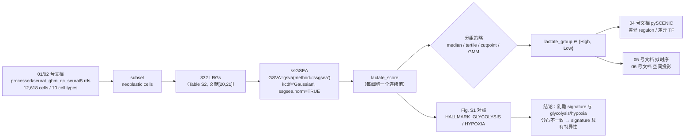

# 03 乳酸代谢评分与高低乳酸亚群划分（332 LRGs / ssGSEA）

> **目标文献**：Wang R, Wu W, et al. *Integrative single-cell and spatial transcriptomic analysis reveals a
> lactate-driven crosstalk between NFATc4⁺ tumor cells and SPP1⁺ macrophages in glioblastoma.*
> *J Transl Med* (2026) 24:1253. DOI: 10.1186/s12967-026-08555-7
>
> **模块对应原文**：Fig. S1；Fig. 3A–C 的分组前提；Methods 中「scRNA-seq dataset analysis」段落
> （`The "GSVA" R package and the ssGSEA algorithm were used to evaluate the lactate score of neoplastic
> cells. The lactate-related genes (LRGs) based on the published studies, and a total of 332 genes were
> included in this study (Table S2) [20, 21].`）
>
> **前置依赖**：01 号文档（`01_环境搭建与数据获取.md`，产出 `processed/lrgs_332.txt`）；
> 02 号文档（`02_单细胞QC整合与十大类细胞注释.md`，产出 `processed/seurat_gbm_qc_seurat5.rds`
> ——Seurat 5 原生对象，同内容的 v3 Assay 版本为 `processed/seurat_gbm_qc.rds`；含 `celltype` 列，
> 肿瘤细胞已由 inferCNV 判定，取值写作 `Neoplastic`）。
> **本模块产出**：`processed/neoplastic_lactate_scored.rds`（含 `lactate_score` / `lactate_group` 两列）、
> `results/FigS1_lactate_vs_glycolysis_hypoxia.csv`、`figures/FigS1_lactate_score_distribution.pdf`。
> **复现难度**：★★☆☆☆　**预计工时**：1.5 人日　**计算资源**：16 GB 内存 / 8 核 CPU（无 GPU；12,618 细胞规模下 ssGSEA 与 AUCell 均在分钟级）

---

## 1. 科学问题与逻辑位置

本模块是全篇证据链的**分叉点**：把「GBM 肿瘤细胞」这一个混合群体，按乳酸代谢活性重新切成两个可比较的亚群，从而让下游 pySCENIC 的差异 TF 分析有明确的对比轴。若这一步的分组不稳，Fig. 3A–C 的 5 个 TF 列表就会漂移，Fig. 3D 的生存结论与后续体外实验的靶点选择也随之失焦。



**上游输入**：带 `celltype` 注释的 Seurat 对象 + 332 LRG 列表。
**下游输出**：`lactate_score`（连续）+ `lactate_group`（二分），被 04 号文档（pySCENIC 差异 TF）、05 号文档（拟时序沿分支的 NFATc4 走势）、06 号文档（空间 spot 的 high/low-lactate 区域划分）三个模块复用。**因此本模块必须把分数矩阵落盘，而不是只画图。**

---

## 2. 背景知识与原理

### 2.1 乳酸：从「代谢废物」到「信号分子」

**Warburg 效应**：即便氧气充足，肿瘤细胞仍偏好把葡萄糖经糖酵解转化为乳酸（有氧糖酵解）。其收益不在 ATP 产率（2 ATP/葡萄糖 vs OXPHOS 的 ~32），而在于：① 快速供能与碳骨架分流（磷酸戊糖途径、丝氨酸/核苷酸合成）；② 乳酸外排造成微环境酸化（pHe 6.5–7.0），有利于侵袭与免疫逃逸；③ 乳酸被邻近氧化型细胞（巨噬细胞、T 细胞、内皮细胞）经 MCT1 摄入后重新氧化供能（"lactate shuttle"，反向 Warburg）。

**乳酸的分子通路（本模块基因集所刻画的实体）**：

| 环节 | 分子 | 方向 / 功能 | GBM 中的含义 |
|---|---|---|---|
| 生成 | **LDHA** | pyruvate + NADH → lactate + NAD⁺（生成乳酸） | GBM 中高表达，是乳酸表型的核心 |
| 生成 | **LDHB** | lactate + NAD⁺ → pyruvate + NADH（消耗乳酸） | 与 LDHA 表达比（LDHA/LDHB）决定净乳酸通量 |
| 外排（生成细胞） | **MCT4 / SLC16A3** | 乳酸 + H⁺ 外排，低亲和/高容量 | 糖酵解型肿瘤细胞的出口 |
| 摄取（消耗细胞） | **MCT1 / SLC16A1** | 乳酸内流，高亲和 | 氧化型细胞（TAM、T 细胞、肿瘤边缘细胞）的入口 |
| 转运 | **MCT8 / SLC16A2** | 甲状腺激素转运体，亦转运乳酸 | 脑内单羧酸转运的重要成员 |
| 分子伴侣 | **Basigin / CD147 / BSG** | MCT1/MCT4 的必需辅助蛋白，定位于质膜 | 抑制 BSG 可间接阻断乳酸转运 |
| 受体 | **GPR81 / HCAR1** | 乳酸激活的 Gi 偶联受体，降低 cAMP、抑制脂肪分解 | 原文引用 [9] 报道 GPR81 激活招募 Treg |
| 翻译后修饰 | **lactylation (Kla)** | 乳酸→lactyl-CoA→组蛋白/非组蛋白赖氨酸乳酸化；writer p300/CBP，eraser HDAC1-3 / SIRT1-3 | 介导乳酸对基因表达的"代谢回写" |

**乳酸的免疫抑制效应**（原文 Introduction 与 Discussion 的核心动机）：
- 抑制 **CD8⁺ T 细胞**增殖与细胞因子分泌（酸性 TME + 胞内乳酸升高抑制 TCR 信号与 MYC）；
- 促进**免疫抑制细胞**功能：Treg 上调 PD-1 [36]、驱动 **M2 巨噬细胞**分化 [37]、诱导 cGAS 降解 [10]；
- 在 GBM 中，肿瘤相关巨噬细胞（TAM）占据髓系主体，是乳酸信号的主要接收者——这正是本文最终落到 **SPP1⁺ macrophages** 的原因。

> **导师批注**：原文 Abstract 说 "Metabolic reprogramming, particularly lactate metabolism"，但实际上真正被测量的是**一类特定基因集的表达谱**，既不是乳酸浓度（未做 metabolomics），也不是通量（未做 ¹³C 示踪），更不是 MCT 活性。写作时务必把"乳酸代谢异质性"这句话表述为"**基于转录组 proxy 推断的乳酸代谢相关程序活性**"，不要越界。

### 2.2 332 个 LRGs 的来源与性质辨析（本模块最关键的认知风险）

原文 Methods 原文：

> `The lactate-related genes (LRGs) based on the published studies, and a total of 332 genes were included in this study (Table S2) [20, 21].`

对应参考文献：
- **[20] Zhang D, Tang Z, Huang H, et al. Metabolic regulation of gene expression by histone lactylation. *Nature*. 2019;574:575–80.** —— 这篇文章做的是**组蛋白乳酸化（histone lactylation, Kla）**的首次系统描述：发现巨噬细胞 M1 极化后期由乳酸驱动 H3K18la 等修饰，激活稳态基因（Arg1 等）。它提供的不是乳酸代谢通路基因，而是**乳酸化写/读/擦体系与乳酸化靶点**。
- **[21] Cheng Z, Huang H, Li M, et al. Lactylation-related gene signature effectively predicts prognosis and treatment responsiveness in hepatocellular carcinoma. *Pharmaceuticals*. 2023;16:644.** —— 明确是"**lactylation-related gene signature**"，其 332 基因来自「在 HCC 中与乳酸化相关基因共表达/差异表达的基因」的筛选，不是 GO/KEGG 的乳酸代谢通路。

> ⚠️ **导师批注（语义漂移，必须写进 13 号文档）**：
> **「乳酸化修饰相关基因（lactylation-related）」与「乳酸代谢基因（lactate metabolism: glycolysis / lactate transport）」不是同一概念。**
> - 乳酸代谢基因 = 生成/转运/受体侧：`LDHA`、`LDHB`、`SLC16A1/3/2`、`BSG`、`HCAR1`、`PKM`、`HIF1A`、`SLC2A1` 等；
> - 乳酸化相关基因 = 修饰侧 + 被乳酸化调控的下游：`EP300`、`CREBBP`、`HDAC1-3`、`SIRT1-3`、以及大量与乳酸化位点共变的靶基因（可能包含大量与乳酸本身无关的转录/代谢调控基因）。
>
> 两者的交集有限。本文用 [20,21] 的 332 基因去描述"乳酸代谢异质性"，存在**指标效度（construct validity）问题**：测到的可能是"乳酸化调控网络活性"，而非"乳酸通量"。**复现时必须显式声明 332 基因的实际来源与命名，不得简化为"乳酸代谢基因"。** 叠加一个事实：作者在 Discussion 里又把它称作 "AUCell and LRGs"（见 §3.2），三处口径不统一，说明作者自己也没有严格区分。

**「为什么仍然值得复现」的三个理由**（给学生在组会上解释用）：
1. 该基因集在原文中确实**产生了可区分的信号**（Fig. 3C 的 5 个差异 TF，尤其是 NFATc4），并在 6 个 bulk 队列中与生存相关（Fig. 3D）——即使用错了标签，结果本身是可检验的；
2. 乳酸化与乳酸代谢在**生物学上高度耦合**：乳酸的胞内浓度是 Kla 的直接底物来源（lactyl-CoA），所以乳酸化基因集的活性往往与糖酵解活性正相关（同时也保留了独立性，这正是 Fig. S1 声称的"分布不一致"）；
3. 这给了我们一个**方法学对照实验的机会**：用「乳酸代谢通路集」与「乳酸化基因集」分别打分，比较哪一套更能复现原文的 NFATc4 结论。这在复现报告里是加分项（见 §5 Plan B）。

> ⚠️ **导师批注（循环论证风险，与 01 号文档 §4.7 呼应）**：**`NFATC4` 本身是否在 332 LRGs 中，原文没有交代。** 它在逻辑上**不应该**在——NFATc4 是"用乳酸分数分组之后由 pySCENIC 找出来的下游发现"，若把它放进打分基因集，就等于"用结论去定义分组"，构成循环论证。复现时**必须先检查 `NFATC4 %in% lrgs`**：若命中，在日志中记录，并额外做一次"剔除 NFATC4 后重新打分 → 重新分组 → 检查差异 TF 列表是否仍含 NFATc4"的敏感性分析。同一条也适用于 `Nfatc4` 的别名写法与 `SPP1`。若敏感性分析后 NFATc4 仍稳健，结论反而更强。

**复现时的基因集获取路径（按优先级）**：
1. **首选**：使用 01 号文档产出的 `processed/lrgs_332.txt`（其来源为期刊 Supplementary Table S2 直取，或按 01 号文档 §4.7 路径 B 重建）。核对其行数是否为 332。
2. **Plan B-1（推荐）**：用**多套平行基因集**做替代与敏感性分析：
   - `GO:0006089` **lactate metabolic process**（MSigDB C5 GO BP）
   - `GO:0015727` **lactate transport**
   - `KEGG hsa00010` **Glycolysis / Gluconeogenesis**
   - `HALLMARK_GLYCOLYSIS`（MSigDB H）
   - `REACTOME_PYRUVATE_METABOLISM_AND_CITRIC_ACID_TCA_CYCLE`
   - 自定义核心集 `LACTATE_CORE` = `{LDHA, LDHB, SLC16A1, SLC16A2, SLC16A3, BSG, HCAR1, PKM, SLC2A1, SLC2A3, HIF1A, EP300, CREBBP, HDAC1, HDAC2, HDAC3, SIRT1, SIRT2}`
   - **Plan B-2**：从 [21] 的方法学复刻——若 Cheng 等 2023 论文正文给出了其 332 基因的筛选流程（通常在 HCC 队列中做"乳酸化相关基因"的 WGCNA/Cox 筛选），按同一流程在 TCGA-GBM 上重跑，得到"GBM 版的乳酸化相关基因集"。
3. **必须记录**：基因集文件路径、基因数、交集到 GBM 数据后实际可用基因数、来源论文 DOI。若最终可用基因数 < 200，在报告中明确标注（原文未报告交集后数目）。

### 2.3 ssGSEA 原理（从 GSEA 的 ES 讲起）

**GSEA 的 ES（Enrichment Score）**。给定一个样本内按表达量降序排列的基因列表 $L = \{g_1, g_2, \dots, g_N\}$（$N$ = 检测到的基因总数）与一个基因集 $G$（$|G| = N_R$），经典的**加权 Kolmogorov–Smirnov 型**统计量为：
$$
\mathrm{ES}(G) = \max_{1 \le k \le N} \left| \sum_{i \le k,\; g_i \in G} \frac{|r_i|^p}{\sum_{j: g_j \in G} |r_j|^p} \;-\; \sum_{i \le k,\; g_i \notin G} \frac{1}{N - N_R} \right|
$$

其中 $r_i$ 为 $g_i$ 的排序相关系数（相关型排序统计量），$p$ 为权重指数（$p=1$ 时即"加权 KS"）。**直觉**：上式括号内是"命中累积分布"与"未命中累积分布"之差（running sum），取最大偏离即为富集信号；基因集成员集中在列表顶端 → running sum 先急速上扬 → ES 大。

**ssGSEA 的两处关键改造**（Barbie et al. 2009, *Nature*）：

1. **每个样本单独计算**：GSEA 需要一个"表型排序"（两组样本），无法给出"每个样本一个分数"；ssGSEA 把排序搬进样本内部——**在单个样本内按表达量排序基因**，于是每个样本都能得到一个 ES。这一步才使得"每个细胞一个乳酸分数"成为可能。
2. **不用 max，改用两条 ECDF 之间的积分差**：把 $\max_k$ 换成对整个排序轴积分，

$$
\mathrm{ES_{ssGSEA}}(G, s) = \sum_{k=1}^{N} \left[ \underbrace{\frac{1}{N_R}\sum_{g \in G} \mathbf{1}\{\mathrm{rank}_s(g) \le k\}}_{P_{\text{in}}(k)} \;-\; \underbrace{\frac{1}{N - N_R}\sum_{g \notin G} \mathbf{1}\{\mathrm{rank}_s(g) \le k\}}_{P_{\text{out}}(k)} \right]
$$

即 $P_{\text{in}}$（基因集内基因的经验累积分布）与 $P_{\text{out}}$（基因集外基因的 ECDF）两条曲线之间的**面积差**。相比 $\max$，积分对"整体上移"更敏感、对单个极端位置不敏感，**样本间可比性更好**（这是单细胞场景想要的性质）。

3. **归一化**（GSVA 实现的 `ssgsea.norm=TRUE`）：若 $G$ 与 $G'$ 是两个大小相同的集合，$P_{\text{in}}$ 的最大可能偏移恒为 1，但若把它从排序轴变换到 $[0,1]$（x 轴归一化为 $k/N$，y 轴为累计比例），则 ES 的上下界恰为 $\pm(1 - N_R/N)$。GSVA 用样本内**该基因集可能取的 ES 极值范围**做线性缩放：

$$
\tilde{\mathrm{ES}}(G,s) = \frac{\mathrm{ES_{ssGSEA}}(G,s)}{\max_{G'} \mathrm{ES_{ssGSEA}}(G', s) - \min_{G'} \mathrm{ES_{ssGSEA}}(G', s)}
$$

> 实操上要点只有一句：**归一化后分数落在约 $[-1, 1]$ 区间（经验上多为 $[-0.5, 0.8]$），因此"分布形态是否与原文一致"是可以肉眼比对的**（见 §6 QC 判据）。

### 2.4 打分工具横向对比（选型依据）

| 方法 | 数学内核 | 是否用秩 | 对 dropout 的稳健性 | 稀疏矩阵适用性 | 单细胞语境常见坑 |
|---|---|---|---|---|---|
| **ssGSEA**（GSVA 包） | 样本内秩 ECDF 面积差 | 是（样本内秩） | 中：零值扎堆会让 ECDF 台阶重叠，分数被压缩 | 需先转 dense，内存 $O(\text{genes}\times\text{cells})$ | `kcdf` 选错（整数 counts 用 Gaussian）导致分数失真；基因集未去重 → 分数虚高 |
| **AUCell** | 恢复曲线下面积（ROC 型 AUC） | 是（样本内秩，上限 `aucMaxRank`） | **高**：只看 top 5% 排名，不被大量零值干扰 | 需 dense 建 ranking，但内存可控（可存 rank 稀疏） | `aucMaxRank` 取太大 → 分数趋同；小细胞群下 AUC 方差大 |
| **UCell** | 秩和（Mann–Whitney $U$）统计量的归一化 | 是（样本内秩，上限 `maxRank`） | **高**：显式设计用于单细胞 | **原生支持稀疏**，速度快 10× 以上 | `maxRank` 与基因集大小需配比；对极小基因集（< 10）不稳 |
| **AddModuleScore**（Seurat） | 表达值分箱后，目标基因均值 − 背景基因均值 | **否**（用绝对表达 + 分箱） | **低**：对 dropout 与测序深度敏感 | 支持稀疏 | 背景基因由表达分箱随机抽，`set.seed` 变化会轻微改变分数；跨样本批次效应会混入分数 |
| **VISION** | 基因 z-score 加权和 + 随机背景基因集校正 | 否（用标准化表达） | 中 | 支持稀疏 | 返回的是"signature score"（含经验 p 值），与 ssGSEA 值域不同，不可直接比较 |

**结论（我们的选型决策）**：
- **主分析用 ssGSEA**，因为原文 Methods 明确写的是 ssGSEA，且下游要复用同一套分组；
- **平行用 AUCell 复算**，因为原文 Discussion 写的是 AUCell——两套分数都算，用 Spearman 相关 + 分组一致性（Cohen's κ）来量化"两种实现得到的 High/Low 分组是否等价"（见 §5.3）；
- **用 UCell 做第三方交叉验证**，它的秩和内核与前两者都不同，可作为"分组稳健性"的客观第三方。

---

## 3. 原文方法逐条拆解

### 3.1 Methods（scRNA-seq dataset analysis 段）

| 原文句子（英文关键词） | 我们的具体操作 | 参数 / 备注 |
|---|---|---|
| `The "GSVA" R package and the ssGSEA algorithm were used to evaluate the lactate score of neoplastic cells.` | 对 `neoplastic cells` 子集，输入 log-normalized 表达矩阵（gene × cell），调用 `GSVA::gsva(method="ssgsea")` | 只对肿瘤细胞打分（不是全细胞）。原文未说明是否重跑 HVG/PCA——**我们的决策：不重跑，直接复用 02 号文档的 normalized data 层**，避免分组依赖降维步骤 |
| `The lactate-related genes (LRGs) based on the published studies, and a total of 332 genes were included in this study (Table S2) [20, 21].` | 读取 Table S2；用 `casefold()` 与数据集基因名（HGNC symbol）匹配；输出可用基因数 | 原文未报告"332 中有多少能在 GSE138794 检出"→ 我们的日志必须记录（预计 270–330） |
| （未写）分数是否归一化 | `ssgsea.norm = TRUE` | 不加归一化时分数不可跨细胞比较 |
| （未写）分组阈值 | 见 §5.1 四种方案 | **原文未报告阈值 → 这是本节最大的可复现性缺口** |

### 3.2 Results 与 Discussion 的三处口径不一致

**(a) Methods 说 GSVA+ssGSEA，Discussion 说 AUCell。** 原文 Discussion 第一段之后：

> `Our research first identified 10 cell types in the dataset GSE138794 and then used AUCell and LRGs to calculate lactate metabolic scores for neoplastic cells.`

而 Methods 写的是 `The "GSVA" R package and the ssGSEA algorithm`。**这不是笔误级别的差异**：ssGSEA 与 AUCell 的分数分布、动态范围、以及"哪些细胞被判为高分"都可能不同。两种实现都必须跑，并给出可比性量化。

**(b) Results 写 "lactate score showed inconsistent distribution patterns with glycolysis- and hypoxia-related signatures"**，对应 Fig. S1，引用 [29]（Baldominos 2022, *Cell*，静息癌细胞形成免疫抑制微环境）与 [30]（Zheng 2023，pan-cancer glycolysis score）。

> **导师批注**：这两篇引用与"hypoxia signature"的对应关系不直观（[29] 主题是 quiescent cancer cells，[30] 才是 glycolysis score）。**原文未报告 glycolysis / hypoxia 两个对照基因集的具体基因列表**——复现时必须自行指定并声明。Plan B：直接用 MSigDB 的 `HALLMARK_GLYCOLYSIS`（200 基因）与 `HALLMARK_HYPOXIA`（200 基因），这是最标准的、可被审稿人接受的替代。

**(c) Fig. 3C 图注写 "Differential TF expression"，Results 写的是 "Differential TF activity analysis"。** TF 的 **regulon 活性（AUC）** 与 TF 本身的 **mRNA 表达**是两个量（详见 04 号文档 §2.3）。按 Results 与 pySCENIC 语境，应理解为 regulon 活性；作图时若用 `NFATC4` 的 `avg_log2FC` 会与原图不一致。

### 3.3 Methods「Machine learning algorithms」段里那句自相矛盾的话

原文 Methods：

> `First, univariate Cox (unicox) regression analysis was used to categorize the tumor cells based on their lactate scores.`

**问题**：单细胞层的肿瘤细胞**没有生存信息**（GSE138794 是 5 个 GBM 样本的 scRNA-seq，随访数据不附着于单个细胞），因此"用单因素 Cox 在单细胞层对肿瘤细胞分组"在统计上不成立。

**这句话的实际来源推测**：Methods 的这段描述属于 **bulk 层分析**（紧随其后就是 TCGA/CGGA/GSE108474/GSE4412/meta-cohort 与 `Mime1` 建模），是模板复用留下的句子。原文 Results 中真正报告的 bulk 分组是：

> `Consensus clustering based on the LRGs identified two molecular subtypes in the TCGA cohort.`（Fig. 7A–D）
> `Candidate genes were further filtered using univariate Cox regression in the TCGA training cohort with a stringent cutoff (P < 0.001).`

即：**单因素 Cox 用来筛基因（P < 0.001），不是用来分组细胞**；分组用的是 consensus clustering。

**我们的复现决策**：
- 单细胞层：用 **中位数/最优阈值** 分组（§5.1），**不做任何生存分析**；
- bulk 层：先 `surv_cutpoint`（或固定中位数）把样本按 LRG 分数二分做 KM，**同时**用 `ConsensusClusterPlus` 做 Cluster A/B（与原文 Fig. 7A–D 对齐）；
- 在报告中显式写明"单细胞分组 = 表达层阈值法；bulk 分组 = 临床层生存法 + 无监督聚类法"，并在 `13_复现质控清单、排错与批判性评述.md` 中记录这一处原文矛盾。

---

## 4. 逐步可运行代码

环境：R 4.4.2（与原文一致）、Seurat 5.3.0、GSVA（记录版本，见下）、AUCell、UCell、msigdbr、survminer、mclust。统一 `set.seed(20260101)`。

### 4.0 载入与基因集准备

```r
# code/03_00_load_lrg.R
suppressPackageStartupMessages({
  library(Seurat); library(GSVA); library(GSEABase)
  library(msigdbr); library(data.table)
})
set.seed(20260101)
dir.create("results", showWarnings = FALSE); dir.create("figures", showWarnings = FALSE)

so <- readRDS("processed/seurat_gbm_qc_seurat5.rds")   # 02 号文档产物（Seurat 5 原生）
stopifnot("celltype" %in% colnames(so@meta.data))
print(table(so$celltype))                              # 先确认水平名：02 号文档写作 "Neoplastic"

# ---- 332 LRGs（01 号文档产出；若只有期刊附件则回退到 xlsx 解析）----
if (file.exists("processed/lrgs_332.txt")) {
  lrgs <- trimws(readLines("processed/lrgs_332.txt"))
} else {
  lrg_tbl <- readxl::read_excel("raw/literature/Table_S2.xlsx")   # 附件路径见 01 号文档
  lrg_col <- grep("gene|symbol|Symbol|Gene", colnames(lrg_tbl), value = TRUE)[1]
  lrgs <- trimws(as.character(lrg_tbl[[lrg_col]]))
}
lrgs <- unique(lrgs[!is.na(lrgs) & lrgs != ""])
message("LRG 读取到 ", length(lrgs), " 个基因（期望 332）")
if ("NFATC4" %in% toupper(lrgs)) {                       # 见 §2.2 导师批注（循环论证）
  warning("NFATC4 出现在 332 LRGs 中 —— 必须补做『剔除 NFATC4 后重打分』的敏感性分析")
  writeLines("NFATC4_IN_LRG=TRUE", "logs/03_circularity_flag.txt")
}

# 与数据集基因名对齐（大小写 / 版本后缀统一）
rownames(so[["RNA"]]) <- toupper(rownames(so[["RNA"]]))   # 在 Assay 层改名最稳（Assay5 支持）
in_data <- intersect(lrgs, rownames(so))
message("在 GSE138794 中可检出: ", length(in_data), " / ", length(lrgs),
        "（原文未报告，需写入日志）")
writeLines(in_data, "results/LRG_detected_genes.txt")

# ---- Plan B 平行基因集 ----
# 兼容两代 msigdbr 接口：旧版 category/subcategory，>= 10.0 版 collection/subcollection
# （注意：下面的子集名必须真的传进 msigdbr；只写一个不传参的包装函数会把整个 C5 全库读进来）
msig <- function(collection, subcollection = NULL) {
  fml  <- names(formals(msigdbr::msigdbr))
  args <- if ("collection" %in% fml) {
    c(list(species = "Homo sapiens", collection = collection),
      if (!is.null(subcollection)) list(subcollection = subcollection))
  } else {
    c(list(species = "Homo sapiens", category = collection),
      if (!is.null(subcollection)) list(subcategory = subcollection))
  }
  d <- as.data.frame(do.call(msigdbr::msigdbr, args))
  split(d$gene_symbol, d$gs_name)             # named list：gs_name → gene symbol 向量
}
HALL <- msig("H")                             # 含 HALLMARK_GLYCOLYSIS / HALLMARK_HYPOXIA
# ⚠️ GO:BP 子集名随版本变化；报错时先跑 msigdbr::msigdbr_collections() 看实际取值
GOBP <- msig("C5", "GO:BP")                   # 含 GOBP_LACTATE_METABOLIC_PROCESS（GO:0006089）
parallel_sets <- list(
  LAC_CORE     = c("LDHA","LDHB","SLC16A1","SLC16A2","SLC16A3","BSG","HCAR1","PKM",
                   "SLC2A1","SLC2A3","HIF1A","EP300","CREBBP","HDAC1","HDAC2","HDAC3",
                   "SIRT1","SIRT2"),
  GO_LACTATE_METAB = GOBP[["GOBP_LACTATE_METABOLIC_PROCESS"]],
  HALLMARK_GLYCOLYSIS = HALL[["HALLMARK_GLYCOLYSIS"]],
  HALLMARK_HYPOXIA    = HALL[["HALLMARK_HYPOXIA"]]
)
lapply(parallel_sets, length)   # 记录每套基因集大小
saveRDS(list(LRG = in_data, PARALLEL = parallel_sets), "processed/gene_sets_lactate.rds")
```

### 4.1 主分析：ssGSEA 对肿瘤细胞打分

```r
# code/03_01_ssgsea.R
library(Seurat); library(GSVA); library(Matrix)
set.seed(20260101)

so <- readRDS("processed/seurat_gbm_qc_seurat5.rds")
gs <- readRDS("processed/gene_sets_lactate.rds")
# 注意 celltype 的实际取值：02 号文档 §4.5 写入的是首字母大写的 "Neoplastic"
neo <- subset(so, subset = celltype %in% c("Neoplastic", "neoplastic cells"))
stopifnot(ncol(neo) > 0)                 # 若为 0，先 print(table(so$celltype)) 检查水平名
message("肿瘤细胞数: ", ncol(neo), "（原文未报告，需记录）")

# 输入矩阵：gene × cell，log-normalized（Seurat 'data' 层）
expr <- as.matrix(GetAssayData(neo, assay = "RNA", layer = "data"))

# ---------- 方式 A：旧接口（仅 GSVA <= 1.46 可用） ----------
# ⚠️ GSVA 1.47 起引入 *Param 对象，method / kcdf / ssgsea.norm / abs.ranking 这些形参被弃用，
#    后续版本中逐步失效。01 号文档钉的是 GSVA 1.54.0（Bioc 3.20），在那一版上方式 A 很可能直接报
#    "unused argument" 或 defunct 错误。**动手前先 packageVersion("GSVA") + ?gsva 核对**：
#    新版本请把方式 B 解除注释并作为主路径，方式 A 只在旧版环境下用于数值对照。
es_old <- gsva(expr,
               gset.idx.list = gs$LRG,      # 注意：list 形式，元素为 gene symbol 向量
               method        = "ssgsea",
               kcdf          = "Gaussian",  # log-normalized 连续值用 Gaussian；原始 counts 才用 Poisson
               ssgsea.norm   = TRUE,        # 归一化，使分数跨细胞可比
               abs.ranking   = FALSE,
               verbose       = TRUE)

# ---------- 方式 B：新接口（GSVA >= 1.47，参数收拢到 *Param 对象） ----------
# ns <- asNamespace("GSVA")
# if (exists("ssgseaParam", envir = ns)) {
#   par <- ssgseaParam(expr, gs$LRG, alpha = 0.25, normalize = TRUE)
#   es_new <- gsva(par, verbose = TRUE)
#   # ⚠️ ssgseaParam() 不再暴露 kcdf 参数（GSVA >= 1.47 已移除该形参）——
#   #    需按当前 GSVA 版本 ?ssgseaParam 核对；缺失时 ssGSEA 走纯秩路径，
#   #    与旧接口 kcdf="Gaussian" 的结果在数值上略有差异（趋势一致）。
# }
# 两套结果都存，用 cor(es_old[1,], es_new[1,], method="spearman") 记录一致性（ρ > 0.95 才算等价）

# 主路径二选一：旧版 GSVA 用 es_old，GSVA >= 1.47 用 es_new
es <- es_old                                       # 若方式 A 报错，改为 es <- es_new

stopifnot(nrow(es) == 1)                           # 单基因集 → 1 × nCells
neo$lactate_score <- as.numeric(es[1, colnames(neo)])
saveRDS(neo, "processed/neoplastic_lactate_scored_raw.rds")

summary(neo$lactate_score)                         # 记录 min/Q1/median/Q3/max/skew
```

### 4.2 平行实现：AUCell 与 UCell（用于 §3.2a 的口径核对）

```r
# code/03_02_aucell_ucell.R
library(Seurat); library(AUCell); library(UCell)
set.seed(20260101)

neo  <- readRDS("processed/neoplastic_lactate_scored_raw.rds")
gs   <- readRDS("processed/gene_sets_lactate.rds")
expr <- as.matrix(GetAssayData(neo, assay = "RNA", layer = "data"))

# ---- AUCell：恢复曲线 AUC ----
# 先用 1% 的细胞估计 ranking 的分位数分布，以确定 aucMaxRank（而非无脑用 5%）
cells_rankings <- AUCell_buildRankings(expr, nCores = 8, plotStats = TRUE)
aucMaxRank <- ceiling(0.05 * nrow(cells_rankings))     # 默认取 top 5% 基因
cells_AUC  <- AUCell_calcAUC(gs$LRG, cells_rankings,
                             aucMaxRank = aucMaxRank, nCores = 8)
auc_vec <- as.numeric(getAUC(cells_AUC)[1, colnames(neo)])

# ---- UCell：秩和（Mann–Whitney U）内核，原生稀疏 ----
ucell_vec <- ScoreSignatures_UCell(expr, features = list(LRG = gs$LRG),
                                   maxRank = 1500, ncores = 8)[, 1]

neo$lactate_aucell <- auc_vec
neo$lactate_ucell  <- ucell_vec

# ---- 三方一致性 ----
cmp <- data.frame(
  ssgsea = neo$lactate_score,
  aucell = neo$lactate_aucell,
  ucell  = neo$lactate_ucell)
print(round(cor(cmp, method = "spearman"), 3))
# 经验值：ssGSEA vs AUCell 通常 rho 0.6–0.85；ssGSEA vs UCell 0.7–0.9；
# 若 < 0.5，说明矩阵层次（log vs raw）或基因集匹配出了问题，先排查再往下走
saveRDS(neo, "processed/neoplastic_lactate_scored_raw.rds")
write.csv(cmp, "results/lactate_score_three_methods.csv", row.names = FALSE)
```

### 4.3 Fig. S1：乳酸分数 vs glycolysis / hypoxia 的分布比较

```r
# code/03_03_FigS1.R
library(Seurat); library(GSVA); library(ggplot2); library(patchwork)
set.seed(20260101)

neo  <- readRDS("processed/neoplastic_lactate_scored_raw.rds")
gs   <- readRDS("processed/gene_sets_lactate.rds")
expr <- as.matrix(GetAssayData(neo, assay = "RNA", layer = "data"))

# 同一套 ssGSEA 参数算三个对照分数（保证可比：同矩阵、同 kcdf、同归一化）
sets3 <- c(list(LRG = gs$LRG), gs$PARALLEL[c("HALLMARK_GLYCOLYSIS","HALLMARK_HYPOXIA")])
es3 <- gsva(expr, gset.idx.list = sets3, method = "ssgsea",
            kcdf = "Gaussian", ssgsea.norm = TRUE, verbose = TRUE)
# 同样按 §4.1 的说明二选一：GSVA >= 1.47 用 gsva(ssgseaParam(expr, sets3, alpha = 0.25, normalize = TRUE))
# 关键要求：三个基因集必须在「同一矩阵、同一接口、同一参数」下算，否则 Fig. S1 的分布比较不成立
sc <- as.data.frame(t(es3)); colnames(sc) <- c("Lactate","Glycolysis","Hypoxia")
sc$lactate_group <- ifelse(sc$Lactate > median(sc$Lactate), "High", "Low")

# (a) 三分数的小提琴 + 密度（原文 Fig. S1 的"分布不一致"）
pl <- tidyr::pivot_longer(sc, c("Lactate","Glycolysis","Hypoxia"),
                          names_to = "Signature", values_to = "Score")
p1 <- ggplot(pl, aes(Signature, Score, fill = Signature)) +
  geom_violin(scale = "width", trim = FALSE) +
  geom_boxplot(width = .12, outlier.size = .2) +
  theme_classic() + labs(title = "Score distributions (per neoplastic cell)")

# (b) 相关矩阵（Spearman，因分数多为偏态分布）
cm <- cor(sc[, c("Lactate","Glycolysis","Hypoxia")], method = "spearman")
p2 <- ggplot(reshape2::melt(cm), aes(Var1, Var2, fill = value)) +
  geom_tile() + geom_text(aes(label = round(value, 3))) +
  scale_fill_gradient2(low = "#2166AC", mid = "white", high = "#B2182B", midpoint = 0) +
  theme_minimal() + labs(title = "Spearman correlation")

# (c) 散点：乳酸分数 vs glycolysis/hypoxia，看是否只是"同一条线"
p3 <- ggplot(sc, aes(Lactate, Glycolysis)) +
  geom_point(size = .3, alpha = .2) +
  geom_smooth(method = "lm", se = TRUE, color = "firebrick") +
  theme_classic()
p4 <- ggplot(sc, aes(Lactate, Hypoxia)) +
  geom_point(size = .3, alpha = .2) +
  geom_smooth(method = "lm", se = TRUE, color = "steelblue") +
  theme_classic()

fig <- (p1 | p2) / (p3 | p4)
ggsave("figures/FigS1_lactate_score_distribution.pdf", fig, width = 11, height = 8)
ggsave("figures/FigS1_lactate_score_distribution.png", fig, width = 11, height = 8, dpi = 300)
write.csv(sc, "results/FigS1_lactate_vs_glycolysis_hypoxia.csv")
```

**如何把"分布不一致"写成统计量（原文只用文字表述，我们补齐量化）**：

```r
# code/03_04_FigS1_stats.R
sc <- read.csv("results/FigS1_lactate_vs_glycolysis_hypoxia.csv")

# 1) Spearman + 95% CI（n > 1000 时可用 Fisher z 近似）
sp <- function(a, b) {
  r <- cor(a, b, method = "spearman"); n <- length(a)
  z <- atanh(r); se <- 1/sqrt(n - 3)
  c(rho = r, lo = tanh(z - 1.96*se), hi = tanh(z + 1.96*se))
}
sp(sc$Lactate, sc$Glycolysis)
sp(sc$Lactate, sc$Hypoxia)

# 2) 高乳酸细胞中"同时为 glycolysis 高分"的比例（Jaccard）+ Cohen's kappa
hiL <- sc$Lactate    > median(sc$Lactate)
hiG <- sc$Glycolysis > median(sc$Glycolysis)
hiH <- sc$Hypoxia    > median(sc$Hypoxia)
jac  <- function(a, b) sum(a & b) / sum(a | b)
kappa2 <- function(a, b) {
  po <- mean(a == b); pe <- mean(a)*mean(b) + mean(!a)*mean(!b); (po - pe)/(1 - pe)
}
c(jaccard_L_G = jac(hiL, hiG), kappa_L_G = kappa2(hiL, hiG),
  jaccard_L_H = jac(hiL, hiH), kappa_L_H = kappa2(hiL, hiH))

# 3) 分布形状差异：KS 检验（乳酸分数 vs 各对照分数字标准化后比较）
ks.test(scale(sc$Lactate)[,1], scale(sc$Glycolysis)[,1])
# 4) 离散度与偏度：原文的 "inconsistent distribution patterns" 最直接的统计表述
c(sd_L = sd(sc$Lactate), sd_G = sd(sc$Glycolysis),
  skew_L = e1071::skewness(sc$Lactate), skew_G = e1071::skewness(sc$Glycolysis))
```

**报告模板（可直接写进复现报告）**：
> 乳酸分数与 `HALLMARK_GLYCOLYSIS` 呈中等正相关（Spearman ρ = 0.XX，95% CI X.XX–X.XX，n = 肿瘤细胞数），
> 与 `HALLMARK_HYPOXIA` 相关为 ρ = 0.XX；但高乳酸细胞与 glycolysis-高细胞的重叠仅 Jaccard = 0.XX（Cohen's κ = 0.XX），
> 且两分数分布的离散度（SD: 0.XX vs 0.XX）与偏度（X.XX vs X.XX）不同。
> **结论**：乳酸 signature 与 glycolysis / hypoxia signature 部分相关但不冗余，"分布不一致"这一表述在我们的数据上得到支持。

### 4.4 分组：四种阈值方案

```r
# code/03_05_grouping.R
library(Seurat); library(mclust); library(survminer)
set.seed(20260101)
neo <- readRDS("processed/neoplastic_lactate_scored_raw.rds")
s   <- neo$lactate_score

# --- 方案 1：中位数二分（最稳健、最常用；原文最可能采用） ---
g_median <- ifelse(s > median(s), "High", "Low")

# --- 方案 2：三分位 top/bottom 1/3（中间 1/3 丢弃；信号最强，但损失 1/3 细胞） ---
q <- quantile(s, c(1/3, 2/3))
g_tertile <- ifelse(s >= q[2], "High", ifelse(s <= q[1], "Low", NA))

# --- 方案 3：cutpoint 最优化生存（需要 bulk 层生存数据；单细胞层不可直接用） ---
# 说明见 §3.3：单细胞层无生存信息。此处仅演示 bulk 层做法。
bulk <- readRDS("processed/bulk_lrg_score.rds")   # data.frame(score, OS.time, OS)
# 该文件由本模块 §8 登记的 bulk 层打分步骤（或 08 号文档）产出；顺序上先跑完 bulk 打分再回到这一步。
# 只想跑单细胞层的话，方案 3 可以整段跳过（单细胞层没有生存信息）。
cut  <- surv_cutpoint(bulk, time = "OS.time", event = "OS", variables = "score")
bulk$group_cutpoint <- ifelse(bulk$score >= cut$score$cutpoint[1], "High", "Low")
# 把 bulk 层学到的 cutpoint 以"分位数形式"迁移到单细胞层：
p <- mean(bulk$score < cut$score$cutpoint[1])               # 得到百分位 p
g_cut <- ifelse(rank(s, ties.method = "first") / length(s) > p, "High", "Low")

# --- 方案 4：高斯混合模型（无监督、不预设比例） ---
mc <- Mclust(s, G = 1:3, modelNames = c("V", "E"))
g_gmm <- ifelse(mc$classification == which.max(mc$parameters$mean), "High", "Low")
message("GMM 最优 K = ", mc$G, "；BIC = ", round(mc$bic, 1))

grp <- data.frame(
  median  = g_median,
  tertile = g_tertile,
  cutq    = g_cut,
  gmm     = as.character(g_gmm))
# 四种方案的一致性：先把 Low/High 编成 0/1（必须显式给 levels，否则各列编码方向可能不一致），
# 再算两两 Kendall tau（缺值用 pairwise 剔除）
gp <- sapply(grp, function(x) as.integer(factor(x, levels = c("Low", "High"))))
print(round(cor(gp, use = "pairwise.complete.obs", method = "kendall"), 3))
# 多阈值稳健性：四种方案都判为 High 的细胞 = 核心高乳酸集（用于 §5.2 稳健性检验）
neo$lactate_group      <- g_median                       # 主分析用中位数
neo$lactate_high_core  <- apply(!is.na(grp) & grp == "High", 1, all)
neo$lactate_low_core   <- apply(!is.na(grp) & grp == "Low",  1, all)
saveRDS(neo, "processed/neoplastic_lactate_scored.rds")
saveRDS(grp, "results/lactate_grouping_4schemes.rds")
```

---

## 5. 参数解释与调参空间

### 5.1 分组阈值的选择（原文未报告 → 本模块最大缺口）

| 方案 | 原理 | 优点 | 缺点 | 我们的建议 |
|---|---|---|---|---|
| 中位数 | 保证两组细胞数 50/50 | 稳健、可复现、对离群不敏感 | 若分布是单峰连续，切在"峰值附近"会人为制造差异 | **主分析**。若分数分布单峰（可用 `dip.test` 检验），须在图注中说明这是"相对高低"而非"两个真实亚群" |
| 三分位 top/bottom 1/3 | 只取两端 | 组间对比最强，最易检出差异 TF | 丢弃 1/3 细胞；样本量小 → 检验功效下降 | 作为**敏感性分析**，与中位数法取差异 TF 交集 |
| cutpoint 最优生存 | 扫描所有切点，选 log-rank 统计量最大处 | 与临床终点直接挂钩 | ① 单细胞层无生存数据；② 会造成**最优切点偏倚**（multiple testing），需 `maxstat` 校正（`surv_cutpoint` 已内置） | 只在 **bulk 层**用；单细胞层以"分位迁移"方式借用 |
| 高斯混合（GMM） | 假设分数为 1–3 个高斯分量混合，用 BIC 选 K，取均值最大的分量 | 数据驱动，无预设比例；能回答"是否存在两个真实亚群" | 若 K=1（单峰），无法二分；对偏态分布需先变换（如 `rank` 或 `log1p`） | 作为**探索性证据**：若 BIC 强烈支持 K=2，则中位数二分有了生物学依据 |

> ⚠️ **导师批注**：**不要只跑中位数就收工。** 下游 pySCENIC 的差异 TF 列表对分组阈值敏感——尤其是 `POU3F3`、`HOXC9` 这类效应量中等（|ΔAUC| 小）的 TF。**必须在报告里给出"四种阈值下差异 TF 的交集/并集"表**，并把只在中位数法出现、其他方法消失的 TF 标为"边缘 TF（不稳健）"。若 NFATc4 在所有方案中都稳定出现，本模块的核心结论才立得住。

### 5.2 稳健性检验：多分组 × 多基因集

```r
# code/03_06_robustness.R
# 3 套基因集 (LRG / GO_LACTATE_METAB / HALLMARK_GLYCOLYSIS) × 4 种阈值 = 12 种分组
# 对每种分组，把 lactate_group 写入 meta.data，交给 04 号文档的 pySCENIC 差异分析
# 输出：TF × 分组方案的 显著性矩阵，统计每个 TF 在多少种方案中显著
combos <- expand.grid(set = c("LRG","GO_LACTATE_METAB","HALLMARK_GLYCOLYSIS"),
                      thr = c("median","tertile","cutq","gmm"),
                      stringsAsFactors = FALSE)
write.csv(combos, "results/robustness_grouping_grid.csv", row.names = FALSE)
# 判据：核心 TF（NFATc4 / SPI1 / FOXO1）应在 >= 8/12 种方案中显著上调；
#       若 < 6/12，说明该 TF 的结论不稳健，需在 13 号文档中标注
```

### 5.3 ssGSEA 关键参数

| 参数 | 含义 | 原文取值 | 可选范围 | 改变后的后果 |
|---|---|---|---|---|
| `method` | 打分算法 | `"ssgsea"`（Methods 明示） | `gsva` / `ssgsea` / `zscore` / `plage` | `zscore` 会丢失"基因集内相对排序"信息，对 dropout 更敏感；`gsva` 是无监督核密度估计，单细胞小样本下不稳 |
| `kcdf` | 核密度估计的核 | 原文未写 | `"Gaussian"` / `"Poisson"` / `"none"` | **log-normalized 连续值必须用 Gaussian**；若误用 Poisson（本意是给整数 counts 用的），ECDF 台阶会错位，分数整体偏移。GSVA ≥ 1.47 的 `ssgseaParam()` 已移除该形参，需按版本核对 |
| `ssgsea.norm` | 是否归一化 | 原文未写 | `TRUE` / `FALSE` | `FALSE` 时分数不可跨细胞/跨基因集比较，Fig. S1 的三集比较将失去意义 |
| `alpha` | 排序权重指数 $p$ | 默认 0.25 | 0–1 | 越大越强调高表达基因，分数更"头部驱动"；0.25 是 ssGSEA 社区默认，**不要改**，否则与原文不可比 |
| `abs.ranking` | 是否用绝对排名 | 默认 `FALSE` | `TRUE` / `FALSE` | 只有做"共表达模块"时才需要 `TRUE`；此处保持 `FALSE` |
| 输入矩阵层次 | 用哪个 assay layer | 原文未写 | `counts` / `data` | 必须用 **`data`（log-normalized）**；用 `counts` 会让高表达基因主导排名，且部分细胞测序深度低 → 分数与深度相关（伪影） |
| `minSize` / `maxSize` | 基因集大小限制 | 默认 1 / Inf | — | 若限定 `minSize=10`，332 基因集不受影响，但 Plan B 的小集合（如 `LAC_CORE` 18 基因）需注意 |

### 5.4 备选方案（Plan B）清单

| 缺口 | Plan B |
|---|---|
| Table S2 不可得 | 用 §2.2 的五套平行基因集；在报告中声明"332 LRG 未能获取，使用 X 套公开基因集替代" |
| GSVA 版本与原文不一致 | 同时跑旧/新接口，报告两者的 Spearman ρ；若 ρ > 0.95 则不影响结论 |
| 分数分布单峰（无真实亚群） | 在报告中降级表述为"连续梯度上的相对高低"；下游差异分析改用**回归/连续相关**（把 lactate_score 作为连续自变量）而非二分组 t 检验 |
| 肿瘤细胞数过少（< 2000） | ssGSEA 的样本内 ECDF 在 cell 维度上不受细胞数影响（ECDF 是 gene 维度的），但**分组后的差异检验功效**受限；改用 UCell 交叉验证 + bootstrap 置信区间 |

---

## 6. 预期结果与 QC 检查点

### 6.1 原文报告的确切数字（必须对齐）

| 项目 | 原文报告 | 出处 |
|---|---|---|
| 总细胞数（QC + 去双胞后） | **12,618** | Results 第 1 段 / Fig. 2A 图注 |
| 细胞类型数 | **10** 类（neoplastic cells, macrophages, T cells, astrocytes, oligodendrocytes, stem cells, neurons, endothelial cells, ILCs, fibroblasts） | Results 第 1 段 |
| LRG 基因数 | **332** | Methods + Table S2 |
| 打分算法（Methods 口径） | **GSVA 包的 ssGSEA** | Methods |
| 打分算法（Discussion 口径） | **AUCell** | Discussion 第 2 段 |
| 分组方式 | 高 / 低乳酸两个亚群；**阈值未报告** | Results |
| Fig. S1 结论 | 乳酸分数与 glycolysis / hypoxia signature **分布不一致** | Results |
| 下游差异 TF | **SPI1、NFATc4、HOXC9、POU3F3、FOXO1**（高乳酸组升高） | Results + Fig. 3C |
| 肿瘤细胞数 | **原文未报告**（建议自测并在日志中记录） | — |
| 332 与数据集的交集基因数 | **原文未报告** | — |

### 6.2 QC 检查点与 Go/No-Go 判据

```r
# code/03_07_QC.R
so  <- readRDS("processed/neoplastic_lactate_scored.rds")
s   <- so$lactate_score
qc  <- data.frame(
  n_neoplastic_cells = length(s),
  n_lrg_input        = 332,
  n_lrg_detected     = length(readLines("results/LRG_detected_genes.txt")),
  score_min          = min(s),  score_q1 = quantile(s, .25),
  score_median       = median(s), score_q3 = quantile(s, .75),
  score_max          = max(s),
  score_sd           = sd(s),
  score_skew         = e1071::skewness(s),
  n_NA               = sum(is.na(s)),
  n_unique_ties_at_median = sum(s == median(s)))
print(qc); write.csv(qc, "results/03_QC_lactate_score.csv", row.names = FALSE)

# 单峰性检验：若 p > 0.05 则不能拒绝"单峰"，中位数二分需在报告中降级表述
if (requireNamespace("diptest", quietly = TRUE)) print(diptest::dip.test(s))
```

| # | 检查点 | 期望值 / 判据 | 不通过时的处置 |
|---|---|---|---|
| 1 | 肿瘤细胞数 | 1,000–8,000（12,618 总细胞中肿瘤占比通常最大）；原文未报告 | < 1,000 → 检查 inferCNV 阈值是否过严 |
| 2 | LRG 检出率 | ≥ 250 / 332（约 75%） | < 200 → 检查基因名大小写、是否用了旧版 symbol（如 `HCAR1` 旧名 `GPR81`） |
| 3 | 分数值域 | 归一化后约 $[-1, 1]$，典型 $[-0.4, 0.8]$ | 出现 > 5 或 < −5 → `ssgsea.norm=FALSE` 或矩阵层次用错 |
| 4 | 分数中位数附近的记录数 | ties 占比 < 5% | ties 极多 → 输入矩阵过于稀疏（可能误用了 `scale.data` 或做了二值化） |
| 5 | 三种实现（ssGSEA / AUCell / UCell）Spearman | 两两 ρ ≥ 0.6 | < 0.5 → 先排查基因集匹配与矩阵层次，再考虑报告"两实现不等价" |
| 6 | **NFATc4 差异稳健性**（跨 §5.2 的 12 种组合） | ≥ 8/12 种组合中显著（Wilcoxon FDR < 0.05，且高乳酸组 ΔAUC > 0） | < 6/12 → 本模块核心结论不成立，需回到 §2.2 换基因集 |
| 7 | Fig. S1 对照分数 | 与乳酸分数的 Spearman ρ 落在 0.2–0.8（**不能 > 0.9**） | ρ > 0.9 → 乳酸 signature 与 glycolysis 冗余，"特异性"结论不成立 |
| 8 | 分组后两组细胞数 | 中位数法保证 50/50；三分位法各 ≈ 1/3 | 严重偏斜 → 阈值实现有 bug |

**Go/No-Go 判据**：检查点 1–4 全部通过 + 检查点 6 通过 → Go；其中任一项失败 → 先修数据层，不要带病进入 04 号文档。

---

## 7. 常见陷阱与排错表

| 现象 | 根因 | 解决 |
|---|---|---|
| 分数整体偏负、动态范围很窄（如全在 −0.1 ~ 0.1） | 输入矩阵是**原始 counts**却用了 `kcdf="Gaussian"`；或对稀疏矩阵做了额外的 log 变换导致零值堆积 | 用 `Seurat::GetAssayData(layer="data")`（已 log1p 归一化）；确认 `kcdf="Gaussian"`；检查是否有大量基因在所有细胞中为 0 |
| 分数与 `nCount_RNA` 高度相关（\|ρ\| > 0.5） | 测序深度未标准化，排名被深度主导 | 先 `NormalizeData`；必要时对分数做深度回归（`lm(score ~ log10(nCount_RNA))` 取残差）后再分组 |
| 分数分布呈双峰但 GMM 选 K=1 / K=3 | 分布严重偏态，BIC 在 Gaussian 假设下失效 | 先 `rank()` 或 `log1p` 变换再拟合；或直接报告 K-S/`diptest` 的单峰性检验结果 |
| 每个细胞分数都几乎一样（SD < 0.02） | `ssgsea.norm=FALSE`（未归一化）或基因集过小（< 20）；也可能 `aucMaxRank`/`maxRank` 设得过大导致 rank 信息饱和 | 打开 `ssgsea.norm=TRUE`；检查基因集大小；AUCell 的 `aucMaxRank` 取 `0.05 * nGenes` 而非固定 5000 |
| 基因集里出现重复基因（同一 gene 被写两次） | Table S2 多来源合并未去重 | `lrgs <- unique(lrgs)`；重复基因会让该基因在 ECDF 中被计两次 → 分数虚高（这是 ssGSEA 实现里真实存在的伪影，务必去重） |
| 基因名不匹配：`HCAR1` / `GPR81`、`BSG` / `CD147`、`SLC16A3` / `MCT4`、`NFATC4` / `NFAT3` | 同一分子有多个别名/旧名 | 统一走 HGNC symbol；用 `hgnc_id` 做映射（如 `HGNChelper::checkGeneSymbols()`）；基因集与数据集必须同一命名体系 |
| LINC/假基因混入（如 `LDHAL6A`、`LDHAL6B`） | 基因集来自 bulk 差异分析，包含假基因 | 保留——假基因可能真实共表达；但要额外做"仅保留蛋白编码基因"的敏感性分析 |
| 只对肿瘤细胞打分但用了全细胞的 log 归一化参数 | 归一化尺度不同（`NormalizeData` 在全数据集上做）→ 肿瘤细胞分数与其它细胞不可比 | 若要与其它细胞比较（如"肿瘤细胞乳酸分数是否高于巨噬细胞"），须在全细胞矩阵上打分后取子集；**原文只对 neoplastic cells 打分，所以不要做跨细胞类型比较** |
| 细胞数太少（< 500）时 ssGSEA 分组不稳 | 分组后每组 < 250，Wilcoxon 检验功效不足，差异 TF 列表随机漂移 | 用 UCell 交叉验证；bootstrap 重采样（> 200 次）报告差异 TF 的复现频率；必要时放宽 FDR（但仍报告效应量） |
| GSVA 报错 `Not enough genes to compute enrichment score` | 基因集与矩阵交集 < `minSize`（默认 1，但实际算法需 ≥ 2，且 GSVA 新版 `minSize` 默认可能为 1 但内部要求） | 检查交集大小；对 Plan B 的 `LAC_CORE`（18 基因）确认至少 10 个检出 |
| 与原文 Fig. 3 对不上（差异 TF 列表不同） | ① 分组阈值不同（原文未报告）；② 用了 AUCell 而非 ssGSEA（或反之）；③ pySCENIC 的 motif 数据库版本不同（见 04 号文档） | 按 §5.2 的稳健性网格排查；把前三项作为"我们复现中显式固定的变量"写进报告 |
| 内存爆掉（30 万细胞级数据） | `as.matrix()` 把稀疏矩阵转 dense | 用 UCell（原生稀疏）替代 ssGSEA；或按样本切块打分后合并；GSE138794 的 12,618 细胞在 16 GB 内存下 dense 化无压力（约 12,618 × 20,000 × 8 B ≈ 2 GB） |

---

## 8. 与原文图表的对应关系表

| 原文图 | 内容 | 本模块产出的文件 |
|---|---|---|
| Fig. S1 | 乳酸分数 vs glycolysis / hypoxia signature 的分布比较 | `figures/FigS1_lactate_score_distribution.pdf`、`results/FigS1_lactate_vs_glycolysis_hypoxia.csv`、`results/FigS1_stats.csv` |
| Fig. 3A（前提） | 高/低乳酸分组的 meta 信息 | `processed/neoplastic_lactate_scored.rds`（`lactate_score`、`lactate_group` 列） |
| Fig. 3C（输入） | 差异 TF 分析的分组标签 | 同上，交 04 号文档消费 |
| Fig. 3G（输入） | NFATc4 regulon 活性按乳酸分组投影 UMAP | 同上 |
| Fig. 7A–D（并行输入） | TCGA 层 consensus clustering 的 LRG 打分 | `processed/bulk_lrg_score.rds`（本模块 §4.4 顺带产出，供 `09_机器学习101组合预后模型.md` 使用） |
| Fig. 3D / S4A（并行输入） | bulk 层 LRG 分数与生存的关联 | `processed/bulk_lrg_score.rds`（供 `08_bulk队列整合与NFATc4生存分析.md` 使用） |
| 方法学补充（本模块新增） | 四种阈值方案的稳健性矩阵 | `results/lactate_grouping_4schemes.rds`、`results/robustness_grouping_grid.csv`、`results/03_QC_lactate_score.csv` |

---

## 9. 交付清单与交接说明

留给 04 号文档的接口约定（**必须严格遵守，否则下游会踩坑**）：

- 对象：`processed/neoplastic_lactate_scored.rds`（Seurat 对象，已 subset 到 neoplastic cells）
- 必需 meta.data 列：`lactate_score`（numeric）、`lactate_group`（factor，level = `c("Low","High")`）、`lactate_high_core` / `lactate_low_core`（logical）、`lactate_aucell`、`lactate_ucell`
- 表达矩阵：`RNA` assay 的 `data` 层（log-normalized），**rowname 已是 uppercase HGNC symbol**（04 号文档做 GRN 时需保持这一命名一致性，motif 数据库注释也是 uppercase）
- 日志必须记录：GSVA 版本、AUCell 版本、332 LRG 的实际检出数、分数 summary、三种实现的 Spearman 矩阵、四种阈值下的分组细胞数
