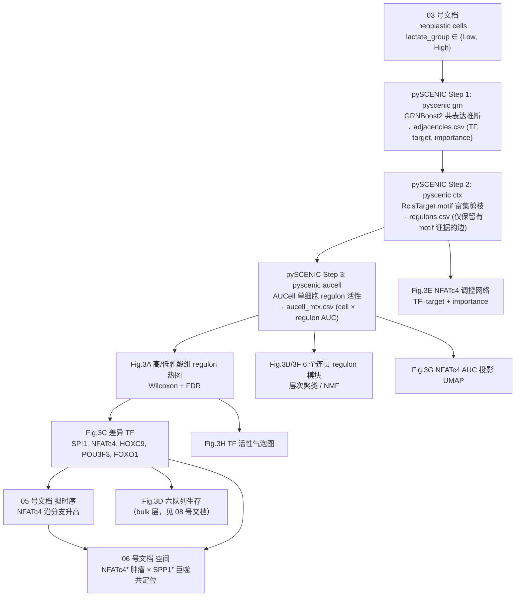
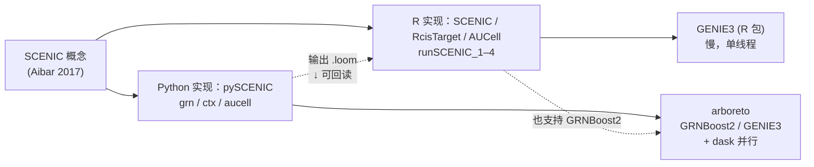

# 04 pySCENIC 转录因子调控网络推断与 NFATc4 的发现

> **目标文献**：Wang R, Wu W, et al. *Integrative single-cell and spatial transcriptomic analysis reveals a
> lactate-driven crosstalk between NFATc4⁺ tumor cells and SPP1⁺ macrophages in glioblastoma.*
> *J Transl Med* (2026) 24:1253. DOI: 10.1186/s12967-026-08555-7
>
> **模块对应原文**：Fig. 3A–H；Results 中「PySCENIC analysis identifies NFATc4 as a key transcription
> factor associated with high-lactate neoplastic cells」整段；Methods 中「scRNA-seq dataset analysis」段的
> `The "SCENIC" R package was used to analyze transcription factor activity.`；Discussion 第 2 段。
>
> **前置依赖**：`03_乳酸代谢评分与高低乳酸亚群划分.md`（`processed/neoplastic_lactate_scored.rds`，含
> `lactate_score`、`lactate_group ∈ {Low, High}`）；`02_单细胞QC整合与十大类细胞注释.md`
> （`processed/seurat_gbm_qc_seurat5.rds` 的 UMAP 嵌入与细胞注释，用于 Fig. 3G）；`01_环境搭建与数据获取.md`
> （`raw/cistarget/` 下的 motif 数据库与 `processed/pyscenic_input.loom`，如有）。
> **关键接口约定**：表达矩阵为 `RNA` assay 的 `data` 层，`rownames` 已是 uppercase HGNC symbol。
>
> **本模块产出**：`results/adjacencies.csv`、`results/regulons.csv`、`results/aucell_mtx.csv`、
> `results/regulon_modules_k6.csv`、`results/diff_TF_high_vs_low.csv`、`figures/Fig3A–3H_*.pdf`。
> **复现难度**：★★★★☆（`ctx` 步骤是全场瓶颈）　**预计工时**：4 人日（含 1–2 天纯计算等待）
> **计算资源**：CPU 16–32 核；**内存 ≥ 64 GB**（`ctx` 步骤峰值可达 30–50 GB）；无 GPU 需求

---

## 1. 科学问题与逻辑位置

03 号文档给出了"高分/低分"两群肿瘤细胞，但**分组本身不是结论**。本模块要回答的是：**驱动这两群细胞状态差异的转录调控程序是谁？** 直接从"乳酸相关基因"跳到"NFATc4"，中间必须有一座桥——这座桥就是 pySCENIC 推断的 **regulon 活性**。



**上游**：03 号文档的乳酸分组 + log-normalized 表达矩阵。
**下游**：NFATc4 是本文后续**全部实验（Fig. 5、6）与空间分析（Fig. 4）的靶点**。本模块一旦选错靶点，后面 60% 的篇幅全部作废。因此本模块的 QC 强度必须最高。

---

## 2. 原理讲透：pySCENIC 三步流水线

SCENIC（Single-Cell Regulatory Network Inference and Clustering，Aibar et al. 2017, *Nat Methods*）的目标是绕开两个经典难题：① 单细胞数据 dropout 导致的相关性失真；② 共表达 ≠ 直接调控。它的方案是**用"共表达"做筛选、用"motif"做证据、用"秩"做活性度量**。

核心产物 **regulon = 一个 TF + 它的一组直接靶基因**。

---

### 2.1 Step 1 — GRN 推断（GENIE3 / GRNBoost2）

**建模方式**：把"预测基因 $g$ 的表达"当成一个**回归问题**。对每一个靶基因 $g$，用所有候选 TF $\{t_1,\dots,t_p\}$ 的表达作为特征（自变量），预测该基因在所有细胞上的表达：

$$
\hat{x}_{g,i} = F_g\!\left(x_{t_1,i},\, x_{t_2,i},\, \dots,\, x_{t_p,i}\right), \qquad i = 1,\dots,n
$$

其中 $n$ = 细胞数，$p$ = 候选 TF 数（人约 1,600–1,900）。

**GENIE3（Huynh-Thu et al. 2010）**：$F_g$ 取**随机森林**（每棵树在随机特征子集上生长）。TF $t$ 对靶基因 $g$ 的调控强度取**变量重要性**，即该变量在所有分裂节点上造成的**加权方差下降之和**（比 Gini 不纯度下降更常用，因为回归任务用方差）：

$$
w_{t,g} \;=\; \frac{1}{T}\sum_{b=1}^{T}\;\sum_{\substack{v \in \mathcal{N}_b \\ \mathrm{split}(v)=t}}
\frac{n_v}{n}\,\Delta\mathrm{Var}(v),
\qquad
\Delta\mathrm{Var}(v)=\mathrm{Var}(y_v)-\frac{n_{v_L}}{n_v}\mathrm{Var}(y_{v_L})-\frac{n_{v_R}}{n_v}\mathrm{Var}(y_{v_R})
$$

$T$ = 树数，$\mathcal{N}_b$ = 第 $b$ 棵树的内部节点集，$n_v$ = 落到节点 $v$ 的样本数。
**直觉**：如果 TF $t$ 的表达能把靶基因 $g$ 的表达切分成"高/低两组"，那么 $t$ 的每次分裂都会带来较大的组内方差下降 → $w_{t,g}$ 大。GENIE3 **不需要线性假设**，能捕捉非线性与组合调控，代价是计算量大。

**复杂度**：每个靶基因训练一片森林（$G$ 个靶基因），每棵树 $O(n\log n)$ 量级节点、每个分裂评估 $m_{\text{try}} \approx \sqrt{p}$ 个特征，因此总量约

$$
\mathcal{O}\!\left(G \cdot T \cdot \sqrt{p} \cdot n\log n\right)
$$

由于 GRN 推断中靶基因集合 $G$ 与候选 TF 集合 $p$ 常常是同一套基因（或同量级），文献中常把该代价简写为**对基因数的 $O(p^2)$ 级（线性于细胞数 $n$）**。这也是为什么"候选 TF 列表越小、跑得越快"——**$p$ 是平方项**。

**GRNBoost2（Moerman et al. 2019, *Bioinformatics*）**：把随机森林换成**梯度提升（GBM）**——一棵树序列拟合前一轮的残差：

$$
F_g^{(m)} = F_g^{(m-1)} + \nu\, h_m(\mathbf{x}), \qquad h_m = \arg\min_{h}\sum_i \left(r_i^{(m-1)} - h(\mathbf{x}_i)\right)^2,\quad r_i^{(m-1)} = x_{g,i}-F_g^{(m-1)}(\mathbf{x}_i)
$$

**为什么快**：① 梯度提升用**早停（early stopping）**——在留出集上监测损失，一旦不再下降就停止加树，因此实际树数 $T_{\text{eff}} \ll T_{\text{RF}}$；② 树的根节点天然只保留信息量最大的少数 TF，后续分裂在更小子集上做；③ 通过 `arboreto` + **dask** 做**跨靶基因并行**（每个靶基因的回归相互独立，天然可并行），单机多核即可线性加速。
**代价**：GBM 的变量重要性在**强共线 TF**（如 STAT1/STAT2、JUN/JUNB）之间会不稳定分配——两个高度相关的 TF，谁拿到重要性带有随机性。这在下游差异分析中表现为"同家族 TF 结果跳动"。

**输入要求**：
- **log 化的表达矩阵**（raw counts 的方差与均值强耦合，会主导树分裂；log1p(CP10K) 是社区标准）；
- 建议**降维**：只保留 `TF 列表 + 高变基因 / 该细胞类型高表达基因`。原因：竞争性回想的树模型在 2 万个基因上跑，绝大部分基因与靶基因无关，纯属浪费计算；同时把基因数从 20,000 降到 3,000–5,000 可让 `grn` 步骤从"数小时"降到"数十分钟"。
  > ⚠️ **注意**：降维只影响"作为靶基因的候选集"，**不要删掉候选 TF**（否则某些 TF 的 regulon 直接消失）。

**输出**：`adjacencies.csv`，三列 `TF, target, importance`，典型规模：几百个 TF × 每个 TF 数千条边 ≈ $10^6 \sim 10^7$ 行。

> 💡 **经验值（给第一次跑 pySCENIC 的同学）**：`grn` 的耗时**几乎线性于细胞数、平方级于基因数**。实操中最有效的三个提速手段，按收益排序是：
> ① 把输入基因从全基因组（~20,000）降到 `TF ∪ HVG`（~3,500）——直接 5–6 倍；
> ② 先用 `--method grnboost2`（默认）跑通全流程，只在需要复核时用 `genie3`；
> ③ 若细胞数 > 3 万，先按细胞类型/样本分块跑再合并（但会损失跨块的调控关系，非必要不用）。**不要**为了跑得快而删候选 TF——那会让某些 TF 的 regulon 直接消失。

---

### 2.2 Step 2 — motif 富集剪枝（RcisTarget / cisTarget）

共表达只是**相关性证据**。这一步检查：**TF 的候选靶基因集合中，是否富集了该 TF 结合 motif 的基因？**

**cisTarget 的预计算**：对每个 motif $m$，在全基因组所有基因的 "TSS 上下游序列" 上扫描 motif 匹配分数，得到一个**全基因组排序**（不是硬阈值，而是连续打分排序）；再对每个基因计算 motif $m$ 的 **AUC（area under the ROC curve）**——即该基因的 motif 打分相对于全基因组背景的富集程度。于是数据库里存的是一张 `motif × gene → AUC` 的排名表（`.feather` 文件，几个 GB）。

**富集打分**：给定 TF 的候选靶基因集合 $S$（$|S|$ 通常 20–500），按 motif $m$ 的 AUC 降序排列全部基因 $g_1, g_2, \dots, g_N$，定义**恢复曲线**（recovery curve）：

$$
\mathrm{Rec}_m(k) = \frac{\left| S \cap \{g_1,\dots,g_k\} \right|}{|S|}
$$

以及其曲线下面积

$$
\mathrm{AUC}(m, S) \;=\; \sum_{k=1}^{N} \mathrm{Rec}_m(k)\cdot \Delta x_k ,
\qquad \Delta x_k = \frac{\mathrm{AUC}_m(g_k)}{\sum_{j}\mathrm{AUC}_m(g_j)}
$$

**关键点**：横轴**不是基因排名序号，而是按 motif AUC 加权的累积**。因此"$S$ 中恰好是那个 TF 真正结合的、motif 打分最高的基因"会得到最大的曲线下面积。

**NES（Normalized Enrichment Score）**：把 $\mathrm{AUC}(m,S)$ 与**山随机抽取的同规模基因集**的 AUC 分布比较（cisTarget 的实现取若干随机集）：

$$
\mathrm{NES}(m, S) \;=\; \frac{\mathrm{AUC}(m, S) - \mu_{\text{rand}}}{\sigma_{\text{rand}}}
$$

- `--nes_threshold`（pySCENIC 默认 **3.0**）：NES > 3 视为显著富集，保留该 motif 对应的 **TF → target 边**；
- `--auc_threshold`（默认 **0.05**）：曲线下面积的绝对门限，与 NES 共同构成双阈值；
- **leading edge**：达到最终 AUC 所需的最少头部基因数，用于截断过长的 regulon（`--rank_threshold`，默认 **5000**）；
- `--min_genes`（默认 **20**）：若某个 TF 在剪枝后只剩下 < 20 个靶基因，该 regulon 被丢弃 —— **这是 NFATc4 这类低表达 TF 最容易掉队的环节**（见 §6.3）。

**数据库版本必须严格自洽**（这是新手最常踩的坑）：

| 资源 | 文件名（人 hg38, v9） | 说明 |
|---|---|---|
| motif 排名数据库 A | `hg38__refseq-r80__10kb_up_and_down_tss.mc9nr.genes_vs_motifs.rankings.feather` | TSS ±10 kb，覆盖调控区，**召回率高** |
| motif 排名数据库 B | `hg38__refseq-r80__500bp_up_and_100bp_down_tss.mc9nr.genes_vs_motifs.rankings.feather` | 近端启动子，**精确率高** |
| motif→TF 注释 | `motifs-v9-nr.hgnc-m0.001-o0.0.tbl`（v9） / `motifs-v10nr_clust-nr.hgnc-m0.001-o0.0.tbl`（v10） | **`motifs-v9` 只能配 `mc9nr`，`motifs-v10` 只能配 `mc_v10_clust`** |

- `mc9nr` = motif collection 9, non-redundant（约 2 万个 motif，来自十余个 motif 数据库去冗余；**确切数目以 `resources.aertslab.org/cistarget` 对应目录的说明为准**，不要照抄二手教程里的数字）；
- `mc_v10_clust` = motif collection v10, clustered（对高度相似的 motif 做了聚类合并，跑得更快，结果略有差异）；
- 文件名中 `hgnc` / `mgi` = 人/鼠的基因命名体系，`nr` = non-redundant，`m0.001` = motif 相似度阈值，`o0.0` = 直系同源保留阈值；
- `--ortholog`（`human` / `mouse`）只在跨物种映射时需要（如用猴样本配人数据库），同物种分析不要加。

**默认推荐同时给 A、B 两个数据库**（pySCENIC 官方教程做法）：近端 + 远端都算，任一命中即保留，召回率更高。

---

### 2.3 Step 3 — 单细胞 regulon 活性（AUCell）

**思想**：regulon 的活性不该看靶基因的**平均表达**（受 dropout 严重干扰），而应看"**靶基因是否系统性地排在表达谱的高位**"。

对细胞 $c$，把基因按表达量降序排名 $\rho_c(g) \in \{1,\dots,N\}$。给定 regulon $R$（$|R| = n_R$），只考虑排名前 $n_{\max}$ 的基因（$n_{\max} = $ `aucMaxRank`，默认 `ceiling(0.05 × N)`，即 **top 5%**）。定义**恢复曲线**：横轴为基因排名（归一化到 $[0,1]$），纵轴为已恢复的 regulon 基因占 $|R|$ 的比例。**AUC = 该曲线下的面积**（梯形法累加，源码见 `AUCell:::auc`）。

$$
\mathrm{AUC}(R, c) = \int_0^1 \mathrm{Rec}_{R,c}(u)\,\mathrm{d}u, \qquad
\mathrm{Rec}_{R,c}(u) = \frac{\left|\{ g \in R : \rho_c(g) \le u \cdot n_{\max} \}\right|}{|R|}
$$

**直觉**：
- 若 regulon 的靶基因**全部**落在 top 5% → 恢复曲线迅速升到 1 并保持 → AUC 接近最大值；
- 若靶基因随机散布 → 恢复曲线近似对角线 → AUC 接近"随机基线"（等于 $n_R / N$ 量级，非常小）；
- **为什么只看 top 5%**：单细胞数据的前 95% 基因名次基本是噪声（表达极低、dropout 严重）。把 $n_{\max}$ 限制在头部，既提高信噪比，又极大降低计算量（只需存每细胞的 top-$n_{\max}$ 排名）。

**rank 阈值的三方对应关系**（同一概念在不同工具里的不同名字，务必分清）：

| 工具 | 参数名 | 含义 | 默认/常用值 |
|---|---|---|---|
| AUCell (R) | `aucMaxRank` | 参与计算的 top-N 基因数 | `ceiling(0.05 * nGenes)` |
| pySCENIC CLI | `--rank_threshold` | 同上 | 5000 基因 |
| SCENIC R 包 | `aucMaxRank` | 同上 | 由 `runSCENIC_3_scoreCells` 内部推断/指定 |

**二值化（binarization）**：连续 AUC → 0/1，用于"该细胞中此 regulon 是否开启"。SCENIC R 包用 `runSCENIC_4_aucell_binarize`，为**每个 regulon 单独**选阈值：在候选阈值中选取"使被分配细胞与未被分配细胞的 AUC 分布差异最大"的那个。pySCENIC 则常用**全局分位数阈值**（如取 AUC 分布的 top 5%）。
**两者不等价**：per-regulon 阈值会使活跃细胞比例在 regulon 之间可比；全局阈值会让高活性 regulon 被不成比例地选中。**我们的复现决策：主分析用 per-regulon 阈值（对齐 R 包语义），敏感性分析用全局 95% 分位。**

> ⚠️ **导师批注（贯穿本章的一处概念陷阱）**：**regulon 活性（AUC）不是 TF 的表达量，也不是 TF 的"功能强弱"，而是"该 TF 的靶基因集合在此细胞中是否被系统性地高表达"**。二者可以完全脱钩：
> - TF 自身表达低但靶基因被别的因子打开 → AUC 高、mRNA 低（**NFATc4 正是这一情形的高危候选**，原文 Introduction 自己就说它 "low expression in tissue"）；
> - TF 自身表达高但靶基因沉默 → AUC 低、mRNA 高。
>
> 因此：**原文 Fig. 3C 图注写 "Differential TF expression"、Results 写 "Differential TF activity"，两者不可互换**；同时 Fig. 3D 的六队列生存用的是 `NFATC4` 的 **mRNA 表达**，Fig. 3G 用的是 **regulon 活性**。在复现报告中，凡出现 "NFATc4 升高" 的句子，**必须注明是 mRNA 层还是 regulon 层**——这是审稿人最容易抓的一处逻辑滑坡。

---

### 2.4 SCENIC 家族的血缘关系（选型前的必修课）



- **两套实现的算法内核相同**，但工程细节不同（见 §3）；**同一批细胞上两套实现的 regulon 数量、regulon 大小、AUC 绝对值都会有差异**；
- 互操作：pySCENIC 输出 `auc_mtx.csv` + `regulons.csv` 可经 `SCENIC::loadInt` / loom 回读进 R 做可视化。

---

### 2.5 NFATc4 的生物学背景（为什么这个 TF 值得追）

#### 2.5.1 NFAT 家族与 Ca²⁺/calcineurin 开关

NFAT（Nuclear Factor of Activated T cells）家族共 5 个成员：

| 成员 | 别名（历史命名，极易混淆） | 典型表达 | 钙调磷酸酶依赖 |
|---|---|---|---|
| NFATC1 | NFAT2、NFATc | T 细胞、心脏、骨 | 是 |
| NFATC2 | NFAT1、NFATp | 免疫细胞 | 是 |
| NFATC3 | NFAT4、NFATx | 广泛 | 是 |
| **NFATC4** | **NFAT3** | 组织表达较低（"low expression in tissue"） | 是 |
| NFAT5 | TonEBP | 广泛，渗透压应激 | **否**（不依赖 calcineurin） |

> ⚠️ **导师批注（基因命名坑，检索与作图务必统一）**：NFAT 家族的**旧名与官方 HGNC 符号错位一位**——NFATC1 旧名 NFAT2，NFATC2 旧名 NFAT1，NFATC4 旧名 **NFAT3**。文献里写 "NFAT3" 时指的是 `NFATC4`，而不是 `NFATC3`。这在检索文献、注释基因集、以及把 `NFATC4` 映射到 motif 注释文件时都会出错。**操作规则**：
> - 人：官方符号 `NFATC4`（全大写）；别名 `NFAT3`、`NFATc4`；
> - 小鼠：`Nfatc4`（首字母大写，其余小写）；蛋白写作 NFATc4；
> - 斑马鱼 / 爪蟾等模式生物：各自命名体系不同（斑马鱼为 `nfatc4`，全小写斜体），且**未必有现成的 motif→TF 注释文件**——非人非鼠样本做 pySCENIC 时，只能用 `--ortholog` 映射或退化为共表达分析；
> - **在 pySCENIC 流程中，基因名必须与 motif 注释文件（`hgnc` / `mgi`）的命名体系完全一致**，否则该 TF 会被静默丢弃（见 §7）。

**分子开关机制**：
1. **静息态**：NFATc4 以磷酸化形式滞留胞质。其 N 端含多个 **SP 基序（SPxx 重复序列）**，被 GSK-3、CK1、DYRK1A 等"NFAT 激酶"磷酸化，掩盖核定位信号（NLS）并暴露核输出信号（NES）。
2. **激活信号**：胞内 Ca²⁺ 升高 → 钙调磷酸酶（**calcineurin**，催化亚基 `PPP3CA/PPP3CB/PPP3CC` + 调节亚基 `PPP3R1`）被钙调蛋白（CALM）激活 → **去磷酸化 SP 基序** → NLS 暴露 → 核输入。
3. **核内**：NFAT 通过**Rel 同源结构域（RHD）**结合 DNA 核心基序 **5′-GGAAA-3′**；在多数调控元件上需与 **AP-1（FOS/JUN）** 等伙伴形成复合物才能有效转录。
4. **退出**：NFAT 激酶重新磷酸化 → CRM1 介导核输出。**持续的 Ca²⁺ 信号 → NFAT 持续核滞留 → 靶基因持续激活**。
5. **重要推论**：**NFATc4 的活性主要由"亚细胞定位"而非"蛋白丰度"决定**。这解释了为什么它转录本丰度低、却可以有很强的功能——也正是它能以 low mRNA 出现在"高 regulon 活性"列表里的分子基础（回看 §2.3 的导师批注）。原文说 "The biological function of NFATc4 is mediated by the SP motifs' phosphorylation and dephosphorylation"，指的正是这一机制。

#### 2.5.2 从 T 细胞经典功能到肿瘤非经典功能

- **经典（免疫）**：T 细胞活化后 NFAT 与 AP-1 协同激活 `IL2`、`IFNG`、`IL4` 等，是免疫应答的核心开关之一（原文引 [11] Macian 2005, *Nat Rev Immunol*）。
- **心血管与神经系统**：心肌肥厚、单次持续应激（PTSD）模型中 calcineurin/NFATc4 通路参与（原文引 [13]、[14]）——说明 NFATc4 的"应激–钙信号"响应特性具有跨组织普适性。
- **肿瘤（非经典，本文的立论基础）**，原文引用的三条关键证据：

| 癌种 | 表型 | 机制 | 出处 |
|---|---|---|---|
| 肺腺癌 | 促进增殖 | 激活 **CCNB1/CDK1** 通路，是潜在预后标志物 | [15] Yang 2025, *Cancer Sci* |
| 卵巢癌 | **静息（quiescence）与化疗抵抗** | NFATC4 作为静息因子，使细胞进入耐药状态 | [16] Cole 2020, *JCI Insight* |
| AML | 免疫抑制 | **招募 Treg**，与不良预后相关 | [17] Zhao 2020, *Front Genet* |

> 💡 **经验值（如何向审稿人论证这个靶点的合理性）**：把上述三条证据串成一条逻辑链——**NFATc4 在不同癌种中反复出现，且表型恰好覆盖本文在 GBM 中观察到的全部四个方面（增殖、耐药/静息、免疫抑制、预后差）**。这是"靶点选择不是数据挖掘偶然产物"的最有力辩护。反过来，如果复现中发现 NFATc4 的效应量很小（§6.2 检查点 9），这条文献链就变成"预期外的阴性结果"，同样值得如实报告。

#### 2.5.3 与乳酸的接口：为什么机制上说得通

原文 Fig. 5R–S 的实验设计（50 mM 乳酸处理 GL261 → NFATc4 mRNA 与蛋白升高）试图建立一条**乳酸 → NFATc4 → SPP1** 的正反馈环。其机制上的合理性来自三点：
1. **钙信号与糖酵解互为因果**：糖酵解产物乳酸影响胞内 pH 与钙稳态，而 Ca²⁺/calcineurin 通路本身受代谢状态调节；
2. **乳酸化修饰**：乳酸→lactyl-CoA→组蛋白乳酸化可改变染色质可及性，理论上可影响 `NFATC4` 位点（这一条**原文并未做 ChIP/乳酸化实验验证**，属于推断）；
3. **反馈闭环**：NFATc4 激活 → 靶基因（可能含糖酵解/转运基因）→ 更多乳酸 → 更多 NFATc4 激活。

> ⚠️ **导师批注（证据边界的诚实标注）**：上述三条中，**只有第 3 条的"环"在原文中有部分数据支持**（Fig. 5R–S 显示外源乳酸能升高 NFATc4）。**"乳酸如何激活 NFATc4"这一关键机制在原文中完全缺失**——既没有 Ca²⁺ 成像、没有 calcineurin 抑制剂（如 cyclosporin A / FK506）实验，也没有乳酸化位点鉴定。复现报告应明确指出：本章建立的是**关联性（association）**而非**因果链（causality）**，这一条同样是 13 号批判性评述的必写内容。背景知识的完整展开见 `14_背景知识精讲与方法学原理速查.md`。

---

## 3. 原文方法逐条拆解

### 3.1 原文原句与操作对应表

| 原文句子（英文关键词） | 我们的具体操作 | 备注 |
|---|---|---|
| `The "SCENIC" R package was used to analyze transcription factor activity.` | 主路径改用 **pySCENIC CLI**（Reason 见 §3.2），但同步跑一遍 R 包做交叉验证 | Methods 写 R 包，Results/Discussion 写 pySCENIC —— 口径不一致 |
| `PySCENIC analysis revealed distinct transcription factor (TF) regulon activities between the two groups (Fig. 3A).` | 用 03 号文档的 `lactate_group` 分组，对每个 regulon 做 Wilcoxon rank-sum + BH 校正 | 原文未报告检验方法与阈值 |
| `TF modules were visualized in a cluster heatmap and UMAP, highlighting six coherent regulon groups (Fig. 3B).` | regulon（cell × regulon AUC 矩阵）做相关距离层次聚类，切 **k = 6**；对 6 个模块的模块级活性做 UMAP | 原文未报告聚类算法与 k 的选择依据 |
| `Differential TF activity analysis identified SPI1, NFATc4, HOXC9, POU3F3, and FOXO1 as significantly elevated in high-lactate neoplastic cells (Fig. 3C).` | 差异分析取 FDR < 0.05 且高乳酸组 Δ(平均 AUC z-score) > 0，按效应量排序取 top | **原文只报告了升高的 5 个，未报告降低的**；我们的报告应双向列出 |
| `Survival analysis across six independent cohorts (CGGA693, CGGA625, CGGA301, GSE108474, GSE4412, and TCGA) showed that high NFATc4 expression was generally associated with poor patient prognosis across most cohorts (Fig. 3D).` | bulk 层 `NFATC4` 表达中位数二分 + KM + log-rank（完整做法见 `08_bulk队列整合与NFATc4生存分析.md`；本文档 §4.9 只给最小可跑版本） | 注意这里用的是 TF 的 **mRNA 表达**，不是 regulon 活性 |
| `NFATc4 regulatory networks and module distributions were further delineated (Fig. 3E–F).` | `adjacencies.csv` 中筛 `NFATC4` 的边，按 importance / NES 排序取 top，igraph 绘图 | |
| `UMAP visualization confirmed elevated NFATc4 regulon activity specifically in high-lactate regions (Fig. 3G).` | 把 `NFATC4(+)` 的 AUC 列投影到 02 号文档的 UMAP embedding | |
| `A bubble plot summarized the differences in TF activity between metabolic subgroups (Fig. 3H).` | 点大小 = 组内该 regulon 二值化后活跃细胞比例；颜色 = 组内平均 AUC z-score | |

### 3.2 措辞辨析：「SCENIC R 包」还是「pySCENIC」？

| 位置 | 原文措辞 |
|---|---|
| Methods | `The "SCENIC" R package was used to analyze transcription factor activity.` |
| Introduction | `We performed pySCENIC analysis to identify the key molecular targets...` |
| Results 小节标题 | `PySCENIC analysis identifies NFATc4 as a key transcription factor...` |
| Discussion | `we performed pySCENIC analysis and identified NFATc4 as the major transcription factor...` |
| Discussion（局限性） | `pySCENIC analysis identified several transcription factors (TFs) enriched in neoplastic cells with high lactate metabolism.` |

**4 : 1，正文几乎全部写 pySCENIC，只有 Methods 写 "SCENIC R package"。** 鉴于：
1. pySCENIC 的 GRNBoost2 在 1 万细胞量级上比 R 版 GENIE3 快 1–2 个数量级，是该规模数据的现实选择；
2. 原文自报了 `Harmony`、`inferCNV`、`CellChat`、`CytoTRACE` 等 R+Python 混合工具链，说明作者并不排斥 Python；
3. 原文生命周期内（2025–2026）pySCENIC 是主流。

**判断：作者实际用的是 pySCENIC，Methods 那句是模板遗留/笔误。** 这属于写作疏漏，应记入 `13_复现质控清单、排错与批判性评述.md`。

**我们的复现决策**：**主路径 pySCENIC（Python），备份路径 SCENIC R 包**。两套结果的比对判据：

| 比对项 | 期望一致性 | 若不一致的处理 |
|---|---|---|
| regulon 数量 | 两套数量级接近（同一数据上通常相差 < 30%） | 数量差 > 2 倍 → 检查 motif 数据库版本与 `min_genes` |
| 核心 TF 是否都在 | `NFATC4(+)` 在两套结果中均存在且均为高乳酸组上调 | 只有一套有 → 说明该 regulon 处于阈值边缘，报告时标注"阈值敏感" |
| `NFATC4(+)` AUC 的 Spearman ρ | ρ ≥ 0.7 | ρ < 0.5 → 检查 `aucMaxRank` 是否一致、是否 mask dropouts |

---

## 4. 逐步可运行代码

环境：Python 3.10 + `pyscenic==0.12.x`（`pip install pyscenic`，需 `dask`、`arboreto`、`ctxcore`）；R 4.4.2 + `SCENIC`（Bioconductor）、`AUCell`、`ComplexHeatmap`、`igraph`、`ggraph`。

### 4.0 数据准备与资源下载

```bash
# code/04_00_prepare.sh
set -euo pipefail
mkdir -p raw/cistarget results figures logs code

# ---- (1) 从 03 号文档的对象导出表达矩阵与分组标签 ----
Rscript code/04_00_export.R        # 见下方 R 片段

# ---- (2) motif 排名数据库（人 hg38, refseq-r80, mc9nr）----
# 完整列表见 https://resources.aertslab.org/cistarget/databases/
BASE=https://resources.aertslab.org/cistarget/databases/homo_sapiens/hg38/refseq_r80/mc9nr/gene_based
wget -c $BASE/hg38__refseq-r80__10kb_up_and_down_tss.mc9nr.genes_vs_motifs.rankings.feather
wget -c $BASE/hg38__refseq-r80__500bp_up_and_100bp_down_tss.mc9nr.genes_vs_motifs.rankings.feather

# ---- (3) motif→TF 注释（必须与 mc9nr 配套的 v9 版本）----
wget -c https://resources.aertslab.org/cistarget/motif2tf/motifs-v9-nr.hgnc-m0.001-o0.0.tbl

# ---- (4) 候选 TF 列表（人）----
wget -c https://raw.githubusercontent.com/aertslab/pySCENIC/master/resources/hs_hgnc_tfs.txt
# 备用（Lambert 2018 人类 TF 全集）：
# wget -c https://raw.githubusercontent.com/aertslab/pySCENIC/master/resources/lambert2018.txt
```

```r
# code/04_00_export.R
# 导出 (a) 表达矩阵 (gene × cell, log-normalized)；(b) 分组标签；(c) UMAP 坐标
library(Seurat); library(Matrix)
neo <- readRDS("processed/neoplastic_lactate_scored.rds")
set.seed(20260101)

# 只保留 TF ∪ 高变基因 —— 降低 grn 的计算量（不删候选 TF！）
tfs   <- readLines("raw/cistarget/hs_hgnc_tfs.txt")
tfs   <- tfs[!grepl("^#", tfs) & nzchar(tfs)]
hvg   <- VariableFeatures(neo)                       # 02 号文档已算的 2000 HVG
keep  <- union(toupper(tfs), toupper(hvg))
expr  <- GetAssayData(neo, assay = "RNA", layer = "data")
keep  <- intersect(keep, rownames(expr))
message("保留基因数: ", length(keep), "（其中 TF ", length(intersect(keep, tfs)), " 个）")
write.csv(as.matrix(expr[keep, ]), "raw/expr_lactate_tf_hvg.csv")   # 若细胞 > 2 万，改存 .mtx
write.csv(data.frame(cell = colnames(neo), lactate_group = neo$lactate_group,
                     lactate_score = neo$lactate_score),
          "raw/lactate_group_labels.csv", row.names = FALSE)
umap <- Embeddings(neo, "umap")
write.csv(umap, "raw/umap_neoplastic.csv")
```
> **若 01 号文档已产出 `processed/pyscenic_input.loom`**：可直接用它作为 pySCENIC 输入
> （`pyscenic grn processed/pyscenic_input.loom ...`，loom 是 pySCENIC 的一等公民输入格式，**无需 `--transpose`**），
> 但要注意该 loom 的基因集是否为"全基因"——若是全基因，`grn` 会慢很多（§2.1 的 $p^2$ 效应）。
> 此时可用 `pySCENIC` 自带的 `pyscenic utils add_cell_annotation` / `loompy` 先切片。**两种输入路径的 group 标签必须来自同一个 `lactate_group`，不得混用。**

### 4.1 Step 1 — `pyscenic grn`（GRNBoost2 共表达推断）

```bash
# code/04_01_grn.sh
# 输入：gene × cell 矩阵（CSV/TSV，首列基因名）；输出：TF-target 邻接表
pyscenic grn \
  --method grnboost2 \
  --num_workers 16 \
  --seed 20260101 \
  --sparse \
  --transpose \
  --output results/adjacencies.csv \
  raw/expr_lactate_tf_hvg.csv \
  raw/cistarget/hs_hgnc_tfs.txt \
  2>&1 | tee logs/04_01_grn.log

# 说明：
# --method grnboost2  用梯度提升（快）；改 genie3 为原始随机森林（慢 10–100×，但
#                     在强共线 TF 间的重要性分配更均匀）
# --seed              固定随机种子（必须与报告一致；见 §7 陷阱表）
# --sparse            输入/输出用稀疏表示，省内存
# --transpose         输入矩阵方向是 gene × cell（pyscenic 默认期望 cell × gene）
#                     ⚠️ 该参数名与默认方向随版本变化，务必 `pyscenic grn --help` 核对
```

Python 端等价调用（便于嵌进 notebook 或做循环）：

```python
# code/04_01_grn.py
import numpy as np, pandas as pd
from arboreto.algo import grnboost2
from distributed import LocalCluster, Client
np.random.seed(20260101)

expr = pd.read_csv("raw/expr_lactate_tf_hvg.csv", index_col=0).T      # → cell × gene
tfs  = [l.strip() for l in open("raw/cistarget/hs_hgnc_tfs.txt")
        if l.strip() and not l.startswith("#")]
tfs  = [t for t in tfs if t in expr.columns]

with LocalCluster(n_workers=16, threads_per_worker=1, processes=True,
                  memory_limit="4GB") as cluster, Client(cluster):
    adj = grnboost2(expression_data=expr, tf_names=tfs,
                    seed=20260101, verbose=True)
adj.to_csv("results/adjacencies.csv", index=False)
# 规模提示：本地 dask 集群下，~5,000 细胞 × ~3,500 基因、16 核约 20–60 分钟；
#          3 万细胞则需数小时到 1 天。峰值内存 ≈ num_workers × 单 worker 数据副本。
```

**规模自检**（跑完立刻看）：

```bash
# 期望：TF 数 300–800；每 TF 边数 500–5000；总边数 10^6 量级
cut -d, -f1 results/adjacencies.csv | tail -n +2 | sort -u | wc -l
wc -l results/adjacencies.csv
```

### 4.2 Step 2 — `pyscenic ctx`（RcisTarget motif 剪枝）——全场瓶颈

```bash
# code/04_02_ctx.sh
# 输入：adjacencies.csv + 1–2 个 motif 排名数据库；输出：regulons.csv
pyscenic ctx \
  results/adjacencies.csv \
  raw/cistarget/hg38__refseq-r80__10kb_up_and_down_tss.mc9nr.genes_vs_motifs.rankings.feather \
  raw/cistarget/hg38__refseq-r80__500bp_up_and_100bp_down_tss.mc9nr.genes_vs_motifs.rankings.feather \
  --annotations_fname raw/cistarget/motifs-v9-nr.hgnc-m0.001-o0.0.tbl \
  --expression_mtx_fname raw/expr_lactate_tf_hvg.csv \
  --mode custom_multiprocessing \
  --num_workers 16 \
  --chunk_size 100 \
  --rank_threshold 5000 \
  --auc_threshold 0.05 \
  --nes_threshold 3.0 \
  --min_genes 20 \
  --mask_dropouts \
  --output results/regulons.csv \
  2>&1 | tee logs/04_02_ctx.log

# 参数要点：
# --mode custom_multiprocessing  单机多核推荐（避免 dask 调度开销与 OOM）
#                                集群上用 dask_multiprocessing
# --chunk_size 100               每个并行任务处理的 TF 数；OOM 时调到 10–20
# --annotations_fname            旧版 pySCENIC (≤0.10) 参数名为 --motif_annotations
#                                需按版本核对（`pyscenic ctx --help | grep -i annot`）
# --mask_dropouts                在恢复分析中屏蔽 dropout（推荐开启；与 R 版 SCENIC
#                                的默认行为一致）
# --nes_threshold 3.0            官方默认；想更严可提到 3.5–4.0，regulon 更少更可靠
# --min_genes 20                 低于 20 个靶基因的 regulon 被丢弃
#                                ⚠️ NFATC4 极可能卡在这一步，见 §6.3
```

**关键诊断：NFATC4 是否进入 regulon 列表？**

```bash
# ctx 运行结束后立即检查（这是本模块的 No-Go 检查点之一）
grep -c "" results/regulons.csv                       # regulon 总数
grep -i "^NFATC4" results/regulons.csv | cut -f1       # 是否存在
grep -i "^NFATC4" results/regulons.csv | tr '\t' '\n' | wc -l   # 靶基因数
# 若无输出 → 见 §6.3 的三条补救路径
```

### 4.3 Step 3 — `pyscenic aucell`（单细胞 regulon 活性）

```bash
# code/04_03_aucell.sh
pyscenic aucell \
  raw/expr_lactate_tf_hvg.csv \
  results/regulons.csv \
  --output results/aucell_mtx.csv \
  --num_workers 16 \
  --rank_threshold 5000 \
  --sparse \
  --seed 20260101 \
  2>&1 | tee logs/04_03_aucell.log
# 注：--rank_threshold 必须与 ctx 步骤一致（同一概念：参与 AUC 计算的 top-N 基因）。
#     部分版本的 aucell 子命令参数集合不同（是否暴露 --mask_dropouts / --auc_threshold
#     随版本变化），以 `pyscenic aucell --help` 为准。
# 耗时：5,000 细胞 × ~400 regulon，分钟级。
```

### 4.4 R 端备份路径（SCENIC R 包，用于 §3.2 的交叉验证）

```r
# code/04_04_scenic_R.R
library(SCENIC); library(Seurat); library(GSEABase); library(RcisTarget)
set.seed(20260101)

expr <- read.csv("raw/expr_lactate_tf_hvg.csv", row.names = 1)   # gene × cell
tfs  <- scan("raw/cistarget/hs_hgnc_tfs.txt", what = "", quiet = TRUE)

scenicOptions <- initializeScenic(
  org              = "hgnc",
  dbDir            = "raw/cistarget",
  dbs              = c("hg38__refseq-r80__10kb_up_and_down_tss.mc9nr.feather",
                       "hg38__refseq-r80__500bp_up_and_100bp_down_tss.mc9nr.feather"),
  motifAnnotations = "motifs-v9-nr.hgnc-m0.001-o0.0.tbl",
  nCores           = 16)

genesKept <- geneFiltering(as.matrix(expr), scenicOptions = scenicOptions,
                           minCountsPerGene = 3 * 0.01 * ncol(expr),
                           minSamples = ncol(expr) * 0.01)
exprMat_filtered <- expr[genesKept, ]

# 1) 共表达模块（GENIE3 或 GRNBoost2）
runGenie3(exprMat_filtered, scenicOptions, nParts = 10)   # 或 runSCENIC_...GRNBoost2
# 2) motif 富集 → regulon
runSCENIC_1_coexNetwork2modules(scenicOptions)
runSCENIC_2_createRegulons(scenicOptions, coexMethod = "top5perTarget")
# 3) AUCell 活性矩阵
runSCENIC_3_scoreCells(scenicOptions, exprMat_filtered)
# 4) 二值化（per-regulon 自适应阈值）
runSCENIC_4_aucell_binarize(scenicOptions)

# 读取结果
auc <- readRDS("int/3.4_regulonAUC.Rds")
aucMat <- getAUC(auc)                       # regulon × cell
write.csv(t(aucMat), "results/aucell_mtx_R.csv")
# 与 pySCENIC 版本比对：regulon 数、NFATC4(+) 是否存在、AUC 的 Spearman ρ
```

### 4.5 模块识别（Fig. 3B / 3F）

```r
# code/04_05_modules.R
library(ComplexHeatmap); library(circlize); library(cluster)
set.seed(20260101)

auc <- as.matrix(read.csv("results/aucell_mtx.csv", row.names = 1)) # cell × regulon
lab <- read.csv("raw/lactate_group_labels.csv"); rownames(lab) <- lab$cell
lab <- lab[rownames(auc), ]

# (0) 过滤：至少 1% 细胞中"活跃"的 regulon（记录过滤前后数量）
act  <- auc > apply(auc, 2, quantile, probs = 0.95)     # 全局 95% 分位二值化（备选）
keep <- colSums(act) >= 0.01 * nrow(auc)
auc  <- auc[, keep, drop = FALSE]; act <- act[, keep, drop = FALSE]
message("regulon: ", ncol(auc), "（原文未报告此数字，需记录）")

# ---- 方案 A（主）：细胞 × regulon 矩阵上做 regulon 相关距离层次聚类，切 k = 6 ----
d  <- as.dist(1 - cor(auc, method = "spearman"))        # regulon × regulon
hc <- hclust(d, method = "ward.D2")
mod <- cutree(hc, k = 6)
# 用轮廓系数 / 间隙统计确证 k=6 是否合理（不要盲信原文的 6）
sil <- sapply(2:12, function(k) {
  m <- cutree(hc, k = k); mean(silhouette(m, d)[, 3]) })
print(setNames(sil, 2:12))          # 若最大值不在 k=6，报告中如实说明
table(mod)

# ---- 方案 B（Plan B）：NMF 对二值化 AUC 矩阵分解，rank = 6 ----
if (requireNamespace("NMF", quietly = TRUE)) {
  library(NMF)
  res <- nmf(t(as.matrix(act)), rank = 6, method = "brunet", seed = 20260101, nrun = 20)
  W   <- basis(res)                                  # regulon × factor 载荷
  modB <- apply(W, 1, which.max)                     # 硬分配
  print(consensus(res))
  # 两种模块划分的吻合度：用调整兰德指数（ARI）。
  # 注意 NMF::agreement() 是给共识矩阵/NMF 对象用的，不能直接喂两个标签向量。
  print(round(mclust::adjustedRandIndex(modB, mod), 3))   # 需 library(mclust) 或加 mclust:: 前缀
}
write.csv(data.frame(regulon = names(mod), module = mod), "results/regulon_modules_k6.csv",
          row.names = FALSE)

# ---- Fig. 3A：高/低乳酸组的 regulon 活性热图（行 z-score） ----
grp_mean <- t(sapply(split(colnames(auc), mod), function(r)
  c(High = mean(auc[lab$lactate_group == "High", r]),
    Low  = mean(auc[lab$lactate_group == "Low",  r]))))
rg <- rowMeans(grp_mean); grp_mean <- grp_mean[order(rg), ]
pmat <- t(scale(t(grp_mean)))                        # 行标准化 z-score

# ---- 差异 regulon：Wilcoxon + BH（按模块注释在热图上） ----
diff_res <- do.call(rbind, lapply(colnames(auc), function(r) {
  x <- auc[lab$lactate_group == "High", r]; y <- auc[lab$lactate_group == "Low", r]
  data.frame(regulon = r,
             auc_high = mean(x), auc_low = mean(y), delta = mean(x) - mean(y),
             p = wilcox.test(x, y)$p.value)
}))
diff_res$FDR <- p.adjust(diff_res$p, "BH")
diff_res <- diff_res[order(diff_res$delta, decreasing = TRUE), ]
write.csv(diff_res, "results/diff_TF_high_vs_low.csv", row.names = FALSE)

ha <- rowAnnotation(Module = factor(mod[match(rownames(pmat), names(mod))]),
                    Delta  = anno_barplot(grp_mean[rownames(pmat), "High"] -
                                          grp_mean[rownames(pmat), "Low"]))
pdf("figures/Fig3A_regulon_heatmap_high_vs_low.pdf", width = 7, height = 10)
Heatmap(pmat, name = "z-score", left_annotation = ha, cluster_rows = TRUE,
        cluster_columns = FALSE, column_split = factor(colnames(pmat), c("Low","High")),
        col = colorRamp2(c(-2, 0, 2), c("#2166AC", "white", "#B2182B")))
dev.off()

# ---- Fig. 3B 右半：6 个模块级活性做 UMAP ----
mod_act <- t(sapply(seq_len(6), function(k) rowMeans(auc[, mod == k, drop = FALSE])))
library(Seurat)
umap <- as.matrix(read.csv("raw/umap_neoplastic.csv", row.names = 1))
mod_obj <- CreateSeuratObject(counts = mod_act, assay = "module",
                              min.cells = 0, min.features = 0)
mod_obj[["umap"]] <- CreateDimReducObject(embeddings = umap[colnames(mod_obj), ],
                                          key = "UMAP_", assay = "module")
pdf("figures/Fig3B_module_umap.pdf", width = 14, height = 3.2)
print(FeaturePlot(mod_obj, features = rownames(mod_obj), ncol = 6, order = TRUE))
dev.off()
```

### 4.6 Fig. 3C 差异 TF 与小提琴图

```r
# code/04_06_Fig3C.R
library(ggplot2); library(ggpubr)
diff_res <- read.csv("results/diff_TF_high_vs_low.csv")
lab <- read.csv("raw/lactate_group_labels.csv"); rownames(lab) <- lab$cell
auc <- as.matrix(read.csv("results/aucell_mtx.csv", row.names = 1))

# 显著阈值（经验值；原文未报告）
sig <- subset(diff_res, FDR < 0.05 & delta > 0.02)
print(head(sig[, c("regulon","auc_high","auc_low","delta","FDR")], 15))
# 核对：SPI1(+)、NFATC4(+)、HOXC9(+)、POU3F3(+)、FOXO1(+) 应出现在列表中

# 注意：AUC 的绝对值在 regulon 之间不可直接比较（regulon 大小不同 → 随机基线不同），
# 因此组间比较前应对每个 regulon 先做 z-score（跨全部细胞）
auc_z <- scale(auc)
plot_dt <- data.frame(
  regulon = rep(sig$regulon, each = nrow(auc_z)),
  z       = as.vector(auc_z[, sig$regulon]),
  group   = rep(lab[rownames(auc_z), "lactate_group"], times = nrow(sig)))

p <- ggplot(plot_dt, aes(regulon, z, fill = group)) +
  geom_violin(scale = "width", trim = FALSE, color = NA) +
  geom_boxplot(width = .12, outlier.shape = NA, position = position_dodge(.9)) +
  stat_compare_means(aes(group = group), label = "p.format", method = "wilcox.test",
                     size = 2.6, vjust = -1) +
  scale_fill_manual(values = c(High = "#B2182B", Low = "#2166AC")) +
  labs(y = "Regulon activity (z-score of AUC)", x = NULL) +
  theme_classic() + theme(axis.text.x = element_text(angle = 45, hjust = 1))
ggsave("figures/Fig3C_diff_TF_violin.pdf", p, width = 12, height = 4.5)
```

> ⚠️ **导师批注（SPI1 出现在"肿瘤细胞"里，是本文最需要警惕的一处）**：
> **SPI1（PU.1）是髓系谱系的 master TF**，在巨噬细胞/小胶质细胞中高表达，正常的 GBM 肿瘤细胞几乎不表达。它成为"高乳酸肿瘤细胞中活性最高的 TF 之一"，有三种可能，必须逐一排查：
> 1. **环境 RNA / 双胞污染（最可能）**：GBM 组织中巨噬细胞占比极高（常达 30–50%），`SPP1`、`APOE`、`SPI1` 是典型的环境 RNA 污染基因；12,618 细胞量级下 DoubletFinder 也不能保证 100% 清除。**排查**：查 `SPI1`/`P2RY12`/`CD68` 在 neoplastic cluster 中的表达比例与 UMI 数；用 `SoupX` / `CellBender` / `DecontX` 去污染后重跑 pySCENIC。
> 2. **真实的谱系共享程序**：GBM 肿瘤细胞确实能表达部分髓系相关基因（"macrophage mimicry"），文献中有报道。**排查**：把 neoplastic cluster 再细分，看 `SPI1(+)` regulon 高活性的细胞是否为一个可分辨的亚群。
> 3. **算法伪影**：SPI1 的共表达模块与巨噬细胞特征基因高度重叠，GRNBoost2 在污染信号上会"顺理成章"地推断出 `SPI1(+)`。**排查**：看 `SPI1(+)` 的靶基因列表是否被 `CD68`、`AIF1`、`TYROBP` 等髓系基因主导——如果是，这个 regulon 就是污染的标志而非肿瘤生物学。
>
> **给学生的操作建议**：在报告里把 5 个 TF 分成两组——**"稳健的核心发现"（NFATc4、FOXO1，均为肿瘤/应激相关）** 与 **"需进一步去污染验证"（SPI1）**。若去污染后 NFATc4 仍稳健而 SPI1 消失，反而**强化**了本文的核心结论（说明 NFATc4 不是污染产物）。这一条对论文的可信度评价至关重要，必须写进 13 号文档。

### 4.7 Fig. 3E 调控网络 / Fig. 3F regulon 聚类 / Fig. 3G UMAP 投影

```r
# code/04_07_Fig3EFG.R
library(igraph); library(ggraph); library(ggplot2); library(Seurat); library(patchwork)

# ---- Fig. 3E：NFATC4 的 TF–target 网络 ----
adj <- read.csv("results/adjacencies.csv")            # 列名：TF, target, importance
## pyscenic ctx 的输出结构：第 1 列是 regulon 名（如 "NFATC4(+) "），随后每个 motif 数据库一列
## （内容为该 regulon 命中的 motif ID / 注释 TF 名），**再往后每列一个靶基因**。
## 因此没有名为 "targets" 的列：要先按第 1 列取出该 regulon 的行，再用输入基因全集把
## motif 注释列的内容滤掉。跑完务必打印列名核对（names(reg)）。
reg  <- read.csv("results/regulons.csv", check.names = FALSE, stringsAsFactors = FALSE)
tf   <- "NFATC4"
rrow <- reg[grepl(paste0("^", tf, "\\("), reg[[1]]), , drop = FALSE]
stopifnot(nrow(rrow) == 1)                            # 若 > 1 行，说明同时存在 NFATC4(+) 与 NFATC4(−)
gene_universe <- rownames(read.csv("raw/expr_lactate_tf_hvg.csv", row.names = 1))
cand         <- unique(trimws(as.character(unlist(rrow[, -1]))))
targets_kept <- intersect(cand, gene_universe)        # 只保留真的出现在表达矩阵里的基因
cat("NFATC4(+) 靶基因数:", length(targets_kept), "\n")

edges <- subset(adj, TF == tf & target %in% targets_kept)
edges <- edges[order(-edges$importance), ]
edges <- head(edges, 50)                              # 取 importance top 50 画图
g <- graph_from_data_frame(edges[, c("TF","target","importance")], directed = TRUE)
V(g)$type <- ifelse(V(g)$name == tf, "TF", "target")
V(g)$size <- ifelse(V(g)$name == tf, 10, 2 + 5 * rank(edges$importance[
  match(V(g)$name[V(g)$type == "target"], edges$target)]) / nrow(edges))

set.seed(20260101)
p <- ggraph(g, layout = "fr") +
  geom_edge_link(aes(width = importance), alpha = .5, color = "grey60", show.legend = FALSE) +
  geom_node_point(aes(size = size, color = type)) +
  geom_node_text(aes(label = ifelse(type == "TF", name, "")), repel = TRUE, size = 4) +
  scale_color_manual(values = c(TF = "#B2182B", target = "#4393C3")) +
  theme_void()
ggsave("figures/Fig3E_NFATC4_network.pdf", p, width = 8, height = 8)

# ---- 导出到 Cytoscape（论文图常见做法） ----
# library(RCy3); createNetworkFromDataFrames(nodes = data.frame(id = V(g)$name),
#   edges = edges[, c("TF","target","importance")], title = "NFATC4_regulon")

# ---- Fig. 3F：regulon 聚类树（加载 04_05 的 mod 与 auc） ----
# pheatmap/ComplexHeatmap 对 cor(auc) 做双向聚类，行侧切 6 块，即为 Fig. 3F

# ---- Fig. 3G：NFATC4 regulon AUC 投影 UMAP ----
neo  <- readRDS("processed/neoplastic_lactate_scored.rds")
auc  <- as.matrix(read.csv("results/aucell_mtx.csv", row.names = 1))
neo$NFATC4_regulon <- auc[colnames(neo), "NFATC4(+)"]      # 列名按实际 regulon 名核对
p1 <- FeaturePlot(neo, "NFATC4_regulon", order = TRUE, pt.size = .5) +
  scale_color_viridis_c(option = "magma")
p2 <- VlnPlot(neo, "NFATC4_regulon", group.by = "lactate_group", pt.size = 0) +
  geom_boxplot(width = .1, outlier.shape = NA) + NoLegend()
ggsave("figures/Fig3G_NFATC4_umap_violin.pdf", p1 | p2, width = 9, height = 4)
```

### 4.8 Fig. 3H 气泡图

```r
# code/04_08_Fig3H.R
library(ggplot2)
auc <- as.matrix(read.csv("results/aucell_mtx.csv", row.names = 1))
lab <- read.csv("raw/lactate_group_labels.csv"); rownames(lab) <- lab$cell
lab <- lab[rownames(auc), ]
act <- auc > apply(auc, 2, quantile, probs = 0.95)     # 或 per-regulon 阈值（§2.3）
aucz <- scale(auc)

diff_res <- read.csv("results/diff_TF_high_vs_low.csv")
tfs <- head(diff_res$regulon[order(-diff_res$delta)], 25)   # 取效应量 top 25

bub <- do.call(rbind, lapply(c("Low","High"), function(gp) {
  idx <- lab$lactate_group == gp
  data.frame(regulon = tfs, group = gp,
             pct_active = colMeans(act[idx, tfs, drop = FALSE]),
             mean_z     = colMeans(aucz[idx, tfs, drop = FALSE]))
}))
bub$group <- factor(bub$group, levels = c("Low","High"))
bub$regulon <- factor(bub$regulon, levels = rev(tfs))

p <- ggplot(bub, aes(group, regulon)) +
  geom_point(aes(size = pct_active, fill = mean_z), shape = 21, color = "grey30", stroke = .3) +
  scale_size_continuous(range = c(0.5, 7), name = "% active cells") +
  scale_fill_gradient2(low = "#2166AC", mid = "white", high = "#B2182B",
                       midpoint = 0, name = "mean AUC\n(z-score)") +
  labs(x = NULL, y = NULL) + theme_bw(base_size = 10) +
  theme(panel.grid = element_line(color = "grey92"))
ggsave("figures/Fig3H_TF_bubble.pdf", p, width = 5, height = 7)
```

### 4.9 Fig. 3D 六队列生存（bulk 层，本模块顺带产出的接口）

```r
# code/04_09_Fig3D.R
library(survival); library(survminer); library(ggplot2)
# ⚠️ 原文写的是 "CGGA625"，但 CGGA 官网并无该数据集；按 01 号文档 §5.2 的裁决用 CGGA325 代替，
#    因此实际文件名是 bulk_CGGA325.rds，图注须标注 "CGGA325（替代 CGGA625）"（详见 08 号文档 §5.1 D1）
cohorts <- c("TCGA","CGGA693","CGGA325","CGGA301","GSE108474","GSE4412")
plist <- lapply(cohorts, function(co) {
  d <- readRDS(sprintf("processed/bulk_%s.rds", co))     # data.frame(NFATC4, OS.time, OS)；命名按 01 号文档：processed/bulk_<cohort>.rds
  d$grp <- ifelse(d$NFATC4 > median(d$NFATC4), "High", "Low")
  fit <- survfit(Surv(OS.time, OS) ~ grp, data = d)
  ggsurvplot(fit, data = d, pval = TRUE, risk.table = FALSE,
             palette = c("#B2182B","#2166AC"), legend.labs = c("High","Low"),
             title = co, xlab = "Time (days)")$plot   # 生存时间必须按 01 号文档 §4.8 统一到「天」
})
ggsave("figures/Fig3D_NFATc4_KM_six_cohorts.pdf",
       patchwork::wrap_plots(plist, ncol = 3), width = 12, height = 8)
# 原文结论：「high NFATc4 expression was generally associated with poor patient prognosis
#           across most cohorts」——注意是 most，不是 all；逐队列记录 HR 与 log-rank p
```

---

## 5. 参数解释与调参空间

### 5.1 关键参数总表

| 步骤 | 参数 | 含义 | 原文取值 | 常用范围 | 改动后果 |
|---|---|---|---|---|---|
| `grn` | `--method` | 推断算法 | 原文未写（推测 grnboost2） | `grnboost2` / `genie3` | GENIE3 慢 10–100×，但共线 TF 的重要性分配更稳定 |
| `grn` | `--seed` | 随机种子 | 原文未写 | 固定为 `20260101` | 不固定则每次结果微变（见 §7） |
| `grn` | `--num_workers` | 并行进程数 | 原文未写 | ≥ 8 | 只影响速度与内存峰值，**不影响结果**（理论上） |
| `grn` | 输入基因集 | 参与推断的基因 | **原文未报告** | TF ∪ HVG（3,000–5,000） | 基因越多越慢；**不能删候选 TF** |
| `ctx` | `--nes_threshold` | motif 富集 NES 门限 | 原文未写 | 3.0（默认）/ 3.5 / 4.0 | 提高 → regulon 更少更可靠；NFATC4 可能被剔除 |
| `ctx` | `--auc_threshold` | AUC 门限 | 原文未写 | 0.05（默认） | 提高 → 更严格 |
| `ctx` | `--rank_threshold` | leading edge 截断 | 原文未写 | 5000（默认） | 与 aucell 步骤必须一致 |
| `ctx` | `--min_genes` | regulon 最小靶基因数 | 原文未写 | 20（默认）/ 10 | 调到 10 可救回 NFATC4 之类的小 regulon，但假阳性上升 |
| `ctx` | `--mask_dropouts` | 屏蔽 dropout | 原文未写 | 开启 | 关闭会让高表达 TF 的活性虚高 |
| `ctx` | 数据库组合 | 远/近端 motif 数据库 | 原文未写 | 10kb + 500bp 两个 | 只用 500bp → 召回率明显下降 |
| `aucell` | `--rank_threshold` | AUCell 的 `aucMaxRank` | 原文未写 | 5000 | 与 ctx 一致；过大 → 分数趋同 |
| 二值化 | 阈值策略 | 0/1 判定 | 原文未写 | per-regulon / 全局 95% 分位 | per-regulon 使活跃比例跨 regulon 可比 |

### 5.2 原文未报告之处的「复现决策 + Plan B」汇总

| 缺口 | 我们的决策 | Plan B |
|---|---|---|
| 用 R 版还是 pySCENIC | **pySCENIC 为主**（§3.2 判断） | 跑 SCENIC R 包做交叉验证，报告两者的 regulon 数差异与核心 TF 的一致性 |
| GRN 算法 | **GRNBoost2**（速度可行性） | GENIE3 重跑一遍，检验 `NFATC4(+)` 是否稳定出现 |
| 候选 TF 列表 | `hs_hgnc_tfs.txt`（约 1,600–1,900 TF） | `lambert2018.txt`；或只保留"在该细胞类型中 ≥ 1% 细胞表达"的 TF |
| motif 数据库版本 | **mc9nr + motifs-v9**（社区主流、教程默认） | `mc_v10_clust` + `motifs-v10nr_clust`，比较 regulon 数量与核心 TF |
| regulon 数 / 模块数 | 模块固定切 **k = 6**（对齐原文） | 用轮廓系数/间隙统计证伪 k=6，若更优值为其他 k，如实报告并说明 |
| 差异 TF 的统计与阈值 | **Wilcoxon rank-sum + BH FDR < 0.05，且 Δ(mean z-score) > 0.2** | 用 `limma`/t 检验；或用连续相关（AUC vs lactate_score 的 Spearman）替代二分组检验 |
| **NFATC4 未进入 regulon 列表** | 见 §6.3 三条补救路径 | 报告"在标准参数下 NFATC4 未通过 motif 剪枝"，这本身就是一个重要的复现结论 |

> ⚠️ **导师批注（关于"调参调到对上原文"）**：pySCENIC 有 6–8 个可调参数，`--min_genes`、`--nes_threshold`、`--auc_threshold`、`--rank_threshold`、二值化阈值任意组合，**几乎"总能"调出一组包含 `NFATC4(+)` 的结果**。这不是复现，这是过拟合。本项目的规则是：
> **参数在主分析开始前一次性钉死，写入 `logs/scenic_params.txt`；所有敏感性分析的参数组合与结果一并报告；若只有在放宽参数后才出现 NFATc4，必须在报告中写明"NFATC4 regulon 在默认参数下不稳健"，而不是省略这一事实。**
> 复现工作的价值在于如实刻画原文结论的稳健区间，不在于复刻一个数字。

---

## 6. 预期结果与 QC 检查点

### 6.1 原文报告的确切数字

| 项目 | 原文报告 | 出处 |
|---|---|---|
| 高/低乳酸组间 regulon 活性 | **显著不同**（未报告具体 regulon 数、检验方法、p 值） | Results + Fig. 3A |
| regulon 模块数 | **6 个连贯的 regulon 模块（six coherent regulon groups）** | Results + Fig. 3B 图注 |
| 高乳酸组显著升高的 TF | **SPI1、NFATc4、HOXC9、POU3F3、FOXO1**（共 5 个） | Results + Fig. 3C |
| 下调 TF | **原文未报告**（建议自测并在日志中记录） | — |
| 生存分析队列 | **CGGA693、CGGA625、CGGA301、GSE108474、GSE4412、TCGA**（6 个） | Results + Fig. 3D |
| 生存结论 | high NFATc4 **generally** associated with poor prognosis **across most cohorts**（即并非全部队列） | Results |
| Fig. 3E | NFATc4 与其靶基因的调控网络（靶基因数、importance 阈值未报告） | Fig. 3E 图注 |
| Fig. 3F | 基于 TF 活性的 regulon 聚类 | Fig. 3F 图注 |
| Fig. 3G | 高乳酸区 NFATc4 regulon 活性升高 | Results |
| Fig. 3H | 代谢亚组间 TF 活性差异气泡图 | Fig. 3H 图注 |
| regulon 总数 / `NFATC4(+)` 靶基因数 / aucMaxRank | **原文均未报告** | — |

### 6.2 QC 检查点

```bash
# code/04_10_QC.sh
echo "== adjacencies =="; awk -F, 'NR>1{print $1}' results/adjacencies.csv | sort -u | wc -l
echo "== regulons ==";    wc -l < results/regulons.csv
echo "== NFATC4 存在性 =="; grep -ci "^NFATC4" results/regulons.csv
echo "== NFATC4 靶基因数 =="; grep -i "^NFATC4" results/regulons.csv | awk -F'\t' '{print NF-1}'
echo "== regulon 大小分布（中位数应为 30–200）=="
awk -F'\t' 'NR>1{print NF-1}' results/regulons.csv | sort -n | awk '{a[NR]=$1} END{print a[int(NR/2)]}'
```

```r
# code/04_10_QC.R
auc <- as.matrix(read.csv("results/aucell_mtx.csv", row.names = 1))
qc <- data.frame(
  n_cells            = nrow(auc),
  n_regulons         = ncol(auc),
  auc_min            = min(auc), auc_median = median(auc), auc_max = max(auc),
  n_regulon_allzero  = sum(colSums(auc > 0.05) == 0),
  n_cell_allzero     = sum(rowSums(auc > 0.05) == 0),
  mean_active_frac   = mean(colMeans(auc > apply(auc, 2, quantile, 0.95))))
print(qc); write.csv(qc, "results/04_QC_scenic.csv", row.names = FALSE)
```

| # | 检查点 | 期望值 / 判据 | 不通过时的处置 |
|---|---|---|---|
| 1 | adjacencies 中的 TF 数 | 300–800 | < 200 → 候选 TF 列表传错或表达矩阵行名不匹配 |
| 2 | 剪枝后 regulon 数 | 100–600（取决于细胞数与 `min_genes`） | < 50 → motif 数据库版本与注释文件不匹配（§2.2） |
| 3 | regulon 靶基因数中位数 | 30–200 | < 20 → `--min_genes` 与数据库选择有问题 |
| 4 | **`NFATC4(+)` 是否存在于 regulon 列表** | **必须存在**（否则本模块核心结论无法复现） | 见 §6.3 |
| 5 | AUC 分布 | 中位数 0.02–0.15，最大值 < 1，右偏 | 整体贴近 1 → `aucMaxRank` 设得过大；整体贴近 0 → regulon 靶基因过多 |
| 6 | 无全零 regulon / 全零细胞 | 均为 0 | 存在说明有细胞表达量异常（可能是低质量细胞漏网） |
| 7 | 模块数 | 按 k=6 切分；同时报告轮廓系数最优 k | 若最优 k 为 5 或 7，如实报告差异 |
| 8 | **差异 TF 列表是否含原文 5 个 TF** | **NFATc4 必须显著且方向一致（高乳酸组升高）** | 若 NFATc4 显著但方向相反 → 检查 AUC 矩阵是否被转置 |
| 9 | 差异 TF 的效应量 | 高乳酸组 `NFATC4(+)` 的 Δ(mean z) 通常 0.2–0.8 | < 0.1 → 分组阈值不稳（回到 03 号文档 §5.2 的网格） |
| 10 | pySCENIC vs SCENIC R 包 | `NFATC4(+)` AUC 的 Spearman ρ ≥ 0.7 | < 0.5 → 二者参数未对齐（`aucMaxRank` / mask_dropouts） |

**Go/No-Go 判据**：检查点 1–4 + 8 通过 → Go，进入 `05_拟时序轨迹与分支依赖基因.md` 与 `06_空间转录组反卷积与共定位.md`；检查点 4 或 8 失败 → **先执行 §6.3，不得带病推进**。

### 6.3 🔴 高风险：NFATC4 可能根本不进入 regulon 列表

**风险来源**：原文 Introduction 自己写道 "Due to its **low expression in tissue**, previous studies have often overlooked the function of NFATc4 in cancer [12]"。而 pySCENIC 的两道关都偏好高表达 TF：① GRNBoost2 对几乎全零的 TF 学不到任何重要性；② `ctx` 的 `--min_genes 20` 会直接丢弃靶基因太少的 regulon。

**三条补救路径（按优先级）**：

1. **放宽 `--min_genes` 到 10**，并同时报告"放宽前/后的 regulon 列表差异"。这是最小改动、最容易被审稿人接受的方案；但需说明假阳性风险上升。
2. **先做 dropout 感知的基因过滤**：只保留在 ≥ 1% 细胞中检出的基因参与 GRN 推断（这是 pySCENIC 官方推荐做法）。注意这**不解决** NFATC4 本身低表达的问题。
3. **NFATC4 单独复核**：不依赖 pySCENIC，直接检验 `NFATC4` 的 mRNA 表达（`FindMarkers`）与 `NFATC4` 靶基因签名（用 motif 注释反查 NFATC4 的靶基因列表，做 AddModuleScore）在高/低乳酸组间的差异。若 mRNA 层也无差异，则本章的核心结论**不可复现**，必须在 13 号文档中明确记录——**这本身是复现工作最有价值的产出之一，不要为了"跑出和原文一样的结果"而调参到过拟合。**

---

## 7. 常见陷阱与排错表

| 现象 | 根因 | 解决 |
|---|---|---|
| `ctx` 报错 `KeyError` / `motif not found`，或 regulon 数异常少 | **motif 排名数据库与注释文件版本不匹配**（`mc9nr` 配了 `motifs-v10nr_clust`，或反之） | 严格配对：`mc9nr ↔ motifs-v9-nr`，`mc_v10_clust ↔ motifs-v10nr_clust`；同时确认物种后缀（`hgnc` vs `mgi`） |
| `ctx` 跑到一半 OOM 被 kill | 每个 worker 都会装载 motif 数据库副本；`--chunk_size` 过大 | 降低 `--num_workers`（先减半）；`--chunk_size 100 → 10`；改用 `--mode custom_multiprocessing`；内存 ≥ 64 GB 更稳 |
| 基因名大小写/别名不匹配，大量 TF 被静默丢弃 | 人用 HGNC uppercase，鼠用 MGI 首字母大写；`HCAR1`/`GPR81`、`NFATC4`/`NFAT3` 等别名混用 | 全流程统一到注释文件对应的命名体系；`ctx` 日志里比对"输入 TF 数 vs 命中 TF 数"，差额 > 20% 必须排查 |
| 不同 `--num_workers` / 不同机器上 GRN 结果不完全一致 | GRNBoost2 在 dask 多进程调度下存在**非确定性**（浮点累加顺序、并行分块边界受影响） | 固定 `--seed` **并且**固定 `--num_workers`；需要严格复现时用 `dask.config.set(scheduler="single-threaded")`（慢），把随机性从流程中彻底移除 |
| 细胞数太少（< 500）时 regulon 结果每次跑都不同 | 样本量不足，树模型的分裂点选择极不稳定 | 合并相似细胞类型再做 GRN；或把样本作为协变量、用分层 bootstrap 报告 regulon 复现频率；**细胞的合理下限约 1,000，2,000+ 更稳** |
| `aucMaxRank` 设太大（如全基因数）→ 所有细胞 AUC 都趋同 | 排名第 10,000 名的基因对活性判断没有信息量，曲线被摊平 | 取 `ceiling(0.05 × nGenes)` 或 5000；`ctx` 与 `aucell` 的 `--rank_threshold` 保持一致 |
| regulon 活性与细胞测序深度相关（\|ρ\| > 0.4） | 矩阵未归一化，或 dropout 未 mask | 用 log-normalized `data` 层；`--mask_dropouts`；必要时把 `nCount_RNA` 作为协变量回归掉 |
| 高乳酸组"所有" regulon 都上调（> 80%） | 两组细胞数极不平衡，或分组与某一批次/样本共线（`lactate_score` 被批次效应驱动） | 检查 `lactate_group` 与 `orig.ident`（样本来源）的交叉表；若某样本 90% 落在高分组 → 必须做分组-批次解耦（分层抽样或把样本作为随机效应） |
| R 版 SCENIC 与 pySCENIC 结果对不上 | ① 默认参数不同（R 版默认 mask dropouts，pySCENIC 不是）；② R 版 GENIE3 单线程、树数不同；③ `aucMaxRank` 不一致 | 逐项显式对齐参数，记录 `sessionInfo()` / `pip freeze`；接受 20–30% 的 regulon 数差异，但核心 TF 必须方向一致 |
| `regulons.csv` 里写的是 `NFATC4(+)` 而代码里写 `NFATC4` → 匹配失败 | pySCENIC 的 regulon 名带 `(+)` 后缀；R 版 SCENIC 还可能有 `(-)` 后缀（共表达方向） | 统一用 `sub("\\(\\+\\)$|\\(-\\)$", "", regulon_name)` 去后缀后再比较 |
| 差异 TF 列表里出现一串同一家族 TF（如 `STAT1`、`STAT2`、`IRF1`…） | 共线 TF 间重要性分配随机（GRNBoost2 的已知局限） | 报告时按家族聚合；用 GENIE3 复核该家族是否稳定 |
| Fig. 3G 的 UMAP 与原文形状完全不同 | 本项目用 02 号文档自己的 Harmony+UMAP；原文未公开随机种子与参数 | 这是**预期内的差异**，报告中说明"UMAP 形状不可精确复现，仅要求分组结构（高乳酸区富集）一致"；绝对不要为了让 UMAP 像原文而反复调参 |
| 模块数切不出 6 个 | 聚类算法与距离度量不同（correlation vs euclidean vs cosine）；或 regulon 集合与原文不同 | 先固定"regulon 集合来自本流程"，再确证 k=6 是否由轮廓系数支持；如实报告最优 k 与原文的 6 的差异 |
| `pyscenic grn` 输入矩阵方向搞反 → 输出为空或极慢 | pySCENIC 默认期望 cell × gene，而 R 导出的是 gene × cell | 用 `--transpose`（并核对版本中该参数是否存在）；或在 R 端先 `t()`，并写单测确认 `dim(expr)` 与预期一致 |

---

## 8. 与原文图表的对应关系表

| 原文图 | 内容 | 本模块产出的文件 |
|---|---|---|
| Fig. 3A | 高/低乳酸组 TF regulon 活性热图 | `figures/Fig3A_regulon_heatmap_high_vs_low.pdf`；数据 `results/aucell_mtx.csv`、`results/diff_TF_high_vs_low.csv` |
| Fig. 3B | 6 个连贯 regulon 模块（聚类热图 + UMAP） | `figures/Fig3B_module_umap.pdf`；`results/regulon_modules_k6.csv` |
| Fig. 3C | 高/低乳酸组差异 TF（SPI1、NFATc4、HOXC9、POU3F3、FOXO1） | `figures/Fig3C_diff_TF_violin.pdf`；`results/diff_TF_high_vs_low.csv` |
| Fig. 3D | 六队列 NFATc4 生存（KM + log-rank） | `figures/Fig3D_NFATc4_KM_six_cohorts.pdf`（数据接口与完整做法见 `08_bulk队列整合与NFATc4生存分析.md`） |
| Fig. 3E | NFATc4 调控网络（TF–target） | `figures/Fig3E_NFATC4_network.pdf`；中间文件 `results/adjacencies.csv`、`results/regulons.csv` |
| Fig. 3F | 基于 TF 活性的 regulon 聚类 | `figures/Fig3F_regulon_clustering.pdf` |
| Fig. 3G | NFATc4 regulon AUC 投影 UMAP / 分组比较 | `figures/Fig3G_NFATC4_umap_violin.pdf` |
| Fig. 3H | TF 活性差异气泡图 | `figures/Fig3H_TF_bubble.pdf` |
| （方法学补充） | `ctx` 参数敏感性、NFATC4 稳健性 | `results/04_QC_scenic.csv`、`logs/04_0{1,2,3}_*.log`、`results/regulon_robustness_grid.csv` |

---

## 9. 交付清单与交接说明

- **本模块是 05 号（拟时序）、06 号（空间）、09 号（机器学习预后模型）、08 号（bulk 生存）文档的共同上游。** 交接时必须给出：
  - `results/aucell_mtx.csv`（cell × regulon AUC，行名 = 02/03 号文档的细胞 barcode）
  - `results/regulons.csv` + `results/adjacencies.csv`（供 `06_空间转录组反卷积与共定位.md` 在空间数据上做 decoupleR ULM 时做基因集对齐）
  - **差异 TF 名单及稳健性等级**（分"核心/边缘/污染可疑"三档，SPI1 归入第三档并注明理由）
- **NFATC4 的两套口径都要交付**：① regulon 活性（AUC，本章）；② mRNA 表达（`FindMarkers`，供 `06_空间转录组反卷积与共定位.md` 在空间层对齐）。原文 Fig. 3D 用的是 mRNA 表达，Fig. 3G 用的是 regulon 活性，**不要混用**。
- 日志必须记录：pySCENIC 版本（`pip show pyscenic`）、motif 数据库文件名与校验和、候选 TF 列表文件与数量、`--seed`、`--num_workers`、`--min_genes`、`--nes_threshold`、regulon 总数、`NFATC4(+)` 靶基因数、以及 §6.3 中是否触发了补救路径。
