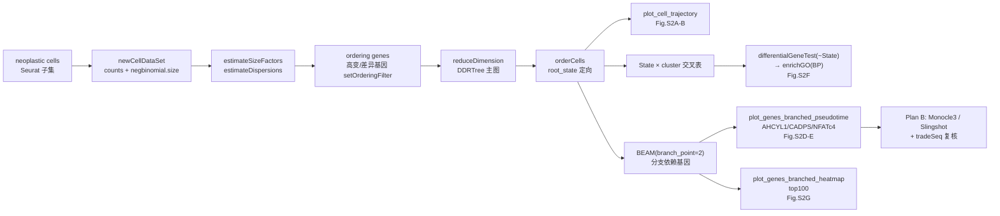

# 05 拟时序轨迹与分支依赖基因（Monocle / BEAM）

> **目标文献**：Wang R, Wu W, et al. *Integrative single-cell and spatial transcriptomic analysis reveals a
> lactate-driven crosstalk between NFATc4⁺ tumor cells and SPP1⁺ macrophages in glioblastoma.*
> *J Transl Med* (2026) 24:1253. DOI: 10.1186/s12967-026-08555-7
>
> **模块对应原文**：Fig. S2A–G；Methods 中「Single-cell pseudotime trajectories were analyzed using the R package "monocle".」一句；Results 中「Pseudotime trajectory analysis reveals dynamic NFATc4 upregulation during neoplastic cell differentiation」整节；Discussion 第 3 段（「NFATc4 was mainly enriched along the astrocyte differentiation branch」）
> **前置依赖**：`02_单细胞QC整合与十大类细胞注释.md`（产出 `processed/seurat_gbm_qc_seurat5.rds`；同内容的 v3 Assay 版本为 `processed/seurat_gbm_qc.rds`。内含 24 cluster → 10 大类注释，肿瘤细胞写作 `Neoplastic`）；本模块的 NFATc4 活性可来自 `04_pySCENIC转录因子调控网络与NFATc4发现.md` 的 AUCell/regulon 打分结果（若尚不可用，先用 NFATc4 基因表达做降级版）
> **复现难度**：★★★★☆　**预计工时**：3 人日　**计算资源**：16 核 CPU / 64 GB 内存（`reduceDimension` 阶段为瓶颈，DDRTree 内存随细胞数近似二次增长；无需 GPU）

---

## 1. 科学问题与逻辑位置

本模块在全文证据链中的位置是**「时间维度」的补证**：

```
scRNA 分群(02) ──► 糖酵解/乳酸打分 + pySCENIC(03/04) ──► NFATc4 是"高乳酸态"的第一相关 TF
                                          │
                                          ▼
                            本模块：neoplastic cells 拟时序(05)
                            ├─ NFATc4 是否在分化后期升高？（方向性）
                            ├─ 它沿哪一支升高？（星形胶质细胞分化分支 → 与"乳酸代谢更高"挂钩）
                            └─ 该分支的 branch-dependent genes（AHCYL1 / CADPS）是谁？
                                          │
                                          ▼
                     空间转录组(06)：NFATc4⁺ 肿瘤细胞与 SPP1⁺ 巨噬细胞是否空间共定位
                                          │
                                          ▼
                     体外实验(Fig.5–6)：NFATc4 敲低 → SPP1↓ / M2 极化↓
```

- **上游输入**：`GSE138794`（5 个 GBM 样本）经 QC + DoubletFinder + Harmony 后的注释对象；`neoplastic cells` 一个亚群（原文未报告该亚群的细胞数，只在 Fig. 2A 报告全局 **12,618 个高质量细胞**）。
- **下游输出**：
  1. `results/05_monocle_state_celltype_crosstab.csv`（State × 大类/cluster 交叉表，用于论证「分支 = 谱系」）；
  2. `results/05_BEAM_branch2_qval_lt_0.01.csv`（分支依赖基因全表）；
  3. `results/05_statedependent_GO_BP.csv`（GO 富集）；
  4. `figures/FigS2A–G_*.pdf`（轨迹图、分支表达曲线、top100 分支依赖基因热图）。
- **它解决什么问题**：pySCENIC 只能给出「高乳酸态细胞里 NFATc4 regulon 活性高」这一**静态相关**。拟时序把静态相关变成**方向性叙述**——「随肿瘤细胞分化推进，NFATc4 逐渐升高」，从而支撑「NFATc4 是被乳酸微环境诱导的、驱动侵袭表型的晚期事件」这一因果假说。这一步是整篇文章叙事从「描述」走向「机制」的关键转折点，也正因为它是叙述的承重墙，它的方法学弱点必须被讲清楚（见 §6、§7）。



---

## 2. 背景知识与原理

### 2.1 细胞「状态转移」与「谱系分岔」是两件不同的事

- **状态转移（state transition）**：细胞沿一条连续轴改变表达程序（如 T 细胞激活的 early → intermediate → late）。它对应轨迹上的一条**路径（trajectory）**，数学上是一条一维流形。
- **谱系分岔（lineage branching）**：一个祖细胞群体分化出两类及以上命运（如 GBM 中「星形胶质细胞样分化」与「少突/神经元样分化」）。它对应轨迹上出现**分叉点（branch point）**，此后每一支有自己的表达程序。

Monocle2 的树结构一次同时给出两者：**主干是状态转移，分叉点是命运抉择**。原文报告的 **2 个分支点、5 个 distinct states** 就是这个树拓扑的描述。⚠️ **导师批注**：肿瘤细胞的「分化」在 GBM 语境下更常指**细胞状态可塑性（cellular plasticity / 干性层级）**，不是发育生物学的单向命运决定。把 pseudotime 读成「发育时间」是本文最容易发生的过度解读，写作时须始终用「拟时序（pseudotime）/ 状态转变顺序」而非「细胞年龄」。

### 2.2 拟时序算法四大流派对比

| 算法 | 降维/图结构 | 拓扑假设 | 是否需指定 root | 分叉检验 API | 优点 | 缺点 |
|---|---|---|---|---|---|---|
| **Monocle2**（Qiu 2017） | **DDRTree**：反向图嵌入学习「主图（principal graph）+ 树脊惩罚」的低维树 | 树（无环） | 需要（`orderCells(root_state=)`），不指定则内部自动挑一个端点 | `BEAM`、`plot_genes_branched_pseudotime` | 分支依赖基因统计框架最成熟；`plot_genes_branched_heatmap` 直接可用 | 树拓扑无法表达环/多分叉；O(n²) 内存；已停止主开发 |
| **Monocle3**（Cao 2019） | UMAP/PCA 低维嵌入 + **Simple Principal Graph（学习得到的主图）** | 主图可含环、可多分叉 | 需要（`order_cells(root_pr_nodes=)`，用交互式 `plot_cells` 点选） | `graph_test(neighbor_graph="principal_graph")` → `morans_I`/`q_value` | 可扩展到数十万细胞；图拓扑更灵活；API 现代 | 分支特异性统计是**图上的空间自相关检验**（Moran's I），语义与 BEAM 不同，q 值不可直接对比 |
| **Slingshot**（Street 2018） | 在任意降维（UMAP/PCA）空间上，以聚类为节点做 **MST + 平滑主曲线** | 平滑曲线集合 | 需 `start.clus` | 需接 **tradeSeq**（`fitGAM` + `patternTest`/`earlyDETest`） | 输入可以是已有 UMAP，最"轻"；统计用可扩展的 GAM | 依赖上游聚类质量；曲线不保证连成生物学合理的树 |
| **PAGA + diffusion map**（Wolf 2019） | **PAGA 图**（cluster 级连通性，基于 k-NN 图跨簇边数）+ diffusion map 扩散伪时间 | 抽象图（可含环） | 需要指定 diffusion 根细胞 | 无内置分支检验；需用 `sc.tl.dpt` + 自定义 GAM | 能可视化「连通性强度」，对不连续轨迹稳健 | PAGA 给的是 cluster 级拓扑，不是细胞级分支 |

**原文用的是 Monocle**（Methods 原句：「Single-cell pseudotime trajectories were analyzed using the R package "monocle".」）。原文**未写版本号、未写 root 策略、未写 ordering genes**。判断依据：原文使用「branch-dependent expression analysis」（分支依赖表达）、「state-dependent genes」（状态依赖基因）、「top 100 branch-dependent genes」（分支依赖基因热图）这套术语，**与 Monocle2 的 `BEAM` + `differentialGeneTest(~State)` API 语义一一对应**，因此本次复现以 **Monocle2** 为主方案，Monocle3 作为 Plan B。

### 2.3 Monocle2 / DDRTree 的数学原理

Monocle2 的核心是把高维表达矩阵 $\mathbf{X} \in \mathbb{R}^{G \times N}$（$G$ 基因、$N$ 细胞）映射到低维树状流形。DDRTree（Mao et al. 2015）联合优化三件事：

$$\min_{\mathbf{W},\,\mathbf{Y},\,\mathbf{Z}} \; \underbrace{\left\|\mathbf{X}^{\top} - \mathbf{W}\mathbf{Z}^{\top}\right\|_F^2}_{\text{反向嵌入：用低维表示重建表达}} \;+\; \gamma\underbrace{\left\|\mathbf{Z} - \mathbf{Y}\mathbf{R}\right\|_F^2}_{\text{细胞到主图节点的软分配}} \;+\; \lambda \underbrace{\sum_{(j,k)\in \mathcal{E}}\left\|\mathbf{y}_j - \mathbf{y}_k\right\|^2}_{\text{树脊惩罚：强制主图为树}}$$

- $\mathbf{Z} \in \mathbb{R}^{N\times K}$：$N$ 个细胞在 $K$ 个主图节点上的软分配（$\sum_k z_{ik}=1$）；
- $\mathbf{Y} \in \mathbb{R}^{K\times d}$：$K$ 个主图节点的低维坐标（$d=2$）；
- $\mathbf{R}$：细胞→节点的对应矩阵；$\mathcal{E}$：主图边集；
- **树脊惩罚**（$\lambda$ 项）是可辨识性的关键：它对主图上存在的边施加平滑约束，从而不允许图出现任意环——这是 Monocle2 输出严格树结构的原因，也是「2 个分支点」这一报告数字的算法来源。

**拟时序**定义为细胞到根节点在图上的**测地距离**：

$$t_i = d_{\text{graph}}\!\left(\hat{k}(i),\; r\right),\qquad \hat{k}(i) = \arg\max_k z_{ik},\qquad r = \text{root 节点}$$

其中 $d_{\text{graph}}$ 是主图边上的最短路（由 `orderCells` 沿主图做广度优先/动态规划求解）。因此 $t_i$ **只在同一棵树内可比，跨数据集、跨参数绝对不可比**——这是全文任何 pseudotime 数值都不能与原文对照报数的根本原因（见 §6 QC）。

**为什么不用 PCA**：PCA 学习的是一张线性子空间（一个超平面），细胞在平面上的分布是"云"，无法表达分叉；DDRTree 学的是**弯曲的树**，因此分叉点被显式建模为一个图节点。**参数对应**：R 中写作 `reduceDimension(cds, reduction_method = "DDRTree")`——注意 Monocle2 的形参名是 `reduction_method`（旧版文档/教程里也写作 `method`），不同版本可能报 `unused argument`，需按 `args(monocle::reduceDimension)` 核对。

### 2.4 伪时间起点（root）是最大的主观性来源

拟时序本质上是一棵**无向树**：算法只告诉你「哪两个细胞离得近」，不告诉你「谁先谁后」。定向完全由 root 决定：换 root，所有 $t_i$ 反转或折向另一支，随之**分支依赖基因的集合、NFATc4 上升方向的解读全部改变**。可选 root 策略：

| 策略 | 做法 | 风险 |
|---|---|---|
| 最长分支末端 | 取主图度数=1 且距其他端点最远的节点为 root | 纯几何，无生物学依据；细胞数少的稀疏端易被选中 |
| 起点细胞指定 | `orderCells(cds, root_state = <含已知祖细胞的 state>)` | 需要外部祖细胞定义 |
| 干细胞标记锚定 | 按 `SOX2 / OLIG2 / POU3F2 / NES` 高表达的细胞所在 state 定 root | GBM 干性标记并非单一 state 专有 |
| CytoTRACE 锚点 | 用 `CytoTRACE2` 打分最高细胞所在 state 定 root（本文 `02_单细胞QC整合与十大类细胞注释.md` 中的 CytoTRACE 打分即为此用） | CytoTRACE 自身依赖「表达基因数 ≈ 分化潜能」假设，在肿瘤中会受 CNV/技术噪声干扰 |
| Monocle 自动 | 不传 `root_state`，让 `orderCells` 内部挑 | **黑箱**：实现细节未在 Monocle2 文档中完全公开，不可用于论文级结论 |

**本次复现决策**：主方案用「CytoTRACE 最高分细胞所在 state」定 root（与原文"分化"框架最一致），并**做三次敏感性分析**（换成长分支末端、干性标记锚定、Monocle 自动），把 NFATc4 上升方向是否稳定写进日志 `logs/05_root_sensitivity.md`。原文未报告 root 策略——这是原文的一个**方法学疏漏**，须在 `13_复现质控清单、排错与批判性评述.md` 中登记。

### 2.5 BEAM 的统计构造：分支依赖基因怎么检验

`BEAM`（Branch Expression Analysis Modeling）对每个基因 $g$ 做**嵌套模型比较**。设细胞 $i$ 的伪时间 $t_i$ 与分支标签 $b_i \in \{1,2\}$（只使用该分支点两端的细胞），Monocle2 用 VGAM 的自然样条拟合：

- **全模型**（表达随分支不同）：$\displaystyle \mathbb{E}[x_{gi}] = f_b(t_i)$，即 $x_{gi} \sim \text{NB}\!\left(\mu_{gi}\right),\; \log \mu_{gi} = \beta_0 + s\!_b(t_i)$，$s_b$ 为按分支分别拟合的样条（R 公式 `~ sm.ns(Pseudotime, df=3) * Branch`）；
- **零模型**（表达与分支无关）：$\log \mu_{gi} = \beta_0 + s(t_i)$（`~ sm.ns(Pseudotime, df=3)`），两支共用一条曲线。

检验统计量是两模型的对数似然比：

$$\Lambda_g = 2\left[\log L\!\left(\hat{\theta}_{\text{full}}\right) - \log L\!\left(\hat{\theta}_{\text{reduced}}\right)\right] \;\sim\; \chi^2_{d},\qquad d = \text{两支样条系数之差（含截距差异）}$$

Monocle2 实际报告的是基于该似然比的 **q value（BH 校正）**，输出表列名为 `pval` / `qval`（`BEAM` 返回的 data.frame 含 `gene_short_name`、`pval`、`qval`、`num_cells_expressed` 等）。**直觉**：一个基因如果只是一个「随伪时间变化的基因（pseudotime-dependent）」，两支曲线形状相同；如果它是「分支依赖基因（branch-dependent）」，两支曲线显著分岔。原文报告 **AHCYL1 先升后降**（两支形状不同 → 分支依赖）、**CADPS 持续上调**（同支单调上升 → 也可能是 pseudotime-dependent，需看 q 值是否通过），因此原文用「branch-dependent」统称时其实混了两种情形。

> ⚠️ **导师批注**：BEAM 的零假设是「两支共用一条平滑曲线」，不是「基因与伪时间无关」。因此**任何一支内部噪声较大、或两支细胞数极不均衡（如 20 : 2000）时，似然比检验的假阳性率会显著高于名义水平**。复现时必须同时报告两支的细胞数，并在 $n_{\text{branch}} < 50$ 时拒绝把该基因写入结论。

---

## 3. 原文方法逐条拆解

| # | 原文表述（中文转述 + 英文关键词） | 对应操作 | 需要设定的参数（原文未给，附我们的取值） |
|---|---|---|---|
| 1 | 「Single-cell pseudotime trajectories were analyzed using the R package "monocle"」（Methods, scRNA-seq 段末） | 对整个 scRNA-seq 对象或亚群跑 Monocle 流程 | 版本未写 → 我们用 `monocle` 2.30+；输入用 `neoplastic cells` 子集 |
| 2 | 「Pseudotime analysis of neoplastic cells using Monocle identified **two branch points and five distinct cellular states**（Fig. S2A–C）」 | `reduceDimension(method="DDRTree")` → `orderCells` → `plot_cell_trajectory(color_by="State")` + `show_branch_points=TRUE` | 主图节点数由 `max_components=2` + DDRTree 自动确定；「星形胶质细胞分化」分支的确定由 state 交叉表确认，**不可硬编码 State 编号**（Monocle 的 State 编号是自动生成的，跨运行会变） |
| 3 | 「NFATc4 expression increased markedly **along one branch after the second branch point**」（Fig. S2D） | `plot_genes_branched_pseudotime(cds, branch_point=2, genes="NFATc4")`；若用 pySCENIC 结果则把 NFATc4 regulon AUCell 分数灌进 `pData(cds)$NFATc4_activity` 后同图 | `branch_point` 编号需从 `plot_cell_trajectory` 图上（或 `cds@auxOrderData`）读实际编号；`df=3` 样条自由度 |
| 4 | 「**AHCYL1** expression peaked and then declined. In contrast, **CADPS** showed sustained upregulation along the same branch」 | `BEAM(cds, branch_point=2)` 取 q 值显著基因，画这两条曲线 | BH 校正；我们用 `qval < 0.01` |
| 5 | 「a pattern associated with unfavorable clinical outcomes at later differentiation stages」 | 属**文献外推**（引文 [38–42]），本模块不产生新数据 | — |
| 6 | 「GO enrichment analysis of **state-dependent genes** highlighted terms such as "cell death" and "gliogenesis"」（Fig. S2F） | `differentialGeneTest(cds, fullModelFormulaStr = "~State")` → 取 qval 显著基因 → `clusterProfiler::enrichGO(ontology="BP")` | `pvalueCutoff=0.05`, `qvalueCutoff=0.2`, `pAdjustMethod="BH"` |
| 7 | 「A heatmap displayed the expression patterns of the **top 100 branch-dependent genes for the second branch**」（Fig. S2G） | `plot_genes_branched_heatmap(cds[top100, ], branch_point=2, num_clusters=6)` | `num_clusters` 原文未写 → 我们用 6，与 state 数 5 接近 |
| 8 | Discussion：「NFATc4 was mainly enriched along the **astrocyte differentiation branch**, suggesting that neoplastic cells derived from astrocyte lineages exhibit higher lactate metabolism」 | 用 astrocyte marker（AQP4/GFAP/S100B/ALDH1L1）在该分支上的表达做交叉验证 + 把乳酸分数叠加到轨迹上 | 该结论**原文没有给出量化指标**（无富集检验 p 值）→ 我们补一个 Fisher 精确检验（NFATc4⁺ 细胞 × 星形胶质细胞分支） |

---

## 4. 逐步可运行代码

> 运行环境：R 4.4.2（与原文一致）；`Seurat` 5.3.0；`monocle`（**Monocle2**，Bioconductor 包，不是 monocle3）；`clusterProfiler` + `org.Hs.eg.db`；Plan B 另需 `slingshot` + `tradeSeq`。
> 具体版本号一律由 01 号文档的 `BiocManager`（Bioc 3.20）决定，安装完用 `packageVersion()` 实测后写入 `logs/`——**不要照抄网上教程里的版本号**（不同 Bioc 版本配不同小版本）。
> 所有脚本落盘到 `code/05_*`，随机种子 `set.seed(20260101)`，末尾 `sessionInfo()` 写入 `logs/05_sessionInfo.txt`。

### 4.1 输入准备：从 Seurat 对象抽出 neoplastic cells

```r
# code/05_01_prepare.R
library(Seurat); library(monocle); library(Matrix)
set.seed(20260101)
so <- readRDS("processed/seurat_gbm_qc_seurat5.rds")   # 02 号文档产物
# neoplastic cells 由 02 文档用 inferCNV 判定；celltype 字段名按 02 的实际输出核对
neo <- subset(so, subset = celltype == "Neoplastic" | celltype == "neoplastic cells")
# 关键：子集化的 Seurat 对象里 LayerData 可能只剩 counts 层（Seurat v5 Assay5）
counts_neo <- LayerData(neo, assay = "RNA", layer = "counts")
cat("neoplastic cells n =", ncol(counts_neo), "\n")   # 原文未报告；写入日志
saveRDS(neo, "processed/05_neoplastic_subset.rds")
```

**要点**：Monocle2 必须吃**raw counts**（非标准化矩阵），因为它内部用负二项/`negbinomial.size()` 建模并自行估计 size factor。若误传 `NormalizeData` 后的对数矩阵，`negbinomial.size()` 的 dispersion 估计会崩（报 `Error in ... : NA/NaN/Inf in foreign function call`）。

### 4.2 构建 CellDataSet：`expressionFamily` 怎么选

```r
# code/05_02_cds.R
pd <- new("AnnotatedDataFrame", data = neo@meta.data)
fd <- new("AnnotatedDataFrame",
          data = data.frame(gene_short_name = rownames(counts_neo),
                            row.names = rownames(counts_neo)))

cds <- newCellDataSet(as(counts_neo, "dgCMatrix"),
                      phenoData      = pd,
                      featureData    = fd,
                      lowerDetectionLimit = 0.5,
                      expressionFamily    = negbinomial.size())
cds <- detectGenes(cds, min_expr = 0.1)
print(head(fData(cds)))
cds <- cds[fData(cds)$num_cells_expressed >= 10, ]   # 去掉极稀疏基因，稳定 dispersion 估计
cds <- estimateSizeFactors(cds)
cds <- estimateDispersions(cds)
```

| `expressionFamily` | 含义 | 适用 | 对轨迹的影响 |
|---|---|---|---|
| `negbinomial.size()` | 负二项，size factor 由 `estimateSizeFactors` 估计，**要求 raw counts** | UMI 数据（10x）——**原文即 10x，选它** | 最贴近 10x 噪声结构；`estimateDispersions` 会做 dispersion 拟合，耗时但稳 |
| `negbinomial()` | 负二项，size factor 固定为文库大小 | UMI 数据但不想跑 `estimateSizeFactors` | 结果与 `.size()` 略有差异，DDRTree 树形可能微变 |
| `uninormal()` | 正态分布（未转换的对数表达） | **TPM/RPKM/FPKM** 等非整数数据 | 用 UMI counts 强行配 `uninormal()` 会低估零膨胀，主图分叉位置漂移 |
| `gaussianff()` / `tobit()` | 高斯 / 截断高斯 | 微阵列、log 转换数据 | 同 `uninormal()` 的问题 |

> ⚠️ **导师批注**：`expressionFamily` 是**最容易被忽略却最影响分支形状**的参数。同一份 counts 用 `negbinomial.size()` 与 `uninormal()` 跑出来的 DDRTree 主图，分支点位置和 State 数目都可能不同（前者更倾向于把 dropout 细胞压在主干上）。复现时若「5 states」对不上，**第一个要排查的就是这个参数**，而不是先怀疑细胞数。

### 4.3 选 ordering genes（决定轨迹的人为选择）

```r
# code/05_03_ordering.R
# 方案 A（推荐，原文"state-dependent genes"暗示用差异基因）：按 cluster 找差异基因
diff_clu <- differentialGeneTest(cds, fullModelFormulaStr = "~seurat_clusters",
                                 cores = 8)   # 慢，~10–30 min；建议先抽样 2000 细胞试跑
ord_genes <- row.names(subset(diff_clu, qval < 0.01))
cds <- setOrderingFilter(cds, ord_genes)

# 方案 B（备选）：高变基因
# ord_genes <- VariableFeatures(neo); cds <- setOrderingFilter(cds, ord_genes)

# 方案 C（Monocle 惯例）：dispersion 最高的若干基因
# disp_table <- dispersionTable(cds)
# ord_genes <- subset(disp_table, mean_expression >= 0.1 &
#                     dispersion_empirical >= 1 * dispersion_fit)$gene_id
# cds <- setOrderingFilter(cds, ord_genes)

plot_ordering_genes(cds)   # 黑点=被选为 ordering genes
```

**直觉**：ordering genes 是「定义伪时间坐标轴的基因」。用管家基因当轴 → 轨迹反映技术噪声；用 cluster 差异基因当轴 → 轨迹反映细胞异质性。**方案 A 与方案 B 的树形差异通常小于 `expressionFamily` 带来的差异，但都需在日志中记录基因数**（我们用 A，基因数写入 `logs/05_ordering_genes.txt`）。

### 4.4 DDRTree 降维

```r
# code/05_04_ddr.R
cds <- reduceDimension(cds,
                       max_components        = 2,
                       reduction_method      = "DDRTree",  # 旧版形参名为 method，需核对
                       norm_method           = "log",      # 仅在有 size factor 后生效
                       pseudo_expr           = 1,
                       scaling               = TRUE,       # 对 ordering genes 做 z-score，稳定主图
                       verbose               = FALSE,
                       auto_param_selection  = TRUE)       # 自动选 ncenter，可手动覆盖
```

**资源提示**：DDRTree 的主图节点数 `ncenter` 在 `auto_param_selection = TRUE` 时**由程序自动估算**——Monocle2 并未公开该启发式的具体公式，不同版本估出的值也不同，**不要凭"细胞数/1000"之类的经验公式去假设**；跑完直接看图上的节点/分支密度，或打印主图对象核对即可。内存与时间对细胞数、主图节点数都敏感。若 neoplastic cells 超过 ~2 万，建议：(a) 用 Monocle3；或 (b) 先用 `sc.pp.subsample` 类方法分层降采样至 1 万细胞跑一次确认拓扑，再回到全量慢跑一次。

### 4.5 `orderCells`：定 root

```r
# code/05_05_root.R
cds <- orderCells(cds)                     # 先不给 root，得到无向树与 State 编号
plot_cell_trajectory(cds, color_by = "State", show_branch_points = TRUE) + ggtitle("undirected")

# --- root 选择（主方案）：CytoTRACE 最高分细胞所在的 State ---
library(CytoTRACE)
ct <- CytoTRACE(as.matrix(counts_neo), ncores = 8, subsamplesize = 1000)
cds$CytoTRACE <- ct$CytoTRACE[colnames(cds)]        # 与 colnames(cds) 对齐后再赋值
root_cell  <- names(which.max(cds$CytoTRACE))
root_state <- pData(cds)$State[match(root_cell, rownames(pData(cds)))]
cds <- orderCells(cds, root_state = root_state)

# --- 敏感性分析 1：最长分支末端（主图端点中到其他端点图距离最大者）---
# 用 igraph 从 cds@reducedDimS 的主图节点/边重建图（见下方辅助函数 get_graph_endpoints()）
# --- 敏感性分析 2：干性标记锚定（SOX2/OLIG2/POU3F2/NES 平均表达最高的 State）---
# --- 敏感性分析 3：orderCells(cds) 的自动 root ---

plot_cell_trajectory(cds, color_by = "Pseudotime")            # Fig. S2A 风格
plot_cell_trajectory(cds, color_by = "State", show_branch_points = TRUE)  # Fig. S2B
plot_cell_trajectory(cds, color_by = "celltype")               # Fig. S2C 风格
ggsave("figures/FigS2A_trajectory_pseudotime.pdf", width = 5, height = 5)
```

辅助函数（重建主图端点，供敏感性分析使用）：

```r
# code/05_utils.R
get_graph_endpoints <- function(cds) {
  # cds@reducedDimK: 主图节点在低维空间的坐标（K x 2）
  # DDRTree 的边在 cds@auxOrderData 或通过 cellPairwiseDistances 推断；
  # 稳妥做法是用 igraph 对 K 个节点做完全图的最小生成树，模拟主图拓扑
  K <- t(cds@reducedDimK)
  D <- as.matrix(dist(K))
  g <- igraph::mst(igraph::graph_from_adjacency_matrix(D, weighted = TRUE, mode = "undirected"))
  V(g)$name <- rownames(K)
  endpoints <- V(g)$name[igraph::degree(g) == 1]
  list(graph = g, endpoints = endpoints)
}
```

> ⚠️ **导师批注**：`cds@reducedDimK` / `auxOrderData` 属 Monocle2 内部槽位，不同小版本字段可能变化。这段代码只用于**敏感性分析**，不进入论文级结论；如字段缺失，退化为「用 `plot_cell_trajectory(show_branch_points=TRUE)` 目视读出端点，手工指定 root」。

### 4.6 State 与分支的对应：可复现「5 states」的具体做法

```r
# code/05_06_state_crosstab.R
ct_tab <- table(pData(cds)$State, neo$celltype[match(rownames(pData(cds)), colnames(neo))])
write.csv(as.data.frame.matrix(ct_tab), "results/05_monocle_state_celltype_crosstab.csv")

ct_clu <- table(pData(cds)$State, pData(cds)$seurat_clusters)
write.csv(as.data.frame.matrix(ct_clu), "results/05_monocle_state_seuratcluster_crosstab.csv")

# 每个 State 的行归一化比例 + 卡方/Fisher 检验"State 是否与 cluster 独立"
chisq.test(ct_clu, simulate.p.value = TRUE, B = 10000)
```

**判据（Go / No-Go）**：
1. `length(unique(pData(cds)$State)) == 5` → 与原文「5 distinct states」一致，Go；
2. 「2 个分支点」的读法：`plot_cell_trajectory(show_branch_points=TRUE)` 上标记的分支点（黑点）数量 = 2，Go；
3. State 编号**不必**与原文一致（Monocle 编号是自动的）；一致性通过**交叉表语义**判断：预期出现「祖端 State（SOX2/OLIG2 高、Pseudotime 低）+ 星形胶质细胞支终末 State（AQP4/GFAP/S100B 高）+ 另一支终末 State」的结构。

### 4.7 识别「星形胶质细胞分化分支」

```r
# code/05_07_astro_branch.R
ast_markers <- c("AQP4", "GFAP", "S100B", "ALDH1L1", "SLC1A2")
cds_ast <- cds[intersect(ast_markers, rownames(fData(cds))), ]
plot_genes_branched_pseudotime(cds_ast, branch_point = 2, ncol = 1)   # 目视该支是否特异上调
ggsave("figures/FigS2_astro_markers_branch.pdf", width = 6, height = 8)

# 量化：把"星形胶质细胞 signature 高分"的细胞与"该支"做 2x2 列联表 + Fisher 精确检验
ast_score <- colMeans(t(scale(t(as.matrix(LayerData(neo, "data")[intersect(ast_markers, rownames(neo)), ])))))
cds$ast_score <- ast_score[colnames(cds)]
# Branch 编号从 plot_cell_trajectory(..., show_branch_points = TRUE) 上读出后写死在脚本里
branch_of_interest <- 2L
writeLines(paste0("branch_of_interest = ", branch_of_interest), "logs/05_branch_of_interest.txt")
# ⚠️ Monocle2 不保证把 Branch 列写进 pData：不同小版本里分支归属可能只存在于
#    cds@auxOrderData$Branch。这里做一次兜底，避免"找不到 Branch 列"直接中断。
branch_vec <- if ("Branch" %in% colnames(pData(cds))) {
  pData(cds)$Branch
} else if (!is.null(cds@auxOrderData) && "Branch" %in% colnames(cds@auxOrderData)) {
  cds@auxOrderData$Branch
} else {
  stop("取不到分支归属：先跑 buildBranchCellDataSet(cds, branch_point = 2) 生成带 Branch 列的对象")
}
branch_cells <- which(branch_vec == branch_of_interest)
tab <- table(ast_hi = cds$ast_score > median(cds$ast_score),
             on_branch = seq_len(ncol(cds)) %in% branch_cells)
fisher.test(tab)     # 期望 ast_hi 与 on_branch 显著正关联（OR > 1, p < 0.05）
```

> ⚠️ **导师批注**：原文的「星形胶质细胞分化分支」**只有定性叙述，没有给出统计检验**（Discussion 原句为 "we found that NFATc4 was mainly enriched along the astrocyte differentiation branch"）。这是全文中最"软"的一处因果推断：GBM 中 astrocyte-like 状态与正常星形胶质细胞共享 marker，用 marker 打分做分支归属存在「参考污染」风险（见 `02_单细胞QC整合与十大类细胞注释.md` 中 normal/tumor 划分的 QC）。我们必须补 Fisher 检验 + 用 inferCNV 确认这些细胞确是 aneuploid（肿瘤），否则该结论应降级为「与 astrocyte-like program 相关的分支」。

### 4.8 BEAM：分支依赖基因

```r
# code/05_08_beam.R
beam_res <- BEAM(cds, branch_point = 2, progenitor_method = "duplicate", cores = 8)
beam_res <- beam_res[order(beam_res$qval), ]          # 只按 q 值对行排序（不要动列）
write.csv(beam_res, "results/05_BEAM_branch2_all.csv")
beam_sig <- subset(beam_res, qval < 0.01)
cat("branch-dependent genes (qval<0.01):", nrow(beam_sig), "\n")   # 原文未报告该数字

# Fig. S2D：NFATc4 沿该支升高
plot_genes_branched_pseudotime(cds["NFATc4", ], branch_point = 2, ncol = 1)
# Fig. S2E：AHCYL1 先升后降 / CADPS 持续上调
plot_genes_branched_pseudotime(cds[c("AHCYL1", "CADPS"), ], branch_point = 2, ncol = 2)
ggsave("figures/FigS2DE_branched_genes.pdf", width = 8, height = 4)
```

**若用 pySCENIC 的 regulon 活性代替单个基因表达**（更贴近原文「NFATc4 activity」的措辞，原文 Discussion 用的是 "NFATc4 activity gradually increased"）：

```r
# 04 号文档的产物是 results/aucell_mtx.csv（cell × regulon AUC，行名 = cell barcode）
auc <- as.matrix(read.csv("results/aucell_mtx.csv", row.names = 1))
auc_col <- grep("^NFATC4\\(\\+\\)", colnames(auc), value = TRUE)[1]   # regulon 名形如 "NFATC4(+)"
stopifnot(!is.na(auc_col))
common <- intersect(colnames(cds), rownames(auc))
pData(cds)$NFATc4_activity <- NA
pData(cds)$NFATc4_activity[match(common, rownames(pData(cds)))] <- auc[common, auc_col]
plot_genes_branched_pseudotime(cds, branch_point = 2,
                               color_by = "NFATc4_activity")   # pData 列名与 04 号文档的 regulon 名务必先对齐
```

### 4.9 top100 分支依赖基因热图（Fig. S2G）

```r
# code/05_09_branched_heatmap.R
# 若本脚本独立运行（未与 05_08 同会话），先从落盘结果读回：
beam_res <- read.csv("results/05_BEAM_branch2_all.csv", row.names = 1)
beam_sig <- subset(beam_res, qval < 0.01)
top100 <- head(row.names(beam_sig), 100)
## 该函数基于 pheatmap 绘制（不是 ComplexHeatmap），最稳的导出方式是"开设备直接画"：
pdf("figures/FigS2G_branch2_top100_heatmap.pdf", width = 8, height = 12)
plot_genes_branched_heatmap(cds[top100, ],
                            branch_point = 2,
                            num_clusters = 6,
                            cores = 8,
                            use_gene_short_name = TRUE,
                            show_rownames = TRUE)
dev.off()
## 若要把图对象交给下游拼图：用 return_heatmap = TRUE，并先核对返回值的字段名
## （不同 Monocle 版本为 $ph 或 $heatmap，绘制用 grid::grid.draw(hm$gtable)），不要直接
## 把返回值喂给 ComplexHeatmap::draw()。
```

### 4.10 state-dependent genes 与 GO 富集（Fig. S2F）

```r
# code/05_10_statedep_go.R
state_deg <- differentialGeneTest(cds, fullModelFormulaStr = "~State", cores = 8)
sig_state <- subset(state_deg, qval < 0.01)
write.csv(sig_state, "results/05_statedependent_genes.csv")

library(clusterProfiler); library(org.Hs.eg.db)
eg <- bitr(rownames(sig_state), fromType = "SYMBOL", toType = "ENTREZID", OrgDb = org.Hs.eg.db)
ego <- enrichGO(gene = eg$ENTREZID, OrgDb = org.Hs.eg.db, ont = "BP",
                pAdjustMethod = "BH", pvalueCutoff = 0.05, qvalueCutoff = 0.2,
                readable = TRUE)
write.csv(as.data.frame(ego), "results/05_statedependent_GO_BP.csv")
dotplot(ego, showCategory = 15) + ggtitle("state-dependent genes, GO BP")
ggsave("figures/FigS2F_state_GO_BP.pdf", width = 7, height = 7)

# 核对：结果中应能检到 "cell death"（GO:0008219）与 "gliogenesis"（GO:0042063）两条
grep("gliogenesis|cell death", as.data.frame(ego)$Description, value = TRUE, ignore.case = TRUE)
```

### 4.11 Plan B：Monocle3 等价复现

```r
# code/05_11_monocle3.R
library(monocle3); library(SeuratWrappers)
cds3 <- as.cell_data_set(neo)                 # Seurat → Monocle3（保留 clusters）
cds3 <- preprocess_cds(cds3, num_dim = 50)
cds3 <- align_cds(cds3, alignment_group = "orig.ident")   # 5 个样本的批次
cds3 <- reduce_dimension(cds3, reduction_method = "UMAP")
cds3 <- cluster_cells(cds3, resolution = 1e-3)
cds3 <- learn_graph(cds3, use_partition = TRUE)
# 交互式选 root：plot_cells(cds3) 后用鼠标点根节点
cds3 <- order_cells(cds3)                     # 交互式；脚本化时传 root_pr_nodes
p3 <- graph_test(cds3, neighbor_graph = "principal_graph", cores = 8)  # 分支依赖基因
p3_sig <- subset(p3, q_value < 0.01)
```

### 4.12 Plan B：Slingshot + tradeSeq

```r
# code/05_12_slingshot.R
library(slingshot); library(tradeSeq); library(SingleCellExperiment)
sce <- as.SingleCellExperiment(neo)
# 根 cluster 的确定必须与 Monocle2 主方案一致：取 CytoTRACE 平均分最高的 cluster
neo$CytoTRACE <- ct$CytoTRACE[colnames(neo)]
root_cluster <- names(which.max(tapply(neo$CytoTRACE, neo$seurat_clusters, mean)))
writeLines(paste0("root_cluster = ", root_cluster), "logs/05_root_cluster_slingshot.txt")
sce <- slingshot(sce, clusterLabels = "seurat_clusters", reducedDim = "UMAP",
                 start.clus = root_cluster)
sds <- SlingshotDataSet(sce)
pseudotime(sds)                                # 细胞 × 谱系 的伪时间矩阵

# tradeSeq: 分支依赖基因（GAM，可扩展）
counts_neo <- as.matrix(LayerData(neo, "counts"))
sce_gam <- fitGAM(counts = counts_neo, pseudotime = slingshot::slingPseudotime(sce),
                  cellWeights = slingshot::slingCurveWeights(sce),
                  nknots = 6, parallel = TRUE, BPPARAM = BiocParallel::MulticoreParam(8))
res_pat  <- patternTest(sce_gam)               # 谱系间表达模式差异（≈ BEAM 的等价物）
res_early <- earlyDETest(sce_gam, knots = c(1, 2))
```

> ⚠️ **导师批注**：**Monocle2 / Monocle3 / Slingshot 的 pseudotime 数值不可直接比较**。它们各自定义在自有的低维图上，尺度由树的直径决定；同一细胞在三套流程下的伪时间可能一个 3.2、一个 11.7、一个 0.41。**只有方向（单调性）与分支归属是可比较的**。复现报告中只报告「NFATc4 沿该支显著单调上升（Spearman $\rho>0$，p<0.05）」，不报告绝对伪时间。

---

## 5. 参数解释与调参空间

| 参数 | 含义 | 原文取值 | 我们的取值 | 可选范围 | 改变后的后果 |
|---|---|---|---|---|---|
| `expressionFamily` | 表达分布族 | 未写 | `negbinomial.size()` | `negbinomial`/`uninormal`/`gaussianff` | 改族 → 主图形状、分支点数与 State 数可能变（最敏感参数，见 §4.2） |
| `lowerDetectionLimit` | 基因"检出"阈值 | 未写 | `0.5`（UMI 惯例；旧教程用 0.1） | 0.1–1 | 影响 `detectGenes` 的 `num_cells_expressed`，进而影响基因过滤 |
| ordering genes | 定义伪时间轴 | 未写 | cluster DEG，`qval<0.01` | HVG / dispersion / DEG / 全部基因 | 决定轨迹反映什么；用全部基因 → 管家基因主导，轨迹失去生物学意义 |
| `max_components` | 主图维度 | 未写 | 2（可视化的默认） | 2–4 | >2 时 HighDist 更大，分叉更容易被识别，但无法直接画 2D 轨迹图 |
| `reduction_method` | 降维方法 | 未写（推断 DDRTree） | `"DDRTree"` | DDRTree / ICA / tSNE | 换 ICA/tSNE → 无树脊约束，`orderCells` 的树结构退化 |
| `auto_param_selection` | 自动选 `ncenter` | 未写 | `TRUE` | TRUE/FALSE | `FALSE` 时须手给 `ncenter`；节点数少 → 分支点少（可能把「2 个分支点」压成 1 个） |
| `root_state` | 伪时间起点 | 未写（**疏漏**） | CytoTRACE 最高分 State | 任意 State | **最主观参数**：换 root → 方向反转 → NFATc4"升高"变"降低" |
| `branch_point` | 用哪个分支点做 BEAM | 未写 | 2（对应原文"second branch point"） | 1 或 2 | 改编号 → 分支依赖基因集合完全不同 |
| `BEAM(progenitor_method)` | 分叉前"祖细胞"如何分配到两支 | 未写 | `"duplicate"` | `duplicate` / `sequential_split`（Monocle2 仅这两个取值，需 `?BEAM` 核对） | `duplicate` 把每个祖细胞在各支各复制一份，两支曲线从同一初始状态出发、对称性最好；`sequential_split` 按伪时间交替分配，更快但对称性差 |
| `BEAM` q 值阈值 | 显著性 | 未写 | `qval < 0.01` | 0.001–0.05 | 关系到分支依赖基因集合大小；top100 热图需保证有 ≥100 个候选 |
| `enrichGO(pvalueCutoff/qvalueCutoff)` | GO 阈值 | 未写 | 0.05 / 0.2 | 常规 | 过松 → 出现大量泛化条目，"cell death"/"gliogenesis" 淹没在噪声里 |
| `num_clusters`（热图） | 分支热图的行聚类数 | 未写 | 6 | 4–10 | 决定能否读出"先升后降 / 持续上调"两类模式 |

---

## 6. 预期结果与 QC 检查点

### 6.1 原文报告的确切数字

| 项目 | 原文数值 | 出处 |
|---|---|---|
| 分支点数 | **2** | Results / Fig. S2A–C |
| distinct states 数 | **5** | Results / Fig. S2A–C |
| NFATc4 变化 | 第二个分支点之后沿**某一支**显著升高 | Fig. S2D |
| 分支依赖基因 1 | **AHCYL1**：先升后降 | Fig. S2E |
| 分支依赖基因 2 | **CADPS**：沿同支持续上调 | Fig. S2E |
| 状态依赖基因 GO | **"cell death"**、**"gliogenesis"** | Fig. S2F |
| 分支热图规模 | 第二个分支的 **top 100** 分支依赖基因 | Fig. S2G |
| Discussion | NFATc4 主要富集于**星形胶质细胞分化分支** | Discussion 第 3 段 |
| neoplastic cells 细胞数 | **原文未报告**（全局 12,618 个细胞） | Fig. 2A |

### 6.2 允许波动范围与 Go / No-Go

| 指标 | 允许波动 | 判据 | 不合格时的首选排查 |
|---|---|---|---|
| State 数 | 4–6 | `== 5` 记 Go；4 或 6 记为「与原拓扑近似，需人工合并/拆分后说明」 | `expressionFamily` → `ncenter`/`auto_param_selection` → ordering genes |
| 分支点数 | 1–3 | `== 2` Go；其他值须在报告中解释（small-branch 合并是常见原因） | `max_components`、ordering genes、细胞数降采样 |
| NFATc4 在该支的单调性 | Spearman $\rho$ 同号 | 沿分支 pseudotime 的 $\rho>0$ 且 `p<0.05` | root 定向是否正确 |
| AHCYL1 形态 | 峰形（先升后降） | 目视 + 分段斜率检验（升段斜率>0、降段斜率<0） | `df` 样条自由度、两支细胞数是否均衡 |
| CADPS 形态 | 单调上升 | 目视 + Spearman | 同上 |
| GO 条目 | 至少要能检索到 `cell death` 与 `gliogenesis` | `grep` 命中 | 基因数太少（提高 qval 阈值）或 `ont` 写错（本文用 BP） |
| 分支细胞数均衡性 | 每支 ≥ 50 细胞 | 低于 50 → 该支的 BEAM 结果不作为结论 | 检查 rare state 是否被 `ncenter` 压缩 |
| 运行可复现性 | 重跑拓扑一致 | 同 seed 下 State 数不变（DDRTree 的主图学习含随机初始化，存在少量随机性） | 记录 `set.seed()`；比对 `orderCells` 前后 State 数 |

### 6.3 落盘日志清单

```
logs/05_sessionInfo.txt              # sessionInfo()
results/05_ordering_genes.txt        # ordering genes 数量与来源（A/B/C 方案）
results/05_monocle_state_celltype_crosstab.csv
results/05_BEAM_branch2_all.csv
results/05_statedependent_genes.csv
results/05_statedependent_GO_BP.csv
logs/05_root_sensitivity.md          # 4 种 root 策略下 NFATc4 方向是否稳定
logs/05_branch_cell_counts.txt       # 每个 branch 的细胞数（BEAM 前提）
```

---

## 7. 常见陷阱与排错表

| # | 现象 | 根因 | 解决 |
|---|---|---|---|
| 1 | NFATc4 在「另一支」上更高，与原文相反 | `root_state` 选择不同 → 伪时间方向翻转，两支的语义互换 | 显式指定 root 并做 4 种策略敏感性分析；只报告方向一致性；**不要**为了"对上原文"而反复换 root（这是 p-hacking） |
| 2 | `reduceDimension` 跑到 OOM / 数小时不结束 | DDRTree 内存与时间对细胞数近似二次增长；ordering genes 过多（如用全部基因） | 减少 ordering genes（用 DEG）；用 Monocle3 或降采样至 ~1 万细胞；`auto_param_selection = FALSE` 后手动调小 `ncenter`（先打印自动估计值再决定调多少） |
| 3 | State 数只有 3–4，凑不出「5 states」 | `ncenter` 太小 / `expressionFamily` 不匹配 / 细胞数过少 | 先 `estimateDispersions` 是否成功（看是否有 NA）；调 `auto_param_selection`；确认输入是 raw counts |
| 4 | 换 `uninormal()` 后分支形状大幅变化 | 分布族与实际数据不匹配（UMI counts 被当作连续数据） | 回到 `negbinomial.size()`；把二者差异写进日志作为敏感性分析 |
| 5 | BEAM 返回几百个分支依赖基因，但曲线看起来一样 | 似然比检验在两支细胞数极不均衡时的假阳性 | 同时报告各支细胞数；加效应量过滤（如两支在分支末端表达差 ≥ 0.5 log2）；用 Monocle3/tradeSeq 交叉验证 |
| 6 | `plot_genes_branched_heatmap` 报 `Error: subscript out of bounds` | 传入的 `cds` 子集的基因不在 BEAM 结果中 / 基因名大小写不一致 | 用 `row.names(beam_sig)` 精确切片；确认 `featureData` 的 `gene_short_name` |
| 7 | 把 pseudotime 当「细胞年龄」解读 | 概念性错误：pseudotime 是**相对图上距离**，无绝对时间单位 | 全部表述改用「拟时序/状态转变顺序」；不报告绝对伪时间数值；跨数据集不可比 |
| 8 | 用 NormalizeData 后的矩阵喂给 `newCellDataSet` | Monocle2 的 `negbinomial.size()` 需要 raw counts | 传 `layer = "counts"`；若数据只有 TPM 才用 `uninormal()` |
| 9 | `estimateDispersions` 极慢或不收敛 | 基因数过多（保留了低表达基因） | `detectGenes(min_expr=0.1)` 后过滤 `num_cells_expressed >= 10` |
| 10 | 「星形胶质细胞分支」结论被审稿人质疑 | astrocyte marker 打分无法区分肿瘤细胞的 astrocyte-like program 与真正的正常星形胶质细胞 | 汇报"分支与 astrocyte-like program 相关"，并附 Fisher 检验 + inferCNV 拷贝数证据；不声称"星形胶质细胞谱系来源" |
| 11 | State 编号与原文对不上 | Monocle2 的 State 编号是自动分配的（与 `orderCells` 的图遍历顺序有关） | 用「语义对应」而非编号对应：低伪时间 + 干性高 = 祖端；AQP4/GFAP 高 = 星形胶质细胞支 |
| 12 | `differentialGeneTest(~State)` 返回 0 个显著基因 | `fullModelFormulaStr` 中的字段名不在 `pData(cds)` 里（Monocle 不认 Seurat 的 metadata） | 先把 `neo@meta.data` 整个灌进 `phenoData`，并核对 `names(pData(cds))` |

---

## 8. 与原文图表的对应关系表

| 原文图 | 内容 | 本模块产出的文件 |
|---|---|---|
| Fig. S2A | neoplastic cells 的拟时序轨迹（按伪时间着色） | `figures/FigS2A_trajectory_pseudotime.pdf` |
| Fig. S2B | 轨迹按 State 着色（含分支点标记） | `figures/FigS2B_trajectory_state.pdf` |
| Fig. S2C | 轨迹拓扑与 State 概览（5 states / 2 branch points） | `results/05_monocle_state_seuratcluster_crosstab.csv` + `figures/FigS2B_*.pdf` |
| Fig. S2D | NFATc4 在第二个分支点后沿某支升高 | `figures/FigS2DE_branched_genes.pdf`（第 1 面板） |
| Fig. S2E | AHCYL1（先升后降）、CADPS（持续上调）的分支表达曲线 | `figures/FigS2DE_branched_genes.pdf`（第 2–3 面板） |
| Fig. S2F | state-dependent genes 的 GO 富集（cell death / gliogenesis） | `figures/FigS2F_state_GO_BP.pdf` + `results/05_statedependent_GO_BP.csv` |
| Fig. S2G | 第二个分支 top 100 分支依赖基因热图 | `figures/FigS2G_branch2_top100_heatmap.pdf` |
| Fig. 2A（依赖） | 12,618 细胞 UMAP（neoplastic 子集的上游） | 由 `02_单细胞QC整合与十大类细胞注释.md` 产出 |
| Discussion 第 3 段（依赖） | 「astrocyte differentiation branch」的定性陈述 | `results/05_monocle_state_celltype_crosstab.csv` + `logs/05_astro_branch_fisher.txt`（我们补充的 Fisher 检验） |

---

### 附：一句话给下一个模块

拟时序模块的**结论只在"方向"层面可靠**：NFATc4 在分化晚期升高、AHCYL1/CADPS 是分支依赖基因、state-dependent genes 富集到 cell death/gliogenesis。任何绝对伪时间、任何"分支 = 星形胶质细胞谱系"的强因果表述，都应在 `13_复现质控清单、排错与批判性评述.md` 中标为「需额外证据」。下一模块（`06_空间转录组反卷积与共定位.md`）承担把「状态」落到「空间位置」的任务，其 spot 级共定位结论同样受空间分辨率的硬约束。
