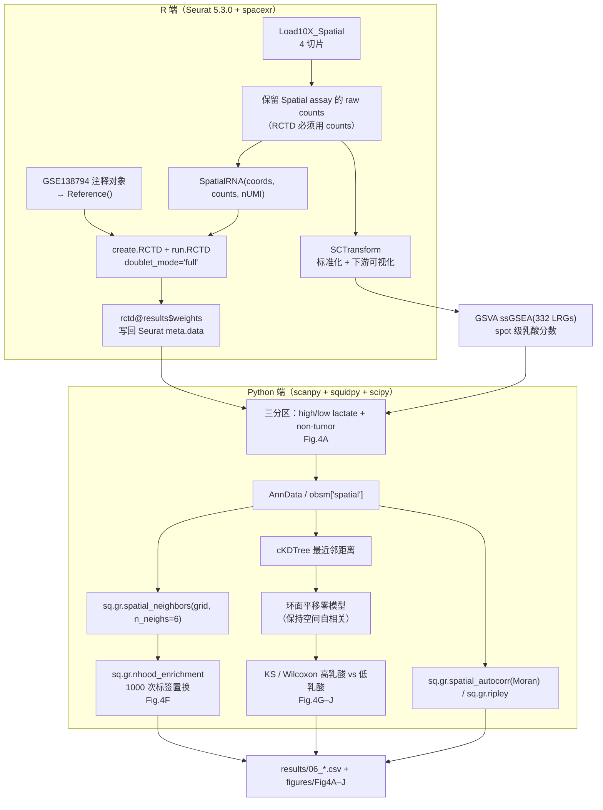

# 06 空间转录组反卷积（RCTD）与 NFATc4⁺ 肿瘤–SPP1⁺ 巨噬细胞空间共定位

> **目标文献**：Wang R, Wu W, et al. *Integrative single-cell and spatial transcriptomic analysis reveals a
> lactate-driven crosstalk between NFATc4⁺ tumor cells and SPP1⁺ macrophages in glioblastoma.*
> *J Transl Med* (2026) 24:1253. DOI: 10.1186/s12967-026-08555-7
>
> **模块对应原文**：Fig. 4A–J、Fig. S3；Methods 中「Spatial transcriptomics analysis」整段；Results 中「Spatial transcriptomics reveals colocalization and interaction between NFATc4⁺ neoplastic cells and SPP1⁺ macrophages」整节；Discussion 中「predominantly located in the tumor's central regions」
> **前置依赖**：`02_单细胞QC整合与十大类细胞注释.md`（产出 `processed/seurat_gbm_qc_seurat5.rds`，作为 RCTD 的 scRNA 参考；本文件早期草稿曾写作 `seurat_gbm_annotated.rds`，**以 02 号文档的正式名为准**）；参见 `05_拟时序轨迹与分支依赖基因.md`（提供 NFATc4 的细胞状态背景）；原始数据 `GSE194329`（4 个切片 GSM5833533/34/35/36 的 Space Ranger `outs/`）
> **复现难度**：★★★★★　**预计工时**：5 人日　**计算资源**：32 核 CPU / 128 GB 内存（RCTD `doublet_mode="full"` 在 4 切片 ~12k spot 上单次约 20–60 min，`max_cores` 建议 16–32）；Python 端 cKDTree + 1000 次置换约 10 min

---

## 1. 科学问题与逻辑位置

本模块是全文**「共定位 → 通讯 → 功能」**证据链中最关键也最脆弱的一环：

```
单细胞(02/03/04)：高乳酸态 neoplastic cells 里 NFATc4 regulon 活性高
拟时序(05)：NFATc4 沿分化晚期/星形胶质细胞样分支升高
                    │
                    ▼
      本模块(06)：把"状态"落到"空间位置"
      ├─ 11,970 个 spot 上，NFATc4 高表达区与乳酸高分区分是否重合？（Fig.4A）
      ├─ NFATc4⁺ 肿瘤区与 SPP1⁺ 巨噬细胞区的空间共定位是否显著？（Fig.4B–C）
      ├─ 邻域富集 z-score 的符号与幅度？（Fig.4F）
      ├─ 最近邻距离分布是否短程富集？（Fig.4G–H）
      └─ 高乳酸区 vs 低乳酸区的最近邻距离是否更小？（Fig.4I–J）
                    │
                    ▼
      CellChat(空间)：SPP1–受体轴信号最强（Fig.4D–E）
                    │
                    ▼
      体外实验(Fig.5–6)：NFATc4 敲低 → SPP1↓、M2 极化↓
```

- **上游输入**：`GSE194329` 的 4 个 Visium 切片（**共 11,970 个 spot**）；`GSE138794` 注释后的 scRNA 参考（细胞类型均值谱）。
- **下游输出**：
  1. `results/06_rctd_weights_GSM5833533.csv`（及其余 3 张）—— spot × celltype 权重矩阵；
  2. `processed/06_visium_annotated.h5ad`—— 含 `region`（high_lactate/low_lactate/non_tumor）、`lactate_score`、RCTD 权重与空间坐标；
  3. `results/06_nhood_enrichment_zscore.csv`、`results/06_NN_distance_distribution.csv`；
  4. `figures/Fig4A–J_*.pdf`、`figures/FigS3_*.pdf`（剩余两个切片 GSM5833535/36）。
- **它解决什么问题**：单细胞只能告诉你「同一样本里同时存在 NFATc4⁺ 肿瘤细胞与 SPP1⁺ 巨噬细胞」；空间转录组才能告诉你这两群细胞**是否挨着**。在 GBM 中，"挨着"是旁分泌（paracrine）假说的最低门槛证据。**注意这只是相关性证据**——原文 Discussion 也自承 "the current data are mainly correlative and do not fully establish a direct causal regulatory relationship"。



---

## 2. 背景知识与原理

### 2.1 10x Visium 的技术参数与文件结构

Visium 的组织学分辨率**不是单细胞分辨率**。必须先把这几个数字刻进脑子：

| 参数 | 数值 | 后果 |
|---|---|---|
| spot 直径 | **55 µm** | 每个 spot 内通常有 **1–10 个细胞**；GBM 肿瘤组织细胞密度高，实际常达 5–20 个 |
| spot 中心间距 | **100 µm**（六边形排布） | 「短程互作」的物理尺度下限就是 100 µm；比细胞直径（~10 µm）大一个数量级 |
| capture area | 6.5 mm × 6.5 mm，共 **4,992 个 spot** | 每张切片最多 ~5,000 spot，4 张切片理论上限 ~2 万 spot，与 **11,970** 个 on-tissue spot 的量级一致 |
| 每 spot UMI | 通常 1,000–10,000（视组织 RNA 含量） | 低深度 → dropout 严重 → 单基因表达噪声大 |
| 每 spot 基因数 | 通常 500–3,000 | **< 1000 基因的 spot 需要不同的反卷积模式**（见 §2.2） |

Space Ranger `outs/` 的标准结构（原文 GSE194329 的每个 GSM 目录下）：

```
GSM5833533/
├── filtered_feature_bc_matrix.h5        # spot × gene 的 raw UMI counts（唯一"真"数据）
├── filtered_feature_bc_matrix/          # 同一数据的 mtx 版本
│   ├── barcodes.tsv.gz  features.tsv.gz  matrix.mtx.gz
└── spatial/
    ├── tissue_positions.csv             # barcode, in_tissue, array_row, array_col,
    │                                    #   pxl_row_in_fullres, pxl_col_in_fullres
    ├── scalefactors_json.json           # tissue_hires_scalef, tissue_lowres_scalef,
    │                                    #   fiducial_diameter_fullres, spot_diameter_fullres
    ├── tissue_hires_image.png           # 高分辨率 HE（与低分辨率都用于叠加可视化）
    ├── tissue_lowres_image.png
    ├── aligned_fiducials.jpg            # 对位基准点（用于核对图像/坐标是否错位）
    └── detected_tissue_image.jpg        # 组织检测结果
```

> ⚠️ **导师批注（陷阱预告）**：旧版 Space Ranger（< 2.0）的文件名是 `tissue_positions_list.csv`（**无表头**），新版是 `tissue_positions.csv`（**有表头**）。`Load10X_Spatial` 会自动识别，但如果你手写读入代码，列序号错一位 → 所有 spot 坐标整体错位、共定位结论全错。这是本模块最容易踩且最难发现的坑。

**坐标与物理距离的换算**：
- `array_row` 步长 1 = **100 µm**（y 方向）；`array_col` 步长 2 = **100 µm**（x 方向，因为相邻行在列方向错开半个 spot）。
- 因此两个 spot 的物理距离：$d_{\mu m} = 100 \times \sqrt{\Delta\text{row}^2 + (\Delta\text{col}/2)^2}$。
- 从 `pxl_*_in_fullres` 换算：$\mu m/px = 55 / \texttt{spot\_diameter\_fullres}$；也可用 $100 / d_{px}(\text{相邻 spot})$ 交叉验证，两者不一致说明 `scalefactors_json.json` 与 `tissue_positions.csv` 不是同一批产物。

### 2.2 RCTD（Robust Cell Type Decomposition）的原理

RCTD（Cable et al., *Nat Biotechnol* 2022）把每个 spot 的表达看作**多个细胞类型表达谱的混合**，用带平台效应校正的泊松混合模型求解比例。

**Step 1：参考构建。** 从 scRNA-seq 计算每种细胞类型 $k$ 的均值谱 $\lambda_{k,g}$：

$$\lambda_{k,g} = \frac{1}{|C_k|}\sum_{i \in C_k} \frac{y_{ig}}{N_i} \cdot \bar{N}_{\text{ref}} \cdot \gamma_g$$

其中 $N_i$ 是细胞 $i$ 的 UMI 总数，$\bar N_{\text{ref}}$ 为参考集的平均深度，**$\gamma_g$ 是基因特异性的平台效应因子**（由参考数据估计的 overdispersion 项）——这正是 RCTD 的"Robust"所在：它显式建模了 scRNA（高深度、低 dropout）与 Visium（低深度、高 dropout）之间的技术差异，而不是假设两者可比。

**Step 2：spot 似然。** spot $s$ 在基因 $g$ 上的 UMI 计数 $y_{sg}$ 服从

$$y_{sg} \sim \mathrm{Poisson}\!\left(N_s \sum_{k=1}^{K} w_{sk}\,\lambda_{k,g}\right),\qquad \sum_{k} w_{sk} = 1,\; w_{sk} \ge 0$$

对数似然：

$$\log L \;=\; \sum_{g} \left[\, y_{sg} \log\!\left(\sum_k \lambda_{k,g}\, w_{sk}\right) \;-\; \sum_k \lambda_{k,g}\, w_{sk} \,\right]$$

（常数项 $-\log(y_{sg}!)$ 与 $w$ 无关，已略去；$N_s$ 已吸收进 $\lambda$ 的标度。）这是一个**带单纯形约束的凸优化问题**，RCTD 用 EM/坐标上升迭代求解 $w_{sk}$。

**Step 3：两种模式的差别（关键）**

| 模式 | 约束 | 适用 | 输出语义 |
|---|---|---|---|
| `doublet_mode = "doublet"` | 每个 spot **至多 2 个非零权重**，且给出"主类型 + 次类型"的组合 | 每个 spot 基因数 **< 1000** 的稀疏 spot（数据不足以支撑多类型拟合） | 每个 spot 的 `spot_class`（singlet / doublet_certain / doublet_uncertain / reject）与两类权重 |
| `doublet_mode = "full"` | 允许 $K$ 类非零，加稀疏约束（`MAX_MULTI_TYPES` 上限） | **基因数 ≥ 1000** 的 spot、组织复杂度高（GBM！） | 完整的 spot × celltype 权重矩阵 |

> ⚠️ **导师批注**：`run.RCTD` 的 `doublet_mode` 是**整个对象级别的参数**，RCTD **不支持逐 spot 混用模式**。实践中三种做法：(a) 全切片按基因数中位数统一选模式（我们用 full，因为 GBM 组织 RNA 含量高）；(b) 把低基因数 spot 单独拆成一个 `SpatialRNA` 跑 doublet 模式，再把权重合并回主矩阵（注意两套权重的标度一致性，需重新行归一化）；(c) 直接过滤掉基因数 < 500 的 spot。哪种都必须写进日志。

### 2.3 decoupleR ULM：TF 活性推断的原理与边界

RCTD 给的是「spot 里有哪些细胞」，decoupleR 给的是「spot 里 NFATc4 这个 TF 的**活性**有多高」——两者是不同层次的问题。

**ULM（Univariate Linear Model）**：对每个 TF $s$ 和每个 spot $j$，在 $s$ 的靶基因集合 $T_s$ 上拟合一个**单变量线性模型**：

$$\hat\beta_{s,j} = \arg\min_{\beta} \sum_{g \in T_s} \left(x_{gj} \;-\; \beta\, w_{gs}\right)^{2},\qquad \text{score}_{s,j} = \frac{\hat\beta_{s,j}}{\mathrm{se}\!\left(\hat\beta_{s,j}\right)}$$

其中 $x_{gj}$ 是靶基因 $g$ 在 spot $j$ 的表达（标准化后），$w_{gs}\in\{-1,+1\}$（或连续权重）是 regulon 中该靶基因的方向（`mor`，mode of regulation，来自 pySCENIC 的 regulon 输出）。**得分是回归系数的 t 统计量**，符号代表方向（正 = 靶基因整体上调）。

"Univariate" 的含义：**每个 TF 独立拟合，不建模 TF 之间的相互作用**。因此：

| 维度 | decoupleR ULM | AUCell |
|---|---|---|
| 数学形式 | 线性回归的 t 值 | 靶基因在细胞排序列表中的 **AUC**（秩和） |
| 是否用权重 | **用**（`mor` 方向、可给连续权重） | 不用（只用 membership） |
| 是否参数化 | 参数化（需要近似正态假设） | 非参数（对 dropout 稳健） |
| 与 pySCENIC 结果可比性 | 与 SCENIC 的 AUCell 分数**不在同一尺度**，但方向应一致 | 与 pySCENIC 原生输出同源 |
| 适用 | spot 级（细胞混合、表达更平滑） | 单细胞级（稀疏） |

> ⚠️ **导师批注**：原文 Methods 说「Transcription factor activity was inferred using the Univariate Linear Model (ULM) algorithm implemented in the "decoupleR" package」，用的是 **ULM**；而单细胞模块用的是 **pySCENIC（AUCell 内核）**。两者不可直接比较数值。复现时若发现 ULM 与 AUCell 的 NFATc4 排名不一致，**先检查 regulon 的 `mor` 是否被正确传入**（默认全 +1 时，一个靶基因方向矛盾的 regulon 得分会被稀释为 0）。

### 2.4 squidpy neighborhood enrichment：置换检验的原理与它的问题

`sq.gr.nhood_enrichment` 给的是**细胞类型标签在空间邻接图上的共现显著性**：

1. 由 `sq.gr.spatial_neighbors` 构建邻接图 $G=(V,E)$（Visium 用 `coord_type="grid", n_neighs=6`，即六边形 6 邻居）；
2. 对标签对 $(a,b)$，统计观测共现边数
$$O_{ab} = \sum_{(i,j)\in E} \mathbb{1}\{c_i = a\} \cdot \mathbb{1}\{c_j = b\}$$
3. **随机置换标签** $c^{(p)}$ 共 $P$ 次，得到零分布 $\{O^{(p)}_{ab}\}_{p=1}^{P}$；
4. 计算 z-score 与经验 p 值：
$$z_{ab} = \frac{O_{ab} - \overline{O_{ab}^{(p)}}}{\mathrm{sd}\!\left(O_{ab}^{(p)}\right)},\qquad p_{ab} = \frac{1 + \#\{p : O_{ab}^{(p)} \ge O_{ab}\}}{P + 1}$$

**致命假设**：完全随机置换标签**破坏了标签场的空间自相关结构**。真实空间数据的标签是强空间自相关的（相邻 spot 大概率同类），因此零分布被"过分随机化"→ 观测值几乎必然远离零分布 → **z-score 绝对值被系统性高估**（常见到 |z| > 50，p < 1e-300）。原文 Fig. 4F 报告的是 "significant enrichment"，但没给 z-score 数值——这正是我们需要明说的统计学问题。

**补救方案（三选一或并用）**：
1. **环面平移（toroidal shift）零模型**：对整个标签场做循环平移（wrap-around translation），保持标签场的自相关结构，只破坏与目标标签的相对位置关系（本模块 §5.3 给出实现）；
2. **Ripley's K / L 函数**：`sq.gr.ripley(adata, cluster_key=..., mode="K")`，量纲为物理距离，不需要置换；
3. **Moran's I 空间自相关**：`sq.gr.spatial_autocorr(mode="moran")`，检验单个基因/分数的空间聚集性。

### 2.5 空间距离统计的三种写法

| 统计量 | 定义 | 回答的问题 | 本模块用途 |
|---|---|---|---|
| 最近邻距离（NN distance） | $d_i^{\mathrm{NN}} = \min_{j \in B} \|p_i - p_j\|$ | A 类 spot 到最近的 B 类 spot 有多远 | Fig. 4G–I：NFATc4⁺ 到 SPP1⁺ 的距离分布 |
| Ripley's K | $\hat K(r) = \frac{|A|}{n(n-1)}\sum_{i}\sum_{j \ne i}\mathbb{1}(d_{ij} \le r)$；$L(r)=\sqrt{\hat K(r)/\pi}-r$ | 在半径 $r$ 内 A 类的邻居数是否多于完全空间随机（CSR） | 空间聚集性（$L(r)>0$ = 聚集） |
| 共定位相关系数 | 两个 spot 级分数的 Pearson/Spearman $r$ | 两群细胞的比例在空间上同增同减 | Fig. 4B：NFATc4 分数 vs SPP1 分数的散点 |

**距离分布比较的正确姿势**：比较 high-lactate 与 low-lactate 两组的 NN 距离，**不能用独立样本 t 检验**（spot 之间空间不独立，距离高度自相关，会严重低估标准误）。正确做法：(a) 用**置换检验**（打乱分组标签或做环面平移）得到经验 p 值；(b) 报告效应量（中位数差、AUC of ROC）而非只看 p；(c) 补充 **KS 检验**描述整条分布曲线的差异（但同样要谨慎解读 p 值）。

---

## 3. 原文方法逐条拆解

| # | 原文表述（中文转述 + English keywords） | 对应操作 | 关键参数（原文未给 → 我们的取值） |
|---|---|---|---|
| 1 | 「Spatial Transcriptomic sequencing data (**GSE194329**)…included **four GBM samples**」（Methods） | 下载 4 个 GSM 的 Space Ranger `outs/` | 切片：**GSM5833533 / GSM5833534 / GSM5833535 / GSM5833536** |
| 2 | 「Spatial transcriptomics data (GSE194329, encompassing **11,970 spots**) were deconvoluted to map lactate metabolic activity」（Results） | 4 切片合并后的 on-tissue spot 总数 | 允许 ±5%（不同 Space Ranger 版本/`in_tissue` 过滤会略有差异）；**必须逐切片记录 spot 数并求和** |
| 3 | 「The Seurat R package was used to process and interpret spatial transcriptomics data. Data were **normalized using the SCTransform** function in Seurat」（Methods） | `SCTransform(vis, assay="Spatial", new.assay.name="SCT")` | `variable.features.n=3000`、`method="glmGamPoi"`（快）；**注意顺序：RCTD 必须在 SCTransform 之前或保留原始 assay**（见 §4.2 导师批注） |
| 4 | 「we use the "**spacexr**" R package to perform **Robust Cell Type Decomposition (RCTD) deconvolution for spot annotation**」（Methods） | `Reference()` + `SpatialRNA()` + `create.RCTD()` + `run.RCTD()` | `doublet_mode="full"`（GBM 组织复杂）；`max_cores=32`；`UMI_min=100`；`CELL_MIN_INSTANCE=25`；**参考来源原文未报告**（我们用 GSE138794，见 §4.3） |
| 5 | 「NFATc4 expression across tissue regions (classified as **high-lactate, low-lactate, and non-tumor areas**)」（Fig. 4A） | spot 级乳酸打分 + 三分区标签 | 打分：`GSVA::gsva(method="ssgsea")` + **332 LRGs**；分区阈值原文未报告 → 我们用「tumor 权重 < 0.25 判为 non-tumor，其余按乳酸分数中位数二分」 |
| 6 | 「Spatial **colocalization** analysis confirmed the **proximity** between SPP1⁺ macrophages and NFATc4⁺ neoplastic cells」（Fig. 4B） | spot 级 NFATc4 分数 vs SPP1 分数相关 + 双分数空间热图 | 定义 NFATc4⁺/SPP1⁺ spot 的表达分位阈值：我们用 top 25%（原文未报告） |
| 7 | 「macrophage-enriched regions…are shown in Fig. 4C」 | 巨噬细胞权重（RCTD）+ SPP1 表达叠加空间图 | — |
| 8 | 「CellChat analysis of spatially resolved data identified **strong interaction signals** between SPP1⁺ macrophages and NFATc4⁺ neoplastic cells」（Fig. 4D–E） | 以 RCTD 反卷积定义 spot 的"细胞类型标签"→ 折叠成伪 bulk 群组 → `CellChat` 分析 | GBM 用 `CellChatDB.human` + `computeCommunProb(type="triMean")`；⚠️ `createCellChat()` 的 `datatype` **默认 `"RNA"`**，折叠伪 bulk 时无坐标 → 距离核不生效（见 §4.6 导师批注）；详见 `07_细胞通讯CellChat与NFATc4-SPP1轴.md` |
| 9 | 「**significant enrichment** observed between SPP1⁺ macrophages and NFATc4⁺ neoplastic cells」（Fig. 4F） | `sq.gr.nhood_enrichment` + `sq.pl.nhood_enrichment(mode="zscore")` | `n_perms=1000`、`seed=20260101`、`n_neighs=6`（六边形） |
| 10 | 「distance distribution analysis demonstrated an **accumulation of short-range interactions**…rather than being randomly distributed」（Fig. 4G） | NN 距离分布 + 置换零模型 | 零模型：**环面平移 1000 次**（保持空间自相关），而非简单打乱坐标 |
| 11 | 「The overall **nearest spatial proportion** of NFATc4⁺ neoplastic cells was located in proximity to SPP1⁺ macrophages」（Fig. 4H） | 每个 NFATc4⁺ spot 的最近邻标签统计（饼图/条形图） | — |
| 12 | 「mean **nearest-neighbor distances** were compared between the **high and low lactate groups**, revealing **reduced spatial separation under high-lactate conditions**」（Fig. 4I） | 分组 NN 距离均值/中位数 + 检验 | 检验：置换检验（主）+ Mann-Whitney U（辅，须标注空间非独立性局限） |
| 13 | 「density distribution analysis demonstrated an enrichment of short-range interactions…**in high-lactate regions** compared with low-lactate regions」（Fig. 4J） | KDE / 直方图 + KS 检验 | `seaborn.kdeplot`，`bw_adjust` 需报告 |
| 14 | 「Transcription factor activity was inferred using the **ULM** algorithm in "decoupleR"」（Methods） | `decoupleR::run_ulm(mat, net)` | `minsize=5`；network 来自 pySCENIC regulon |
| 15 | 「The **SciPy spatial distance module** and **NumPy and Pandas** were used to perform **spatial correlation coefficients** and **distance-based analysis**. Visualization…using **Matplotlib**」（Methods） | `scipy.spatial.cKDTree` / `distance_matrix`；`numpy.corrcoef` | KDTree 用 `k=1`（最近邻）、`k=6`（六邻域） |
| 16 | 「NFATc4…**predominantly located in the tumor's central regions**」（Discussion） | 分区图目视 + 可选：用组织边界距离量化"中央/边缘" | 原文为定性描述，无量化指标 → 我们补「spot 到组织边界的距离」连续变量 + Wilcoxon |
| 17 | 「The spatial transcriptomic analysis in the remaining…slides (**GSM5833535 and GSM5833536**) is presented in Fig. S3」 | 四切片全部跑一遍，两张主图 + 两张补充 | 四张必须用**同一套参数**（否则不可比） |

---

## 4. 逐步可运行代码 —— R 端

> 环境：R 4.4.2；`Seurat` 5.3.0；`spacexr` 2.2.1（GitHub `dmcable/spacexr`）；`GSVA` 1.50.0；`CellChat` 2.1.2；`Matrix`、`data.table`。
> 会话信息落盘 `logs/06_sessionInfo.txt`；Python 端 `pip freeze > logs/requirements.lock`。

### 4.1 读入 4 张 Visium 切片

```r
# code/06_01_load_visium.R
library(Seurat); library(spacexr); library(Matrix); library(data.table)
set.seed(20260101)

gsm <- c("GSM5833533", "GSM5833534", "GSM5833535", "GSM5833536")
root <- "raw/spatial/GSE194329"

vis_list <- lapply(gsm, function(s) {
  d <- file.path(root, s)
  # Load10X_Spatial 自动读 filtered_feature_bc_matrix.h5 与 spatial/*
  x <- Load10X_Spatial(data.dir = d,
                       filename  = "filtered_feature_bc_matrix.h5",
                       assay     = "Spatial",
                       slice     = s)
  x$orig.ident <- s
  x$slice      <- s
  x
})
names(vis_list) <- gsm

# 逐切片记录 spot 数（用于核对 11,970）
spot_counts <- sapply(vis_list, ncol); print(spot_counts); print(sum(spot_counts))
write.csv(spot_counts, "results/06_spot_counts_per_slice.csv")

# 坐标与比例因子自检：核对 tissue_positions.csv 与 scalefactors_json.json 是否配套
sf <- jsonlite::fromJSON(file.path(root, gsm[1], "spatial", "scalefactors_json.json"))
tp <- fread(file.path(root, gsm[1], "spatial", "tissue_positions.csv"))
stopifnot(all(c("barcode","in_tissue","array_row","array_col",
                "pxl_row_in_fullres","pxl_col_in_fullres") %in% names(tp)))
um_per_px <- 55 / sf$spot_diameter_fullres                     # 55 µm = spot 直径
# 交叉验证：相邻 spot（array_row 差 1）的中心距应为 100 µm
d_px <- with(tp[order(array_row)], dist(head(cbind(pxl_col_in_fullres, pxl_row_in_fullres), 100)))
cat("µm/px =", um_per_px, "  cross-check 100µm =", 100 / um_per_px, "px\n")
```

> ⚠️ **导师批注（极易踩）**：Seurat v5 里 `merge()` 会把多个 `Spatial` 对象的 **image 槽位丢掉**（只剩一个），因此`SpatialDimPlot` 会报错或画错图。**推荐两种做法**：(a) 全程用 `list` 逐切片处理、逐切片出图（原文本就是"每两张切片一张主图 + Fig. S3 补充"的结构，天然适合）；(b) 若必须合并，用 `merge()` 后手工 `vis[["sliceX"]] <- Read10X_Image(...)` 重新挂回每张图像。

### 4.2 SCTransform 与「先反卷积还是先标准化」的顺序问题

```r
# code/06_02_sct.R
for (s in gsm) {
  x <- vis_list[[s]]
  # (1) 先备份 raw counts（RCTD 必须用 counts；SCTransform 会替换 counts 槽！）
  counts_raw <- LayerData(x, assay = "Spatial", layer = "counts")
  saveRDS(counts_raw, file.path("processed", paste0("06_counts_", s, ".rds")))

  # (2) SCTransform 用于下游可视化（FeaturePlot / CellChat 伪 bulk）
  x <- SCTransform(x, assay = "Spatial", new.assay.name = "SCT",
                   method = "glmGamPoi",
                   variable.features.n = 3000,
                   return.only.var.genes = FALSE,   # 关键：不要只留 3000 个基因，
                                                    # 否则后续 CellChat / module score 会缺基因
                   verbose = FALSE)
  x <- RunPCA(x, assay = "SCT", npcs = 30, verbose = FALSE)
  vis_list[[s]] <- x
}
saveRDS(vis_list, "processed/06_visium_sct_list.rds")
```

> ⚠️ **导师批注**：原文 Methods 顺序是「SCTransform → RCTD」。**这个顺序在实现层面是危险的**：Seurat 的 `SCTransform` 默认覆盖 `counts` 槽为 Pearson 残差（放在 `SCT` assay 的 `scale.data`），原 `Spatial` assay 的 `counts` 虽保留，但若你误把 `SCT` assay 或 `scale.data` 传给 `SpatialRNA()`，RCTD 会给出**极其离谱的权重**（负值被截断为 0、权重全塌到 1–2 类）而不报错。**我们的复现决策**：显式保存 raw counts，RCTD 只用 `layer = "counts"`；在日志中打印 `range(counts_raw)` 确认是非负整数。

### 4.3 RCTD 全流程（参考来自 GSE138794）

```r
# code/06_03_rctd.R
library(spacexr); library(Matrix)

# ---- 参考：GSE138794 注释后的 scRNA（02 文档产出）----
ref <- readRDS("processed/seurat_gbm_qc_seurat5.rds")   # 02 号文档的正式产物名（规范名，见 PROJECT_SPEC.md §2.3）
# 只保留我们关心的层级：10 大类细胞（neoplastic cells / macrophages / T cells / astrocytes /
# oligodendrocytes / stem cells / neurons / endothelial cells / innate lymphoid cells / fibroblasts）
ref <- subset(ref, subset = !is.na(celltype))
counts_ref <- as.matrix(LayerData(ref, assay = "RNA", layer = "counts"))
cell_types <- factor(ref$celltype); names(cell_types) <- colnames(ref)
nUMI_ref   <- colSums(counts_ref)

# 关键：检查每类细胞是否够多（CELL_MIN_INSTANCE 之前先自查）
print(table(cell_types))     # 任一类 < 25 时 create.RCTD 会把该类整体丢弃并 warning

reference <- Reference(counts_ref, cell_types, nUMI_ref, n_max_cells = 10000)

# ---- 目标：逐切片反卷积 ----
for (s in gsm) {
  counts_sp <- readRDS(file.path("processed", paste0("06_counts_", s, ".rds")))
  x <- vis_list[[s]]
  # 注意：Seurat v5 的 GetTissueCoordinates() 对 VisiumV1 返回的是 imagerow/imagecol
  #（旧版 Seurat / 别的包返回 x/y），列名必须先核对再改名——SpatialRNA 强制要求列名 x / y。
  tc <- GetTissueCoordinates(x)
  print(head(tc)); print(colnames(tc))            # 先看清你的版本给的是什么列名
  xy_cols <- if (all(c("x", "y") %in% colnames(tc))) c("x", "y") else c("imagecol", "imagerow")
  coords <- data.frame(x = tc[[xy_cols[1]]], y = tc[[xy_cols[2]]])
  rownames(coords) <- rownames(tc)

  spatialRNA <- SpatialRNA(coords, counts_sp, colSums(counts_sp))

  # create.RCTD 参数（部分版本签名不同，请用 args(spacexr::create.RCTD) 核对）
  rctd <- create.RCTD(spatialRNA, reference,
                      max_cores         = 32,
                      test_mode         = FALSE,
                      gene_cutoff       = 0.000125,   # 参考中最小平均表达
                      fc_cutoff         = 0.5,        # 参考细胞类型间的 logFC 过滤
                      gene_cutoff_reg   = 0.0002,
                      fc_cutoff_reg     = 0.75,
                      UMI_min           = 100,        # spot UMI 下限（低于此的 spot 被丢弃）
                      UMI_max           = 2e6,
                      UMI_min_sigma     = 300,        # 拟合 sigma 时的 UMI 下限
                      CELL_MIN_INSTANCE = 25,         # 参考中每类最少细胞数（低于则丢弃该类）
                      MAX_MULTI_TYPES   = 4)          # full 模式下每个 spot 最多混合的类型数

  # 模式选择：按基因数中位数决定（RCTD 不支持逐 spot 混用）
  nGene_med <- median(Matrix::colSums(counts_sp > 0))
  mode <- if (nGene_med >= 1000) "full" else "doublet"
  cat(s, "median genes/spot =", nGene_med, "-> mode =", mode, "\n")

  rctd <- run.RCTD(rctd, doublet_mode = mode)
  saveRDS(rctd, file.path("processed", paste0("06_rctd_", s, ".rds")))

  w <- as.matrix(rctd@results$weights)              # spot × celltype（行和为 1）
  stopifnot(all(abs(rowSums(w) - 1) < 1e-6))
  fwrite(as.data.frame(w), file.path("results", paste0("06_rctd_weights_", s, ".csv")),
         row.names = TRUE)
  if (mode == "doublet") {
    fwrite(rctd@results$results_df,
           file.path("results", paste0("06_rctd_doublet_class_", s, ".csv")), row.names = TRUE)
  }
}
```

**关于 `min_count`**：网络教程里常出现的 `min_count` 在多数 `spacexr` 版本中并不出现在 `create.RCTD` 的签名里；与之功能相近的是 **DE 基因筛选** `get_de_genes(rctd, fc_thresh = 0.5, expr_thresh = 0.00015, MIN_OBS = 3)` 和 `create.RCTD` 的 `gene_cutoff` / `fc_cutoff`。**必须用 `args(spacexr::create.RCTD)` 和 `args(spacexr::get_de_genes)` 逐版本核对**，不要照抄本段。

```r
# 快速自查（跑正式流程前必做）
args(spacexr::create.RCTD); args(spacexr::run.RCTD); args(spacexr::Reference)
```

### 4.4 参考图谱的适用性：必须显式声明的三个问题

1. **同源性**：GSE194329（Visium，人 GBM）与 GSE138794（scRNA-seq，人 GBM）都是人 GBM，**同物种、同瘤种**，这是跨平台反卷积可行的前提。若换成小鼠模型参考（如 GL261 体外数据），必须做 ortholog 映射并只保留 1:1 直系同源基因。
2. **是否需要整合**：RCTD 的 `Reference()` 只用**每类细胞的均值谱**，不做批次校正。因此**不需要** Harmony；但**需要**在构建参考前确认 GSE138794 的 5 个样本之间注释一致（用 `02` 文档的 `celltype` 字段，而不是各自的 `seurat_clusters`）。
3. **原文未报告参考来源**——这是必须写进复现报告的假设。替代方案：把参考换成只保留「neoplastic cells / macrophages / T cells / astrocytes / oligodendrocytes / endothelial cells」6 类（减少稀有类别的权重挤压），作为**敏感性分析**跑一遍，比较 NFATc4 高分区的位置是否稳定。

### 4.5 把权重写回 Seurat、spot 级乳酸分数、三分区

```r
# code/06_04_region.R
library(GSVA)
lrgs <- readLines("raw/LRG_332_TableS2.txt")   # 332 个乳酸相关基因（Table S2）

for (s in gsm) {
  x  <- vis_list[[s]]
  w  <- as.matrix(fread(file.path("results", paste0("06_rctd_weights_", s, ".csv")),
                        data.table = FALSE))
  rownames(w) <- w[, 1]; w <- w[, -1]
  common <- intersect(colnames(x), rownames(w))

  # (1) 权重写回
  x$tumor_weight <- NA_real_
  x$mac_weight   <- NA_real_
  x$tumor_weight[match(common, colnames(x))] <- rowSums(w[common, c("neoplastic cells"), drop = FALSE])
  x$mac_weight  [match(common, colnames(x))] <- rowSums(w[common, c("macrophages"), drop = FALSE])

  # (2) spot 级乳酸分数：ssGSEA（与单细胞模块同一套 332 LRGs，保证可比）
  counts_sp <- readRDS(file.path("processed", paste0("06_counts_", s, ".rds")))
  gs <- gsva(expr = as.matrix(counts_sp),
             gset.idx.list = list(LRG = intersect(lrgs, rownames(counts_sp))),
             method = "ssgsea", kcdf = "Poisson", abs.ranking = TRUE,
             min.sz = 10, max.sz = Inf, parallel.sz = 8)
  x$lactate_score <- as.numeric(gs["LRG", colnames(x)])

  # (3) NFATc4 / SPP1 的 spot 级表达（SCT 标准化后的 log 值）
  x$NFATc4_expr <- as.numeric(LayerData(x, assay = "SCT", layer = "data")["NFATc4", ])
  x$SPP1_expr   <- as.numeric(LayerData(x, assay = "SCT", layer = "data")["SPP1",   ])

  # (4) 三分区（我们的复现决策；原文未报告阈值）
  is_nontumor <- is.na(x$tumor_weight) | x$tumor_weight < 0.25
  thr <- median(x$lactate_score[!is_nontumor], na.rm = TRUE)
  x$region <- ifelse(is_nontumor, "non_tumor",
              ifelse(x$lactate_score >= thr, "high_lactate", "low_lactate"))
  x$region <- factor(x$region, levels = c("high_lactate", "low_lactate", "non_tumor"))

  # (5) NFATc4⁺ / SPP1⁺ spot 定义（top 25% 表达 + 反卷积权重约束）
  x$NFATc4_pos <- x$NFATc4_expr >= quantile(x$NFATc4_expr, 0.75) & x$tumor_weight >= 0.5
  x$SPP1_pos   <- x$SPP1_expr   >= quantile(x$SPP1_expr,   0.75) & x$mac_weight   >= 0.5

  vis_list[[s]] <- x
  print(table(x$region, useNA = "ifany"))
}
saveRDS(vis_list, "processed/06_visium_annotated_list.rds")

# (6) 供 Python 端使用：把 fullres 像素坐标写进 meta.data，再导出 h5ad
#     （§5.1 的 a.obs[["pxl_col_in_fullres","pxl_row_in_fullres"]] 依赖这一步）
for (s in gsm) {
  x <- vis_list[[s]]
  img <- x@images[[s]]                       # VisiumV1 对象
  x$pxl_col_in_fullres <- img@coordinates[colnames(x), "imagecol"]
  x$pxl_row_in_fullres <- img@coordinates[colnames(x), "imagerow"]
  vis_list[[s]] <- x
  # 导出：SeuratDisk::SaveH5Seurat(x, paste0("processed/06_visium_", s, ".h5Seurat")) 后
  # Convert(..., dest = "h5ad")；或 sceasy::convertFormat(x, from="seurat", to="anndata",
  # outFile=paste0("processed/06_visium_", s, ".h5ad"), assay="SCT", main_layer="data")
}
saveRDS(vis_list, "processed/06_visium_annotated_list.rds")
```

### 4.6 出图（Fig. 4A–C）与空间数据的 CellChat（Fig. 4D–E）

```r
# code/06_05_plots_cellchat.R
x <- vis_list[["GSM5833533"]]
SpatialDimPlot(x, group.by = "region", image.alpha = 0.3, pt.size.factor = 1.6) +
  scale_fill_manual(values = c(high_lactate = "#D7263D", low_lactate = "#1B98E0",
                               non_tumor = "#E8E8E8"))
ggsave("figures/Fig4A_region_GSM5833533.pdf", width = 5, height = 5)

SpatialFeaturePlot(x, features = "NFATc4_expr", image.alpha = 0.3, pt.size.factor = 1.6)
ggsave("figures/Fig4A_NFATc4_GSM5833533.pdf", width = 5, height = 5)

p <- data.frame(NFATc4 = x$NFATc4_expr, SPP1 = x$SPP1_expr, region = x$region)
ggplot(p, aes(NFATc4, SPP1, color = region)) + geom_point(size = 0.6, alpha = 0.6) +
  geom_smooth(method = "lm", se = FALSE) + theme_classic()   # Fig. 4B 风格

# ---- CellChat on spatial：用 RCTD 权重把 spot 折叠成"伪细胞群"----
library(CellChat)
# 做法：对每个 celltype，用权重做加权平均得到该类型的"空间伪 bulk"表达谱
# ⚠️ 重要（已核对 CellChat 源码）：`createCellChat()` 的 `datatype` 默认是 "RNA"。
#    下面的对象只有 C 条（C = 细胞类型数）伪 bulk 表达谱、**没有坐标**，因此
#    computeCommunProb 会走 RNA 分支（console 打印 ">>> Run CellChat on sc/snRNA-seq data <<<"），
#    空间距离核 P.spatial ≡ 1 —— 也就是说**这一版并不含距离约束**，它是"该类型在整张切片上的
#    平均通讯倾向"，不是严格意义的"空间通讯"。若真要启用距离核，必须改用
#    datatype="spatial" + coordinates=<每个 spot 的坐标> + spatial.factors，
#    而那时操作单位必须是 spot（见 07_细胞通讯CellChat与NFATc4-SPP1轴.md §4.8 方案 B）。
cch_list <- lapply(gsm, function(s) {
  x  <- vis_list[[s]]
  w  <- as.matrix(fread(file.path("results", paste0("06_rctd_weights_", s, ".csv")),
                        data.table = FALSE)); rownames(w) <- w[,1]; w <- w[,-1]
  w  <- w[colnames(x), , drop = FALSE]
  norm <- LayerData(x, assay = "SCT", layer = "data")
  bulk_ct <- t(sapply(colnames(w), function(ct)
                as.numeric(norm %*% w[, ct] / sum(w[, ct]))))
  colnames(bulk_ct) <- rownames(norm)
  cch <- createCellChat(object = bulk_ct, meta = data.frame(labels = rownames(bulk_ct)),
                        group.by = "labels")
  cch@DB <- CellChatDB.human
  cch <- subsetData(cch)
  cch <- identifyOverExpressedGenes(cch)            # CellChat 2.x 推荐写法
  cch <- identifyOverExpressedInteractions(cch)
  cch <- computeCommunProb(cch, type = "triMean")
  cch <- filterCommunication(cch, min.cells = 3)
  cch <- computeCommunProbPathway(cch)              # 得到 SPP1 通路的通讯概率
  saveRDS(cch, file.path("results", paste0("06_cellchat_", s, ".rds")))
  ggsave(file.path("figures", paste0("Fig4DE_cellchat_bubble_", s, ".pdf")),
         netVisual_bubble(cch, remove.isolate = TRUE), width = 7, height = 6)
  cch
})
names(cch_list) <- gsm
# 跨切片比较（要求各切片 object 的细胞类型集合一致；不一致时用 liftCellChat 对齐）
cch_merged <- mergeCellChat(cch_list, add.names = gsm)
saveRDS(cch_merged, "results/06_cellchat_merged.rds")   # 供 07_细胞通讯CellChat与NFATc4-SPP1轴.md 复用
rn <- rankNet(cch_merged, mode = "comparison", stacked = TRUE, do.stat = TRUE,
              return.data = TRUE)                          # 不加这个参数只返回 ggplot，取 $signaling.contribution 会得到 NULL
write.csv(rn$signaling.contribution, "results/06_spatial_pathway_rank.csv", row.names = FALSE)
netVisual_heatmap(cch_merged, measure = "weight")          # Fig. 4E 风格
# 核对：SPP1 通路（CellChatDB.human 中配体基因名为 SPP1，通路名 "SPP1"）应出现在
# 强互作通路列表前列——若不在前列，优先怀疑参考反卷积把 macrophages 权重压得过低
netAnalysis_signalingRole_heatmap(cch_list[["GSM5833533"]], pattern = "outgoing", width = 6, height = 8)
```

> ⚠️ **导师批注**：把 Visium spot 折叠成「细胞类型伪 bulk」再做 CellChat，**在统计上并不等价于单细胞 CellChat**——spot 的混合会把共表达的配体-受体对人为拉高（同一 spot 内的两个类型必然"共表达"）。原文 Fig. 4D–E 的结论「SPP1⁺ 巨噬细胞与 NFATc4⁺ 肿瘤细胞互作信号强」在 spot 数据上**天然偏向阳性**。复现时建议：把单细胞 `CellChat`（02/07 模块，GSE138794）作为主证据，空间 CellChat 只作**一致性支持**，并在图注中写明这一局限。

> ⚠️ **导师批注（本节最容易被写错的一点）**：**"折叠成伪 bulk"与"真正的空间 CellChat"是两种不同的计算**。
> CellChat 只在 `datatype="spatial"` 且传入坐标时才启用距离核 $P_{\text{spatial}}=1/d_{\text{spatial}}$
> （源码：`P1_Pspatial <- P1 * P.spatial`；RNA 模式下 `P.spatial` 恒为 1×1 矩阵）。本节的伪 bulk 对象没有坐标，
> **跑出来的是 RNA 模式**。因此：
> (a) 报告里不要把它称为"空间通讯分析"，应称为"按切片平均后的类型间通讯倾向"；
> (b) 若审稿人问"距离怎么进的模型"，唯一站得住的答案是
> `07_细胞通讯CellChat与NFATc4-SPP1轴.md` §4.8 方案 B（spot 为单位 + 真坐标 + `spatial.factors`），
> 届时还必须报告 `interaction.range`（默认 250 µm）/ `scale.distance`（默认 0.01）/ `k.min` / `contact.range` ——
> **原文一个都没报告**（原文 Methods 只有一句 "Cell-cell communication analysis was conducted using the
> 'Cellchat' package"），这是 Fig. 4D–E 复现时最大的不可控因素；
> (c) 若 `scale.distance` 使得最小缩放距离 < 1，`computeCommunProb` 会直接 `stop()` 报错，需按提示调小（或调大 ratio）。

---

## 5. 逐步可运行代码 —— Python 端

> 环境：Python 3.11；`scanpy` 1.10；`squidpy` 1.4；`anndata` 0.10；`scipy` 1.13；`numpy` 1.26；`pandas` 2.2；`matplotlib` 3.8；`seaborn` 0.13。

### 5.1 构建 AnnData（空间坐标 + 分区 + 分数）

```python
# code/06_10_build_adata.py
import json
import numpy as np, pandas as pd, scanpy as sc, anndata as ad
from scipy.spatial import cKDTree
np.random.seed(20260101)
rng = np.random.default_rng(20260101)

gsm = ["GSM5833533", "GSM5833534", "GSM5833535", "GSM5833536"]
adatas = []
for s in gsm:
    a = ad.read_h5ad(f"processed/06_visium_{s}.h5ad")     # 由 4.5 步导出（SeuratDisk / sceasy）
    # 空间坐标用 fullres 像素坐标（与 tissue_positions.csv 的 pxl_col/pxl_row 对应）
    a.obsm["spatial"] = a.obs[["pxl_col_in_fullres", "pxl_row_in_fullres"]].to_numpy(float)
    # 物理坐标（µm）：µm/px = 55 / spot_diameter_fullres
    # 注意：scalefactors_json.json 不会被自动导入 Python，必须显式读取
    with open(f"raw/spatial/GSE194329/{s}/spatial/scalefactors_json.json") as fh:
        sf = json.load(fh)
    um_per_px = 55.0 / sf["spot_diameter_fullres"]
    a.obsm["spatial_um"] = a.obsm["spatial"] * um_per_px
    a.uns["um_per_px"] = um_per_px
    a.obs["slice"] = s
    adatas.append(a)
adata = ad.concat(adatas, join="inner", label="batch", keys=gsm)
adata.obs["region"] = adata.obs["region"].astype("category")
adata.obs["NFATc4_pos"] = adata.obs["NFATc4_pos"].astype(bool)
adata.obs["SPP1_pos"]   = adata.obs["SPP1_pos"].astype(bool)
print(adata.shape, adata.obs["region"].value_counts())
# QC：总计应接近原文的 11,970
assert 11000 < adata.n_obs < 13000, f"total spots = {adata.n_obs}, 与原文 11,970 差距过大"
adata.write_h5ad("processed/06_visium_annotated.h5ad")
```

### 5.2 squidpy 邻域富集（Fig. 4F）

```python
# code/06_11_nhood.py
import squidpy as sq, scanpy as sc, pandas as pd, matplotlib.pyplot as plt

adata = sc.read_h5ad("processed/06_visium_annotated.h5ad")

# 逐切片做（不同切片的 spot 不该在同一张邻接图上连边！）
for s in adata.obs["slice"].unique():
    sub = adata[adata.obs["slice"] == s].copy()
    # Visium 是六边形网格：coord_type="grid", n_neighs=6
    sq.gr.spatial_neighbors(sub, coord_type="grid", n_neighs=6, key_added="spatial_neighbors")
    sq.gr.nhood_enrichment(sub, cluster_key="region", n_perms=1000, seed=20260101)
    z = pd.DataFrame(sub.uns["region_nhood_enrichment"]["zscore"],
                     index=sub.obs["region"].cat.categories,
                     columns=sub.obs["region"].cat.categories)
    z.to_csv(f"results/06_nhood_enrichment_zscore_{s}.csv")
    sq.pl.nhood_enrichment(sub, cluster_key="region", mode="zscore",
                           vmin=-20, vmax=20, cmap="RdBu_r", figsize=(5, 5),
                           save=f"Fig4F_nhood_{s}.pdf")
# 提示：sq.pl.* 的 save= 是相对 sc.settings.figdir 的相对路径（默认 figdir="figures"），
#       写成 "figures/xxx.pdf" 会落到 figures/figures/xxx.pdf；且扩展名会被自动追加。
#       先 print(adata.uns["region_nhood_enrichment"].keys()) 核对键名（不同版本可能是
#       count/zscore/pvalue 的组合）。
```

广义的「NFATc4⁺ 肿瘤 vs SPP1⁺ 巨噬细胞」邻域富集，应把标签改成二分类组合标签（因为 RCTD 权重不是互斥标签）：

```python
adata.obs["pair_label"] = "other"
adata.loc[adata.obs["NFATc4_pos"], "pair_label"] = "NFATc4pos"
adata.loc[adata.obs["SPP1_pos"],   "pair_label"] = "SPP1pos"
adata.loc[adata.obs["NFATc4_pos"] & adata.obs["SPP1_pos"], "pair_label"] = "both"
# 逐切片重复 5.2 的 nhood_enrichment，cluster_key="pair_label"
# 期望：z(NFATc4pos, SPP1pos) > 0（正富集），z(NFATc4pos, other) < 0
```

同时补充**不依赖置换**的两个统计量：

```python
sq.gr.ripley(sub, cluster_key="pair_label", mode="K", n_simulations=100, n_steps=50)
sq.pl.ripley(sub, cluster_key="pair_label", mode="K")        # 绘图 mode 必须与计算时一致，
# 否则 uns 里找不到对应结果；L(r)>0 → 空间聚集（可自行由 K 换算 L(r)=sqrt(K/pi)-r）
sq.gr.co_occurrence(sub, cluster_key="pair_label", interval=50)   # 共现曲线
sq.gr.spatial_autocorr(sub, mode="moran", genes=["NFATc4", "SPP1"],
                       n_perms=1000, n_jobs=8, seed=20260101)
```

### 5.3 最近邻距离 + 置换检验（Fig. 4G–J）—— 零模型是关键

```python
# code/06_12_nn_distance.py
import scanpy as sc
import numpy as np, pandas as pd
from scipy.spatial import cKDTree
from scipy.stats import ks_2samp, mannwhitneyu

def nn_distances(coords_a, coords_b, k=1):
    """A 类每个点到最近的 B 类点的欧氏距离（µm）"""
    tree = cKDTree(coords_b)
    d, idx = tree.query(coords_a, k=k)
    return np.atleast_1d(d if k == 1 else d[:, -1])

def toroidal_shift_null(coords_a, coords_b, n_perm=1000, seed=20260101):
    """
    环面平移零模型：保持 B 类点模式的空间自相关结构，
    只破坏 A → B 的"相对位置"，比打乱坐标/标签更保守。
    做法：在组织包围盒 [xmin,xmax)×[ymin,ymax) 上循环平移 B 的坐标。
    """
    rng = np.random.default_rng(seed)
    lo = coords_b.min(0); hi = coords_b.max(0); span = hi - lo
    obs = nn_distances(coords_a, coords_b).mean()
    null = np.empty(n_perm)
    for p in range(n_perm):
        shift = rng.random(2) * span
        b_shift = (coords_b - lo + shift) % span + lo
        null[p] = nn_distances(coords_a, b_shift).mean()
    # 单侧 p：观测距离是否显著"更短"
    pval = (1 + np.sum(null <= obs)) / (n_perm + 1)
    return obs, null, pval

rows = []
adata = sc.read_h5ad("processed/06_visium_annotated.h5ad")
for s in adata.obs["slice"].unique():
    sub  = adata[adata.obs["slice"] == s]
    coords = sub.obsm["spatial_um"]                   # 已换算为 µm
    a_pos  = coords[(sub.obs["NFATc4_pos"]).to_numpy()]
    b_pos  = coords[(sub.obs["SPP1_pos"]).to_numpy()]
    if len(a_pos) < 10 or len(b_pos) < 10:
        print(f"{s}: 样本过少，跳过"); continue

    obs_d = nn_distances(a_pos, b_pos)
    obs_mean, null, pval = toroidal_shift_null(a_pos, b_pos, n_perm=1000)
    rows.append(dict(slice=s, n_a=len(a_pos), n_b=len(b_pos),
                     mean_nn_um=obs_mean, median_nn_um=np.median(obs_d),
                     null_mean_um=null.mean(), null_sd_um=null.std(),
                     z=(obs_mean - null.mean()) / null.std(), p_perm=pval))

    # 分组比较：high-lactate vs low-lactate（只比较非 non_tumor 的 spot）
    reg = sub.obs["region"].to_numpy()
    hi = coords[(reg == "high_lactate") & sub.obs["NFATc4_pos"].to_numpy()]
    lo = coords[(reg == "low_lactate")  & sub.obs["NFATc4_pos"].to_numpy()]
    if len(hi) > 10 and len(lo) > 10:
        d_hi = nn_distances(hi, b_pos); d_lo = nn_distances(lo, b_pos)
        ks = ks_2samp(d_hi, d_lo)                       # Fig. 4J 的密度曲线对比
        mw = mannwhitneyu(d_hi, d_lo, alternative="less")
        rows.append(dict(slice=s, n_a=len(hi), n_b=len(lo),
                         mean_nn_um=d_hi.mean() - d_lo.mean(),   # 高乳酸 − 低乳酸
                         median_nn_um=np.median(d_hi) - np.median(d_lo),
                         null_mean_um=np.nan, null_sd_um=np.nan,
                         z=np.nan, p_perm=mw.pvalue, ks_p=ks.pvalue))
        pd.DataFrame({"dist_um": np.r_[d_hi, d_lo],
                      "group": np.r_[np.repeat("high_lactate", len(d_hi)),
                                     np.repeat("low_lactate",  len(d_lo))]}) \
          .to_csv(f"results/06_NN_distance_distribution_{s}.csv", index=False)

pd.DataFrame(rows).to_csv("results/06_nn_distance_summary.csv", index=False)
```

> ⚠️ **导师批注（本模块最重要的统计学要点）**：**如果零模型只是"打乱 spot 坐标"或"打乱标签"，得到的 p 值几乎必然显著，因为它把空间自相关一起打乱了**。原文 Methods 只说用了 "SciPy spatial distance module + NumPy/Pandas 计算空间相关系数与距离分布"，**未写明零模型构造方式**。我们采用环面平移（toroidal shift）作为主零模型，把「简单打乱标签」的结果作为**对照放在附录**，若两者结论不一致，说明结论主要来自空间自相关而非真实的相对定位。

### 5.4 出图（Fig. 4G–J）

```python
# code/06_13_plots.py
import seaborn as sns, matplotlib.pyplot as plt

# Fig. 4G：距离分布 + 零分布对比
fig, ax = plt.subplots(figsize=(5, 3.5))
ax.hist(obs_d, bins=60, density=True, alpha=.7, label="observed NN")
ax.hist(null,  bins=60, density=True, alpha=.4, label="toroidal-shift null")
ax.set_xlabel("nearest-neighbor distance (µm)"); ax.legend()
fig.savefig("figures/Fig4G_NN_distance_vs_null.pdf", bbox_inches="tight")

# Fig. 4H：每个 NFATc4⁺ spot 的最近邻"细胞类型标签"构成
# 注意：原文的表述是"最近邻空间中 SPP1⁺ 巨噬细胞占比最高"，因此这里统计的应是
# 最近邻的 pair_label（SPP1pos / both / other），而不是 region（high/low lactate）。
nn_label = sub.obs["pair_label"].to_numpy()[cKDTree(b_pos).query(a_pos, k=1)[1]]
pd.Series(nn_label).value_counts(normalize=True).plot.bar()
plt.savefig("figures/Fig4H_nearest_neighbor_label.pdf", bbox_inches="tight")

# Fig. 4I：高/低乳酸组的平均最近邻距离（柱状 + 置换 p）
# Fig. 4J：KDE 密度曲线
sns.kdeplot(data=dist_df, x="dist_um", hue="group", fill=True, bw_adjust=0.8)
plt.savefig("figures/Fig4J_NN_density_by_lactate.pdf", bbox_inches="tight")
```

### 5.5 空间相关性与 Moran's I（导师要求补的统计）

```python
# code/06_14_spatial_corr.py
# (1) 两个 spot 级分数的相关（Pearson/Spearman，依赖正态性）
from scipy.stats import pearsonr, spearmanr
r_p, p_p = pearsonr(adata.obs["NFATc4_expr"], adata.obs["SPP1_expr"])
r_s, p_s = spearmanr(adata.obs["NFATc4_expr"], adata.obs["SPP1_expr"])

# (2) 关键：相关性显著有多少来自空间自相关？用"分层"相关（partial Mantel 的简化版）
#     把坐标作为协变量做偏 Spearman：对 x, y, x*y 回归后取残差再相关
import statsmodels.api as sm
xy = sm.add_constant(adata.obsm["spatial_um"])
res_n = sm.OLS(adata.obs["NFATc4_expr"], xy).fit().resid
res_s = sm.OLS(adata.obs["SPP1_expr"],   xy).fit().resid
r_partial, p_partial = spearmanr(res_n, res_s)
# 报告：raw r 与 partial r 的差值 = 空间结构贡献的份额

# (3) Moran's I（squidpy 内置）
sq.gr.spatial_autocorr(adata, mode="moran", genes=["NFATc4", "SPP1"],
                       n_perms=1000, n_jobs=8, seed=20260101)   # 结果在 adata.uns["moranI"]
```

### 5.6 物理距离核对（写进 QC 报告）

```python
# 用 array_row/array_col 直接算物理距离，与 px 换算结果交叉验证
tp = pd.read_csv("raw/spatial/GSE194329/GSM5833533/spatial/tissue_positions.csv")  # §4.1 的同一文件
dr = (tp.array_row.values[:, None] - tp.array_row.values[None, :])
dc = (tp.array_col.values[:, None] - tp.array_col.values[None, :])
d_um_array = 100.0 * np.sqrt(dr**2 + (dc / 2.0)**2)
# 取最近邻非零距离，应等于 100 µm（六边形网格的相邻 spot 间距）
assert np.isclose(np.partition(d_um_array[d_um_array > 0], 0)[0], 100.0, atol=1e-6)
```

---

## 6. 参数解释、QC 检查点与预期结果

### 6.1 关键参数表

| 参数 | 含义 | 原文取值 | 我们的取值 | 改变后的后果 |
|---|---|---|---|---|
| `n_neighs`（squidpy） | 邻接图近邻数 | 未写 | 6（Visium 六边形） | 设成 8/10 会把"次近邻"也算成邻接，z-score 普遍升高 |
| `coord_type` | 坐标类型 | 未写 | `"grid"` | 用 `"generic"` + `delaunay=True` 会连出跨越空斑的长边，破坏局部性 |
| `n_perms` | 置换次数 | 未写 | 1000 | < 200 → p 值不稳定；经验 p 的最小可分辨值 = 1/(n_perms+1) |
| `doublet_mode` | RCTD 模式 | 未写 | `"full"` | 用 `doublet` → 每 spot 至多 2 类，肿瘤+巨噬+内皮混合的 spot 权重被强行压缩 |
| `UMI_min` | spot UMI 下限 | 未写 | 100 | 过高 → 大量 spot 被丢弃（11,970 对不上）；过低 → 噪声 spot 污染权重 |
| `CELL_MIN_INSTANCE` | 参考每类最小细胞数 | 未写 | 25 | 提高 → 稀有类（ILC、fibroblasts）被整类丢弃，权重重新分配 |
| `MAX_MULTI_TYPES` | full 模式最多混合类型数 | 未写 | 4 | 提高 → 过拟合（基因数不足的 spot 会拿到很多小权重） |
| 乳酸分数分区阈值 | 划分 high/low/非肿瘤 | **未报告** | non-tumor: tumor_weight < 0.25；其余按乳酸分数中位数二分 | 阈值决定三组比例，直接改变 Fig. 4A 的视觉结论 |
| NFATc4⁺ / SPP1⁺ 判定 | 表达分位阈值 | **未报告** | top 25% + 权重 ≥ 0.5 | 阈值越严 → 细胞数越少 → 距离统计越不稳 |
| 零模型 | 置换方式 | **未报告** | 环面平移 1000 次 | 换成"打乱标签"→ p 值系统性变小（虚高显著） |
| CellChat `datatype` | 跑 RNA 模式还是 spatial 模式（**默认 `"RNA"`**） | **未报告** | 折叠伪 bulk 实际是 `"RNA"`（无坐标）；真空间模式需 `"spatial"` + 坐标 | 直接决定 $P_{\text{spatial}}$ 是否生效；两种模式下的 $p_{ij}$ 不是同一个量，不可混用 |
| `interaction.range` / `scale.distance` / `k.min` | 空间距离核参数（µm / 缩放 / 最少近邻） | **未报告** | 250 / 0.01 / 10（`computeCommunProb` 默认） | 直接决定"哪些细胞对算邻近"；`scale.distance` 过小会触发 `stop()` |

### 6.2 QC 检查点与 Go / No-Go

| 检查 | 期望 | 判据（Go） | 不合格时的排查 |
|---|---|---|---|
| spot 总数 | **11,970**（原文） | 4 切片求和在 11,000–13,000，且 `in_tissue == 1` | Space Ranger 版本差异；`UMI_min` 过滤；是否误把 `raw_feature_bc_matrix` 当 filtered |
| 逐切片 spot 数 | 原文未报告 | 每切片 1,500–4,000（capture area 上限 ~4,992） | 记录到 `results/06_spot_counts_per_slice.csv` |
| `nFeature_Spatial` 分布 | — | 中位数 ≥ 1000（决定 RCTD 模式） | < 500 → 组织 RNA 降解严重，考虑换切片或放弃该切片 |
| 每 spot UMI | — | 中位数 1,000–10,000 | 过低 → 反卷积不可靠 |
| RCTD 权重合理性 | 行和 = 1；无全 0 行 | `range(w) ∈ [0,1]`；每 spot 非零类型数 1–4 | 出现负值或全塌 → 把非 counts 矩阵喂给了 `SpatialRNA` |
| RCTD 主类型占比 | non-tumor spot 存在 | `region == "non_tumor"` 占比 15%–60% | 不在区间 → 检查 `tumor_weight` 阈值与参考细胞类型完整性 |
| 邻域富集 z-score 符号 | **NFATc4⁺ × SPP1⁺ 为正**（原文：significant enrichment） | `z(NFATc4pos, SPP1pos) > 0` | 符号相反 → 检查标签构造、坐标方向、是否逐切片分割错误（跨切片连边） |
| NN 距离 vs 零模型 | 观测 < 零模型均值（短程富集） | 环面平移 p < 0.05 且效应量（均值差）> 一个 spot 间距（100 µm） | 若只有"打乱标签"显著、环面平移不显著 → 结论主要由空间自相关贡献，**必须降级表述** |
| 高乳酸 vs 低乳酸 | 高乳酸组 NN 距离更小（Fig. 4I–J） | 中位数差 < 0 且置换 p < 0.05 | 方向相反 → 检查 region 定义是否用了全套切片同阈值 |
| Moran's I | NFATc4 / SPP1 均显著正自相关 | Moran's I > 0，p < 0.05 | I ≈ 0 → 该基因无空间结构，共定位分析基础不牢 |

### 6.3 原文报告的确切数字（引用时须一致）

| 项目 | 原文数值 |
|---|---|
| 数据集 | GSE194329（4 个 GBM 样本） |
| 切片 | **GSM5833533 / GSM5833534**（主图 Fig. 4A–C）+ **GSM5833535 / GSM5833536**（Fig. S3） |
| spot 总数 | **11,970** |
| 标准化 | SCTransform |
| 反卷积 | spacexr / RCTD |
| 区域划分 | **high-lactate / low-lactate / non-tumor** |
| 邻域富集 | squidpy，**显著富集**（原文未报告 z-score 数值） |
| 距离统计 | SciPy 空间距离模块 + NumPy/Pandas，**短程互作累积**、**高乳酸组最近邻距离更小** |
| TF 活性 | decoupleR **ULM** |
| Discussion | NFATc4 **主要位于肿瘤中央区域** |

> 原文**未报告**的数字（我们须自测并记录，不得编造）：逐切片 spot 数、每 spot UMI/基因数中位数、RCTD 各类细胞平均权重、邻域富集 z-score 具体数值、最近邻距离的均值/中位数、乳酸分数分区阈值、NFATc4⁺/SPP1⁺ spot 的判定阈值、置换次数与零模型构造方式。

---

## 7. 常见陷阱与排错表

| # | 现象 | 根因 | 解决 |
|---|---|---|---|
| 1 | `Load10X_Spatial` 报找不到 `tissue_positions.csv` | GEO 下载的补充文件未解包（Visium 数据常以 `spatial.tar.gz` 形式提供），只有 h5 没有 `spatial/` 目录 | 解压 `spatial.tar.gz` 到与 h5 同级目录，确认 `spatial/tissue_positions.csv` 与 `scalefactors_json.json` 存在；GEO 上的 `*_spatial.tar.gz` 必须单独下载 |
| 2 | 图像与 spot 坐标整体错位 | `spot_diameter_fullres`/`tissue_hires_scalef` 与坐标不是同一批产物（混用了不同版本的 `outs/`）；或把 `tissue_positions_list.csv`（无表头）当有表头读 | 用 `aligned_fiducials.jpg` 目视核对；断言相邻 spot 距离 = `100/(55/spot_diameter_fullres)` px；统一使用同一 Space Ranger 版本的 `outs/` |
| 3 | `create.RCTD` 报 `Error: cell types with fewer than CELL_MIN_INSTANCE cells` | 参考中稀有类型（ILC、fibroblasts）细胞数 < 25 | 合并稀有类型（如 ILC → T cells）或降低 `CELL_MIN_INSTANCE` 到 10，**并在日志中记录哪些类型被丢弃** |
| 4 | RCTD 权重全塌到 1–2 类，其余为 0 | 喂了非 counts 矩阵（`SCT` 的 `data`/`scale.data`）或参考谱与目标平台的基因集重叠太少 | 确认 `layer="counts"` 且 `range(x) >= 0` 且为整数；打印 `sum(intersect(rownames(counts_ref), rownames(counts_sp)))`，重叠基因 < 5000 则加权结论不可信 |
| 5 | spot 总数远小于 11,970 | `UMI_min = 100` 过严；或把 `in_tissue == 0` 的 spot 也算进来（反向错误）；或只跑了 2 张切片 | 逐切片记录、逐过滤器记录剩余 spot 数（`results/06_spot_counts_per_slice.csv`） |
| 6 | 分区比例严重失衡（如 non-tumor 占 90%） | `tumor_weight` 阈值过高；或参考里 neoplastic cells 类型缺失/被 `CELL_MIN_INSTANCE` 丢弃 | 先看 RCTD 的平均细胞类型权重表；确认参考能用 inferCNV 正确区分 neoplastic；调整阈值并做敏感性分析 |
| 7 | `sq.gr.spatial_neighbors` 把 4 张切片连成一张图 | 把所有切片 `concat` 成一个 AnnData 后直接建图 → 跨切片边 | **必须逐切片建图**（切片间无空间关系）；或设 `library_key="slice"` 让 squidpy 按切片分别建图 |
| 8 | 邻域富集 z-score 打到 ±100，p 值全为 0 | 标签置换破坏了空间自相关，零分布过于分散/偏离 → |z| 虚高 | 用环面平移零模型复核；同时报告 z-score 与效应量；在图中截断色阶（`vmin=-20, vmax=20`）并注明截断 |
| 9 | 距离分布差异显著但看图上几乎重合 | 大样本下 p 值必然显著（11,970 spot 的统计功效极高）；效应量只有几个 µm（远小于 100 µm 的 spot 间距，物理上无意义） | **必须报告效应量**；若中位数差 < 100 µm（一个 spot 间距），结论只能写成"趋势性"，不能写"显著更近" |
| 10 | 把反卷积权重当单细胞比例使用 | RCTD 的 $w_{sk}$ 是**混合权重**，受参考细胞类型的平均 RNA 含量影响（RNA 含量高的类型权重被高估） | 报告时用"spot 层比例/打分"而非"细胞数"；需要绝对细胞数时用 `w × N_s` 且明确标注不确定性 |
| 11 | 置换次数太少（如 100 次）导致 p 值抖动 | 经验 p 的分辨率 = $1/(P+1)$，且尾部分位数估计方差大 | `n_perms ≥ 1000`；报告 p 值时同时给出零分布均值/SD（便于读者判断 z 的可靠性） |
| 12 | Fig. 4 用 GSM5833533/34，但 Fig. S3 的参数不同 | 4 张切片分别调参（人为"调到好看"） | 四张切片**必须用完全相同的参数**（阈值、n_neighs、n_perms、mode）；把参数写进 `logs/06_params.json` 并在图注中引用 |
| 13 | ULM 推断的 NFATc4 活性在空间数据上全为负 | regulon 的 `mor` 未传入（默认全 +1），或靶基因在 spot 数据中检出率过低 | 从 pySCENIC 的 `regulons.csv` 读 `motif` 方向；过滤 `minsize ≥ 5`；对照单细胞 AUCell 的方向做一致性检查 |
| 14 | 把颈椎/灰质等正常脑组织 spot 当成 non-tumor 却得到高乳酸分数 | 正常脑组织也有糖酵解基因表达；non-tumor 的定义依赖反卷积权重而非乳酸分数 | non-tumor 必须由 RCTD 权重定义（如 `tumor_weight < 0.25`），**不要**用乳酸分数的低分端定义 |
| 15 | 以为跑了"空间 CellChat"，但 console 只有一行 `>>> Run CellChat on sc/snRNA-seq data <<<` | `createCellChat()` 的 `datatype` 默认 `"RNA"`；折叠成伪 bulk 后对象里没有坐标，距离核 $P_{\text{spatial}}$ 恒为 1 | 若要真空间模式：`datatype="spatial"` + `coordinates`（每 spot 坐标）+ `spatial.factors=list(ratio = spot.size/spot_diameter_fullres, tol = spot.size/2)`，并把 console 那行输出收进日志（详见 07 号文档 §4.8） |
| 16 | `computeCommunProb` 报 `Please increase the value of scale.distance` | 空间模式下 `d.spatial * scale.distance` 最小值 < 1，源码 `stop()`；或 `spatial.factors$ratio` 换算错（像素 vs µm） | 按报错提示把 `scale.distance` 调到略小于 `1/d.min`（默认 0.01，缩放后最小距离建议落在 [1,2]）；确认 `spot_diameter_fullres` 取自与坐标同一批 `outs/` |
| 17 | `rankNet()` 之后 `write.csv(rn$signaling.contribution)` 写出空文件/报 NULL | `rankNet()` 默认 `return.data = FALSE`，返回的是 ggplot 对象 | 加 `return.data = TRUE`，此时返回 `list(signaling.contribution = df, gg.obj = gg)`（已核对源码） |

---

## 8. 与原文图表的对应关系表

| 原文图 | 内容 | 本模块产出的文件 |
|---|---|---|
| Fig. 4A | 乳酸代谢分组 + NFATc4 活性分数在组织切片上的空间分布（GSM5833533/34） | `figures/Fig4A_region_GSM5833533.pdf`、`figures/Fig4A_NFATc4_GSM5833533.pdf`、`results/06_rctd_weights_GSM5833533.csv` |
| Fig. 4B | NFATc4⁺ 肿瘤细胞与 SPP1⁺ 巨噬细胞的空间邻近性 | `figures/Fig4B_colocalization_scatter_*.pdf`、`results/06_spatial_correlation.csv` |
| Fig. 4C | 巨噬细胞富集区域的空间分布 | `figures/Fig4C_macrophage_enrichment_*.pdf` |
| Fig. 4D–E | 空间数据的 CellChat 互作强度（SPP1⁺ 巨噬 ↔ NFATc4⁺ 肿瘤） | `results/06_cellchat_bubble_*.rds`、`figures/Fig4DE_cellchat_*.pdf` |
| Fig. 4F | 邻域富集热图（z-score） | `results/06_nhood_enrichment_zscore_*.csv`、`figures/Fig4F_nhood_*.pdf` |
| Fig. 4G | 距离分布：短程互作累积 | `results/06_NN_distance_distribution_*.csv`、`figures/Fig4G_NN_distance_vs_null.pdf` |
| Fig. 4H | NFATc4⁺ 细胞的最近邻空间比例 | `figures/Fig4H_nearest_neighbor_label.pdf` |
| Fig. 4I | 高/低乳酸组平均最近邻距离比较 | `results/06_nn_distance_summary.csv`、`figures/Fig4I_mean_NN_by_group.pdf` |
| Fig. 4J | 高乳酸区短程互作富集的密度分布 | `figures/Fig4J_NN_density_by_lactate.pdf` |
| Fig. S3 | 剩余两个切片（GSM5833535/36）的全套结果 | 同名 `*_GSM5833535/36.pdf` 与 csv |
| Methods（依赖） | SCTransform / RCTD / CellChat / squidpy / decoupleR / SciPy | `logs/06_params.json`、`logs/06_sessionInfo.txt`、`logs/requirements.lock` |

---

### 附：给批判性评述模块（13 号文档）的三条登记项

1. **「NFATc4⁺ neoplastic cell」与「SPP1⁺ macrophage」在空间数据中是 spot 层的比例/打分，不是单细胞**。共定位结论受 (a) 参考图谱选择、(b) 反卷积权重阈值、(c) 组织切片取材位置三重因素影响，换个参考或换个阈值就可能改变结论。
2. **邻域富集与距离统计的零模型未在原文报告**。若原文使用的是标签置换（squidpy 默认），则 z-score 与 p 值系统性偏大；本模块用环面平移零模型重做，并把两者差异明确写入报告。
3. **CellChat 在 spot 数据上天然偏向阳性**（同一 spot 内共表达）；空间 CellChat 只能作为单细胞 CellChat 的一致性支持，不能独立支撑"SPP1–受体轴"的因果叙事。
