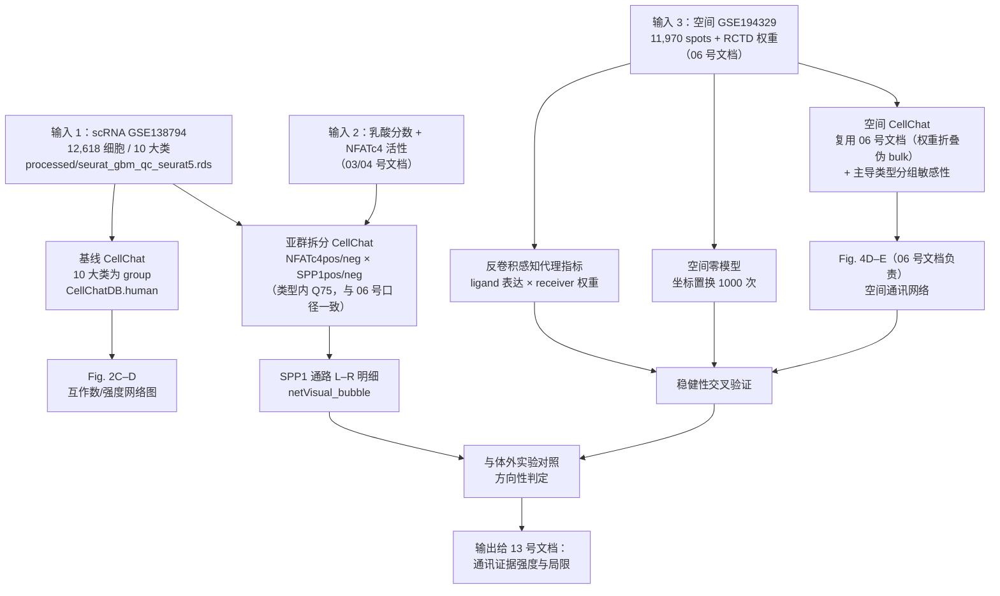

# 07 细胞通讯分析：CellChat 解析 NFATc4⁺ 肿瘤细胞–SPP1⁺ 巨噬细胞轴

> **目标文献**：Wang R, Wu W, et al. *Integrative single-cell and spatial transcriptomic analysis reveals a
> lactate-driven crosstalk between NFATc4⁺ tumor cells and SPP1⁺ macrophages in glioblastoma.*
> *J Transl Med* (2026) 24:1253. DOI: 10.1186/s12967-026-08555-7
>
> **模块对应原文**：Fig. 2C–D（scRNA 层 CellChat）、Fig. 4D–E（空间层 CellChat）；Fig. 2 与 Fig. 4 图注中
> "CellChat analysis depicting the number and strength of intercellular interactions, with emphasis on
> neoplastic cell–macrophage communication"；Methods 中「scRNA-seq dataset analysis」末句
> ("The 'CellChat' R package was used to analyze cell-cell interaction") 与「Spatial transcriptomics analysis」
> 第三句 ("Cell-cell communication analysis was conducted using the 'Cellchat' package")
> **前置依赖（已按各模块作者确认的实际产物名与列名对齐）**：
> 1. **02 号文档（`02_单细胞QC整合与十大类细胞注释.md`）** → `processed/seurat_gbm_qc_seurat5.rds`
>    （**Seurat 5 原生对象，下游主用**；同内容的 v3 Assay 版本为 `processed/seurat_gbm_qc.rds`，供必须走 Seurat 4 API 的工具）；
>    另有 `processed/02_cell_metadata.tsv`（meta.data 平铺导出，不想加载大对象时可读它）。
>    关键列：`celltype`（10 个 level，见下）、`seurat_clusters`（24 个 cluster）、`cnv_score` / `cnv_call`（`"CNV+"`/`"CNV-"`，
>    **肿瘤细胞认定的唯一依据**）、`sample`（GSE138794 的 5 个 GSM）、`nCount_RNA` / `nFeature_RNA`。
>    ✅ 06 号文档已按 13 号文档决策 D1 统一引用同一文件名（早期草稿里的 `seurat_gbm_annotated.rds` 已废弃）。
> 2. **03 号文档（`03_乳酸代谢评分与高低乳酸亚群划分.md`）** → `processed/neoplastic_lactate_scored.rds`
>    （**已 subset 到 neoplastic cells**；列 `lactate_score`（主，ssGSEA+332 LRGs）、
>    `lactate_group`（factor，levels `c("Low","High")`，**按中位数二分——原文未报告阈值**）、
>    `lactate_aucell` / `lactate_ucell`（平行与第三方实现）、`lactate_high_core` / `lactate_low_core`（四种阈值方案的交集核））；
>    另有 `results/lactate_grouping_4schemes.rds`（4 种阈值方案的对照表）→ §4.6 的稳健性分析应同时报告核心集口径。
> 3. **04 号文档（`04_pySCENIC转录因子调控网络与NFATc4发现.md`）** → `results/aucell_mtx.csv`
>    （**cell × regulon 的 AUC 矩阵**，行名 = 细胞 barcode，**列名带 `(+)` 后缀**，如 `NFATC4(+)`）。
>    ⚠️ **不存在 `so$NFATc4_activity` 这类列** —— 要用时须自行投影：`neo$NFATC4_regulon <- auc[colnames(neo), "NFATC4(+)"]`。
>    另外记住原文的两套口径**不可混用**：**Fig. 3D 用 mRNA 表达、Fig. 3G 用 regulon 活性**。
> 4. **06 号文档（`06_空间转录组反卷积与共定位.md`）** → `processed/06_visium_sct_list.rds`、
>    `processed/06_visium_annotated_list.rds`、`processed/06_visium_annotated.h5ad`（Python 侧）、
>    `results/06_rctd_weights_GSM583353{3,4,5,6}.csv`（**第 1 列 barcode，列名 = 细胞类型名，行和为 1**）、
>    `results/06_nhood_enrichment_zscore_<GSM>.csv`、`results/06_nn_distance_summary.csv`、
>    `results/06_spatial_correlation.csv`、`results/06_spot_counts_per_slice.csv`（四切片求和 ≈ 11,970），
>    以及**已经跑好的空间 CellChat 对象** `results/06_cellchat_GSM583353{3,4,5,6}.rds` 与
>    `results/06_cellchat_merged.rds`（按 RCTD 权重把 spot 折叠为细胞类型伪 bulk 后跑的，
>    `min.cells = 3`；**统计上不等价于单细胞 CellChat**）。
>    ⇒ **本模块对空间层以"复用 + 补充敏感性分析"为主，不重复 06 号文档已完成的工作**（见 §4.8）。
> 5. 生存数据**不存在**于 02–06 号文档：`NFATc4 高 → 预后差` 的全部证据属**本套文档的 08 号 bulk 模块**，
>    不得在 07 号里把生存结果挂到 06 号文档的产物上。
>
> ⚠️ **标签名已按 02 号文档的实际拼写固化（大小写敏感，勿凭直觉写）**：
> 02 号文档的 `so$celltype` 是**恰好 10 个 level**，按此顺序：
> `"Neoplastic"`、`"Macrophage"`、`"T cell"`、`"Astrocyte"`、`"Oligodendrocyte"`、`"Stem cell"`、`"Neuron"`、
> `"Endothelial"`、`"ILC"`、`"Fibroblast"`。
> 注意：是 **`Macrophage` 而非 `macrophages`**、**`T cell` 带空格**、**`Stem cell` 单数**、**`ILC` 而非 `ILCs`**、
> **`Neoplastic` 而非 `neoplastic cells`**（原文正文用的是后者，代码里必须用前者）。
> 本文件的**散文**沿用原文措辞（`neoplastic cells` / `macrophages`，便于与原文对照），
> 但**所有代码块已统一使用 02 号文档的实际 level**；运行前仍建议 `print(levels(so$celltype))` 复核一次，
> 否则 `spp1_lr[spp1_lr$source == "macrophage", ]` 这类取子集会**静默返回 0 行**（最典型的 silent failure）。
>
> ⚠️ **不要覆盖 `so$celltype`**：本模块新增的亚群/分组标签一律写入**新列**（本文件用 `so$cci_group`，§4.6 用 `so1$cci_group`），
> 绝不要写回 `so$celltype`，否则 06 / 09 号文档复用同一对象时会全部错乱。
>
> **目录约定**：本项目实际使用 `raw/` 与 `processed/`（00 号总览中写作 `data/raw/`、`data/processed/`，指同一处）；
> 原始数据的下载与校验由 01 号文档负责，本模块只消费 02 / 03 / 06 号文档的**中间对象**。
>
> **复现难度**：★★★★☆　**预计工时**：3–4 人日（含阈值敏感性分析）　**计算资源**：32–64 GB 内存 / 16 核；
> 空间层建议 64 GB；无需 GPU

---

## ① 科学问题与逻辑位置

### 1.1 本模块在全文证据链中解决什么问题

原文的证据链是 **"代谢异质性 → 转录调控 → 空间共定位 → 细胞间信号 → 功能验证 → 预后模型"**。本模块承担的是
第 4 环：**把"两类细胞在空间上挨得近"升级为"两类细胞之间存在可信的配体–受体（L–R）通讯"**。

上游输入：
- 02 号文档的单细胞注释结果（10 大类，其中 `neoplastic cells` 与 `macrophages` 是主角）；
- 03 号文档的乳酸分数与 04 号文档的 pySCENIC 结果（NFATc4 在高乳酸肿瘤细胞中活性升高）；
- 06 号文档的空间反卷积结果（11,970 个 spot 的细胞类型权重 + high-/low-lactate/non-tumor 区域标签）。

本模块要回答三个层层递进的问题：

1. **谁和谁在讲话？** —— scRNA 层：`neoplastic cells ↔ macrophages` 是否是互作数量与强度最高的细胞对之一（Fig. 2C–D）。
2. **用什么分子在讲？** —— 空间层：`SPP1⁺ macrophages → NFATc4⁺ neoplastic cells` 之间是否存在显著富集的信号通路与 L–R 对（Fig. 4D–E）。
3. **信号强不强、方向对不对？** —— 与体外实验（12 号文档）对照：CellChat 给出的方向是"巨噬细胞投递 SPP1 → 肿瘤细胞接收"，而体外实验证明的是"肿瘤细胞 NFATc4 → 巨噬细胞 SPP1"。**这两个方向不是同一件事**，是本文最重要的逻辑缺口（见 §7 批注与 §9）。

下游输出：
- `results/07_cellchat_scRNA_net_count.csv`、`results/07_cellchat_scRNA_net_weight.csv`（细胞群 × 细胞群的互作数与强度矩阵）；
- `results/07_cellchat_SPP1_pathway_summary.csv`（SPP1 通路内各 L–R 对在 Mac→Neoplastic 方向的 prob / pval / padj）；
- `figures/Fig2C_cellchat_count.pdf`、`figures/Fig2D_cellchat_weight.pdf`（对应 Fig. 2C–D 的"数量"与"强度"两版）；
- `figures/FigSx_threshold_sensitivity.pdf`、`figures/FigSx_spatial_SPP1_pathway.pdf`（原文没有的补充图）；
- Fig. 4D–E 的**主图由 06 号文档产出**，本模块补出 SPP1 通路专属面板并做跨切片一致性核验；
- 供 13 号文档（批判性评述）引用的"通讯结论稳健性"结论段。

### 1.2 逻辑流程图



---

## ② 背景知识与原理

### 2.1 细胞通讯推断工具的谱系与选型

"从单细胞表达矩阵推断细胞间通讯"有四个技术流派，原文选择了最主流的 CellChat。理解差异才能理解复现时为什么不能随便换工具。

| 工具 | 核心假设 | 输出量 | 统计框架 | 数据库 | 适用/不适用 |
|---|---|---|---|---|---|
| **CellChat**（Jin 2021 *Nat Commun*；2025 *Nat Protoc*） | 通讯概率由配体/受体**平均表达的质量作用**经 Hill 函数饱和得到；多亚基受体按几何平均/乘积组合 | 每对细胞群的 $p_{ij}\in(0,1)$ + 通路级汇总 + 中心性 | 置换检验（`nboot` 次）给经验 p 值 | CellChatDB（人/鼠；含 secreted / ECM–receptor / cell–cell contact 三类） | 本文口径；**支持空间数据**是它被用于 Fig. 4D–E 的直接原因 |
| **CellPhoneDB v5** | 只有当**两个基因都在某一群中显著表达**（`pval<0.05` 的均值差异检验）时才算"有表达"；不做表达量加权 | 显著 L–R 对的均值 | 细胞标签置换 + 精确 p 值 | 手工注释的 L–R 复合物数据库 | 保守、假阳性低；只给"有/无"，不给"多强"，做不了 Fig. 2C–D 那种强度网络 |
| **NicheNet** | 先用**下游靶基因表达**定义"接收方是否被激活"，再反推哪些配体最能解释该基因谱 | ligand–target 调控潜力矩阵 | 基于先验 GRN 的相关系数 | ligand–receptor + ligand–target 双层先验 | 擅长"给出机制假说"；需要 target 基因集，不适合做无先验的全局网络 |
| **Connectome**（Raredon 2021） | 用**差异表达检验（`FindMarkers` 式）**判断 L 在发送群、R 在接收群是否比背景显著 | 经验 p 值 + 效应量 | 表达背景分布 + 显著性 | 可自定义（如 OmniPath） | 统计上最直白，但输出不是"概率"，跨群不可比 |
| **LIANA / LIANA+** | 统一封装 12+ 种打分方法（含 CellPhoneDB、Connectome、NATMI、sca 等）并做共识排序 | consensus rank | 各方法自带 | OmniPath 汇总 | 做**方法敏感性**的最佳工具：若换 5 种方法结论都稳定，可信度大幅提升（建议作为本模块的 Plan B） |

> **导师批注**：这一节的实践含义是——不要把 CellChat 的 `p_ij` 当成"真实通讯概率"。它是对**表达量乘积的单调变换**，
> 是一个**相对排序量**。合理的用法是"同一数据集内不同细胞对之间比较排序"或"同细胞对跨组比较"，而不是跨数据集比较绝对值。

### 2.2 CellChat 的层次化概率模型

CellChat 的模型分四层：**（i）群内表达估计 → （ii）L–R 对水平概率 → （iii）通路水平聚合 → （iv）网络/中心性水平聚合**。逐层讲清楚，复现时才知道哪个参数在动哪一层。

#### 2.2.1 第一层：细胞群的平均表达（`type` 参数）

设细胞群 $i$ 中所有细胞对基因 $g$ 的表达向量为 $e_g^{(i)}$（归一化后）。CellChat 用**群体平均**代表该群的"配体/受体浓度"，
但直接取算术均值会被少数高表达细胞（双胞、高分细胞）拉偏，所以提供四种估计：

| `type` | 估计量 | 直觉 | 何时用 |
|---|---|---|---|
| `"triMean"`（**默认，原文与 CellChat 官方教程口径**） | **三均值**：$\dfrac{Q_{0.25}+2Q_{0.5}+Q_{0.75}}{4}$，$Q$ 为分位数 | 与 median 相近但对分布形状更敏感，抗离群 | 通用推荐；种群层面稳定 |
| `"truncatedMean"` | 先去掉最高/最低各 `trim`（默认 0.1）比例再取均值 | 显式截尾 | 当某群含明显双胞或极端细胞时 |
| `"thresholdedMean"` | 低于阈值（默认按表达分布取）的表达置 0 后取均值 | 降 dropout 噪声的正向偏置 | 稀疏 UMI 数据 |
| `"median"` | 中位数 | 最稳健但离散化（大量 0 导致中位数=0） | 稀疏群，慎用（易全 0） |

三均值的权重 $0.25:0.5:0.25$ 是 Tukey 三均值（trimean）的经典定义，其方差效率在厚尾分布下优于算术均值、又保留了分布的偏态信息 —— 这正是 CellChat 把它设为默认值的原因。

#### 2.2.2 第二层：Law of mass action + Hill 函数

对 L–R 对 $(\text{L},\text{R})$，发送群 $i$、接收群 $j$：

$$L_i = \operatorname{avg}\!\left(e^{(i)}_{\text{L}}\right), \qquad R_j = \operatorname{avg}\!\left(e^{(j)}_{\text{R}}\right)$$

**质量作用定律（law of mass action）**：配体与受体的结合速率正比于两者"浓度"之积，即结合的复合物量
$B_{ij} \propto L_i \cdot R_j$。CellChat 用这个乘积作为"相互作用量 $K_{ij}$"的分子。

**从结合量到概率**：$L_iR_j$ 的取值域是 $[0,\infty)$，而概率必须落在 $(0,1)$。CellChat 用 **Hill 饱和函数**
（`Kh` 为半饱和常数，`n` 为 Hill 系数，默认 `n = 1`）完成映射：

$$p_{ij} \;=\; \frac{(L_i R_j)^n}{K_h^{\,n} \;+\; (L_i R_j)^n}
\qquad \xrightarrow[\;n=1\;]{}\; p_{ij} \;=\; \frac{K_{ij}}{1+K_{ij}},
\quad K_{ij} := \frac{L_i R_j}{K_h}$$

这就是 `computeCommunProb` 帮助文档里那句 "**communication probability is computed using the law of mass action** …
$p = K/(1+K)$" 的形式。它的三条性质决定了所有下游解释：

1. **单调性**：$L_iR_j$ 越大，$p_{ij}$ 越大 → 排序可信；
2. **饱和性**：$L_iR_j \gg K_h$ 时 $p_{ij}\to 1$ → **高表达群之间会互相"顶到天花板"，差异被压缩**，这是"最高分那几条边往往打平"的原因；
3. **零无交互**：任一侧表达为 0 则 $p_{ij}=0$ → dropout 会直接删边，是主要假阴性来源。

数值直觉（默认 $K_h = 0.5$，`n = 1`）：

| $L_i R_j$ | 0.01 | 0.1 | **0.5** | 1.0 | 2.0 | 10 |
|---|---|---|---|---|---|---|
| $p_{ij}=L R/(K_h+LR)$ | 0.02 | 0.17 | **0.50** | 0.67 | 0.80 | 0.95 |

> **导师批注**：$K_h=0.5$ 的物理含义是"当配体与受体的（归一化）平均表达乘积达到 0.5 时，通讯概率恰为 0.5"。
> 因为 Seurat `NormalizeData` 后单基因表达多落在 0–3、中位数约 0.3–1，所以 0.5 是一个"中等表达即可过半概率"的宽松阈值 ——
> 这就是 CellChat 的边普遍很"密"的原因。**如果你想让网络更稀疏，调大 `Kh`（如 1 或 2）比调 p 值阈值更符合模型**。
>
> **已核对源码（CellChat 仓库 `R/modeling.R`，`computeCommunProb`）**：函数体里写的是
> `dataLR <- Matrix::crossprod(dataLavg[i,], dataRavg[i,])` → `P1 <- dataLR^n/(Kh^n + dataLR^n)`，
> 与上面的 Hill 公式**完全一致**（$Kh$ 确实作除数，默认 0.5），并且**配体侧/受体侧还各自乘过共激活/共抑制受体因子**
> （`dataRavg <- dataRavg * dataRavg.co.A.receptor / dataRavg.co.I.receptor`）。
> 因此：单调性与饱和性的结论成立；但**绝对数值不可跨版本比较**（1.x 曾用 `K/(1+K)` 的无 `Kh` 形式，且不区分 agonist/antagonist 时结果不同）。
>
> ⚠️ **空间数据还有一个乘性因子（极易被忽略）**：当 `object@options$datatype != "RNA"` 时，
> CellChat 会用 **`P.spatial`** 再乘一次已算好的 $P_1$：`P.spatial <- 1/d.spatial`（$d$ 为细胞群之间的平均空间距离，
> 按 `scale.distance` 缩放），不邻近的细胞对直接置 0（`P.spatial[is.na(d.spatial)] <- 0`），对角线取 `max(P.spatial)`。
> 也就是说 **Fig. 4D–E 那类"空间 CellChat"的概率 = 表达量的 Hill 值 × 距离核**，
> 不是纯表达量函数。相关参数 `distance.use / interaction.range(默认 250) / scale.distance(默认 0.01) / k.min(默认 10) /
> contact.dependent / contact.range` **原文一个都没报告**，复现时必须在方法里写全（详见 §4.8）。
> 若 `d.spatial * scale.distance` 的最小值 < 1，`computeCommunProb` 会**直接报错停止**
> （提示 "Please increase the value of `scale.distance`"），这是空间 CellChat 最常见的启动失败原因。

#### 2.2.3 多亚基受体的组合

若受体是复合物（如 `SPP1–(ITGAV+ITGB1)`、`COLLAGEN–(ITGA1+ITGB1)`），CellChat 先算出各亚基的群平均表达，再按数据库注释的 `agonist`/`antagonist`/`co-receptor` 关系组合：拮抗亚基取倒数乘、共激活亚基直接乘、多亚基复合物默认取**几何平均**（而非算术平均），以免"一个亚基极高、另一个为 0"被误判为强信号：

$$\operatorname{avg}\!\left(e_{\text{R}}\right) = \Big(\prod_{m=1}^{M}\operatorname{avg}\big(e_{R_m}\big)\Big)^{1/M}$$

几何平均的"乘法惩罚"性质使任一亚基为 0 时整个复合物为 0 —— 与"复合物必须齐全才成受体"的生物学一致。

#### 2.2.4 `population.size`：要不要按细胞数加权

`computeCommunProb(..., population.size = FALSE)` 为默认。设为 `TRUE` 时，群平均表达会被该群在总细胞中的**占比**加权，
使"只有 3 个细胞的小群"不会因为均值不稳而刷出高分边。

- **什么时候必须开**：细胞群规模极度不均衡（如 10 大类里 fibroblast 只有几十个细胞，而 neoplastic 有几千个）。
- **原文口径**：原文未报告该参数（原文未报告），按 CellChat 默认 `FALSE` 复现。
- **复现决策**：主分析 `FALSE`；**并跑一次 `TRUE` 作为敏感性分析**，在 QC 表中记录 SPP1 通路结论是否改变。若 `FALSE` 下 SPP1 显著而 `TRUE` 下不显著，说明结论由小群驱动，必须降级表述。

#### 2.2.5 第三层：置换检验如何给出 p 值

CellChat 不看"表达差异检验"，而是对**细胞群标签**做置换：把 $n$ 个细胞的 group 标签随机重排 `nboot` 次（默认 100），
每次重算整个 $p_{ij}$ 矩阵得到零分布 $\{P^{*(b)}\}_{b=1}^{B}$，经验单侧 p 值为

$$p_{ij} = \frac{1 + \#\{\,b: P^{*(b)}_{ij} \ge P_{ij}\,\}}{1 + B}$$

随后做 BH-FDR 校正（`computeCommunProb` 内部对通路层面也给 `netP`）。要点：

- **置换的是标签不是表达** → 检验的是"这种细胞群划分下的表达乘积是否超出随机分组能给出的水平"，即**是否具有群特异性**，
  **不是**"有没有通讯"。因此 p 值小 ≠ 通讯强，p 值大 ≠ 没有通讯。
- `nboot = 100` 时 p 值的分辨率下限约 0.01（$1/101$）。原文未报告 `nboot`（原文未报告），复现默认 100；
  若需要报告 $p<0.001$，**必须把 `nboot` 提到 ≥1000**，否则不存在这个精度。
- **`seed.use` 必须显式固定**（CellChat 默认 `seed.use = 1`），跨随机数流与 `set.seed()` 不同，容易在两台机器上得到不同的边集。

#### 2.2.6 过滤、通路聚合与网络聚合

| 函数 | 作用 | 关键参数 | 复现取值 |
|---|---|---|---|
| `subsetData()` | 只保留 CellChatDB 中的基因，内存与速度优化 | — | 必调（否则内存翻数倍） |
| `identifyOverExpressedGenes()` | 每群算 over-expressed 基因（类 `FindMarkers`，Wilcoxon + 表达比例 + FC 阈值） | `thresh.p`（默认 0.05）、`thresh.pc`（表达比例）、`thresh.fc` | 默认 |
| `identifyOverExpressedInteractions()` | 只保留"配体在发送群 over-expressed **且**受体在接收群 over-expressed"的 L–R 对 | — | 必调（否则 dropout 噪声会造出大量假边） |
| `computeCommunProb()` | 第二层：L–R 级概率 + p 值 | `type / trim / population.size / nboot / Kh / n / seed.use`（**2.x 无 `future.use`**；1.x 有） | `triMean, 0.1, FALSE, 100, 0.5, 1, 1` |
| `filterCommunication()` | 去掉细胞数 < `min.cells` 的群参与的通讯 | `min.cells` | **10**（CellChat 默认；原文未报告） |
| `computeCommunProbPathway()` | **第三层**：把 L–R 概率按通路求和 | — | 必调 |
| `aggregateNet()` | **第四层**：汇总为"互作数 `net$count`"与"互作强度 `net$weight`"两个群 × 群矩阵 | `sources.use/targets.use/signaling` | 全局 |
| `netAnalysis_computeCentrality()` | 计算 signaling role（outgoing/incoming strength、pattern） | `slot.name = "netP"`、`signaling` | 必调（Fig. 4D–E 的"strength"语义） |

**通路级聚合的口径**：通路 $w$ 在 $i\to j$ 方向的通讯强度是该通路下所有 L–R 对概率之和
$I^{(w)}_{ij} = \sum_{(\text{L},\text{R})\in w} p_{ij}^{(\text{L},\text{R})}$。
这带来一个常被忽略的后果：**通路含有的 L–R 对越多，通路得分天然越高**。所以"SPP1 通路排第一"这句话，
一定要同时给出"SPP1 通路在 CellChatDB 中含几对 L–R"，与同规模通路比较才有意义。

**网络级聚合的两种语义**（容易被混用，务必分清）：
- `net$count`：**显著边的条数**（$p_{ij}<0.05$ 的 L–R 对计数）→ 回答"讲了几种话"；
- `net$weight`：**显著边的概率之和** → 回答"讲得多大声"。

原文 Fig. 2C–D 图注明确写的是 "the **number** and **strength** of intercellular interactions"，正好对应这两个矩阵，
复现时必须**分别出两张图**，不要只出一张。

#### 2.2.7 `netVisual_*` 可视化家族：每张图在回答什么

| 函数 | 图形 | 编码的变量 | 读图要点 |
|---|---|---|---|
| `netVisual_circle()` | 圆环图 | 节点大小 = `vertex.weight`（常给细胞数或互作数）；边宽 = 矩阵值；自环 = 自分泌 | 一眼看"谁最活跃"；**边权重饱和时宽窄难辨，需同时给矩阵热图** |
| `netVisual_heatmap()` | 热图 | 行=发送方，列=接收方，色=互作数/强度 | 数值可比；适合放进正文做主图 |
| `netVisual_bubble()` | 气泡图 | 行=L–R 对（`interaction_name_2`），列=细胞群对（`source.target`），**默认 `size = pval`、`color = prob`**（已核对源码 `aes(...)`: `color = prob, size = pval`） | **查具体 L–R 对**（本模块核心图）。⚠️ **点大小方向与直觉相反**：源码用 `scale_radius(range = c(min(pval), max(pval)), name = "p-value")`，即**点越大 = p 值越大 = 越不显著**（图例按 `p > 0.05` / `0.01 < p < 0.05` / `p < 0.01` 三档标注）。写图注前必须核对你那个版本的图例，**写反是本文档类型的高频事故** |
| `netVisual_chord_gene()` | 弦图 | 圆周 = 基因（配体/受体），弦 = 互作 | 展示"一个配体连多个受体群"的多效性 |
| `netVisual_aggregate()` | 通路级圆环/弦图 | 指定 `signaling` 后只画该通路 | 单通路叙事（如 `signaling = "SPP1"`）|
| `netVisual_diffInteraction()` | 差异网络 | 两组的 `net$count`/`net$weight` 之差，红=上调、蓝=下调 | 组间比较主图 |
| `netAnalysis_signalingRole_heatmap()` | 角色热图 | `pattern = "outgoing"/"incoming"/"all"`，色 = 相对强度/信息流 | 回答"谁是主要发送者/接收者" |
| `netAnalysis_signalingChanges_scatter()` | 散点 | x/y = 两组在某一群上的 outgoing/incoming 强度；点在虚线两侧 = 显著变化 | 高乳酸 vs 低乳酸的关键对比图 |

> **导师批注**：原文 Fig. 4D–E 是"spatially resolved data 的 CellChat"，但**图注没有说明分组的依据**。是"spot 的 dominant cell type"、
> 还是"RCTD 权重 > 阈值的 spot"、还是"区域标签"？这直接决定图能不能解释成"细胞类型之间的通讯"。复现时**必须把分组规则写进图注和图例**，
> 并同时给一版替代实现（§4.9），否则审稿人一定会问。

### 2.3 SPP1 / 骨桥蛋白（osteopontin, OPN）的分子生物学

SPP1（*Secreted Phosphoprotein 1*）编码骨桥蛋白（OPN），是本文两条细胞之间的"信使"，必须先把这个分子讲清楚：

- **蛋白结构**：约 300 aa 的**分泌型糖磷蛋白**，天然无规卷曲为主（intrinsically disordered），带大量天冬氨酸/丝氨酸磷酸化位点。
  含经典 **RGD 基序**（Arg-Gly-Asp），被 $\alpha v\beta 1/\alpha v\beta 3/\alpha v\beta 5/\alpha 5\beta 1$ 等整合素识别；
  另有 **SVVYGLR** 隐蔽表位，需经凝血酶或 MMP 切割后暴露，被 $\alpha 4\beta 1/\alpha 9\beta 1$ 识别。
- **受体**：**CD44**（含 v6/v7 剪接变体，主要介导黏附与迁移）与**整合素家族**（介导黏着斑激酶 FAK → PI3K/AKT、MAPK 通路）。
  CellChatDB 中它们被注释为复合物形式，如 `SPP1–CD44`、`SPP1–(ITGAV+ITGB1)`、`SPP1–(ITGA5+ITGB1)`、`SPP1–(ITGA4+ITGB1)` 等。
- **剪接与形式**：人 SPP1 有 OPN-a/b/c 三种剪接变体（b 含外显子 5 插入、c 缺少外显子 7，功能异质）；存在分泌型 sOPN 与胞内型 iOPN（参与胞内信号与炎症）。
- **功能**：促黏附/迁移/侵袭、促血管生成、趋化巨噬细胞并驱动 M2 极化、抑制 T 细胞反应；在多种实体瘤中与高级别、治疗抵抗、预后差相关。

### 2.4 SPP1⁺ TAM 在肿瘤中的促瘤功能与免疫治疗抵抗

原文在 Discussion 中给出的两条直接证据（**引用原文文献编号，勿改写**）：

1. 结直肠癌（CRC）中，SPP1⁺ 巨噬细胞通过与 **FAP⁺ 成纤维细胞**互作促进肿瘤进展
   （Qi J, Sun H, Zhang Y, et al. *Nat Commun* 2022;13:1742，原文文献 [44]）；
2. 头颈鳞癌（HNSCC）中，SPP1⁺ 巨噬细胞通过分泌 **TNF-α 与 IL-1β** 支持肿瘤细胞增殖与迁移
   （Liu C, Wu K, Li C, et al. *J Exp Clin Cancer Res* 2024;43:332，原文文献 [45]）。

作为"SPP1⁺ TAM 与免疫治疗抵抗"的背景（**以下结论属领域共识性表述，引用前必须自行核对原文与 PMID，本方案不代替文献检索**）：
多瘤种的髓系单细胞图谱工作将 TAM 分为若干亚群，其中 SPP1⁺ 亚群常与 C1QC⁺ 亚群并置，SPP1⁺ TAM 比例在
抗 PD-1/PD-L1 无应答者中升高、与 T 细胞排斥（"immune-excluded" 表型）和血管/基质重塑相关；
其机制假说包括 SPP1 直接抑制 T 细胞、通过基质重排形成物理屏障、以及驱动 M2 极化。
建议的检索式：`("SPP1" OR "osteopontin") AND ("tumor-associated macrophage" OR "TAM") AND ("immune checkpoint" OR "resistance")`。

**GBM 中 TAM 的占比**：文献常引用"TAM/TME 细胞中占 30–50%"这一区间（不同报道口径不一：以 CD45⁺CD11b⁺ 门控、
或以 scRNA-seq 注释比例为准，数值差异大）。**本文原文未报告数值占比**（原文未报告；Fig. 2E 只给了堆叠条形图的**图形**，
未给数字）。复现时请用 `prop.table(table(so$celltype))` 实测本项目 GSE138794 的巨噬细胞占比，并把实测值写进 QC 表
（同时也是"GBM 是巨噬细胞高浸润肿瘤"这一前提的本地证据）。

---

## ③ 原文方法逐条拆解

原文关于本模块只有 **4 句方法学描述 + 3 处结果描述**，信息量极低，复现者必须自己补齐参数。逐句对照如下。

| # | 原文原句（英文关键词） | 中文转述 | 对应到具体操作 | 原文缺失的信息 |
|---|---|---|---|---|
| M1 | Methods / scRNA: "The **'CellChat'** R package was used to analyze cell-cell interaction." | 用 CellChat 做细胞间通讯分析 | 需要完整指定：数据库版本、`type`、`nboot`、`min.cells`、是否 `population.size` | **全部参数未报告**；CellChat 版本未报告 |
| M2 | Methods / Spatial: "Cell-cell communication analysis was conducted using the **'Cellchat'** package."（注意原文大小写不一致） | 空间数据同样用 CellChat | spot × gene 矩阵 + `meta` 分组 | **分组依据未报告**（dominant cell type？区域？RCTD 阈值？） |
| M3 | Results / Fig. 2C–D：Cell-cell communication analysis using CellChat "highlighted **frequent and strong** interactions between **neoplastic cells and macrophages**" | 肿瘤–巨噬互作"频繁且强" | 分别出 `net$count`（频繁）与 `net$weight`（强）两张网络图 | "频繁/强"的**排序位置未报告**（是第 1 名还是前 3 名？） |
| M4 | Results / Fig. 4D–E："CellChat analysis of spatially resolved data identified **strong interaction signals** between **SPP1⁺ macrophages and NFATc4⁺ neoplastic cells**" | 空间层显示两类细胞间信号强 | 需要在空间对象上定义 `SPP1⁺ macrophages` / `NFATc4⁺ neoplastic cells` 两组并跑 CellChat | **两个"⁺"的阈值定义完全未报告**；未报告通路名与 L–R 对 |
| M5 | Fig. 4 图注："(D–E) CellChat interaction plots **quantifying communication strength** among spatially resolved cell types." | D–E 是通讯强度定量图 | 应为 `netVisual_circle`/`netVisual_heatmap` 的强度版 | 是否做了置换检验、显著性阈值未报告 |
| M6 | Discussion："our data revealed a potential **symbiotic mechanism** in which NFATc4⁺ neoplastic cells **actively interact with** SPP1⁺ macrophages to foster a poor-prognosis niche" | 提出"共生"机制假说 | 这是**假说**不是结论 | 原文同时自承 "the current data are mainly **correlative** and do not fully establish a direct causal regulatory relationship" |

> ⚠️ **导师批注（必须写进 13 号文档）**：CellChat 部分的**可复现性在本文中是最薄的一环**——没有版本、没有参数、没有通路名、
> 没有 L–R 对、没有 p 值、没有"⁺"的阈值。也就是说，**Fig. 2C–D 与 Fig. 4D–E 在字面上不可精确复现**，
> 只能复现**结论方向**（"neoplastic–macrophage 是前几名""SPP1 通路在 Mac→Neoplastic 方向显著"）。
> 本方案的策略是：把每个不确定点都给出"我们的复现决策 + 备选方案"，并把结果记录成**可验证的判据**（§6），
> 而不是追求像素级复刻。

> ⚠️ **导师批注（"⁺"的循环论证陷阱）**：原文用 `SPP1` 的表达把巨噬细胞分成 "SPP1⁺"，再用 CellChat 发现
> "SPP1⁺ 巨噬细胞发出 SPP1 信号"。**这在逻辑上是自我实现的**：只要分组变量是某个配体的表达，
> 该配体在该群中的平均表达必然偏高，$L_iR_j$ 必然偏大，$p_{ij}$ 必然显著。这不是 CellChat 的缺陷，
> 而是**"用要检验的变量去定义分组"（conditioning on the variable）**的统计错误。
> 可接受的修法有三种，本方案要求**至少做一种**：
> 1. **正交定义**：用与 SPP1 无关的标准定义分组（如 RCTD 权重主导、或巨噬细胞的 M2 程序分数）；
> 2. **留一法**：跑 CellChat 时把 SPP1 相关的 L–R 对从 DB 中剔除（`LR.use` 指定子集），
>    检验 **NFATc4⁺ 肿瘤细胞 → SPP1⁺ 巨噬细胞方向的其他通路**是否也增强（这才是真正有信息量的检验）；
> 3. **反向检验**：检验"SPP1⁻ 巨噬细胞"是否同样给出高分边（若同样高分，说明结论由细胞数/测序深度驱动，而非 SPP1）。

---

## ④ 逐步可运行代码

环境约定：R 4.4.2、Seurat 5.3.0（与原文一致）、CellChat ≥ 1.6.1（建议 2.x）。
所有脚本开头固定 `set.seed(20260101)`；每个脚本末尾 `sessionInfo()` 落盘。

### 4.1 环境准备与输入检查

```r
# code/07_00_setup.R
suppressPackageStartupMessages({
  library(Seurat); library(CellChat); library(patchwork)
  library(dplyr); library(ggplot2); library(Matrix)
  library(future)
})
set.seed(20260101)
options(stringsAsFactors = FALSE)

# ---- 并行：CellChat 的置换检验是主要算力消耗 ----
# 注意：Windows 下必须 multisession；Linux 下 multicore 更省内存
plan("multisession", workers = 8)
options(future.globals.maxSize = 16 * 1024^3)   # 单细胞矩阵很容易超过默认 500 MB

# ---- 读入 02 号文档的注释结果 ----
so <- readRDS("processed/seurat_gbm_qc_seurat5.rds")
stopifnot("celltype" %in% colnames(so@meta.data))

# 统一标签（不同注释工具会给出不同大小写/连字符，必须先对齐）
so$celltype <- factor(so$celltype)
print(table(so$celltype))          # QC①：应为 10 类，总细胞数 12,618（允许 ±10% 平台差异）
stopifnot(ncol(so) > 11000, ncol(so) < 14500)

# CellChat 需要归一化数据；Seurat v5 用 layer=，v4 用 slot=
data.input <- GetAssayData(so, assay = "RNA", layer = "data")
meta       <- so@meta.data
```

### 4.2 scRNA 层基线 CellChat（复现 Fig. 2C–D）

```r
# code/07_01_cellchat_scRNA_baseline.R
# 目标：10 大类为 group，CellChatDB.human，得到 net$count 与 net$weight
cellchat <- createCellChat(object = data.input, meta = meta, group.by = "celltype")
cellchat@DB <- CellChatDB.human          # GSE138794 为人源，必须用 human 库

# 先看看库里 SPP1 到底被收在哪些通路（原文未报告通路名，这一步是复现的关键锚点）
db <- cellchat@DB$interaction
spp1_pathways <- unique(db$pathway_name[grepl("SPP1|SPP", db$pathway_name, ignore.case = TRUE)])
print(spp1_pathways)                     # 预期：至少含 "SPP1"
write.csv(db[grepl("^SPP1$|^SPP1\\b", db$ligand) | grepl("SPP1", db$ligand), ],
          "results/07_cellchatdb_SPP1_LR_pairs.csv", row.names = FALSE)
# 预期 L-R 对（**以你安装版本 `CellChatDB.human$interaction` 的实际内容为准**，条目数随 DB 版本变动）：
#   SPP1 - CD44, SPP1 - (ITGAV+ITGB1), SPP1 - (ITGA5+ITGB1),
#   SPP1 - (ITGA4+ITGB1), SPP1 - (ITGA8+ITGB1) 等整合素复合物 + 共受体标记
#   ⚠️ 不要照抄这份清单：DB 版本不同，受体复合物的写法（如 (ITGAV+ITGB1) 还是 (ITGAV_ITGB1)）与条目数都会变，
#      以 §4.2 第 1 步 write.csv 落盘的 results/07_cellchatdb_SPP1_LR_pairs.csv 为准。

# ---- 标准流水线 ----
cellchat <- subsetData(cellchat)                       # 只留 DB 基因（省内存，必调）
cellchat <- identifyOverExpressedGenes(cellchat)        # 群特异高表达基因
cellchat <- identifyOverExpressedInteractions(cellchat) # L 在发送群、R 在接收群 over-expressed

cellchat <- computeCommunProb(
  cellchat,
  type           = "triMean",    # 默认三均值
  trim           = 0.1,          # 仅 truncatedMean 生效
  population.size = FALSE,       # 主分析关闭；敏感性分析见 §4.4
  nboot          = 100,          # 置换次数；要报 p<0.001 需 ≥1000
  Kh             = 0.5,
  n              = 1,
  seed.use       = 1,
)

cellchat <- filterCommunication(cellchat, min.cells = 10)
cellchat <- computeCommunProbPathway(cellchat)   # 通路级聚合
cellchat <- aggregateNet(cellchat)               # 群×群 count / weight
cellchat <- netAnalysis_computeCentrality(cellchat, slot.name = "netP")

# ---- 落盘：后续所有图的数值来源 ----
saveRDS(cellchat, "processed/cellchat_scRNA_baseline.rds")
write.csv(cellchat@net$count,  "results/07_cellchat_scRNA_net_count.csv")
write.csv(cellchat@net$weight, "results/07_cellchat_scRNA_net_weight.csv")
write.csv(subsetCommunication(cellchat), "results/07_cellchat_scRNA_allLR.csv", row.names = FALSE)
# subsetCommunication() 返回 long 表：source/target/ligand/receptor/pathway_name/prob/pval/...

# ---- Fig. 2C–D：互作数 + 互作强度（两张图，语义不同）----
groupSize <- as.numeric(table(cellchat@idents))
pdf("figures/Fig2C_cellchat_count.pdf", width = 7, height = 7)
netVisual_circle(cellchat@net$count,  vertex.weight = groupSize,
                 weight.scale = TRUE, label.edge = FALSE,
                 title.name = "Number of interactions")
dev.off()
pdf("figures/Fig2D_cellchat_weight.pdf", width = 7, height = 7)
netVisual_circle(cellchat@net$weight, vertex.weight = groupSize,
                 weight.scale = TRUE, label.edge = FALSE,
                 title.name = "Interaction strength")
dev.off()

# 热图版（数值可比，建议同时出，作为补充图）
pdf("figures/FigSx_cellchat_heatmap.pdf", width = 9, height = 7)
print(netVisual_heatmap(cellchat, measure = "count",  color.heatmap = "Reds"))
print(netVisual_heatmap(cellchat, measure = "weight", color.heatmap = "Reds"))
dev.off()
```

**判据（QC②）**：在 `net$count` 与 `net$weight` 两个矩阵中，取 `Neoplastic → Macrophage` 与
`Macrophage → Neoplastic` 两条边（矩阵 dimnames 即 02 号文档的 `celltype` 取值），检查其**入度/出度排名**。原文只说 "frequent and strong"，
我们的操作性定义是：**这两条边至少有一条落在全部群对的前 10%**（10 类细胞共 $10\times10=100$ 个有序对，
即排名 ≤10）。若两条边都在 30 名以外，说明注释标签或归一化口径与原文不同，Go/No-Go 判为 **No-Go**，
回到 02 号文档核查 `Neoplastic` 标签是否包含了大批正常细胞（`cnv_call` 的阈值问题）。

### 4.3 定义 "NFATc4⁺ 肿瘤细胞" 与 "SPP1⁺ 巨噬细胞"

**原文未报告任何阈值**（原文未报告）。必须自己定并做敏感性分析。本节给出三类定义：

| 定义 | 规则 | 定位 | 选它的理由 / 风险 |
|---|---|---|---|
| **B：类型内 Q75**（**主分析**） | 在 neoplastic cells 内 `NFATC4 > Q75`；在 macrophages 内 `SPP1 > Q75` | 主分析 | **与 06 号文档空间层口径完全一致**（06 号：`expr >= Q75 & 细胞类型权重 >= 0.5`），主分析与空间层用同一把尺子，"共定位"与"通讯"才能相互印证。风险：若 Q75 落在 0 上（低表达基因）会退化成定义 A，必须打印 Q75 数值检查 |
| **A：检测阈值（> 0）** | 表达 > 0 | 敏感性分析 1 | 最贴近"细胞是否检出该转录本"；但受测序深度/dropout 影响大，深度高的样本会得到更多"阳性"细胞 |
| **C：程序分数（正交定义）** | 用**剔除 SPP1 / NFATC4 自身**后的 signature 做 `AddModuleScore`，按中位数二分 | 敏感性分析 2（**对抗 §3 循环论证的唯一手段**） | 分组变量与被检验的配体/受体解耦；风险是 signature 本身仍与目标基因高度相关（无法完全解耦），需在报告中说明 |

> ⚠️ **导师批注**：**定义 C 不是可有可无的"锦上添花"，它是本模块唯一能部分回答"结论是否循环论证"的设计。**
> 因为 A 与 B 都用 `SPP1` / `NFATC4` 自身的表达去定义分组，所以"SPP1⁺ 巨噬细胞发出 SPP1 信号"在 A/B 下**必然成立**。
> 只有 C（或用 RCTD 权重的空间分组）让分组标准独立于被检验的分子，才具有真正的检验力。

```r
# code/07_02_define_pos_groups.R
neopl <- subset(so, subset = celltype == "Neoplastic")     # 02 号文档 celltype 的实际 level
macs  <- subset(so, subset = celltype == "Macrophage")

# ================= 先构造两套 signature（供定义 C 与 08 号文档的 PDX 分析复用）=================
# 02 号文档只给注释，未给"SPP1⁺ 巨噬细胞 / NFATc4⁺ 肿瘤细胞"的 signature —— 由本模块定义并落盘
so$celltype <- factor(so$celltype)                       # 标签名请先 print(levels(so$celltype)) 核对
sub_neopl <- subset(so, subset = celltype == levels(so$celltype)[
                          grep("^(neoplastic|Neoplastic)$", levels(so$celltype))])
sub_macs  <- subset(so, subset = celltype == levels(so$celltype)[
                          grep("^(macrophages|Macrophage)$", levels(so$celltype))])
# 巨噬细胞内部的 SPP1⁺ vs SPP1⁻（用 Q75 口径，与 06 号文档的空间定义保持一致）
sub_macs$pos  <- GetAssayData(sub_macs,  assay = "RNA", layer = "data")["SPP1", ]   >
                 quantile(GetAssayData(sub_macs,  assay = "RNA", layer = "data")["SPP1", ],   0.75)
sub_neopl$pos <- GetAssayData(sub_neopl, assay = "RNA", layer = "data")["NFATC4", ] >
                 quantile(GetAssayData(sub_neopl, assay = "RNA", layer = "data")["NFATC4", ], 0.75)
Idents(sub_macs)  <- sub_macs$pos;  Idents(sub_neopl) <- sub_neopl$pos
sig_spp1_mac_tam <- rownames(FindMarkers(sub_macs,  ident.1 = "TRUE", ident.2 = "FALSE",
                                         only.pos = TRUE, logfc.threshold = 0.25, min.pct = 0.1))
sig_nfatc4_tumor <- rownames(FindMarkers(sub_neopl, ident.1 = "TRUE", ident.2 = "FALSE",
                                         only.pos = TRUE, logfc.threshold = 0.25, min.pct = 0.1))
saveRDS(sig_spp1_mac_tam, "processed/sig_spp1_mac_tam.rds")
saveRDS(sig_nfatc4_tumor, "processed/sig_nfatc4_tumor.rds")
# ⚠️ 这两套 signature 的**目标基因自身必须剔除**（否则 08 号文档的 ssGSEA 相关是自证）：
sig_spp1_mac_tam <- setdiff(sig_spp1_mac_tam, c("SPP1", "NFATC4"))
sig_nfatc4_tumor <- setdiff(sig_nfatc4_tumor, c("SPP1", "NFATC4"))
cat("signature 长度：", length(sig_spp1_mac_tam), length(sig_nfatc4_tumor), "\n")
cat("两套 signature 交集：", length(intersect(sig_spp1_mac_tam, sig_nfatc4_tumor)), "\n")

# ---- 定义 B（主分析）：细胞类型内 top 25%（Q75）----
# 选它作为主分析的理由：**与 06 号文档的空间层定义完全一致**
#   （06 号文档：NFATc4_pos = NFATc4_expr >= Q75 & tumor_weight >= 0.5；SPP1_pos 同理）
#   主分析与空间层用同一口径，"共定位"与"通讯"两个结论才能相互印证而不是各说各话。
q_nfatc4 <- quantile(GetAssayData(neopl, layer = "data")["NFATC4", ], 0.75)
q_spp1   <- quantile(GetAssayData(macs,  layer = "data")["SPP1",   ], 0.75)
neopl$NFATc4_top25 <- GetAssayData(neopl, layer = "data")["NFATC4", ] > q_nfatc4
macs$SPP1_top25    <- GetAssayData(macs,  layer = "data")["SPP1",   ] > q_spp1
# 25% 分位在超过 25% 的细胞表达为 0 时会退化（截断点落在 0 上），必须打印分位数值检查
cat("NFATC4 Q75 =", q_nfatc4, " SPP1 Q75 =", q_spp1, "\n")

# ---- 定义 A（敏感性分析 1）：检测阈值法（表达 > 0）----
# 在"本细胞类型内部"判断是否检测到目标基因
neopl$NFATc4_status <- ifelse(GetAssayData(neopl, layer = "data")["NFATC4", ] > 0,
                              "NFATc4pos", "NFATc4neg")
macs$SPP1_status    <- ifelse(GetAssayData(macs,  layer = "data")["SPP1",   ] > 0,
                              "SPP1pos",   "SPP1neg")
# 优点：简单、与"细胞是否检出该转录本"直接对应；
# 缺点：受测序深度极端影响（dropout），深度高的样本会被判成"更多阳性"

# ---- 定义 C（敏感性分析 2，正交定义）：模块分数法 ----
# 用与 SPP1 / NFATC4 本身无关的"程序分数"定义，**避免 §3 的循环论证**
sig_spp1_prog  <- readRDS("processed/sig_spp1_mac_tam.rds")     # 已在上面剔除 SPP1/NFATC4
sig_nfat_prog  <- readRDS("processed/sig_nfatc4_tumor.rds")
macs  <- AddModuleScore(macs,  features = list(sig_spp1_prog), name = "spp1prog")
neopl <- AddModuleScore(neopl, features = list(sig_nfat_prog), name = "nfatprog")
macs$SPP1_prog_high   <- macs$spp1prog1  > median(macs$spp1prog1)
neopl$NFATc4_prog_high <- neopl$nfatprog1 > median(neopl$nfatprog1)

# ---- 合并回对象并建立 CellChat 分组变量（主分析 = 定义 B）----
# 关键：只有 neoplastic 与 macrophage 需要拆分，其余 8 类保持原标签
so2 <- so
so2$cci_group <- as.character(so2$celltype)
so2$cci_group[colnames(neopl)] <- ifelse(neopl$NFATc4_top25, "NFATc4pos", "NFATc4neg")
so2$cci_group[colnames(macs)]  <- ifelse(macs$SPP1_top25,    "SPP1pos",   "SPP1neg")
print(table(so2$cci_group))

# 每个子群细胞数（filterCommunication(min.cells=10) 会据此删群，必须记录）
qc_group_n <- as.data.frame(table(so2$cci_group))
colnames(qc_group_n) <- c("cci_group", "n_cells")
write.csv(qc_group_n, "results/07_qc_cci_group_sizes.csv", row.names = FALSE)

# ---- 把上面三种定义封装成一个可复用函数（§4.3 批量敏感性分析调用它）----
# 主分析用 B_top25（与 06 号文档空间层口径一致）；A/C 为敏感性分析
build_cci_groups <- function(so, def = c("B_top25", "A_detect", "C_program")) {
  def <- match.arg(def)
  so  <- so
  so$cci_group <- as.character(so$celltype)

  i_neopl <- which(so$celltype == "Neoplastic")
  i_macs  <- which(so$celltype == "Macrophage")
  e <- GetAssayData(so, assay = "RNA", layer = "data")

  if (def == "A_detect") {
    so$cci_group[i_neopl] <- ifelse(e["NFATC4", i_neopl] > 0, "NFATc4pos", "NFATc4neg")
    so$cci_group[i_macs]  <- ifelse(e["SPP1",   i_macs ] > 0, "SPP1pos",   "SPP1neg")
  } else if (def == "B_top25") {
    so$cci_group[i_neopl] <- ifelse(e["NFATC4", i_neopl] > quantile(e["NFATC4", i_neopl], .75),
                                    "NFATc4_top25_pos", "NFATc4_top25_neg")
    so$cci_group[i_macs]  <- ifelse(e["SPP1",   i_macs ] > quantile(e["SPP1",   i_macs ], .75),
                                    "SPP1_top25_pos",   "SPP1_top25_neg")
  } else {   # C_program：用不含 SPP1 / NFATC4 自身的程序签名打分（正交定义）
    sig_spp1_prog  <- setdiff(readRDS("processed/sig_spp1_mac_tam.rds"), c("SPP1", "NFATC4"))
    sig_nfat_prog  <- setdiff(readRDS("processed/sig_nfatc4_tumor.rds"), c("SPP1", "NFATC4"))
    # 注意：AddModuleScore 的 `name` 只接受**单个字符串**，传向量会生成意料之外的列名——
    # 必须分两次调用，得到 so$spp1prog1 与 so$nfatprog1
    so <- AddModuleScore(so, features = list(sig_spp1_prog), name = "spp1prog", search = TRUE, nbin = 24)
    so <- AddModuleScore(so, features = list(sig_nfat_prog), name = "nfatprog", search = TRUE, nbin = 24)
    so$cci_group[i_neopl] <- ifelse(so$nfatprog1[i_neopl] > median(so$nfatprog1[i_neopl]),
                                    "NFATc4_prog_high", "NFATc4_prog_low")
    so$cci_group[i_macs]  <- ifelse(so$spp1prog1[i_macs] > median(so$spp1prog1[i_macs]),
                                    "SPP1_prog_high", "SPP1_prog_low")
  }
  so$cci_group <- factor(so$cci_group)
  so
}
```

**阈值敏感性分析的批量模板**（本模块最重要的稳健性证据，产出 Fig. Sx）：

```r
# code/07_03_threshold_sensitivity.R
run_cellchat <- function(expr_mat, meta_df, group_col,
                         type = "triMean", min.cells = 10,
                         population.size = FALSE, nboot = 100) {
  cc <- createCellChat(object = expr_mat, meta = meta_df, group.by = group_col)
  cc@DB <- CellChatDB.human
  cc <- subsetData(cc)
  cc <- identifyOverExpressedGenes(cc)
  cc <- identifyOverExpressedInteractions(cc)
  cc <- computeCommunProb(cc, type = type, population.size = population.size,
                          nboot = nboot, Kh = 0.5, n = 1, seed.use = 1)
  cc <- filterCommunication(cc, min.cells = min.cells)
  cc <- computeCommunProbPathway(cc)
  cc <- aggregateNet(cc)
  cc
}

# 记录每次运行的"主结论指标"
extract_key_edges <- function(cc, src, tgt) {
  cnt <- cc@net$count;  wgt <- cc@net$weight
  spp1_lr <- subsetCommunication(cc, signaling = grep("SPP1", cc@netP$pathways,
                                                     value = TRUE, ignore.case = TRUE))
  spp1_sig <- if (nrow(spp1_lr) == 0) NA else
    sum(spp1_lr$source == src & spp1_lr$target == tgt &
        spp1_lr$pval < 0.05, na.rm = TRUE)
  data.frame(
    edge_count_src2tgt = cnt[src, tgt],
    edge_weight_src2tgt = wgt[src, tgt],
    rank_count  = rank(-as.vector(cnt))[ (which(rownames(cnt) == src) - 1) * ncol(cnt) +
                                          which(colnames(cnt) == tgt) ],
    rank_weight = rank(-as.vector(wgt))[ (which(rownames(wgt) == src) - 1) * ncol(wgt) +
                                          which(colnames(wgt) == tgt) ],
    n_sig_SPP1_LR = spp1_sig,
    stringsAsFactors = FALSE
  )
}

# ---- 遍历 12 种配置 ----
# (阈值定义 A/B/C) × (type triMean/truncatedMean) × (population.size FALSE/TRUE) = 3×2×2 = 12
grid <- expand.grid(def = c("A_detect", "B_top25", "C_program"),
                    type = c("triMean", "truncatedMean"),
                    population.size = c(FALSE, TRUE),
                    stringsAsFactors = FALSE)

res <- vector("list", nrow(grid))
for (k in seq_len(nrow(grid))) {
  g <- grid[k, ]
  so_k <- build_cci_groups(so, def = g$def)       # 返回带 $cci_group 的对象
  cc_k <- run_cellchat(GetAssayData(so_k, assay = "RNA", layer = "data"),
                       so_k@meta.data, "cci_group",
                       type = g$type, population.size = g$population.size)
  # 从实际分组标签里正则匹配"阳性"群，避免硬编码拼错名字
  labs <- levels(so_k$cci_group)
  src  <- grep("^SPP1.*(pos|high)",  labs, value = TRUE)[1]
  tgt  <- grep("^NFATc4.*(pos|high)", labs, value = TRUE)[1]
  stopifnot(!is.na(src), !is.na(tgt))
  res[[k]] <- cbind(g, extract_key_edges(cc_k, src, tgt))
}
sens <- do.call(rbind, res)
write.csv(sens, "results/07_threshold_sensitivity.csv", row.names = FALSE)
print(sens)
# 判据（QC③）：若 12/12 配置下 n_sig_SPP1_LR > 0 且 rank_count ≤ 10，结论稳健；
#               若 < 8/12 配置成立，必须在正文把"SPP1⁺ Mac→NFATc4⁺ 肿瘤细胞通讯增强"降级为"提示性"。
```

### 4.4 SPP1 通路的 L–R 对明细（Fig. 4D–E 的分子层证据）

```r
# code/07_04_spp1_LR_detail.R
cc <- readRDS("processed/cellchat_scRNA_baseline.rds")

# 全库 L-R 明细（long 表），过滤出 SPP1 通路
allLR <- subsetCommunication(cc)
spp1_path <- grep("SPP1", cc@netP$pathways, value = TRUE, ignore.case = TRUE)
spp1_lr <- subsetCommunication(cc, signaling = spp1_path)
write.csv(spp1_lr, "results/07_cellchat_SPP1_pathway_summary.csv", row.names = FALSE)

# 关键边：Mac → Neoplastic（注意 source/target 的具体标签名以 table(cc@idents) 为准）
key <- spp1_lr[spp1_lr$source == "Macrophage" & spp1_lr$target == "Neoplastic", ]
print(key[order(-key$prob), c("ligand","receptor","prob","pval","pathway_name")])

# 气泡图（默认 size = pval、color = prob；**当前版本点越大 p 越大、越不显著**，图注务必按图例写）
pdf("figures/Fig4E_spp1_bubble.pdf", width = 9, height = 5)
print(netVisual_bubble(cc,
        sources.use = "Macrophage",
        targets.use = c("Neoplastic", "Astrocyte", "Oligodendrocyte"),
        signaling   = spp1_path,
        remove.isolate = FALSE))
dev.off()

# 弦图：一个配体（SPP1）连向多个接收群/多个受体，展示多效性
pdf("figures/FigSx_spp1_chord.pdf", width = 10, height = 8)
netVisual_chord_gene(cc, signaling = spp1_path, slot.name = "netP",
                     legend.pos.x = 8, legend.pos.y = 20,
                     title.name = paste0(spp1_path, " signaling (L-R level)"))
dev.off()

# 单通路圆环图：SPP1 通路下的 Naive 视角
pdf("figures/FigSx_spp1_circle.pdf", width = 7, height = 7)
netVisual_aggregate(cc, signaling = spp1_path, layout = "circle")
dev.off()

# 配体/受体表达的原始证据（任何 CCI 结论都应回到表达本身）
pdf("figures/FigSx_SPP1_CD44_ITG_violin.pdf", width = 12, height = 6)
print(VlnPlot(so, features = c("SPP1", "CD44", "ITGAV", "ITGB1", "ITGA4", "ITGA5", "NFATC4"),
              group.by = "celltype", pt.size = 0, ncol = 4))
dev.off()
```

**判据（QC④）**：`key` 表中必须存在 **至少 1 对** pval < 0.05 的 L–R 对，且受体的表达（`CD44` / `ITGAV`+`ITGB1` 复合物）
必须在 `neoplastic cells` 中有可检测表达（dot plot 或 violin 中位表达 > 0）。
**若 SPP1 配体高表达但受体全群近乎为 0**，则"通讯"无法成立，只能表述为"SPP1 高表达"，这是最常见的 No-Go 情形。

### 4.5 signaling role 与 pattern（谁在发送、谁在接收）

```r
# code/07_05_signaling_role.R
cc <- readRDS("processed/cellchat_scRNA_baseline.rds")

# 相对信息流（outgoing/incoming pattern）：第 1 张图看"发送者"，第 2 张看"接收者"
pdf("figures/FigSx_role_outgoing.pdf", width = 8, height = 12)
print(netAnalysis_signalingRole_heatmap(cc, pattern = "outgoing",
                                        width = 8, height = 12))
dev.off()
pdf("figures/FigSx_role_incoming.pdf", width = 8, height = 12)
print(netAnalysis_signalingRole_heatmap(cc, pattern = "incoming",
                                        width = 8, height = 12))
dev.off()

# 中心性矩阵（netP$centr）——用于定量描述"巨噬细胞的 outgoing strength"
centr <- cc@netP$centr
out_spp1 <- sapply(centr, function(x) x$outdeg)
write.csv(out_spp1, "results/07_cellchat_outgoing_strength.csv")
# 判据（QC⑤）：Macrophage 的 outgoing strength 排名应在前 3；
#               Neoplastic 的 incoming strength 排名应在前 3。
```

### 4.6 高乳酸 vs 低乳酸两组的差异通讯（Fig. 3G 与 Fig. 4 的组间对照逻辑）

> ⚠️ **先注意一个接口问题**：03 号文档的产物 `processed/neoplastic_lactate_scored.rds`
> **只包含 neoplastic cells 一个细胞群**，`lactate_score` / `lactate_group` 两列也在该子集上。
> 因此**不能**像下面第一版代码那样直接 `subset(so, lactate_group == "High")` —— 细胞通讯的发送方是巨噬细胞，
> 而巨噬细胞没有乳酸分数。必须先把分数**映射回完整对象**，再用以下两种设计之一分组：

| 设计 | 做法 | 语义 | 局限 |
|---|---|---|---|
| **设计 1（推荐，细胞级）** | 把 `lactate_group` 映射回 `so`；再把 neoplastic cells 按该列拆成 `Neoplastic_High` / `Neoplastic_Low`，其余细胞类型保持不变，一组 CellChat 内同时包含两种肿瘤细胞亚群 | "高乳酸肿瘤细胞"与"低乳酸肿瘤细胞"接收到的信号差异（**最贴合 Fig. 3G 的叙事**） | neoplastic 亚群的细胞数减半，需放宽 `min.cells` |
| **设计 2（样本级）** | 每个样本取 neoplastic cells 的平均乳酸分数，按中位数把 **5 个样本**分成 High/Low 两组，各自独立跑 CellChat | "高乳酸微环境 vs 低乳酸微环境的通讯网络"（**最贴合"微环境"叙事**） | 只有 5 个样本 → 2/3 分组，KM 与网络的组间比较效能极低；且样本间混杂（测序深度、取材位置）无法分离 |

```r
# code/07_06_cellchat_compare_lactate.R
suppressPackageStartupMessages({library(CellChat); library(Seurat)})
set.seed(20260101)

# ---- ① 把 03 号文档的乳酸分数映射回完整对象（关键步骤）----
so  <- readRDS("processed/seurat_gbm_qc_seurat5.rds")
neo <- readRDS("processed/neoplastic_lactate_scored.rds")   # 仅 neoplastic cells（03 号文档）
stopifnot(all(c("lactate_score", "lactate_group", "lactate_high_core", "lactate_low_core")
              %in% colnames(neo@meta.data)))
print(table(neo$lactate_group))        # 主口径：中位数二分（原文未报告阈值）
print(table(neo$lactate_high_core))    # 稳健性口径：四种阈值方案的交集核

so$lactate_score     <- NA_real_
so$lactate_group     <- NA_character_
so$lactate_high_core <- NA            # 四种阈值方案的交集核（03 号文档）
so$lactate_low_core  <- NA
common <- intersect(colnames(so), colnames(neo))
so$lactate_score[common]     <- neo$lactate_score[common]
so$lactate_group[common]     <- as.character(neo$lactate_group[common])
so$lactate_high_core[common] <- neo$lactate_high_core[common]
so$lactate_low_core[common]  <- neo$lactate_low_core[common]
cat("映射成功比例：", length(common) / ncol(neo), "\n")   # 应为 1（barcode 完全一致）
stopifnot(length(common) == ncol(neo))

# ================= 设计 1（推荐）：细胞级 —— 拆分 neoplastic 亚群 ----
so1 <- so
so1$cci_group <- as.character(so1$celltype)
idx_n <- common                                   # neoplastic cells 的 barcode
so1$cci_group[idx_n] <- paste0("Neoplastic_", so1$lactate_group[idx_n])
so1$cci_group <- factor(so1$cci_group)
print(table(so1$cci_group))                       # 记录两组细胞数（QC③'）

cc_d1 <- createCellChat(object = GetAssayData(so1, assay = "RNA", layer = "data"),
                        meta = so1@meta.data, group.by = "cci_group")
cc_d1@DB <- CellChatDB.human
cc_d1 <- subsetData(cc_d1) |> identifyOverExpressedGenes() |> identifyOverExpressedInteractions()
cc_d1 <- computeCommunProb(cc_d1, type = "triMean", population.size = TRUE,
                           nboot = 100, seed.use = 1)
cc_d1 <- filterCommunication(cc_d1, min.cells = 5)   # 亚群细胞数减少，阈值降到 5
cc_d1 <- computeCommunProbPathway(cc_d1) |> aggregateNet() |>
         netAnalysis_computeCentrality(slot.name = "netP")
saveRDS(cc_d1, "processed/cellchat_lactate_split.rds")

# 核心检验：SPP1 通路在 "Macrophage → Neoplastic_High" 与 "Macrophage → Neoplastic_Low" 上的差异
spp1_pw <- grep("SPP1", cc_d1@netP$pathways, value = TRUE, ignore.case = TRUE)
spp1_lr <- subsetCommunication(cc_d1, signaling = spp1_pw)
res <- aggregate(prob ~ source + target, data = spp1_lr, FUN = sum)
print(res[res$source == "Macrophage" & grepl("Neoplastic", res$target), ])
write.csv(res, "results/07_SPP1_pathway_lactate_split.csv", row.names = FALSE)
# 判据（QC③'）：Macrophage → Neoplastic_High 的 SPP1 通路 prob 之和 > Macrophage → Neoplastic_Low，
#   且方向在下列四种设置下一致：(a) population.size = TRUE/FALSE；
#   (b) 分组用中位数二分（lactate_group）还是四种阈值方案的交集核（lactate_high_core / lactate_low_core）。
#   把 (b) 这一版单独落盘，作为"结论不依赖阈值选择"的直接证据：
#   so1$cci_group[idx_core] <- paste0("Neoplastic_",
#       ifelse(so1$lactate_high_core[idx_core], "High",
#       ifelse(so1$lactate_low_core[idx_core],  "Low", NA)))
#   中间集合（既非核心高也非核心低）留 NA 后 subset 掉，再重跑上面的 CellChat 与汇总。

# ================= 设计 2（备选）：样本级 —— 5 个样本按平均乳酸分数二分 ----
neo$sample <- sub("_.*$", "", colnames(neo))          # barcode 前缀即样本 ID（以实际命名核对）
sample_score <- tapply(neo$lactate_score, neo$sample, mean, na.rm = TRUE)
print(sample_score)
high_samples <- names(sample_score)[sample_score > median(sample_score)]
cat("高乳酸样本：", paste(high_samples, collapse = ", "), "（共", length(high_samples), "个）\n")
# 注意：5 个样本二分后每组 2–3 例，组间网络差异几乎不可能达到统计显著
#   → 本设计只作为"方向是否一致"的旁证，不作为主证据。

build_one <- function(so_sub, tag) {
  cc <- createCellChat(object = GetAssayData(so_sub, assay = "RNA", layer = "data"),
                       meta = so_sub@meta.data, group.by = "celltype")
  cc@DB <- CellChatDB.human
  cc <- subsetData(cc) |> identifyOverExpressedGenes() |>
        identifyOverExpressedInteractions()
  cc <- computeCommunProb(cc, type = "triMean", population.size = FALSE,
                          nboot = 100, seed.use = 1)
  cc <- filterCommunication(cc, min.cells = 10)
  cc <- computeCommunProbPathway(cc) |> aggregateNet() |>
        netAnalysis_computeCentrality(slot.name = "netP")
  cc
}
so_h <- subset(so, subset = sample %in% high_samples)   # 需 so 有 sample 列；否则按 barcode 前缀构造
cc_high <- build_one(so_h, "High")
cc_low  <- build_one(subset(so, subset = !(sample %in% high_samples)), "Low")

# 两组必须拥有同一批细胞群标签，否则无法比较：用 liftCellChat 把缺失群补齐
cc_low <- liftCellChat(cc_low, as.character(unique(cc_high@idents)))

obj.list <- list(High = cc_high, Low = cc_low)
cc_cmp   <- mergeCellChat(obj.list, add.names = names(obj.list))
saveRDS(cc_cmp, "processed/cellchat_lactate_merged.rds")

# 差异互作网络（红=High 增强，蓝=High 减弱）
pdf("figures/FigSx_diffInteraction.pdf", width = 12, height = 6)
par(mfrow = c(1,2))
netVisual_diffInteraction(cc_cmp, weight.scale = TRUE, measure = "count")
netVisual_diffInteraction(cc_cmp, weight.scale = TRUE, measure = "weight")
dev.off()

# 通路排序对比（堆叠条形图，带显著性星号）
pdf("figures/FigSx_rankNet.pdf", width = 10, height = 6)
rankNet(cc_cmp, mode = "comparison", stacked = TRUE, do.stat = TRUE)
dev.off()

# 关键散点：以 neoplastic cells 或 macrophages 为中心的 signaling change
pdf("figures/FigSx_signalChange_scatter.pdf", width = 8, height = 6)
print(netAnalysis_signalingChanges_scatter(cc_cmp, idents.use = "Neoplastic"))
print(netAnalysis_signalingChanges_scatter(cc_cmp, idents.use = "Macrophage"))
dev.off()

# 相似性 / 聚类（可选，作为"全局差异是否真实"的旁证）
cc_cmp <- computeNetSimilarity(cc_cmp, type = "functional")
cc_cmp <- netEmbedding(cc_cmp, type = "functional", umap.method = "uwot")
cc_cmp <- netClustering(cc_cmp, type = "functional")
pdf("figures/FigSx_netEmbedding.pdf", width = 8, height = 6)
netVisual_embedding(cc_cmp, type = "functional", label.size = 3.5)
dev.off()
```

### 4.7 抽样偏差：`liftCellChat` 之外的两个必须检查项

```r
# code/07_07_confounder_check.R
# 前置：先跑 §4.6 的 ① 段，把 03 号文档的 lactate_score / lactate_group 映射回完整对象
#        （03 号文档的产物只含 neoplastic cells，直接在本脚本里读 so 是拿不到这两列的）
# 陷阱：High 组的巨噬细胞数可能远多于 Low 组，导致"通讯更多"其实是"细胞更多"
tab <- table(so$lactate_group, so$celltype)
write.csv(as.data.frame.matrix(tab), "results/07_qc_lactate_group_celltype_counts.csv")
print(prop.table(tab, margin = 1))     # 期望：两组细胞类型构成大体一致（差异 < 10 个百分点）

# 测序深度混杂：nCount_RNA 在两组间是否有系统差异
print(tapply(so$nCount_RNA, so$lactate_group, median))
# 若 High 组中位 nCount 显著更高（Wilcoxon p < 0.05）→ 必须在敏感性分析里对表达做深度下采样，
# 或改用 population.size = TRUE，并在报告中声明这一混杂。
print(wilcox.test(nCount_RNA ~ lactate_group, data = so@meta.data)$p.value)
```

### 4.8 空间层：复用 06 号文档的 CellChat 结果 + 一种替代分组的敏感性分析

> ⚠️ **先读这一段，避免重复劳动**：**空间层 CellChat 的主实现属于 06 号文档**
> （`06_空间转录组反卷积与共定位.md`，对应 Fig. 4D–E），它采用的是**"RCTD 权重折叠为细胞类型伪 bulk"**方案：
> 对每个细胞类型 $c$，用 spot 的权重 $w_{s,c}$ 对表达谱做加权平均，得到该类型的平均表达谱，
> 再把 $C$ 个细胞类型的平均表达谱当作 $C$ 个"细胞"跑标准 CellChat。它的产物是：

| 06 号文档产物 | 内容 | 本模块如何使用 |
|---|---|---|
| `results/06_cellchat_GSM583353{3,4,5,6}.rds` | 单切片空间 CellChat 对象 | **直接读取**，提取 SPP1 通路 L–R 明细 |
| `results/06_cellchat_merged.rds` | `mergeCellChat` 后的跨切片对象 | **直接读取**，做通路排名与跨切片比较 |
| `figures/Fig4DE_cellchat_bubble_<slice>.pdf` | L–R 气泡图（Fig. 4D–E 风格） | 不重复出图，仅在需要时补 SPP1 专属面板 |

**因此本模块在空间层只做三件 06 号文档没做的事**：

1. **把 SPP1 通路的 L–R 明细抽出来做跨切片一致性核验**（这是"SPP1⁺ Mac → NFATc4⁺ 肿瘤细胞"论断的分子层证据）；
2. **换一种 spot 分组方案（主导细胞类型）做敏感性分析**，检验结论是否依赖 06 号文档的折叠方式；
3. **把两种方案共同的局限写清楚**（§4.8.1），供 13 号文档使用。

三种可实现的 spot 分组方案，**语义完全不同，不能互相替代**：

| 方案 | 做法 | 得到的语义 | 主要缺陷 |
|---|---|---|---|
| **A. 权重折叠伪 bulk**（06 号文档主实现，本模块复用） | 每个细胞类型一条加权平均表达谱，$C$ 个细胞类型 = $C$ 个"细胞" | "该类型在整张切片上的平均通讯倾向" | 折叠抹平了 spot 内的异质性；置换检验几乎没有自由度（$C$ 个样本），p 值不可解释 |
| **B. 主导细胞类型分组**（本节敏感性分析） | 每个 spot 归到权重最大的细胞类型，spot 作为观测 | "以某类型为主的 spot 群体之间的通讯" | 伪重复：近万 spot 空间自相关、彼此不独立，p 值极度显著但不可解释；纯度阈值引入误分类 |
| **C. 区域分组**（`region`） | 每个 spot 归到 high_lactate / low_lactate / non_tumor | "区域之间的通讯" | **不能**表述为细胞类型之间的通讯，只能作为区域叙事（Fig. 4A）的补充 |

> ⚠️ **导师批注（方案 A 的一个隐藏事实，必须知道）**：06 号文档的"权重折叠伪 bulk"把每个细胞类型压成**一条**表达谱、
> 当作一个"细胞"送进 `createCellChat`，**对象里没有坐标** ⇒ 即使写了 `datatype="spatial"` 也拿不到 `coordinates`，
> `computeCommunProb` 会走 scRNA 分支（`P.spatial ≡ 1`）。也就是说 **06 号文档那张 Fig. 4D–E 实质上是"把切片平均后
> 当单细胞跑"的 CellChat，距离约束并没有生效**——它不是严格意义的"空间通讯分析"，而是"该类型的平均通讯倾向"。
> 只有**方案 B（spot 为单位 + 真实坐标 + `spatial.factors`）**才真正启用 CellChat 的距离核
> $P_{\text{spatial}} = 1/d_{\text{spatial}}$（见 §2.2.2 的源码核对）。
> 复现报告里一定要写清这一点：**"空间 CellChat"这个词在方案 A 下是名不副实的**。

```r
# code/07_08a_spatial_reuse_and_sensitivity.R
suppressPackageStartupMessages({library(Seurat); library(CellChat); library(dplyr)})
set.seed(20260101)
gsm <- c("GSM5833533", "GSM5833534", "GSM5833535", "GSM5833536")

# ================= (1) 复用 06 号文档结果：SPP1 通路 L–R 明细 =================
cch_list   <- lapply(gsm, function(s) readRDS(sprintf("results/06_cellchat_%s.rds", s)))
names(cch_list) <- gsm
cch_merged <- readRDS("results/06_cellchat_merged.rds")

spp1_detail <- do.call(rbind, lapply(gsm, function(s) {
  cc <- cch_list[[s]]
  pw <- grep("SPP1", cc@netP$pathways, value = TRUE, ignore.case = TRUE)
  if (length(pw) == 0) { warning(sprintf("[%s] 空间 CellChat 中未找到 SPP1 通路", s)); return(NULL) }
  d <- subsetCommunication(cc, signaling = pw)
  if (nrow(d) == 0) return(NULL)
  d$slice <- s
  d
}))
write.csv(spp1_detail, "results/07_spatial_SPP1_LR_by_slice.csv", row.names = FALSE)
print(spp1_detail[, c("slice", "source", "target", "ligand", "receptor", "prob", "pval")])
# 判据（QC⑥'）：4 个切片中 ≥ 3 个切片里，SPP1 相关边出现在 Macrophage → Neoplastic 方向，
#   且该方向的 prob 排名位于全部细胞类型有序对的前 50%（若为 4 类细胞，即前 8 名以内）。

# 跨切片通路贡献（06 号文档已算过 rankNet，这里把数值落盘以便进 QC 表）
# ⚠️ 已核对源码：rankNet() 默认 return.data = FALSE，返回的是 ggplot 对象；只有
#    return.data = TRUE 时才返回 list(signaling.contribution = df, gg.obj = gg)。
#    不加这个参数就 write.csv(rn$signaling.contribution) 会静默写不出任何东西（NULL）。
rn <- rankNet(cch_merged, mode = "comparison", stacked = TRUE, do.stat = TRUE,
              return.data = TRUE)
write.csv(rn$signaling.contribution, "results/07_spatial_pathway_rank.csv", row.names = FALSE)
ggsave("figures/FigSx_rankNet_merged.pdf", rn$gg.obj, width = 10, height = 6)

# ================= (2) 敏感性分析：主导细胞类型分组（方案 B）=================
vis_list <- readRDS("processed/06_visium_annotated_list.rds")
# 区域标签（06 号文档写入）：x$region ∈ {high_lactate, low_lactate, non_tumor}

make_dominant <- function(w, thresh = 0.5) {
  dm   <- colnames(w)[max.col(w, ties.method = "first")]
  wmax <- apply(w, 1, max)
  dm[wmax < thresh] <- "Mixed"       # 低纯度 spot 单独一类，不要硬塞进某一类型
  data.frame(dominant = dm, purity = wmax, row.names = rownames(w))
}

run_dominant_cellchat <- function(s, vis_list, thresh = 0.5,
                                  min.cells = 20, nboot = 100,
                                  spot.size = 55) {          # Visium spot 直径(µm)；CellChat 官方教程曾用 65
  x <- vis_list[[s]]
  w <- read.csv(sprintf("results/06_rctd_weights_%s.csv", s), row.names = 1)
  w <- as.matrix(w[colnames(x), , drop = FALSE])
  dm <- make_dominant(w, thresh)

  x$dominant        <- dm$dominant
  x$dominant_purity <- dm$purity
  print(table(x$dominant, x$region))    # QC⑥：高乳酸区中 Neoplastic/Macrophage 主导 spot 应占多数

  norm <- LayerData(x, assay = "SCT", layer = "data")   # 与 06 号文档同一归一化口径

  # ---- 关键：必须显式声明 datatype="spatial" 并给坐标与比例因子 ----
  # 已核对源码：createCellChat(..., datatype = c("RNA","spatial"), coordinates = NULL,
  #                            spatial.factors = NULL)，**datatype 默认取 "RNA"**。
  # 只传 group.by 不传这三个参数时，CellChat 会按 scRNA-seq 处理（打印
  # ">>> Run CellChat on sc/snRNA-seq data <<<"），**距离约束 P.spatial 恒为 1**，
  # 算出来的并不是"空间通讯"。
  sf <- jsonlite::fromJSON(file.path("raw/spatial/GSE194329", s, "spatial", "scalefactors_json.json"))
  spatial.locs   <- GetTissueCoordinates(x, scale = NULL, cols = c("imagerow", "imagecol"))
  conversion.factor <- spot.size / sf$spot_diameter_fullres      # px -> µm
  spatial.factors   <- list(ratio = conversion.factor, tol = spot.size / 2)

  cc <- createCellChat(object = norm, meta = x@meta.data, group.by = "dominant",
                       datatype = "spatial", coordinates = spatial.locs,
                       spatial.factors = spatial.factors)
  cc@DB <- CellChatDB.human
  cc <- subsetData(cc) |> identifyOverExpressedGenes() |> identifyOverExpressedInteractions()
  # 注意：此处操作单位是「spot」（单切片约 3,000 个），置换检验代价高
  # 距离相关的默认参数：distance.use=TRUE, interaction.range=250(µm), scale.distance=0.01,
  #                     k.min=10, contact.dependent=TRUE, contact.range=NULL
  # ⚠️ 若 d.spatial*scale.distance 的下限 < 1，computeCommunProb 会直接报错并提示
  #    "Please increase the value of `scale.distance`" —— 这是空间 CellChat 最常见的启动失败。
  #    先跑一次 print(range(...)) 或按提示把 scale.distance 调到略小于 1/d.min。
  cc <- computeCommunProb(cc, type = "triMean",
                          population.size = TRUE,   # 各主导类型的 spot 数差异大
                          distance.use = TRUE, interaction.range = 250,
                          scale.distance = 0.01, k.min = 10, contact.dependent = TRUE,
                          nboot = nboot, seed.use = 1)
  cc <- filterCommunication(cc, min.cells = min.cells)
  cc <- computeCommunProbPathway(cc) |> aggregateNet() |>
        netAnalysis_computeCentrality(slot.name = "netP")
  saveRDS(cc, sprintf("results/07_cellchat_dominant_%s.rds", s))
  cc
}

ccB <- lapply(gsm, run_dominant_cellchat, vis_list = vis_list)
names(ccB) <- gsm

# ---- 方案 A vs 方案 B 的结论一致性对比 ----
cmp <- do.call(rbind, lapply(gsm, function(s) {
  # A：06 号文档的折叠方案；B：本模块的主导分组方案
  get_edge <- function(cc, src, tgt) {
    cnt <- cc@net$count; wgt <- cc@net$weight
    if (!(src %in% rownames(cnt)) || !(tgt %in% colnames(cnt))) return(c(NA, NA))
    c(cnt[src, tgt], wgt[src, tgt])
  }
  a <- get_edge(cch_list[[s]], "Macrophage", "Neoplastic")   # 标签名以 06 号对象为准
  b <- get_edge(ccB[[s]],      "Macrophage", "Neoplastic")
  data.frame(slice = s, edge = "Mac->Neoplastic",
             count_A = a[1], weight_A = a[2], count_B = b[1], weight_B = b[2])
}))
write.csv(cmp, "results/07_spatial_scheme_AB_comparison.csv", row.names = FALSE)
print(cmp)
# 判据（QC⑥''）：两种方案的 count / weight 排序方向一致（Spearman ρ > 0.5）。
#   若方向相反 → 空间层通讯结论不稳健，只能作为"提示性"证据，主证据回到单细胞层。

# ---- 出图：SPP1 通路的跨切片面板（Fig. 4D–E 的分子层补充）----
pdf("figures/FigSx_spatial_SPP1_pathway.pdf", width = 12, height = 8)
for (s in gsm) {
  pw <- grep("SPP1", cch_list[[s]]@netP$pathways, value = TRUE, ignore.case = TRUE)
  if (length(pw) == 0) next
  print(netVisual_bubble(cch_list[[s]], signaling = pw, remove.isolate = FALSE) +
          ggtitle(sprintf("SPP1 signaling – %s", s)))
}
dev.off()
```

#### 4.8.1 这一做法的局限（**必须写进正文与图注**）

| 局限 | 具体后果 | 缓解措施 |
|---|---|---|
| spot ≠ 细胞，表达是混合信号 | "Macrophage 主导"的 spot 里同时含大量肿瘤细胞，"Mac→Neoplastic"边里混入了 spot 内部的自/旁分泌 | 报告 purity 分布；对 purity > 0.7 的 spot 单独跑一版 |
| RCTD 权重是估计值 | 阈值化（0.5）会引入分类误差；低纯度 spot 被归入 "Mixed" 丢弃 | 阈值敏感性：0.4 / 0.5 / 0.6 三档；报告 "Mixed" 占比 |
| **伪重复（pseudo-replication）** | 近万个 spot 高度空间自相关、彼此不独立，置换检验的 p 值会极度显著（$p \approx 1/101$），**不能当独立性检验用** | 只报告**效应量排序**与跨切片一致性，不报告 p 值；或按切片/区域做 block permutation |
| 分组变量含要检验的基因 | 若用 SPP1 表达定义"SPP1⁺ 巨噬细胞 spot"，回到 §3 的循环论证 | 用 RCTD 权重（不含 SPP1 单基因信息）定义分组 |
| 平台/深度不同 | 空间数据深度远低于 scRNA，dropout 更多，`p_ij` 绝对值不可与 Fig. 2C–D 横比 | 只在空间数据内部比较，不做跨模态数值比较 |
| **距离核参数全部未报告**（`distance.use` / `interaction.range` / `scale.distance` / `k.min` / `contact.range` / `spatial.factors`） | 空间模式下 $p_{ij}=P_1 \times P_{\text{spatial}}$，$P_{\text{spatial}}=1/d_{\text{spatial}}$。`interaction.range`（默认 250 µm）与 Visium 的 spot 间距（100 µm）同量级，**改一个参数就能把"哪些细胞对算邻近"整批换掉** | 先做参数扫描（`interaction.range` 取 100/250/500 µm），报告排序是否稳定；把全部距离参数写进方法段与图注 |

### 4.9 替代方案：反卷积感知的通讯代理指标 + 空间零模型（推荐作为独立证据）

不依赖 CellChat 的第三条路，也是最能说服审稿人的一版：**只检验"SPP1 配体表达 × 受体细胞丰度"的空间关联是否超出随机**。

```r
# code/07_09_deconv_aware_cci.R
suppressPackageStartupMessages({library(Seurat); library(Matrix)})
set.seed(20260101)
gsm       <- c("GSM5833533", "GSM5833534", "GSM5833535", "GSM5833536")
vis_list  <- readRDS("processed/06_visium_annotated_list.rds")   # 06 号文档：已 SCTransform + 区域标签

for (g in gsm) {
  x    <- vis_list[[g]]
  expr <- LayerData(x, assay = "SCT", layer = "data")
  W    <- read.csv(sprintf("results/06_rctd_weights_%s.csv", g), row.names = 1)
  W    <- as.matrix(W[colnames(x), , drop = FALSE])
  cells <- colnames(x)
  if (length(cells) < 500) next
  W <- W / pmax(rowSums(W), 1e-9)                  # 归一化为比例

  # 代理指标 1：SPP1 配体水平 × 受体细胞（Neoplastic/Astrocyte）丰度
  lig <- as.numeric(expr["SPP1", cells])
  rec <- rowSums(W[, intersect(c("Neoplastic", "Astrocyte"), colnames(W)), drop = FALSE])
  obs_r <- cor(lig, rec, method = "spearman")

  # 代理指标 2：受体表达（CD44 等）在 Neoplastic 中的加权平均
  rec_genes <- intersect(c("CD44", "ITGAV", "ITGB1"), rownames(expr))
  if (length(rec_genes) == 0) {
    warning(sprintf("[%s] 受体基因名不匹配，跳过代理指标 2", g)); obs_r2 <- NA_real_
  } else {
    rec_expr <- Matrix::colMeans(expr[rec_genes, cells, drop = FALSE])
    obs_r2 <- cor(lig, rec_expr * rec, method = "spearman")
  }

  # ---- 空间零模型：打乱 spot 的标签配对 1000 次 ----
  # 理由：空间自相关使解析 p 值严重反保守；必须用经验分布（见 06 号文档的 squidpy 做法）
  B <- 1000
  null_r <- replicate(B, {
    idx <- sample.int(length(cells))                # 随机重排 spot 标签
    cor(lig, rec[idx], method = "spearman")
  })
  p_emp <- (1 + sum(abs(null_r) >= abs(obs_r))) / (1 + B)

  cat(sprintf("%s: Spearman r = %.3f, empirical p = %.4f\n", g, obs_r, p_emp))
  write.csv(data.frame(sample = g, n_spot = length(cells),
                       r_lig_rec = obs_r, p_emp = p_emp, r_lig_recExpr = obs_r2),
            sprintf("results/07_deconv_cci_%s.csv", g), row.names = FALSE)
}
```

> **导师批注**：坐标完全随机打乱会破坏空间自相关结构，得到的零分布偏"窄"，p 值偏小。
> 更严格的零模型是 **distance-preserving permutation**（如 06 号文档提到的 squidpy 做法、或
> `spdep::moran.mc` 的随机化、"toroidal shift"），或直接报告 **Moran's I 的空间自相关 p 值**。
> 本方案要求：**主报告用经验置换 p（随机打乱，保守解读），并在方法中明确写出置换方式**，不要只写 "p < 0.05"。

### 4.10 Python 侧交叉验证（LIANA+ / squidpy，强烈建议）

```python
# code/07_10_liana_spatial.py
# 目的：用完全不同的 L-R 打分方法复核 SPP1 相关的边，抵消"单一方法假阳性"
import scanpy as sc, squidpy as sq
import numpy as np
np.random.seed(20260101)

# 06 号文档已导出 Python 侧 AnnData：obsm["spatial"]（像素坐标）/ obsm["spatial_um"]（µm）；
# obs 含 region / slice / tumor_weight / mac_weight / lactate_score / NFATc4_expr / SPP1_expr /
#         NFATc4_pos / SPP1_pos（后两个为 bool，定义 = expr >= Q75 且对应细胞类型权重 >= 0.5）
adata = sc.read_h5ad("processed/06_visium_annotated.h5ad")
adata.obs["cci_group"] = adata.obs["dominant"].astype(str)   # 需先按 §4.8 方案 B 计算 dominant；或直接用 region

# squidpy 的 ligrec：置换检验 + 多重校正；cellchat 的对照实现
sq.gr.ligrec(
    adata,
    cluster_key="cci_group",
    n_perms=1000,
    threshold=0.01,                 # 表达检测阈值（fraction of cells）
    corr_method="benjamini-hochberg",
    use_raw=False,
    n_jobs=8,
    seed=20260101,
)
sq.pl.ligrec(
    adata,
    cluster_key="cci_group",
    source_groups=["Macrophage"],
    target_groups=["Neoplastic", "Astrocyte"],
    means_range=(0.5, np.inf),
    pvalue_threshold=0.05,
    alpha=1.0,
)
# 判据（QC⑦）：squidpy 输出中 SPP1 相关交互（SPP1–CD44 / SPP1–ITG*）在
#               Macrophage → Neoplastic 方向应显著（FDR < 0.05），与 CellChat 结论方向一致。
# 说明：squidpy 与 CellChat 的 p 值口径不同（前者基于置换 + 行列校正），只比较"方向与显著性"，不比数值。

# 若要用 LIANA+ 做多方法共识（推荐）：
# import liana as li
# li.mt.rank_aggregate(adata, groupby="cci_group", expr_prop=0.1, verbose=True, n_perms=1000)
# li.pl.dotplot(adata, colour="magnitude_rank", size="specificity_rank",
#               source_labels=["Macrophage"], target_labels=["Neoplastic"])
# 参数名以当前 liana 版本为准核对（2.x 用 li.mt.* 命名空间，1.x 为 li.method.*）
```

---

## ⑤ 参数解释与调参空间

| 参数 | 含义 | 原文取值 | 复现取值 | 改变后的后果 | Plan B |
|---|---|---|---|---|---|
| `group.by` / `idents` | 通讯分析的"细胞群"粒度 | 未报告 | 10 大类；关键分析再拆 4 个子群 | 拆得太细 → 每群细胞数不足，`min.cells` 删群；太粗 → 稀释掉 NFATc4/SPP1 异质性 | 若拆子群后某群 < 10 细胞，把该群并回大类并声明 |
| `CellChatDB.human` / `.mouse` | 物种库 | 未报告 | human（GSE138794/GSE194329 均人源） | 用错物种 → 基因名不匹配，边数骤降到近 0（最典型的 silent failure） | 体内/体外小鼠数据（12 号文档）才用 `.mouse`，两套结果不可混比 |
| `DB$interaction` 子集 | 三类互作（secreted / ECM–receptor / cell–cell contact） | 未报告 | 全库 | 只留 secreted 会去掉整合素–ECM 类，可能删掉 SPP1 的部分受体 | 敏感性分析：全库 vs 仅 secreted |
| `type` | 群平均表达估计 | 未报告 | `triMean` | `truncatedMean(0.1)` 会略降高表达端；`median` 在稀疏群易全 0 → 删边 | 跑 `triMean` 与 `truncatedMean` 两版比对 |
| `trim` | 截尾比例（仅 truncatedMean） | 未报告 | 0.1 | 加大 → 更稳健但丢失真实高分细胞（可能是真实的 SPP1 高表达 TAM） | 0.05 / 0.1 / 0.2 三档 |
| `population.size` | 是否按细胞群占比加权 | 未报告 | `FALSE`（主）/ `TRUE`（敏感性） | `TRUE` 会压低小群（如 fibroblast）的边，可能把真实的小群通讯也压掉 | 两版都报；结论不一致时以 `TRUE`（更保守）为准 |
| `Kh` | Hill 半饱和常数 | 未报告 | 0.5 | 调大 → 全部概率下降、网络变稀疏；只改绝对尺度不改排序（近似） | 报告"核对了 Kh 在源码中的作用位置" |
| `n` | Hill 系数 | 未报告 | 1 | `n>1` 会引入"协同开关"效应，低表达端被进一步压低 | 不建议偏离默认 |
| `nboot` | 置换次数 | 未报告 | 100（主）/ 1000（正式） | 决定 p 值分辨率下限（$1/(B+1)$）；100 无法报 $p<0.001$ | 用 1000，代价是 10 倍时间 |
| `seed.use` | 置换随机种子 | 未报告 | 1（CellChat 默认） | 不固定 → 边集在不同运行间抖动，无法复现 | 与全局 `set.seed(20260101)` 一起写进脚本 |
| `min.cells` | 群最小细胞数 | 未报告 | 10（scRNA）/ 20（spot） | 调大 → 删掉小群及其全部边；调小 → 稀疏群造出伪边 | 敏感区间 5/10/20 |
| `plan()` / `future` | 并行策略（**2.x 的 `computeCommunProb` 本身没有 `future.use` 形参**，1.x 才有） | 未报告 | Linux `multicore(8)`；Windows `multisession(8)` | `multisession` 会复制数据到子进程，内存 ×worker 数，极易 OOM | 内存紧时 `workers=4`；或按细胞类型下采样 |
| 空间层 spot 分组方案 | 怎样把 spot 变成 CellChat 的"细胞" | 未报告 | **复用 06 号文档的"权重折叠伪 bulk"（方案 A）**；本模块补"主导细胞类型"（方案 B）作敏感性分析 | 方案 A 折叠掉 spot 异质性、置换自由度极低；方案 B 有伪重复、p 值不可解释；方案 C（region 分组）语义完全不同，不能当细胞类型通讯 | A/B 两版都跑，图注写明语义与 p 值不可解释 |
| spot purity 阈值（仅方案 B） | 判为某类型主导的权重下限 | 未报告 | 0.5 | 提高 → 剩更多高纯度 spot 但样本量骤减；降低 → 混杂严重 | 0.4/0.5/0.6 与"top1 vs top2 差值 > 0.1" |
| `datatype` | 跑 RNA 模式还是 spatial 模式（**默认 `"RNA"`**） | 未报告 | 方案 B 用 `"spatial"`；方案 A（06 号折叠伪 bulk）**实际为 `"RNA"`** | 决定了 $P_{\text{spatial}}$ 是否生效：RNA 模式 $P_{\text{spatial}}\equiv1$，spatial 模式 $P_{\text{spatial}}=1/d$。**同一个"空间 CellChat"结论在这两种模式下不是同一个量** | 两种模式都跑并明确标注；报告中不要混用 `p_{ij}` 的绝对值 |
| `interaction.range` / `scale.distance` / `k.min` | 空间距离核的三个关键参数（µm；距离缩放；最少近邻数） | 未报告 | 250 / 0.01 / 10（`computeCommunProb` 默认） | `scale.distance` 过大会直接报错；`interaction.range` 直接决定"谁算邻近" | 参数扫描：`interaction.range` = 100/250/500；报告排序稳定性 |
| `spatial.factors`（`ratio`, `tol`） | 像素→µm 的换算因子与容差 | 未报告 | `ratio = spot.size / spot_diameter_fullres`（`spot.size` 取 55 µm，CellChat 教程曾用 65），`tol = spot.size/2` | ratio 写错 → 全部距离整体缩放错 → 邻近关系错 → 结论方向可能翻转 | 用 55 与 65 各跑一次，比较 SPP1 边排序是否变化 |

**原文未写清之处的复现决策汇总**（写入 `logs/decisions_07.md`）：

1. CellChat 版本：本文写于 2026 年，原文未给版本 → 我们用 **CellChat 2.x**；同时记录 `packageVersion("CellChat")`。
2. 通路名与 L–R 对：原文未给 → 我们用 `grep("SPP1", pathway_name)` 的**全部命中通路**，并在结果表中标注每条通路含几对 L–R。
3. 空间层分组：原文未给 → **主实现沿用 06 号文档的"权重折叠伪 bulk"（不重复劳动）**；本模块补"主导细胞类型（purity ≥ 0.5）"作为敏感性分析，`region` 分组仅作区域叙事的补充；三者的语义差别已在 §4.8 列表说明。
4. "⁺"的阈值：原文未给 → **主分析用类型内 Q75（与 06 号文档空间层口径一致）**；敏感性分析用"检测 > 0"（A）与正交的程序分数法（C）（§4.3）。
5. **空间层的模式声明**：原文未给 → **复用的 06 号文档伪 bulk 对象只能跑 RNA 模式（无坐标，$P_{\text{spatial}}\equiv1$）**；本模块的方案 B 显式用 `datatype="spatial"` + `coordinates` + `spatial.factors`，才真正启用距离核。两版结果必须分别标注，**不得都叫"空间 CellChat"**（§4.8 批注）。
6. **空间距离核参数**：原文未给 → 用 `computeCommunProb` 默认（`interaction.range=250`、`scale.distance=0.01`、`k.min=10`、`contact.dependent=TRUE`），并做 `interaction.range ∈ {100,250,500}` 的参数扫描报告排序稳定性（§4.8.1）。

---

## ⑥ 预期结果与 QC 检查点

原文在 CellChat 部分**只给结论方向、不给数字**，因此 QC 判据必须自己构造为"可核验的排序与显著性"，而不是"等于某个数"。

| # | 检查点 | 期望（原文口径 / 我们的操作化判据） | 允许波动 | Go/No-Go |
|---|---|---|---|---|
| QC① | 细胞数与细胞类型 | 12,618 细胞、10 大类 | ±10%（平台差异） | 超出 → 回 02 号文档 |
| QC② | neoplastic↔macrophage 边的排名 | "frequent and strong"（原文未报告具体数字）→ 操作化：`count` 或 `weight` 矩阵中至少一条方向排名 ≤ 10/100 | 排名 ≤ 20 仍可表述为"高频" | 两者均 > 30 → No-Go |
| QC③ | 阈值敏感性 | **12 种配置**（3 定义 × 2 type × 2 population.size）中 ≥ 8 种下 SPP1 通路在 Mac→Neoplastic 方向有显著 L–R 对 | 12/12 为佳 | < 8/12 → 结论降级为"提示性" |
| QC④ | SPP1 通路 L–R 显著性 | `subsetCommunication(signaling="SPP1")` 中 Mac→Neoplastic 至少 1 对 pval < 0.05 | 依 `nboot` 分辨率 | 0 对 → 检查受体表达 |
| QC⑤ | signaling role | `Macrophage` outgoing strength 排名前 3；`Neoplastic` incoming strength 排名前 3 | 前 5 | 均 > 5 → 记录并复核标签 |
| QC⑥ | 空间层分组分布（方案 B） | 高乳酸区中 Neoplastic/Macrophage 主导 spot 占多数；"Mixed" < 30% | Mixed < 40% | Mixed > 50% → 降低 purity 阈值重跑 |
| QC⑥′ | 空间层 SPP1 通路跨切片一致性 | 4 个切片中 ≥ 3 个，SPP1 相关边出现在 Macrophage → Neoplastic 方向且排名位于有序对前 50% | 3/4 | ≤ 2/4 → 空间层结论降级为"提示性" |
| QC⑥″ | 方案 A vs 方案 B 一致性 | 两种 spot 分组方案的 count/weight 排序 Spearman ρ > 0.5 | ρ > 0.3 | ρ < 0 或结论相反 → 空间层通讯证据不稳健 |
| QC⑦ | 独立方法一致性 | squidpy/`ligrec` 中 SPP1 相关交互在 Mac→Neoplastic 显著（FDR < 0.05） | 方向一致即可 | 方向相反 → 必须报告冲突 |
| QC⑧ | 空间零模型 | `deconv_cci_*.csv` 中 `r_lig_rec` > 0 且 `p_emp` < 0.05（4 个切片中 ≥ 3 个） | 3/4 可接受 | ≤ 2/4 → 共定位证据不稳健 |
| QC⑨ | 4 个切片一致性 | GSM5833533/34 为主图，35/36 为 Fig. S3：SPP1 相关结论应在 4 个切片中方向一致 | 3/4 | 仅 1/4 → 不能声称"普遍共定位" |
| QC⑩ | 巨噬细胞占比 | 原文未报告 → 实测 `table(so$celltype)`，作为"GBM 巨噬细胞高浸润"的本地证据 | — | 必须记录实测值 |

> **导师批注**：QC②是"复现成功"的真正门槛，因为 Fig. 2C–D 的全部信息就是"neoplastic–macrophage 是强边"。
> 如果复现后拿到的是"neoplastic–T cell"最强，那不是 bug 就一定是注释或归一化口径出了问题——
> **不要为了对上原文而调参**，先把差异原因写清楚，这本身就是有价值的复现结果（可写入 13 号文档）。

---

## ⑦ 常见陷阱与排错表

| 现象 | 根因 | 解决 |
|---|---|---|
| 报错 `Please update the CellChat object by `updateCellChat``，或 `slot "netP" not found` | 用旧版本 CellChat 保存的 rds 在新版本里读取；`netP` 等 slot 结构在 1.6/2.0 之间变更 | 读取旧对象后立刻 `cellchat <- updateCellChat(cellchat)`；**跨版本不要复用 rds，重新从表达矩阵算**（见下一条） |
| 忘记调 `identifyOverExpressedInteractions()` | L–R 对没做"配体在发送群/受体在接收群 over-expressed"的筛选，dropout 噪声造出大量假边 | 标准流水线顺序固定为 `subsetData → identifyOverExpressedGenes → identifyOverExpressedInteractions → computeCommunProb`，写成函数一次性调用，避免漏步 |
| `plan("multicore")` 在 Windows/WSL 下报错或卡死 | Windows 不支持 fork；WSL 中 `/dev/shm` 过小也会导致 multicore 异常 | Windows 用 `plan("multisession", workers = 8)`；WSL 提高 `/dev/shm` 或直接用 multisession |
| `plan("multisession")` 后内存爆掉（每 worker 一份数据副本） | 12,618 细胞 × 2000 基因的稀疏矩阵在 8 个进程里各持一份；`identifyOverExpressedGenes` 阶段最吃内存 | 用 `subsetData()` 先砍掉 DB 外基因；`workers` 降到 4；或按细胞类型下采样（每群最多 2000 细胞）后再算，`population.size=TRUE` 保留组成信息 |
| 细胞数太多导致 `computeCommunProb` 跑不完 | 置换 `nboot` 次 × 每次全矩阵重算，复杂度 $\mathcal{O}(B \cdot n_{\text{cell}} \cdot n_{LR})$ | 先 `nboot=20` 跑通流程，确认无报错后再用 `nboot=100~1000` 正式跑；或按上述下采样；用 `future.apply`/`plan()` 并行（注意 2.x 的 `computeCommunProb` **没有** `future.use` 参数） |
| 结果里完全没有 SPP1 相关的边 | ① 用了 `CellChatDB.mouse` 处理人源数据（基因名大小写/命名不同）；② `identifyOverExpressedInteractions` 把 SPP1 判为非 over-expressed（巨噬细胞群不够纯净）；③ 归一化用了原始 counts 而非 `data` slot | 打印 `unique(cc@DB$interaction$ligand)` 检查是否含 "SPP1"；确认 `GetAssayData(..., layer = "data")`；检查 `VlnPlot(so, "SPP1", group.by="celltype")` 是否在巨噬细胞中确实高表达 |
| `triMean` 换成 `truncatedMean` 后结论翻转 | 两者对高表达端的处理不同：若真实信号只存在于极少数高分细胞（如真正分泌 SPP1 的一小撮 TAM），截尾会把信号截掉 | 两版都报告；若翻转，说明结论依赖少数细胞 → 用 `thresholdedMean` 或直接回到"单细胞级 SPP1 表达分布"叙事，不要只说 CellChat |
| 把通讯概率 $p_{ij}$ 当作"因果/真实发生概率" | $p_{ij}$ 是表达乘积的单调饱和变换（Hill 函数）**乘**空间距离核（空间模式）；仍然没有时间、没有亲和力、没有拷贝数、没有配体扩散动力学 | 全文中一律表述为"通讯潜能/推断的通讯强度"，绝不用"证明存在 XXX 信号"；对因果的表述交给体外实验（12 号文档）。⚠️ 写方法时要说明**跑的是 RNA 模式还是 spatial 模式**——两者的 $p_{ij}$ 含义不同（前者 $P_{\text{spatial}}\equiv1$） |
| `computeCommunProb` 报 "Please increase the value of `scale.distance`" | 空间模式下 `d.spatial * scale.distance` 的下限 < 1，源码直接 `stop()` | 按提示把 `scale.distance` 调到略小于 `1/d.min`（默认 0.01，建议区间 [1,2] 对应缩放后最小距离）；同时确认 `spatial.factors$ratio` 是把像素距离换成 µm 的换算因子（`spot.size / spot_diameter_fullres`），**ratio 传错会整体缩放错、结论方向可能翻转** |
| 以为 `createCellChat(object, meta, group.by)` 就是"空间 CellChat" | `datatype` 默认是 `"RNA"`；不传 `datatype="spatial"` + `coordinates` + `spatial.factors` 时走 scRNA 分支，距离约束不生效（console 会打印 ">>> Run CellChat on sc/snRNA-seq data <<<"，**这是唯一的提示，极易漏看**） | 显式传三个参数，并把 console 那行输出收进日志（§4.8 已给出完整写法） |
| `liftCellChat` 未调用，两组对象群标签不一致，`mergeCellChat` 报错或错位 | 两组各自 `subset` 后某些细胞群消失（如 High 组的 fibroblast 被 `min.cells` 删掉） | 比较前统一群标签：`cc_low <- liftCellChat(cc_low, as.character(unique(cc_high@idents)))`，再 `mergeCellChat` |
| 组间比较发现"高乳酸组通讯全面增强" | 高乳酸组细胞数更多 / 测序深度更高（$nCount$ 更高）→ 这是**组成学假象**，不是生物学 | 看 `results/07_qc_lactate_group_celltype_counts.csv` 与 `tapply(nCount_RNA, ...)`；若差异显著，改用 `population.size=TRUE` 或对两组做深度匹配下采样（down-sampling 到相同中位 UMI） |
| 空间层 CellChat 的 p 值全部等于 0.01（置换分辨率下限） | 近万 spot 的伪重复：所有边都"显著" | 空间层**不报告 CellChat 的 p 值**，只报告强度排序、跨切片一致性，以及 §4.9 的空间零模型 p 值；在图注中说明"spot 非独立观测" |
| `createCellChat` 报 `Error in ... : object 'data.input' must be a matrix` 或稀疏矩阵类型错误 | Seurat v5 的 `GetAssayData` 返回 `dgCMatrix`，某些旧版 CellChat 要求 `matrix`；或 `layers` 名不匹配（v5 用 `layer=`，v4 用 `slot=`） | `as(GetAssayData(so, assay="RNA", layer="data"), "CsparseMatrix")`；或显式 `as.matrix()`（内存换稳定）；先 `print(Version(so))` 确认 Seurat 版本再写调用 |
| SPP1 通路排序里含有与本故事无关的通路（如 `SPP1` 与 `COMPLEMENT` 得分接近） | 通路级得分 = 该通路 L–R 对概率之和，含对数多的通路天然占优 | 同时报告"通路内 L–R 对数"与"平均每对概率"，做规模校正后的比较；不要只按总分排序 |
| 阈值敏感性分析里"检测 > 0"与"top 25%"给出不同的阳性细胞数 | 当 >50% 细胞表达为 0 时，Q75 可能等于 0，top 25% 退化为"检测 > 0"；或 SPP1 在巨噬细胞中普遍表达，Q75 较高导致阳性细胞过少 | 打印分位数值（`cat("Q75 =", q)`）核对；若退化，改用"程序分数法"（§4.3 定义 C）或用 KMeans/混合模型两分 |

---

## ⑧ 与原文图表的对应关系表

| 原文图 | 内容（图注原文） | 本模块产出的文件 | 复现难度 |
|---|---|---|---|
| Fig. 2C | CellChat 互作**数量**网络（emphasis on neoplastic–macrophage） | `figures/Fig2C_cellchat_count.pdf`、`results/07_cellchat_scRNA_net_count.csv` | ★★☆ |
| Fig. 2D | CellChat 互作**强度**网络 | `figures/Fig2D_cellchat_weight.pdf`、`results/07_cellchat_scRNA_net_weight.csv` | ★★☆ |
| Fig. 4B（部分） | "Spatial proximity analysis indicates significant colocalization" | 由 06 号文档负责；本模块消费其输出 | — |
| Fig. 4D | 空间层 CellChat 互作图（count） | **由 06 号文档产出**（`results/06_cellchat_*.rds`、`figures/Fig4DE_cellchat_bubble_*.pdf`）；本模块复用并补出 `figures/FigSx_07_spatial_count.pdf` | ★★★★（分组规则需自定） |
| Fig. 4E | 空间层 CellChat 互作图（strength） | 同上；本模块补出 `figures/FigSx_07_spatial_weight.pdf` 与 `figures/FigSx_spatial_SPP1_pathway.pdf` | ★★★★ |
| Fig. 3G（呼应） | 高乳酸区 NFATc4 regulon 活性升高（04 号文档） | 本模块用于定义 NFATc4⁺ 细胞的依据 | — |
| Fig. S3 | 另两个切片（GSM5833535/36）的空间分析 | `results/07_deconv_cci_GSM5833535.csv`、`_GSM5833536.csv` | ★★★ |
| **原文未有的补充图（强烈建议出）** | 阈值敏感性（**12 配置** = 3 定义 × 2 type × 2 population.size）× SPP1 通路显著性 | `figures/FigSx_threshold_sensitivity.pdf`、`results/07_threshold_sensitivity.csv` | ★★☆ |
| **原文未有的补充图** | 反卷积感知代理指标 + 空间零模型 | `figures/FigSx_deconv_cci_null.pdf` | ★★★ |
| **原文未有的补充图** | LIANA / squidpy 交叉验证气泡图 | `figures/FigSx_liana_crosscheck.pdf` | ★★★ |

---

## ⑨ 与体外实验的互证关系、方向性问题，以及原文未做的机制实验

这一节是 07 号文档与 13 号文档（批判性评述）的接口，也是"计算生物学 + 转化医学"视角下最需要警惕的部分。

### 9.1 两条"方向"不是同一件事

| 证据来源 | 论断的方向 | 方法学能支持的强度 |
|---|---|---|
| Fig. 4D–E（空间 CellChat） | **SPP1⁺ 巨噬细胞 → NFATc4⁺ 肿瘤细胞**（SPP1 为配体，受体在肿瘤细胞） | 相关性 + 表达量推断；**无因果** |
| Fig. 5M–Q（共培养） | **肿瘤细胞 NFATc4 → 巨噬细胞 SPP1 蛋白 ↑、M2 比例 ↑、迁移 ↑** | 因果（敲低 → 表型变化），但**跨物种（小鼠细胞系）**、体外 |
| Fig. 6A–H（共培养） | **巨噬细胞 SPP1 → GL261 增殖/迁移 ↑、凋亡 ↓** | 因果，但方向是"巨噬细胞→肿瘤细胞" |
| Discussion | "**bidirectional crosstalk** / symbiotic mechanism" | **假说**；原文自承 "mainly correlative" |

**核心问题**：CellChat 只能推断"谁能向谁投递什么"，**无法推断"谁调控谁"**。原文用体外实验证明的
"肿瘤 NFATc4 → 巨噬细胞 SPP1"，在 CellChat 的框架里是**不可见**的（CellChat 的 SPP1 边方向由"SPP1 在巨噬细胞表达、
受体在肿瘤细胞表达"决定，与 NFATc4 毫无关系）。因此"两个方向构成一个环路"这个说法，
**是由两种完全不同性质的证据拼接出来的**，而不是一个被同一方法验证的环路。

### 9.2 体外实验留下的机制缺口（复现者应在报告中列出）

1. **肿瘤细胞通过什么分子让巨噬细胞的 SPP1 升高？** 共培养只能说明"有可扩散因子"。需要：
   条件培养基（CM）转移实验——Nfatc4 敲低的 GL261 CM 是否同样降低巨噬细胞 SPP1（若 CM 有效 → 可扩散因子；若无效 → 需要细胞接触）；
2. **是哪个因子？** 需要细胞因子阵列 / 分泌蛋白组（如 LIF、IL-6、TGF-β、VEGF、CCL2 等候选）+ 中和抗体实验（anti-X 抗体处理巨噬细胞，看 SPP1 是否回升）；
3. **乳酸 → NFATc4 的机制**：50 mM 乳酸处理 24 h 后 NFATc4 mRNA 与蛋白升高（Fig. 5R–S），
   但 NFATc4 的经典激活是 **Ca²⁺/钙调磷酸酶依赖的去磷酸化与核转位**，不是转录上调。
   原文**未做**核质分离/免疫荧光定位、未测钙流、未用钙调磷酸酶抑制剂（如环孢素 A / FK506）或
   NFATc4 突变体（SP 位点突变失活）来验证"激活"而非"表达升高"。**"NFATc4 升高"≠"NFATc4 被激活"**；
4. **SPP1 的受体侧**：做了 SPP1 敲低，但**未做**受体阻断（anti-CD44 / anti-整合素抗体）、
   未做重组 SPP1（rSPP1）回复实验、未检测下游信号（FAK/SRC/AKT/ERK 磷酸化）；
5. **谁接收：CD44 还是整合素？** 若能在 GL261 上敲低 Cd44 或 Itgb1，看 SPP1 的促增殖/迁移效应是否消失，
   才能把"SPP1–CD44/整合素"这条 CellChat 预测的边变成机制结论；
6. **体内验证缺失**：原文自承 "a key limitation of this study is the lack of in vivo validation using animal models"。
   建议补 GL261 原位移植 + 巨噬细胞特异性 Spp1 敲除（或 SPP1 中和抗体）+ 生存曲线，这正是 Fig. 5–6 的体内延伸。

> ⚠️ **导师批注**：把这六条写进你的复现报告的"未解决问题"一节，比多画十张图更有价值。
> 一篇好的复现研究报告的产出不是"我跑出了和原文一样的图"，而是"**我确定了哪些结论是稳的、哪些是原文方法学不支持的**"。

### 9.3 与 13 号文档的接口（需汇总的条目）

- [ ] CellChat 参数、版本、通路名、L–R 对、"⁺"阈值**全部未报告** → 原文可复现性最低的模块之一；
- [ ] 空间层把 spot 当细胞跑 CellChat 的语义问题 + 伪重复导致 p 值不可解释；
- [ ] 用待检验基因（SPP1）定义分组造成的**循环论证**；
- [ ] "两个方向拼成环路"的论证结构与 CellChat 的能力边界；
- [ ] "NFATc4 表达升高" 与 "NFATc4 激活" 的混淆；
- [ ] 跨物种（小鼠细胞系）体外证据向人 GBM 的外推限制（原文已自承，但表述仍偏强）。
