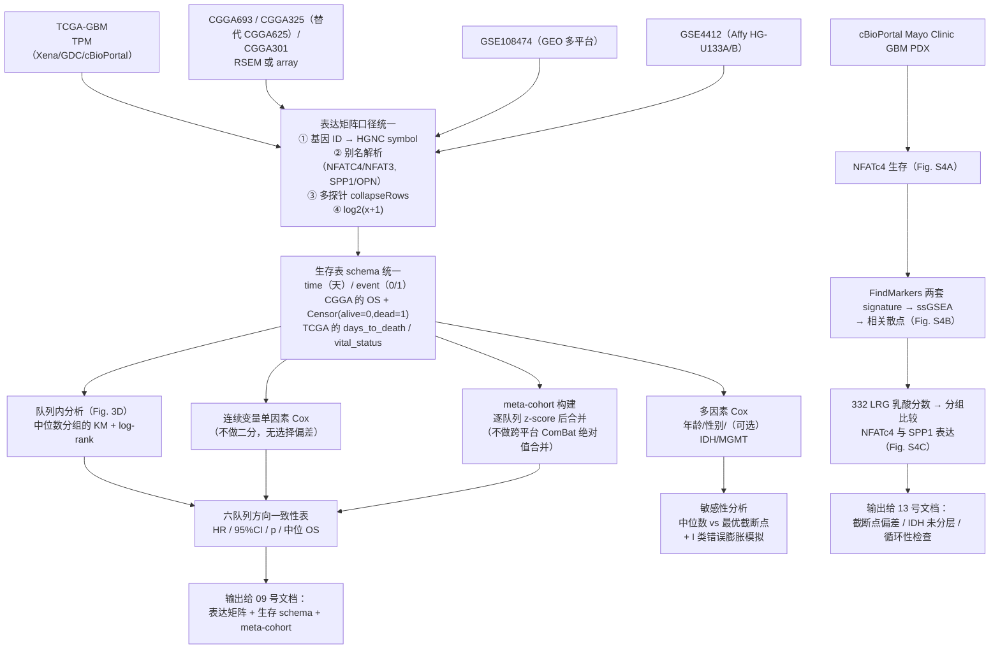

# 08 bulk 多队列整合与 NFATc4 生存分析（含 PDX 验证）

> **目标文献**：Wang R, Wu W, et al. *Integrative single-cell and spatial transcriptomic analysis reveals a
> lactate-driven crosstalk between NFATc4⁺ tumor cells and SPP1⁺ macrophages in glioblastoma.*
> *J Transl Med* (2026) 24:1253. DOI: 10.1186/s12967-026-08555-7
>
> **模块对应原文**：Fig. 3D（六队列 NFATc4 的 Kaplan–Meier 生存分析）、Fig. S4A–C（Mayo Clinic GBM PDX 的
> NFATc4 生存、SPP1⁺/NFATc4⁺ signature 的 ssGSEA 相关、乳酸分数分组下的表达比较）；
> Methods 中「Collection and integration of the data」「Statistical analysis」段落；
> Discussion 中关于"公开数据临床注释不全 → 统一按 GBM WHO IV 分析、不做 IDH 分层"的段落
> **前置依赖（已按各模块作者确认的产物名对齐）**：
> 1. **01 号文档** → `processed/lrgs_332.txt`（332 LRGs，直接用 `readLines()` 读，不要自己解析 Table S2）；
>    `raw/tcga/`、`raw/cgga/`、`raw/geo/`、`raw/cbioportal/` 的原始数据；`processed/pdx_mayo.rds`（cBioPortal PDX）。
> 2. **02 号文档** → `processed/seurat_gbm_qc_seurat5.rds`（10 大类注释；本模块只用它的 `celltype` 与表达矩阵）。
> 3. **03 号文档** → `processed/neoplastic_lactate_scored.rds`（列 `lactate_score` / `lactate_group` 等）；
>    **04 号文档** → `results/aucell_mtx.csv`（regulon AUC，列名带 `(+)` 后缀；注意原文 Fig. 3D 用 **mRNA 表达**而非 regulon 活性）。
> 4. **07 号文档 §4.3** → `processed/sig_spp1_mac_tam.rds`、`processed/sig_nfatc4_tumor.rds`
>    （两套 signature，**已剔除 SPP1 / NFATC4 自身**）。**原 02 号文档只到 10 大类细胞，不产出 signature** ——
>    这也正是 §4.9 必须做循环性检查的原因。
>
> 除上述接口外，本模块的 bulk 输入是**从零下载的公开队列**，可与 01–07 号文档并行推进。
> **与 01 号文档的分工（避免重复劳动，务必先读）**：
>
> | 事项 | 归属 | 产物 |
> |---|---|---|
> | 六个队列的**下载**与原始格式统一 | **01 号文档**（`01_环境搭建与数据获取.md`） | `raw/tcga/`、`raw/cgga/`、`raw/geo/`、`raw/cbioportal/`；`logs/geo_manifest.tsv` |
> | 332 LRG 基因集 | **01 号文档** | `processed/lrgs_332.txt`（本模块直接 `readLines()` 读取，不再自己解析 Table S2） |
> | 一份**候选的** meta-cohort 构建脚本 | **01 号文档** | `code/01_meta_cohort.R` → `processed/bulk_matrix.rds`、`processed/meta_cohort.rds` |
> | **生存表 schema 统一**、逐队列 NFATc4 生存、多因素 Cox、截断点偏差、编码陷阱 | **本模块（08）** | `processed/bulk_cohorts_raw.rds` 等 |
>
> **本模块对 meta-cohort 的处理**：优先**复用** 01 号文档的 `processed/meta_cohort.rds`（用
> `intersect(colnames(...))` 与样本数校验后使用）；§4.8 给出的 `build_meta_cohort()` 是**当 01 号产物不可用、
> 或需要按本模块口径重算时的等价实现** —— 两者口径必须一致（逐队列 z-score + 生存时间统一为天），
> 否则 09 号文档的 C-index 无法与原文对照。
>
> **目录约定**：本项目实际使用 `raw/` 与 `processed/`（00 号总览中写作 `data/raw/`、`data/processed/`，指同一处）；
> 本文件一律按 01 号文档的写法。
>
> **复现难度**：★★★☆☆（单队列分析本身简单，**难点全在数据工程的编码陷阱与截断点选择偏差**）
> **预计工时**：4–5 人日　**计算资源**：16–32 GB 内存 / 8 核；纯 CPU，PDX 部分计算量可忽略

---

## ① 科学问题与逻辑位置

### 1.1 本模块在全文证据链中解决什么问题

前六个模块（01–07）回答的是"**在单细胞/空间尺度上发生了什么**"：高乳酸肿瘤细胞富集 NFATc4、
NFATc4⁺ 肿瘤细胞与 SPP1⁺ 巨噬细胞空间共定位并存在推断的通讯。但这些结论都建立在**样本量极小**的
scRNA-seq / Visium 数据上（GSE138794 五个样本、GSE194329 四个切片）。

本模块承担的是**"从 5 个病人外推到 6 个队列、上千例样本"的检验**：

> **NFATc4 高表达是否真的与更差的临床结局相关？这个关联是否在不同平台、不同人群、不同来源的队列中稳定？**

这是全文唯一把"分子机制假说"与"临床可测量终点（overall survival）"直接连接的模块。它必须经得起的最强反驳是：
**"你的 NFATc4 不过是五个样本里的一个转录因子噪声，放到大样本里就消失了。"**

同时本模块还承担 **PDX 层的交叉验证（Fig. S4）**：用独立的、非患者的模型系统（Mayo Clinic GBM PDX），
检验三个预言是否成立 —— (i) 高 NFATc4 → 预后更差；(ii) SPP1⁺ 巨噬细胞 signature 与 NFATc4⁺ 肿瘤细胞 signature 正相关；
(iii) 乳酸分数高的 PDX 模型同时高表达 NFATc4 与 SPP1。

### 1.2 输入 / 输出

| 方向 | 内容 |
|---|---|
| 上游输入 | 公开队列原始数据（TCGA-GBM、CGGA 的三个数据集、GSE108474、GSE4412、cBioPortal 的 Mayo PDX）；03/04 号文档的 NFATc4 选定依据与乳酸分数口径；**07 号文档 §4.3 产出的两套 signature**；01 号文档产出的 332 LRGs（`processed/lrgs_332.txt`）|
| 本模块产物 | 每个队列统一后的表达矩阵与生存表；六队列 NFATc4 生存汇总表与多面板 KM；连续/多因素 Cox 结果；截断点敏感性结果；PDX 的生存 + ssGSEA 相关 + 乳酸分组比较 |
| 下游消费者 | 09 号文档（`09_机器学习101组合预后模型.md`，机器学习预后模型）：直接复用本模块的**表达矩阵 + 生存 schema + meta-cohort 构建代码**；13 号文档（`13_复现质控清单、排错与批判性评述.md`）：消费"方向一致性""截断点偏差""IDH 分层缺失"三条批判点 |

> ⚠️ **边界声明**：Fig. 3D 与 Fig. S4 属于本模块；**Fig. 7 的 101 种机器学习模型、共识聚类、
> time-dependent ROC、meta 分析的 pooled HR = 1.82 属于 09 号文档**。
> 两者容易混淆的一点是：**Fig. 7F 的 pooled HR = 1.82（95% CI 1.64–2.02，p < 0.001）是"机器学习风险分数"的
> 合并 HR，不是 NFATc4 单基因的 HR**。原文六队列 NFATc4 的 HR 与 p 值**完全没有报告**（原文未报告）。
> 复现时若把这两个数字混用，会得出"NFATc4 有 HR=1.82 的强效应"这一**原文并不支持的结论**。

### 1.3 逻辑流程图



---

## ② 背景知识与原理

### 2.1 六个队列的"性格"：为什么它们不可混为一谈

| 队列 | 平台 / 数据类型 | 表达量口径 | 生存终点可得性 | 关键陷阱 |
|---|---|---|---|---|
| **TCGA-GBM** | Illumina RNA-seq（STAR 比对） | 原文明确用 **TPM** | 好（`days_to_death` / `days_to_last_follow_up` / `vital_status`） | TPM 不可与 RPKM/FPKM 混用；历史 GBM 队列本身即 IDH-wt 为主，与 CGGA 的定义不同（见 §3 批注） |
| **CGGA693** | Illumina RNA-seq | RSEM（官网已给 FPKM 或 RSEM count 两套） | 好（`OS` + `Censor (alive=0, dead=1)`） | `OS` 单位为**天**；`Censor` 列是**字符/数值混排**，直接 `as.numeric` 会得到 NA；列名拼写有历史遗留（如 `1p19q_codeletion`） |
| **CGGA625** | **官网无此数据集**（下游用 **CGGA325 代替**，n = 325） | RSEM | 与 CGGA325 同 | 官网只有 **mRNAseq_693 / mRNAseq_325 / mRNA-array_301** 三套，"CGGA625"不可溯源。详见 §5.1 的 D1 决策与 01 号文档的登记 |
| **CGGA301** | mRNA array | 芯片强度（需 log2 与分位数归一化） | 好 | 与 RNA-seq 队列**不可直接合并**做绝对比较 |
| **GSE108474** | GEO 合辑 = **REMBRANDT 研究**（已核实：GSE108474 即 REMBRANDT，n = 550，检索到的主平台为 **GPL570 = HG-U133 Plus 2.0**） | 芯片强度 | 部分样本有 OS | **下载后必须用 `annotation(es)` 实测到底有几个子平台**（有多平台时逐平台拆分、各自归一化）；探针→基因映射依赖平台注释包；样本在子平台之间不可直接 concat |
| **GSE4412** | Affymetrix **HG-U133A + HG-U133B**（双平台；以 `annotation(es)` 实测为准） | MAS5 或 RMA | 有 OS（Freije 等，GBM 为主） | 双平台需分别处理再按基因取并集；样本量小（GBM 部分数十例）→ **KM 阶梯跳变明显、CI 极宽** |
| **meta-cohort** | 多种平台的合并集 | 逐队列标准化后合并 | 依赖成员队列 | **原文未报告其构成与合并方式**（原文未报告），见 §5.1 |

> **导师批注**：这张表是全篇最值得先读的表。**六个队列里有三种平台、四种表达量口径、两种生存编码、
> 两套基因 ID 体系**。原文用一句 "Gene expression matrices and corresponding survival data were collected from
> TCGA, CGGA, GSE108474, GSE4412, and the meta-cohort" 就交代完了，而实际上 80% 的复现工作量在这个"collection"里。
> 复现者必须把每个队列的处理写成**逐队列的 QC 日志**（样本数、被丢弃的样本数及原因）。

### 2.2 表达矩阵口径统一：五步固定流程

**第 1 步：基因 ID → HGNC symbol。** 四种常见 ID：Ensembl（`ENSG00000184599`）、Entrez（`4776`）、
Affymetrix 探针（`204580_at`）、CGGA 自带的 symbol。统一到当前的 HGNC symbol（NFATC4 曾用名 **NFAT3 / NF-ATc4**；
SPP1 曾用名 **OPN / BNSP / ETA-1 / SPP1**）。**必须做别名解析**，否则 `NFAT3` 会与 `NFATC4` 分成两行，导致表达值被稀释。

**第 2 步：多探针 collapse。** 一个基因对应多个探针时，常见策略：
- `MaxMean`（WGCNA `collapseRows` 默认，取平均表达最高的探针）—— **本方案主用**；
- `MaxVariance`（取方差最大的探针）—— 更适合"该基因是不是标志物"的场景，但对低表达基因不稳定；
- 平均（`rowMeans`）—— 会把高表达探针的信号平均掉，**不推荐**。
无论选哪种，**必须记录每种基因的探针数分布**（`table(table(probe2gene))`），并在报告中声明口径。

**第 3 步：log 变换。** 连续计数型（TPM/RSEM/FPKM）与芯片强度一律 `log2(x + 1)`。
方差稳定化的替代方案是 `limma::voom` / `DESeq2::vst`，但它们假设负二项分布，**对 TPM 不成立**，不要乱用。

**第 4 步：跨队列可比性。** 三种策略，**用途不同，不可混用**：

| 策略 | 做法 | 适用 | 不适用 |
|---|---|---|---|
| **不校正**（推荐用于生存验证） | 各队列独立分析，最后用 **HR 的 meta 分析**汇总 | 生存分析的**主分析**：因为 HR 是队列内的相对量，不受平台绝对尺度影响 | 需要跨队列比较绝对表达时 |
| **逐队列 z-score** | 每个队列内 $\tilde x_{ig} = (x_{ig} - \bar x_g)/s_g$ | 构造 meta-cohort 做**分组类**分析（KM 按中位数二分） | 需要基因间相对表达（z-score 抹掉了基因间量纲差异） |
| **ComBat / `limma::removeBatchEffect`** | 用 `sva::ComBat(expr, batch = cohort, mod = model.matrix(~1))` | 需要跨队列的**可视化**（PCA、聚类）或机器学习的联合建模 | **生存分析的主分析**——因为平台间批次校正会改变表达分布形状，进而不可控地改变样本的生存排序；且 ComBat 无法处理"事件/随访时间"这一共变量 |

> ⚠️ **导师批注（本模块最重要的方法学判断）**：**对于"某基因与 OS 的关系"这个问题，跨队列批次校正是有害的。**
> 理由：ComBat 假设"批次效应是加性的、且样本的真实生物学分组已知"。当 `mod` 里不含生存信息时，
> ComBat 可能把"某队列整体预后更好"（如 CGGA 里 IDH-mut 比例更高）当作批次效应消掉，
> 从而**人为制造或抹掉**生存关联。正确做法是**逐队列独立检验 + meta 分析 HR**（这正是原文 Fig. 7F 的做法，也是本方案的选择）。
> 只有在 Fig. 7C 那种"PCA 显示两组分离"的展示性分析中，ComBat 才有位置。

**第 5 步：基因过滤。** 原文写 "Genes with average expression values greater than zero and shared across all
datasets were retained for downstream analyses" —— 即 **平均表达 > 0 且在全部数据集中共享**。
这是个**极宽松**的过滤（"平均表达 > 0"对任何表达矩阵都几乎恒成立）。复现时建议在原文口径之外，
**额外记录一版更严格口径**（在 ≥ 30% 样本中表达 > 0）作为敏感性分析，并在报告中声明两版口径的基因数差异。

### 2.3 生存分析的数学原理

#### 2.3.1 数据与删失

生存数据是三元组 $(T_i^{\text{obs}}, \delta_i, x_i)$，其中
$T_i^{\text{obs}} = \min(T_i, C_i)$（真实事件时间 $T_i$ 与删失时间 $C_i$ 的较小者），
$\delta_i = \mathbf 1\{T_i \le C_i\}$ 是事件指示符（1 = 死亡，0 = 删失）。
**关键假设是"非信息性删失"**：删失时间与事件时间独立（否则 KM 有偏）。活到随访结束仍存活的病人被删失 —— 这不是缺失，
而是部分信息。

#### 2.3.2 Kaplan–Meier 估计量

$$\hat S(t) = \prod_{t_{(i)} \le t} \left(1 - \frac{d_i}{n_i}\right)$$

其中 $t_{(i)}$ 为排序后的事件时间，$d_i$ 为该时点的死亡数，$n_i$ 为该时点的**风险集（risk set）**大小
（即 $\ge t_{(i)}$ 仍未发生事件且未被删失的人数，`risk.table=TRUE` 显示的就是它）。
把 $d_i$ 换成分组计数即得各组的 $\hat S_g(t)$；`survfit` 用 **Greenwood 公式**给置信区间。

**读图三要点**：(a) **阶梯的宽度反映的是样本量与事件数**，样本小则阶梯跳跃大（GSE4412 会很明显）；
(b) **曲线末端发散不可信**（风险集只剩几例）；(c) **必须看风险表**，否则无法判断曲线差异是否有足够的事件支撑。

#### 2.3.3 log-rank 检验

检验 $H_0: S_1(t) = S_0(t)$，在每个事件时点比较"观察到的死亡数"与"若两组同分布时的期望死亡数"：

$$U = \sum_{i} \left(d_{i1} - \frac{n_{i1}}{n_i} d_i\right), \qquad
V = \sum_i \frac{n_{i1} n_{i0} d_i (n_i - d_i)}{n_i^2 (n_i - 1)}$$

$$\chi^2_{\text{log-rank}} = \frac{U^2}{V} \;\sim\; \chi^2_1$$

性质与陷阱：log-rank 是**对整条曲线**加权比较（权重近似为各时点的风险集大小），
**对早期事件更敏感**；若两组曲线早期交叉、晚期分离，log-rank 的 p 值可能很大而实际效应存在
（此时应报告 **restricted mean survival time (RMST)** 或加权 log-rank，如 `survdiff` 的 `rho` 参数、
或 `survival::survdiff` 配合 `rms::rmst` 类方法）。

#### 2.3.4 Cox 比例风险模型

$$h(t \mid x) = h_0(t)\exp\!\left(\beta^{\top} x\right)$$

$h_0(t)$ 是完全未指定的基准风险，因此 Cox 模型是**半参数**模型。$\beta$ 通过**偏似然**估计：

$$L(\beta) = \prod_{k:\,\delta_k = 1} \frac{\exp\!\left(\beta^{\top} x_k\right)}
{\sum_{j \in R(t_k)} \exp\!\left(\beta^{\top} x_j\right)}$$

注意乘积只遍历**发生事件**的个体（$\delta_k = 1$），分母是风险集。$\exp(\beta_g)$ 即 HR：
在其余协变量固定的条件下，$x_g$ 每增加 1 单位，**瞬时死亡风险**按比例变化 HR 倍。
95% CI 为 $\exp\!\left(\hat\beta_g \pm 1.96\, \mathrm{SE}(\hat\beta_g)\right)$。

**PH 假设检验**：$h_1(t)/h_0(t) = \exp(\beta^{\top}(x_1-x_0))$ 必须**不随时间变化**。
`cox.zph()` 用 **Schoenfeld 残差**与时间（或其函数）做检验，输出每个协变量与全局的 p 值：
- **p > 0.05** → 未检出违反（注意：这不等于"PH 成立"，只是样本量不足以证明它不成立）；
- **p < 0.05** → PH 被违反，补救方案：(a) 分层 Cox（`strata()`）；(b) 引入时依系数（`tt()` 函数）；
  (c) 改用 AFT 模型或 RMST 作为稳健性分析。

> **导师批注**：`cox.zph` 的 p 值也**依赖样本量**：n = 40 的队列几乎永远通不过 PH 检验的反驳（p 很大），
> 但也不代表 PH 成立。所以对 GSE4412 这类小队列，PH 检验的结论只写"未检出违反"，不要写"PH 假设成立"。

#### 2.3.5 连续变量 vs 二分变量：为什么二分是"信息损失 + 偏差引入"

把连续表达量 $x$ 二分为"高/低"看似直观，但代价是：

1. **信息损失**：$n$ 个样本的连续信息被压缩成 1 bit；在 $n$ 较小或效应中等时，**统计效能可下降 20–50%**
   （Royston, Altman & Sauerbrei, *Stat Med* 2006 的经典论述：keeping continuous data continuous）；
2. **残差混杂（residual confounding）**：若真实关系是单调的，二分仍可检出方向，但**二分点的位置决定了 HR 的大小**；
3. **截断点的选择带来多重比较**：若在 $[p_{10}, p_{90}]$ 区间内扫描所有可能截断点并取"最小 p 值"的那个，
   等价于做了几十到上百次检验却没有校正 —— **p 值必然被低估，I 类错误必然膨胀**。
   这就是 `survminer::surv_cutpoint()` / `maxstat::maxstat.test()` 背后的问题。

**未经校正的"最优截断点"p 值有多离谱？** 本方案要求**在你自己队列的样本量下实测**（代码见 §4.7）。
经验上，当 $n \approx 100$、单协变量、`minprop = 0.1` 时，一个**与生存完全无关的噪声基因**
在名义 $\alpha = 0.05$ 下被"检出"的概率可达 **20–40%**（远高于 5%）。这一模拟结果是你在报告中
质疑"最优截断点"最有力的证据。`maxstat` 提供的 **Lausen & Schumacher 校正 p 值** 正是为修正这一问题而设计。

**本方案的选择（三层，从主到次）**：

| 层次 | 方法 | 定位 | 报告方式 |
|---|---|---|---|
| **主分析（推断层）** | **连续表达量的单因素 Cox**（`coxph(Surv(time,event) ~ scale(NFATC4))`） | 无截断点选择，唯一可做推断的证据 | 每队列 HR（per SD）、95% CI、p、PH 检验 p |
| **主图（展示层）** | **中位数二分 + KM + log-rank**（Fig. 3D 风格） | 视觉直观、与原文图一致 | 明确标注"中位数分割，非最优截断点" |
| **敏感性分析（探索层）** | 最优截断点（`surv_cutpoint`）、三分位、四分位 | 只用于稳健性检查 | **标注为探索性**；同时给出 `maxstat` 的校正 p；**不得据此声称显著性** |

### 2.4 PDX 模型的特殊性

- **PDX ≠ 患者队列**：Mayo Clinic GBM PDX（Vaubel et al., *Clin Cancer Res* 2020）是把患者肿瘤
  移植到免疫缺陷小鼠后传代的模型。**"生存"的含义完全不同**：原文的 PDX "survival" 应理解为
  **模型的荷瘤生存时间/成瘤至终点的时间**（如移植后到肿瘤达某体积或小鼠死亡的天数），
  与患者的 overall survival **不可直接类比**，更不构成独立的患者层面证据。
- **免疫缺陷背景**：多数 GBM PDX 传代于裸鼠/NSG 小鼠，**没有人源免疫系统**。
  因此 PDX 里的"SPP1⁺ 巨噬细胞 signature"只能用**基因表达相关性**验证，
  **不可能**验证"NFATc4⁺ 肿瘤细胞与 SPP1⁺ 巨噬细胞之间真的有通讯"——因为那些巨噬细胞本质上是鼠源或不存在。
  这是 Fig. S4 最需要被小心解读的地方（见 §3 批注）。
- **样本量**：PDX panel 通常数十个模型，KM 同样面临小样本问题。
- **cBioPortal 的版本漂移**：研究 ID、分子谱 ID、临床字段名会随 cBioPortal 版本变化，
  **必须用 `getStudies()` 动态核对**，不要硬编码。

---

## ③ 原文方法逐条拆解

| # | 原文原句 | 中文转述 | 对应操作 | 原文缺失/含糊之处 |
|---|---|---|---|---|
| M1 | "The Bulk RNA-seq data for GBM samples include The Cancer Genome Atlas (**TCGA, expression values transformed to TPM**), the Chinese Glioma Genome Atlas (**CGGA**), and the Gene Expression Omnibus (GEO) datasets with accession IDs **GSE108474** and **GSE4412**." | 四个来源 + 一个 meta-cohort | TCGA 只要 TPM；CGGA 与两套 GEO 按各自原格式处理 | ① CGGA 用哪几个数据集？（Results 里出现 CGGA693/625/301 三个）② 表达量口径（RSEM/FPKM/芯片强度）未报告；③ meta-cohort 是什么、怎么合，**完全未报告** |
| M2 | "Samples with **missing survival information were excluded**." | 生存信息缺失的样本剔除 | 每个队列单独执行，并**记录剔除前后样本数** | "缺失"的判据未定义（时间是 NA？事件是 NA？时间是 0？）→ 本方案统一为 time 或 event 为 NA/≤0 即剔除 |
| M3 | "Genes with **average expression values greater than zero** and **shared across all datasets** were retained." | 基因过滤 | `rowMeans(expr) > 0` 且跨数据集取交集 | "average" 是算术均值还是中位数？跨哪些数据集取交集（含 meta-cohort 吗）？ |
| M4 | "**Survival curves were analyzed using Kaplan-Meier analysis and the log-rank test.**" (Statistical analysis) | KM + log-rank | `survfit` + `survdiff` / `ggsurvplot(pval=TRUE)` | **分组方式完全未报告**：中位数？最优截断点？四分位？这是最关键的信息缺失 |
| M5 | "Survival analysis across six independent cohorts (**CGGA693, CGGA625, CGGA301, GSE108474, GSE4412, and TCGA**) showed that high NFATc4 expression was **generally associated with poor patient prognosis across most cohorts** (Fig. 3D)." | 六队列 KM | 需要六个队列各自做 KM | "**generally / most cohorts**" 说明**并非所有队列都显著**（否则会写 "in all cohorts"）。**哪些队列不显著、方向是否一致，原文完全未报告** → 这是本模块最重要的复现任务。**另注意**：六队列里的 "CGGA625" 在官网不存在，本项目用 CGGA325 代替（见 §5.1 D1），复现图上必须标注"替代" |
| M6 | Fig. 3D 图注："**Kaplan–Meier survival analysis of NFATc4 expression-based groups in GBM cohorts.**" | 按 NFATc4 表达分组的 KM | "expression-based groups" 措辞回避了分组规则 | 同 M4 |
| M7 | Discussion："due to the retrospective nature of the publicly available datasets, **clinical annotations such as IDH mutation status were not consistently available across cohorts**. To maintain cohort consistency and **avoid introducing additional stratification bias, we analyzed GBM (WHO grade IV) as a unified entity without further stratification based on IDH status**." | 不做 IDH 分层 | 主分析只按 WHO IV 纳入，不加 IDH 协变量 | 这是一个**双刃剑式**的决策：避免了队列间注释不一致，但引入了**新的混杂**（见下方批注） |
| M8 | Results / Fig. S4："we calculated lactate metabolic scores using transcriptomic data from the GBM patient-derived xenograft (**PDX**) model of the **Mayo Clinic**, retrieved from the **cBioPortal** database (Fig. S4). Survival analysis of the GBM PDX model revealed that **high NFATc4 expression was significantly associated with worse prognosis** (Fig. S4A)." | PDX 层 NFATc4 生存 | cBioPortal 下载 → 表达矩阵 → NFATc4 分组 → KM | 研究 ID、样本数、分组方式、PDX 生存字段（时间单位）均未报告 |
| M9 | "Using **signature genes** of SPP1⁺ macrophages and NFATc4⁺ malignant cells identified via the **FindMarkers** tool, we further quantified their relative abundance in GBM PDX models by **ssGSEA** analysis. Intriguingly, a **strong positive correlation** was observed between SPP1⁺ macrophages and NFATc4⁺ neoplastic cells (Fig. S4B)." | 两套 signature 在 PDX 中 ssGSEA 打分后强正相关 | `FindMarkers` 取 signature（**基因数未报告**）→ `GSVA::gsva(ssgseaParam(...))` → 相关 | ① signature 基因数未报告（我们取 top 50，并做 25/50/100 敏感性）；② 相关系数类型（Pearson/Spearman）与 r、p 值均未报告（原文只写 "strong positive correlation"） |
| M10 | "GBM PDX models with **higher lactate metabolic scores** exhibited significantly elevated expression levels of **both NFATc4 and SPP1** (Fig. S4C)." | 乳酸分数高的 PDX 中 NFATc4 与 SPP1 均升高 | 332 LRGs 打乳酸分数 → 分组（分组方式未报告）→ 比较 NFATC4 / SPP1 表达 | ① 分组是三分位还是中位数未报告；② 检验方法未报告（我们默认 Kruskal–Wallis + Dunn，因为多组非参数） |
| M11 | Methods："univariate Cox (unicox) regression analysis was used to **categorize the tumor cells based on their lactate scores**" | 用单因素 Cox 给肿瘤细胞分组 | —— | ⚠️ **这句话在单细胞语境下不自洽**：单细胞没有随访信息，无法做 Cox。03 号文档 §3.3 已辨析：该句实际属 **bulk 层**且很可能是模板遗留；原文 Results 真正报告的 bulk 分组是 TCGA 的 **consensus clustering（Cluster A/B）**，单因素 Cox 只用于筛基因（P < 0.001）。**复现时不要把"细胞"打成"病人"** |

> ⚠️ **导师批注（M5 是本模块的"真问题"）**：原文用的是 "generally associated with poor prognosis across **most** cohorts"。
> 这句话在学术写作里是一个**谨慎的减责表述**：作者知道至少有一个队列没跑出显著、甚至方向相反，
> 所以不敢写 "in all cohorts"。因此复现者的**首要任务**不是"把六个队列都做成显著"（那是造假），
> 而是**把每个队列的 HR、95% CI、p、中位 OS 全部列出来**——尤其是**哪个队列不显著、方向如何**。
> 这个表本身就是对原文最有价值的补充，也应当原样进入 13 号文档。

> ⚠️ **导师批注（M7 的 IDH 混杂）**：按 WHO 2021 分类，**"GBM" 已经被重新定义为 "IDH-wildtype 的 CNS WHO grade 4 星形细胞瘤"**，
> 而 IDH-mutant 的 grade 4 星形细胞瘤是**另一个疾病实体**（预后显著更好，中位生存 > 5 年 vs GBM 的 ~15 个月）。
> 问题在于：**TCGA-GBM 按历史诊断纳入（IDH-wt 占绝大多数）**，而 **CGGA 的 "Grade IV" 里同时含 IDH-mut 与 IDH-wt**。
> 于是"六个队列都叫 GBM"实际上**不是同一个疾病**：CGGA 队列中 IDH-mut 比例越高，整体生存越好。
> 若 NFATc4 恰好与 IDH 状态相关（例如在 IDH-mut 中表达更低），就会产生**辛普森悖论式的混杂**。
> 原文选择"不加 IDH 协变量"，在注释不全时是无奈之举，但**必须在局限性里显式写出这一混杂的方向与量级未知**，
> 而原文的表述（"avoid introducing additional stratification bias"）读起来更像是在为不做事辩护。
> 本方案的应对：**主分析保持原文口径（WHO IV 统一）**，**额外加一个仅用有完整 IDH 注释样本的敏感性分析**
> （TCGA-GBM 与 CGGA693 均提供 IDH 状态），并**明确标注为 post hoc 敏感性分析**。

> ⚠️ **导师批注（M9/M10 的循环性，必须检查）**：Fig. S4C 用 332 个 LRGs 算乳酸分数，
> 然后说"乳酸分数高的模型 NFATc4 与 SPP1 表达均升高"。**如果 `NFATC4` 或 `SPP1` 本身就在这 332 个基因里**，
> 这就是**循环论证**（用含 X 的基因集打分，再说分数与 X 相关）。
> 同理，Fig. S4B 的两套 signature 若彼此有交集，相关性也会被**结构性抬高**。
> **本方案的强制 QC 项**：`intersect(LRG332, c("NFATC4","SPP1"))` 与
> `intersect(sig_spp1, sig_nfatc4)` 各打印出来，若非空则**重跑一版剔除交集基因的分数**，两组结果都报告。

---

## ④ 逐步可运行代码

环境：R 4.4.2；`survival`、`survminer`、`maxstat`、`GSVA`、`GEOquery`、`WGCNA`、`sva`、`limma`、`cBioPortalData`。
目录约定沿用全项目：`raw/ → processed/ → results/ → figures/ → code/ → logs/`。

### 4.1 数据下载（bash）

```bash
# code/08_00_download.sh
mkdir -p raw/{tcga,cgga,geo,cbioportal} processed results figures logs

# ---------- 1) TCGA-GBM（TPM，原文口径）----------
# 路线 A（推荐，含 TPM + 生存，字段最干净）：UCSC Xena
#   打开 https://xenabrowser.net/datapages/ → 搜 "TCGA GBM"
#   下载 TCGA-GBM.star_tpm.tsv.gz（gene-level TPM，log2(TPM+0.001) 版本另有 *star_gene_expr*）
#   下载 TCGA-GBM.survival.tsv（字段：sample / OS / OS.time / _PATIENT）
curl -L -o raw/tcga/TCGA-GBM.star_tpm.tsv.gz \
  "https://tcga-xena-hub.s3.us-east-1.amazonaws.com/download/TCGA-GBM.star_tpm.tsv.gz"
curl -L -o raw/tcga/TCGA-GBM.survival.tsv \
  "https://tcga-xena-hub.s3.us-east-1.amazonaws.com/download/TCGA-GBM.survival.tsv"

# 路线 B（备选，字段更啰嗦但可交叉核对）：GDC / cBioPortal
#   cBioPortal: https://www.cbioportal.org/study/summary?id=gbm_tcga
#   → Download → "RNA Seq V2 RSEM"（注意：这是 RSEM 归一化值，不是 TPM）
#   → Clinical Data → data_clinical_patient.txt（OS_MONTHS / OS_STATUS = "1:DECEASED"）

# ---------- 2) CGGA（官网 http://www.cgga.org.cn/download.jsp）----------
# 在下载页勾选以下文件（文件名含日期版本，以页面当前列表为准）：
#   CGGA.mRNAseq_693.RSEM-genes.20200506.txt      + CGGA.mRNAseq_693_clinical.20200506.txt
#   CGGA.mRNAseq_325.RSEM-genes.20200506.txt      + CGGA.mRNAseq_325_clinical.20200506.txt
#   CGGA.mRNA-array_301.RSEM-genes.20200506.txt   + CGGA.mRNA-array_301_clinical.20200506.txt
# 注意：官网下载需要先在页面上的 "Download" 表单提交并等待下载链接（可能需要邮箱）。
# 若无法获得，Plan B 见 §5.1。

# ---------- 3) GEO ----------
# GSE108474（多平台合辑）与 GSE4412（Affy U133A/B）交给 R 的 GEOquery 下载（见 §4.2）

# ---------- 4) cBioPortal Mayo Clinic GBM PDX ----------
# 网页路线（推荐，可核对字段名）：
#   https://www.cbioportal.org/ → Data Sets → 搜索 "Mayo" →
#   选 "Brain Cancer PDX (Mayo Clinic, Clin Cancer Res 2020)" → Download
#   需要：mRNA expression（RSEM）+ Clinical Data（含 PDX 生存字段）
# 命令行路线（需网络且速度慢）：用 R 的 cBioPortalData（见 §4.9）
```

### 4.2 表达矩阵与生存表的统一（R）

先写一组通用工具函数，后面每个队列复用。**这段代码的核心价值是"用列名探测代替硬编码"**，
因为 CGGA / Xena / cBioPortal 的字段名会变。

```r
# code/08_01_utils.R
suppressPackageStartupMessages({
  library(dplyr); library(tidyr); library(readr); library(stringr)
  library(WGCNA)      # collapseRows
  library(AnnotationDbi)
})
set.seed(20260101)

# ---- 生存表 schema：统一为 data.frame(sample, time_days, event) ----
make_surv <- function(sample, time_days, event) {
  df <- data.frame(sample = as.character(sample),
                   time   = as.numeric(time_days),
                   event  = as.integer(event))
  # 统一的清洗规则：时间缺失/<=0 或事件缺失 → 剔除并记录
  bad <- is.na(df$time) | is.na(df$event) | df$time <= 0
  df_clean <- df[!bad, , drop = FALSE]
  attr(df_clean, "n_dropped") <- sum(bad)
  df_clean
}

# ---- 列名探测（避免硬编码各队列的字段名）----
pick_col <- function(df, candidates, label) {
  hit <- intersect(candidates, colnames(df))
  if (length(hit) == 0)
    stop(sprintf("找不到「%s」列。候选：%s。实际列名：%s",
                 label, paste(candidates, collapse = " / "),
                 paste(colnames(df), collapse = ", ")))
  hit[1]
}

# ---- 表达矩阵统一：ID → symbol → collapse → log2 ----
unify_expr <- function(mat, id2symbol,
                       collapse_method = "MaxMean",
                       already_logged = FALSE) {
  # mat: 行 = 探针/基因 ID，列 = 样本
  keep <- rownames(mat) %in% names(id2symbol) & !is.na(id2symbol[rownames(mat)])
  mat  <- mat[keep, , drop = FALSE]
  sym  <- id2symbol[rownames(mat)]
  # 不要在这里按 symbol 去重：那会在 collapseRows 之前就把重复 symbol 的行整行丢掉，
  # 而 collapseRows 正是用来在多探针之间择优（MaxMean）的。去重交给 collapseRows。

  if (!already_logged) mat <- log2(mat + 1)      # 原文未明说，全项目统一 log2(x+1)
  # 负数兜底：芯片强度若已 log 过又减了背景，可能出现负值 → 截断到 0 之下的值 sum 会出问题
  mat[mat < 0] <- 0

  collapsed <- WGCNA::collapseRows(datET = as.matrix(mat),
                                   rowGroup = as.character(sym),
                                   rowID   = rownames(mat),
                                   method  = collapse_method)
  out <- collapsed$datETcollapsed
  message(sprintf("[unify_expr] 输入 %d 行 → 输出 %d 个基因（collapse=%s）",
                  nrow(mat), nrow(out), collapse_method))
  out
}

# ---- 分组函数：统一产物为 factor(High/Low) ----
cut_by_median <- function(x, labels = c("Low", "High")) {
  factor(ifelse(x > median(x, na.rm = TRUE), labels[2], labels[1]), levels = labels)
}
cut_by_cutpoint <- function(df, var, time = "time", event = "event", minprop = 0.1) {
  cp <- survminer::surv_cutpoint(df, time = time, event = event, variables = var,
                                 minprop = minprop)
  cut <- cp[[var]]$cutpoint[1]
  list(cutpoint = cut,
       group = factor(ifelse(df[[var]] > cut, "High", "Low"), levels = c("Low", "High")))
}
```

### 4.3 逐队列读取：TCGA、CGGA、GSE108474、GSE4412

> **写代码前的第一步：先看有没有现成的**。01 号文档落盘的是**全队列合并对象** `processed/bulk_matrix.rds`
> 与 `processed/meta_cohort.rds`（**没有**逐队列的 `processed/bulk_<cohort>.rds`，别照着这个名字去找文件）。
> 若能从中按队列拆分出含 `OS.time`、`OS` 两列的生存表，就把它当作**生存 schema 的交叉校验器**——
> 和本模块自己解析出的 `surv_df` 做 `merge()`，逐样本核对 `time` / `event` 是否一致。
> **不一致就说明有一边的编码解析错了**（这正是 §⑦ 里"事件编码方向反了却 p 值不变"最难察觉的那个坑）。
>
> ```r
> bulk_up <- tryCatch(readRDS("processed/bulk_matrix.rds"), error = function(e) NULL)  # 或 meta_cohort.rds
> # 先看清上游是什么结构（data.frame / list / SummarizedExperiment），再决定怎么取列
> if (!is.null(bulk_up)) { print(class(bulk_up)); print(names(bulk_up)) }
> for (tag in c("TCGA", "CGGA693", "CGGA325", "CGGA301", "GSE108474", "GSE4412")) {
>   b <- if (is.list(bulk_up) && !is.null(bulk_up[[tag]])) bulk_up[[tag]] else NULL
>   if (is.null(b)) { message("[", tag, "] 上游对象里没有该队列，跳过交叉校验"); next }
>   meta <- if (is.data.frame(b)) b else as.data.frame(SummarizedExperiment::colData(b))
>   if (!all(c("sample", "OS.time", "OS") %in% colnames(meta))) {
>     message("[", tag, "] 列名不匹配（需 sample/OS.time/OS），跳过"); next }
>   chk <- merge(meta[, c("sample", "OS.time", "OS")], surv_list[[tag]],
>                by = "sample", all = FALSE)
>   cat(sprintf("[%s] 交叉校验：n=%d，time 不一致 %d，event 不一致 %d，中位 OS=%.0f 天\n",
>               tag, nrow(chk), sum(chk$OS.time != chk$time, na.rm = TRUE),
>               sum(chk$OS      != chk$event, na.rm = TRUE),
>               median(chk$time, na.rm = TRUE)))
> }
> ```
> ⚠️ 两者不一致时**不要随手挑一个**：回到该队列的原始临床文件，逐个样本对到原始字段，把结论写进 `logs/`。


```r
# code/08_02_load_cohorts.R
source("code/08_01_utils.R")
expr_list <- list(); surv_list <- list(); clin_list <- list()

# ================= TCGA-GBM（Xena TPM + survival）=================
# ---- 路线 0（推荐，优先）：直接复用 01 号文档已整理好的对象 ----
#   processed/tcga_gbm_star_counts.rds —— GDC STAR-Counts 对象，assay "unstranded" = counts、
#   "tpm_unstrand" = TPM（原文明确用 TPM）。若该文件存在则走这一支，跳过下面的原始文件解析：
if (file.exists("processed/tcga_gbm_star_counts.rds")) {
  tc_obj <- readRDS("processed/tcga_gbm_star_counts.rds")
  print(SummarizedExperiment::assayNames(tc_obj))
  tpm <- SummarizedExperiment::assay(tc_obj, "tpm_unstrand")
  is_logged <- max(tpm, na.rm = TRUE) < 30          # STAR TPM 为原始尺度，通常需 log2(x+1)
} else {
# ---- 路线 1：自己从 Xena 文件读（01 号未产出时的兜底）----
tpm <- read.delim("raw/tcga/TCGA-GBM.star_tpm.tsv.gz",
                  check.names = FALSE, row.names = 1)
# Xena 的 TPM 矩阵值已是 log2(TPM + 0.001)，**不要再取一次 log**
# 判断依据：若 max(值) > 30 说明是原始 TPM，需 log2(x+1)；否则已是 log 尺度
is_logged <- max(tpm, na.rm = TRUE) < 30
}
message("TCGA TPM 是否已 log：", is_logged)
# ⚠️ 路线 0 的对象**只含表达**，不含生存 —— 生存表仍需另行获取：
#    Xena 的 TCGA-GBM.survival.tsv，或 cBioPortal 的 gbm_tcga data_clinical_patient.txt（OS_MONTHS / OS_STATUS）
# 样本 ID 形如 TCGA-06-0125-01A-01R-...，取前 15 位（patient-barcode 级）
colnames(tpm) <- substr(colnames(tpm), 1, 15)
tpm <- tpm[, !duplicated(colnames(tpm)), drop = FALSE]

surv_tcga <- read.delim("raw/tcga/TCGA-GBM.survival.tsv", check.names = FALSE)
c_time  <- pick_col(surv_tcga, c("OS.time", "OS_TIME", "days_to_death", "_OS_TIME"), "生存时间")
c_event <- pick_col(surv_tcga, c("OS", "OS_STATUS", "_EVENT", "vital_status"), "事件指示")
c_samp  <- pick_col(surv_tcga, c("sample", "_PATIENT", "sampleID"), "样本 ID")
# Xena 口径：OS = 1(dead)/0(alive)；OS.time 单位为「天」
tcga_s <- make_surv(substr(surv_tcga[[c_samp]], 1, 15),
                    surv_tcga[[c_time]], surv_tcga[[c_event]])
message("TCGA 剔除生存缺失样本数：", attr(tcga_s, "n_dropped"))

expr_list$TCGA <- unify_expr(tpm, setNames(rownames(tpm), rownames(tpm)),
                             already_logged = is_logged)   # TPM 行名已是 symbol
surv_list$TCGA <- tcga_s

# ================= CGGA（三个数据集）=================
read_cgga <- function(tag, expr_file, clin_file, already_logged = FALSE) {
  e <- read.delim(expr_file, check.names = FALSE, row.names = 1)
  e[is.na(e)] <- 0
  cl <- read.delim(clin_file, check.names = FALSE, stringsAsFactors = FALSE)

  c_samp  <- pick_col(cl, c("CGGA_ID", "Sample_ID", "sample"), "CGGA 样本 ID")
  c_time  <- pick_col(cl, c("OS", "os"), "OS 时间")
  # ⚠️ 最关键的一行：Censor 列在官网文件里可能被读成字符（含空格/中文注释）
  c_cens  <- pick_col(cl, c("Censor (alive=0, dead=1)", "Censor", "censor"), "删失指示")
  raw_cens <- cl[[c_cens]]
  if (is.character(raw_cens)) {
    raw_cens <- str_trim(raw_cens)
    raw_cens <- ifelse(tolower(raw_cens) %in% c("dead", "deceased", "1"), 1L,
                ifelse(tolower(raw_cens) %in% c("alive", "living", "0"), 0L,
                       suppressWarnings(as.integer(raw_cens))))
  }
  s <- make_surv(cl[[c_samp]], cl[[c_time]], as.integer(raw_cens))
  message(sprintf("[CGGA-%s] 生存可用样本 %d，剔除 %d", tag, nrow(s), attr(s, "n_dropped")))

  list(expr = unify_expr(as.matrix(e), setNames(rownames(e), rownames(e)),
                         already_logged = already_logged),
       surv = s, clin = cl, idcol = c_samp)
}

cgga693 <- read_cgga("693", "raw/cgga/CGGA.mRNAseq_693.RSEM-genes.20200506.txt",
                            "raw/cgga/CGGA.mRNAseq_693_clinical.20200506.txt")
cgga325 <- read_cgga("325", "raw/cgga/CGGA.mRNAseq_325.RSEM-genes.20200506.txt",
                            "raw/cgga/CGGA.mRNAseq_325_clinical.20200506.txt")
# array_301 是芯片，官网值通常已 log2，需按实际最大值判断
cgga301 <- read_cgga("301", "raw/cgga/CGGA.mRNA-array_301.RSEM-genes.20200506.txt",
                            "raw/cgga/CGGA.mRNA-array_301_clinical.20200506.txt",
                     already_logged = FALSE)

expr_list$CGGA693 <- cgga693$expr; surv_list$CGGA693 <- cgga693$surv
expr_list$CGGA325 <- cgga325$expr; surv_list$CGGA325 <- cgga325$surv
expr_list$CGGA301 <- cgga301$expr; surv_list$CGGA301 <- cgga301$surv

# ================= GSE108474（多平台）与 GSE4412 =================
library(GEOquery)
load_geo <- function(gse_id) {
  gse <- getGEO(gse_id, destdir = "raw/geo", GSEMatrix = TRUE, getGPL = TRUE)
  es_list <- if (is.list(gse) && !methods::is(gse, "ExpressionSet")) gse else list(gse)
  out <- list()
  for (i in seq_along(es_list)) {
    es  <- es_list[[i]]
    gpl <- annotation(es)                       # 例如 "GPL96"
    pd  <- pData(es)
    fd  <- fData(es)
    message(sprintf("[%s] 平台 %s：%d 探针 × %d 样本", gse_id, gpl, nrow(es), ncol(es)))

    # ---- 探针 → symbol：优先用 GPL 注释里自带的 symbol 列 ----
    sym_col <- intersect(c("Gene symbol", "GENE_SYMBOL", "Symbol", "gene_symbol"),
                         colnames(fd))
    if (length(sym_col) > 0) {
      id2sym <- setNames(str_split_i(fd[[sym_col[1]]], " /// ", 1), rownames(fd))
      id2sym <- id2sym[!is.na(id2sym) & id2sym != "" & id2sym != "---"]
    } else {
      # 回退：用平台注释包（以实际平台为准安装 hgu133a.db / hgu133plus2.db / hgu133b.db）
      dbpkg <- switch(gpl, GPL96 = "hgu133a.db", GPL97 = "hgu133b.db",
                      GPL570 = "hgu133plus2.db", GPL1352 = "hgu133x3p.db", NULL)
      if (is.null(dbpkg) || !requireNamespace(dbpkg, quietly = TRUE))
        stop(sprintf("平台 %s 无可用注释包，请手动指定映射", gpl))
      db <- getExportedValue(sub("\\..*$", "", dbpkg), sub("\\..*$", "", dbpkg))
      id2sym <- AnnotationDbi::mapIds(db, keys = rownames(fd), column = "SYMBOL",
                                      keytype = "PROBEID", multiVals = "first")
      id2sym <- id2sym[!is.na(id2sym)]
    }
    expr <- exprs(es)
    already_logged <- max(expr, na.rm = TRUE) < 30
    e <- unify_expr(expr, id2sym, already_logged = already_logged)

    # ---- 生存：GEO 的生存字段通常在 pData 里的 characteristics 或独立列 ----
    tm_col <- intersect(c("survival time", "survival_time", "os time", "follow up time",
                          "days to death", "time"), colnames(pd))
    ev_col <- intersect(c("status", "vital status", "event", "os status"), colnames(pd))
    out[[as.character(i)]] <- list(
      platform = gpl, expr = e, pdata = pd,
      time_col = if (length(tm_col)) tm_col[1] else NA_character_,
      event_col = if (length(ev_col)) ev_col[1] else NA_character_,
      gsm = rownames(pd))
  }
  out
}

gse108474 <- load_geo("GSE108474")   # 预期：多个子平台
gse4412   <- load_geo("GSE4412")     # 预期：GPL96 + GPL97

saveRDS(list(expr = expr_list, surv = surv_list,
             gse108474 = gse108474, gse4412 = gse4412,
             cgga_clin = list(`693` = cgga693$clin, `325` = cgga325$clin,
                              `301` = cgga301$clin)),
        "processed/bulk_cohorts_raw.rds")
```

> ⚠️ **导师批注**：GEO 里旧的芯片数据集（尤其 GSE4412）**生存字段名极其混乱**：可能是
> `characteristics_ch1.2 = "survival time (months): 12"` 这种**"字段名+数值"塞在一个字符串里**的形式。
> 上面的 `time_col` / `event_col` 探测只解决了"列名"问题，还需要**从字符串里抽数值**。
> 请务必先 `print(head(pData(es)))` 看一眼真实结构，再决定解析方式（正则 `str_extract(..., "[0-9.]+")`），
> 并写下**时间单位**（天还是月）——这是本模块最容易出错、也最难被察觉的一步。

### 4.4 生存表统一 + 六队列一站式生存分析（**复现 Fig. 3D 的核心**）

```r
# code/08_03_survival_six_cohorts.R
suppressPackageStartupMessages({
  library(survival); library(survminer); library(patchwork); library(ggplot2)
})
set.seed(20260101)

#' 单队列 NFATc4 生存分析（连续 Cox 为主分析，中位数 KM 为主图）
#' @return list(cohort=, n=, hr_cont=, ci_cont=, p_cont=, ph_p=, km_df=, fit=)
analyze_cohort <- function(cohort_name, expr_mat, surv_df, gene = "NFATC4",
                           id_map = NULL) {
  # ---- ① 样本对齐 ----
  if (is.null(id_map)) id_map <- setNames(surv_df$sample, surv_df$sample)
  common <- intersect(colnames(expr_mat), id_map[surv_df$sample])
  if (length(common) < 10) stop(sprintf("[%s] 表达与生存交集仅 %d 例，无法分析",
                                        cohort_name, length(common)))
  surv_df$sample <- id_map[surv_df$sample]
  surv_df <- surv_df[surv_df$sample %in% common, , drop = FALSE]
  surv_df$sample <- factor(surv_df$sample, levels = common)
  surv_df <- surv_df[order(match(surv_df$sample, common)), , drop = FALSE]

  if (!gene %in% rownames(expr_mat))
    stop(sprintf("[%s] 表达矩阵中找不到基因 %s（检查 symbol 别名映射）", cohort_name, gene))
  x <- as.numeric(expr_mat[gene, common])
  d <- data.frame(time = surv_df$time, event = surv_df$event,
                  expr = x, expr_z = as.numeric(scale(x)))

  # 诊断：该基因是否低表达/零方差（会让 Cox 不收敛）
  if (sd(d$expr) == 0 || mean(d$expr > 0) < 0.5)
    warning(sprintf("[%s] %s 表达过低/零方差（>0 比例 %.2f），结果不可靠",
                    cohort_name, gene, mean(d$expr > 0)))

  # ---- ② 主分析：连续表达量单因素 Cox（无截断点，可做推断）----
  cox_cont <- coxph(Surv(time, event) ~ expr_z, data = d)
  sc <- summary(cox_cont)
  hr_cont <- unname(sc$conf.int[1, "exp(coef)"])
  ci_cont <- unname(sc$conf.int[1, c("lower .95", "upper .95")])
  p_cont  <- unname(sc$coefficients[1, "Pr(>|z|)"])
  ph <- tryCatch(cox.zph(cox_cont)$table["expr_z", "p"], error = function(e) NA_real_)

  # ---- ③ 主图：中位数二分 KM + log-rank ----
  d$group <- cut_by_median(d$expr)
  fit <- survfit(Surv(time, event) ~ group, data = d)
  lr  <- survdiff(Surv(time, event) ~ group, data = d)
  hr_bin <- unname(summary(coxph(Surv(time, event) ~ group, data = d))$conf.int[1, "exp(coef)"])

  med_os <- tryCatch(
    as.data.frame(summary(fit)$table)[, "median"][2:1],   # 顺序：High, Low
    error = function(e) c(NA_real_, NA_real_))

  message(sprintf("[%s] n=%d | 连续 Cox: HR/SD=%.2f (%.2f-%.2f), p=%.4f | 中位数二分 HR=%.2f | log-rank p=%.4f",
                  cohort_name, nrow(d), hr_cont, ci_cont[1], ci_cont[2], p_cont,
                  hr_bin, lr$pvalue))

  list(cohort = cohort_name, n = nrow(d),
       n_events = sum(d$event),
       hr_cont = hr_cont, ci_low = ci_cont[1], ci_high = ci_cont[2], p_cont = p_cont,
       ph_p = ph,
       hr_bin = hr_bin, logrank_p = lr$pvalue,
       median_OS_high = med_os[1], median_OS_low = med_os[2],
       km = d, fit = fit, cox_cont = cox_cont)
}

results <- list(
  TCGA      = analyze_cohort("TCGA",      expr_list$TCGA,      surv_list$TCGA),
  CGGA693   = analyze_cohort("CGGA693",   expr_list$CGGA693,   surv_list$CGGA693),
  CGGA325   = analyze_cohort("CGGA325",   expr_list$CGGA325,   surv_list$CGGA325),
  CGGA301   = analyze_cohort("CGGA301",   expr_list$CGGA301,   surv_list$CGGA301)
)
# GSE108474 / GSE4412 需先按平台构造 expr_mat + surv_df —— 见 §4.5 的
#   geo_to_analysis() 与"六队列主循环"；那里会把六个队列一起跑完并落盘
#   最终汇总表 results/08_Fig3D_NFATc4_survival_summary.csv。
# 下面的 summary_tbl / km_plots 先用这 4 个队列跑通流程（调试用），
# 正式结果以 §4.5 的 summary_tbl6 与 res_all 为准。

# ---- 调试用的 4 队列汇总表（不要作为最终结果）----
summary_tbl <- do.call(rbind, lapply(results, function(r)
  data.frame(cohort = r$cohort, n = r$n, n_events = r$n_events,
             median_OS_high = r$median_OS_high, median_OS_low = r$median_OS_low,
             HR_perSD = round(r$hr_cont, 3),
             CI_low = round(r$ci_low, 3), CI_high = round(r$ci_high, 3),
             p_cont = signif(r$p_cont, 3), PH_p = signif(r$ph_p, 3),
             HR_bin = round(r$hr_bin, 3),
             logrank_p = signif(r$logrank_p, 3),
             direction = ifelse(r$hr_cont > 1, "High=worse", "High=better"))))
write.csv(summary_tbl, "results/08_debug_4cohort_survival.csv", row.names = FALSE)
print(summary_tbl)

# ---- Fig. 3D 风格多面板 KM ----
# 用函数封装，便于先用 4 队列调试、再用 §4.5 的 res_all（六队列）出正式图
make_km_panels <- function(res_list) {
  lapply(res_list, function(r) {
    ggsurvplot(r$fit, data = r$km,
               pval = TRUE, pval.method = TRUE, conf.int = TRUE,
               risk.table = TRUE, risk.table.height = 0.28,
               palette = c("#4DBBD5", "#E64B35"),   # Low = 蓝, High = 红
               legend.labs = c("Low", "High"),
               xlab = "Time (days)", ylab = "Overall survival",
               title = sprintf("%s (n = %d)", r$cohort, r$n),
               ggtheme = theme_classic(), tables.theme = theme_cleantable())
  })
}
km_plots <- make_km_panels(results)          # 调试：4 队列
# 正式出图请在 §4.5 跑完后执行：
# km_plots <- make_km_panels(res_all)        # 六队列（若 GSE108474 有多平台，选样本最多的那个）
pdf("figures/Fig3D_NFATc4_KM_six_cohorts.pdf", width = 14, height = 9)
print(wrap_plots(lapply(km_plots, function(x) x$plot), ncol = 3))
dev.off()
pdf("figures/FigSx_NFATc4_KM_with_risktable.pdf", width = 12, height = 12)
for (p in km_plots) print(p)
dev.off()

# ---- 森林图（连续 Cox 的 HR per SD，六队列）----
fp <- ggforest(results$TCGA$cox_cont)   # 单队列示例（多因素森林图）
forest_df <- summary_tbl6               # 由 §4.5 的六队列汇总表生成
forest_df$cohort <- factor(forest_df$cohort, levels = rev(forest_df$cohort))
pdf("figures/FigSx_NFATc4_forest.pdf", width = 7, height = 4.5)
print(ggplot(forest_df, aes(x = HR_perSD, y = cohort)) +
        geom_vline(xintercept = 1, linetype = 2) +
        geom_errorbarh(aes(xmin = CI_low, xmax = CI_high), height = 0.18) +
        geom_point(aes(size = n), colour = "#E64B35") +
        scale_x_log10() + labs(x = "Hazard ratio per SD of NFATC4 (log scale)", y = NULL,
                               title = "NFATc4 表达与总体生存（连续变量 Cox）") +
        theme_bw())
dev.off()
```

### 4.5 GSE108474 / GSE4412 的平台级处理、生存字段解析，与六队列主循环

```r
# code/08_04_geo_survival.R
# ---- GSE4412：双平台（GPL96 + GPL97），样本交集后按基因取并集 ----
ex96 <- gse4412[["1"]]; ex97 <- gse4412[["2"]]
# 先确认哪个是哪个平台
print(sapply(gse4412, function(x) x$platform))

pick_geo_surv <- function(es) {
  pd <- es$pdata
  gsm <- es$gsm
  # 情况 1：生存信息在独立的 characteristics 字符串里（旧数据集的常见形式）
  chr_cols <- grep("characteristic|title|source", colnames(pd), value = TRUE,
                   ignore.case = TRUE)
  time <- event <- rep(NA_real_, nrow(pd))
  unit <- NA_character_          # 未判定时保持 NA，由 geo_to_analysis 报警而不是静默按"天"处理
  for (cc in chr_cols) {
    v <- as.character(pd[[cc]])
    if (all(is.na(time)) && any(grepl("surviv|follow|days|month", v, ignore.case = TRUE))) {
      time <- as.numeric(str_extract(v, "[0-9.]+"))
      unit <- if (any(grepl("month", v, ignore.case = TRUE))) "months" else "days"
      message("生存时间来自列 ", cc, "，单位判定为 ", unit)
    }
    if (all(is.na(event)) && any(grepl("dead|alive|deceas|status", v, ignore.case = TRUE))) {
      event <- as.integer(grepl("dead|deceas|1", v, ignore.case = TRUE))
      message("事件指示来自列 ", cc)
    }
  }
  # 返回 unit（**时间单位是本模块的头号陷阱**：把月当天算会把 HR 的含义与整条 KM 的时间轴都搞错）
  list(df = data.frame(sample = gsm, time = time, event = event), unit = unit)
}
# ---- 合并双平台：按样本取交集，基因取并集，缺失填 0（0 表示"该平台未检测"）----
merge_platforms <- function(a, b) {
  common <- intersect(colnames(a$expr), colnames(b$expr))
  g_all  <- union(rownames(a$expr), rownames(b$expr))
  m <- matrix(0, nrow = length(g_all), ncol = length(common),
              dimnames = list(g_all, common))
  m[rownames(a$expr), common] <- a$expr[, common]
  # 仅在 b 中有值的基因/样本才覆盖（避免 0 覆盖真实值）
  only_b <- setdiff(rownames(b$expr), rownames(a$expr))
  m[only_b, common] <- b$expr[only_b, common]
  m
}
# ⚠️ 用 0 填充只在"平台互补检测"的假设下成立；若两平台都测同一基因则必须做平台间校正
#    （limma::removeBatchEffect 或 ComBat）。做生存分析时**优先只用单平台（GPL96，样本更多）**，
#    双平台合并仅作为敏感性分析。

# ================= 六队列统一入口：把每个 GEO 子平台变成 (expr_mat, surv_df) =================
#' 从一个 GEO 子平台对象构造可分析的 expr_mat + surv_df
#' 关键：GEO 的生存字段名极度不统一，必须"探测 + 正则抽数值 + 记录单位"
geo_to_analysis <- function(es, cohort_tag) {
  pd  <- es$pdata
  ps  <- pick_geo_surv(es)             # 上一段定义的函数：返回 list(df, unit)
  sur <- ps$df
  # 时间单位统一为天 —— ⚠️ 必须用**从数值所在字符串里探测出的**单位（ps$unit），
  # 而不是列名里有没有 "month"（单位几乎总写在值里，不在列名里）
  if (identical(ps$unit, "months") && !all(is.na(sur$time))) {
    message(sprintf("[%s] 检测到 month 单位，×30.4375 换算为天", cohort_tag))
    sur$time <- sur$time * 30.4375
  } else if (is.na(ps$unit)) {
    warning(sprintf("[%s] 未能判定时间单位（既无 day 也无 month 线索）——必须在日志里人工确认后再继续",
                    cohort_tag))
  }
  sur <- make_surv(sur$sample, sur$time, sur$event)
  message(sprintf("[%s] 平台 %s：表达 %d 基因 × %d 样本；生存可用 %d，剔除 %d",
                  cohort_tag, es$platform, nrow(es$expr), ncol(es$expr),
                  nrow(sur), attr(sur, "n_dropped")))
  # 只保留生存可用的样本（原文："Samples with missing survival information were excluded"）
  keep <- intersect(colnames(es$expr), sur$sample)
  if (length(keep) < 10) return(NULL)
  list(expr = es$expr[, keep, drop = FALSE],
       surv = sur[sur$sample %in% keep, , drop = FALSE])
}

# ---- GSE108474：多平台，逐平台各自分析（不要 concat）----
cohort_108474 <- lapply(seq_along(gse108474), function(i) {
  x <- geo_to_analysis(gse108474[[i]], sprintf("GSE108474_%s", gse108474[[i]]$platform))
  if (is.null(x)) NULL else c(x, list(tag = sprintf("GSE108474_%s", gse108474[[i]]$platform)))
})
cohort_108474 <- Filter(Negate(is.null), cohort_108474)

# ---- GSE4412：优先用样本数更多的单平台（GPL96），双平台合并仅作敏感性 ----
gse4412_single <- { i <- which(sapply(gse4412, function(x) x$platform) == "GPL96")
                    if (length(i)) geo_to_analysis(gse4412[[i[1]]], "GSE4412_GPL96") else NULL }
if (is.null(gse4412_single))                     # 若 GPL96 不可用则退回第一个平台
  gse4412_single <- geo_to_analysis(gse4412[[1]], paste0("GSE4412_", gse4412[[1]]$platform))

# ================= 六队列主循环（Fig. 3D 的批量模板）=================
cohort_inputs <- c(
  list(list(tag = "TCGA",      expr = expr_list$TCGA,      surv = surv_list$TCGA)),
  list(list(tag = "CGGA693",   expr = expr_list$CGGA693,   surv = surv_list$CGGA693)),
  list(list(tag = "CGGA325",   expr = expr_list$CGGA325,   surv = surv_list$CGGA325)),
  list(list(tag = "CGGA301",   expr = expr_list$CGGA301,   surv = surv_list$CGGA301)),
  lapply(cohort_108474, function(x) list(tag = x$tag, expr = x$expr, surv = x$surv)),
  list(gse4412_single)
)
cohort_inputs <- Filter(function(x) !is.null(x) && !is.null(x$expr), unlist(cohort_inputs, recursive = FALSE))

res_all <- lapply(cohort_inputs, function(ci) {
  tryCatch(analyze_cohort(ci$tag, ci$expr, ci$surv),
           error = function(e) { warning(sprintf("[%s] 分析失败：%s", ci$tag, conditionMessage(e)))
                                 NULL })
})
res_all <- Filter(Negate(is.null), res_all)
names(res_all) <- sapply(res_all, function(r) r$cohort)
saveRDS(res_all, "processed/08_cohort_results.rds")

summary_tbl6 <- do.call(rbind, lapply(res_all, function(r)
  data.frame(cohort = r$cohort, n = r$n, n_events = r$n_events,
             detect_rate = round(mean(r$km$expr > 0), 3),
             median_OS_high = r$median_OS_high, median_OS_low = r$median_OS_low,
             HR_perSD = round(r$hr_cont, 3),
             CI_low = round(r$ci_low, 3), CI_high = round(r$ci_high, 3),
             p_cont = signif(r$p_cont, 3), PH_p = signif(r$ph_p, 3),
             HR_bin = round(r$hr_bin, 3), logrank_p = signif(r$logrank_p, 3),
             direction = ifelse(r$hr_cont > 1, "High=worse", "High=better"))))
write.csv(summary_tbl6, "results/08_Fig3D_NFATc4_survival_summary.csv", row.names = FALSE)
print(summary_tbl6)
cat(sprintf("\n方向一致性：[%d/%d] 队列 HR > 1；其中 [%d] 个 p < 0.05\n",
            sum(summary_tbl6$HR_perSD > 1), nrow(summary_tbl6),
            sum(summary_tbl6$p_cont < 0.05)))
# 判据（QC⑧）：≥ 4/6 队列 HR > 1，且 ≥ 3/6 队列 p < 0.05（连续 Cox）
#   注意：若某个 GSE108474 子平台的 n < 20 或事件数 < 10，按 QC① 剔除，不计入分母。
```

### 4.6 多因素 Cox 与 PH 假设检验

```r
# code/08_05_multivar_cox.R
library(survival); library(survminer)

# ---- 从 CGGA 临床表里取协变量（列名探测 + 缺失统计）----
build_covar <- function(clin, surv_df, idcol, cohort) {
  cl <- clin
  get <- function(cands) { h <- intersect(cands, colnames(cl)); if (length(h)) h[1] else NA }
  c_age <- get(c("Age", "age"));  c_sex <- get(c("Gender", "gender", "Sex"))
  c_idh <- get(c("IDH_mutation_status", "IDH", "IDH_status"))
  c_mgmt <- get(c("MGMTp_methylation_status", "MGMT", "MGMT_methylation_status"))
  c_1p19q <- get(c("1p19q_codeletion", "1p19q_codeletion_status", "1p19q"))
  c_grade <- get(c("Grade", "WHO_grade", "grade"))

  df <- data.frame(sample = cl[[idcol]], stringsAsFactors = FALSE)
  if (!is.na(c_age))  df$age    <- suppressWarnings(as.numeric(cl[[c_age]]))
  if (!is.na(c_sex))  df$sex    <- factor(cl[[c_sex]])
  if (!is.na(c_idh))  df$idh    <- factor(cl[[c_idh]])     # Mutant / Wildtype
  if (!is.na(c_mgmt)) df$mgmt   <- factor(cl[[c_mgmt]])    # methylated / unmethylated
  if (!is.na(c_1p19q)) df$codel <- factor(cl[[c_1p19q]])   # codel / non-codel
  if (!is.na(c_grade)) df$grade <- factor(cl[[c_grade]])
  m <- merge(surv_df, df, by = "sample")
  message(sprintf("[%s] 协变量可用样本：%d；IDH 非缺失 %d，MGMT 非缺失 %d，1p19q 非缺失 %d",
                  cohort, nrow(m),
                  if ("idh" %in% names(m)) sum(!is.na(m$idh)) else 0L,
                  if ("mgmt" %in% names(m)) sum(!is.na(m$mgmt)) else 0L,
                  if ("codel" %in% names(m)) sum(!is.na(m$codel)) else 0L))
  m
}

cov_693 <- build_covar(cgga693$clin, surv_list$CGGA693, "CGGA_ID", "CGGA693")

run_multivar <- function(m, expr_mat, cohort, use_idh = FALSE) {
  common <- intersect(m$sample, colnames(expr_mat))
  d <- cbind(m[match(common, m$sample), , drop = FALSE],
             expr_z = as.numeric(scale(as.numeric(expr_mat["NFATC4", common]))))
  rhs <- "expr_z"
  if ("age" %in% names(d) && sum(!is.na(d$age)) > 20) rhs <- paste(rhs, "+", "scale(age)")
  if ("sex" %in% names(d) && nlevels(droplevels(d$sex)) > 1) rhs <- paste(rhs, "+ sex")
  # 主分析（原文口径）：不加 IDH
  # 敏感性分析：加 IDH（仅当注释完整时）
  if (use_idh && "idh" %in% names(d) && nlevels(droplevels(d$idh)) > 1 &&
      sum(!is.na(d$idh)) == nrow(d)) rhs <- paste(rhs, "+ idh")

  f <- as.formula(paste("Surv(time, event) ~", rhs))
  fit <- coxph(f, data = d)
  s <- summary(fit)
  list(cohort = cohort, use_idh = use_idh, n = fit$n, n_events = fit$nevent,
       table = as.data.frame(s$conf.int)[, c("exp(coef)", "lower .95", "upper .95")],
       pvals = s$coefficients[, "Pr(>|z|)"], ph = cox.zph(fit)$table,
       formula = rhs)
}
mv_main <- run_multivar(cov_693, expr_list$CGGA693, "CGGA693", use_idh = FALSE)
mv_sens <- run_multivar(cov_693, expr_list$CGGA693, "CGGA693", use_idh = TRUE)
print(mv_main$table); print(mv_main$pvals); print(mv_main$ph)
# 判据（QC⑤）：
#   - 多因素中 expr_z 的 HR 与单因素同向；
#   - cox.zph 的全局 p > 0.05（否则改用 strata() 分层或 tt() 时依系数，并在报告中说明）。
#   - 若加入 IDH 后 expr_z 的 HR 明显衰减（如从 1.4 降到 1.1）→ NFATc4 的预后价值很大程度由 IDH 状态解释，
#     必须在报告中明确指出（这正是原文不做 IDH 分层所掩盖的信息）。
```

### 4.7 截断点敏感性分析与"I 类错误膨胀"实测

```r
# code/08_06_cutpoint_bias.R
suppressPackageStartupMessages({library(survminer); library(maxstat); library(survival)})
set.seed(20260101)

d <- results$CGGA693$km       # 用上文的队列数据

# (a) 中位数二分（主图口径，无选择偏差）
d$grp_median <- cut_by_median(d$expr)

# (b) 最优截断点（survminer）——注意：它给的 p 值是**未校正**的
cp <- surv_cutpoint(d, time = "time", event = "event", variables = "expr",
                    minprop = 0.1)     # minprop: 每组至少 10% 样本
print(summary(cp))                  # 含 cutpoint / n / p（未校正）
d$grp_opt <- factor(ifelse(d$expr > cp$expr$cutpoint[1], "High", "Low"),
                    levels = c("Low", "High"))
print(survdiff(Surv(time, event) ~ grp_opt, data = d))      # 未校正 p
print(coxph(Surv(time, event) ~ grp_opt, data = d))         # 未校正 HR

# (c) maxstat 的**已校正** p 值（Lausen & Schumacher 方法）
ms <- maxstat.test(Surv(time, event) ~ expr, data = d,
                   smethod = "LogRank", pmethod = "Lau94", minprop = 0.1)
print(ms$p.value)     # 与 (b) 的未校正 p 对比，通常明显更大
# 说明：maxstat.test 的 smethod / pmethod 取值与默认值以当前 maxstat 版本文档为准核对。

# (d) 在本队列样本量下实测"最优截断点"的 I 类错误膨胀
n <- nrow(d)
B <- 1000
p_median <- p_opt <- numeric(B)
for (b in seq_len(B)) {
  dd <- d; dd$noise <- rnorm(n)     # 与生存完全无关的噪声基因
  dd$g_med <- cut_by_median(dd$noise)
  p_median[b] <- survdiff(Surv(time, event) ~ g_med, data = dd)$pvalue
  cpb <- tryCatch(surv_cutpoint(dd, time = "time", event = "event",
                                variables = "noise", minprop = 0.1),
                  error = function(e) NULL)
  if (!is.null(cpb)) {
    dd$g_opt <- ifelse(dd$noise > cpb$noise$cutpoint[1], "High", "Low")
    p_opt[b] <- survdiff(Surv(time, event) ~ g_opt, data = dd)$pvalue
  }
}
alpha_report <- data.frame(
  median_split_typeI  = mean(p_median < 0.05, na.rm = TRUE),
  optimal_cutpoint_typeI = mean(p_opt < 0.05, na.rm = TRUE),
  n = n, B = B)
write.csv(alpha_report, "results/08_qc_cutpoint_typeI_error.csv", row.names = FALSE)
print(alpha_report)
# 判据（QC⑥）：中位数二分的 I 类错误应 ≈ 0.05；
#   最优截断点的 I 类错误应显著高于 0.05（通常 0.15–0.40）。
#   这个数字写进报告，是"为什么不用最优截断点做主要推断"的直接证据。

# (e) 多阈值稳健性：中位数 / 三分位（T3 vs T1）/ 四分位（Q4 vs Q1）/ 最优截断点
threshold_rules <- list(
  median   = function(x) cut_by_median(x),
  tertile  = function(x) {
    q <- quantile(x, c(1/3, 2/3))
    g <- ifelse(x <= q[1], "Low", ifelse(x > q[2], "High", NA))
    factor(g, levels = c("Low", "High"))            # 中间三分位设为 NA，只在 T3 vs T1 间比较
  },
  quartile = function(x) {
    q <- quantile(x, c(0.25, 0.75))
    g <- ifelse(x <= q[1], "Low", ifelse(x > q[2], "High", NA))
    factor(g, levels = c("Low", "High"))
  },
  cutpoint = function(x) {
    # 用不含当前样本的截断点会引入泄漏；这里按队列内最优截断点（探索性，仅供敏感性对比）
    cut_by_cutpoint(data.frame(expr = x, time = d$time, event = d$event), "expr")$group
  }
)
robust_rows <- lapply(names(threshold_rules), function(rn) {
  dd <- d; dd$g <- threshold_rules[[rn]](d$expr)
  dd <- dd[!is.na(dd$g), , drop = FALSE]
  fit <- coxph(Surv(time, event) ~ g, data = dd)
  s <- summary(fit)
  data.frame(rule = rn, contrast = "High vs Low",
             n = nrow(dd),
             HR = round(unname(s$conf.int[1, "exp(coef)"]), 3),
             CI_low  = round(unname(s$conf.int[1, "lower .95"]), 3),
             CI_high = round(unname(s$conf.int[1, "upper .95"]), 3),
             p = signif(unname(s$coefficients[1, "Pr(>|z|)"]), 3),
             exploratory = rn %in% c("cutpoint"))
})
robust_tbl <- do.call(rbind, robust_rows)
write.csv(robust_tbl, "results/08_qc_cutpoint_robustness_CGGA693.csv", row.names = FALSE)
print(robust_tbl)
# 判据（QC⑦）：4 条规则的 HR 方向必须一致且都 > 1（或都 < 1）；
#   若中位数与三分位给出方向一致的显著结果、而最优截断点给出更大但未校正的显著性，
#   则报告"中位数口径为主、最优截断点仅作探索"，并在正文引用 (d) 的 I 类错误数字。
```

### 4.8 meta-cohort 的构建（**原文未报告构成；与 01 号文档的口径对齐**）

> **先看 01 号文档已经做了什么**：`code/01_meta_cohort.R` 会产出
> `processed/bulk_matrix.rds` 与 `processed/meta_cohort.rds`，其中 **meta_cohort.rds 内含 `combat` 与
> `removeBatchEffect` 两版矩阵**；01 号文档的决策是"各队列 log2(x+1) 后做**基因级 z-score** 再合并 + ComBat"，
> 并特别提醒：**`ComBat` 的 `mod` 参数不能放入与生存强相关的变量，否则会抹掉预后信号**。
>
> ⚠️ **本模块必须把"两种用途"分清楚，否则会把方法学判断搞反**：
>
> | 用途 | 推荐做法 | 理由 |
> |---|---|---|
> | **09 号文档的机器学习联合建模**（共识聚类、101 组合模型、PCA 展示） | 用 01 号文档的 **ComBat 版**合并矩阵 | 需要一个"看起来同分布"的矩阵做跨队列训练/验证；批次校正在这里利大于弊 |
> | **本模块的 NFATc4 生存验证（Fig. 3D）** | **逐队列独立分析 + HR 的 meta 分析**（森林图）；**不用 ComBat 矩阵** | HR 是队列内的相对量，不受平台绝对尺度影响；ComBat 可能把"某队列整体预后更好"（如 IDH-mut 比例高）当成批次效应消掉，从而**人为制造或抹掉**生存关联 |
> | **meta-cohort 的 KM** | **不要画**（或画了也不作为独立证据） | 拼接 KM 把"队列间生存差异"与"基因效应"混杂，且与成员队列高度重叠（信息学意义上的数据泄漏） |
>
> 因此本节的 `build_meta_cohort()` 定位是：**当 01 号产物不可用、或需要按本模块口径重算时的等价实现**，
> 且**必须与 01 号口径一致（逐队列 z-score + 生存时间统一为天）**，否则 09 号文档的 C-index 无法与原文对照。
>
> **一句实话**：原文的 meta-cohort 到底怎么合的**完全没写**（原文未报告）。若复现出的 meta-cohort C-index
> 明显高于原文的 0.62（例如 > 0.7），**先查数据泄漏**（训练集样本混进验证集、或某队列被重复计入），
> 而不是庆祝模型变好了。

```r
# code/08_07_meta_cohort.R
# 优先复用 01 号文档的产物；下面的函数是等价实现（口径必须与其一致）
META_FROM_01 <- "processed/meta_cohort.rds"
if (file.exists(META_FROM_01)) {
  meta_01 <- readRDS(META_FROM_01)
  print(names(meta_01))          # 预期含 combat 与 removeBatchEffect 两版矩阵 + 生存表
  # 用生存表与样本名做一致性校验后再决定是否沿用；不一致则改用下面的等价实现
}
# 我们的复现决策（必须在报告中显式声明）：
#   meta-cohort = TCGA + CGGA693 + CGGA325（替代 CGGA625）+ CGGA301 + GSE108474 + GSE4412 的**样本并集**，
#   表达值按**逐队列 z-score（每个基因在每个队列内标准化）**后拼接，
#   生存时间统一为天，**生存分析不做跨队列平台校正**（ComBat 版仅供 09 号建模）。
# 若某队列的时间单位是月，拼接前统一换算为天（months * 30.4375），并记录换算。

zscore_by_cohort <- function(mats) {
  lapply(mats, function(m) {
    t(scale(t(as.matrix(m))))          # 每个基因在队列内 z-score
  })
}

build_meta_cohort <- function(expr_list_named, surv_list_named,
                              gene_intersect = TRUE) {
  stopifnot(identical(names(expr_list_named), names(surv_list_named)))
  if (gene_intersect) {
    g <- Reduce(intersect, lapply(expr_list_named, rownames))
    message("跨队列共享基因数：", length(g))
    expr_list_named <- lapply(expr_list_named, function(m) m[g, , drop = FALSE])
  }
  zs <- zscore_by_cohort(expr_list_named)

  common_gene_after <- Reduce(intersect, lapply(zs, rownames))
  zs <- lapply(zs, function(m) m[common_gene_after, , drop = FALSE])

  meta_expr <- do.call(cbind, zs)
  meta_surv <- do.call(rbind, lapply(names(surv_list_named), function(nm) {
    s <- surv_list_named[[nm]]
    s <- s[s$sample %in% colnames(zs[[nm]]), , drop = FALSE]
    s$cohort <- nm
    s$sample <- paste(nm, s$sample, sep = ":")   # 保证样本 ID 全局唯一
    s
  }))
  meta_expr <- meta_expr[, sub("^[^:]+:", "", meta_surv$sample), drop = FALSE]
  stopifnot(ncol(meta_expr) == nrow(meta_surv))
  list(expr = meta_expr, surv = meta_surv)
}
# 使用示例（务必在所有队列都加载完成后调用）：
# meta <- build_meta_cohort(
#   list(TCGA = expr_list$TCGA, CGGA693 = expr_list$CGGA693,
#        CGGA325 = expr_list$CGGA325, CGGA301 = expr_list$CGGA301),
#   list(TCGA = surv_list$TCGA, CGGA693 = surv_list$CGGA693,
#        CGGA325 = surv_list$CGGA325, CGGA301 = surv_list$CGGA301))
# 注意：**不要把 meta-cohort 的 KM 当成独立证据**——它与成员队列完全重叠（信息学上的"数据泄漏"）。
# 它的正确用途是：(a) 提高连续 Cox 的效能；(b) 给 09 号文档做训练/验证；**不能**计入"六队列方向一致性"。
```

> ⚠️ **导师批注**：把 6 个队列拼起来画一条 KM，是这类文章里最常见的"看起来很有说服力其实无效"的图。
> 原因：合并后的 KM 把"队列间生存差异"（CGGA 病人普遍活得更久、TCGA 随访更完整）与"NFATc4 的效应"混在一起；
> 而且这条曲线不是任何真实患者群体的生存曲线。**跨队列证据的正确形式是 meta 分析 HR**（森林图），
> 而不是拼接 KM。原文 Fig. 3D 是**逐队列** KM（这是它做对的地方），这一点要在复现时保持。

### 4.9 PDX 验证（Fig. S4A–C）

```r
# code/08_08_pdx.R
suppressPackageStartupMessages({library(GSVA); library(survival); library(ggplot2)})

# ---------- 1) 数据获取 ----------
# 路线 A（手工路线，字段名可见、便于核对；路线 0 优先）
#   https://www.cbioportal.org/ → Data Sets → "Brain Cancer PDX (Mayo Clinic, Clin Cancer Res 2020)"
#   下载 mRNA expression（RSEM）与 Clinical Data
# ---- 路线 0（推荐，优先）：复用 01 号文档已下载的 cBioPortal 对象 ----
#   processed/pdx_mayo.rds（01 号文档产出；其 studyId 用 getStudies() 动态查，不要硬编码）
if (file.exists("processed/pdx_mayo.rds")) {
  pdx_obj  <- readRDS("processed/pdx_mayo.rds")
  print(class(pdx_obj))                       # ⚠️ 先看清是 MultiAssayExperiment / SummarizedExperiment / list
  # 若是 MAE：assay 取 pdx_obj[[1]]，但 colData 要用 MAE 本身（或统一用 pdx_obj[[1]]，两者样本顺序必须核对一致）
  pdx_expr <- as.matrix(SummarizedExperiment::assay(pdx_obj[[1]]))
  pdx_clin <- as.data.frame(SummarizedExperiment::colData(pdx_obj))
  stopifnot(nrow(pdx_clin) == ncol(pdx_expr))  # 对不上说明 expr 与 clin 取的层级不一致
} else {
# ---- 路线 1：自己从 cBioPortal 网页下载的文件读 ----
pdx_expr <- read.delim("raw/cbioportal/pdx_mrna_rsem.txt",
                       check.names = FALSE, row.names = 1, comment.char = "#")
pdx_clin <- read.delim("raw/cbioportal/pdx_clinical_patient.txt",
                       check.names = FALSE, comment.char = "#", stringsAsFactors = FALSE)
}   # 结束 PDX 数据获取的两条路线
# cBioPortal 的临床文件前 4 行是 "#" 注释（含列类型说明），comment.char="#" 会跳过它们

# 路线 B：cBioPortalData R 包（需联网）
# library(cBioPortalData)
# studies <- getStudies()                     # 先动态核对研究 ID，不要硬编码
# hit <- studies[grepl("PDX", studies$name, ignore.case = TRUE) &
#                grepl("Mayo", studies$name, ignore.case = TRUE), ]
# print(hit[, c("studyId", "name", "allSampleCount")])
# pdx <- cBioDataPack(hit$studyId[1])         # 返回 MultiAssayExperiment
# pdx_expr <- as.matrix(SummarizedExperiment::assay(pdx[[1]]))
# pdx_clin <- as.data.frame(SummarizedExperiment::colData(pdx))

# ---------- 2) NFATc4 生存（Fig. S4A）----------
# PDX 的临床字段名以实际下载文件表头为准（原文未报告）。
# 常见候选：小鼠生存时间 / 至终点时间（天）
c_time <- pick_col(pdx_clin, c("SURVIVAL_TIME", "Mouse survival time (days)",
                               "survival_time_days", "OS_MONTHS"), "PDX 生存时间")
c_evt  <- pick_col(pdx_clin, c("SURVIVAL_STATUS", "OS_STATUS", "event"), "PDX 事件指示")
c_id   <- pick_col(pdx_clin, c("PATIENT_ID", "sample", "Model"), "PDX 模型 ID")

pdx_clin$event <- if (is.character(pdx_clin[[c_evt]]))
  as.integer(sub(":.*$", "", pdx_clin[[c_evt]])) else as.integer(pdx_clin[[c_evt]])
pdx_clin$time  <- as.numeric(pdx_clin[[c_time]])
# ⚠️ 若字段名含 "MONTHS"，必须 ×30.4375 换算为天，并记录（**不能只写在注释里，必须落到代码**）
if (grepl("MONTH", c_time, ignore.case = TRUE)) {
  message(sprintf("[PDX] 字段 %s 为月单位，×30.4375 换算为天", c_time))
  pdx_clin$time <- pdx_clin$time * 30.4375
}

if (!"NFATC4" %in% rownames(pdx_expr))
  stop("PDX 表达矩阵缺少 NFATC4 —— 检查基因 ID 是 symbol 还是 Ensembl，需先映射")

common <- intersect(colnames(pdx_expr), pdx_clin[[c_id]])
pd <- data.frame(time = pdx_clin$time[match(common, pdx_clin[[c_id]])],
                 event = pdx_clin$event[match(common, pdx_clin[[c_id]])],
                 expr = as.numeric(pdx_expr["NFATC4", common]))
pd <- pd[!is.na(pd$time) & !is.na(pd$event) & !is.na(pd$expr) & pd$time > 0, ]
pd$group <- cut_by_median(pd$expr)

fit_pdx <- survfit(Surv(time, event) ~ group, data = pd)
p1 <- ggsurvplot(fit_pdx, data = pd, pval = TRUE, risk.table = TRUE, conf.int = TRUE,
                 palette = c("#4DBBD5", "#E64B35"), legend.labs = c("Low", "High"),
                 title = sprintf("PDX (Mayo Clinic): NFATc4 (n = %d)", nrow(pd)),
                 xlab = "Time (days)", ylab = "Survival probability",
                 ggtheme = theme_classic())
pdf("figures/FigS4A_pdx_NFATc4_KM.pdf", width = 6, height = 5.5); print(p1); dev.off()
# 判据（QC⑭，对应 §6.2 表的 PDX Fig. S4A 一行）：中位数二分下 High 组生存更差（HR > 1），且 log-rank p < 0.05
#   （原文称 "significantly"）。若 p > 0.05，必须如实报告"未能在 PDX 中复现显著性"，不要改用最优截断点来凑显著性。

# ---------- 3) 两套 signature 的 ssGSEA 打分与相关（Fig. S4B）----------
so <- readRDS("processed/seurat_gbm_qc_seurat5.rds")               # 02 号文档产物（单细胞注释）
sig_spp1   <- readRDS("processed/sig_spp1_mac_tam.rds")     # 07 号文档 §4.3 产出（FindMarkers）
sig_nfatc4 <- readRDS("processed/sig_nfatc4_tumor.rds")    # 07 号文档 §4.3 产出

# ⚠️ 循环性检查（强制 QC⑨）：两套 signature 是否有交集？是否含 NFATC4/SPP1 自身？
print(intersect(sig_spp1, sig_nfatc4))
print(intersect(union(sig_spp1, sig_nfatc4), c("NFATC4", "SPP1")))

sig_spp1   <- setdiff(sig_spp1,   c("NFATC4", "SPP1"))
sig_nfatc4 <- setdiff(sig_nfatc4, c("NFATC4", "SPP1"))
TOPN <- 50                                  # 原文未报告基因数 → 我们取 top50，并做 25/50/100 敏感性
gs_list <- list(SPP1mac   = head(intersect(sig_spp1,   rownames(pdx_expr)), TOPN),
                NFATc4tum = head(intersect(sig_nfatc4, rownames(pdx_expr)), TOPN))

pdx_log <- log2(as.matrix(pdx_expr) + 1)
if (requireNamespace("GSVA", quietly = TRUE) && packageVersion("GSVA") >= "1.50.0") {
  par_ss <- GSVA::ssgseaParam(pdx_log, gs_list, normalize = TRUE, alpha = 0.25)
  sc_pdx <- GSVA::gsva(par_ss)
} else {
  sc_pdx <- GSVA::gsva(pdx_log, gs_list, method = "ssgsea", kcdf = "Gaussian",
                       abs.ranking = FALSE)     # 旧版 API（GSVA < 1.50）
}
write.csv(as.data.frame(t(sc_pdx)), "results/08_FigS4B_pdx_signature_scores.csv")

cor_df <- as.data.frame(t(sc_pdx))
shap_p <- shapiro.test(cor_df$SPP1mac)$p.value
m <- if (shap_p > 0.05 && shapiro.test(cor_df$NFATc4tum)$p.value > 0.05) "pearson" else "spearman"
ct <- cor.test(cor_df$SPP1mac, cor_df$NFATc4tum, method = m)
message(sprintf("FigS4B: n=%d, %s r=%.3f, p=%.3g", nobs(ct), m, ct$estimate, ct$p.value))
p2 <- ggplot(cor_df, aes(SPP1mac, NFATc4tum)) +
  geom_point(size = 2, alpha = .8) +
  geom_smooth(method = "lm", se = TRUE, colour = "#E64B35") +
  labs(x = "SPP1⁺ macrophage signature (ssGSEA)",
       y = "NFATc4⁺ tumor signature (ssGSEA)",
       subtitle = sprintf("%s r = %.2f, p = %.3g (n = %d)", m, ct$estimate, ct$p.value, nobs(ct))) +
  theme_classic()
ggsave("figures/FigS4B_pdx_signature_cor.pdf", p2, width = 5.5, height = 5, dpi = 300)

# ---------- 4) 乳酸分数分组比较 NFATC4 与 SPP1（Fig. S4C）----------
lrg332 <- readLines("processed/lrgs_332.txt")        # 332 LRGs，由 01 号文档产出（原文 Table S2）
lrg332 <- unique(trimws(lrg332[nzchar(lrg332)]))
lrg_use <- intersect(lrg332, rownames(pdx_expr))
# ⚠️ 循环性检查（强制 QC⑩）：NFATC4 / SPP1 是否在 332 LRGs 内？
print(intersect(lrg332, c("NFATC4", "SPP1")))
lrg_clean <- setdiff(lrg_use, c("NFATC4", "SPP1"))   # 剔除后的"干净"版本

score_lactate <- function(genes) {
  if (packageVersion("GSVA") >= "1.50.0") {
    GSVA::gsva(GSVA::ssgseaParam(pdx_log, list(LRG = genes), normalize = TRUE))[1, ]
  } else {
    GSVA::gsva(pdx_log, list(LRG = genes), method = "ssgsea", kcdf = "Gaussian")[1, ]
  }
}
lat_raw   <- score_lactate(lrg_use)      # 原始 332 基因（可能与 NFATC4/SPP1 重合）
lat_clean <- score_lactate(lrg_clean)    # 剔除 NFATC4/SPP1 后

box_df <- rbind(
  data.frame(model = names(lat_raw), lactate = lat_raw,
             gene = "NFATC4", expr = as.numeric(pdx_expr["NFATC4", names(lat_raw)]),
             score_version = "with_NFATC4_SPP1"),
  data.frame(model = names(lat_clean), lactate = lat_clean,
             gene = "NFATC4", expr = as.numeric(pdx_expr["NFATC4", names(lat_clean)]),
             score_version = "without_NFATC4_SPP1"),
  data.frame(model = names(lat_raw), lactate = lat_raw,
             gene = "SPP1", expr = as.numeric(pdx_expr["SPP1", names(lat_raw)]),
             score_version = "with_NFATC4_SPP1"),
  data.frame(model = names(lat_clean), lactate = lat_clean,
             gene = "SPP1", expr = as.numeric(pdx_expr["SPP1", names(lat_clean)]),
             score_version = "without_NFATC4_SPP1"))
# 分组：三分位（原文未报告分组方式；主分析用三分位，备选按连续相关）
box_df$lat_grp <- ave(box_df$lactate, box_df$gene, box_df$score_version,
                      FUN = function(x) cut(x, quantile(x, c(0, 1/3, 2/3, 1)),
                                            labels = c("Low", "Mid", "High"),
                                            include.lowest = TRUE))
print(with(box_df, kruskal.test(expr ~ lat_grp, subset = gene == "NFATC4" &
                                score_version == "without_NFATC4_SPP1")))
# 事后两两比较（Dunn，需 dunn.test 或 FSA 包）
# library(FSA); print(dunnTest(expr ~ lat_grp, data = subset(...), method = "bh"))

p3 <- ggplot(subset(box_df, score_version == "without_NFATC4_SPP1"),
             aes(lat_grp, expr, fill = lat_grp)) +
  geom_boxplot(outlier.shape = NA, alpha = .8) +
  geom_jitter(width = .15, size = 1) +
  facet_wrap(~ gene, scales = "free_y") +
  labs(x = "Lactate score tertile", y = "log2(expression + 1)",
       title = "Mayo Clinic GBM PDX：乳酸分数与 NFATc4 / SPP1 表达") +
  theme_classic() + theme(legend.position = "none")
ggsave("figures/FigS4C_pdx_lactate_tertile.pdf", p3, width = 7, height = 4, dpi = 300)
write.csv(box_df, "results/08_FigS4C_pdx_lactate_gene_expr.csv", row.names = FALSE)
# 判据（QC⑪）：剔除 NFATC4/SPP1 后的乳酸分数，"High" 组的 NFATC4 与 SPP1 表达仍高于 "Low" 组
#   （Kruskal–Wallis p < 0.05，且 Dunn 事后 High vs Low 的 BH 校正 p < 0.05）。
#   若只在"含 NFATC4/SPP1 的版本"里显著 → 该结论是循环论证，必须撤下。
```

### 4.10 循环性与一致性检查的汇总脚本

```r
# code/08_09_integrity_checks.R
qc <- list(
  # ---- ① 六队列方向一致性 ----
  direction_consistency = {
    s <- read.csv("results/08_Fig3D_NFATc4_survival_summary.csv")
    data.frame(
      n_cohorts       = nrow(s),
      n_HR_gt1        = sum(s$HR_perSD > 1),
      n_p_lt_005      = sum(s$p_cont < 0.05),
      n_consistent    = sum(s$HR_perSD > 1 & s$p_cont < 0.05),
      any_reversed    = paste(s$cohort[s$HR_perSD < 1], collapse = ","))
  },
  # ---- ② 样本量汇总 ----
  sample_sizes = {
    s <- read.csv("results/08_Fig3D_NFATc4_survival_summary.csv")
    data.frame(cohort = s$cohort, n = s$n, n_events = s$n_events)
  },
  # ---- ③ 循环性检查 ----
  circularity = {
    lrg <- unique(trimws(readLines("processed/lrgs_332.txt")))
    data.frame(LRG_contains_NFATC4 = "NFATC4" %in% lrg,
               LRG_contains_SPP1   = "SPP1"   %in% lrg,
               sig_overlap_n = length(intersect(readRDS("processed/sig_spp1_mac_tam.rds"),
                                                readRDS("processed/sig_nfatc4_tumor.rds"))))
  },
  # ---- ④ NFATC4 在各队列的表达分布（诊断"低表达导致失败"）----
  nfatc4_detect_rate = sapply(names(expr_list), function(nm)
    round(mean(expr_list[[nm]]["NFATC4", ] > 0), 3))
)
print(qc)
saveRDS(qc, "results/08_qc_integrity.rds")
```

> ⚠️ **导师批注（`nfatc4_detect_rate` 这一项不要省）**：原文 Introduction 明确指出
> "**Due to its low expression in tissue, previous studies have often overlooked the function of NFATc4 in cancer**"。
> 这句话既是它的新颖性来源，也是**最大的技术风险**：如果 NFATC4 在某队列中检出率极低（例如 < 30%），
> 那么"高/低二分"实际上是在**把稀疏的 dropout 噪声二分**，得到的 HR 与 p 值没有意义。
> 复现时对每个队列都必须打印检出率与表达分布的分位数，**检出率 < 30% 的队列不应进入方向一致性统计**，
> 或必须改用"检出/未检出"二分并在报告中说明其局限。

---

## ⑤ 参数解释与调参空间

### 5.1 原文未写清之处的复现决策（写入 `logs/decisions_08.md`）

| # | 原文缺失 | 我们的复现决策 | 备选方案（Plan B） |
|---|---|---|---|
| D1 | **"CGGA625" 是什么** —— CGGA 官网只有 `mRNAseq_693` / `mRNAseq_325` / `mRNA-array_301` 三套，**"CGGA625" 在官网无对应数据集** | **采用 01 号文档已登记的裁决**：CGGA693 与 CGGA301 精确复现，**CGGA625 用 `mRNAseq_325`（n = 325）代替**；所有图与表中该队列一律标注为 **"CGGA325（替代 CGGA625）"**，并在 `logs/` 记录"不可溯源"。本模块另外保留一个**备选假设**做对照：CGGA625 也可能指 **CGGA325 + mRNA-array_301 的合并集**（325 + 301 = 626，去重后约 625）—— 若合并后样本数恰为 625，则该假设成立，可作为敏感性分析增补一行 | 若官网下载受限，改用 CGGA 数据的公开再分析产物（如 GlioVis、GEO 镜像），并声明来源与版本日期 |
| D2 | **meta-cohort 构成** | 6 队列样本并集 + 逐队列 z-score（§4.8）；**不计入方向一致性统计** | 仅用 TCGA + CGGA693 构造（样本量最大、注释最全） |
| D3 | **KM 分组方式** | 主图**中位数二分**；主分析为**连续变量 Cox** | 最优截断点（`surv_cutpoint`，标注探索性）；三分位 T3 vs T1 |
| D4 | **最优截断点的搜索范围** | `minprop = 0.1`（每组至少 10%） | 0.2 / 0.25；并报告截断点位置（是 Q60 还是 Q30 很能说明问题） |
| D5 | **IDH 是否纳入** | 主分析不纳入（与原文一致）；**额外**用有 IDH 注释的 TCGA-GBM / CGGA693 做 post hoc 敏感性分析 | 用 `strata(idh)` 分层 Cox；或只保留 IDH-wt 样本 |
| D6 | **MGMT / 1p19q / 年龄 / 性别** | CGGA 有则纳入多因素；缺失则只报单因素 | 多重插补（`mice`）——**不推荐**，因为缺失机制很可能与预后相关（MNAR） |
| D7 | **PDX 生存字段与单位** | 按下载文件的表头探测；若含 "MONTHS" 则 ×30.4375 换算为天 | 若 PDX 无可用生存字段，则只报 Fig. S4B–C，并在报告中说明 S4A 无法复现及原因 |
| D8 | **signature 基因数** | top 50（`FindMarkers` 的 `only.pos = TRUE, logfc.threshold = 0.25, min.pct = 0.1`） | 25 / 100；`min.pct` 0.1 / 0.25 |
| D9 | **PDX 乳酸分数分组** | 三分位（Low/Mid/High），Kruskal–Wallis + Dunn（BH） | 中位数二分 + Wilcoxon；连续相关（Spearman） |
| D10 | **332 LRGs 与 NFATC4/SPP1 的重叠** | 强制检查；若重叠则**同时报告剔除与不剔除两版** | 若重叠且结论只在"不剔除版"显著 → 判定为循环论证，撤下该结论 |

### 5.2 关键参数表

| 参数 | 含义 | 原文取值 | 复现取值 | 改变后的后果 |
|---|---|---|---|---|
| 表达量口径 | TPM / RSEM / 芯片强度 | TCGA 明确 TPM；其余未报告 | TCGA TPM；CGGA RSEM；芯片原值 | 混用 TPM 与 RPKM/FPKM 会引入基因长度偏差 → 长基因（如 TTN）被系统性高估，NFATC4 这类短基因被低估 |
| log 底数与伪计数 | `log2(x+1)` vs `log2(x+0.001)` | 未报告 | `log2(x+1)` 全项目统一 | 加 0.001 会让 0 值变成 -10，KM 分组与相关分析全盘改变（但样本内排序不变，故 Cox 的 HR 方向不变） |
| 多探针 collapse | MaxMean / MaxVariance / 平均 | 未报告 | MaxMean（WGCNA） | MaxVariance 会偏向高方差探针，在 n 小时更不稳定 |
| 跨队列校正 | 无 / z-score / ComBat | 未报告（推测为无） | **无校正**（逐队列独立分析） | ComBat 用于生存分析会导致不可控的生存排序改变（§2.2） |
| 分组截断点 | 连续 / 中位数 / 最优截断点 | **未报告** | 连续（推断）+ 中位数（主图） | 最优截断点使 I 类错误膨胀至 0.15–0.40（§4.7 实测） |
| 时间单位 | 天 / 月 | 未报告 | 统一为天（月 ×30.4375） | 单位混用会让"中位 OS"数字差 30 倍；HR 与 p **不受影响**（时间等比缩放）——所以这是最容易潜伏的错误 |
| 事件编码 | 0/1 还是 1/2 | 未报告 | 统一 1 = 死亡 | 方向反了会让 HR 变成 1/HR，且 p 值不变（极难察觉）→ 必须逐队列打印 `table(event)` 与随访时间分布核对 |
| `minprop`（截断点） | 每组最小样本比例 | 未报告 | 0.1 | 太小 → 极端的截断点被选中，HR 虚高；太大 → 排除真实截断点 |
| 相关方法 | Pearson / Spearman | 未报告（原文统计约定："正态→Pearson，否则 Spearman"） | Shapiro 检验后用对应方法 | ssGSEA 分数常呈偏态 → 用 Spearman 更稳 |

---

## ⑥ 预期结果与 QC 检查点

### 6.1 原文报告的确切信息 vs 我们应产出的信息

| 项 | 原文报告 | 我们必须产出 |
|---|---|---|
| 六队列 NFATc4 生存 | 只有一句 "high NFATc4 expression was **generally** associated with poor patient prognosis across **most** cohorts (Fig. 3D)" | **逐队列的 n、事件数、中位 OS（高/低）、HR（per SD 与二分）、95% CI、p、PH 检验 p、方向** |
| PDX 生存（Fig. S4A） | "high NFATc4 expression was **significantly** associated with worse prognosis" | n、中位 OS、HR、95% CI、log-rank p、分组规则 |
| PDX signature 相关（Fig. S4B） | "a **strong positive correlation**" | r、p、方法（Pearson/Spearman）、n、signature 基因数与交集情况 |
| PDX 乳酸分组（Fig. S4C） | "significantly elevated expression levels of both NFATc4 and SPP1" | 分组方式、检验方法、各组 n、p、效应量、**剔除 NFATC4/SPP1 后的重跑结果** |
| 各队列样本数 | **未报告** | 必须逐队列报告（含生存缺失被剔除的数量） |

### 6.2 QC 检查点表

| # | 检查点 | 期望 / 判据 | 允许波动 | Go/No-Go |
|---|---|---|---|---|
| QC① | 六队列全部成功加载且样本可对齐 | 每队列 `n ≥ 30` 且事件数 ≥ 15 | GSE4412 的 GBM 子集可能仅数十例 | `n < 20` 或事件数 < 10 → 该队列只作描述性展示，不进一致性统计 |
| QC② | NFATC4 检出率 | 每队列 `mean(NFATC4 > 0) ≥ 0.3` | 0.3–1.0 | < 0.3 → 改用"检出/未检出"分组或剔除该队列 |
| QC③ | 事件编码方向正确 | `table(event)` 中 1 的比例 = 该队列的死亡率（GBM 应 > 0.6） | 0.5–1.0 | 若 1 的比例 ≈ 0.1 → 编码反了 |
| QC④ | 中位 OS 量级合理 | GBM 队列中位 OS 应落在 **~12–20 个月（≈ 365–600 天）** 量级 | 因队列构成（含 IDH-mut）可偏长 | 中位 OS 为 12–20 **天** → 时间单位错（天/月混用） |
| QC⑤ | 多因素 Cox 的 PH 假设 | `cox.zph` 全局 p > 0.05；NFATC4 项 p > 0.05 | — | 违反 → 用 `strata()` 或 `tt()` 并在报告中说明 |
| QC⑥ | 截断点 I 类错误实测 | 中位数二分 ≈ 0.05；最优截断点显著 > 0.05 | — | 必须把这两个数字写进报告 |
| QC⑦ | 多阈值稳健性 | 4 种规则（中位数/三分位/四分位/最优截断点）HR 方向一致 | 允许 3/4 | 方向不一致 → 结论降级为"依赖于分组方式" |
| QC⑧ | 六队列方向一致性 | **≥ 4/6 队列 HR > 1** 且 **≥ 3/6 队列 p < 0.05**（连续 Cox） | 3/6 HR > 1 仍可写"趋势" | ≤ 2/6 HR > 1 → 判定为"未能复现"，必须如实报告 |
| QC⑨ | 循环性检查 | `intersect(sig_spp1, sig_nfatc4) == ∅`（或已剔除） | — | 非空且未处理 → 相关分析作废 |
| QC⑩ | LRG 与目标基因重叠 | `intersect(332 LRGs, c("NFATC4","SPP1"))` 结果已记录 | — | 重叠且结论只在重叠版成立 → 撤下结论 |
| QC⑪ | PDX Fig. S4B 相关 | r > 0.5 且 p < 0.05（"strong positive"） | r > 0.4 | r < 0.3 或方向为负 → 报告"未复现" |
| QC⑫ | PDX Fig. S4C 乳酸分组 | 剔除 NFATC4/SPP1 后的乳酸分数，High vs Low 两组 NFATC4 与 SPP1 均显著升高 | KW p < 0.05 且 Dunn BH p < 0.05 | 仅"未剔除版"显著 → 循环论证 |
| QC⑬ | 生存时间缺失剔除数 | 每队列记录剔除数及原因（时间 NA / 事件 NA / 时间 ≤ 0） | — | 剔除比例 > 30% → 检查解析逻辑（而非真实缺失） |
| QC⑭ | PDX Fig. S4A 生存 | 中位数二分下 High 组更差（HR > 1）且 log-rank p < 0.05（原文措辞 "significantly"） | — | p > 0.05 → 如实报告"未在 PDX 复现显著性"；**不得改用最优截断点凑显著性**；若 PDX 无可用生存字段，则 S4A 标记为"无法复现"并说明原因 |

### 6.3 六队列方向一致性检查表（复现报告的**核心交付物**）

> **使用方法**：下表每一行都必须**实测填入**，不可留空。原文只给了 "most cohorts"，这张表就是"most"到底是几个。

| 队列 | n | 事件数 | NFATC4 检出率 | 中位 OS（High / Low） | HR per SD（95% CI） | p（连续 Cox） | PH p | HR（中位数二分） | log-rank p | 方向 | 写入"一致性统计"？ |
|---|---|---|---|---|---|---|---|---|---|---|---|
| TCGA | 待测 | 待测 | 待测 | 待测 | 待测 | 待测 | 待测 | 待测 | 待测 | 待测 | 是（若 QC②通过） |
| CGGA693 | 待测 | 待测 | 待测 | 待测 | 待测 | 待测 | 待测 | 待测 | 待测 | 待测 | 是 |
| CGGA325（替代原文的 CGGA625） | 待测 | 待测 | 待测 | 待测 | 待测 | 待测 | 待测 | 待测 | 待测 | 待测 | 是 |
| CGGA301 | 待测 | 待测 | 待测 | 待测 | 待测 | 待测 | 待测 | 待测 | 待测 | 待测 | 是 |
| GSE108474 | 待测 | 待测 | 待测 | 待测 | 待测 | 待测 | 待测 | 待测 | 待测 | 待测 | 是 |
| GSE4412 | 待测 | 待测 | 待测 | 待测 | 待测 | 待测 | 待测 | 待测 | 待测 | 待测 | 视 n 而定 |
| meta-cohort | 待测 | 待测 | — | 不适用（拼接 KM 无意义） | 待测 | 待测 | 待测 | 不适用 | 不适用 | — | **否**（与成员队列重叠） |

（"待测"是**执行时的填写位**，不是文本占位符：本表由 `results/08_Fig3D_NFATc4_survival_summary.csv` 直接生成，
脚本见 §4.4 与 §4.10。）

---

## ⑦ 常见陷阱与排错表

| 现象 | 根因 | 解决 |
|---|---|---|
| TCGA 的 HR 与 CGGA 的 HR 数量级差异巨大 | **TPM 与 RSEM/芯片强度的分布不同**，连续 Cox 是"per SD"的效应，尺度不同使 HR 不可比 | 统一改为"per SD"（先 `scale()` 再 Cox）或"per IQR"；报告中明确写"HR per SD"，不做跨队列绝对比较 |
| 把 TCGA TPM 与 RPKM/FPKM 混用 | cBioPortal 的 "RNA Seq V2 RSEM" 不是 TPM；CGA/GDC 又提供 FPKM | 明确写出每个队列的**数据来源与归一化类型**；只用一种口径做全部分析；若必须换队列，改用"队列内 z-score + HR 的 meta 分析"规避尺度问题 |
| GSE4412 的 R 语句报 `object 'hgu133a.db' not found` | 探针→基因映射依赖平台注释包，且需要**版本匹配**（`hgu133a.db` 对应 GPL96） | `BiocManager::install(c("hgu133a.db","hgu133b.db","hgu133plus2.db"))`；或优先用 `getGEO(..., getGPL = TRUE)` 后 `fData(es)` 里的 "Gene symbol" 列 |
| GSE4412 双平台合并后大量基因表达为 0 | 两个平台的探针集**不完全重叠**，用 0 填充后基因被"人为归零" | 只在**单平台（GPL96）**内做生存分析；双平台合并仅作敏感性分析，且必须用 `removeBatchEffect` 或按平台分列处理 |
| CGGA 的 `Censor` 列 `as.numeric()` 后全是 NA | 该列是字符型（可能含中文或空格）；或读取时 `check.names` 把列名改了 | 先 `str(cl[[c_cens]])` 与 `table(cl[[c_cens]], useNA = "ifany")`；用 `pick_col` 探测真实列名；用显式映射（"alive"/"dead" → 0/1）而非 `as.numeric` |
| CGGA 官网下载的列名是 `1p19q_codeletion`（拼写少一个 d），代码里写 `1p19q_codeletion` 找不到 | 列名历史遗留拼写；且以数字开头的列名在 `data.frame` 里会被加 `X` 前缀 | 一律用 `pick_col()` 做候选名匹配，并在日志里打印 `colnames(cl)` 快照 |
| 生存时间单位不一致（TCGA 天 / 某些 GEO 是月 / cBioPortal 的 `OS_MONTHS`） | 各数据源默认单位不同 | 统一换算为**天**（月 ×30.4375），并把换算写入日志；**用中位 OS 的量级自检**（GBM 应 ~365–600 天） |
| 事件编码方向反了（1 = 存活 vs 1 = 死亡） | TCGA 的 `vital_status` 是 "Alive"/"Dead"（字符），cBioPortal 的 `OS_STATUS` 是 "0:LIVING"/"1:DECEASED"（带前缀），Xena 的 `OS` 是 1/0 但含义需核对 | 逐队列打印 `table(event)` 与 `prop.table(table(event))`：**GBM 队列的死亡率应 > 0.6**；同时打印中位随访时间；两处都合理才继续 |
| `coxph` 报错 `NA/NaN/Inf in foreign function call` 或 `X matrix deemed to be singular` | 表达值含 NA/Inf（TPM 未加伪计数就取 log 会产生 -Inf）；或某协变量零方差（所有样本同一 IDH 状态） | `expr[!is.finite(expr)] <- 0`；检查 `table(covariate, useNA="ifany")` 后剔除零方差协变量 |
| GSE4412 的 KM 曲线呈"大阶梯跳变"、CI 极宽 | 样本量小（GBM 子集可能仅数十例），每个事件都会造成明显跳跃 | 报告 n 与事件数；改用连续 Cox 作为主要证据（对小样本更高效）；不要在小 n 队列里用最优截断点 |
| 六个队列里有一两个方向相反，想"调参让它一致" | 这是**真实异质性**（队列构成、平台、人种、治疗背景不同），调参去掩盖属于数据操纵 | **如实报告**反方向队列，并分析原因（如该队列 IDH-mut 比例高、或 NFATC4 检出率低）；这正是 13 号文档需要的内容 |
| 用最优截断点后 p 值从 0.04 变成 0.001，以为"找到了更好的分组" | 最优截断点带来多重比较，p 值被系统性低估（§4.7 的模拟给出实测膨胀倍数） | 报告 `maxstat` 的**校正 p**；主分析回到连续 Cox 或中位数二分 |
| 加入 IDH 后 NFATC4 的 HR 明显衰减甚至消失 | NFATc4 的预后价值部分由 IDH 状态解释（混杂） | 这正是必须报告的发现；不能因为"削弱了结论"就删掉这个敏感性分析 |
| PDX 的 `read.delim` 读进来列名错乱、首行是说明文字 | cBioPortal 的临床文件前 4 行是 `#` 开头的元信息（含列类型） | 加 `comment.char = "#"`，或 `read.delim(..., skip = 4)`；先 `readLines(file, 6)` 看一眼 |
| `GSVA::gsva` 报参数错误（如 `kcdf` 不被接受） | GSVA 1.50 起改成参数对象 API（`ssgseaParam()` / `gsvaParam()`），旧的 `method=`/`kcdf=` 位置参数被弃用 | 按本文件 §4.9 的版本分支写；`packageVersion("GSVA")` 打印到日志 |
| ssGSEA 两套 signature 的相关极高（r > 0.9） | 两套 signature 有重叠基因，或两套都富集了同一批高表达管家/核糖体基因 | 做 QC⑨ 的交集检查；用 `setdiff` 剔除交集；并在打分前剔除 `RP[SL]` / `MT-` / `MALAT1` 等高表达管家基因（**注意**：`remove.isolate` 是 CellChat 的参数，不能用在 ssGSEA 上） |
| NFATC4 在某队列里几乎全为 0，但 Cox 仍给出 p < 0.05 | 稀疏 + dropout 导致的伪相关：少数"检出"样本恰好预后差 | 打印检出率（QC②）；检出率 < 30% 的队列退出推断；改用"检出/未检出"二分并明确其局限 |
| meta-cohort 的 KM 比任何单队列都"漂亮"，被当作最强证据 | 拼接 KM 把队列间差异与基因效应混杂，且与成员队列高度重叠（数据泄漏） | 跨队列只报**森林图 + meta 分析 HR**；meta-cohort 只用于连续 Cox 与 09 号文档的建模 |

---

## ⑧ 与原文图表的对应关系表

| 原文图 | 内容（原文图注） | 本模块产出的文件 | 复现难度 |
|---|---|---|---|
| Fig. 3D | "Kaplan–Meier survival analysis of NFATc4 expression-based groups in GBM cohorts"（六队列） | `figures/Fig3D_NFATc4_KM_six_cohorts.pdf`、`figures/FigSx_NFATc4_KM_with_risktable.pdf`、`results/08_Fig3D_NFATc4_survival_summary.csv` | ★★★（数据工程占 80%） |
| Fig. S4A | PDX 高 NFATc4 → 预后更差 | `figures/FigS4A_pdx_NFATc4_KM.pdf` | ★★★（字段名与生存语义需自行判断） |
| Fig. S4B | 两套 signature 在 PDX 中 ssGSEA 打分后强正相关 | `figures/FigS4B_pdx_signature_cor.pdf`、`results/08_FigS4B_pdx_signature_scores.csv` | ★★☆（需 02 号文档的 signature） |
| Fig. S4C | 乳酸分数高的 PDX 中 NFATc4 与 SPP1 表达均升高 | `figures/FigS4C_pdx_lactate_tertile.pdf`、`results/08_FigS4C_pdx_lactate_gene_expr.csv` | ★★☆（需 Table S2 的 332 LRGs） |
| **原文未有的补充图** | 六队列森林图（连续 Cox，HR per SD） | `figures/FigSx_NFATc4_forest.pdf` | ★☆ |
| 命名约定 | 图中该队列一律写作 **"CGGA325 (CGGA625 replacement)"**；**不要**沿用原文的 "CGGA625" 而不加注 | — | — |
| **原文未有的补充图** | 截断点 I 类错误膨胀实测 | `results/08_qc_cutpoint_typeI_error.csv` | ★★☆ |
| **原文未有的补充图** | 多阈值稳健性表 | `results/08_qc_cutpoint_robustness_<cohort>.csv` | ★☆ |
| **原文未有的补充表** | 六队列方向一致性表（§6.3） | `results/08_qc_integrity.rds` | ★☆ |
| 与 09 号文档共享 | 统一后的表达矩阵 + 生存 schema + meta-cohort | `processed/bulk_cohorts_raw.rds`、`processed/meta_cohort.rds` | — |

---

## ⑨ 与 09 / 13 号文档的接口

**输出给 09 号文档（机器学习预后模型）**：
`processed/bulk_cohorts_raw.rds`（六队列表达矩阵 + 生存表）、`processed/meta_cohort.rds`、
`code/08_01_utils.R` 中的 `unify_expr()` / `make_surv()` / `cut_by_median()`。
09 号文档的 "Samples with missing survival information were excluded" 与 "shared non-low-expression genes"
两条过滤口径**必须与本模块保持完全一致**，否则训练集与验证集的基因集不同，C-index 无法解释。

**输出给 13 号文档（批判性评述）的条目**：
- [ ] 六队列中 "most cohorts" 的具体含义（几个显著、几个方向相反）——**原文未报告**，本模块产出；
- [ ] **最优截断点带来的选择偏差与 p 值膨胀**（§2.3.5、§4.7）：原文未报告分组方式，若其使用了最优截断点，
      则 Fig. 3D 与 Fig. S4A 的 p 值都不可解释；
- [ ] **IDH 未分层**带来的混杂：TCGA-GBM（历史诊断，IDH-wt 为主）与 CGGA（Grade IV 含 IDH-mut）不是同一疾病实体（§3 批注）；
- [ ] **PDX 的生存语义与免疫缺陷背景**：PDX 里不存在人源 TAM，"SPP1⁺ 巨噬细胞 signature 相关"只是表达相关，
      不能支持"两类细胞有通讯"（Fig. S4B 的解读边界）；
- [ ] **循环性风险**：乳酸分数（332 LRGs）与 NFATC4/SPP1 的重叠检查（§4.9、QC⑩）；
- [ ] **NFATc4 低表达**（原文自承 "low expression in tissue"）与"检出率 < 30% 时二分无意义"的技术风险；
- [ ] 单基因预后标志物的普遍问题：**NFATc4 的 HR 是否在加入已知临床变量（年龄/MGMT/IDH）后仍然独立**——
      原文未做，本模块的多因素 Cox（§4.6）给出答案。

> ⚠️ **导师批注（最后一条，也是最容易被忽略的）**：一个单基因标志物的"预后价值"是否值得写进论文，
> 判据不是 "p < 0.05"，而是 **（a）方向在多数队列一致；（b）在多因素模型中对已知临床变量仍独立；
> （c）有机制解释（本文的机制由 03–07 号文档提供）；（d）效应量有临床意义**（HR per SD = 1.1 与 2.0 是两回事）。
> 本模块的全部 QC 检查点都是为了让你能对 NFATc4 给出这四条中的每一条一个**有依据的"是"或"否"**，
> 而不是一句含糊的 "associated with poor prognosis"。


