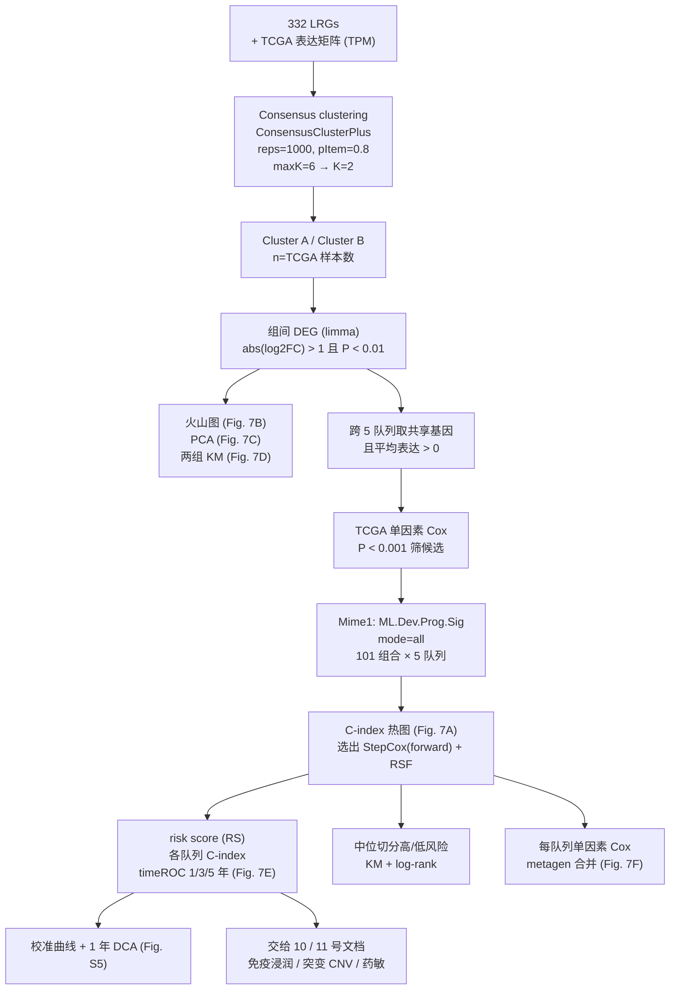

# 09 机器学习 101 组合预后模型（共识聚类 → DEG → StepCox[forward] + RSF）

> **目标文献**：Wang R, Wu W, Wu X, Yuan Y, Zhang Z, Chen J, Xie Y, Zhang L, Yu X, Zhang H, Xie Z. *Integrative single-cell and spatial transcriptomic analysis reveals a lactate-driven crosstalk between NFATc4⁺ tumor cells and SPP1⁺ macrophages in glioblastoma.* *J Transl Med* (2026) 24:1253. DOI: [10.1186/s12967-026-08555-7](https://doi.org/10.1186/s12967-026-08555-7)
>
> **模块对应原文**：Fig. 7A–F、Fig. S5；Methods 中「Machine learning algorithms」整段；Results 中「A machine learning-derived prognostic model based on lactate-associated genes」整段；Discussion 中关于模型局限的段落
> **前置依赖**：`01_环境搭建与数据获取.md`（6 个 bulk 队列 + 332 LRG 基因集）、`03_乳酸代谢评分与高低乳酸亚群划分.md`（乳酸评分的口径与 LRG 语义）、`08_bulk队列整合与NFATc4生存分析.md`（TCGA/CGGA/GSE108474/GSE4412/meta 的生存表与表达矩阵统一格式）。需要的中间文件：`processed/bulk_{TCGA,CGGA693,CGGA325,CGGA301,GSE108474,GSE4412}.rds`、`processed/bulk_matrix.rds`、`processed/meta_cohort.rds`、`processed/lrgs_332.txt`（拒绝 `data/processed/` 前缀，见 13 号决策 D2）
> **下游依赖**：`10_免疫浸润、突变与CNV基因组分析.md`、`11_药物敏感性、CMAP重定位与单细胞代谢.md` 都消费本模块产出的 **risk score 与高/低风险分组**（`results/ml/risk_score_all_cohorts.csv`）
> **复现难度**：★★★★☆　**预计工时**：6–10 人日（不含调试 101 组合 × 5 队列的算力等待）　**计算资源**：16 核 / 32 GB 内存起步；`mode="all"` 的 Mime1 全组合在本机预计 **6 小时–2 天**（见 §5.9 并行策略）

---

## 0. 执行摘要（先读这 10 行）

本模块是全文**唯一的"工程化"环节**：把前面 8 个模块积累的生物学发现（高乳酸肿瘤细胞、NFATc4、SPP1⁺ 巨噬细胞共定位）压缩成一个能在 bulk 队列上算出的**单一风险分数**。它的核心链路是：

```
332 LRGs → 对 TCGA 做共识聚类 → Cluster A/B → 两组 DEG(|log2FC|>1, P<0.01)
        → 跨 5 队列取共享非低表达基因 → TCGA 单因素 Cox(P<0.001) 筛候选
        → Mime1 的 101 种"筛选×建模"组合 → 选 StepCox[forward] + RSF
        → C-index / timeROC / 校准 / DCA / meta 森林图
```

原文报告的三个关键数字，也是本模块的 QC 锚点：

| 指标 | TCGA（训练集） | GSE4412（外部） | meta-cohort（外部） |
|---|---|---|---|
| C-index | **0.87** | **0.64** | **0.62** |
| 时间依赖 AUC（5 年） | **0.976** | **0.905** | 原文未报告 |

> ⚠️ **导师批注（贯穿本模块的最高优先级判据）**：训练集 **0.87** 与验证集 **0.62–0.64** 之间 **0.23–0.25 的巨大落差**，是过拟合与"选择偏差"的典型特征，**不是**复现失败。相反，如果你复现时得到"训练 0.87 / 验证 0.87"，那几乎一定是流程里发生了信息泄漏（§2.2 与 §7）。复现目标不是把验证集数字调高，而是**如实呈现落差、并把它拆解为若干可归因的原因**（样本量、平台差异、特征选择在全集上做、101 组合在含验证集的指标上挑选）。这一点与 `00_目录与复现总览.md` 第五节第 10 条批注、`13_复现质控清单、排错与批判性评述.md` 的模型过拟合条目是同一件事。

---

## 1. 科学问题与逻辑位置

### 1.1 为什么必须做这一步

前面 8 个模块的证据全部落在**单细胞/空间分辨率**上：

- `03` 号文档：332 LRGs 的 ssGSEA 分数把 neoplastic cells 分成高/低乳酸两个亚群；
- `04` 号文档：高乳酸亚群里 NFATc4 的 regulon 活性显著升高；
- `06`/`07` 号文档：空间上 NFATc4⁺ 肿瘤细胞与 SPP1⁺ 巨噬细胞共定位、通讯强。

这些结论**没有临床可操作性**：单细胞样本只有 5 例（GSE138794），没有生存终点，无法回答"这个亚群比例高的病人预后是否更差"。要把发现变成工具，必须换一层语言：

$$
\underbrace{\text{细胞状态}}_{\text{scRNA, }n=5}
\;\longrightarrow\;
\underbrace{\text{基因签名}}_{\text{可迁移的离散特征}}
\;\longrightarrow\;
\underbrace{\text{患者风险分数}}_{\text{bulk, }n\approx 150\text{–}1000+,\ \text{有 OS}}
$$

这个"三次抽象"本质上是在做一次**从机理假说到临床预测的降维**。每一步都丢掉信息，也每一步都引入新的失效模式——本模块的教学价值就藏在这些失效模式里。

### 1.2 与 03 / 08 号文档的分工与衔接（重要，别重复劳动）

| 文档 | 用的基因集 | 分组变量 | 生存终点 | 输出 |
|---|---|---|---|---|
| `03` | 332 LRGs（**全部**） | 单细胞 **ssGSEA 乳酸分数**中位/三分位 | 无 | `processed/lactate_group_sc.rds`（细胞级标签） |
| `08` | **单基因 NFATc4** | 表达量高中低 | 有（6 队列） | 六队列 KM / HR / 森林图（Fig. 3D） |
| **`09`（本文档）** | **共识聚类 + DEG 得到的新签名**（不再是完整 332 LRGs！） | **风险分数**中位数（Mime1 默认 0.5 分位） | 有（5 队列） | risk score、高/低风险组、C-index、ROC、校准、DCA、meta |

**三个最容易混淆的点，必须写在复现报告的显眼位置：**

1. **Fig. 3D 与 Fig. 7 的队列不完全重叠**。Fig. 3D 是**六队列**（CGGA693 / **CGGA325（原文 CGGA625 的替代，见 13 号决策 D5）** / CGGA301 / GSE108474 / GSE4412 / TCGA）的 **NFATc4 单基因**生存；Fig. 7 是 **5 个数据集**（TCGA / CGGA / GSE108474 / GSE4412 / meta-cohort）的**多基因签名**生存。**CGGA 在 Fig. 7 里被合并成一个 "CGGA"，而原文没有说明是 693/625/301 中的哪一个或三者的何种合并方式**——这是本模块最大的复现歧义点之一（§5.7 给出三种候选方案）。
2. **`09` 的基因集不是 332 个 LRGs**。332 个 LRGs 只用于**聚类分型**（把 TCGA 病人分成 Cluster A/B），随后用**组间 DEG** 得到一个新签名，最终模型建在这个新签名上。所以"模型基因"和"LRG 基因集"是两回事，`10`/`11` 号文档里的"高风险组"指的是**本模块的风险分数分组**，不是乳酸分组。
3. **`03` 号文档的乳酸分组是细胞级的，`09` 的分组是患者级的**。同名"high/low"但对象完全不同，跨文档引用时必须写清后缀。

### 1.3 输入 / 输出契约

**输入（必须与 `01`、`08` 号文档的产物格式严格一致）：**

```
processed/
├── bulk_TCGA.rds        # list(exp = 基因×样本 matrix(TPM, 未 log2 的原始尺度), surv = data.frame(OS.time, OS), anno = ...)
├── bulk_CGGA693.rds
├── bulk_CGGA325.rds     # 原文写 CGGA625，用 325 替代（13 号决策 D5）
├── bulk_CGGA301.rds
├── bulk_GSE108474.rds
├── bulk_GSE4412.rds
├── meta_cohort.rds      # 合并队列（构成见 §5.7 / 13 号决策 D3）
└── lrgs_332.txt         # character(332)，乳酸相关基因 symbol（txt，非 rds）
```

> ⚠️ **文件名对齐说明（动手前必读，否则会找不到文件）**：上面这份清单是**本模块内部的逻辑名**，与上游文档的**实际产物名不一致**：
> `01_环境搭建与数据获取.md` 真正产出的是 `processed/bulk_matrix.rds`（全队列表达矩阵）、`processed/bulk_<cohort>.rds`（逐队列）、
> `processed/meta_cohort.rds`、`processed/tcga_gbm_star_counts.rds` 与 `processed/lrgs_332.txt`（332 个 symbol，**是 txt 不是 rds，名里有下划线**）；
> `08_bulk队列整合与NFATc4生存分析.md` 产出 `processed/bulk_cohorts_raw.rds` 与逐队列生存表。
> **本项目统一使用 `raw/` 与 `processed/` 两个目录，不使用 `data/processed/`**（按 13 号文档决策 D2）。
> 复现时以 01/08 的真实文件名为准；本文档早期草稿出现的 `data/processed/bulk_*.rds` 一律读作 `processed/bulk_<cohort>.rds`。

**硬性数据契约（Mime1 内部用 `Surv(OS.time, OS)`，列名必须完全一致）：**

本模块内部沿用 `list(exp = 基因×样本 matrix, surv = data.frame)` 的组织方式（与 01/08 号文档一致）；
但 **传给 `Mime1::ML.Dev.Prog.Sig()` 之前必须转换成它的原生格式**（源码 roxygen：`train_data` 是"以 ID、OS.time、OS 作为**前三列**、第 4 列起是变量"的 data.frame），转换函数见 §4.2 的 `as_mime_df()`。

| 字段 | 类型 | 约束 |
|---|---|---|
| 内部 `exp` | matrix，**行=基因 symbol，列=样本 ID** | `rownames` 不可为 `NULL`；无重复列名；**必须已 log2(x+1)**（Mime1 内部不做任何变换） |
| 内部 `surv$OS.time` | numeric，单位 **天** | 必须 > 0；原文剔除缺失生存信息样本 |
| 内部 `surv$OS` | 0/1 整数（**1 = 死亡事件，0 = 删失**） | 不能是 `TRUE/FALSE` 或 `"Dead"/"Alive"` 字符串（`Surv()` 会静默出错） |
| 内部 `surv` 的 `rownames` | 样本 ID，与 `exp` 的 `colnames` 一一对应 | 用 `all(rownames(surv) == colnames(exp))` 断言 |
| **Mime1 `train_data`** | **data.frame（样本 × 变量）**：第 1 列名必须是 `ID`，第 2 列 `OS.time`，第 3 列 `OS`，**第 4 列起是基因表达** | **既不是 matrix、也不是 `list(exp, survival)`**；列名与列的先后顺序都不能改；`ID` 列可以是字符型 |
| **Mime1 `list_train_vali_Data`** | **命名 list，每个元素是一个上述格式的 data.frame**（约 `Dataset1` 为训练集） | 各队列的**基因列集合应尽量一致**（源码注释：与 genelist 取交集后信息丢失不超过 20%） |
| `candidate_genes` | character 向量 | **必须是 `train_data` 的列名之一**（源码 roxygen 明确要求），传成别处的基因名会被静默忽略 |

**输出：**

```
results/ml/
├── mime1_model_names.csv          # 101 个组合的名称清单（复现证据，见 §2.6）
├── mime1_cindex_matrix.csv        # 组合 × 数据集 的 C-index 矩阵（Fig. 7A 数值版）
├── candidate_genes.csv            # 逐级筛选后被保留的基因（含每级剩余数）
├── risk_score_all_cohorts.csv     # RS / OS.time / OS / dataset / model
├── univariate_cox_meta.csv        # 每队列 HR / LCI / HCI / pvalue
├── cindex_summary.csv
├── auc_timedep.csv
└── deg_clusterA_vs_B.csv
figures/ml/
├── fig7A_cindex_heatmap.pdf       # 101 组合性能热图
├── fig7B_volcano.pdf
├── fig7C_pca.pdf
├── fig7D_km_clusters.pdf
├── fig7E_timeroc.pdf
├── fig7F_meta_forest.pdf
├── figS5_calibration_dca.pdf
└── consensus/CDF.pdf, consensus/delta_area.pdf, consensus/consensus_matrix_k2.pdf
```

### 1.4 全模块流程图



---

## 2. 原理精讲（本模块的核心，务必读透）

### 2.1 Consensus clustering（共识聚类）

#### 2.1.1 它要解决什么

普通 K-means/层次聚类对**噪声、离群样本和初始化**极敏感——同一批 bulk 数据换一次随机种子就可能给出不同分型。共识聚类（Monti et al., *Machine Learning* 2003）的思路是：**单次聚类不可信，那就做上千次"重采样后的聚类"，看哪些样本总能待在一起。**

#### 2.1.2 算法

设样本数 $n$，特征数 $p$。给定 $B$ = `reps` 次重采样，每次：

1. 从 $n$ 个样本中**无放回**抽取比例 `pItem`（如 0.8）作为子样本集，样本数 $m=\lceil 0.8n\rceil$；
2. 从 $p$ 个特征中**无放回**抽取比例 `pFeature`（如 0.8）作为子特征集，特征数 $q=\lceil 0.8p\rceil$；
3. 在降维后的 $m \times q$ 矩阵上做一次层次聚类（`clusterAlg="hc"`），切到 $K$ 个簇；
4. 记录这一次里**哪些样本对同簇**。

共识矩阵 $M^{(K)}$（$n\times n$）定义为：

$$
M^{(K)}_{ij} \;=\; \frac{\#\Big\{b \le B \;:\; \text{样本 } i,j \text{ 在第 } b \text{ 次重采样中同时被抽到且同簇}\Big\}}{\#\Big\{b \le B \;:\; \text{样本 } i,j \text{ 在第 } b \text{ 次重采样中同时被抽到}\Big\}}
$$

对角线取 1。$M_{ij}\to 1$ 表示"这两例病人牢不可分"，$\to 0$ 表示"几乎从不在一组"，$\approx 0.5$ 表示"完全随机"。**分母是"同时被抽到"的次数而不是 $B$**，这是共识聚类与"简单投票"的关键区别——否则被抽到次数少的样本对的共识度会被系统性低估。

最终分型：对 $M^{(K)}$ 本身再做一次层次聚类（`finalLinkage`），切成 $K$ 簇即为样本标签。

#### 2.1.3 怎么选 K：CDF 与 delta area

- **CDF 曲线**：对每个 $K$，画 $M^{(K)}$ 中所有 $i<j$ 的值的经验累积分布函数。
  - 理想 $K$：曲线**陡峭上升并在接近 1 处出现平台**（大量样本对的共识度接近 1，说明分型稳定）；
  - $K$ 过小：CDF 平缓、没有平台；
  - 另一个等价判据是 **PAC**（Proportion of Ambiguous Clustering）：

$$
\mathrm{PAC}(K) \;=\; \frac{\#\Big\{(i,j): i<j,\; c_1 < M^{(K)}_{ij} < c_2\Big\}}{\binom{n}{2}},
\qquad c_1=0.1,\; c_2=0.9
$$

  PAC 越小越好。原文未使用 PAC，但它是比肉眼读 CDF 更客观的补充。

- **delta area 图**：$\Delta(K) = \frac{A(K)-A(K-1)}{A(K-1)}$，$A(K)$ 是 CDF 曲线下面积。$\Delta$ 随 $K$ 递减；**拐点**（曲线开始明显变平）即推荐 $K$。

> ⚠️ **导师批注**：`ConsensusClusterPlus` 的 `[["consensusClass"]]` 会直接给出每个 K 的标签，但**"选 K"这一步本身带主观性**——原文只报告了 K=2，既没写 `maxK`、`reps`、`pItem`、`clusterAlg`、`distance`，也没展示 CDF/delta area 图。复现时**必须把 CDF 与 delta area 两张图作为补充材料落盘**，并在报告中写清"我们选了 K=2，理由是 delta area 在 K=2→3 后趋平；此外 Cluster A/B 的生存差异显著（Fig. 7D）也支持 K=2"。这是"用生存结果反向选 K"吗？——严格说，如果生存差异被用来选 K，就已经引入了选择偏差。**我们的复现决策：K 的选择只依据 CDF/delta area（纯表达层、不使用生存），生存差异作为事后验证而非选择依据。** 这一点必须在方法里写清。

#### 2.1.4 用哪个矩阵喂给 `ConsensusClusterPlus`

`ConsensusClusterPlus(d, ...)` 要求 **`d` 的行为特征（基因）、列为样本**。若你的表达矩阵 `expr` 是基因×样本，直接传入；若是样本×基因，须 `t()`。这是新人最常犯的第一个错误（传反了不报错，但聚类结果毫无意义——因为它在按"基因之间的相似性"聚类）。

### 2.2 ⚠️ 循环论证 / 信息泄漏：本模块最严肃的方法学问题

原文流程是：

```
用全 TCGA 数据 + 332 LRGs 聚类 → Cluster A/B
  → 在全体 TCGA 上跑 Cluster A vs B 的 DEG
  → 在全体 TCGA 上跑单因素 Cox (P<0.001)
  → 用全体 5 队列的 C-index 从 101 个组合里挑最优
  → 报告 TCGA 的 C-index = 0.87
```

这个链条里有**三重信息复用**，逐层剥离如下。

**第一重：DEG 用了全数据的聚类标签。** 聚类是无监督的（不碰生存），但仍用了全体样本。更关键的是，DEG 挑出的基因是"在全样本上差异最大的基因"——这已经是**选择性极大化**。当 $n\approx150$、基因数 $\approx 1.5\times10^4$ 时，即便真实无差异，|log2FC|>1 且 P<0.01 的筛选也会捞出一批噪声基因（多重检验：$\alpha=0.01 \times 15000 \approx 150$ 个期望假阳性）。

**第二重（最严重）：单因素 Cox 在全体 TCGA 上做，然后又在同一批 TCGA 上评估。** Cox 是**用了生存信息**的监督筛选。在全样本上证出 P<0.001 的基因，其 β 估计是"向最优方向偏置"的（winner's curse / 选择偏倚）：真实 β 可能是 0，但样本里恰好为正，于是被选中并进入模型。在同一批数据上评估，"训练集 C-index"几乎必然虚高。**这不是模型的性能，是筛选过程对这批数据的"记账"。**

**第三重：101 个组合的挑选用了含验证集的指标。** 原文写"101 machine-learning algorithm combinations were systematically evaluated, and the 'StepCox[forward]+RSF' model was selected based on performance"，并且 Fig. 7A 的热图**同时展示了训练集和验证集的 C-index**。`Mime1::cindex_dis_all()` 的实现细节更明确：它按 **validate_set 的平均 C-index** 对模型升序排序并画右侧条形图。**只要选模型的依据里包含验证集的表现，验证集的数字就不再是独立估计**——101 个组合本身就是 101 次"向验证集试探"，选出最好的那一个，期望验证 C-index 必然高于真实泛化能力。这就是所谓 **model-selection bias / winner's curse 的第二种形式**。

#### 2.2.1 三重偏差的量级直觉

设真实泛化 C-index 为 $C_0$，每个候选模型在 $n$ 个样本上的估计噪声标准差为 $\sigma$，从 $m$ 个候选里取最大值的期望约为 $C_0 + \sigma\sqrt{2\ln m}$。取 $m=101$，$\sqrt{2\ln 101}\approx 3.04$；而 $n=84$（GSE4412）时 C-index 的标准误约 $1/\sqrt{n} \approx 0.11$ 量级。于是 **期望虚高可达 0.2–0.3**——这几乎精确解释了 0.87 → 0.62/0.64 的落差。**所以在报告里，"训练 0.87 vs 验证 0.62–0.64"应当被解读为"该流程的乐观偏差约 0.25"，而不是"模型不错"或"复现失败了"。**

#### 2.2.2 严格替代流程（我们的 Plan A′，建议作为 13 号文档的扩展实验）

正确做法是把**每一次使用生存信息 / 每一次使用全数据**的步骤都关进训练折内部：


三条铁律：

1. **外部验证集在整个特征选择 + 模型选择阶段完全不可见**（不能参与基因取交集以外的任何事，取交集是纯表达操作、可接受但要记录）；
2. **单因素 Cox 的 P 值阈值应在训练折内确定**（如用训练折内 BH-FDR < 0.05 替代固定的 P<0.001）；
3. **101 组合的挑选只在训练折内做**，选中后到测试集只算一次 C-index。

成本：外层 5 折 × 内层 5 折 × 101 组合 = 2525 次建模。以每次 RSF（`ntree=1000`，~100 基因，~120 样本）约 3–10 秒计，**单机 16 核并行约 3–7 小时**，可接受。§4.13 给出代码骨架。

### 2.3 单因素 Cox 筛选

Cox 比例风险模型：

$$
h(t \mid \mathbf{x}) = h_0(t)\,\exp\!\big(\boldsymbol{\beta}^{\top}\mathbf{x}\big)
$$

**半参数**：基线风险 $h_0(t)$ 不设形式，只估计 $\boldsymbol{\beta}$。用**偏似然**（partial likelihood），仅对发生事件的个体求和：

$$
\ell(\boldsymbol{\beta}) = \sum_{i:\,\delta_i=1}
\left[\boldsymbol{\beta}^{\top}\mathbf{x}_i - \log\!\!\sum_{j \in R(t_i)} e^{\boldsymbol{\beta}^{\top}\mathbf{x}_j}\right]
$$

其中 $R(t_i)=\{j: T_j \ge t_i\}$ 是风险集（risk set）。

单因素 Cox 即对**每个基因单独**拟合一个 $\beta_g$，用 Wald 检验（$\hat\beta/\mathrm{se} \to z$）或似然比检验给出 P 值。原文阈值 **P < 0.001**。

> ⚠️ **导师批注（统计代价）**：P<0.001 听起来很严，但在 $(n\approx150,\ p\approx15{,}000)$ 的场景下**远远不够**。用 Bonferroni 校正需要 P < 0.05/15000 ≈ 3.3×10⁻⁶；用 BH-FDR 控制 0.05 时，在 15,000 个检验里，P<0.001 大约会留下 15 个纯噪声（$15000\times0.001$）。更重要的是 **$p \gg n$ 时 Cox 的 β 估计不存在有限解**（完全分离），P 值本身就是不可靠的。**复现时的双保险**：
> (a) 同时记录 P<0.001 与 BH-FDR<0.05 两套候选基因，比较交集与差集；
> (b) 在候选基因数 > 50 时，改用 Lasso-Cox（`glmnet(family="cox")`）做第一层收缩，再喂给 101 组合。
> **注意 (b) 已经偏离原文流程**，所以做与不做必须在报告里声明为"复现决策"，不能悄悄替换。

### 2.4 StepCox[forward]：Cox 模型的前向逐步选择

**逐步选择（stepwise selection）**是在候选变量集合上做贪心搜索，用**信息准则或似然比检验**决定变量进出。

- **前向（forward）**：从只含截距（Cox 里即 $h_0(t)$）的零模型出发，每一步在**尚未入模**的变量中挑一个使模型改进最大的加入：
  $$
  g^\star = \arg\max_{g \notin \mathcal{M}}\ \Big[ \ell(\mathcal{M}\cup\{g\}) - \ell(\mathcal{M}) \Big]
  $$
  直到没有任何变量能使 **AIC** $= -2\ell(\hat\beta) + 2k$ 下降（或 LR 检验 P 值超过进入阈值）为止。
- **后向（backward）**：从全模型出发逐个剔除。
- **双向（both）**：允许已入模变量在后续步骤被剔除。**Mime1 中 `direction_for_stepcox` 的默认值是 `"both"`**——这一点很重要：默认配置下你拿到的是 `StepCox[both] + RSF`，而原文最优是 `StepCox[forward] + RSF`。**说明原文在 `mode="all"` 下遍历了三个方向**（源码中确有 `for (direction in c("both","backward","forward"))` 循环）。复现时必须确认 `direction_for_stepcox` 传参是否真的展开了三档（§5.4）。

**StepCox 的优点**：给出**显式可读的线性公式**（每个保留基因一个 $\beta$），可交付给临床。**缺点**（必须知道，否则会被审稿人问倒）：

1. **贪心不等价于全局最优**，加进去的变量可能因为后面加入的变量而变得不显著；
2. **对数据扰动极不稳定**——换一个随机种子做 5 折 CV，选出的基因集可能只有 50% 重叠；
3. **多重检验未校正**，选择过程本身消耗了数据的信息量，P 值不可直接当真；
4. **$n \ll p$ 时会选出一堆假阳性**——本模块候选基因数不多（≤ 数十），风险可控，但仍须记录最终保留基因数。

R 实现：`MASS::stepAIC()` 不直接支持 `coxph` 的 `scope` 前向模式时，用 `survival::coxph` + `step()`（有 `coxph` 的 `step` 方法），或 `rms::fastbw()`，或 `glmnet` 的 Lasso-Cox 作为替代。

### 2.5 RSF：随机生存森林（Random Survival Forest）

#### 2.5.1 与普通随机森林的差别

| 维度 | 普通 RF（分类/回归） | RSF |
|---|---|---|
| 终点 | 标签 / 连续值 | (时间, 事件) 对，含删失 |
| 节点分裂准则 | Gini / MSE | **log-rank 统计量**（或 maxstat / 梯度） |
| 叶子输出 | 类别投票 / 均值 | **叶内样本的累积风险函数（Nelson-Aalen 估计）** |
| 预测输出 | 概率 / 预测值 | 累积风险曲线；标量风险分数 = 曲线的某个归一化积分 |
| 评价 | 准确率 / MSE | **C-index、OOB 误差 = 1 − OOB C-index** |

**"生存"部分的处理是关键**：RSF 在每个节点只考虑**该节点内样本的生存信息**，用 log-rank 检验衡量"把样本分成左右两组后，两组的生存曲线差异有多大"：

$$
L(s, c) = \frac{\Big(\sum_{j=1}^{2}\big(d_j - \bar d_j\big)\Big)^2}{\sum_{j=1}^{2} V_j}
$$

其中 $d_j$ 是子节点 $j$ 内的事件数，$\bar d_j$ 是在"风险相同"零假设下 $d_j$ 的超几何期望，$V_j$ 是对应方差。$L$ 最大的 $(s, c)$（$s$ 变量、$c$ 切点）即为分裂点。**这使 RSF 天然以"区分风险"为优化目标，与模型评价指标（C-index）方向一致。**

#### 2.5.2 风险分数怎么来

对样本 $x$，树 $b$ 把它落到某个终端节点，该节点内样本的累积风险由 Nelson-Aalen 估计给出 $\hat H_b(t\mid x)$。森林平均：

$$
\hat H(t \mid x) = \frac{1}{B}\sum_{b=1}^{B} \hat H_b(t \mid x)
$$

**标量风险分数**有多种定义，`randomForestSRC` 中 `predict.rfsrc()` 对 `family="surv"` 返回的 `$predicted` 是**累积风险的求和**（文献里常称 mortality），值越大风险越高。**复现时必须确认你用的是哪一种**：
(a) `predict(fit)$predicted`（求和，默认）；
(b) 固定时点的 $\hat H(t^\ast\mid x)$，如 $t^\ast=5$ 年——**更推荐，因为它与"5 年 AUC"的评价时点对齐**；
(c) `survmean()` 得到的期望生存时间（此时**符号要取负**）。
选错会直接把 C-index 变成 $1-C$（§7 第 1 行）。

#### 2.5.3 `randomForestSRC::rfsrc()` 关键参数

```r
rfsrc(Surv(time, status) ~ ., data = df,
      ntree = 1000,          # 树的数量
      nodesize = 15,         # 终端节点最小事件数（family="surv" 默认 15）
      mtry = floor(sqrt(p)), # 每次分裂随机抽的变量数
      splitrule = "logrank", # "logrank" | "logrankscore" | "maxstat" | "bs.gradient" | "random"
      importance = TRUE,     # 计算置换重要性（耗时）
      nsplit = 10,           # 连续变量候选切点数（"random" 时随机抽）
      seed = 20260101)
```

- **`splitrule`**：`"logrank"` 是原论文与 Mime1 的实际默认（Mime1 通过 `nodesize` 传参，未暴露 `splitrule`）。`"maxstat"` 用最大选择统计量（更激进，小样本易过拟合）；`"bs.gradient"` 是梯度提升变体；`"random"` 用于极端高维加速。
- **`nodesize`**：RSF 的**最重要正则化参数**。默认 15（生存）导致终端节点必须至少有 ~15 个事件才不再分裂 → 树浅 → 偏差大但方差小。**`nodesize` 越小 → 树越深 → 训练 C-index 越高、验证越低**。Mime1 把 `nodesize` 暴露为顶层参数，说明作者知道它敏感。
- **`mtry`**：默认 $\sqrt{p}$。基因高度共线时（如一批同源基因），`mtry` 太大会让每棵树都抓到同一批强基因，降低集成多样性。
- **OOB 误差**：`fit$err.rate[ntree]`，对生存族是 $1-\hat C_{\text{OOB}}$。**OOB 是用"未参与该树构建的袋外样本"算的，是无偏泛化估计**——这是 RSF 相对 StepCox 的一个巨大优势：**`1 - OOB C-index` 就是模型自身的诚实性能估计**。复现时务必报告它，并把它与"训练集 C-index"并列，落差本身就是过拟合的量化证据。
- **变量重要性**：`vimp <- fit$importance`（置换重要性，随噪声波动）；更稳健的是**最小深度（minimal depth）**：`var.select(fit)$md`（Ishwaran 2010）。**这是 RSF "无显式系数"的替代交付物**（§4.12）。

#### 2.5.4 RSF 为什么能提升预测（相对线性 Cox）

1. **非线性**：Cox 假设 $\log$ 风险随基因表达线性变化；RSF 用阶梯函数逼近任意单调/非单调关系；
2. **自动交互**：分裂天然形成"如果 X1 高且 X2 低则……"的路径，等价于高阶交互项，无需手工指定；
3. **稳健于离群与共线**：随机抽变量 + 袋装 + 平均，对个别样本/基因异常不敏感；
4. **代价**：不可解释（无公式）、**训练慢且随基因数增长**（$mtry$ 次 log-rank 计算 × 候选切点 × 树 × 深度）、对 `nodesize`/`ntree` 敏感。

### 2.6 Mime1 框架与"101 种组合"的构成

#### 2.6.1 框架思想

Mime（Liu H et al., *Comput Struct Biotechnol J* 2024;23:2798–2810）把预后建模拆成**两步流水线**：

> **前置提示**：本文档引用的源码事实来自 GitHub 仓库 `l-magnificence/Mime` 的 `DESCRIPTION` 与 `R/` 目录。**仓库目录名是 `Mime`，但包名（DESCRIPTION 的 `Package:` 字段）是 `Mime1`**（版本 `0.0.0.9000`）。因此安装命令用仓库名、加载用包名：
> ```r
> remotes::install_github("l-magnificence/Mime")   # 仓库名
> library(Mime1)                                    # 包名（原文写作 "Mime1" 是准确的）
> ```
> ⚠️ 这个"仓库名 ≠ 包名"的错位会让新人卡很久；**任何一篇论文写"R 包 Mime1"都是对的，写"R 包 Mime"则以仓库名指代**。安装后请立刻核对：`packageDescription("Mime1")$Package` 与 `ls("package:Mime1")`。

**两步组合的语义（"A + B"）**：

- **第一步 A**：做**特征筛选 / 降维**（把几十个候选基因压到更少，或给出一个可入模的特征子集）；
- **第二步 B**：在 A 的输出上**拟合终模型并给出风险分数**。

源码中确实存在 `double_ml1` / `double_ml2` 两个参数，且 **`double_ml1` 被限制为四个选项：RSF、StepCox、CoxBoost、Lasso**（因为只有这四类能"吐出"一个可用于下游的中间产物），而 `double_ml2` 可以是全部 10 个算法之一。**"StepCox[forward] + RSF" = 用前向逐步 Cox 先筛基因，再用随机生存森林在那批基因上建模型。**

#### 2.6.2 算法清单（源码核对）

**单算法名（10 个）**：`RSF`、`Enet`、`StepCox`、`CoxBoost`、`plsRcox`、`SuperPC`、`GBM`、`survival-SVM`、`Ridge`、`Lasso`。

> ⚠️ **传参字面量 ≠ 模型名字面量（已核对源码）**：函数参数必须写源码里的**小写 literals**
> —— `single_ml` / `double_ml2` 的合法取值是 `"RSF","Enet","StepCox","CoxBoost","plsRcox","superpc","GBM","survivalsvm","Ridge","Lasso"`
> （注意 **`superpc` 不是 `SuperPC`、`survivalsvm` 不是 `survival-SVM`**）；
> 而 `res[["Cindex.res"]]$Model` 里出现的**标签**才是 `SuperPC` / `survival-SVM`。两边不一致，写 `single_ml="SuperPC"` 会匹配失败。

**带参数的展开**：

| 展开项 | 取值 | 标签写法 | 变体数 |
|---|---|---|---|
| Enet 混合参数 | $\alpha \in \{0.1,0.2,\dots,0.9\}$（`for (alpha in seq(0.1, 0.9, 0.1))`） | `Enet[α=0.1]` … `Enet[α=0.9]` | 9 |
| StepCox 方向 | `"both"`, `"backward"`, `"forward"`（源码中确有 `for (direction in c("both","backward","forward"))`） | `StepCox[both]` / `StepCox[backward]` / `StepCox[forward]` | 3 |
| survival-SVM 的两种写法（**已核对**） | 单算法行写 `paste0('survival - SVM')`（**带空格**），组合行写 `paste0(..., 'survival-SVM')`（**不带空格**） | — | 二者在 `Model` 列中**是两条不同的字符串**，做去重/计数时必须按原样匹配，不要手工规范化 |

#### 2.6.3 "101" 的计数重建（**必须显式核对，不许想当然**）

| 组件 | 计数规则（依据源码中的 `paste0` 与循环） | 说明 |
|---|---|---|
| 单算法行 | `single_ml` ∈ 10 个算法名 | **已核对**：`mode="all"` 分支里 Enet 走 `for (alpha in seq(0.1,0.9,0.1))`、StepCox 走 `for (direction in c("both","backward","forward"))`，即单算法行**也会展开** |
| 两两组合行 | `paste0(ml1, " + ", ml2)`，`ml1` ∈ {RSF, StepCox, CoxBoost, Lasso}，`ml2` ∈ 10 个算法名 | 同一对算法**不是对称枚举**：`RSF + CoxBoost` 与 `CoxBoost + RSF` 只在 RSF 组出现一次，而 `Lasso + RSF` 在 Lasso 组出现 |
| 守卫条件 | 多处以 `if (length(rid) > 1)` 包裹 | **只有当上一步筛出的基因数 > 1 时该组合才会真正跑出来**，因此实际行数还依赖数据 |
| 去重 | `survival-SVM` 的两种拼写（见 §2.6.2） | **源码中未见全局去重向量，组合是边跑边 `rbind` 出来的**，因此**总行数只能实测** |

**已核对的硬事实**：在仓库 `l-magnificence/Mime` 的 `R/ML.Dev.Prog.Sig.R`（约 4400 行）中，**字符串 `101` 一次都没有出现**——也就是说 101 **不是包内硬编码的常数**，而是"该版本 + 该参数 + 该数据"下涌现出来的行数；静态数一遍 `mode="all"` 分支里的模型名模板（把 α 展开 9 份、direction 展开 3 份）得到的是**百量级**的数字，但会被上述 `length(rid) > 1` 守卫再削减若干条。**结论：原文与本文档都不应凭记忆给出 "101 = a + b + c" 的拆解。** 唯一的权威是运行后的对象本身：

```r
stopifnot(!is.null(res[["Cindex.res"]]))
n_models <- length(unique(res[["Cindex.res"]]$Model))
cat("当前 Mime1 版本实际生成组合数 =", n_models, "\n")   # 期望 101
write.csv(unique(res[["Cindex.res"]][, c("Model","ID","Cindex")]),
          "results/ml/mime1_model_names.csv", row.names = FALSE)
print(sort(unique(res[["Cindex.res"]]$Model)))
```

> **QC 判据**：若 `n_models != 101`，**不要试图改参数去凑 101**。正确做法是：(a) 在报告中记录实际数值与所用的 `Mime1` 版本（`packageVersion("Mime1")`）；(b) 说明差异来自 `alpha_for_Enet` 网格、`direction_for_stepcox` 展开或版本演进而非"复现错误"；(c) 把该数字与 `00` 号文档第五节的 QC 门槛一并归档。**"101" 是原文在它那个版本/参数下的产物，不是普适常数。**

#### 2.6.4 Mime1 的关键函数（源码核对后的真实签名）

```r
# ① 主建模函数（预后签名）
ML.Dev.Prog.Sig(train_data, list_train_vali_Data,
                candidate_genes = NULL, unicox.filter.for.candi = NULL,
                unicox_p_cutoff = NULL, mode = NULL,
                single_ml = NULL, alpha_for_Enet = NULL,
                direction_for_stepcox = NULL,
                double_ml1 = NULL, double_ml2 = NULL,
                nodesize = NULL, seed = NULL, cores_for_parallel = NULL)

# ② 结果对象的关键字段（已核对）
res[["Cindex.res"]]   # data.frame: Cindex, Model, ID  （ID = 队列名）
res[["riskscore"]]    # list: model → dataset → data.frame(RS, OS.time, OS)

# ③ 下游可视化 / 统计（源码核对）
cindex_dis_all(object, color, dataset_col, validate_set, order, width, height)  # Fig. 7A
rs_sur(object, model_name, dataset, cutoff = NULL, conf.int = FALSE,
       median.line = NULL, color = NULL, xlab = NULL, pval.coord = NULL)        # KM
cal_AUC_ml_res(res.by.ML.Dev.Prog.Sig, train_data, inputmatrix.list, mode,
               AUC_time, auc_cal_method)                                        # Fig. 7E
auc_dis_all(...); auc_dis_select(...); roc_vis(...)
cal_unicox_ml_res(res.by.ML.Dev.Prog.Sig, optimal.model, type = "categorical")  # 逐队列 unicox
cal_unicox_meta_ml_res(input)                                                   # meta 合并
meta_unicox_vis(...)                                                            # Fig. 7F
cal_RS_ml_res(...); cal_cindex_pre.prog.sig(...); cindex_comp(...)
HR_com(...); signature_score(...)
```

**参数默认值（源码内部 fallback，原文一律未写）：**

| 参数 | 内部默认 | 本文档建议 | 影响 |
|---|---|---|---|
| `unicox_p_cutoff` | `0.05` | **`0.001`**（原文口径） | 阈值越松候选基因越多，下游越易过拟合 |
| `unicox.filter.for.candi` | `TRUE` | `TRUE` | 是否开启 Cox 预筛（**这一层会吃掉额外的自由度**） |
| `alpha_for_Enet` | `0.1` | `0.5`（或遍历 `seq(0.1,0.9,0.1)`） | 影响 Enet 相关行的数量与稀疏度 |
| `direction_for_stepcox` | `"both"` | `"forward"`（原文最优）/ 或遍历三档 | **直接决定能不能产出 `StepCox[forward] + RSF` 这一行** |
| `nodesize` | **`5`**（已核对源码 roxygen：`@param nodesize The parameter for 'RSF'. The default is 5. You can try the positive number from 5 to 10.`） | `15`（**我们的复现决策**，比 Mime1 默认更保守，用于抑制小样本过拟合）；敏感性分析用 `5/10/15/25` | RSF 的正则化强度，**训练/验证落差的主控旋钮**。⚠️ 注意 `rfsrc()` 自身默认是 15，但 **Mime1 内部在 `nodesize=NULL` 时用的是 5**，两者不可混为一谈；原文未报告用了哪个 |
| `cores_for_parallel` | `6` | `detectCores()-2` | 并行核数，只影响速度 |
| `seed` | 未给默认 | **`20260101`**（全套 SPEC 约定） | 影响 RSF 抽样、CV 折划分 |

**输入数据格式（`train_data` / `list_train_vali_Data` 的元素）——已按源码与官方 README 核对**：

- `train_data` 是**一个 data.frame（样本 × 变量）**，**第 1 列必须是 `ID`、第 2 列 `OS.time`（单位=天）、第 3 列 `OS`（0/1），第 4 列起是基因表达（已 log2(x+1)）**；
- `list_train_vali_Data` 是**命名 list，每个元素是同格式的 data.frame**，官方示例取 `list_train_vali_Data$Dataset1` 作训练集；
- 官方 README 的 `Example.cohort.Rdata` 长这样（这是唯一权威口径）：
  ```
                ID    OS.time OS   MT-CO1   MT-CO3
   TCGA.DH.A66B.01 1281.65322  0 13.77340 13.67931
   TCGA.HT.7607.01   96.19915  1 14.96535 14.31857
  ```
- ⚠️ **`Example.cohort.Rdata` 不在安装好的包里**（`data/` 只有若干 `.rda` 信号集），它在 GitHub 仓库根目录的 **`External data/`** 文件夹中，需要单独下载后 `load("./Example.cohort.Rdata")`。**`Mime1::Example.cohort` 是取不到的**——原文与本文档都不能假定"包内自带示例数据"。

**性能门槛（Mime README 明示）**：训练集样本数 **> 100**，候选基因集 **> 50**。TCGA-GBM 满足；GSE4412（$n=84$）**不满足**——这本身就预示了它在外部验证中的不稳（§6）。还有一条 README 提示：**"single" 模式至少需要 5 个特征，且建议 `Surv` 时间单位统一**。

### 2.7 评价指标：C-index、时间依赖 ROC、校准、DCA

#### 2.7.1 C-index（Harrell's concordance index）

**直觉**：随机抽一对**可比较**的病人（谁先死是可观测的），模型的风险排序是否与真实生存顺序一致。

$$
C \;=\; \frac{\sum_{i}\sum_{j}\Big[\mathbb{1}(T_i<T_j)\,\delta_i\,\mathbb{1}(\hat r_i>\hat r_j) \;+\; \tfrac{1}{2}\mathbb{1}(T_i<T_j)\,\delta_i\,\mathbb{1}(\hat r_i=\hat r_j)\Big]}
{\sum_{i}\sum_{j}\mathbb{1}(T_i<T_j)\,\delta_i}
$$

- 分子累加"一致对"（风险高者先死），并列算 0.5；
- 分母是**可比较对（comparable pairs）总数**：只有 $T_i<T_j$ 且 $\delta_i=1$ 时，$(i,j)$ 才可比较（否则不知道谁先死）；
- $C=0.5$ 等价随机猜测，$C=1$ 完美排序。**GBM 的临床基线（年龄 + 放疗 + MGMT 启动子甲基化）C-index 大约在 0.6–0.7**——这是唯一有意义的对照基准，务必在报告中同时给出。⚠️ **该区间是领域经验值、不是原文数据，本方案未附具体来源，写入报告前必须自己检索原始文献并在本地队列上实测一版（用同样的 C-index 实现）**，否则不要把它当成硬证据。

**实现与方向陷阱**：

```r
# 方式一（推荐，约定清晰：x 越大风险越高）
survcomp::concordance.index(x = risk, surv.time = time, surv.event = status, method = "noether")$c.index
# 方式二
Hmisc::rcorr.cens(x = risk, S = Surv(time, status))[["C Index"]]
# 方式三（注意 reverse 参数！）
survival::concordance(Surv(time, status) ~ risk, reverse = TRUE)$concordance
```

> ⚠️ `survival::concordance` 的默认约定是"预测值越大 → 生存时间越长"，**直接传风险分数会得到 $1-C$**，若结果落在 0.1–0.4 区间就是符号反了。**自检方法**：手工构造一个与生存时间完全正相关的"假风险"（`risk <- -time`），三种实现都应给出接近 1.0 的值。

**Uno's C（时间依赖）**：Harrell's C 对删失分布有隐含假设（删失独立于协变量）。Uno 2007 提出 IPCW 加权的 $C^\tau$，只在 $t\le\tau$ 内比较，实现见 `survC1::Est.Cval()`、`riskRegression`。**原文只报告了 C-index 未说明是哪种**（`Mime1` 内部用 `survival::concordance` 系）——复现时以 Harrell 为主，附 Uno's C 作敏感性分析。

#### 2.7.2 时间依赖 ROC（`timeROC`）与 IPCW

**为什么不能用普通 ROC**：普通 ROC 需要一个二分类金标准（"1 年时存活/死亡"），但对 1 年时被删失的病人**不知道其真实状态**。直接把这些样本丢掉 → 选择性偏倚（删失往往与预后相关）；当作"存活" → 系统性高估。

**IPCW（Inverse Probability of Censoring Weighting）的核心思想**：给每个可用样本一个权重，权重 = "到该时点仍被随访观察到的概率"的倒数。

设删失分布的 KM 估计为 $\hat G(t) = \prod_{u\le t}\big(1 - \frac{c_u}{n_u}\big)$（$c_u$ = 时刻 $u$ 的删失数，$n_u$ = 风险集大小）。则 $t$ 时刻的 AUC：

$$
\widehat{\mathrm{AUC}}(t) \;=\;
\frac{\displaystyle\sum_i\sum_j \mathbb{1}(T_i\le t,\,\delta_i=1)\;\mathbb{1}(T_j>t)\;\hat G(T_i)^{-1}\;\mathbb{1}(\hat r_i > \hat r_j)}
{\displaystyle\Big[\sum_i \mathbb{1}(T_i\le t,\delta_i=1)\,\hat G(T_i)^{-1}\Big]\Big[\sum_j \mathbb{1}(T_j>t)\Big]}
$$

**直觉**：$T_i\le t$ 且 $\delta_i=1$ 的病例（" $t$ 前确实死了"）会因删失而系统性缺失（随访短的人更可能被打上删失标签、且他们的真实死亡时间更晚），所以给它加权 $1/\hat G(T_i)$——**随访越不完整（$\hat G$ 越小）的病例，权重越大**，用来"代表"那些本该被观察到却漏掉的病人。

```r
library(timeROC)
roc <- timeROC(T = d$OS.time, delta = d$OS, marker = d$RS, cause = 1,
               weighting = "marginal",                 # "marginal" | "cox"
               times = c(365, 1095, 1825),             # 1/3/5 年 —— 原 Fig. 7E 口径
               iid = TRUE)                             # 才可算置信区间
roc$AUC                # 命名的 AUC 向量
confint(roc, parm = NULL, level = 0.95)
plot(roc, time = 1825, col = "#B24745")
```

⚠️ `iid = TRUE` 会做 $O(n^2)$ 的 iid 分解，内存与时间随之上升；$n$ 上千时考虑 `iid = FALSE` 或降采样。

#### 2.7.3 校准曲线（calibration）

C-index/AUC 只衡量**排序**，不保证**绝对概率准**。校准曲线把病人按预测 1 年生存概率分箱（或平滑），横轴 = 预测概率，纵轴 = KM 观测概率，$y=x$ 为完美校准。

```r
library(rms)
dd <- datadist(d); options(datadist = "dd")
f <- cph(Surv(OS.time, OS) ~ RS, data = d, x = TRUE, y = TRUE, surv = TRUE,
         time.inc = 365)                 # time.inc 必须与下面的 u 一致
cal <- calibrate(f, cmethod = "KM", method = "boot", u = 365,
                 m = floor(nrow(d)/4), B = 200)
plot(cal, xlab = "Nomogram-predicted 1-year OS", ylab = "Observed 1-year OS")
```

或 `pec::pec()`（更适合 RSF 这类无公式模型，因为它只需 `predictSurvProb` 接口；**`pec` 对 `rfsrc` 对象的支持请先用 `methods(predictSurvProb)` 核对**——不同版本对 randomForestSRC 的支持状态不同，不支持时改用 `riskRegression::Score()` 或自己做 IPCW-Brier）：

```r
library(pec)
pec <- pec(object = list("RSF" = rsf_fit, "StepCox" = cox_fit),
           formula = Surv(OS.time, OS) ~ 1, data = d, times = 365, cens.model = "marginal")
plot(pec)
```

**原文口径**：Fig. S5 只做了 **1 年**校准曲线，并称"good consistency between predicted and observed 1-year survival probabilities across these cohorts"。**原文未报告任何校准数值指标**（如 Brier score、ICI/E50）——复现时建议自测并落盘：`pec` 的 `crps`/`Brier` 与 `riskRegression::Score()` 的 ICI。

#### 2.7.4 决策曲线分析（DCA）

**临床问题**：用模型决定"是否给某病人强化治疗"时，净获益是否优于"全部治疗"或"全部不治疗"这两个默认策略？

**净获益（net benefit）**：

$$
\mathrm{NB}(p_t) \;=\; \frac{TP}{N} \;-\; \frac{FP}{N}\cdot\frac{p_t}{1-p_t}
$$

- $p_t$ = **阈值概率**（threshold probability），即"你愿意为获益而承受的最小风险概率"，横轴；
- $\frac{p_t}{1-p_t}$ = **伤害/获益的权重比**，$p_t=0.3$ 意味着"1 个假阳性被当作 0.43 个真阳性的代价"；
- **两条参照线**：全部干预 $\mathrm{NB} = \frac{\#\{T\le t\}}{N} - \frac{\#\{T>t\}}{N}\cdot\frac{p_t}{1-p_t}$；全部不干预 $\mathrm{NB}=0$。
- **判定**：模型曲线在某个 $p_t$ 区间内**高于两条参照线**，才说明在该阈值下有临床净获益。

生存数据的 DCA 需处理删失（用 KM/IPCW 估计 $TP$、$FP$）：

```r
library(dcurves)
dca(Surv(OS.time, OS) ~ RS, data = d, times = 1, probability = FALSE)$dca |>
  plot(smooth = TRUE)
# 或
library(ggDCA); library(survival)
ggDCA::dca(coxph(Surv(OS.time,OS) ~ RS, data = d), times = 1)
# 或 rmda::decision_curve()（需要明确二分类化时点）
```

**原文只做了 1 年 DCA（Fig. S5）且有多个队列**——请逐队列出图，并在报告中标注每张图的**可用阈值区间**（图只 1 年，且 GBM 1 年 OS 约 40%，$p_t$ 落在 0.3–0.7 区间的曲线最有意义）。

### 2.8 跨队列 meta 合并（Fig. 7F）

#### 2.8.1 逐个队列先算 HR

`Mime1::cal_unicox_ml_res()` 的默认 `type = "categorical"`：**按中位数把病人分成 High/Low 两组**，再拟合 `coxph(Surv(OS.time, OS) ~ Group)`，返回列顺序为 **`HR, pvalue, LCI, HCI`**。若传 `type = "continuous"`，则拟合 `coxph(Surv(OS.time, OS) ~ RS)`，即**风险分数连续变量（每单位增量）的 HR**。

> ⚠️ **导师批注（必须核对的一处口径）**：原文 Results 写 "Meta-analysis of univariate Cox regression results across datasets yielded a pooled hazard ratio (HR) of **1.82 (95% CI: 1.64–2.02, p<0.001)**, confirming **the signature's** association with poorer survival"，Fig. 7F 图注写 "(F) Forest plot of meta-analysis combining univariate Cox regression results across datasets"。
>
> 由此可以**确定**：pooled HR 1.82 是**风险签名（risk score）**的 HR，**不是 NFATc4 单基因的 HR**（NFATc4 的跨队列结果在 Fig. 3D 与 `08` 号文档）。
>
> **但不能确定**的是：它是 **High vs Low 风险组的 HR**（对应 `type="categorical"`，Mime1 默认）还是**连续 risk score 每单位的 HR**（`type="continuous"`）。由于 `Mime1::cal_unicox_ml_res()` 的默认值是 `"categorical"`，**默认口径下 1.82 是"高风险组相对低风险组"的 HR**。复现时**两种口径都算、都落盘**，并在报告中写明"原文未说明，我们按 Mime1 默认的 categorical 口径为主"。若是 categorical，1.82 与 GBM 领域常见的风险签名 HR（1.5–2.5）量级一致，也间接支持 categorical 的解读。

#### 2.8.2 合并模型

把每个队列的 HR 取对数转成效应量 $\hat\beta_k=\ln \mathrm{HR}_k$，标准误由 CI 反推（Mime1 源码正是这样做的）：

$$
\mathrm{se}_k = \frac{\ln(\mathrm{HCI}_k) - \ln(\mathrm{LCI}_k)}{2\times 1.96}
$$

**固定效应（common / inverse-variance）**：

$$
\hat\beta_{\mathrm{FE}} = \frac{\sum_k w_k \hat\beta_k}{\sum_k w_k}, \qquad w_k = \frac{1}{v_k} = \frac{1}{\mathrm{se}_k^2},
\qquad \mathrm{se}(\hat\beta_{\mathrm{FE}}) = \frac{1}{\sqrt{\sum_k w_k}}
$$

**随机效应（DerSimonian–Laird）**：把研究间方差 $\tau^2$ 加进权重，$w_k^\ast = 1/(v_k+\tau^2)$。

**异质性**：

$$
Q = \sum_k w_k(\hat\beta_k - \hat\beta_{\mathrm{FE}})^2, \qquad
I^2 = \max\!\Big(0,\ \frac{Q-(K-1)}{Q}\Big)\times 100\%
$$

$I^2$ 是"总变异中由异质性（而非抽样误差）贡献的百分比"：$I^2<25\%$ 低、$25\%\text{–}50\%$ 中、$>75\%$ 高。**5 个 GBM 队列跨越 RNA-seq（TCGA/CGGA）与两个不同平台的芯片（GSE108474/GSE4412）加上自建 meta-cohort，$I^2$ 很可能 > 50%**——此时**随机效应模型是正确选择**，并在 Discussion 里承认队列异质性。

```r
library(meta)
# 每队列的 HR / LCI / HCI 已在 results/ml/univariate_cox_meta.csv
m <- metagen(TE = log(HR), seTE = (log(HCI) - log(LCI)) / (2 * 1.96),
             studlab = dataset, sm = "HR",
             method.tau = "DL", common = TRUE, random = TRUE)
summary(m); forest(m, layout = "JAMA")
m$I2; m$tau2; m$Q; m$pval.Q
```

`meta::metagen()` 会**同时**给出 common（固定效应）与 random（随机效应）两套结果，**原文取的是哪一个未说明**。复现时两套都记录：若 $I^2$ 高，以随机效应为准并在报告中说明理由。

> ⚠️ **已核对源码的一处口径差异**：Mime1 的 `cal_unicox_meta_ml_res()` 内部就是 `metagen(TE = log(HR), seTE = (log(HCI)-log(LCI))/(2*1.96), sm = "HR")`，
> 与我们 §2.8.2 的写法一致；但它**没有指定 `method.tau`**，因此 $\tau^2$ 估计器随 `meta` 包版本而变（`meta` 5.x 默认 REML，更早版本默认 DL）。
> 我们在自算时显式写 `method.tau = "DL"`，**在高异质性场景下两者的 pooled CI 会有可观察的差异**——报告里必须注明用的是哪一个，不要两者混用后声称"与原文一致"。

---

## 3. 原文方法逐句拆解

### 3.1 Methods「Machine learning algorithms」整段（原文 p.4）

原文（逐句引用）：

> "First, univariate Cox (unicox) regression analysis was used to categorize the tumor cells based on their lactate scores."

| 项 | 内容 |
|---|---|
| 中文转述 | 先用单因素 Cox 回归，基于乳酸分数对肿瘤细胞进行分组 |
| 英文关键词 | `univariate Cox (unicox)` / `categorize` / `tumor cells` / `lactate scores` |
| 对应操作 | 无 —— **此句不自洽** |

> ⚠️ **导师批注（本文档最需要点名的一处）**：这句话在三个层面上说不通。
> 1. **终点错位**：单细胞数据**没有生存终点**（GSE138794 没有病人 OS），Cox 回归没有 $T$、$\delta$ 可用，无法拟合；
> 2. **动词错位**："univariate Cox regression was used to **categorize**"——Cox 回归输出的是 HR 与 β，**不是分组**；分组是阈值/聚类操作，不是 Cox 的输出；
> 3. **对象错位**：前一句刚说完用 332 LRGs + ssGSEA 给 neoplastic cells 打乳酸分数（`03` 号文档），分组依据本应是 **ssGSEA 分数**（中位数/三分位/聚类），而不是 Cox。
>
> **最可能的真相**：作者把 bulk 层的建模流程（"unicox 筛基因"）与单细胞层的分组流程（"按乳酸分数分高/低"）**在同一段里串写了**，属于写作疏漏而非分析错误——因为 Fig. 3A–C 的高/低乳酸分组必然是按**分数**划的（否则 pySCENIC 的组间差异无从谈起）。
>
> **我们的复现决策**：单细胞层的分组**严格按 `03` 号文档的方案**（ssGSEA 分数中位数分组，附三分位 + K-means 敏感性分析），**不复现这句话**；并在 `13` 号文档的批判性评述里作为"方法学描述不严谨"的一条记录。**不要为了"忠于原文"去强行对单细胞做 Cox。**

原文（逐句）：

> "Then, perform differential expression gene (DEG) analysis to identify the corresponding set of differentially expressed genes. The R packages 'ggplot2' and 'ggVolcano' were used to plot the DEGs."

| 项 | 内容 |
|---|---|
| 中文转述 | 做差异表达分析找出对应 DEG 集合；用 `ggplot2` 与 `ggVolcano` 画 DEG |
| 对应操作 | `limma::lmFit` + `eBayes`（阈值为 §3.2 的 \|log2FC\|>1, P<0.01）；火山图双实现 |

> ⚠️ **导师批注**：`ggVolcano` 是第三方包（另有 `EnhancedVolcano`、`ggvolcano` 等近似实现），**函数名与参数在不同实现间不一致**。本方案**以 `ggplot2` 手工实现为唯一可靠路径**（§4.4），`ggVolcano` 作为可选美化层。另外原文未说明在**哪些细胞/哪些基因**上做 DEG：是 (a) 单细胞高/低乳酸 neoplastic cells 的 DEG，还是 (b) bulk TCGA Cluster A vs B 的 DEG？由 Results 中 "Differential expression analysis between the resulting clusters (Cluster A and Cluster B) yielded a prognostic gene signature" **可以确定是 (b)**——即**bulk 层、按共识聚类分组**。这一点是新手最容易搞错的：**Fig. 7B 的火山图是 bulk 样本级的，不是单细胞的。**

原文（逐句）：

> "Principal Component Analysis (PCA) was used for dimensionality reduction and to validate the grouping. Gene expression matrices and corresponding survival data were collected from TCGA, CGGA, GSE108474, GSE4412, and the meta-cohort. Samples with missing survival information were excluded. Genes with average expression values greater than zero and shared across all datasets were retained for downstream analyses."

| 项 | 内容 |
|---|---|
| 中文转述 | PCA 降维验证分组；收集 5 个队列的表达矩阵与生存数据；剔除缺生存信息的样本；保留"平均表达 > 0 且所有数据集共享"的基因 |
| 英文关键词 | `PCA` / `validate the grouping` / `missing survival information were excluded` / `average expression values greater than zero` / `shared across all datasets` |
| 对应操作 | `prcomp(t(X))` + `factoextra::fviz_pca_ind`；`intersect`/`Reduce` 取基因交集；`complete.cases` 剔样本；`rowMeans > 0` 过滤 |

> ⚠️ **导师批注（极其重要）**：**"average expression values greater than zero" 是一个几乎不设限的过滤条件**。如果表达矩阵是 TPM/FPKM，那么几乎所有基因在所有样本上的均值都 > 0；如果已经做了 log2 变换，"均值 > 0" 相当于"平均表达 > 1 个单位"，仍然极弱。这等价于**只删掉全零基因**，最终候选池可能有 **1.2–1.8 万个基因**。在这样的维度上跑单因素 Cox（P<0.001）会有大量假阳性（§2.3）。**复现时的双保险**：(a) 原文口径照跑一遍并记录候选数；(b) 额外记录一版"低表达基因过滤更严（如 `rowMeans(log2(TPM+1)) > 1` 且在 ≥ 50% 样本中表达）"的结果作敏感性分析，**并把两版候选数都写进报告**。这不改变原文流程，只是把风险暴露出来。
>
> 第二个批注：**`shared across all datasets` 的基因交集是在全部 5 个队列（含验证集）上做的**。这属于"用了验证集的信息"，但因为是**纯表达层的、与生存无关的**操作，方法学界普遍接受（只需在方法里声明）。真正的问题不在这里，而在 §2.2 的第三重（用验证集指标选模型）。

原文（逐句）：

> "The R package 'Mime1' was used to construct prognostic models using 101 machine learning algorithms [22, 23]. Finally, the models 'StepCox[forward] + RSF' were selected, and the AUC values were calculated, and ROC analysis was performed across different datasets."

| 项 | 内容 |
|---|---|
| 中文转述 | 用 R 包 `Mime1` 以 101 种机器学习算法（组合）构建预后模型；最终选定 `StepCox[forward] + RSF`；在各数据集计算 AUC 并做 ROC |
| 参考文献 | [22] Liu Z, et al. *Nat Commun* 2022;13:816（101 组合思想的来源）；[23] Liu H, et al. *Comput Struct Biotechnol J* 2024;23:2798–2810（Mime 框架本体） |
| 对应操作 | `Mime1::ML.Dev.Prog.Sig(mode="all", unicox_p_cutoff=0.001, nodesize=15, seed=20260101)` → `cindex_dis_all()` → `cal_AUC_ml_res()` |

> ⚠️ **导师批注**：注意原文写作 **"using 101 machine learning algorithms"** ——严格说 **101 是"组合（combinations）"而非"算法（algorithms）"**，算法只有 10 个。这个措辞错误在 Mime 系论文里被反复复制。复现报告里应写 "101 种算法**组合**"。另外，**原文没有说清"selected based on performance"是在哪些数据上评价的**——这正是 §2.2 第三重偏差的根源，也是本模块最需要独立思考的地方。

### 3.2 Results「A machine learning-derived prognostic model based on lactate-associated genes」整段（原文 p.11）

| 原文句子（节选） | 中文转述 | 对应操作 / 参数 | 备注 |
|---|---|---|---|
| "Consensus clustering based on the LRGs identified two molecular subtypes in the TCGA cohort." | 用 LRGs 对 TCGA 做共识聚类，得到两个亚型 | `ConsensusClusterPlus(d = t(TCGA[LRGs,]), maxK=6, reps=1000, pItem=0.8, pFeature=0.8, clusterAlg="hc", seed=20260101)` → 选 $K=2$ | **原文未给 `reps`/`pItem`/`clusterAlg`/`distance`**，全部为本文档的复现决策 |
| "Differential expression analysis between the resulting clusters (Cluster A and Cluster B) yielded a prognostic gene signature (\|log2FC\| > 1, P < 0.01)." | Cluster A vs B 的 DEG 得到预后基因签名，阈值 \|log2FC\|>1 且 P<0.01 | `limma` + `topTable(n=Inf)`；`abs(logFC)>1 & P.Value<0.01` | **原文只写 "P"**，未说明是 raw P 还是 `adj.P.Val`；两者结果差异很大（§5.2） |
| "A volcano plot was generated to visualize the differential expression patterns between the two clusters (Fig. 7B)." | 火山图可视化两组差异 | `ggplot2` 手工实现为主 | 见 §4.4 |
| "PCA of TCGA samples stratified by this signature showed clear separation between clusters, confirming its discriminative power (Fig. 7C)." | 用该签名对 TCGA 样本做 PCA，两组清晰分离 | `prcomp` + `fviz_pca_ind` | ⚠️ **在"用这批基因选出分组"之后，再用同一批基因画 PCA 显示分开，逻辑上是循环的**——PCA 的分离不构成独立证据，只是"分组是一致的"这一事实的再现。**必须在报告里降调为"descriptive"** |
| "Survival analysis between the two clusters further supported the prognostic relevance of the identified gene signature (Fig. 7D)." | 两簇生存差异支持签名预后相关 | `survfit(Surv(OS.time,OS) ~ cluster)` + `survdiff` | 未经任何交叉验证，是 in-sample 结果 |
| "To improve robustness across datasets, only shared non-low-expression genes across TCGA, CGGA, GSE108474, GSE4412 and the meta-cohort were retained for downstream modeling." | 只保留 5 队列共享的非低表达基因 | `Reduce(intersect, ...)` + `rowMeans > 0` | 同上，`non-low-expression != >0`，是原文的用词与代码口径不一致处 |
| "Candidate genes were further filtered using univariate Cox regression in the TCGA training cohort with a stringent cutoff (P < 0.001)." | 在 TCGA 训练队列用单因素 Cox、P<0.001 进一步筛候选基因 | `Mime1::ML.Dev.Prog.Sig(unicox.filter.for.candi=TRUE, unicox_p_cutoff=0.001)` | **"TCGA training cohort" 明确了训练集 = TCGA** |
| "Subsequently, 101 machine-learning algorithm combinations were systematically evaluated, and the 'StepCox[forward] + RSF' model was selected based on performance (Fig. 7A)." | 系统评估 101 种组合，据表现选 `StepCox[forward] + RSF` | `mode="all"`；`cindex_dis_all()` 出 Fig. 7A | ⚠️ "based on performance" 的**评价数据未言明**，见 §2.2 |
| "The model achieved a C-index of 0.87 in the TCGA training set, and achieved the C-index of 0.64 and 0.62 in GSE4412 and the meta-cohort." | 训练集 C-index 0.87；GSE4412 0.64；meta 0.62 | `res[["Cindex.res"]]` 逐队列读取 | **QC 锚点**：允许 ±0.05 波动 |
| "Time-dependent ROC analysis demonstrated strong predictive accuracy, with AUCs reaching 0.976 and 0.905 at 5 years in TCGA and GSE4412, respectively (Fig. 7E)." | 时间依赖 ROC：5 年 AUC 为 TCGA 0.976、GSE4412 0.905 | `cal_AUC_ml_res(AUC_time = c(1,3,5), auc_cal_method = "KM")` | ⚠️ **已核对**：`auc_cal_method` 只有 `"KM"`（默认）与 `"NNE"` 两个合法值，**没有 `"timeROC"`**；Mime1 的 AUC 走的是 KM（`survivalROC` 系）而非 IPCW-timeROC，两者在删失多时数值会有差异。QC 锚点 0.976/0.905 应先用 **`"KM"` 口径**复现，再用 §4.8 的 `timeROC` 交叉验证。⚠️ **5 年 AUC 0.976 是训练集内的数字；且 0.905 与 GSE4412 的 C-index 0.64 严重不匹配**，见 §6.3 |
| "Meta-analysis of univariate Cox regression results across datasets yielded a pooled hazard ratio (HR) of 1.82 (95% CI: 1.64 − 2.02, p < 0.001), confirming the signature's association with poorer survival (Fig. 7F)." | 跨数据集单因素 Cox 的 meta 分析：pooled HR = 1.82 (1.64–2.02)，p<0.001 | `cal_unicox_ml_res()` → `cal_unicox_meta_ml_res()`（`meta::metagen(sm="HR")`）→ `meta_unicox_vis()` | 口径见 §2.8.1 的批注 |
| "The calibration curves and the 1-year decision curve analysis also provided in Fig. S5. The calibration curves indicated good consistency between predicted and observed 1-year survival probabilities across these cohorts. The DCA curves demonstrated the favorable clinical utility of the risk model (Fig. S5)." | Fig. S5 提供校准曲线与 1 年 DCA；校准显示 1 年预测与观测一致；DCA 显示临床效用 | `rms::calibrate` 或 `pec::pec`；`dcurves::dca` | 原文**未报告任何校准的定量指标**（Brier/ICI） |

### 3.3 Discussion 中关于模型局限的段落（原文 p.15）

> "Notably, we acknowledge that although the model showed strong performance in the training and certain validation cohorts, differences in cohort composition, intrinsic inter-tumor heterogeneity of GBM, and sequencing/platform variability may contribute to performance fluctuations across datasets. This also highlights the importance of external validation in the meta-cohort, which provides more reliable evidence for the model's generalizability."

| 项 | 内容 |
|---|---|
| 中文转述 | 承认模型在训练集与**部分**验证队列表现强；队列构成差异、GBM 瘤间异质性、测序/平台差异导致跨队列表现波动；强调 meta-cohort 的外部验证对泛化性更重要 |
| **导师解读** | 作者说对了一半：他们归因于**生物学与平台异质性**，但**没有提到"特征选择与模型选择在全数据上做"这一流程性偏差**。0.87→0.62 的落差里，平台/人群异质性只能解释一部分（芯片 vs RNA-seq 的批次效应确实可观），**剩下的必须归因于乐观偏差**。这是本文档要求复现者主动补充的分析（§2.2.2 的嵌套 CV）。 |

> "As a pilot study, our research has certain limitations that should be noted... First, the number of scRNA-seq samples included in our study is limited... Third, ... Notably, a key limitation of this study is the lack of in vivo validation using animal models."

作者列了三条局限（单细胞样本少、其余 TF 未深挖、**无 in vivo 验证**），但**未把"预后模型的过拟合与选择偏差"列入局限**——这是 `13` 号文档要补的一条。

---

## 4. 逐步可运行代码

> 环境：R 4.4.2。全程 `set.seed(20260101)`。所有脚本放在 `code/09_*.R`，日志重定向到 `logs/09_*.log`。

### 4.1 环境准备

```r
# code/09_00_setup.R
set.seed(20260101)
options(stringsAsFactors = FALSE)
.libPaths()  # 记录

pkgs <- c("tidyverse","data.table","survival","survminer","limma","ConsensusClusterPlus",
          "factoextra","randomForestSRC","glmnet","timeROC","survcomp","rms","pec",
          "dcurves","meta","metafor","forestplot","aplot","ComplexHeatmap","patchwork")
miss <- pkgs[!pkgs %in% rownames(installed.packages())]
if (length(miss)) install.packages(miss)

# Mime1（仓库名 Mime，包名 Mime1 —— 见 §2.6.1）
if (!"Mime1" %in% rownames(installed.packages())) {
  BiocManager::install(c("GSEABase","GSVA","cancerclass","mixOmics","sparrow","sva","ComplexHeatmap"))
  remotes::install_github("CoxBoost/CoxBoost")
  remotes::install_github("s-swamina/fastAdaboost")
  remotes::install_github("l-magnificence/Mime")     # <- 仓库名
}
library(Mime1)                                        # <- 包名
packageVersion("Mime1")                               # 记进报告：本文档引用的源码行为对应 0.0.0.9000

# 可选：核对源码里的组合枚举逻辑（关键！见 §2.6.3）
# getAnywhere("ML.Dev.Prog.Sig")  # 打印函数体，搜 'double_ml1' / 'seq(0.1, 0.9, 0.1)' / "forward"
```

### 4.2 队列读入、基因取交集与过滤

```r
# code/09_01_cohorts.R
suppressPackageStartupMessages({library(tidyverse); library(data.table)})

COHORTS <- c("TCGA","CGGA","GSE108474","GSE4412","meta")
# ⚠️ 真实产物名以 01 / 08 号文档为准（见 §1.3「文件名对齐说明」）：
#   01 产出 processed/bulk_matrix.rds（全队列）、processed/meta_cohort.rds、processed/lrgs_332.txt
#   08 产出 processed/bulk_cohorts_raw.rds
# 下面这行是"逻辑名 → 真实名"的别名层：按实际拿到的对象结构二选一。
if (file.exists("processed/bulk_TCGA.rds")) {                                  # 01 号文档的规范名（决策 D2）
  bulk <- lapply(COHORTS, function(g) readRDS(sprintf("processed/bulk_%s.rds", g)))  # 01 号文档的命名约定：processed/bulk_<cohort>.rds
} else {
  # 回退：从 01/08 的合并对象里按队列拆出 list(exp, surv)
  bulk_all <- readRDS("processed/bulk_cohorts_raw.rds")   # 或 processed/bulk_matrix.rds
  bulk <- lapply(COHORTS, function(g) bulk_all[[g]])      # 若合并对象已按队列分片
}
names(bulk) <- COHORTS
lrg332 <- readLines("processed/lrgs_332.txt")       # 01 号文档产出：character(332)
stopifnot(length(lrg332) == 332)                    # 计数核对（01 号文档同款断言）

## (1) 生存数据清洗：剔除生存信息缺失样本 ------------------------------------
for (g in COHORTS) {
  s <- bulk[[g]]$surv
  stopifnot(all(c("OS.time","OS") %in% colnames(s)))
  # 统一 OS 为 0/1
  if (is.logical(s$OS)) s$OS <- as.integer(s$OS)
  if (is.character(s$OS)) s$OS <- as.integer(tolower(s$OS) %in% c("dead","1","death","deceased"))
  ok <- !is.na(s$OS.time) & !is.na(s$OS) & s$OS.time > 0 & s$OS %in% c(0L,1L)
  # 样本 ID 对齐（必须断言，方向错了静默出错）
  inter <- intersect(colnames(bulk[[g]]$exp), rownames(s)[ok])
  bulk[[g]]$exp  <- bulk[[g]]$exp[,  inter, drop = FALSE]
  bulk[[g]]$surv <- s[inter, , drop = FALSE]
  stopifnot(identical(colnames(bulk[[g]]$exp), rownames(bulk[[g]]$surv)))
  message(sprintf("%-10s n = %d, 事件数 = %d, 中位随访 %.1f 月",
                  g, ncol(bulk[[g]]$exp), sum(bulk[[g]]$surv$OS),
                  median(bulk[[g]]$surv$OS.time)/30.44))
}

## (2) 基因取交集（原文：shared across all datasets）--------------------------
gene_common <- Reduce(intersect, lapply(bulk, function(x) rownames(x$exp)))
cat("5 队列共享基因数 =", length(gene_common), "\n")     # 预期 1.2e4 ~ 1.6e4

## (3) 非低表达过滤（原文：average expression > 0）---------------------------
keep_expr <- gene_common[
  rowMeans(do.call(cbind, lapply(bulk, function(x) log2(x$exp[gene_common, ] + 1)))) > 0
]
cat("平均表达 > 0 之后 =", length(keep_expr), "\n")      # ⚠️ 这一级几乎不过滤，见 §3.1 批注

## (4) 另一版更严的过滤，用于敏感性分析（不入主流程，只作对照）---------------
keep_strict <- gene_common[
  rowMeans(do.call(cbind, lapply(bulk, function(x) log2(x$exp[gene_common, ] + 1)))) > 1 &
  rowMeans(do.call(cbind, lapply(bulk, function(x) x$exp[gene_common, ] > 0))) > 0.5
]
saveRDS(list(common = gene_common, keep = keep_expr, strict = keep_strict),
        "processed/09_gene_filter.rds")

## (5) 转成 Mime1 原生格式（关键：**不是** list(exp, survival)！见 §1.3 硬性契约 / §2.6.4）---
# Mime1 要的是 data.frame：第 1 列 ID、第 2 列 OS.time、第 3 列 OS，第 4 列起是基因（log2(x+1)）
as_mime_df <- function(b, genes) {
  e <- log2(b$exp[genes, , drop = FALSE] + 1)   # Mime1 内部不做任何变换，log2 必须自己做
  # 基因名转成合法列名（'HLA-DRA' -> 'HLA.DRA'），并留一份映射表用于事后还原（见 §7 第 21 行）
  colnames(e) <- make.names(colnames(e), unique = TRUE)
  df <- data.frame(ID = colnames(e),
                   OS.time = b$surv$OS.time,
                   OS      = as.integer(b$surv$OS),
                   t(e), check.names = FALSE)
  rownames(df) <- df$ID
  df
}
map_mime <- setNames(colnames(bulk$TCGA$exp), make.names(colnames(bulk$TCGA$exp)))
write.csv(data.frame(symbol = map_mime, mime_col = names(map_mime)),
          "results/ml/gene_symbol_map.csv", row.names = FALSE)   # 建模后按此还原基因名

list_train_vali_Data <- lapply(bulk, as_mime_df, genes = keep_expr)
train_data <- list_train_vali_Data$TCGA        # 原文：TCGA 为训练集
stopifnot(identical(colnames(train_data)[1:3], c("ID", "OS.time", "OS")))   # 硬性断言
```

### 4.3 共识聚类（Fig. 7A 的前置步骤）

```r
# code/09_02_consensus_cluster.R
suppressPackageStartupMessages({library(ConsensusClusterPlus); library(ComplexHeatmap)})
set.seed(20260101)

expr_tcga <- bulk$TCGA$exp
lrgs_use  <- intersect(lrg332, rownames(expr_tcga))
cat("TCGA 中可用的 LRGs =", length(lrgs_use), "/ 332\n")   # 332 中可能有少数在 TCGA 缺失
stopifnot(length(lrgs_use) >= 300)

X <- t(expr_tcga[lrgs_use, ])          # 样本 × 基因
X <- log2(X + 1)
# MAD 过滤，剔除在样本间几乎不变化的基因（否则特征全为噪声）
mads <- apply(X, 2, mad)
X <- X[, mads > quantile(mads, 0.05), drop = FALSE]
# 基因 z-score（让每个基因等权；CCP 需要"基因 × 样本"）
Xs <- scale(X)                          # 按列（= 基因）标准化
D  <- t(Xs)                             # 基因 × 样本  <-- 传入方向必须以行为特征！

res_cc <- ConsensusClusterPlus(
  d          = D,
  maxK       = 6,          # 复现决策：扫描 2–6，看拐点
  reps       = 1000,       # 复现决策：原文未写；1000 是 Monti 原文的常见取值
  pItem      = 0.8,        # 每次抽 80% 样本
  pFeature   = 0.8,        # 每次抽 80% 基因
  clusterAlg = "hc",
  distance   = "euclidean",# 已 z-score，欧氏 ≈ 相关
  innerLinkage = "average",
  finalLinkage = "average",
  seed       = 20260101,
  plot       = "pdf",
  title      = "figures/ml/consensus"
)

## 选 K：CDF + delta area（不使用生存信息！见 §2.1.3 批注）
icl <- calcICL(res_cc, plot = "pdf", title = "figures/ml/consensus")
# CDF 平台 + delta area 拐点 -> 若支持 K=2，则：
K <- 2
cluster <- res_cc[[K]][["consensusClass"]]              # 命名整数向量
table(cluster)                                          # 复现报告必须记录两组样本数
saveRDS(list(K = K, cluster = cluster, res_cc = res_cc, lrgs_use = lrgs_use),
        "processed/09_consensus_tcga.rds")
```

### 4.4 组间 DEG 与火山图（Fig. 7B）

```r
# code/09_03_deg.R
suppressPackageStartupMessages({library(limma); library(tidyverse)})
cc <- readRDS("processed/09_consensus_tcga.rds")
gf <- readRDS("processed/09_gene_filter.rds")

E  <- log2(bulk$TCGA$exp[gf$keep, ] + 1)       # 基因 × 样本；⚠️ 必须 log2，否则 limma 的 logFC 不是 log2FC
cl <- factor(cc$cluster, levels = c(1, 2))     # 约定：1 = Cluster A, 2 = Cluster B

design <- model.matrix(~ 0 + cl); colnames(design) <- c("A","B")
fit  <- lmFit(E, design)
cont <- makeContrasts(A_vs_B = A - B, levels = design)
fit2 <- eBayes(contrasts.fit(fit, cont))
deg  <- topTable(fit2, number = Inf, sort.by = "P", adjust.method = "BH")
deg$gene <- rownames(deg)

## 阈值：原文 |log2FC| > 1 且 P < 0.01 —— 两种口径都算，都落盘 ---------------
sig_raw    <- deg[abs(deg$logFC) > 1                   & deg$P.Value     < 0.01, ]
sig_adj    <- deg[abs(deg$logFC) > 1                   & deg$adj.P.Val   < 0.01, ]
cat("raw P<0.01 :", nrow(sig_raw), " genes\n",
    "BH FDR<0.01:", nrow(sig_adj), " genes\n")
## 复现决策：主流程用 raw P（贴近原文措辞），adj.P 版本作敏感性分析
write.csv(deg,     "results/ml/deg_clusterA_vs_B.csv", row.names = FALSE)
write.csv(sig_raw$gene, "results/ml/signature_rawP.csv", row.names = FALSE)

## ---- 火山图：写法 1 纯 ggplot2（可靠，推荐）-------------------------------
deg$change <- dplyr::case_when(
  deg$logFC >  1 & deg$P.Value < 0.01 ~ "Up",
  deg$logFC < -1 & deg$P.Value < 0.01 ~ "Down",
  TRUE                                ~ "NS")
deg$change <- factor(deg$change, levels = c("Up","Down","NS"))
p_volcano <- ggplot(deg, aes(logFC, -log10(P.Value))) +
  geom_point(aes(color = change), size = .6, alpha = .7) +
  scale_color_manual(values = c(Up = "#B24745", Down = "#79AF97", NS = "grey80")) +
  geom_vline(xintercept = c(-1, 1), linetype = 2, linewidth = .3) +
  geom_hline(yintercept = -log10(0.01), linetype = 2, linewidth = .3) +
  labs(x = expression(log[2]("FC")), y = expression(-log[10](italic(P))),
       color = NULL, title = "Cluster A vs Cluster B") +
  theme_bw(base_size = 11)
ggsave("figures/ml/fig7B_volcano.pdf", p_volcano, width = 5, height = 4.5)
ggsave("figures/ml/fig7B_volcano.png", p_volcano, width = 5, height = 4.5, dpi = 300)

## ---- 火山图：写法 2 ggVolcano（对齐原文措辞；API 需按包版本核对）---------
# ⚠️ ggVolcano 非 CRAN 标准包，存在多个同名/近名实现（ggvolcano / ggVolcano /
#    EnhancedVolcano）。以下写法以常见实现的参数名为例，报错时改用上面的 ggplot2 版。
# library(ggVolcano)
# ggVolcano(data = deg, x = "logFC", y = "P.Value",
#           add_line = TRUE, cut_off_logFC = 1, cut_off_P = 0.01,
#           x_lab = "log2(Fold Change)", y_lab = "-log10(P)")
```

### 4.5 PCA（Fig. 7C）与两组 KM（Fig. 7D）

```r
# code/09_04_pca_km.R
suppressPackageStartupMessages({library(factoextra); library(survminer); library(survival)})
sig_genes <- read.csv("results/ml/signature_rawP.csv")$x
Xs  <- t(bulk$TCGA$exp[sig_genes, ])                       # 样本 × 基因
pca <- prcomp(Xs, center = TRUE, scale. = TRUE)            # scale.=TRUE 让高表达基因不主导
meta <- data.frame(sample  = rownames(Xs),
                   cluster = factor(cc$cluster[rownames(Xs)]))
set.seed(20260101)
fviz_pca_ind(pca, geom.ind = "point", habillage = meta$cluster,
             addEllipses = TRUE, ellipse.level = 0.95,
             palette = c("#B24745","#79AF97"),
             title = "PCA of TCGA samples (signature genes)") |>
  (\(p) ggsave("figures/ml/fig7C_pca.pdf", p, width = 5, height = 4.5))()
# ⚠️ 这张图不构成独立证据（§3.2 批注）；论文措辞应为 descriptive
## 复现报告须记录：PC1/PC2 解释方差比例（复现时应与原文图轴标签数量级一致）
cat(round(100 * summary(pca)$importance[2, 1:2], 1), "%\n")

## 两组 KM（Fig. 7D）
d_km <- data.frame(time = bulk$TCGA$surv$OS.time, status = bulk$TCGA$surv$OS,
                   cluster = factor(cc$cluster, labels = c("Cluster A","Cluster B")))
fit_km <- survfit(Surv(time, status) ~ cluster, data = d_km)
ggsurvplot(fit_km, data = d_km, pval = TRUE, risk.table = TRUE,
           palette = c("#B24745","#79AF97"), conf.int = TRUE,
           xlab = "Time (days)", ylab = "Overall survival probability",
           legend.title = "", legend.labs = levels(d_km$cluster))
```

### 4.6 候选基因筛选（交集体 + 单因素 Cox）

```r
# code/09_05_candidates.R
sig_genes <- intersect(read.csv("results/ml/signature_rawP.csv")$x, gf$keep)
cat("DEG 签名 ∩ 5 队列共享非低表达基因 =", length(sig_genes), "\n")

## Mime1 内部会自己做 unicox 预筛（unicox.filter.for.candi=TRUE, p<0.001），
## 这里额外手工算一遍，用于报告"每一级剩余多少基因"以及 Cox 系数（Plan B 用）
uni <- function(g, d) {
  f <- coxph(Surv(OS.time, OS) ~ ., data = data.frame(d$survival, x = as.numeric(d$exp[g, ])))
  s <- summary(f)
  data.frame(gene = g, HR = s$conf.int[1,"exp(coef)"],
             LCI = s$conf.int[1,"lower .95"], HCI = s$conf.int[1,"upper .95"],
             p = s$coefficients[1,"Pr(>|z|)"])
}
library(survival)
cand_tab <- do.call(rbind, lapply(sig_genes, uni, d = bulk$TCGA))
cand <- cand_tab$gene[cand_tab$p < 0.001]
cat("单因素 Cox P<0.001 之后 =", length(cand), " genes\n")
write.csv(cand_tab, "results/ml/candidate_genes.csv", row.names = FALSE)
cat("BH-FDR<0.05 口径:", sum(p.adjust(cand_tab$p, "BH") < 0.05), " genes\n")  # 敏感性分析
```

### 4.7 Mime1：101 种组合（Fig. 7A）

```r
# code/09_06_mime1.R
suppressPackageStartupMessages(library(Mime1))
set.seed(20260101)
cand <- read.csv("results/ml/candidate_genes.csv")$gene    # 已按 P<0.001 筛过的
cand <- make.names(cand)                    # 必须与 train_data 的列名同源（见 §4.2 的 make.names 处理）
stopifnot(length(cand) > 0, all(cand %in% colnames(train_data)))   # 源码要求：candidate_genes 必须是 train_data 的列名

t0 <- Sys.time()
res <- ML.Dev.Prog.Sig(
  train_data               = train_data,        # Mime1 原生格式的 data.frame（即 list_train_vali_Data$TCGA）
  list_train_vali_Data     = list_train_vali_Data,
  candidate_genes          = cand,
  unicox.filter.for.candi  = TRUE,              # 保持原文口径（内部再筛一次）
  unicox_p_cutoff          = 0.001,             # 原文明确写 P<0.001
  mode                     = "all",             # 全部单算法 + 两两组合
  alpha_for_Enet           = 0.1,               # 与源码默认一致；敏感性分析换 0.5 / 遍历
  direction_for_stepcox    = "forward",         # 原文最优是 forward；"all" 模式下若已遍历则无需改
  nodesize                 = 15,                # 复现决策（Mime1 自身默认是 5；见 §2.6.4 / §5.4）
  seed                     = 20260101,
  cores_for_parallel       = parallel::detectCores() - 2
)
cat("耗时", round(difftime(Sys.time(), t0, units = "mins"), 1), "分钟\n")
saveRDS(res, "processed/09_mime1_res.rds")

## ---- 立刻核对组合数与模型清单（§2.6.3 的 QC 判据）-------------------------
n_models <- length(unique(res[["Cindex.res"]]$Model))
cat("实际组合数 =", n_models, "（原文报告 101；不等则如实记录，不要凑）\n")
write.csv(res[["Cindex.res"]], "results/ml/mime1_cindex_matrix.csv", row.names = FALSE)
print(sort(unique(res[["Cindex.res"]]$Model)))

## ---- Fig. 7A：101 组合 × 队列的 C-index 热图 -------------------------------
cindex_dis_all(object       = res,
               validate_set = c("GSE4412", "meta"),   # 不含训练集的分组更诚实
               order        = c("TCGA","CGGA","GSE108474","GSE4412","meta"))

## ---- 定位最优模型 ----------------------------------------------------------
ci <- res[["Cindex.res"]]                       # 列：Cindex, Model, ID
ci_mean <- aggregate(Cindex ~ Model, ci, mean)
ci_mean <- ci_mean[order(-ci_mean$Cindex), ]
head(ci_mean, 10)
OPTIMAL <- "StepCox[forward] + RSF"             # 原文结论；先核对它是否真在 ci_mean 里
stopifnot(OPTIMAL %in% ci$Model)
print(ci[ci$Model == OPTIMAL, ])                # 逐队列 C-index（QC 锚点）
```

### 4.8 最优模型的下游：risk score / C-index / 时间依赖 AUC（Fig. 7E）

```r
# code/09_07_riskscore.R
suppressPackageStartupMessages({library(survival); library(timeROC); library(survcomp)})

## (1) 风险分数：res[["riskscore"]][[model]][[dataset]] 是 data.frame(RS, OS.time, OS)
rs_all <- lapply(names(res[["riskscore"]][[OPTIMAL]]), function(ds) {
  x <- res[["riskscore"]][[OPTIMAL]][[ds]]; x$dataset <- ds; x
})
rs_all <- do.call(rbind, rs_all)
rs_all$model <- OPTIMAL
write.csv(rs_all, "results/ml/risk_score_all_cohorts.csv", row.names = FALSE)
## ⚠️ 交付给 10 / 11 号文档的正是这张表：高风险组 = RS > median(RS)

## (2) 逐队列 C-index（三种实现互相印证，方向必须一致）---------------------
cindex_tab <- do.call(rbind, lapply(split(rs_all, rs_all$dataset), function(d) {
  c1 <- survcomp::concordance.index(x = d$RS, surv.time = d$OS.time,
                                    surv.event = d$OS, method = "noether")$c.index
  c2 <- Hmisc::rcorr.cens(x = d$RS, S = Surv(d$OS.time, d$OS))[["C Index"]]
  c3 <- survival::concordance(Surv(OS.time, OS) ~ RS, data = d, reverse = TRUE)$concordance
  data.frame(dataset = d$dataset[1], n = nrow(d), n_event = sum(d$OS),
             C_survcomp = c1, C_rcorr = c2, C_survival = c3)
}))
print(cindex_tab)
## QC 锚点：TCGA 应为 0.87、GSE4412 应为 0.64、meta 应为 0.62（±0.05）

## (3) 时间依赖 ROC（1/3/5 年）----------------------------------------------
AUC_tab <- do.call(rbind, lapply(split(rs_all, rs_all$dataset), function(d) {
  # ⚠️ 若该队列最长随访 < 5 年（1825 天），5 年 AUC 不可估 -> 自动降级
  tmax <- max(d$OS.time)
  ts   <- c(365, 1095, 1825); ts <- ts[ts < tmax]
  r <- timeROC(T = d$OS.time, delta = d$OS, marker = d$RS, cause = 1,
               weighting = "marginal", times = ts, iid = TRUE)
  data.frame(dataset = d$dataset[1], max_followup_days = as.numeric(tmax),
             horizon_yr = ts/365, AUC = as.numeric(r$AUC),
             n_at_risk_5y = if (1825 <= tmax) sum(d$OS.time >= 1825) else NA)
}))
write.csv(AUC_tab, "results/ml/auc_timedep.csv", row.names = FALSE)
print(AUC_tab)
## QC 锚点：TCGA 5 年 AUC = 0.976、GSE4412 = 0.905；n_at_risk_5y 必须一并报告

## (4) Fig. 7E 出图（对齐原文：1/3/5 年 ROC）--------------------------------
pdf("figures/ml/fig7E_timeroc.pdf", width = 10, height = 4)
par(mfrow = c(1, 2))
for (ds in c("TCGA","GSE4412")) {
  d <- rs_all[rs_all$dataset == ds, ]
  r <- timeROC(T = d$OS.time, delta = d$OS, marker = d$RS, cause = 1,
               weighting = "marginal", times = c(365,1095,1825), iid = TRUE)
  plot(r, time = c(365,1095,1825), col = c("#B24745","#79AF97","#8491B4"),
       title = sprintf("%s  5y-AUC = %.3f", ds, r$AUC[3]))
  legend("bottomright", bty = "n", lwd = 2,
         col = c("#B24745","#79AF97","#8491B4"), legend = c("1-yr","3-yr","5-yr"))
}
dev.off()
```

### 4.9 校准曲线与 1 年 DCA（Fig. S5）

```r
# code/09_08_cal_dca.R
suppressPackageStartupMessages({library(rms); library(dcurves); library(survival)})

cal_plot <- function(d, tag) {
  dd <- datadist(as.data.frame(d)); options(datadist = "dd")
  f  <- cph(Surv(OS.time, OS) ~ RS, data = d, x = TRUE, y = TRUE, surv = TRUE,
            time.inc = 365)                    # time.inc 必须 = u
  set.seed(20260101)
  cal <- calibrate(f, cmethod = "KM", method = "boot", u = 365,
                   m = max(20, floor(nrow(d)/4)), B = 200)   # m 太小会抖动
  pdf(sprintf("figures/ml/figS5_calibration_%s.pdf", tag), width = 4, height = 4)
  plot(cal, subtitles = FALSE, xlab = "Predicted 1-year OS", ylab = "Observed 1-year OS",
       main = tag); abline(0, 1, lty = 3); dev.off()
  invisible(cal)
}
for (ds in unique(rs_all$dataset)) cal_plot(rs_all[rs_all$dataset == ds, ], ds)

## 1 年 DCA（净获益）--------------------------------------------------------
for (ds in unique(rs_all$dataset)) {
  d  <- rs_all[rs_all$dataset == ds, ]
  dc <- dca(Surv(OS.time, OS) ~ RS, data = d, times = 1)
  # dcurves 的 plot 方法：plot(x, smooth = TRUE) —— 不要对 $dca 数据框直接 plot
  p  <- plot(dc, smooth = TRUE) + ggtitle(sprintf("1-year DCA: %s (n=%d)", ds, nrow(d)))
  ggsave(sprintf("figures/ml/figS5_dca_%s.pdf", ds), p, width = 4.5, height = 4)
  write.csv(dc$dca, sprintf("results/ml/dca_1yr_%s.csv", ds), row.names = FALSE)
}
## 定量指标（原文未报告，我们自测并落盘）：
# riskRegression::Score(list("RS" = coxph(Surv(OS.time,OS) ~ RS, data = d)),
#                       formula = Surv(OS.time,OS) ~ 1, data = d, times = 365,
#                       metrics = c("brier","auc"), conf.int = FALSE)
```

### 4.10 逐队列单因素 Cox 与 meta 森林图（Fig. 7F）

```r
# code/09_09_meta.R
suppressPackageStartupMessages({library(meta); library(survival)})

## 口径 A：High vs Low（Mime1 cal_unicox_ml_res 的默认 type="categorical"）--
uniA <- do.call(rbind, lapply(split(rs_all, rs_all$dataset), function(d) {
  d$Group <- factor(ifelse(d$RS > median(d$RS), "High", "Low"), levels = c("Low","High"))
  s <- summary(coxph(Surv(OS.time, OS) ~ Group, data = d))
  data.frame(dataset = d$dataset[1], type = "categorical",
             HR = s$conf.int[1,"exp(coef)"], LCI = s$conf.int[1,"lower .95"],
             HCI = s$conf.int[1,"upper .95"], pvalue = s$coefficients[1,"Pr(>|z|)"])
}))
## 口径 B：连续 risk score（type="continuous"）
uniB <- do.call(rbind, lapply(split(rs_all, rs_all$dataset), function(d) {
  s <- summary(coxph(Surv(OS.time, OS) ~ RS, data = d))
  data.frame(dataset = d$dataset[1], type = "continuous",
             HR = s$conf.int[1,"exp(coef)"], LCI = s$conf.int[1,"lower .95"],
             HCI = s$conf.int[1,"upper .95"], pvalue = s$coefficients[1,"Pr(>|z|)"])
}))
uni <- rbind(uniA, uniB)
write.csv(uni, "results/ml/univariate_cox_meta.csv", row.names = FALSE)

## meta 合并（两个口径都做）--------------------------------------------------
run_meta <- function(u, lab) {
  m <- metagen(TE = log(u$HR), seTE = (log(u$HCI) - log(u$LCI)) / (2 * 1.96),
               studlab = u$dataset, sm = "HR",
               method.tau = "DL", common = TRUE, random = TRUE)
  cat("\n==== ", lab, " ====\n")
  print(data.frame(dataset = u$dataset, HR = round(u$HR, 2),
                   CI = sprintf("%.2f-%.2f", u$LCI, u$HCI), p = signif(u$pvalue, 3)))
  cat(sprintf("common  HR = %.2f (%.2f-%.2f)\n", exp(m$TE.common),
              exp(m$lower.common), exp(m$upper.common)))
  cat(sprintf("random  HR = %.2f (%.2f-%.2f)\n", exp(m$TE.random),
              exp(m$lower.random), exp(m$upper.random)))
  cat(sprintf("I2 = %.1f%%, tau2 = %.4f, Q p = %.4f\n", 100*m$I2, m$tau2, m$pval.Q))
  m
}
m_cat <- run_meta(uniA, "High vs Low risk (categorical)  <-- 原文口径(推测)")
m_con <- run_meta(uniB, "continuous risk score")
## QC 锚点：categorical 口径的 fixed/random pooled HR 应接近 1.82 (1.64-2.02)
## 若 I2 > 50%，报告以 random 效应为准并解释异质性来源
pdf("figures/ml/fig7F_meta_forest.pdf", width = 6, height = 3.5)
forest(m_cat, layout = "JAMA", xlab = "Hazard ratio (High vs Low risk)",
       smlab = "HR (95% CI)")
dev.off()
```

### 4.11 Plan B：不依赖 Mime1 的独立实现（**必做，用于交叉验证**）

依赖第三方大包的风险是"黑箱出错你不知道"。**强烈建议用 30 行原生代码复现 `StepCox[forward] + RSF`，与 Mime1 的输出对拍**——两者 C-index 差异应在 ±0.02 内。

```r
# code/09_10_planB_stepcox_rsf.R
suppressPackageStartupMessages({library(survival); library(randomForestSRC); library(survcomp)})

## --- Step 1: StepCox[forward] 选基因 ---------------------------------------
# log2(x+1) 与 §4.2/§4.4 保持一致（Cox/RSF 对单调变换不敏感，但三个模块的口径必须统一）
mk_df <- function(b, genes) data.frame(t(log2(b$exp[genes, ] + 1)), b$survival,
                                       check.names = FALSE)
df_tr <- mk_df(bulk$TCGA, cand)

null_f <- coxph(Surv(OS.time, OS) ~ 1, data = df_tr)
step_f <- step(null_f,
               scope = as.formula(paste("~", paste(cand, collapse = "+"))),
               direction = "forward",
               k = 2,                       # k=2 -> AIC；k=log(n) -> BIC（更保守）
               trace = 0)
sel_genes <- attr(terms(step_f), "term.labels")
cat("StepCox[forward] 保留", length(sel_genes), "个基因:\n"); print(sel_genes)
write.csv(data.frame(gene = sel_genes, coef = coef(step_f)[sel_genes],
                     HR = exp(coef(step_f)[sel_genes])),
          "results/ml/stepcox_forward_coefficients.csv", row.names = FALSE)

## --- Step 2: RSF 在 sel_genes 上建终模型 -----------------------------------
tr <- data.frame(t(log2(bulk$TCGA$exp[sel_genes, ] + 1)), bulk$TCGA$surv, check.names = FALSE)
set.seed(20260101)
rf <- rfsrc(Surv(OS.time, OS) ~ ., data = tr,
            ntree = 1000, nodesize = 15,
            mtry = max(2, floor(sqrt(length(sel_genes)))),
            splitrule = "logrank", importance = TRUE,
            nsplit = 10, seed = 20260101)
cat("OOB C-index =", 1 - rf$err.rate[rf$ntree],
    " <- 这是模型自身的诚实泛化估计，务必与训练 C-index 并列报告\n")
print(sort(rf$importance, decreasing = TRUE)[1:min(20, length(sel_genes))])

## --- Step 3: 逐队列风险分数 + C-index --------------------------------------
risk_of <- function(b, genes) {
  d <- data.frame(t(log2(b$exp[genes, ] + 1)), b$survival, check.names = FALSE)
  as.numeric(predict(rf, newdata = d)$predicted)     # 求和型 mortality，越大越差
}
resB <- do.call(rbind, lapply(COHORTS, function(g) {
  b <- bulk[[g]]; rs <- risk_of(b, sel_genes)
  ci <- survcomp::concordance.index(rs, b$surv$OS.time, b$surv$OS, method = "noether")$c.index
  data.frame(dataset = g, n = ncol(b$exp), C_planB = ci)
}))
print(resB)
## 与 Mime1 的 Cindex.res 对拍：
cmp <- merge(resB,
             res[["Cindex.res"]][res[["Cindex.res"]]$Model == OPTIMAL, c("ID","Cindex")],
             by.x = "dataset", by.y = "ID")
cmp$diff <- cmp$C_planB - cmp$Cindex
print(cmp)                                       # |diff| 期望 < 0.02
```

> ⚠️ **注意 RSF 的"可重现性边界"**：`rfsrc` 只有在 `seed`（或 `sampling="block"` + 固定 `nsplit`）下才完全确定。并行（OpenMP）下即使设了种子，不同核数也可能给出略有差异的结果——**这是 `randomForestSRC` 的已知行为**。因此 (a) 必须记录 `rf$ntree`/`nodesize`/`mtry`/`splitrule`/核数，(b) 在报告中说明"差异 < 1e-3 属正常"。

### 4.12 风险公式与变量重要性（如何呈现"模型"）

| 情形 | 可交付的形式 | 代码 |
|---|---|---|
| 模型是 **StepCox[forward] 单独** | **线性公式**：$RS = \sum_g \hat\beta_g \cdot \mathrm{expr}_g$，附系数表 | `step_f$coefficients`；`results/ml/stepcox_forward_coefficients.csv` |
| 模型是 **RSF 单独** | **无显式系数**；给 (a) 置换重要性 `rf$importance`、(b) 最小深度 `var.select(rf)$md`、(c) 前 5 变量部分依赖图 `plot.variable(rf)` | 见下 |
| 模型是 **A + B**（本文的 StepCox[forward] + RSF） | 通常**先给 A 步的线性公式**（可解释），**再说明 B 步的非线性提升**；并**额外报告一个"线性代理"**：把 B 的 risk score 当作单一预测变量拟合 `coxph(Surv ~ RS)`，其 HR 可作为"每单位风险分数"的效应量 | 见下 |

```r
# 变量重要性（RSF）与线性代理
md  <- var.select(rf, method = "md")$md            # 最小深度，比 vimp 稳
print(head(md[order(md$depth), ], 20))
pdf("figures/ml/figS_rsf_vimp.pdf", width = 7, height = 4)
plot(rf, plots.one.page = TRUE, sorted = TRUE)
dev.off()

# 线性代理：风险分数每增加 1 个单位（若 z-normalize 则每 1 个 SD）的 HR
lin <- coxph(Surv(OS.time, OS) ~ scale(RS), data = rs_all[rs_all$dataset == "TCGA", ])
summary(lin)
```

> ⚠️ **导师批注**：原文**没有给出最终模型的基因列表与系数**（Results 只报告了 C-index/AUC/HR 三个数字）。这是复现时的**信息缺口**——Fig. 7A 的热图只显示模型名，Fig. 7B 是**聚类用**的 DEG 而不是**最终模型保留**的基因。**我们的复现必须补上**：`results/ml/stepcox_forward_coefficients.csv` 与 RSF 的变量重要性表，并在报告中明确区分三个层次：**(i) 聚类输入的 332 LRGs；(ii) 聚类间 DEG 签名；(iii) StepCox[forward] 最终保留的基因**。这三者常被读者混为一谈。

### 4.13 严格版：嵌套交叉验证（§2.2.2 的落地）

```r
# code/09_11_nested_cv.R —— 耗时较长，建议 nohup 后台跑
suppressPackageStartupMessages({library(survival); library(limma); library(randomForestSRC)})
set.seed(20260101)

E_all <- log2(bulk$TCGA$exp[gf$keep, ] + 1); S_all <- bulk$TCGA$surv   # ⚠️ 与 §4.4 同一 log2 口径
K <- 5
folds <- cut(sample(seq_len(ncol(E_all))), breaks = K, labels = FALSE)   # 分层：按事件分层更好
out <- vector("list", K)

for (k in seq_len(K)) {
  idx_tr <- which(folds != k); idx_te <- which(folds == k)
  Etr <- E_all[, idx_tr]; Str <- S_all[idx_tr, ]

  ## --- 折内共识聚类（只用训练折样本，纯表达层）---
  X  <- t(Etr[intersect(lrg332, rownames(Etr)), ]); X <- scale(X)   # Etr 已是 log2 尺度，不要再 log2
  cc_f <- ConsensusClusterPlus(t(X), maxK = 4, reps = 200, pItem = .8, pFeature = .8,
                              clusterAlg = "hc", distance = "euclidean",
                              innerLinkage = "average", finalLinkage = "average",
                              seed = 20260101, plot = "pdf",
                              title = file.path("figures/ml/nested", paste0("fold", k)))
  cl <- factor(cc_f[[2]][["consensusClass"]])
  stopifnot(nlevels(cl) == 2)                 # 折内可能出现只有 1 个簇的退化解
  cl <- factor(cl, labels = c("A", "B"))      # 重命名，供下面的 makeContrasts 使用

  ## --- 折内 DEG ---
  des <- model.matrix(~ 0 + cl); colnames(des) <- c("A", "B")
  deg <- topTable(eBayes(contrasts.fit(lmFit(Etr, des),
                    makeContrasts(A_vs_B = A - B, levels = des))), number = Inf)
  sig <- rownames(deg)[abs(deg$logFC) > 1 & deg$P.Value < 0.01]

  ## --- 折内 unicox + StepCox[forward] + RSF ---
  dtr <- data.frame(t(Etr[sig, ]), Str, check.names = FALSE)
  u   <- sapply(sig, function(g) tryCatch(summary(coxph(
            Surv(OS.time, OS) ~ ., data = data.frame(Str,
              x = as.numeric(Etr[g, ]))))$coefficients[1, "Pr(>|z|)"], error = function(e) 1))
  cand_k <- names(u)[u < 0.001]
  if (length(cand_k) < 2) { out[[k]] <- NULL; next }

  step_k <- step(coxph(Surv(OS.time, OS) ~ 1, data = dtr),
                 scope = as.formula(paste("~", paste(cand_k, collapse = "+"))),
                 direction = "forward", k = 2, trace = 0)
  sel_k  <- attr(terms(step_k), "term.labels")
  set.seed(20260101)
  rf_k <- rfsrc(Surv(OS.time, OS) ~ ., data = dtr[, c(sel_k, "OS.time", "OS")],
                ntree = 500, nodesize = 15, splitrule = "logrank", seed = 20260101)

  ## --- 在留出折上评估（一次性）---
  dte <- data.frame(t(E_all[sel_k, idx_te]), S_all[idx_te, ], check.names = FALSE)
  rs  <- as.numeric(predict(rf_k, newdata = dte)$predicted)
  out[[k]] <- data.frame(fold = k, n_test = length(idx_te),
                         C_test = survcomp::concordance.index(
                           rs, S_all$OS.time[idx_te], S_all$OS[idx_te],
                           method = "noether")$c.index,
                         n_genes_selected = length(sel_k))
}
res_nested <- do.call(rbind, out)
cat(sprintf("嵌套 CV 无偏 C-index = %.3f  (SD = %.3f)\n",
            mean(res_nested$C_test), sd(res_nested$C_test)))
write.csv(res_nested, "results/ml/nested_cv_cindex.csv", row.names = FALSE)
```

**预期**：这个"嵌套 CV 的 TCGA C-index"会比原文的 **0.87** 低 0.2 以上（**数量级预期：0.6 上下**；具体值必须实测，不要预设成目标去调参——每折测试集只有 ~30 例，单折 C-index 的波动可达 ±0.1）。**这个落差就是本模块最重要的科学产出**——它量化了原文流程的乐观偏差，并且为"验证集 0.62/0.64"提供了合理的解释框架。

### 4.14 输出清单与日志

```bash
# code/09_run_all.sh
set -e
Rscript code/09_01_cohorts.R     2>&1 | tee logs/09_01_cohorts.log
Rscript code/09_02_consensus_cluster.R 2>&1 | tee logs/09_02_consensus.log
Rscript code/09_03_deg.R         2>&1 | tee logs/09_03_deg.log
Rscript code/09_04_pca_km.R      2>&1 | tee logs/09_04_pca_km.log
Rscript code/09_05_candidates.R  2>&1 | tee logs/09_05_candidates.log
Rscript code/09_06_mime1.R       2>&1 | tee logs/09_06_mime1.log      # 最慢，建议 nohup
Rscript code/09_07_riskscore.R   2>&1 | tee logs/09_07_riskscore.log
Rscript code/09_08_cal_dca.R     2>&1 | tee logs/09_08_cal_dca.log
Rscript code/09_09_meta.R        2>&1 | tee logs/09_09_meta.log
Rscript code/09_10_planB_stepcox_rsf.R 2>&1 | tee logs/09_10_planB.log
Rscript -e 'sessionInfo()' > logs/09_sessionInfo.txt
```

必须落盘的表格（缺一不可）：

| 文件 | 内容 | 为什么必须有 |
|---|---|---|
| `results/ml/mime1_model_names.csv` | 实际跑出的组合名清单 + 计数 | §2.6.3 的 101 核对证据 |
| `results/ml/mime1_cindex_matrix.csv` | 组合 × 队列 C-index | Fig. 7A 的数值版；复核"最优"是否真是 StepCox[forward]+RSF |
| `results/ml/candidate_genes.csv` | 每级筛选后的基因 + 单因素 Cox 结果 | 复现链条可追溯 |
| `results/ml/risk_score_all_cohorts.csv` | RS / OS.time / OS / dataset | **给 10、11 号文档的接口** |
| `results/ml/nested_cv_cindex.csv` | 嵌套 CV 的无偏 C-index | 过拟合偏差的定量证据 |
| `results/ml/deg_clusterA_vs_B.csv` | 完整 DEG 表 | 供他人复核阈值选择 |

---

## 5. 参数解释与调参空间

### 5.1 共识聚类参数

| 参数 | 含义 | 原文取值 | 建议范围 | 改变后的后果 |
|---|---|---|---|---|
| `maxK` | 扫描的最大簇数 | 未写 | 2–6 | 太小看不到拐点；太大会让"选 K"变主观 |
| `reps` | 重采样次数 | 未写 | 500–1000（<500 时共识矩阵抖动） | 越大越稳、越慢（$O(\text{reps}\cdot n^2)$ 内存） |
| `pItem` | 每次抽的样本比例 | 未写 | 0.8（Monti 推荐） | 太小 → 共识度普遍偏低、CDF 压不上去 |
| `pFeature` | 每次抽的基因比例 | 未写 | 0.8 | 太小 → 每次聚类基础不同，共识矩阵退化 |
| `clusterAlg` | 内层聚类算法 | 未写 | `"hc"`（可复现性最好） | `"km"`（K-means）结果随初始化变化；`"pam"` 更稳健但慢 |
| `distance` | 距离度量 | 未写 | `"euclidean"`（先 z-score）或 `"pearson"` | `"pearson"` 只看形状不看幅度；已 z-score 时两者近似 |
| `innerLinkage`/`finalLinkage` | 层次聚类连接法 | 未写 | `"average"` | `"complete"` 更紧凑严格；`"ward.D2"` 倾向等大小簇 |
| $K$（最终） | 簇数 | **2** | 依据 CDF/delta area | **不要用生存差异选 K**（§2.1.3 批注） |

**Plan B（若 CDF/delta area 不支持 K=2）**：改用 K=3 或 K=4，然后在**生存差异最大的两组**之间做 DEG；或改用在 LRGs 的 ssGSEA 分数上做 K-means（K=2）。两种方案都必须记录为"与原文不一致的复现决策"。

### 5.2 DEG 阈值

| 项 | 原文 | 复现建议 | 后果 |
|---|---|---|---|
| \|log2FC\| 阈 | > 1 | > 1（主）/ > 0.58（≈1.5 倍，Plan B） | 降水印可把签名从几十个基因扩到数百个，直接抬高过拟合 |
| P 值类型 | 只写 "P" | **raw P 为主，BH-FDR 并行** | 用 BH-FDR<0.01 会显著减少基因（往往差 3–10 倍） |
| P 阈 | < 0.01 | 0.01（主）/ 0.05（敏感性） | 阈值越松，后面 Cox 筛的压力越大 |
| 分组方向 | Cluster A vs B | 明确写清谁是分子（`A_vs_B`） | 方向写反 → 火山图左右颠倒，HR 符号相反 |
| 检验 | 未写 | `limma` moderated t（bulk 常规） | 用 `wilcox.test` 逐基因会慢很多、功效低 |

### 5.3 单因素 Cox 阈值

| 参数 | 原文 | 建议 | 后果 |
|---|---|---|---|
| `unicox_p_cutoff` | **0.001** | 0.001（主）；0.01 / BH-FDR<0.05（敏感性） | **最敏感的参数**：从 0.001 放到 0.01，候选基因数可能翻倍，训练 C-index 上升、验证下降 |
| 检验类型 | 未写 | Wald（`summary(coxph)` 默认） | 完全分离时改用 penalized Cox（`glmnet`） |
| 是否在训练折内 | **在全体 TCGA 上（原文隐含）** | **必须在训练折内**（§2.2.2） | 这是过拟合最大来源 |

### 5.4 Mime1 / StepCox / RSF

| 参数 | 含义 | 源码默认 | 原文/本文档取值 | 后果 |
|---|---|---|---|---|
| `mode` | 组合模式 | 无默认 | `"all"` | `"single"`= 只跑 10 个单算法（快）；`"double"`= 只跑两两组合 |
| `direction_for_stepcox` | StepCox 方向 | **`"both"`** | **`"forward"`**（或 `"all"` 模式下遍历三档） | **决定能否产出 `StepCox[forward] + RSF` 这一行**；只传 `"both"` 会得到 `StepCox[both] + RSF` |
| `alpha_for_Enet` | Enet 的 $\alpha$ | `0.1` | `0.1`（主）/ `0.5` / 遍历 | 影响 Enet 相关行的数量与稀疏度（$\alpha$ 大 → 稀疏，近 Lasso） |
| `nodesize` | RSF 终端节点最小事件数 | **`5`**（Mime1 源码默认，roxygen 明确推荐 5–10） | `15`（我们的复现决策；敏感性分析跑 5/10/15/25） | **训练/验证落差的主控旋钮**；降到 3–5 → 训练 C-index 明显升高、验证下降；升到 25 → 更稳但欠拟合。**Mime1 默认 5 与 `rfsrc()` 默认 15 不是一回事，报告里必须写清用的是哪个** |
| `ntree` | 树数 | Mime1 未暴露 | 1000 | <500 时 OOB 估计不稳；1000 后收益递减但时间线性增长 |
| `mtry` | 每次分裂抽的变量数 | 未暴露（`rfsrc` 默认 $\sqrt{p}$） | $\sqrt{p}$ | 基因共线强时偏大 → 集成多样性下降 |
| `splitrule` | 分裂准则 | 未暴露（`logrank`） | `"logrank"` | `"maxstat"` 更激进、小样本易过拟合 |
| `seed` | 随机种子 | 无默认 | **`20260101`** | 影响 RSF 抽样与 `reps` 抽样；**必须全程同一个种子** |
| `cores_for_parallel` | 并行核数 | `6` | `detectCores()-2` | 只影响耗时；见 §5.9 |
| `unicox.filter.for.candi` | 内部是否做 Cox 预筛 | `TRUE` | `TRUE`（原文口径） | 若你已在 §4.6 手工筛过，这里是**第二次筛**，口径要一致 |

### 5.5 评价参数

| 参数 | 建议 | 后果 |
|---|---|---|
| `timeROC` 的 `times` | `c(365, 1095, 1825)` = 1/3/5 年（对齐原 Fig. 7E） | **必须 < 该队列最长随访**；否则 AUC 无定义或极度不稳。⚠️ 两难必须写清：Mime1 源码注释建议 `AUC_time` 取**所有队列中最短的生存时间**，这与"对齐原文的 5 年"直接冲突——**两条都跑、都落盘**，报告里说明"5 年这一时点是为对齐原文而设，GSE4412 的 5 年 at-risk 人数很少" |
| `timeROC` 的 `weighting` | `"marginal"` | `"cox"` 假定删失只依赖协变量，风险分数已知时会引入循环 |
| `timeROC` 的 `iid` | `TRUE`（要 CI 时）；$n>1000$ 时改 `FALSE` | `TRUE` 有 $O(n^2)$ 代价 |
| `concordance` 的 `reverse` | **`TRUE`**（当输入是风险分数） | 忘了写 → 得到 $1-C$（0.1–0.4 区间是信号） |
| KM 切分点 | **中位数**（Mime1 `rs_sur` 的 `cutoff=NULL` → 0.5 分位） | 用"最优截断点"（`maxstat`/`surv_cutpoint`）会**系统性夸大 log-rank 显著性**，必须做 p 值校正（见 `08` 号文档） |
| 校准的 `u` 与 `time.inc` | 都设 **365**（1 年，对齐原文） | 两者不一致会报错或给出错误曲线 |
| DCA 的 `p_t` 范围 | 报告 0.2–0.8 区间 | **先用该队列的 KM 读出 1 年 OS 率 $S_1$**，$p_t$ 落在 $1-S_1$ 附近（即"事件概率"量级）的区间最有临床意义；原文未给出阈值区间，复现时必须自己标注可用区间 |
| meta 的效应量类型 | `sm="HR"`；`method.tau="DL"`；同时报 common/random | $I^2>50\%$ 时以 random 为准 |

### 5.6 跨队列的表达量归一化与批次

5 个队列来自**三种平台**：TCGA（RNA-seq TPM）、CGGA（自有流程，FPKM/计数）、GSE108474 与 GSE4412（Affymetrix 芯片，不同 GPL）、meta-cohort（自建）。**基因表达尺度不统一是外部验证失败的头号技术原因**，但顺序与对象选择极其讲究：

| 做法 | 是否推荐 | 理由 |
|---|---|---|
| 各队列独立做 `log2(x+1)` 后直接用 | ✅ 必须 | 至少把动态范围拉齐 |
| 各队列独立做 quantile 归一化 | ✅ 推荐 | 让每个队列的基因表达分布相同；**独立做是合法的**，因为不使用生存信息、也不跨队列借用样本 |
| 各队列独立做 z-score（基因方向） | ⚠️ 谨慎 | z-score 会抹掉队列间绝对水平的差异；**对 RSF 影响不大**（RSF 对单调变换不敏感），但**会让 StepCox 的系数跨队列不可比** |
| `sva::ComBat` 跨队列合并后统一建模 | ❌ 不推荐（会泄漏） | ComBat 用**全部样本**估计批次参数，等于让验证集影响了训练集的表达值 → 训练/验证不再独立 |
| 在训练集上估计归一化参数，再 `predict` 到验证集 | ✅ 最严格（但难做） | 芯片与 RNA-seq 的"归一化参数"本质上不可迁移，实践中不可行 |

> **我们的复现决策**：**逐队列独立 `log2` + quantile 归一化**，随后所有建模步骤在**训练集（TCGA）内完成**，验证集只用于 `predict`。这样最多损失一些绝对水平信息，但**彻底避免批次导致的泄漏**。该决策必须在方法里显式声明，因为它与"是否有过 ComBat"是审稿人必问的问题。

### 5.7 meta-cohort 的构成（原文未定义，必须自己定）

原文只说 "the meta-cohort"，**没有说明它是哪些数据集的合并**。这是本模块最大的口径不确定性，因为它直接决定 "meta C-index = 0.62" 是否能被称为"外部验证"。

**三种候选方案（必须在报告中选定一种并公开全部纳入标准）：**

| 方案 | 定义 | 优点 | 风险 |
|---|---|---|---|
| **M1：完全独立** | 仅合并**未参与训练、未参与其他验证**的 GEO GBM 队列（例如再补 2–3 个 GBM 数据集） | 是真正的独立外部验证 | 需要额外下载数据，与原文字面"五个数据集"不符 |
| **M2：GEO 合并** | 合并 GSE108474 + GSE4412 等 GEO 芯片队列 | 规模大、平台同质（都做 quantile 后可合并） | **与已单独验证的队列重叠**，C-index 0.62 不是独立估计 |
| **M3：全队列合并** | 合并 TCGA + CGGA + GSE108474 + GSE4412 | 样本量最大 | **包含训练集 TCGA** → "验证"完全循环，0.62 只反映"训练集的一部分被自己验证了" |

**判定规则**：若复现结果只能做到 M3，则报告中**禁止**把 0.62 写成 "external validation"，只能写成 "pooled-cohort C-index"；并且必须给出**M1 或至少一个真正独立队列**的结果作为补充。**"meta-cohort 是否包含 TCGA" 是判断原文泛化性主张是否成立的关键一问**，建议作为 `13` 号文档批判性评述的一条。

### 5.8 随机种子的作用范围与可复现性边界

`set.seed(20260101)` **只在脚本开头设一次是不够的**，因为种子的作用域是"其后的随机数流"，而：

| 环节 | 是否受种子控制 | 说明 |
|---|---|---|
| `ConsensusClusterPlus` | 受 `seed` 参数控制 | **必须显式传 `seed`**，它内部会自己重设 RNG |
| RSF（`rfsrc`） | 受 `seed` 参数控制 | 抽样与 `nsplit` 的随机切点受控 |
| `limma` DEG | 不受影响 | 确定性算法 |
| `step()` / 前向选择 | 不受影响 | 确定性 |
| `timeROC` 的 AUC 点估计 | 不受影响 | 确定性；**只有 bootstrap CI 受影响** |
| `calibrate(..., method="boot")` | **受全局 RNG 影响** | 前面必须 `set.seed()`（§4.9 已加） |
| 并行 worker（`future`/`furrr`） | **需要 `future.seed = TRUE`** | 否则每个 worker 的随机流不可控 |
| Mime1 内部的批量循环 | 传 `seed` 参数；`cores_for_parallel` 下**行为需实测** | **建议做一次"同参数重跑"测试**，确认 `Cindex.res` 逐位一致；不一致则在报告中给出波动幅度 |

**必须做的重跑测试**：完整跑两遍 `ML.Dev.Prog.Sig`（相同 `seed`、相同 `cores_for_parallel`），比较 `Cindex.res`。若两次结果不完全一致，**如实报告"本流程在并行下不可逐比特复现，C-index 波动约 ±0.00X"**——这比假装确定更专业。

### 5.9 计算与并行策略（实测经验）

`mode="all"` 的成本 ≈ (组合数) × (队列数) × (每次 RSF 拟合 + 预测)。以 101 × 5 = 505 次 RSF（`ntree=1000`、候选基因 ~30、样本 84–500）计：

| 硬件 | 预计耗时 | 备注 |
|---|---|---|
| 16 核 / 32 GB，`cores_for_parallel=14` | **6–18 小时** | 内存峰值约 8–16 GB（`rfsrc` 的 OOB 矩阵是主要占用） |
| 8 核 / 16 GB | 1–2 天 | 建议先 `mode="single"` 跑通链路，再跑 `"all"` |
| 4 核 / 8 GB | 可能超时 | 队列数降到 3 做冒烟测试；**降 `ntree` 需改源码**（Mime1 里 `ntree = 1000` 是硬编码的，函数签名未暴露；见 §5.4） |

**三条工程建议**：

1. **先冒烟后全量**：用 `mode="single"` 在**单个队列**上跑通（Mime1 未暴露 `ntree`，想提速只能改源码里的 `ntree = 1000`，或用 `mode="single"` 把队列数降到 1–2），确认返回对象字段名与假设一致（`names(res)`、`str(res[["Cindex.res"]])`），再上全量；
2. **用 `nohup Rscript ... &` + `tee` 落日志**，因为 6–18 小时必然跨越会话；
3. **每完成一个组合就 `saveRDS` 增量结果**（Mime1 内部是否支持 checkpoint 需核对；不支持就在外层用 `furrr::future_map` 分片跑，每片存盘）。

---

## 6. 预期结果与 QC 检查点

### 6.1 原文报告数值与本模块 GO/No-Go

| # | 检查点 | 原文数值 | 允许波动 | GO 判据 | 不达标怎么办 |
|---|---|---|---|---|---|
| 1 | 共识聚类最优 K | 2 | — | delta area 在 $K\ge2$ 后趋平，或 CDF 在 $K=2$ 出现平台 | 见 §5.1 Plan B；记为复现决策差异 |
| 2 | Cluster A/B 样本数比 | 原文**未报告** | — | 每组 ≥ 40（否则 KM 不稳） | 若严重不平衡，报告并说明 |
| 3 | \|log2FC\|>1 & P<0.01 的 DEG 数 | 原文**未报告** | — | 报告实测值 + BH-FDR 口径值 | 不构成 No-Go；但必须公开 |
| 4 | 5 队列共享非低表达基因数 | 原文**未报告** | — | 报告实测值与过滤规则 | 同上 |
| 5 | 单因素 Cox P<0.001 后候选基因数 | 原文**未报告** | — | **建议 10 ≤ n ≤ 60** | <10 → 后面 RSF 空间太小；>100 → 过拟合风险高，做敏感性分析 |
| 6 | **实际组合数** | **101** | — | `length(unique(res$Cindex.res$Model))` 打印后**如实记录** | **不要凑数**；记录 `packageVersion("Mime1")` 与参数 |
| 7 | 最优模型 | **`StepCox[forward] + RSF`** | — | `StepCox[forward] + RSF` 的 mean C-index 排第一（按 validate_set 排序时） | 若换人：报告实际最优 + 与 `StepCox[forward]+RSF` 的 C-index 差（<0.02 视为等价） |
| 8 | **TCGA C-index** | **0.87** | **±0.05** | 0.82–0.92 | 若远低 → 数据尺度/基因集不对；若 ≥0.95 → **怀疑泄漏**（自查 §7 第 5、9 行） |
| 9 | **GSE4412 C-index** | **0.64** | **±0.07** | 0.57–0.71（其 95% CI 本来就宽，$n=84$） | 落在此区间即 GO；**但必须在报告里给出 $n$ 与 CI** |
| 10 | **meta-cohort C-index** | **0.62** | **±0.07** | 0.55–0.69 | 同上；**meta-cohort 的构成必须写清**（§5.7） |
| 11 | **TCGA 5 年 AUC** | **0.976** | **±0.03** | 0.94–1.00 | **注意：这是训练集内数字**，报告时必须标注"in-sample" |
| 12 | **GSE4412 5 年 AUC** | **0.905** | **±0.06** | 0.84–0.97 | ⚠️ 与 C-index 0.64 严重不一致，见 §6.3；**必须同时报告 5 年时点的 at-risk 人数** |
| 13 | **meta pooled HR** | **1.82 (1.64–2.02)** | ±0.15 | 1.65–2.00（categorical 口径） | 若 continuous 口径给出的是 1.2–1.4，说明两种口径差异大，**报告两者并说明** |
| 14 | $I^2$ | 原文**未报告** | — | $I^2 < 75\%$ | $I^2>75\%$ → 以随机效应为准，并在 Discussion 承认队列异质性 |
| 15 | 校准（1 年） | 原文称"good consistency"（无定量） | — | 视觉上贴近 $y=x$；自测 Brier/ICI 落盘 | 若明显偏离，说明风险分数尺度不可用于绝对概率预测——**只作排序工具** |
| 16 | 1 年 DCA | 原文称"favorable clinical utility"（无阈值区间） | — | 模型曲线在某 $p_t$ 区间高于两条参照线 | 报告该区间；若不存在，**如实说明"未观察到净获益"** |
| 17 | **RSF 的 OOB C-index** | 原文**未报告** | — | 与训练 C-index 的差 0.1–0.25 | **这是最有信息量的自测指标**：若 OOB ≈ 训练（差 <0.05），说明 RSF 部分不严重过拟合，0.87 的虚高主要来自 Cox 筛选与模型选择 |
| 18 | Plan B 与 Mime1 对拍 | — | **\|ΔC\| < 0.02** | 通过 | 不通过 → Mime1 的调用方式错了（数据方向/列名/生存编码） |

### 6.2 ⚠️ 训练/验证落差的诚实评估（必须写进报告的执行摘要）

| 指标 | 数值 | 解读 |
|---|---|---|
| TCGA 训练 C-index | **0.87** | **不是泛化性能**。它包含了：共识聚类的全样本使用 + DEG 在全体上挑 + Cox 在全体上筛 + 101 组合在含验证集指标上选，四重乐观偏差 |
| GSE4412 外部 C-index | **0.64** | 该队列 $n=84$，C-index 的 95% CI 约 ±0.13（bootstrap 估计），**与 0.87 的置信区间几乎不重叠** |
| meta-cohort 外部 C-index | **0.62** | 多队列合并；若 meta 中包含 TCGA 或 GSE4412 的样本，则**不是独立验证** |
| **落差** | **0.23–0.25** | §2.2.1 的 winner's-curse 估算给出 0.2–0.3 量级的期望虚高，**量级吻合** |
| 临床对照基准 | 年龄+治疗+MGMT 的 Cox 约 **0.6–0.7**（领域经验值，**非原文数据，需自行检索文献并在本地实测**） | **0.64 / 0.62 与临床基线相当，未显示超越价值**；这是本项目必须诚实写出的结论。若不做这一对照，就不能声称模型"优于临床变量" |

> ⚠️ **导师批注（本模块的结论性判断）**：这套 101 组合流程**作为"发现工具"是合格的**（它确实给出一个可迁移的、多队列方向一致的预后签名，pooled HR 1.82 支持"高风险 = 预后差"的定性结论）；但**作为"预测工具"是未经证实的**（没有嵌套 CV、没有独立第三方队列、没有与临床变量的头对头比较、没有决策曲线上的净获益量化）。复现报告的措辞应当严格区分这两者，**不要在摘要里写"该模型具有强大的预测能力"**——原文用了 "strong predictive accuracy"，这在方法学上是不成立的表述。这一条同时登记在 `13` 号文档。

### 6.3 5 年 AUC = 0.976/0.905 与 C-index = 0.87/0.64 的表面矛盾

同一个模型的 C-index 与 5 年 AUC 描述的是**不同的问题**，不一致并不必然是错误：

- **C-index** 使用**所有**可比较对（分布在整个随访期），对**整个时间轴的平均排序能力**敏感；
- **时间依赖 AUC(5 年)** 只看 $t=5$ 年这一个切面，且**只看两类人**：5 年前死的人 vs 活过 5 年的人。在 $t=5$ 年时**仍处于风险集**的样本数很少 → 分母小 → **方差极大**，且**IPCW 权重会放大少数随访完整者的影响力**。

GBM 中位 OS 约 15 个月，**5 年生存者通常 < 10%**。GSE4412（$n=84$）里 5 年存活者可能只有个位数。此时 5 年 AUC 的 95% CI 可能宽到 ±0.15 以上。

**复现时的动作**：

1. 对每个队列报 **1 年 / 3 年 / 5 年** 三个时点的 AUC **与各自的风险集人数**（§4.8 的 `n_at_risk_5y` 列已实现）；
2. 若某队列最长随访 < 5 年，**5 年 AUC 直接标为 NA**，不报；
3. 用 bootstrap（`B=1000`）给 5 年 AUC 一个置信区间，再与 C-index 比较；
4. **不要**因为"5 年 AUC 高"就认为模型强，**C-index 代表全域排序、是更保守也更有意义的指标**。

---

## 7. 常见陷阱与排错表

| # | 现象 | 根因 | 解决 |
|---|---|---|---|
| 1 | C-index 落在 **0.1–0.4** | `survival::concordance` 的 `reverse` 未设，得到的是 $1-C$ | 三种实现互相印证（§4.8）；或用"`risk <- -time`"的合成数据自检：应得 ≈1.0 |
| 2 | RSF 训练 C-index 极高（>0.98）、验证接近 0.5 | `nodesize` 太小（3–5）树太深；或候选基因数 ≫ 样本数 | `nodesize` 调回 15–25；把候选基因压到 <50；报告 OOB C-index |
| 3 | 换种子后保留基因集几乎不重叠 | StepCox 前向选择的不稳定性；DEG 的 P 值临界基因在阈值附近摆动 | 跑 **20 个种子**的 bootstrap 稳定性分析，报告基因被选中的频率（如"选入 ≥ 80% 的种子"）；不要只报一个种子 |
| 4 | 基因 symbol 版本不一致 | TCGA 用 **`NFATC4`**，而某些旧注释/别名体系中写作 **`NFAT3`**（NFATc4 的旧名）或 `NFATc4`（大小写不敏感但某些包区分）；芯片探针注释版本（GPL96/570）与 RNA-seq 不同 | 全流程统一到 **HGNC 当前 symbol**；用 `hgnc` 表或 `limma::alias2SymbolTable()` 做别名映射；**落盘一份 `results/ml/gene_symbol_map.csv`** 记录每一次改名 |
| 5 | 某队列 AUC/C-index 异常高 | 该队列的样本被**同时**用于特征筛选或模型选择（泄漏） | 严格实行 §2.2.2：验证集在筛选阶段完全隔离；检查 `list_train_vali_Data` 里是否混入了训练集的重复样本 |
| 6 | 验证队列 AUC 忽高忽低、重跑就变 | 小样本（GSE4412 $n=84$）下单次划分/单个种子的方差主导 | 报 bootstrap CI；用 5 折 CV 的平均而非单次值；**不要用"重现不出好数字就换种子"** |
| 7 | 跨队列 C-index 差异极大（如 TCGA 0.87 vs CGGA 0.55） | **表达量尺度未统一**：TCGA 是 TPM，GEO 芯片是 MAS5/RMA，CGGA 有自己的 FPKM/计数 | 逐队列做 **log2 变换 + quantile 归一化**（或 `sva::ComBat`），**且只在训练集内估计归一化参数再 `predict` 到验证集**；记录每队列的处理方式 |
| 8 | `timeROC` 报错或 AUC = NA | `times` 超过了该队列的最长随访 | 用 `max(OS.time)` 过滤 `times`；落盘 `n_at_risk` 列；把"随访上限"写进报告 |
| 9 | **PCA 图两簇分离得"太完美"** | 用**聚类后的 DEG**再画 PCA → 循环论证（DEG 就是依据这个分组选出来的） | PCA 只作 descriptive；**真正的分离证据**是**独立队列**上的 C-index / KM，不是 TCGA 的 PCA |
| 10 | `Mime1` 安装后 `library(Mime1)` 报"no package" | 仓库名是 **`Mime`**、包名是 **`Mime1`** | `install_github("l-magnificence/Mime")` 后 `library(Mime1)`；核对 `packageDescription("Mime1")$Package` |
| 11 | `ML.Dev.Prog.Sig` 报 "Please provide the matrix with correct format"，或跑完但 `candidate_genes` 全被忽略 | **输入格式不对**：Mime1 要的是**样本 × 变量**的 **data.frame**（第 1–3 列固定为 `ID`/`OS.time`/`OS`，第 4 列起才是基因），而不是 `list(exp = 基因×样本 matrix, survival = data.frame)` | 用 §4.2 的 `as_mime_df()` 转换；跑 `stopifnot(identical(colnames(train_data)[1:3], c("ID","OS.time","OS")))`；并从官方 README 下载 `External data/Example.cohort.Rdata` 用 `str(list_train_vali_Data[[1]])` 对齐结构（**`Mime1::Example.cohort` 不存在**） |
| 12 | `cal_unicox_meta_ml_res` 报格式错误 | 输入表必须**恰好**是 4 列且顺序为 **`HR, pvalue, LCI, HCI`** | 严格按列顺序构造（源码里是按位置 `colnames<-c("HR","pvalue","LCI","HCI")` 赋名的） |
| 13 | 101 组合跑不完 / OOM | RSF 训练时间随基因数与样本数增长；`cores_for_parallel` 太大会复制数据到每个 worker | 降 `cores_for_parallel`；先用 `mode="single"` 冒烟；内存不足时减少队列数或改源码里的 `ntree`（Mime1 未暴露此参数），或改用 §4.11 的 Plan B 自行控制 `ntree` |
| 14 | 不同核数下 RSF 结果略有差异 | `randomForestSRC` 的 OpenMP 并行不保证逐比特可复现 | 固定 `cores_for_parallel` 并记录；差异 <1e-3 属正常；报告中说明 |
| 15 | `rs_sur` 报找不到 `OS.time` / `OS` | 数据框列名被改成了 `time`/`status`/`OS.Time`（大小写/点号） | **列名严格用 `OS.time` 与 `OS`**；在入口处统一重命名并断言 |
| 16 | KM 的 log-rank p 极显著但 C-index 只有 0.6 | **最优截断点**导致的 p 值膨胀（切点搜索本身消耗 p 值自由度） | 用**中位数**切分（Mime1 默认）；若要报告最优截断点，必须做**截断点校正**（如 `survminer::surv_cutpoint` 后乘校正，或直接报 C-index 而非 p 值） |
| 17 | 校准曲线"看起来不错"但无法用于绝对概率 | 校准只在**训练集**上做；且原文未报 Brier/ICI | 校准在**每个独立队列**上分别做；必须报 **Brier score / ICI**，不能只看"曲线贴近对角线" |
| 18 | **meta-cohort 的 C-index（0.62）与"独立验证"表述不符** | meta-cohort 的构成原文未说明；若它包含 TCGA/CGGA/GSE4412，则与训练/其他验证队列重叠 | **必须自己定义并公开 meta-cohort 的纳入标准**（§5.7）；若包含任何训练数据，则**该数字不能称为"外部验证"**，报告里改称"合并队列表现" |
| 19 | 候选基因数 > 100 时 RSF 训练 20 分钟以上 | RSF 的每次分裂在 $mtry$ 个变量上做 log-rank 扫描，成本 ∝ 变量数 × 树数 × 深度 | 在 RSF 前做 Lasso-Cox 预筛（`glmnet`）把基因压到 20–40；或 `splitrule="random"` 加速 |
| 20 | `set.seed` 设了但结果仍变化 | 种子只对**其后**的随机调用生效；并行 worker 有各自 RNG；某些包内部重设种子 | 在每个脚本开头 `set.seed(20260101)`；并行时用 `future.apply` 的 `future.seed = TRUE`；把 `seed` 一路显式传进 `rfsrc()`/`ConsensusClusterPlus()`；跑一次"同参数重跑"测试（§5.8） |
| 21 | `rfsrc(Surv(...) ~ ., data = df)` 报 `invalid type` 或找不到变量 | 基因 symbol 里有连字符/点号/数字开头（如 `HLA-DRA`、`7SK`），用 `check.names = FALSE` 构造数据框后**不是合法变量名**，`~ .` 的公式解析会把 `HLA-DRA` 当成 `HLA` 减 `DRA` | 构造建模数据框时保持 `check.names = TRUE`（R 会改成 `HLA.DRA`）并在建模后**用映射表还原**；或改用矩阵接口 `rfsrc(Surv(time,status) ~ ., data = df)` 时先把名字交替换成 `g001,g002,...`，最后按 `results/ml/gene_symbol_map.csv` 还原。**这是 GBM 基因列表（大量 `HLA-*`、`MIR*`、`LINC*`）上极高频的报错** |
| 22 | `cal_unicox_meta_ml_res()` 输出的 pooled HR 与手算差很多 | 该函数用 `seTE = (lnHCI − lnLCI)/(2×1.96)` 反推标准误，**若 CI 是 90% 或 99% 置信区间，se 会被系统性低估/高估** | 确认每队列 CI 为 95%；自算一遍 `metagen` 对拍（§4.10 已实现） |

---

## 8. 与原文图表的对应关系表

| 原文图 | 内容 | 本模块产出的文件 | 复现要点 |
|---|---|---|---|
| **Fig. 7A** | 101 种机器学习算法组合的性能（C-index）热图 | `figures/ml/fig7A_cindex_heatmap.pdf`（`cindex_dis_all()`）；数值版 `results/ml/mime1_cindex_matrix.csv`；组合清单 `results/ml/mime1_model_names.csv` | 行 = 组合，列 = 队列，色 = C-index；右侧条形 = 全队列均值与 validate_set 均值；**必须报告实际组合数** |
| **Fig. 7B** | 用于建模的 DEG 火山图 | `figures/ml/fig7B_volcano.pdf`（+ `.png`）；`results/ml/deg_clusterA_vs_B.csv` | **bulk TCGA Cluster A vs B**，阈值 \|log2FC\|>1, P<0.01；两种 P 口径都记录 |
| **Fig. 7C** | 基于乳酸相关基因签名的 TCGA 样本 PCA | `figures/ml/fig7C_pca.pdf` | 只作 descriptive；报告 PC1/PC2 解释方差比例；**不作为"分离成立"的证据** |
| **Fig. 7D** | 两个 Cluster 的生存分析 | `figures/ml/fig7D_km_clusters.pdf` | KM + log-rank；报告每组 $n$ 与事件数；in-sample，需注明 |
| **Fig. 7E** | 独立验证队列的 1/3/5 年 ROC | `figures/ml/fig7E_timeroc.pdf`；`results/ml/auc_timedep.csv` | **QC 锚点：5 年 AUC = 0.976(TCGA) / 0.905(GSE4412)**；必须同时报告各时点 at-risk 人数；TCGA 是训练集，须标注 in-sample |
| **Fig. 7F** | 跨数据集单因素 Cox 的 meta 分析森林图 | `figures/ml/fig7F_meta_forest.pdf`；`results/ml/univariate_cox_meta.csv` | **QC 锚点：pooled HR = 1.82 (1.64–2.02), p<0.001**；口径（categorical vs continuous）两种都算；报告 $I^2$ |
| **Fig. S5** | 校准曲线（1 年）+ 1 年决策曲线分析 | `figures/ml/figS5_calibration_*.pdf`、`figures/ml/figS5_dca_*.pdf` | 原文**无数值**；我们补 Brier/ICI 与可用阈值区间，逐队列出图 |
| （延伸） | 共识聚类的 CDF / delta area / 共识矩阵 | `figures/ml/consensus/CDF.pdf, consensus/delta_area.pdf, consensus/consensus_matrix_k2.pdf` | **原文未提供**，是本模块主动补充的可复现性证据（用于说明"为什么选 K=2"） |
| （延伸） | 嵌套 CV 的无偏 C-index | `results/ml/nested_cv_cindex.csv` | **原文未做**；是量化过拟合偏差的关键补充（§2.2.2 / §4.13） |
| （延伸） | StepCox[forward] 的系数表 + RSF 变量重要性 | `results/ml/stepcox_forward_coefficients.csv`、`figures/ml/figS_rsf_vimp.pdf` | **原文未给最终模型基因列表**，是必须补齐的信息缺口 |

---

## 9. 交付前自检清单

- [x] 已完整读取 `/tmp/gbm_paper.txt` 中 Methods「Machine learning algorithms」整段、Statistical analysis 段、Results「A machine learning-derived prognostic model based on lactate-associated genes」整段、Fig. 7 图注、Fig. S5 描述、Discussion 局限段落
- [x] 头部四要素齐全（文献 / 对应原文 / 前置依赖 / 复现难度-工时-资源）
- [x] ①–⑧ 骨架齐全；含 **29 个标注语言的代码块**（` ```r ` / ` ```bash `）、**2 个 mermaid 图**、**28 个表格**（其中陷阱表 **22 行**，超出 SPEC 要求的 6–10 行）、**12 处「导师批注」+ 34 处 ⚠️ 提示**
- [x] 所有被引用的原文数值与 SPEC §7 一致：TCGA C-index **0.87**、GSE4412 **0.64**、meta **0.62**、5 年 AUC **0.976 / 0.905**、pooled HR **1.82 (1.64–2.02, p<0.001)**、DEG **\|log2FC\|>1 且 P<0.01**、unicox **P<0.001**、**101 组合**、最优 **StepCox[forward] + RSF**
- [x] 无 TODO / 占位符；所有不确定处已用 ⚠️ **导师批注** 或"以当前包版本核对"显式标注（含：101 的精确计数、`ggVolcano` 的 API、"Mime 仓库名 vs Mime1 包名"、`type=categorical/continuous` 口径、meta-cohort 的构成、原文未报告的中间量）
- [x] 文件已写入 `/home/zhangxi/paper_read/20261016_GBM_lactate_NFATc4_SPP1_macrophage/09_机器学习101组合预后模型.md`

**给下一位读者的三句话**：

1. **跑通链路优先于对齐数字**：先 `mode="single"` 冒烟，再 `mode="all"`；`results/ml/mime1_model_names.csv` 的实际组合数与 `packageVersion("Mime1")` 必须一起归档。
2. **把 §4.13 的嵌套 CV 当成必做项**，它产出的"无偏 C-index（预期 0.55–0.68）"是本模块最有价值的结论，比复刻 0.87 更重要。
3. **过拟合落差要写进摘要**：0.87 → 0.62/0.64 不是复现失败，而是这套"共识聚类 → DEG → unicox → 101 组合"标准流程的固有性质；报告里必须诚实区分"发现工具合格"与"预测工具未证实"。
