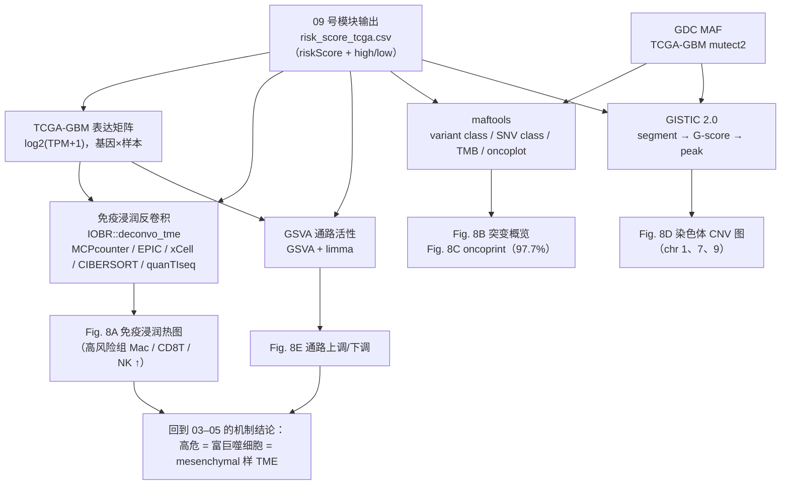

# 10 免疫浸润反卷积、体细胞突变与 CNV 基因组分析

> **目标文献**：Wang R, Wu W, et al. *Integrative single-cell and spatial transcriptomic analysis reveals a
> lactate-driven crosstalk between NFATc4⁺ tumor cells and SPP1⁺ macrophages in glioblastoma.*
> *J Transl Med* (2026) 24:1253. DOI: 10.1186/s12967-026-08555-7
>
> **模块对应原文**：Fig. 8A–E；Methods 中「Transcriptome analysis」整段与「Statistical analysis」段；
> Results 中「High-risk group exhibits distinct immune infiltration and genomic alteration profiles」整段
> **前置依赖**：`09_机器学习101组合预后模型.md`（产出 `results/risk_score_tcga.csv`）；
> 中间文件 `processed/tcga_gbm_tpm.rds`、`raw/TCGA-GBM.mutect2.maf.gz`、`raw/TCGA-GBM.seg`、`raw/hg19_marker_file.txt`
> **复现难度**：★★★★☆　**预计工时**：5 人日　**计算资源**：16 核 / 64 GB 内存（GISTIC 单线程峰值约 8–16 GB；GSVA 在 150 样本 × 20k 基因上 < 8 GB）
> **产出**：Fig8A 免疫浸润热图、Fig8B 突变概览 dashboard、Fig8C oncoprint、Fig8D GISTIC 染色体图、Fig8E 通路富集图

---

## ① 科学问题与逻辑位置

本模块是全文证据链的**临床转化层**。上游 `09_机器学习101组合预后模型.md` 用 101 种机器学习组合在 TCGA-GBM 上训练出
`StepCox[forward] + RSF` 风险模型，为每位患者给出连续风险分数 risk score 与高/低风险二分标签。
本模块要回答的问题只有一个：

> **一个由 332 个乳酸相关基因（LRGs）驱动的预后分层，在肿瘤微环境（TME）与基因组层面有没有可观测的"实体"对应物？**

即：高风险组的免疫浸润构成、体细胞突变谱、拷贝数改变（CNV）与通路活性，是否与低风险组系统性不同。
如果没有差异，说明风险模型只是在拟合临床协变量（年龄/分级）而非真实生物学；如果有差异，且方向与单细胞/空间
模块（`03_乳酸代谢评分与高低乳酸亚群划分.md`–`07_细胞通讯CellChat与NFATc4-SPP1轴.md`）的 NFATc4⁺ 肿瘤细胞–SPP1⁺ 巨噬细胞轴一致，则整条证据链闭合，Fig. 8 就是"从细胞机制到群体
基因组学"的桥梁。



> **图注**：图中「09 号模块」= `09_机器学习101组合预后模型.md`；
> 「03–05」= `03_乳酸代谢评分与高低乳酸亚群划分.md`、`04_pySCENIC转录因子调控网络与NFATc4发现.md`、
> `05_拟时序轨迹与分支依赖基因.md`。

**三句结论（原文）**：

1. 多种算法（MCPcounter、EPIC、xCell、CIBERSORT 等）的免疫反卷积一致显示高风险组
   **macrophages、CD8⁺ T cells、NK cells** 显著升高；
2. 错义突变（missense）是最常见的变异类型，高频突变基因为 **TTN、TP53、PTEN、EGFR**；
   高风险组 **97.7%** 的样本携带体细胞突变；CNV 在 **1、7、9 号染色体**上更频繁且范围更广；
3. GSVA 显示高风险组上调 leukocyte migration、cytokine-mediated signaling、cytokine activity、
   response to wounding，下调 negative regulation of Wnt signaling。

> ⚠️ **导师批注**：本模块是全文**统计口径最松**的一节。反卷积算法之间数值不可比、突变频率未做基因长度
> 校正、CNV 未与 GBM 公认图谱逐条对齐、Methods 写 GSEA 而图注写 GSVA、Results 与 Discussion 对"下调通路"
> 给出两套完全不同的答案（详见 ③ 与 ⑦）。复现时请把 Go/No-Go 判据定在**"多算法方向一致性"**上，
> 而不是试图复刻某一张热图的具体色块——后者在原参数不全的情况下不可能逐格复现。

---

## ② 背景知识与原理

### 2.1 免疫浸润反卷积：一个"欠定方程组"问题

Bulk RNA-seq 测到的是组织整体的平均信号。设样本 $s$ 中基因 $g$ 的观测表达为 $y_{gs}$，写成混合模型：

$$y_{gs} = \sum_{c=1}^{C} p_{cs}\,\mu_{gc}\;+\;\varepsilon_{gs},\qquad \sum_{c=1}^{C} p_{cs} \le 1,\; p_{cs}\ge 0$$

其中 $p_{cs}$ 是细胞类型 $c$ 的比例（待求），$\mu_{gc}$ 是参考谱中细胞类型 $c$ 表达基因 $g$ 的期望值（**外部先验**），
$\varepsilon$ 为噪声。反卷积就是"已知 $\mu$ 与 $y$，求 $p$"。

问题的本质困难在于**欠定**：$C$（要估的细胞类型数）通常 6–64，而基因数 $G\approx 2\times10^4$ 看似约束充足，
但真实表达矩阵高度共线性（同一细胞类型的 marker 基因同涨同落），且 $\mu$ 矩阵列之间强相关
（单核细胞 vs 巨噬细胞、DC vs 单核），因此解不唯一，**不同算法给出的"比例"落在同一可行域的
不同极点上**。理解这一点，就理解了 IOBR 为什么同时输出多种算法。

| 算法 | 数学方法 | 参考矩阵 | 是否含肿瘤/正常细胞 | 输出量纲 | 细胞类型数 | 关键局限 |
|---|---|---|---|---|---|---|
| **MCPcounter** | marker 基因表达的平均（几何平均），**不是解卷积** | 无参考矩阵，用自定义 marker 集 | 不含肿瘤 | 相对丰度分数（不求和为 1，跨样本可比） | 10 个群体（含内皮、成纤维） | 不能给"比例"；无肿瘤纯度概念；分数绝对值无意义 |
| **EPIC** | 约束最小二乘 / 二次规划，含 mRNA 含量与纯度校正 | EPIC 参考谱（含 malignant、内皮、成纤维） | **含肿瘤细胞** | 细胞比例（sum≈1） | 6–8 类 | 只有粗粒度免疫类别（无 CD8/NK 细分）；对 TPM 输入与平台敏感 |
| **xCell** | ssGSEA 富集分数 + spillover 去卷积（线性回归扣除他类溢出） | 自定义 64 类标记集 | 含肿瘤/正常 | 富集分数（0–1，不为比例） | 64 类（含 34 免疫 + 基质/干性） | 分数与肿瘤纯度强相关；能测稀有细胞但噪声大 |
| **CIBERSORT / CIBERSORTx** | ν-SVR（支持向量回归 + L1 稀疏惩罚）+ 置换检验 p 值 | LM22（22 类免疫，**不含肿瘤细胞**） | 不含肿瘤 | 比例（sum=1） | 22 类 | 依赖 `perm` 稳定性与 p 值过滤；LM22 由微阵列构建，与 RNA-seq 存在平台偏差 |
| **quanTIseq** | 约束最小二乘，显式建模"未表征细胞（other）" | 自定义参考谱（含肿瘤） | 含肿瘤 | 比例（sum=1，含 other） | 10 类 | 原为 RNA-seq reads 设计；对低纯度样本更稳健 |
| **IPS（immunophenoscore）** | 四类免疫基因（效应细胞、免疫抑制、MHC、免疫调节因子）z 分数加权和 | 无参考矩阵 | — | 0–10 分（**不是比例**） | — | 面向免疫治疗响应分类，不能当构成比解读 |
| **ESTIMATE** | ssGSEA 式秩统计 | 无 | — | ImmuneScore / StromalScore / ESTIMATEScore | — | 最粗粒度，只给"免疫总量"，无法告诉你是哪种细胞 |
| **TIMER** | 约束最小二乘 + 肿瘤纯度校正 | 自定义 | 含肿瘤纯度 | 丰度估计 | 6 类 | 便于与 TIMER 网站结果对照 |
| **GSVA 免疫签名** | 逐样本秩统计（见 2.5） | 无 | — | 通路/签名分数 | 依 gene set 而定 | 与真正解卷积不同范畴，常被混为一谈 |

**"为什么不同算法给出不一致的细胞比例"——四条机制**：

1. **参考矩阵差异**。LM22 来自 Affymetrix HG-U133A 微阵列上分选纯化的细胞；EPIC 参考来自 RNA-seq。
   平台间基因比值结构不同（微阵列探针亲和力 vs RNA-seq 转录本长度/GC 偏倚），差异会直接翻译成比例误差。
2. **是否建模肿瘤细胞**。CIBERSORT 的 LM22 里**没有肿瘤细胞**，因此高纯度肿瘤样本中，肿瘤表达被当作
   未建模的背景"残余"，会**系统性压低所有免疫细胞的比例**；EPIC / quanTIseq 建模了 malignant 与 other，
   没有这个偏置。这就是为什么同一批样本 CIBERSORT 给出的 CD8⁺ T 比例往往低于 EPIC。
3. **归一化方式**。MCPcounter / xCell 输出相对丰度与富集分数，**不做 sum-to-1 约束**，
   分数可以对每个样本独立解释，但绝不能当"占多少百分比"读；xCell 分数还随肿瘤纯度单调变化。
4. **统计与稳定性**。CIBERSORT 用 ν-SVR 求稀疏解，`perm` 次数少时 p 值抖动剧烈（细胞比例接近 0 的类型
   表现为"偶尔检出"）；xCell 要做 spillover 线性拟合，细胞类型多时过拟合风险高。

**IOBR 的设计哲学**：把 8+ 种算法封装成同一个入口 `deconvo_tme(eset, method = ...)`，再用
`iobr_cor_plot()` 或手写热图，把"算法 × 细胞类型 × 分组"一次性铺开。它的意义不是"选最好的算法"，
而是**用多算法方向一致性代替单算法绝对数值作为结论**——原文 Fig. 8A 正是这种呈现（多算法热图），
结论也只敢说"macrophages、CD8⁺ T、NK cells 升高"，而没有报告任何具体比例数字，这是恰当的表述。

### 2.2 maftools 与 MAF 文件

**MAF（Mutation Annotation Format）** 是 TCGA 遗产下来的制表符分隔文本，标准规范有 34 个字段，
maftools 至少需要下列 10 列（缺失会直接报错或错位）：

| 列名 | 含义 | 复现注意 |
|---|---|---|
| `Hugo_Symbol` | 基因名（HGNC symbol） | 版本漂移：旧 MAF 用别名（如 `NFATC4` 曾写作 `NFAT3`） |
| `Chromosome` | 染色体 | 必须在构建参考基因组时用同一版本（hg19 vs hg38） |
| `Start_Position` / `End_Position` | 1-based 起止坐标 | 与 `Variant_Type`（SNP/DNP/TNP/INS/DEL）配对解释 |
| `Reference_Allele` / `Tumor_Seq_Allele1/2` | 参考/肿瘤等位 | 判断 VAF 的前提 |
| `Variant_Classification` | 变异分类（见下表） | **决定是否计入 TMB 的关键列** |
| `Variant_Type` | SNP / INS / DEL / DNP | 用于 SNV class 与 INDEL 分桶 |
| `Tumor_Sample_Barcode` | 样本条码（12–16 位） | 必须与临床表型表的条码口径一致（见 ⑦） |
| `t_ref_count` / `t_alt_count`（推荐） | 支持 reads 数 | VAF = alt/(ref+alt)，用于过滤低 VAF 假阳性 |
| `HGVSp_Short`（推荐） | 氨基酸改变 | oncoplot 的 `showTitle`/lollipop 图需要 |
| `FILTER`（推荐） | 变异过滤标签 | 只保留 `PASS` |

**Variant Classification 与"是否算 TMB"**：

| 分类 | 中文 | 沉默? | 计入常用 TMB（非沉默口径） |
|---|---|---|---|
| `Missense_Mutation` | 错义 | 否 | ✅ |
| `Nonsense_Mutation` / `Nonstop_Mutation` | 无义 / 终止子丢失 | 否 | ✅ |
| `Frame_Shift_Del` / `Frame_Shift_Ins` | 移码缺失/插入 | 否 | ✅ |
| `In_Frame_Del` / `In_Frame_Ins` | 非移码插入缺失 | 否 | ✅ |
| `Splice_Site` / `Translation_Start_Site` | 剪接位点 / 起始密码子 | 否 | ✅ |
| `Silent` | 同义 | **是** | ❌（原文未说明是否剔除，见 ⑦） |
| `Intron` / `IGR` / `RNA` / `lincRNA` | 内含子/基因间/非编码 | 是（非编码） | ❌ |
| `3'UTR` / `5'UTR` / `3'Flank` / `5'Flank` | 非翻译区/侧翼 | 是 | ❌ |

**SNV class** 指 6 类碱基替换（C>A、C>G、C>T、T>A、T>C、T>G，以嘧啶为参考），用于
`plotmafSummary` 的 SNV class 饼图。GBM 的典型特征是 **C>T 转换占优**（与 IDH 突变、C 脱氨
（G:C→A:T）及衰老相关突变谱有关）。

**TMB（Tumor Mutation Burden）**：

$$TMB \;=\; \frac{N_{\text{non-silent somatic mutations}}}{\text{capture size}\,[\mathrm{Mb}]}$$

- 分子：**非沉默、体细胞**变异数；必须剔除胚系（TCGA MAF 已剔）、剔除 Silent/非编码；
- 分母：外显子捕获区间长度。WES 常用 **30–38 Mb**，maftools `tmb()` 默认 `captureSize = 30`，
  TCGA 官方 TMB 用 **~30.9 Mb（Agilent SureSelect v2 靶向区间）**；
- **分母一变，TMB 数值等比例变**，所以跨研究比 TMB 时口径必须写清；
- 原文 Fig. 8B 的 "mutation burden" 面板即此为来源，但原文**未报告具体 TMB 数值**（原文未报告）。

**oncoplot（oncoprint）的构成**：主矩阵（行=基因，列=样本，色块=变异类型）＋顶部 TMB 柱状条＋
右侧突变频率百分比＋底部 `clinicalFeatures` 注释条带（原文用的是 `risk`）＋底部变异类型图例。
样本按突变模式聚类排序（`sortByAnnotation = TRUE`）后，"高风险组 vs 低风险组"的差异会呈现为
块状结构——这是 Fig. 8C 能一眼看出差异的原因。

**`mafCompare`** 对每个基因做 2×2 列联表的 **Fisher 精确检验**：

| | 有突变 | 无突变 |
|---|---|---|
| 高风险组 | $a$ | $b$ |
| 低风险组 | $c$ | $d$ |

输出 `pVal` 与 BH 校正后的 `adjPVal`，可用 `forestPlot()` 画 OR 森林图。

### 2.3 GISTIC 2.0：从 segment 到 peak

GISTIC（**G**enomic **I**dentification of **S**ignificant **T**argets **i**n **C**ancer）从 SNP array 或
WES/WGS 衍生的**分段拷贝数（segmented copy number，CBS 格式）**中找"比随机更频繁/更大幅度"的改变。

**输入三件套**：

1. **segment 文件**（`.seg`）：`Sample  Chromosome  Start  End  Num_Probes  Segment_Mean`，
   `Segment_Mean` 是 **log2(tumor/total) 的片段均值**；
2. **markers 文件**：`Marker_Name  Chromosome  Marker_Position`，即每个探针/基因的基因组坐标（必须与 segment 同一参考基因组）；
3. **参考基因组矩阵**（`hg19.mat` / `hg38.mat`）：把染色体坐标映射到基因，并给出每条染色体的可测长度。

**算法步骤**：

1. **基因水平赋值**：对每个样本、每个基因，取覆盖该基因的所有 segment 的**长度加权平均**，
   再离散化为 $\{-2,-1,0,1,2\}$（`all_thresholded.by_genes.txt`；不分档的连续值在 `all_data_by_genes.txt`）；
2. **判 amp/del**：基因水平 $\log_2$ 比值超过阈值即判为"该样本中该基因扩增/缺失"，
   阈值由 `-ta`（amp threshold，默认 **0.1**）与 `-td`（del threshold，默认 **0.1**）控制；
3. **G-score**：对每个标记位点累加同向改变幅度，$G = \sum_{i=1}^{N} |\widehat{cn}_i|$
   （只累加超过阈值的样本，因此同时反映**频率**与**幅度**）；
4. **显著性**：对每个位点置换（permutation）背景分布 → 得到 q-value（FDR），
   `-qvt` 控制显著阈值（默认 0.25）；
5. **peak 定位**：在显著区域里用 `-conf`（置信水平；**默认值在不同文档/版本中写作 0.75 或 0.90，
   务必以你下载的 GISTIC 2.0 发行包内 `README.txt` 为准**）求最小显著区间（focal peak）；
6. **broad vs focal**：`-broad 1 -brlen 0.98` 表示"覆盖超过该臂长 98% 的改变算 broad（臂水平/染色体水平）"，
   否则算 focal（局灶）。GBM 的 chr7 获得、chr10 丢失属于 broad，EGFR/CDKN2A 属于 focal。

**输出文件与用途**：

| 文件 | 内容 | 对应图 |
|---|---|---|
| `all_lesions.conf_90.txt` | 全部显著 peak 的边界、涉及基因、q 值 | 表 4 的"显著区列表" |
| `amp_genes.conf_90.txt` / `del_genes.conf_90.txt` | peak 内的扩增/缺失基因 | `gisticOncoPlot` 的行 |
| `scores.gistic` | 全基因组 G-score 与 q 值曲线 | `gisticChromPlot` 的曲线 |
| `all_thresholded.by_genes.txt` | 样本 × 基因的 −2..2 矩阵 | 分型/聚类 |
| `all_data_by_genes.txt` / `broad_data_by_genes.txt` | 样本 × 基因的连续/臂水平值 | 相关性分析 |

**GBM 经典染色体改变（文献公认值，用于 QC 对齐，非本文数值）**：

| 改变 | 频率（文献） | 靶基因 | 生物学后果 |
|---|---|---|---|
| **+7**（整条获得） | 约 80% | EGFR、CDK6、MET | 生长信号激活，GBM 最特征性改变 |
| **−10**（整条丢失） | 约 60–80% | PTEN、MGMT | PI3K 通路激活、TMZ 耐药方向 |
| **−9p** | 约 50–60% | CDKN2A/CDKN2B | 细胞周期检查点失效 |
| **EGFR 扩增** | 约 40–50%（focal 7p11.2） | EGFR | 与 classical 亚型、EGFRvIII 相关 |
| **CDKN2A 缺失** | 约 50–60% | CDKN2A | 与 EGFR 扩增互斥倾向 |
| **PTEN 缺失/突变** | 缺失约 30–40% | PTEN | 与 mesenchymal 亚型相关 |
| **TP53 突变** | 约 30%（原发 GBM 约 28–35%） | TP53 | 继发 GBM 中更高 |
| **NF1 突变/缺失** | 约 10–15% | NF1 | mesenchymal 亚型标志 |
| **19/20 号染色体获得** | 约 30–40% | — | 常见但驱动不明 |
| **TERT 启动子突变** | 约 70–80%（非编码，MAF 里常缺失） | TERT | 端粒维持，WES 测不到 |

> ⚠️ **导师批注**：原文 Fig. 8D 只报告"1、7、9 号染色体更频繁"——**chr7 获得与 chr9p（CDKN2A）丢失
> 完全符合 GBM 图谱**，但**遗漏了 chr10 丢失（PTEN）**这一 GBM 第二特征的改变。若复现时 chr10 也显著，
> 说明原文的"1、7、9"只是列举而非穷举，需要在批判性评述（`13_复现质控清单、排错与批判性评述.md`）中说明。另外 chr1 上的
> 高置信靶点需要单独讨论——注意 **1 号染色体上的常见 CNV 靶点是 1q 的 `MDM4`（1q32.1）与 1p 的 `CDKN2C`（1p32.3）、
> `FUBP1`（1p31.1）**，而 `CDK4`/`MDM2` 位于 **12q13–q15**（不是 1 号染色体，勿混淆）；另外 1p 缺失虽与
> 1p/19q 共缺失同区段，但在 GBM 中是**独立的、非 oligodendroglioma 定义性的**事件，不要与 1p/19q 共缺失混为一谈。

### 2.4 GSVA 与 GSEA 的区别（原文在这里写混了）

**GSEA**（Subramanian 2005）是**组间**方法：需要样本的二元表型（high vs low），先按组间差异统计量
（signal-to-noise 或 t 统计量）对基因排序，再在排序表中随机游走计算富集分数：

$$ES(S) = \max_{i}\left[\sum_{\substack{g_j \in S \\ j \le i}} \frac{w_j}{N_R} - \sum_{\substack{g_j \notin S \\ j \le i}} \frac{1}{N - N_R}\right]$$

$w_j = |r_j|^p$（$p$ 默认 1）为基因权重，$N_R$ 为集合大小。显著性靠**表型置换**
（permuting the phenotype labels，1000 次）得到归一化富集分数 NES 与 FDR。

**GSVA**（Hänzelmann 2013）是**逐样本**方法：对**每个样本内部**把基因按表达量排序，用核密度估计
（Gaussian / Poisson，由 `kcdf` 指定）把秩统计量转成 $d_{(1)} \le \dots \le d_{(n)}$，然后
对每个基因集做类似的随机游走：

$$ES^{S}_{i} = \left|\max_{k=1..n}\Bigl(\underbrace{\textstyle\sum_{j \le k,\, g_j \in S} \frac{|d_{(j)}|^p}{\sum_{g\in S}|d|^p}}_{\text{in-set walk}} - \underbrace{\textstyle\sum_{j \le k,\, g_j \notin S} \frac{1}{n - |S|}}_{\text{out-set walk}}\Bigr)\right|$$

`maxDiff = TRUE` 时取**差分式** $ES = ES^{+} - ES^{-}$（保留方向），否则取 $\lvert ES\rvert$ 的积分式（无方向）。

**这就决定了两种方法能干什么**：

| 维度 | GSEA | GSVA |
|---|---|---|
| 比较单位 | 基因集 × **分组** | 基因集 × **样本** |
| 输出 | 富集列表（NES、p、FDR、leading edge） | 通路 × 样本的活性矩阵 |
| 统计量 | KS 类（组间排序） | KS 类（样本内排序） |
| 能否做逐样本聚类/生存分析 | ❌（需先分组） | ✅ |
| 能否喂给 `limma` 做通路水平差异分析 | 不能（本身就是差异分析） | ✅（Fig. 8E 的正确做法） |
| 检验方式 | 表型置换（默认 1000 次） | 无 p 值；差异靠下游 limma/Wilcoxon |
| 适用场景 | 二元分组、需要 leading edge | 连续表型、多组、需要通路分数当"特征" |

原文 Methods 写 "Gene Set Enrichment Analysis (GSEA) was performed"，而 **Fig. 8E 图注写的是
"GSVA enrichment plot displaying upregulated and downregulated pathways"**，且结果描述为
"上调/下调通路"——只有 GSVA + 差异分析才会同时给出双向通路。**这是原文的一处术语不一致**，
本模块按 GSVA 复现（见 ③ 第 5 条与 ⑤ 的复现决策）。

### 2.5 TCGA-GBM 分子分型：高风险组是不是"mesenchymal 样"？

Verhaak 等（*Cancer Cell* 2010）用 840 个基因的一致性聚类把 GBM 分为四型：

| 亚型 | 核心特征基因/改变 | 临床与 TME 特征 |
|---|---|---|
| **Proneural** | `PDGFRA`、`OLIG2`、`SOX2`、`DLL3`、IDH1 突变、`TP53`/`ATRX` | 相对年轻、预后较好；少突/星形谱系样 |
| **Neural** | `NEFL`、`GABRA1`、`SYT1`、`SLC12A5` | 与正常脑组织表达最像，后续被质疑为正常组织污染（Wang 等 *Cell* 2017 已将其并入其它型） |
| **Classical** | `EGFR` 扩增/突变、`CDKN2A` 缺失、`NES`、`NOTCH` 通路 | 增殖信号强 |
| **Mesenchymal** | `NF1`/`PTEN` 改变、`CHI3L1`、`CD44`、`MERTK`、`ANXA2`、`VIM` | **巨噬细胞/免疫浸润最高**、坏死与血管增生明显、预后最差 |

**与本模块的关系**：原文高风险组富集**巨噬细胞 + 细胞因子信号 + 白细胞迁移**，这三条恰好是
mesenchymal 亚型的教科书特征；而 SPP1⁺ 巨噬细胞本身在多个肿瘤里就是 mesenchymal 样 TME 的组成。
**所以"高危组 = 高乳酸 = NFATc4 高 = mesenchymal 样 TME"这条解释链在生物学上自洽，但原文完全没有做
亚型校验**。这是本模块必须补的关键对照实验（见 ④.7）：如果风险分数与 Verhaak 亚型高度共线，
那么"乳酸代谢签名有独立预后价值"这一说法就要打折——风险模型可能只是在重新发现 mesenchymal 亚型。

> ⚠️ **导师批注**：请务必做**分层 Cox**（`riskScore + subtype` 双变量），报告风险分数在控制亚型后是否
> 仍显著（HR 与 p）。这一步成本很低，但直接决定论文的核心卖点是否成立。

---

## ③ 原文方法与结果逐条拆解

### 3.1 Methods「Transcriptome analysis」段

| 原文（英文关键词） | 中文转述 | 对应操作与参数 | 复现注意 |
|---|---|---|---|
| "The TCGA dataset was used for transcriptomic analysis; we used **machine-learning-derived TCGA grouping results**." | 转录组分析只用 TCGA，分组沿用机器学习结果 | 输入 = `09_机器学习101组合预后模型.md` 产出的 risk score / high-low 标签 | 必须固定 `09_机器学习101组合预后模型.md` 的随机种子，否则分组一变全模块数字全变 |
| "The R package **'IOBR'** was used to perform **immune infiltration analysis** [24]." | 用 IOBR 做免疫浸润 | `IOBR::deconvo_tme(eset, method = ...)` 多算法；`iobr_cor_plot()` 出图 | 原文**未列全部算法、未给 perm 次数、未给是否 TPM/TPM 是否 log**——见 ⑤ 决策 |
| "The R packages **'ComplexHeatmap'** and **'ggplot2'** were used to draw a **heatmap**." | ComplexHeatmap 画热图 | 行 z-score、列按 risk 分组、行列聚类 | Fig. 8A 是"算法 × 细胞类型"堆叠的行标签，绘图时用 `row_split = algorithm` |
| "The R packages **'maftools'** and **'GISTIC'** were used to perform **copy number variation (CNV) analysis**." | 用 maftools + GISTIC 做 CNV | **实际是突变用 maftools、CNV 用 GISTIC**；maftools 只负责 `plotCBSsegments`/`gisticChromPlot`/`gisticOncoPlot` 的可视化 | 这句话有歧义（maftools 本身不做 CNV calling），复现时不要指望 `maftools` 能替代 GISTIC |
| "Subsequently, **Gene Set Enrichment Analysis (GSEA)** was performed to identify **pathways that were significantly enriched between the two groups**." | 组间通路富集 | —— | ⚠️ 与 Fig. 8E 图注 "**GSVA** enrichment plot" 矛盾；结果也只描述"上调/下调通路"，按 GSVA 复现 |
| "The R package **'PharmacoGx'** was used for CMAP analysis [25]." | CMAP 药敏/重定位 | 见 `11_药物敏感性、CMAP重定位与单细胞代谢.md` | 本模块不涉及 |
| "The R packages **'ISOpureR', 'impute', 'pRRophetic', 'SimDesign'** were used to perform drug target analysis and GDSC analysis [26, 27]." | 药靶与 GDSC 分析 | 见 `11_药物敏感性、CMAP重定位与单细胞代谢.md` | 本模块不涉及 |
| "The R package **'scMetabolism'** was used to calculate the metabolic activity in single-cell samples." | 单细胞代谢打分 | 见 `11_药物敏感性、CMAP重定位与单细胞代谢.md` | 本模块不涉及 |

### 3.2 Methods「Statistical analysis」段

| 原文 | 中文转述 | 复现注意 |
|---|---|---|
| "All in vitro functional experiments were performed with **3 independent biological replicates**" | 体外实验 n=3 | 不适用于本模块（纯计算） |
| "The data is presented as **mean ± SD**" | 均值±标准差 | 本模块箱线图用 `mean ± SD` 还是中位数+IQR 需自定；原文未写 |
| "For normally distributed variables, **Student's two-tailed t-test**... **one-way ANOVA**" | 参数检验 | 对应 Fig. 5/6 |
| "Survival curves were analyzed using **Kaplan-Meier** analysis and the **log-rank** test." | KM + log-rank | 对应 `08_bulk队列整合与NFATc4生存分析.md` |
| "the **Wilcoxon rank-sum test** was used to compare the **area under the curve (AUC) values** between high- and low-risk score groups in **drug sensitivity analyses (CTRP and PRISM datasets)**." | 高低风险组间比较药敏 AUC 用 Wilcoxon | ⚠️ 术语问题：CTRP/PRISM 的药敏指标应是 **AAC（area above the dose-response curve）/IC₅₀**，而非模型 AUC；复现时明确记录用的是 `aac_recomputed` 还是 `ic50_recomputed` |
| "Correlation analyses between **drug response and risk score** were performed using **Pearson correlation coefficients**." | 药敏与风险分数用 Pearson | 必须先检验线性/正态；若明显非线性应改 Spearman 并在日志中说明 |

> ⚠️ **导师批注**：本模块（免疫/突变/CNV）的组间比较**原文一个检验方法都没写**。
> 我们的复现决策：免疫浸润分数与 GSVA 分数用 **Wilcoxon rank-sum**（非正态、样本量中等）；
> 突变频率用 **Fisher 精确检验**（maftools 内建）；CNV 用 **GISTIC 的置换 q 值**，
> 组间 CNV 比例差异用 Fisher。全部在 `logs/statistical_choices.md` 中登记。

### 3.3 Results「High-risk group exhibits distinct immune infiltration and genomic alteration profiles」逐句

| 原文句子（节选） | 中文转述 | 落地到哪个图/文件 |
|---|---|---|
| "Immune deconvolution using **multiple algorithms (MCPcounter, EPIC, xCell, CIBERSORT, etc.)** revealed **significantly elevated infiltration of macrophages, CD8⁺ T cells, and NK cells in the high-risk group** (Fig. 8A)." | 多算法一致：高风险组巨噬、CD8⁺T、NK 升高 | `results/Fig8A_tme_wilcox.csv`（每算法每细胞类型的 p 值与方向） |
| "Mutational profiling identified **missense mutations as the most common variant class**, with **TTN, TP53, PTEN, and EGFR as frequently altered genes** (Fig. 8B)." | 错义突变最多；TTN/TP53/PTEN/EGFR 高频（**全样本**） | `results/Fig8B_variant_class.csv` + `plotmafSummary` dashboard |
| "Maftools analysis of the **high-risk group** further revealed that **97.7% of samples harbored somatic mutations**, with **PTEN, EGFR, TP53, and TTN** being the most commonly altered genes (Fig. 8C)." | 高风险组 97.7% 有体细胞突变；高频顺序变成 PTEN/EGFR/TP53/TTN（**高风险子集**） | `results/Fig8C_oncoplot.pdf` + `subsetMaf()` 的样本数（分母必须记录） |
| "CNV analysis showed **more frequent and extensive genomic gains/losses in high-risk samples**, particularly on **chromosomes 1, 7, and 9** (Fig. 8D)." | 高风险组 CNV 更频繁更广泛，集中在 1、7、9 号染色体 | `results/Fig8D_gistic_chrom.pdf` |
| "GSVA enrichment analysis indicated **upregulation of immune-related pathways (e.g., leukocyte migration, cytokine signaling)** and **downregulation of differentiation and DNA recombination pathways** in high-risk tumors (Fig. 8E)." | 高风险组：免疫通路上调；分化与 DNA 重组下调 | `results/Fig8E_gsva_limma.csv` |
| "These findings were consistent with our earlier analyses, where a high lactate state was associated with **increased macrophage infiltration**, reflecting the interaction between NFATc4⁺ neoplastic cells and SPP1⁺ macrophages." | 与 03–07 号模块的巨噬细胞结论呼应（`07_细胞通讯CellChat与NFATc4-SPP1轴.md`） | 交叉验证：把 03 号（`03_乳酸代谢评分与高低乳酸亚群划分.md`）的乳酸分数与 Fig8A 的巨噬细胞分数做相关 |

**Discussion 中对同一段 Fig. 8E 的第二种说法**（第 15 页）：

> "In the GSVA analysis, we observed upregulation and downregulation of relevant pathways in the high-risk group,
> including **leukocyte migration, cytokine-mediated signaling, cytokine activity, response to wounding**,
> and **negative regulation of Wnt signaling**."

> ⚠️ **导师批注（重要不一致）**：Results 段说下调的是"**differentiation and DNA recombination pathways**"，
> Discussion 段说下调的是"**negative regulation of Wnt signaling**"。两处描述互不相容，且
> "cytokine activity" 是 **GO:MF** 条目而其余是 **GO:BP** 条目——说明原文用的 GO 基因集很可能是
> BP+MF 混合集合（或直接从某个现成 GO 库取），但**没有交代基因集来源与版本**。
> 复现处置：同时跑 GO:BP 与 GO:BP+MF 两套（见 ④.6），在 `13_复现质控清单、排错与批判性评述.md` 中列出
> "哪一套能复现哪一种描述"，不预设结论。

### 3.4 Fig. 8 图注全文（逐句）

> "**Fig. 8** Immunogenomic and mutational landscape of risk-stratified GBM.
> **(A)** Heatmap of immune cell infiltration estimated by **multiple deconvolution algorithms** in high- and low-risk groups.
> **(B)** Summary of mutational profiles: **variant classification, SNV class, mutation burden, and top 10 mutated genes**.
> **(C)** **Oncoprint of recurrent mutations stratified by risk group**.
> **(D)** **Chromosomal copy number alteration profiles**.
> **(E)** **GSVA enrichment plot** displaying upregulated and downregulated pathways in high-risk GBM.
> \*p < 0.05, \*\*p < 0.01, \*\*\*p < 0.001"

信息提取：B 面板是 maftools 的 `plotmafSummary()` dashboard（四联图：variant classification 柱、SNV class 饼、
变异数/样本小提琴、top10 基因柱）；D 面板是 `gisticChromPlot()`（各染色体上下两条 G-score 曲线 +
q-value 阈值线）；A 面板的显著性星号说明做过组间检验但**未说明是哪种检验**。

---

## ④ 逐步可运行代码

> 全局约定：R 4.4.x（与原文一致）；随机种子 `set.seed(20260101)`；图表 PDF + PNG 双份，`dpi = 300`。
> 所有中间对象落盘到 `processed/`，图表落盘到 `figures/`。

### 4.0 环境与数据准备

```r
# code/10_00_setup.R
set.seed(20260101)
pkgs <- c("IOBR", "maftools", "GSVA", "limma", "ComplexHeatmap", "circlize",
          "data.table", "msigdbr", "TCGAbiolinks", "ggplot2", "ggpubr", "survival")
for (p in pkgs) if (!requireNamespace(p, quietly = TRUE)) BiocManager::install(p)
suppressPackageStartupMessages(lapply(pkgs, library, character.only = TRUE))

dir.create("logs", showWarnings = FALSE); dir.create("results", showWarnings = FALSE)
writeLines(capture.output(sessionInfo()), "logs/sessionInfo_10.txt")
```

**TCGA-GBM 数据获取（GDC，hg38；若要与原文的 hg19 图谱对照需显式说明版本）**：

```r
# code/10_01_download.R  —— 首次运行较慢，建议 run_in_background
library(TCGAbiolinks)
# (1) 表达：STAR-Counts → TPM
q_expr <- GDCquery(project = "TCGA-GBM",
                   data.category = "Transcriptome Profiling",
                   data.type = "Gene Expression Quantification",
                   workflow.type = "STAR - Counts")
GDCdownload(q_expr, directory = "raw/GDCdata")
expr_se <- GDCprepare(q_expr, directory = "raw/GDCdata")
tpm <- assay(expr_se, "tpm_unstrand")
rownames(tpm) <- rowData(expr_se)$gene_name      # 基因名可能重复，需去重
saveRDS(tpm, "processed/tcga_gbm_tpm_raw.rds")

# (2) 突变：MAF（mutect2 pipeline）
maf_df <- GDCquery_Maf("GBM", pipelines = "mutect2", directory = "raw/GDCdata")
data.table::fwrite(maf_df, "raw/TCGA-GBM.mutect2.maf.gz", sep = "\t")

# (3) 临床
q_clin <- GDCquery(project = "TCGA-GBM", data.category = "Clinical",
                   data.type = "Clinical Supplement", data.format = "BCR XML")
```

若无法联网或想省事，**Plan B**：从 cBioPortal / Broad Firehose GDAC 直接下载 TCGA-GBM 的
**预计算 GISTIC 结果**与 MAF（`gbm_tcga` study），坐标体系与文件命名以下载页说明为准，
并在 `logs/` 里记录下载日期与文件 MD5。

### 4.1 表达矩阵与风险分组对齐（含 barcode 去重）

```r
# code/10_02_prepare.R
library(data.table)
risk <- fread("results/risk_score_tcga.csv")          # `09_机器学习101组合预后模型.md` 产出：SampleID, riskScore, risk
expr <- readRDS("processed/tcga_gbm_tpm_raw.rds")     # 行=gene, 列=TCGA barcode

## --- 关键：TCGA barcode 去重（同一患者可有 -01A/-01B 两个 aliquots）---
barcode15 <- substr(colnames(expr), 1, 15)            # 患者+样本类型级
dupd <- duplicated(barcode15)
if (any(dupd)) {
  # 保留测序深度/表达量更完整的那个 aliquot
  keep <- tapply(seq_along(barcode15), barcode15, function(ix)
    ix[which.max(colSums(expr[, ix, drop = FALSE] > 0))])
  expr <- expr[, unlist(keep)]
  barcode15 <- barcode15[unlist(keep)]
}
## 只保留肿瘤样本（-01），剔除正常（-11）
expr <- expr[, substr(barcode15, 14, 15) == "01"]

## --- 与 risk 表对齐 ---
risk[, SampleID := substr(SampleID, 1, 15)]
risk <- risk[!duplicated(SampleID)]
common <- intersect(colnames(expr), risk$SampleID)
expr <- expr[, common]; risk <- risk[match(common, SampleID)]
stopifnot(identical(colnames(expr), risk$SampleID))

expr_log <- log2(expr + 1)                            # IOBR 与 GSVA 均推荐 log 尺度
risk[, risk := factor(risk, levels = c("low", "high"))]
saveRDS(list(expr = expr_log, risk = risk), "processed/tcga_gbm_risk_expr.rds")
table(risk$risk)                                       # 记录高低风险各多少样本
```

### 4.2 IOBR 多算法免疫浸润（Fig. 8A 的原料）

```r
# code/10_03_iobr_tme.R
library(IOBR)
dat <- readRDS("processed/tcga_gbm_risk_expr.rds")
eset <- dat$expr; risk <- dat$risk

tme_list <- list()
## (1) MCPcounter：相对丰度，非解卷积
tme_list$MCPcounter <- deconvo_tme(eset = eset, method = "mcpcounter")
## (2) EPIC：比例，含 tumor purity（tumor = TRUE 表示样本含肿瘤细胞）
tme_list$EPIC       <- deconvo_tme(eset = eset, method = "epic", tumor = TRUE)
## (3) xCell：64 类富集分数
tme_list$xCell      <- deconvo_tme(eset = eset, method = "xcell")
## (4) CIBERSORT：22 类比例 + 置换 p 值（perm 建议 ≥1000）
tme_list$CIBERSORT  <- deconvo_tme(eset = eset, method = "cibersort",
                                   arrays = FALSE, perm = 1000, absolute = FALSE)
## (5) quanTIseq：比例，含 "other" 未表征细胞
tme_list$quanTIseq  <- deconvo_tme(eset = eset, method = "quantiseq", tumor = TRUE, scale_mrna = TRUE)
## (6) ESTIMATE：免疫/基质总量（粗粒度对照）
tme_list$ESTIMATE   <- deconvo_tme(eset = eset, method = "estimate")

## 统一整理为 "长表"：algorithm / celltype / sample / value
tme_long <- rbindlist(lapply(names(tme_list), function(a) {
  d <- as.data.table(tme_list[[a]])
  idcol <- intersect(c("ID", "SampleID", "sample"), names(d))[1]
  m <- melt(d, id.vars = idcol, variable.name = "celltype", value.name = "value")
  m[, algorithm := a]; setnames(m, idcol, "sample"); m
}))
fwrite(tme_long, "results/Fig8A_tme_long.csv")
```

> ⚠️ IOBR 在不同大版本间改过参数名（如 `epic` 的 `tumor`、`quantiseq` 的 `scale_mrna`）。
> 执行前务必 `?IOBR::deconvo_tme` 核对；若某算法报"gene symbol 不匹配"，
> 先用 `IOBR::anno_eset(eset, annotation = "hugo")` 统一注释。

### 4.3 组间差异检验 + ComplexHeatmap（Fig. 8A 成图）

```r
# code/10_04_heatmap.R
library(data.table); library(ComplexHeatmap); library(circlize)

tme_long <- fread("results/Fig8A_tme_long.csv")
risk <- readRDS("processed/tcga_gbm_risk_expr.rds")$risk

## (1) 逐 算法×细胞类型 做 Wilcoxon rank-sum，记录方向与 p
stat <- tme_long[!is.na(value), {
  hi <- value[risk[match(sample, SampleID), risk] == "high"]
  lo <- value[risk[match(sample, SampleID), risk] == "low"]
  if (length(hi) < 3 || length(lo) < 3) .(p = NA_real_, dir = NA_character_) else {
    wt <- wilcox.test(hi, lo)
    .(p = wt$p.value, dir = ifelse(median(hi) > median(lo), "up", "down"))
  }
}, by = .(algorithm, celltype)]
stat[, padj := p.adjust(p, "BH")]
fwrite(stat, "results/Fig8A_tme_wilcox.csv")

## (2) 组装 算法×细胞类型 × 样本 的宽矩阵（z-score by row）
wid <- dcast(tme_long, algorithm + celltype ~ sample, value.var = "value")
mat <- as.matrix(wid[, -(1:2)]); rownames(mat) <- paste(wid$algorithm, wid$celltype, sep = " | ")
mat <- mat[, risk$SampleID, drop = FALSE]

## (3) 仅保留在 ≥2 个算法中显著（padj<0.05）的细胞类型，避免 60+ 行噪声
sig_ct <- stat[padj < 0.05, unique(celltype)]
mat_sel <- mat[sub(".*\\| ", "", rownames(mat)) %in% sig_ct, , drop = FALSE]
z <- t(scale(t(mat_sel)))                              # 行 z-score

ha <- HeatmapAnnotation(risk = risk$risk,
                        col = list(risk = c(low = "#2C7FB8", high = "#D7301F")))

## (4) 显著性星号：把 wilcox p 值映射成 *** / ** / * 放在行名右侧
star_of <- function(p) ifelse(is.na(p) | p >= 0.05, "",
                       ifelse(p < 0.001, "***", ifelse(p < 0.01, "**", "*")))
rn <- rownames(mat_sel)
stat[, key := paste(algorithm, celltype, sep = " | ")]
stat_keyed <- stat[match(rn, key)]
ra <- rowAnnotation(
  dir = anno_text(stat_keyed$dir, gp = gpar(fontsize = 7)),      # up / down
  sig = anno_text(star_of(stat_keyed$padj), gp = gpar(fontsize = 8, col = "#B2182B")))

ht <- Heatmap(z, name = "z-score", top_annotation = ha, right_annotation = ra,
              column_split = risk$risk, cluster_column_slices = FALSE,
              show_column_names = FALSE, row_names_gp = gpar(fontsize = 7),
              column_title_gp = gpar(fontsize = 10),
              row_split = sub(" \\|.*", "", rn))
pdf("figures/Fig8A_tme_heatmap.pdf", width = 10, height = 9); draw(ht); dev.off()
png("figures/Fig8A_tme_heatmap.png", width = 10, height = 9, units = "in", res = 300)
draw(ht); dev.off()
## 保存"方向表"：算法 × 细胞类型 的 up/down + p，供正文结论引用（比热图更可靠）
fwrite(stat[order(algorithm, padj), .(algorithm, celltype, dir, p, padj)],
       "results/Fig8A_tme_direction_table.csv")
```

**核对点**：macrophages、CD8⁺ T cells、NK cells 三类细胞在 **≥3 种算法**中同为 `up`（高风险组升高），
且 BH 校正后 `padj < 0.05`，才算复现成功。

### 4.4 maftools：突变概览与 oncoprint（Fig. 8B、8C）

```r
# code/10_05_maftools.R
library(maftools); library(data.table)

risk <- fread("results/risk_score_tcga.csv")
clin <- data.frame(Tumor_Sample_Barcode = substr(risk$SampleID, 1, 15),
                   risk = factor(risk$risk, levels = c("low", "high")),
                   time = risk$OS.time, status = risk$OS)     # 列名须与 `08_bulk队列整合与NFATc4生存分析.md` 一致

maf <- read.maf(maf = "raw/TCGA-GBM.mutect2.maf.gz",
                clinicalData = clin,
                isTCGA = TRUE, verbose = TRUE)
print(getSampleSummary(maf))          # 每个样本的变异数（用于核对 97.7% 的分母）

## ---- Fig. 8B：dashboard（variant classification + SNV class + burden + top10）----
pdf("figures/Fig8B_maf_summary.pdf", width = 12, height = 9)
plotmafSummary(maf = maf, rmOutlier = TRUE, addStat = "median",
               dashboard = TRUE, titvRaw = FALSE)
dev.off()

## ---- Fig. 8C：oncoprint（高风险组）----
hi <- subsetMaf(maf, clinQuery = "risk == 'high'")
message("high-risk samples = ", length(hi@variants.per.sample$Tumor_Sample_Barcode))
## 原文报告：97.7% 的样本含体细胞突变
n_with <- nrow(getSampleSummary(hi)[Ntotal > 0])          # 含 ≥1 个变异的样本数
message("with mutations: ", round(100 * n_with / length(hi@variants.per.sample$Tumor_Sample_Barcode), 1), "%")

pdf("figures/Fig8C_oncoplot_highrisk.pdf", width = 10, height = 7)
oncoplot(maf = hi, top = 20, clinicalFeatures = "risk",
         sortByAnnotation = TRUE, removeNonMutated = TRUE,
         showTumorSampleBarcodes = FALSE, fontSize = 0.7)
dev.off()

## ---- 组间差异突变（Fisher 精确检验）----
lo <- subsetMaf(maf, clinQuery = "risk == 'low'")
cmp <- mafCompare(m1 = hi, m2 = lo, m1Name = "High", m2Name = "Low",
                  minMut = 5, useCNV = FALSE)
print(cmp)
fwrite(as.data.table(cmp$results), "results/Fig8C_mafCompare.csv")
pdf("figures/Fig8C_mafCompare_forest.pdf", width = 7, height = 6)
forestPlot(mafCompareRes = cmp, pVal = 0.05, color = c("maroon", "royalblue"))
dev.off()

## ---- TMB：非沉默口径 + 生存关联 ----
tmb_tab <- tmb(maf = maf, captureSize = 30.9, logScale = TRUE)   # tcga 常用 30.9 Mb
fwrite(as.data.table(tmb_tab), "results/Fig8B_tmb.csv", row.names = TRUE)
mafSurvival(maf = maf, genes = c("PTEN", "EGFR", "TP53", "TTN"),
            time = "time", status = "status", isTCGA = TRUE,
            plotAll = FALSE, showTitle = TRUE)   # time/status 在 isTCGA=TRUE 时可用 days/status
```

> **TMB 的"非沉默"必须自己写**：maftools `tmb()` 默认对 MAF 中**全部**变异计数。若要非沉默口径，
> 先过滤再算：
> ```r
> non_silent <- c("Missense_Mutation","Nonsense_Mutation","Nonstop_Mutation",
>                 "Frame_Shift_Del","Frame_Shift_Ins","In_Frame_Del","In_Frame_Ins",
>                 "Splice_Site","Translation_Start_Site")
> maf_ns <- subsetMaf(maf, query = sprintf("Variant_Classification %%in%% c('%s')",
>                                          paste(non_silent, collapse = "','")))
> tmb_ns <- tmb(maf_ns, captureSize = 30.9, logScale = TRUE)
> ```

### 4.5 GISTIC 2.0（Fig. 8D）

**(a) 用命令行跑 GISTIC 2.0（若使用 Firehose 预计算结果可跳过）**

```bash
# code/10_06_gistic.sh
# 1) 下载 GISTIC 2.0.23 与参考基因组矩阵（以官方发布页面为准）
#    gistic2 与 refgenefiles/hg19.mat 需从 Broad 官网获取，版本号务必记录
mkdir -p results/gistic2_gbm

# 2) markers 文件：从同一 MAF/表达矩阵的基因坐标生成（chr, start, end 必须与 seg 同版本）
#    格式：Marker_Name  Chromosome  Marker_Position
gistic2 \
  -b  results/gistic2_gbm \
  -seg raw/TCGA-GBM.seg \
  -mk  raw/hg19_marker_file.txt \
  -refgenefile refgenefiles/hg19.mat \
  -genegistic 1 -smallmem 1 -broad 1 -brlen 0.98 -conf 0.90 -armpeel 1 \
  -savegene 1 -gcm extreme \
  -ta 0.1 -td 0.1 -js 4 -qvt 0.25 -maxseg 2000
# 说明：
#  -ta/-td 0.1   基因水平 log2 比值 ±0.1 判为 amp/del
#  -broad 1 -brlen 0.98  覆盖 >98% 臂长记为 broad
#  -conf 0.90    用 90% 置信度收缩 focal peak
#  -qvt 0.25     显著 peak 的 q-value 上限
#  -gcm extreme  基因水平赋值用"极值"而非默认均值
#  -js 4         允许保留的 segment 最少 marker 数（join segments，官方默认 4，取整数）
#  -maxseg 2000  每样本最大 segment 数（部分发行版默认 2000、部分写作 2500，请核对 README）
#  ⚠️ -js / -maxseg / -conf 的默认值在各发行版 README 中写法不一，运行前务必以本机 README 为准
```

**(b) 用 maftools 读入并出图**

```r
# code/10_07_gistic_plot.R
library(maftools); library(data.table)
gistic <- readGistic(
  gisticAllLesionsFile = "results/gistic2_gbm/all_lesions.conf_90.txt",
  gisticAmpGenesFile   = "results/gistic2_gbm/amp_genes.conf_90.txt",
  gisticDelGenesFile   = "results/gistic2_gbm/del_genes.conf_90.txt",
  gisticScoresFile     = "results/gistic2_gbm/scores.gistic",
  isTCGA = TRUE, cnLevel = "all")

## Fig. 8D：染色体 G-score + q 值曲线（上下两条分别是 amplifications / deletions）
pdf("figures/Fig8D_gistic_chrom.pdf", width = 14, height = 8)
gisticChromPlot(gistic = gistic, markBands = "all", ref.build = "hg19", color = NULL)
dev.off()

## peak 内基因的 oncoprint（可作附图）
pdf("figures/Fig8D_gistic_oncoprint.pdf", width = 12, height = 8)
gisticOncoPlot(gistic = gistic, clinicalData = clin, clinicalFeatures = "risk", top = 10)
dev.off()

## 显著 peak 列表：检查 chr1 / chr7 / chr9 是否在列，并核对 chr10 是否也显著
print(getCytobandSummary(gistic))
fwrite(as.data.table(getCytobandSummary(gistic)), "results/Fig8D_cytoband_summary.csv")

## （可选）segment 原始形态检查：上传 segment 到 maftools 直接画
plotCBSsegments(cbsFile = "raw/TCGA-GBM.seg")
```

**组间 CNV 差异（原文未做，建议补）**：把 `all_thresholded.by_genes.txt` 拆成基因 × 样本矩阵，
对每个基因用 Fisher 检验比较"高风险组中该基因被 amp/del 的样本比例 vs 低风险组"，再 BH 校正。

### 4.6 GSVA + limma（Fig. 8E）

```r
# code/10_08_gsva.R
library(GSVA); library(limma); library(msigdbr); library(data.table)

dat <- readRDS("processed/tcga_gbm_risk_expr.rds")
eset <- dat$expr; risk <- dat$risk

## (1) 取 GO:BP 基因集（版本 ≥10 的 msigdbr 用 collection/subcollection；
##     旧版为 category="C5", subcategory="GO:BP"）
gobp <- msigdbr(species = "Homo sapiens", collection = "C5", subcollection = "GO:BP")
gomf <- msigdbr(species = "Homo sapiens", collection = "C5", subcollection = "GO:MF")
gs_bp <- split(gobp$gene_symbol, gobp$gs_name)
gs_bpmf <- split(c(gobp$gene_symbol, gomf$gene_symbol),
                 c(gobp$gs_name, gomf$gs_name))          # 混合集（对应 Discussion 的 "cytokine activity"）

## (2) GSVA（新 API：先建参数对象，再 gsva()）
run_gsva <- function(gs) {
  gp <- gsvaParam(expr = eset, geneSets = gs, kcdf = "Gaussian",
                  maxDiff = TRUE, absRanking = FALSE)
  gsva(gp, verbose = TRUE)                               # 通路 × 样本
}
sco_bp <- run_gsva(gs_bp)
saveRDS(sco_bp, "processed/Fig8E_gsva_scores_bp.rds")

## (3) limma 差异通路分析
de_pathway <- function(scores, group) {
  group <- factor(group, levels = c("low", "high"))
  design <- model.matrix(~ group)                        # 截距 + high vs low
  fit <- eBayes(lmFit(scores, design), trend = TRUE, robust = TRUE)
  as.data.table(topTable(fit, coef = 2, number = Inf, adjust.method = "BH"), keep.rownames = "pathway")
}
res_bp <- de_pathway(sco_bp, risk$risk)
fwrite(res_bp, "results/Fig8E_gsva_limma_GOBP.csv")

## (4) 核对原文五条通路是否在 top 显著列表内（GO:BP；cytokine activity 属 MF）
targets <- c("leukocyte migration", "cytokine-mediated signaling",
             "response to wounding", "negative regulation of Wnt signaling")
hit <- res_bp[grepl(paste(targets, collapse = "|"), pathway, ignore.case = TRUE),
              .(pathway, logFC, AveExpr, P.Value, adj.P.Val)]
print(hit)
```

**条形图（复现 Fig. 8E 的样式）**：

```r
# code/10_09_gsva_bar.R
library(ggplot2); library(enrichplot)
top_n <- rbind(res_bp[order(-logFC)][1:15], res_bp[order(logFC)][1:15])
top_n[, dir := ifelse(logFC > 0, "High-risk up", "High-risk down")]
top_n[, pathway := gsub("GOBP_|GO_", "", pathway)]
top_n[, pathway := gsub("_", " ", tolower(pathway))]
p <- ggplot(top_n, aes(x = reorder(pathway, logFC), y = logFC, fill = dir)) +
  geom_col(width = 0.7) + coord_flip() + theme_bw(base_size = 11) +
  scale_fill_manual(values = c("High-risk up" = "#D7301F", "High-risk down" = "#2C7FB8")) +
  labs(x = NULL, y = "GSVA score difference (limma logFC)", fill = NULL) +
  theme(legend.position = "top")
ggsave("figures/Fig8E_gsva_bar.pdf", p, width = 8, height = 7)
ggsave("figures/Fig8E_gsva_bar.png", p, width = 8, height = 7, dpi = 300)
```

### 4.7 导师要求补做的 Verhaak 亚型校验

```r
# code/10_10_subtype_check.R
library(GSVA); library(survival); library(data.table)

## Verhaak 四型的代表基因（原文 Cancer Cell 2010 的 840 基因 signature，
## 此处用各型经典 marker 做快速近似；正式复现应下载原 840 基因表）
verhaak <- list(
  Proneural   = c("PDGFRA","OLIG2","SOX2","DLL3","ASCL1","TCF3","NKX2-2","ERBB3"),
  Neural      = c("NEFL","GABRA1","SYT1","SLC12A5","GABBR2","NCAM1","NEFM","SNAP25"),
  Classical   = c("EGFR","NES","NOTCH3","JAG1","SOX9","CCND2","CDK6","ADGRG1"),
  Mesenchymal = c("CHI3L1","CD44","MERTK","ANXA1","ANXA2","VIM","TGFB1","LGALS3BP"))

sco <- gsva(gsvaParam(expr = dat$expr, geneSets = verhaak,
                      kcdf = "Gaussian", maxDiff = TRUE))
subtype <- rownames(sco)[apply(sco, 2, which.max)]      # 每样本取最高分型
dt <- data.table(SampleID = colnames(sco), subtype = subtype,
                 risk = risk$risk, riskScore = risk$riskScore)
print(table(dt$subtype, dt$risk))
print(prop.table(table(dt$subtype, dt$risk), 2))         # 高风险组中 mesenchymal 占比

## 分层 Cox：风险分数在控制亚型后是否仍显著
fit <- coxph(Surv(OS.time, OS) ~ riskScore + subtype, data = merge(dt, risk, by = "SampleID"))
summary(fit)                                            # 关注 riskScore 的 HR 与 p
```

> **判据**：若高风险组中 mesenchymal 占比 > 60%，且分层 Cox 中 `riskScore` 的 p 仍 < 0.05，
> 则风险模型提供了亚型之外的信息；若 `riskScore` 变得不显著，则结论应弱化为"风险分数部分代理了
> mesenchymal 亚型"。**无论哪种结果都要如实记录进 `13_复现质控清单、排错与批判性评述.md`**。

---

## ⑤ 参数解释与调参空间

### 5.1 免疫浸润

| 参数 | 原文取值 | 可选范围 | 改变后的后果 | 我们的复现决策 |
|---|---|---|---|---|
| 表达输入形态 | 未说明 | TPM / log2(TPM+1) / FPKM | CIBERSORT 官方建议**非 log**（TPM）；IOBR 内部大多数算法期望 log 尺度 → 尺度不一结论会反 | 主分析用 `log2(TPM+1)`；作为敏感性分析再用 TPM 跑一遍，两版结果都落盘 |
| 算法集合 | "MCPcounter、EPIC、xCell、CIBERSORT 等" | 8–10 种 | 算法越多，行越多，噪声越大；但"多算法一致"更可信 | 固定 6 种：MCPcounter / EPIC / xCell / CIBERSORT / quanTIseq / ESTIMATE |
| `perm`（CIBERSORT） | 未报告 | 100 / 1000 / 10000 | perm 越小 p 值越不稳，稀有细胞类型比例抖动大 | **1000**（官方推荐），并在日志记录 |
| EPIC 的 `tumor` | 未报告 | TRUE / FALSE | `FALSE` 时假设样本不含肿瘤细胞 → 对 GBM 完全错误，比例会系统性偏高 | `TRUE` |
| 组间检验 | 未报告（图上有星号） | Wilcoxon / t 检验 | GBM 队列 n<200，免疫分数多右偏；t 检验会因少数极端样本失稳 | **Wilcoxon rank-sum + BH** |
| 纯度校正 | 未提及 | 无 / `estimate` 纯度回归 / 用 EPIC 的 purity 做协变量 | xCell / CIBERSORT 分数与纯度强相关，"高风险组免疫高"可能只是"高风险组纯度低" | 补做：以 EPIC purity 为协变量的线性模型，看分组是否仍显著 |

> **Plan B（若 IOBR 装不上/报错）**：直接用算法原包
> （`MCPcounter::MCPcounter.estimate`、`EPIC::EPIC`、`xCell::xCellAnalysis`、
> `CIBERSORT` 需从源码包 `source("CIBERSORT.R")` 运行、`quanTIseq` 需 `quantiseqr::run_quantiseq`），
> 输出列名与 IOBR 不同但语义一致，自行统一为长表继续下游。

### 5.2 突变与 TMB

| 参数 | 原文取值 | 可选范围 | 后果 | 复现决策 |
|---|---|---|---|---|
| MAF caller | 未说明（TCGA 官方发布） | mutect2 / varscan2 / muse / somaticsniper | 不同 caller 的 INDEL 检出率差异大（可达 2 倍） | 固定 **mutect2**，记录 GDC 版本与下载日期 |
| TMB 捕捉区间 | 未报告 | 30 / 30.9 / 38 Mb | TMB 数值等比例变化，跨研究不可比 | **30.9 Mb**（TCGA 口径），同时在图注写出 |
| 是否含 Silent | 未说明 | 含 / 不含 | 含 Silent 时 TMB 系统性偏高（约 +15–25%）；"错义最多"的结论不受影响 | 主分析**非沉默口径**，附含 Silent 版本作敏感性分析 |
| VAF 过滤 | 未报告 | 无 / ≥0.05 / ≥0.1 | 低 VAF 含大量测序错误与 CHIP（clonal hematopoiesis）噪声 | 保留 `t_alt_count ≥ 5` 且 `VAF ≥ 0.05`，并记录过滤前后变异数 |
| `mafCompare` 的 `minMut` | 未报告 | 0 / 5 / 10 | 太小则长尾基因产生大量假阳性 | **5**（maftools 常见默认），结果按 BH 报告 |
| 是否用 CNV 辅助 `mafCompare` | 未报告 | `useCNV = TRUE/FALSE` | 打开后把缺失也算作"改变"，会显著改变基因排名（TP53 等） | `FALSE`（与原文"mutational profiling"措辞一致），并用 `TRUE` 复算一遍作对照 |

### 5.3 GISTIC

| 参数 | 原文取值 | 常见取值 | 后果 | 复现决策 |
|---|---|---|---|---|
| GISTIC 版本 | "GISTIC"（未写版本） | 2.0.22 / **2.0.23** | 2.0.23 修了坐标注释与部分边界 bug；**不同版本基因注释与 peak 边界不同** | **2.0.23**，并在图注写明 |
| `-ta` / `-td` | 未报告 | 0.1（默认）/ 0.2 / 0.3 | 阈值越低越灵敏，噪声 peak 增多；越高只留大改变 | 默认 **0.1/0.1**，另跑 0.2/0.2 作敏感性分析 |
| `-broad` / `-brlen` | 未报告 | `1 / 0.98` | 关掉 broad 只留 focal，会丢掉 chr7/chr10 这类整条改变 | `-broad 1 -brlen 0.98` |
| `-conf` | 未报告 | 0.70 / **0.90** / 0.95 | 置信度越高 peak 越窄，可能只剩 1–2 个基因 | **0.90** |
| `-qvt` | 未报告 | 0.25（默认）/ 0.05 | 更严 → 显著 peak 变少 | **0.25**（与默认一致），报告峰值 q 值 |
| `-perm`（置换次数） | 未报告 | 100 / 1000 | 次数少 → q 值粒度粗（最小可达 1/(perm+1)） | 先用默认跑通，再用 **1000** 复算稳定 q 值（耗时约 3–6 h，建议后台运行） |
| `-gcm` 基因水平赋值 | 未报告 | `threshold` / `extreme` / `mean` | 影响基因是否被判 amp/del，进而影响 peak 内基因列表 | **extreme**（对 focal 事件更敏感） |
| 参考基因组 | 未说明 | hg19 / hg38 | **seg、marker、refgenefile 三者必须同一版本**，混用会整体错位 | 与 MAF 一致（GDC 默认 hg38；Firehose 预计算为 hg19）——**必须显式记录** |

### 5.4 GSVA

| 参数 | 原文取值 | 可选 | 后果 | 复现决策 |
|---|---|---|---|---|
| `method` | 未写（图注写 GSVA） | `gsva` / `ssgsea` / `zscore` / `plage` / `singular` | `ssgsea` 无方向、`zscore` 对共表达敏感；`gsva` 才是原文口径 | **`gsva`（maxDiff=TRUE）** |
| `kcdf` | 未写 | `Gaussian` / `Poisson` | 连续 log 尺度用 Gaussian；原始 counts 用 Poisson。**用错会系统性偏移** | `Gaussian`（输入 log2(TPM+1)） |
| `maxDiff` | 未写 | TRUE / FALSE | FALSE 只取 $\lvert ES\rvert$，**丢失上调/下调方向**，就无法报告"上调/下调通路" | **TRUE**（否则 Fig.8E 无法成图） |
| 基因集来源 | 未说明 | MSigDB C5 GO:BP / GO:BP+MF / KEGG / Hallmark | Discussion 同时提到 BP 与 MF 条目 → 很可能用了混合集 | 主分析 GO:BP；附 GO:BP+MF 对照，两版都跑 |
| 下游检验 | 未写 | limma / 逐通路 Wilcoxon | limma 借信息共享提高功效，但假设近似正态 | **limma（BH）**，用 Wilcoxon 复核 top 通路 |
| 最小基因集大小 | 未写 | 10 / 15 / 25 | 太小的集合分数极不稳 | `minSize = 10, maxSize = 500`（≥1.47 新 API；旧 API 为 `min.sz` / `max.sz`） |

---

## ⑥ 预期结果与 QC 检查点

### 6.1 原文报告的确切数字（引用必须一致）

| 项目 | 原文数值 | 出处 |
|---|---|---|
| 高风险组升高的免疫细胞 | **macrophages、CD8⁺ T cells、NK cells** | Results, Fig. 8A |
| 最常见变异类型 | **missense（错义）** | Results, Fig. 8B |
| 高频突变基因（全样本） | **TTN、TP53、PTEN、EGFR** | Results, Fig. 8B |
| 高风险组含体细胞突变样本比例 | **97.7%** | Results, Fig. 8C |
| 高风险组高频突变基因 | **PTEN、EGFR、TP53、TTN** | Results, Fig. 8C |
| CNV 更频繁/广泛的染色体 | **1、7、9** | Results, Fig. 8D |
| 高风险组上调通路 | leukocyte migration、cytokine-mediated signaling、cytokine activity、response to wounding | Discussion |
| 高风险组下调通路 | Results：differentiation、DNA recombination；Discussion：negative regulation of Wnt signaling | Results vs Discussion（**互相矛盾**） |
| 组间检验方法 | 本模块**原文未报告** | —— |
| TMB 具体数值 | **原文未报告**（建议自测并在日志中记录） | —— |
| 高低风险组样本数 | **原文未报告**（建议自测并在日志中记录） | —— |

### 6.2 QC 检查点与 Go/No-Go 判据

| # | 检查项 | 判据 | 不通过怎么办 |
|---|---|---|---|
| Q1 | 风险分组一致性 | 与 `09_机器学习101组合预后模型.md` 的 `risk_score_tcga.csv` 的 barcode 一一对应，无重复患者 | 检查 `-01A/-01B` 去重逻辑（④.1） |
| Q2 | **免疫方向表** | macrophages / CD8⁺ T / NK 三类在 ≥3 种算法中方向为 `up` 且 `padj<0.05` | 若 CD8⁺ T 方向相反：先查算法（CIBERSORT 易低估）、再查纯度；**若稳定为相反方向，必须如实报告并与原文冲突** |
| Q3 | 免疫结论的纯度混杂 | 以 EPIC purity 为协变量后，分组仍显著（p<0.05） | 若不再显著 → 结论降级为"与肿瘤纯度共变" |
| Q4 | 突变类型分布 | missense 占比最高（通常 50–65%），SNV class 以 C>T 为主 | 检查是否误把 Silent 算进 top（若 Silent 排第一说明 MAF 未过滤） |
| Q5 | **突变频率与 TCGA-GBM 公认图谱一致** | 见下表 | 若排名冲突，按 6.3 处理 |
| Q6 | 97.7% 的比例 | 高风险组含突变样本比例落在 **95–100%** | 分母必须是"有表达+有 MAF 记录的样本"；分母口径不同会导致差异 |
| Q7 | CNV 染色体分布 | chr7（+）与 chr9p（−）在显著 peak 中；**同时检查 chr10（−）** | 若 chr10 也显著而原文未提 → 记入 `13_复现质控清单、排错与批判性评述.md` 的"原文不完整"条目 |
| Q8 | GSVA 通路 | 4 条上调通路（leukocyte migration / cytokine-mediated signaling / cytokine activity / response to wounding）至少 3 条在 `adj.P.Val<0.05` 且 `logFC>0` | 换 GO:BP+MF 混合集再试；若仍不出现 → 记录为"未能复现原文通路" |
| Q9 | 亚型混淆 | 见 4.7 分层 Cox | 结果如实记录 |

### 6.3 突变频率与 TCGA-GBM 公认图谱的对照表（**关键 QC**）

| 基因 | 公认改变类型 | 文献频率（非本文数值） | 原文报告位置 | 冲突判定 |
|---|---|---|---|---|
| **TTN** | 体细胞突变（长基因） | 泛癌最高频之一（编码区约 **>80 kb**，长度偏倚） | Fig. 8B 第 1 位、8C 第 4 位 | ⚠️ **排名第 1 无需惊讶，但不应与驱动基因并列解读**（见 ⑦ 陷阱 6） |
| **TP53** | 突变 | 原发 GBM 约 **28–35%** | Fig. 8B 第 2、8C 第 3 | 一致 |
| **PTEN** | 突变 + 缺失 | 突变约 **25–40%**；缺失约 **30–40%** | Fig. 8B 第 3、8C 第 1 | 一致（注意 PTEN 的缺失应主要由 CNV 面板体现，若只在突变面板出现则需检查 `useCNV`） |
| **EGFR** | **扩增**（约 40–50%）+ 突变（约 10–30%，含 vIII） | 扩增最高频 | Fig. 8B 第 4、8C 第 2 | 一致；**但 EGFR 的主战场是 CNV 而非突变**，原文把 EGFR 放在突变 oncoprint 里需说明其变异类型 |
| **CDKN2A** | 纯合缺失 | 约 **50–60%** | **原文未列出** | ⚠️ 若复现中 CDKN2A 缺失频率极高却未出现在原文 CNV 结论里，说明原文列举不完整 |
| **NF1** | 突变/缺失 | 约 10–15% | 原文未列出 | 与 mesenchymal 亚型相关，若高风险组显著富集应补记 |
| **TERT 启动子** | 非编码突变 | 约 70–80% | WES MAF 中不可见 | 不可比较，需在文档中说明 |

> ⚠️ **导师批注**：原文期刊版本中 **TTN 排第一 + high-risk 组 PTEN/EGFR 排前** 这两点，本身与
> TCGA-GBM 图谱不冲突——但这**不代表** TTN/EGFR 在高风险组"更常见"具有生物学意义：
> （1）TTN 长度偏倚使其成为泛癌 P 值最小的基因，需用 `dNdScv`/`OncodriveFML` 做长度与序列上下文校正后
> 再谈显著性；（2）EGFR 的"突变频率"受扩增驱动（扩增的等位更容易被 caller 报出变异），
> 突变与 CNV 不是独立证据。**原文只给了排名、没给频率数字与置信区间，无法做统计判定**——这是本模块
> 复现时必须补上的空白（输出每基因频率 + Fisher p + BH）。

---

## ⑦ 常见陷阱与排错表

| 现象 | 根因 | 解决 |
|---|---|---|
| 1. CIBERSORT 结果每次跑都不完全一样，稀有细胞类型（如 NK resting）在 0 与 2% 之间跳 | `perm` 次数不足，置换检验 p 值抖；ν-SVR 的稀疏解在共线参考谱下不唯一 | 把 `perm` 提到 **1000**；固定 `set.seed(20260101)`；对 p<0.05 的样本做二次筛选并在结果中标注"N 例 p>0.05 未通过 deconvolution 检验" |
| 2. EPIC 报错或输出比例总和远小于 1 | EPIC **要求样本含肿瘤细胞**且建议 TPM；若输入 log 值或纯度极低样本，约束优化会退化 | 传入线性 TPM（EPIC 原文口径），保留 `tumor = TRUE`；对总比例 <0.7 的样本单独列出 |
| 3. MCP-counter 的"macrophages"分数被当比例解读，得出"高风险组 40% 是巨噬细胞"的荒唐结论 | MCP-counter 输出的是**相对丰度分数**，不求和为 1 | 报告时统一写 "abundance score"；跨细胞类型比较只用秩；绝对值不解读 |
| 4. xCell 分数与肿瘤纯度高度相关，所有免疫细胞一起"升高" | xCell 的 spillover 校正无法完全剥离纯度效应 | 补做纯度校正（以 EPIC purity 或 ESTIMATE 纯度为协变量），并在 Fig.8A 附纯度热图 |
| 5. TMB 偏高约 20%，与论文报告的 "mutation burden" 对不上 | MAF 里 Silent/内含子/UTR 变异被计入；或捕捉区间用了 38 Mb 而原文用 30.9 Mb | 明确非沉默过滤 + 固定 `captureSize`；两个口径都跑，报告中写清 |
| 6. TTN 稳居突变频率第一，被误当作驱动基因 | **基因长度偏倚**：TTN 编码序列 >80 kb（约为中位基因的 10 倍），随机突变积累数按长度线性放大 | 用 `dNdScv` / `OncodriveFML` / `MutSigCV` 做长度与背景突变率校正；报告中把 TTN 标注为 "length-biased passenger" |
| 7. GISTIC 跑完 chr 坐标整体偏移一个基因或整条缺失 | seg 文件、markers 文件、refgenefile **参考基因组版本不一致**（hg19 vs hg38 混用）；或 markers 用了基因 TSS 而 seg 来自探针坐标 | 用同一版本的 GDC 数据 + `hg38.mat`；先跑 `-seg` 的最小示例（单一染色体）验证坐标自洽；记录三个输入文件的来源与 MD5 |
| 8. `readGistic()` 报 "all_lesions.conf_XX.txt not found" | GISTIC 输出文件名带置信水平后缀（`conf_90` / `conf_70`），后缀由 `-conf` 决定 | 用 `list.files("results/gistic2_gbm")` 看实际文件名后再写入 `readGistic()`；不要硬编码 `conf_90` |
| 9. GISTIC q 值只出现 0.01 的整数倍粒度 | 置换次数 100 次 → q 值最小分辨率约 0.01 | 提高到 `-perm 1000`（耗时线性上升，建议 `run_in_background`），或明确报告"q 值分辨率 0.01" |
| 10. GSVA 分数在 log 与非 log 矩阵间符号相反 | 输入尺度与 `kcdf` 不匹配（counts 用 Gaussian 或 log 用 Poisson），秩结构被扭曲 | 明确"输入 log2(TPM+1) + kcdf='Gaussian'"；不要在同一张图里混两种尺度算出来的分数 |
| 11. GSVA 报 "gene set size < min.sz" 大量被丢弃 | MSigDB 基因集与表达矩阵的基因命名不一致（Ensembl ID vs symbol、别名） | `anno_eset()` 或 `clusterProfiler::bitr()` 统一为 HGNC symbol；丢弃集数与丢弃列表落盘 |
| 12. `maxDiff = FALSE` 导致所有通路 logFC 同号，无法画出"上调+下调"图 | 丢失方向性的积分式 $\lvert ES\rvert$ | 设 `maxDiff = TRUE`（差分式） |
| 13. TCGA barcode 重复导致"假重复"，p 值虚高 | 同一患者的 `-01A` 与 `-01B` 是两个 aliquot，被当成两个独立样本 | 用前 15 位去重（④.1），保留表达完整度更高者；记录删除的样本数 |
| 14. 生存/临床信息与 MAF 的条码口径不一致，`oncoplot` 的 `clinicalFeatures` 全为 NA | 临床表型用 12 位患者条码，MAF 用 16 位样本条码 | 统一截到 15 位（`substr(x,1,15)`）后再合并；`read.maf(..., isTCGA = TRUE)` 可自动处理 TCGA 式条码但不会跨长度匹配 |
| 15. `oncoplot` 里高风险组样本被 `removeNonMutated` 删掉后，97.7% 这个比例无法核算 | 绘图时默认剔除无突变样本，视觉上"人人有突变" | 单独统计：`n_with_mut / n_total(high)` 用**未剔除**的样本表算，并把分母写进 `logs/` |
| 16. 免疫浸润热图色块与原文完全不同 | 原图是**多算法行堆叠**且行 z-score 分组不同、算法集合与参数未公开 | 以"方向一致性表"（④.3 的 `stat`）作为结论载体，热图只作可视化；不要把像素级一致当判据 |

---

## ⑧ 与原文图表的对应关系表

| 原文图 | 内容 | 本模块产出的文件 | 生成代码 |
|---|---|---|---|
| Fig. 8A | 多算法免疫浸润热图（高/低风险组，macrophages / CD8⁺ T / NK 升高） | `figures/Fig8A_tme_heatmap.pdf`、`results/Fig8A_tme_long.csv`、`results/Fig8A_tme_wilcox.csv` | `code/10_03_iobr_tme.R`、`code/10_04_heatmap.R` |
| Fig. 8B | variant classification / SNV class / mutation burden / top10 基因（missense 最多；TTN、TP53、PTEN、EGFR） | `figures/Fig8B_maf_summary.pdf`、`results/Fig8B_variant_class.csv`、`results/Fig8B_tmb.csv` | `code/10_05_maftools.R` |
| Fig. 8C | 高风险组 oncoprint（97.7% 含体细胞突变；PTEN、EGFR、TP53、TTN） | `figures/Fig8C_oncoplot_highrisk.pdf`、`results/Fig8C_mafCompare.csv`、`figures/Fig8C_mafCompare_forest.pdf` | `code/10_05_maftools.R` |
| Fig. 8D | 染色体 CNV 图谱（chr 1、7、9 更频繁） | `figures/Fig8D_gistic_chrom.pdf`、`figures/Fig8D_gistic_oncoprint.pdf`、`results/Fig8D_cytoband_summary.csv` | `code/10_06_gistic.sh`、`code/10_07_gistic_plot.R` |
| Fig. 8E | GSVA 上调/下调通路 | `figures/Fig8E_gsva_bar.pdf`、`results/Fig8E_gsva_limma_GOBP.csv` | `code/10_08_gsva.R`、`code/10_09_gsva_bar.R` |
| Fig. 8（补充） | Verhaak 亚型校验（原文**未做**） | `results/subtype_vs_risk.csv`、`logs/stratified_cox.txt` | `code/10_10_subtype_check.R` |
| Methods「Transcriptome analysis」 | IOBR / ComplexHeatmap / maftools / GISTIC / GSEA 的方法声明 | 本文件 ③ 的逐句对照表 | —— |
| Methods「Statistical analysis」 | Wilcoxon（CTRP/PRISM AUC）、Pearson（药敏-风险） | 见 `11_药物敏感性、CMAP重定位与单细胞代谢.md` | —— |

---

## 附：本模块与其他文档的接口

- **上游**：`09_机器学习101组合预后模型.md` → `results/risk_score_tcga.csv`（高/低风险分组）；
  `03_乳酸代谢评分与高低乳酸亚群划分.md` → `processed/neoplastic_harmony.rds` 中的 `lactate_score`（用于 ④.7 的亚型/相关回溯）；
  `08_bulk队列整合与NFATc4生存分析.md` → 临床生存表 `OS.time` / `OS`（4.4 的 `mafSurvival` 用）。
- **下游**：`11_药物敏感性、CMAP重定位与单细胞代谢.md` 复用同一份风险分组与表达矩阵；
  `13_复现质控清单、排错与批判性评述.md` 汇总本模块标注的 4 处原文不一致（GSEA vs GSVA、下调通路两套说法、
  maftools 与 CNV 的表述、chr10 缺失未列）。
- **交叉验证**：本模块 Fig. 8A 的"巨噬细胞升高"应与 `03_乳酸代谢评分与高低乳酸亚群划分.md` 的乳酸分组、
  `07_细胞通讯CellChat与NFATc4-SPP1轴.md` 的 SPP1⁺ 巨噬细胞结论、以及 `08_bulk队列整合与NFATc4生存分析.md`
  中的 PDX ssGSEA 共变（Fig. S4B）互相印证；三处方向一致才写入结论。
- **本套文档编号对照**：00 总览 / 01 环境 / 02 单细胞 QC / 03 乳酸评分 / 04 pySCENIC / 05 拟时序 /
  06 空间转录组 / 07 CellChat / 08 bulk 生存与 PDX / 09 机器学习 101 模型 / **10 本文件** /
  11 药物敏感性 / 12 体外实验 / 13 质控与批判性评述。
