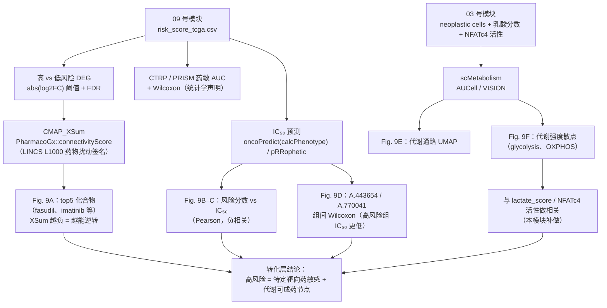

# 11 药物敏感性预测、CMAP 重定位与单细胞代谢分析

> **目标文献**：Wang R, Wu W, et al. *Integrative single-cell and spatial transcriptomic analysis reveals a
> lactate-driven crosstalk between NFATc4⁺ tumor cells and SPP1⁺ macrophages in glioblastoma.*
> *J Transl Med* (2026) 24:1253. DOI: 10.1186/s12967-026-08555-7
>
> **模块对应原文**：Fig. 9A–F；Methods 中「Transcriptome analysis」段后三句（PharmacoGx / ISOpureR+impute+pRRophetic+SimDesign / scMetabolism）
> 与「Statistical analysis」段末两句；Results 中「Drug sensitivity and metabolic pathway activities associated with risk stratification」整段
> **前置依赖**：`09_机器学习101组合预后模型.md`（→ `results/ml/risk_score_all_cohorts.csv`、`results/ml/stepcox_forward_coefficients.csv`）；
> `03_乳酸代谢评分与高低乳酸亚群划分.md` 与 `04_pySCENIC转录因子调控网络与NFATc4发现.md`（→ `processed/neoplastic_harmony.rds` 中的 `lactate_score`、`lactate_group`、`NFATc4` regulon AUC）；
> 可选 `10_免疫浸润、突变与CNV基因组分析.md`（免疫浸润结果，用于解释药敏方向）
> **复现难度**：★★★★☆　**预计工时**：5 人日　**计算资源**：16 核 / 64 GB 内存（`scMetabolism` AUCell 在约 6k 细胞 × 85 条 KEGG 通路上单核 20–40 min，建议 `ncores = 8`）
> **产出**：Fig9A CMAP_XSum top5 化合物、Fig9B–C 药敏-风险相关散点/热图、Fig9D A.443654 与 A.770041 组间 IC₅₀ 箱线、Fig9E–F 单细胞代谢 UMAP 与代谢强度散点

---

## ① 科学问题与逻辑位置

`09_机器学习101组合预后模型.md` 给出了风险分层，`10_免疫浸润、突变与CNV基因组分析.md` 证明高风险组在免疫与基因组层面确有差异。本模块要把它推进到
**"那高风险患者应该用什么药"**：

1. **反向**问：**有没有已上市/已知机制的小分子能够"逆转"高风险组的表达特征？**（CMAP / LINCS L1000
   connectivity，输出 Fig. 9A）
2. **正向**问：**高风险组对已有靶向药的预测敏感性是更高还是更低？**（IC₅₀ 预测，输出 Fig. 9B–D）
3. **机制**问：**单细胞层面，哪些肿瘤亚群的糖酵解/OXPHOS 活性更高，是否与乳酸分数/NFATc4 活性同向？**
   （scMetabolism，输出 Fig. 9E–F）



> **图注**：图中「09 号模块」= `09_机器学习101组合预后模型.md`；「03 号模块」= `03_乳酸代谢评分与高低乳酸亚群划分.md`
> 与 `04_pySCENIC转录因子调控网络与NFATc4发现.md`（乳酸分数与 NFATc4 regulon 活性）。

**原文结论（原句）**：

- "CMAP_XSum analysis identified several small molecules (e.g., **fasudil, imatinib**) as potentially effective in **high-risk patients**"（Fig. 9A，top5）；
- "Drug-target correlation analysis revealed a **negative association** between the **risk score** and the **estimated IC₅₀** for multiple targeted agents"（Fig. 9B–C）；
- "OncoPredict analysis further indicated **significantly lower predicted IC₅₀ values for A.443,654 and A.770,041** in the high-risk group"（Fig. 9D）；
- "Single-cell metabolic scoring highlighted **elevated glycolysis and oxidative phosphorylation** activities in **specific neoplastic subpopulations**"（Fig. 9E–F）。

> ⚠️ **导师批注（本模块最重要的一句话）**：以上四条结论**全部是 in silico 预测，没有任何细胞或动物层面的
> 验证**——而同一篇文章在 Fig. 5/6 做了完整的体外功能实验。这意味着"药物重定位"部分与文章其余部分
> **证据强度不对等**。复现时请把这一段定位为"**假设生成（hypothesis generation）**"，
> 在 `13_复现质控清单、排错与批判性评述.md` 的批判性评述中明确写出：**药敏结论不可直接进入结论段**，需要至少一条湿实验证据
> （例如 GL261 上 fasudil / Akt 抑制剂的 IC₅₀ 与 NFATc4 敲低背景的交互实验）。

---

## ② 背景知识与原理

### 2.1 CMAP / LINCS L1000 与 connectivity score

**Connectivity Map（CMAP）** 的核心思想（Lamb 等 *Science* 2006；LINCS L1000 升级版）：

> 如果药物 A 与药物 B 产生**相反的**转录组扰动，那么 A 可能逆转 B（或某个疾病/表型）的状态。

**数据形态**：L1000 平台只直接测 **978 个 landmark 基因**，其余约 1.1 万个基因由 landmark 通过
回归模型**推断**（inferred genes，合计约 **12,000+** 转录本）。每个"扰动实例（instance）"=
（化合物 × 剂量 × 时间 × 细胞系），被压缩成一个 **z-score 向量** $\mathbf{d}\in\mathbb{R}^{G}$
（相对 DMSO 对照），并挑出最强的 **up 50 / down 50** 基因构成"signature"。
LINCS 总实例数千万级；**注意：signature 是否显著取决于实例质量（`P100` 模式下无 replicate）。**

**查询签名（query signature）** ：从差异分析得到上调基因集 $U$ 与下调基因集 $D$
（通常各取 top 150–250 个）。**两侧基因数必须对称**——这是 XSum 类打分公式的前提。

**Connectivity score 的家族**（记查询签名在基因 $g$ 上的分数为 $q_g$，药物签名为 $d_g$）：

| 方法名（`PharmacoGx::connectivityScore` 的 `method`） | 数学形式（以包内实现为准） | 直觉 | 用途 |
|---|---|---|---|
| `sum` | $\mathrm{CS}=\sum_{g\in U} q_g - \sum_{g \in D} q_g$ | 上/下调基因的原始分数相加 | 对 signature 长度极敏感，不推荐单独使用 |
| `weighted` | 同 `sum`，但各除以 $\sqrt{\lvert U\rvert}$、$\sqrt{\lvert D\rvert}$ | 抑制长签名主导 | 长度不一时更稳健 |
| **`xsum`** | $\mathrm{CS}_{XSum}=\dfrac{1}{\sqrt{N_U}}\sum_{g\in U} q_g \;-\; \dfrac{1}{\sqrt{N_D}}\sum_{g\in D} q_g$（**XSum 的核心：分别对两侧做长度归一后求和**） | 在 `weighted` 之上再对**药物侧**的 up/down 分别归一 | 原文所用；对两侧不对称的签名鲁棒 |
| `cosine` | $\mathrm{CS}=\dfrac{\sum_g q_g d_g}{\lVert q\rVert\,\lVert d\rVert}$ | 两向量夹角余弦 | 保留方向、幅度无关，最易解释 |
| **`xcos`** | 分别在 $U$、$D$ 上算归一化余弦再合并 | 分段余弦，抗"单侧主导" | 与 `xsum` 常一起报告 |
| **`xcossum`** | `xcos` 的求和版本 | —— | 冗余报告 |
| `average` | up 与 down 两侧 KS 类富集分数的平均 | 经典 CMAP 的打分简化 | 稳健但丢信息 |
| `gsea` / `fgsea` | KS 类富集分数（`fgsea` 用快速置换实现，需 `x` 为 `list(up=..., down=...)`） | 与 GSEA 同族，可用 leading edge 追溯 | 需要 p 值时首选 |

**符号约定（极易搞错）**：connectivity score 为**负**表示药物扰动的方向与查询签名**相反**，
即药物**逆转**该表型。因此"高风险组可用药"的候选是 **XSum 最负**（或 GSEA 的 NES 最负）的那些化合物。
原文描述"identified several small molecules as potentially effective in high-risk patients"就是这个方向。

**两条实现路线**：

- **路线 A（原文用法，推荐先跑通）**：`PharmacoGx` 下载 PSet（药敏 + 扰动数据），
  用 `drugPerturbationSig()` 得到"药物 × 基因"的扰动效应矩阵（自己算，而非直接用 CLUE 网站的签名），
  再用 `connectivityScore()` 对每个药物签名算 XSum。优点是**完全本地可复现、不依赖网站接口**。
- **路线 B（CLUE.io / L1000 原始 GCTX）**：用 `cmapR::parse_gctx()` 读 CLUE 下载的
  `level5_beta_trt_cp_n*.gctx`（z-score 矩阵），自行挑 top/bottom 基因构签名，再对齐查询基因空间。
  优点是与网站结果一致；缺点是文件巨大（数十 GB）、实例元数据要自己筛（`pert_iname`、`cell_id`、`pert_time`、`pert_dose`）。

### 2.2 IC₅₀ 预测：pRRophetic 与 oncoPredict

**问题**：TCGA-GBM 是**患者肿瘤**，没有药敏表型；GDSC/CTRP 有药敏但只有**细胞系**。
所以"预测患者对某药的 IC₅₀"是一个**从细胞系到患者肿瘤的迁移学习**问题。

**pRRophetic（Geeleher 2014）** 的做法：用细胞系训练集（默认 CGP / CCLE）对**每个药**各训练一个
**岭回归**（ridge regression）：

$$\hat{y}_{\text{IC}_{50}} = \mathbf{x}^{\top}\beta,\qquad
\hat{\beta} = \arg\min_{\beta}\;\|\mathbf{y} - \mathbf{X}\beta\|_2^2 + \lambda\|\beta\|_2^2
= \left(\mathbf{X}^{\top}\mathbf{X} + \lambda \mathbf{I}\right)^{-1}\mathbf{X}^{\top}\mathbf{y}$$

其中 $\mathbf{X}$ 是细胞系表达矩阵（**只保留 1000 个高变基因**，由 `selection = 1` 控制），
$\lambda$ 由 CV 选。预测时把同一个 $\beta$ 用到患者肿瘤表达上。

**关键副产品**：药物特征基因（sig. genes，与 IC₅₀ 最相关的基因）会被打印出来。
**这些基因几乎总是落在细胞周期/增殖基因上**——这是 pRRophetic 最著名的偏倚，
也直接导致"预测 IC₅₀ 与风险分数负相关"可能只是"高风险组增殖分数高"的代理。

**oncoPredict（Maeser 2021）** 是 pRRophetic 的重写升级版：

| 维度 | pRRophetic | oncoPredict |
|---|---|---|
| 训练集 | 内置 CGP（2016）/ CCLE（`hgu133a` 微阵列芯片） | 用户提供 `trainingExprData` + `trainingPtype`，官方提供 **GDSC1 / GDSC2 / CTRP / PRISM** 现成 RData |
| 输入基因空间 | 强制微阵列探针（需 `platform` 匹配）→ 与 RNA-seq 不兼容 | 基因 symbol，RNA-seq 友好 |
| 批次校正 | `batchCorrect = "eb"`（Empirical Bayes，ComBat 风格） | 同 + 参数 `batchCorrect` 可取 `"eb"` / `"none"` |
| 主函数 | `pRRopheticPredict()` / `pRRopheticCV()` | **`calcPhenotype()`**，一次返回**全部药物 × 全部样本**的预测矩阵 |
| 表型变换 | `powerTransformPhenotype` | 同（对偏态 IC₅₀ 做 Box-Cox 幂变换） |
| 输出 | 单药向量 | 药物 × 样本矩阵（论文 Fig. 9C 的药敏热图就来自这里） |

**oncoPredict 的核心**依旧是岭回归 + EB 批次校正，改进在于数据接口与多数据集支持。
`removeLowVaryingGenes = 0.2` 表示剔除最低变异的 20% 基因（避免近常数的基因进入回归造成不稳定）。

### 2.3 其他四个包的定位（原文一句话带过，容易误解）

| 包 | 真实作用 | 在原流程中的位置 | 复现必要性 |
|---|---|---|---|
| **ISOpureR** | **肿瘤纯度校正**：把 bulk 表达 $y$ 建模为"纯肿瘤表达 $\times$ 肿瘤分数 + 正常细胞表达 $\times$ (1−分数)"，用 EM/极大似然求出纯肿瘤谱 | 若在 IC₅₀ 预测**之前**做，可减少正常脑组织污染对药敏预测的干扰 | 中（耗时，需正常参考谱；可作敏感性分析） |
| **impute** | KNN 缺失值填补（`impute.knn()`） | 表达矩阵有 NA 时的兜底 | 高（一行代码） |
| **pRRophetic** | 药敏预测（见 2.2） | 与 oncoPredict 并列 | 高（作交叉验证） |
| **SimDesign** | 模拟/功效分析（`SimDesign::SimDesign()`），用于"在给定效应量下需要多少样本才能检出" | **不产生任何结果数据**，是稳健性论证工具 | 低（原文未说明具体用法） |
| **PharmacoGx** | 药敏 PSets（GDSC2、CTRPv2、PRISM、CCLE）与扰动签名、`connectivityScore()` | CMAP_XSum + CTRP/PRISM 的 AUC 比较 | 高（本模块骨架） |

> ⚠️ **导师批注**：原文把 `ISOpureR / impute / pRRophetic / SimDesign` 四个包写在一句里称为
> "perform drug target analysis and GDSC analysis"，但**没有给出任何参数、没有说明顺序、没有说明
> ISOpureR 是否真的跑过**（ISOpureR 的 CPE 模型在 150 个样本上要跑数小时）。复现时按"最小可复现集"
> 处理：**oncoPredict + pRRophetic 为主线**，ISOpureR 与 SimDesign 作为可选敏感性分析并显式标注
> "原文未说明用法"。

### 2.4 药敏数据的三个体系与三种指标（务必分清）

| 数据集 | 来源/细胞系数 | 药敏指标 | 常见命名 | 复现注意 |
|---|---|---|---|---|
| **GDSC2** | Sanger，约 950 细胞系 × ~290 化合物 | **IC₅₀**（µM，经曲线拟合） | `GDSC2_Res.rds`（oncoPredict 提供） | 与 GDSC1 药物重叠但数值不可混用；同一药在两版里 IC₅₀ 可达数倍差异 |
| **CTRP v2** | Broad，约 860 细胞系 × ~545 化合物 | **AAC**（area above the dose-response curve，越大越敏感）与 EC₅₀ | `CTRPv2` PSet | 原文统计段点名的就是 CTRP |
| **PRISM** | Broad，约 580 细胞系 × 数千化合物（repurposing 库） | **LFC / AUC**（细胞活力） | `PRISM` PSet（`availablePSets()` 核对） | 原文统计段点名的第二个数据集 |
| **CCLE** | 细胞系基线表达 | 无药敏（只有表达/突变） | `CCLE` PSet | 把风险模型映射到细胞系的**表达来源** |

> ⚠️ **术语冲突**：原文统计段写 "compare the **area under the curve (AUC) values** between high- and
> low-risk score groups in drug sensitivity analyses (CTRP and PRISM datasets)"。这里 AUC 指的是
> **剂量-反应曲线的 AUC（药敏指标）**，绝不是模型的 ROC AUC。复现时在结果表中必须写成
> `sensitivity.measure = "aac_recomputed"`（或 `"auc_recomputed"`）并标注单位，避免与 `08_bulk队列整合与NFATc4生存分析.md` / `09_机器学习101组合预后模型.md` 的
> ROC AUC 混淆。

### 2.5 scMetabolism：单细胞代谢通路活性

**AUCell 方法**（`method = "AUCell"`）：对每个细胞，把基因按表达降序排列，取前 `aucMaxRank`
（默认**全部基因的 5%**）个基因，定义 recovery curve

$$rec(r) \;=\; \frac{\bigl|\{g \in S:\; r_{g} \le r \}\bigr|}{|S|},\qquad r = 1,\dots,N,\quad N=\texttt{aucMaxRank}$$

（$r_g$ 为基因 $g$ 在该细胞中的表达秩，$r$ 越小表达越高），再对**秩轴**积分得到曲线下面积：

$$AUC_c \;=\; \frac{1}{N}\sum_{r=1}^{N} rec(r)$$

注意求和是对 **rank 轴 $r=1\dots N$**（rank 上界为 `aucMaxRank`），**不是**对基因集大小 $|S|$ 求和。
最后把 AUC 线性归一化到 $[0,1]$（减去理论最小 AUC、除以理论最大与最小之差）。**AUCell 的优点**：阈值可解释、对 dropout 稳健、
不需要跨细胞归一化；**缺点**：只反映"基因集在表达谱顶部的富集"，不反映绝对表达量。

**VISION / GSVA 方法**（`method = "VISION"`，老版本等价于 GSVA 路线）：
VISION（Frye 2019）先对表达矩阵做潜变量/PCA 降维，再在潜空间中计算 signature 的富集分数，
对**相关基因集之间的冗余**更稳健，但结果对降维维度敏感。

**`imputation = TRUE` 的含义**：调用 Seurat 的 `ALRA`（Adaptive Leveled Random Approximation）
对稀疏的 drop-out 值做低秩填补后再打分。**代价**：会抹平稀有细胞亚群之间的真实差异，
并让代谢分数"变平滑"——**因此主分析建议 `imputation = FALSE`，把 `TRUE` 作为敏感性分析**。

**geneSet / 物种**：`scMetabolism` 内置 **人类 KEGG（约 85 条）与 REACTOME** 通路基因集。
**小鼠数据必须做同源基因映射**（`biomaRt` 或 `babelgene` 把 `Nfatc4` → `NFATC4`），
否则基因集匹配率极低、分数全为噪声。

### 2.6 四个化合物的靶点与 GBM 背景（只讲机制，不编造试验结果）

| 化合物 | 靶点 | 机制 | 在 GBM 中的研究背景（文献事实，本文未验证） |
|---|---|---|---|
| **fasudil（法舒地尔，HA-1077）** | **ROCK1/2**（Rho 激酶） | 抑制 RhoA/ROCK 下游的肌动蛋白重构与收缩 | ROCK 通路参与 GBM 的侵袭、迁移与血管生成；fasudil 已是临床用药（用于脑血管痉挛），血脑屏障穿透相对有利——这是它出现在 CMAP top5 里**最合理**的一点 |
| **imatinib（伊马替尼）** | **BCR-ABL、c-KIT、PDGFRα/β** | ATP 竞争性酪氨酸激酶抑制剂 | GBM 中 PDGFRα 扩增/过表达是明确的分型特征（proneural）；但 imatinib 是 P-gp 底物，**中枢穿透有限**，这是其作为 GBM 药物最主要的药理学障碍 |
| **A.443654**（R 数据框会把 `A-443654` 转成 `A.443654`） | **Akt（AKT1/2/3）**，ATP 竞争性泛 Akt 抑制剂（Abbott 探针化合物） | 阻断 PI3K→Akt 信号 | GBM 的 **PTEN 缺失 / EGFR 扩增**使 PI3K-AKT 通路高频激活 → 靶点在生物学上高度合理；但该化合物本身未见进入 GBM 临床 |
| **A.770041** | **Src 家族激酶（以 LCK 选择性最高）**（Abbott 探针化合物） | ATP 竞争性抑制 SFK | GBM 中 SRC/FYN/LYN 参与 EGFR 下游信号与侵袭；靶点合理，但该化合物的**选择性以 LCK 为主**，把它简单标为"Src 抑制剂"时需注明选择性谱 |

> ⚠️ **导师批注**：原文把 A.443654 / A.770041 直接说成 "**Akt inhibitor**" 与 "**Src inhibitor**"
> 是可以接受的简称，但这两个 ID 来自高通量筛选库的**探针化合物（probe compound）**，不是药物。
> 写作时必须写清"probe compound，无临床数据"，绝不能暗示成药性。另外 `A.443654` 的**小数点**是
> R 把连字符转义的结果（`check.names = TRUE` 的默认行为），**在原始数据/文献中应写作 `A-443654`**——
> 这个细节直接决定你能不能从 GDSC/CTRP 注释表里查到它。

---

## ③ 原文方法与结果逐条拆解

### 3.1 Methods「Transcriptome analysis」段（后三句）

| 原文（英文关键词） | 中文转述 | 对应操作与参数 | 复现注意 |
|---|---|---|---|
| "Then, the R package **'PharmacoGx'** was used for **CMAP analysis** [25]." | 用 PharmacoGx 做 CMAP | `downloadPSet()` → `drugPerturbationSig()` → `connectivityScore(method = "xsum")` | 原文只在结果里写了 **CMAP_XSum**（Fig. 9A 图注），说明 `method = "xsum"`；**未说明 signature 长度、细胞系、剂量/时间点** |
| "After that, the R packages **'ISOpureR', 'impute', 'pRRophetic', and 'SimDesign'** were used to perform **drug target analysis and GDSC analysis** [26, 27]." | 药靶与 GDSC 药敏分析 | 纯度校正（ISOpureR）→ 缺失填补（impute）→ 岭回归预测（pRRophetic）→ 功效模拟（SimDesign） | **顺序、参数、是否真跑过均未说明**；`SimDesign` 不产出数据 |
| "The R package **'scMetabolism'** was used to calculate the **metabolic activity in single-cell samples**." | 单细胞代谢活性 | `sc.metabolism.Seurat(obj, method = "AUCell", imputation = ?, ncores = ?)` | 原文未写 `method` 与 `imputation` → 见 ⑤ 的复现决策 |

### 3.2 Methods「Statistical analysis」段（末两句）

| 原文 | 中文转述 | 复现注意 |
|---|---|---|
| "the **Wilcoxon rank-sum test** was used to compare the **AUC values between high- and low-risk score groups in drug sensitivity analyses (CTRP and PRISM datasets)**" | 高低风险组间比较药敏 AUC 用 Wilcoxon | 需要在**细胞系**上定义高/低风险（把风险模型套到 CCLE/CTRP/PRISM 细胞系表达上）——原文没说怎么分组，见 ⑤ |
| "Correlation analyses between **drug response and risk score** were performed using **Pearson correlation coefficients**." | 药敏-风险分数用 Pearson | 逐药算 $r$ 与 $p$，并做多重检验校正；原文未报告 $r$ 与 $p$ 的具体值（**原文未报告**，复现须自测并记录） |

### 3.3 Results「Drug sensitivity and metabolic pathway activities associated with risk stratification」逐句

| 原文句子（节选） | 中文转述 | 落地产物 |
|---|---|---|
| "**CMAP_XSum** analysis identified several small molecules (e.g., **fasudil, imatinib**) as potentially effective in **high-risk patients**" (Fig. 9A) | XSum 打分选出对高风险患者可能有效的 top5 小分子 | `results/Fig9A_cmap_xsum_top5.csv` |
| "Drug-target correlation analysis revealed a **negative association** between the **risk score** and the **estimated IC₅₀** for multiple targeted agents" (Fig. 9B–C) | 风险分数越高，预测 IC₅₀ 越低（更敏感） | `results/Fig9BC_risk_ic50_pearson.csv`、`figures/Fig9B_risk_ic50_scatter.pdf`、`figures/Fig9C_drug_heatmap.pdf` |
| "**OncoPredict** analysis further indicated **significantly lower predicted IC₅₀ values for A.443,654 and A.770,041 in the high-risk group**" (Fig. 9D) | 高风险组对 A-443654（Akt）与 A-770041（SFK）预测 IC₅₀ 显著更低 | `results/Fig9D_IC50_wilcox.csv`、`figures/Fig9D_IC50_boxplot.pdf` |
| "Single-cell metabolic scoring highlighted elevated **glycolysis** and **oxidative phosphorylation** activities in **specific neoplastic subpopulations**" (Fig. 9E–F) | 特定肿瘤亚群糖酵解与 OXPHOS 活性升高 | `results/Fig9EF_metabolism_scores.csv`、`figures/Fig9E_metabolism_umap.pdf` |

### 3.4 Fig. 9 图注全文（逐句）

> "**Fig. 9** Therapeutic vulnerability and metabolic pathway activity in risk subgroups.
> **(A)** **Top five candidate small-molecule compounds** from **CMAP_XSum** analysis with predicted efficacy in high-risk patients.
> **(B)** **Correlation between drug sensitivity (IC₅₀) and risk score** for selected targeted agents.
> **(C)** **Heatmap of drug response scores** across risk groups.
> **(D)** **Box plots comparing estimated IC₅₀ values** of representative compounds between risk groups.
> **(E)** **UMAP visualization of metabolic pathway activity** in single cells.
> **(F)** **Scatter plot illustrating metabolic signaling intensity** in high-risk associated pathways.
> \* p < 0.05, \*\* p < 0.01"

信息提取：（A）是 top5 表格/条形图；（B）是散点+回归线（多药分面）；（C）是药物 × 样本的热图，
说明确实用了 `oncoPredict` 的**全药矩阵**输出；（D）是组间箱线（Wilcoxon）；（E）是 UMAP 连续着色
（AUCell 分数投到 UMAP 上）；（F）是代谢通路 × 细胞的散点——**但没有说明是哪些通路的什么对比**
（原文仅在 Results 里点名 glycolysis 与 oxidative phosphorylation，故按此两条复现）。
注意显著性标注只有 `*` 与 `**`（p<0.05 / p<0.01），**没有 `***`**。

> ⚠️ **导师批注（Results 与 Methods 的缺口）**：Methods 花整句描述 **CTRP 与 PRISM** 的 AUC 组间比较
> （Wilcoxon），但 Results 段与 Fig. 9 的任何面板里都**没有出现 CTRP/PRISM 的结果**——只有 GDSC 体系的
> oncoPredict 结果。这是**方法声明了却未报告结果**的典型情况，复现时应把 CTRP/PRISM 分析完整跑出并
> 作为补充图，同时在 `13_复现质控清单、排错与批判性评述.md` 中记录该缺口。

---

## ④ 逐步可运行代码

### 4.0 环境与数据准备

```r
# code/11_00_setup.R
set.seed(20260101)
pkgs <- c("PharmacoGx", "oncoPredict", "pRRophetic", "scMetabolism", "Seurat",
          "data.table", "ggplot2", "ggpubr", "ComplexHeatmap", "circlize", "limma")
for (p in pkgs) if (!requireNamespace(p, quietly = TRUE))
  install.packages(p)   # PharmacoGx / scMetabolism / oncoPredict 建议从 Bioconductor 或 GitHub 安装
suppressPackageStartupMessages(lapply(pkgs, library, character.only = TRUE))
dir.create("logs", showWarnings = FALSE); dir.create("results", showWarnings = FALSE)
writeLines(capture.output(sessionInfo()), "logs/sessionInfo_11.txt")
```

**oncoPredict 官方训练集**（GDSC2 / GDSC1 / CTRP / PRISM 的 `Expr` + `Res` RData）从作者发布的
OSF 仓库（Maeser 2021 论文所附）下载，落到 `raw/`，并记录下载日期与 MD5：

```bash
# code/11_01_get_training.sh
# 示例文件名（以官方发布页为准，切勿硬编码到脚本里而不做存在性检查）
#   GDSC2_Expr (RData).rds / GDSC2_Res.rds
#   CTRP_Expr.rds / CTRP_Res.rds
#   PRISM_Expr.rds / PRISM_Res.rds
sha256sum raw/*.rds > raw/oncoPredict_training.md5
```

```r
# code/11_02_prepare.R
library(data.table)
risk <- fread("results/risk_score_tcga.csv")             # `09_机器学习101组合预后模型.md` 产出
dat  <- readRDS("processed/tcga_gbm_risk_expr.rds")       # `10_免疫浸润、突变与CNV基因组分析.md` 产出：expr(log2 TPM+1) + risk
expr <- dat$expr; stopifnot(identical(colnames(expr), risk$SampleID))
risk[, risk := factor(risk, levels = c("low", "high"))]
```

### 4.1 构造查询 signature（高 vs 低风险 DEG）

```r
# code/11_03_signature.R
library(limma); library(data.table)
design <- model.matrix(~ risk, data = risk)               # 截距 + high vs low
fit <- eBayes(lmFit(expr, design), trend = TRUE, robust = TRUE)
deg <- as.data.table(topTable(fit, coef = 2, number = Inf, adjust.method = "BH"),
                     keep.rownames = "gene")
fwrite(deg, "results/Fig9_high_vs_low_DEG.csv")

## ---- 主签名：对称取 top N（N = 200，两侧等长）----
make_query <- function(d, n = 200) {
  up   <- d[logFC > 0][order(P.Value)][1:n, gene]
  down <- d[logFC < 0][order(P.Value)][1:n, gene]
  list(up = up, down = down)
}
q200 <- make_query(deg, 200)
saveRDS(q200, "processed/Fig9_query_signature_200.rds")
```

> **对称性硬要求**：若 `up` 与 `down` 长度不等，`xsum` 的长度归一化会失去意义，
> 且 `average`/`weighted`/`xcossum` 的打分会失衡。代码里必须 `stopifnot(length(up) == length(down))`。

### 4.2 CMAP_XSum（Fig. 9A）

```r
# code/11_04_cmap_xsum.R
library(PharmacoGx); library(data.table)

## (1) 载入药敏 PSet（GDSC2 用作扰动签名来源；若本地已有 .rds 直接 readRDS）
pSet <- downloadPSet("GDSC2", saveDir = "raw/PSets")      # 首次需联网，约 1–2 GB
## 若网络受限：从 PharmacoGx 官方数据仓库手动下载 PSet 后 load()

## (2) 药物扰动签名：drug × gene 的效应量矩阵
##     ⚠️ drugPerturbationSig() 的参数名与返回形态在不同 PharmacoGx 版本间有差异
##        （`features` / `datasets` / `returnSignatures` 尤其如此），
##        执行前务必 ?PharmacoGx::drugPerturbationSig 核对；返回若不是 data.frame 需先按药物名取行。
drug_sig <- drugPerturbationSig(pSet,
                                mDataTypes = "rna",        # 转录组扰动
                                drug = "all",
                                cell_lines = "all",
                                features = "genes",
                                duration = "24h",
                                dose = "all",
                                returnSignatures = TRUE,
                                verbose = TRUE)
saveRDS(drug_sig, "processed/Fig9A_drugPerturbationSig.rds")

## (3) 逐药算 XSum 连接分数
##     注意：x 与 y 的参数形态依 method 而异，执行前务必 ?PharmacoGx::connectivityScore
q <- readRDS("processed/Fig9_query_signature_200.rds")     # list(up=..., down=...)
stopifnot(length(q$up) == length(q$down))

res <- rbindlist(lapply(seq_len(nrow(drug_sig)), function(i) {
  dsig <- setNames(as.numeric(drug_sig[i, -1]), colnames(drug_sig)[-1])  # gene -> score
  cs <- connectivityScore(x = q, y = dsig, method = "xsum", nperm = 1000)
  data.table(drug = drug_sig[i, 1], xsum = as.numeric(cs[1]), pvalue = as.numeric(cs[2]))
}))
setnames(res, 1, "drug")
res[, padj := p.adjust(pvalue, "BH")]
setorder(res, xsum)                       # 越负 = 越能逆转高风险表型
fwrite(res, "results/Fig9A_cmap_xsum_all.csv")

top5 <- res[1:5]
fwrite(top5, "results/Fig9A_cmap_xsum_top5.csv")
print(top5)
## 核对点：top5 中应出现 fasudil 与 imatinib（原文报告）
```

**若 `connectivityScore` 的输入形态不匹配当前版本**，Plan B：把 `fgsea` 路线显式写出——
将查询签名转成排序向量（up 基因给正分、down 给负分），用 `fgsea::fgseaSimple()`
对每个药物签名的排序表计算 NES，取 NES 最负者。两条路线应当给出方向一致的 top 化合物。

### 4.3 signature 稳健性检验（**导师要求，原文未做**）

```r
# code/11_05_cmap_robustness.R
library(data.table); library(PharmacoGx)
qlist <- lapply(c(50, 100, 200, 500), function(n) make_query(deg, n))
drug_sig <- readRDS("processed/Fig9A_drugPerturbationSig.rds")

run_xsum <- function(q) {
  rbindlist(lapply(seq_len(nrow(drug_sig)), function(i) {
    dsig <- setNames(as.numeric(drug_sig[i, -1]), colnames(drug_sig)[-1])
    cs <- connectivityScore(x = q, y = dsig, method = "xsum", nperm = 1000)
    data.table(drug = drug_sig[i, 1], xsum = as.numeric(cs[1]))
  }))
}
rob <- rbindlist(lapply(names(qlist), function(nm) {
  r <- run_xsum(qlist[[nm]]); r[, sig_len := as.integer(nm)]; r
}))

## (a) 长度一致性：fasudil / imatinib 在 4 个长度档中的排名
print(rob[drug %in% c("Fasudil", "Imatinib"), .(sig_len, xsum, rank = frank(xsum)), by = sig_len])

## (b) 置换对照：随机取等长基因集得到 XSum 的零分布 → 经验 p 值
set.seed(20260101)
random_query <- function(n = 200)
  list(up = sample(rownames(expr), n), down = sample(rownames(expr), n))
dsig_fixed <- setNames(as.numeric(drug_sig[1, -1]), colnames(drug_sig)[-1])  # 固定一个药物签名为参照
null <- vapply(seq_len(200), function(i) {                 # 200 次随机查询
  as.numeric(connectivityScore(x = random_query(200), y = dsig_fixed,
                               method = "xsum", nperm = 1000)[1])
}, numeric(1))
## 单侧经验 p：XSum 越负越显著（越能逆转），故用左尾
p_emp <- function(v) (sum(null <= v) + 1) / (length(null) + 1)
rob[, p_emp := p_emp(xsum), by = sig_len]
fwrite(rob, "results/Fig9A_cmap_robustness.csv")
## 耗时提示：若 200 × 1000 次置换过慢，把随机次数降到 50 或 nperm 降到 100，
## 并在日志中记录实际使用的次数（经验 p 的分辨率即为 1/(随机次数+1)）。
```

**判据**：fasudil 与 imatinib 在 **4 个 length 档中至少 3 档进入 top20**，且置换经验 p < 0.01，
才认为"top 化合物"不是签名长度/基因挑选的产物。

### 4.4 IC₅₀ 预测（oncoPredict，Fig. 9B–D）

```r
# code/11_06_oncopredict.R
library(oncoPredict); library(data.table)

GDSC2_Expr <- readRDS("raw/GDSC2_Expr.rds")     # 基因 × 细胞系（log2 尺度，包作者预处理过）
GDSC2_Res  <- readRDS("raw/GDSC2_Res.rds")      # 细胞系 × 药物（IC₅₀ 或 AUC，见文件说明）

test <- as.matrix(expr)                          # 患者样本；行=gene symbol，列=样本
## 关键：训练集与测试集的基因取交集，并强制同一顺序
common_genes <- intersect(rownames(GDSC2_Expr), rownames(test))
GDSC2_Expr <- GDSC2_Expr[common_genes, , drop = FALSE]
test       <- test[common_genes, , drop = FALSE]
message("shared genes: ", length(common_genes))

pred_ic50 <- calcPhenotype(trainingExprData   = GDSC2_Expr,
                           trainingPtype      = GDSC2_Res,
                           testExprData       = test,
                           batchCorrect       = "eb",        # Empirical Bayes 批次校正
                           powerTransformPhenotype = TRUE,   # Box-Cox 幂变换纠正偏态
                           removeLowVaryingGenes   = 0.2,    # 剔除最低变异 20% 基因
                           minNumSamples      = 10,
                           selection          = 1,
                           printOutput        = TRUE)
saveRDS(pred_ic50, "processed/Fig9_IC50_pred_matrix.rds")
fwrite(as.data.table(pred_ic50, keep.rownames = "drug"), "results/Fig9_IC50_pred_matrix.csv")
## 输出：药物 × 样本 的预测 IC₅₀ 矩阵 —— Fig. 9C 热图与 Fig. 9B 散点都从这里取数
```

**对照组：pRRophetic（交叉验证用）**

```r
# code/11_07_prrophetic.R
library(pRRophetic); library(data.table)
prr <- rbindlist(lapply(c("Fasudil", "Imatinib", "A-443654", "A-770041"), function(d) {
  ## pRRophetic 内置 CGP 训练集基于 hgu133a 探针 → RNA-seq 输入需基因 symbol 同源匹配，
  ## 预测值仅作"方向一致性"交叉验证，不作为主结果
  v <- tryCatch(pRRopheticPredict(testMatrix = test, drug = d,
                                  tissueType = "all", selection = 1,
                                  dataset = "cgp2016", batchCorrect = "eb",
                                  powerTransformPhenotype = TRUE,
                                  removeLowVaryingGenes = 0.2,
                                  minNumSamples = 10, printOutput = FALSE),
                error = function(e) NULL)
  if (is.null(v)) return(NULL)
  data.table(drug = d, sample = names(v), ic50 = as.numeric(v))
}))
fwrite(prr, "results/Fig9D_IC50_prrophetic.csv")
```

### 4.5 风险分数 vs IC₅₀（Pearson，Fig. 9B–C）

```r
# code/11_08_correlation.R
library(data.table); library(ggplot2); library(ggpubr)
ic <- fread("results/Fig9_IC50_pred_matrix.csv")          # drug × 样本
risk <- fread("results/risk_score_tcga.csv")
samples <- intersect(colnames(ic)[-1], risk$SampleID)
ic <- ic[, c("drug", samples), with = FALSE]
risk <- risk[match(samples, SampleID)]

cor_tab <- rbindlist(lapply(seq_len(nrow(ic)), function(i) {
  y <- as.numeric(ic[i, -1]); x <- risk$riskScore
  ct <- cor.test(x, y, method = "pearson")                # 原文口径
  data.table(drug = ic$drug[i], r = unname(ct$estimate),
             p = ct$p.value, n = length(x),
             spearman_rho = suppressWarnings(cor(x, y, method = "spearman")))
}))
cor_tab[, padj := p.adjust(p, "BH")]
setorder(cor_tab, r)                                       # r 最负者 = 高风险更敏感
fwrite(cor_tab, "results/Fig9BC_risk_ic50_pearson.csv")
print(cor_tab[1:15])

## ---- 散点图（Fig. 9B 样式：多药分面）----
plot_drugs <- cor_tab[order(r)][1:6, drug]
pd <- melt(ic[drug %in% plot_drugs], id.vars = "drug",
           variable.name = "sample", value.name = "ic50")
pd <- merge(pd, risk[, .(sample = SampleID, riskScore, risk)], by = "sample")

p <- ggplot(pd, aes(riskScore, log10(ic50 + 1e-6))) +
  geom_point(size = 0.8, alpha = 0.6) +
  geom_smooth(method = "lm", formula = y ~ x, color = "#D7301F", se = TRUE) +
  stat_cor(method = "pearson", label.x.npc = "left", size = 3) +
  facet_wrap(~ drug, scales = "free_y", ncol = 3) + theme_bw(base_size = 11) +
  labs(x = "Risk score", y = "Predicted log10(IC50, µM)")
ggsave("figures/Fig9B_risk_ic50_scatter.pdf", p, width = 11, height = 6)
ggsave("figures/Fig9B_risk_ic50_scatter.png", p, width = 11, height = 6, dpi = 300)

## ---- 药敏热图（Fig. 9C 样式：药物 × 样本，行 z-score）----
library(ComplexHeatmap); library(circlize)
mat <- as.matrix(ic[, -1]); rownames(mat) <- ic$drug
z <- t(scale(t(log10(mat + 1e-6)))); z[is.na(z)] <- 0
ht <- Heatmap(z, name = "z(IC50)", show_column_names = FALSE,
              column_split = risk$risk, cluster_column_slices = FALSE,
              top_annotation = HeatmapAnnotation(risk = risk$risk,
                col = list(risk = c(low = "#2C7FB8", high = "#D7301F"))),
              row_names_gp = gpar(fontsize = 7))
pdf("figures/Fig9C_drug_heatmap.pdf", width = 10, height = 9); draw(ht); dev.off()
png("figures/Fig9C_drug_heatmap.png", width = 10, height = 9, units = "in", res = 300); draw(ht); dev.off()
```

**报告口径**：每药必须同时给出 **Pearson $r$、$p$、BH 校正后的 $p$、Spearman $\rho$ 与 $n$**。
原文只给了"negative association"与图上的显著性星号，**没有报告任何具体 $r$ 与 $p$（原文未报告）**。

### 4.6 关键药物的组间 Wilcoxon（Fig. 9D）

```r
# code/11_09_ic50_boxplot.R
library(data.table); library(ggplot2); library(ggpubr)
ic <- fread("results/Fig9_IC50_pred_matrix.csv")
risk <- fread("results/risk_score_tcga.csv")
key_drugs <- c("A.443654", "A.770041")          # 原文写法；原始注释表中为 A-443654 / A-770041
## 若药物名不匹配，先在注释表里定位（下划线/点号/大小写都会变）
# anno <- fread("raw/GDSC2_Res.rds 的列注释"); grep("443654|770041", anno, value = TRUE)

pd <- melt(ic[drug %in% key_drugs], id.vars = "drug",
           variable.name = "sample", value.name = "ic50")
pd <- merge(pd, risk[, .(sample = SampleID, risk)], by = "sample")

stat <- pd[, .(p = wilcox.test(ic50[risk == "high"], ic50[risk == "low"])$p.value,
               median_high = median(ic50[risk == "high"]),
               median_low  = median(ic50[risk == "low"])), by = drug]
stat[, direction := ifelse(median_high < median_low, "high-risk more sensitive", "high-risk more resistant")]
fwrite(stat, "results/Fig9D_IC50_wilcox.csv")
print(stat)
## 核对点：direction 应为 "high-risk more sensitive"（高风险组 IC50 更低）

p <- ggplot(pd, aes(risk, log10(ic50 + 1e-6), fill = risk)) +
  geom_boxplot(outlier.shape = NA, width = 0.6) +
  geom_jitter(width = 0.15, size = 0.6, alpha = 0.5) +
  stat_compare_means(method = "wilcox.test", label = "p.signif") +
  facet_wrap(~ drug, scales = "free_y") + theme_bw(base_size = 11) +
  scale_fill_manual(values = c(low = "#2C7FB8", high = "#D7301F")) +
  labs(x = NULL, y = "Predicted log10(IC50, µM)")
ggsave("figures/Fig9D_IC50_boxplot.pdf", p, width = 8, height = 4.5)
ggsave("figures/Fig9D_IC50_boxplot.png", p, width = 8, height = 4.5, dpi = 300)
```

### 4.7 CTRP / PRISM 的组间药敏比较（Methods 声明但 Results 未报告）

```r
# code/11_10_ctrp_prism.R
library(PharmacoGx); library(data.table)
## (1) 取 PSet 与药敏矩阵（先看 availablePSets() 确认可用的数据集名与版本）
psets <- availablePSets()
print(psets[grep("CTRP|PRISM|CCLE", psets$Dataset), ])
ctrp  <- downloadPSet("CTRPv2", saveDir = "raw/PSets")

## (2) 药敏指标：AAC（area above the dose-response curve）
aac <- summarizeSensitivityProfiles(ctrp, sensitivity.measure = "aac_recomputed",
                                    summary.stat = "median")
## (3) 细胞系表达（用于把 `09_机器学习101组合预后模型.md` 的风险模型迁移到细胞系）
cl_expr <- summarizeMolecularProfiles(ctrp, mDataType = "rna")
cl_expr <- log2(exprs(cl_expr) + 1)

## (4) 细胞系风险分数：用 `09_机器学习101组合预后模型.md` 的模型系数线性组合
coefs <- read.csv("results/ml/stepcox_forward_coefficients.csv")   # 09 号文档正式产物：列 gene / coef / HR
coefs <- setNames(coefs$coef, coefs$gene)                          # gene -> coefficient
common <- intersect(names(coefs), rownames(cl_expr))
rs_cl <- as.numeric(t(cl_expr[common, , drop = FALSE]) %*% coefs[common])
names(rs_cl) <- colnames(cl_expr)
cl_group <- ifelse(rs_cl > median(rs_cl), "high", "low")   # 细胞系内中位数切分（务必记录口径）

## (5) 逐药 Wilcoxon（原文口径）
sens <- as.data.table(t(aac), keep.rownames = "cell")
sens <- melt(sens, id.vars = "cell", variable.name = "drug", value.name = "aac")
sens[, group := cl_group[match(cell, names(cl_group))]]
res <- sens[!is.na(aac) & !is.na(group),
            .(p = wilcox.test(aac[group == "high"], aac[group == "low"])$p.value,
              med_high = median(aac[group == "high"]),
              med_low  = median(aac[group == "low"]),
              n_high = sum(group == "high"), n_low = sum(group == "low")),
            by = drug]
res[, padj := p.adjust(p, "BH")]
fwrite(res, "results/Fig9_ctrp_aac_wilcox.csv")
## PRISM 同法：prism <- downloadPSet("PRISM")（若数据集名/版本不同，按 availablePSets() 调整）
```

> ⚠️ **导师批注**：把 TCGA 训练的风险模型直接套到细胞系表达上，前提是**训练集与细胞系的表达分布可比**。
> 建议（1）细胞系内先做分位数归一化，或（2）用 TCGA 的 cutoff 而非细胞系中位数分组，
> （3）报告两种口径下 top 药物是否一致。这一步原文完全没写，属于"必须自行决断并记录"的部分。

### 4.8 scMetabolism 单细胞代谢打分（Fig. 9E–F）

```r
# code/11_11_scmetabolism.R
library(Seurat); library(scMetabolism); library(data.table)
neo <- readRDS("processed/neoplastic_harmony.rds")   # `03_乳酸代谢评分与高低乳酸亚群划分.md` 产出：neoplastic cells + lactate_score/lactate_group

## 主分析：AUCell，不填补（imputation = FALSE）
neo <- sc.metabolism.Seurat(obj = neo, method = "AUCell",
                            imputation = FALSE, ncores = 8,
                            metabolism.type = "KEGG")
met <- neo@assays$METABOLISM$scoreAUC      # 通路 × 细胞矩阵（存储位置以当前版本为准）
fwrite(as.data.table(t(met), keep.rownames = "cell"), "results/Fig9EF_metabolism_scores_AUCell.csv")
saveRDS(neo, "processed/neo_neoplastic_scmetabolism.rds")   # 供 ④.9 的相关性分析复用

## 敏感性分析：VISION（对基因集间冗余更稳健）
neo <- sc.metabolism.Seurat(obj = neo, method = "VISION",
                            imputation = FALSE, ncores = 8, metabolism.type = "KEGG")
met_vis <- neo@assays$METABOLISM$scoreVision

## ---- Fig. 9E：代谢通路活性投到 UMAP ----
## ★ 关键：sc.metabolism.Seurat() 会把结果写进新建的 "METABOLISM" assay，
##   而 FeaturePlot / DotPlot 默认读取 DefaultAssay()。必须先切换，否则会报
##   "feature not found" 或静默画成空图。
DefaultAssay(neo) <- "METABOLISM"
FeaturePlot(neo, features = c("Glycolysis / Gluconeogenesis", "Oxidative phosphorylation"),
            order = TRUE, min.cutoff = "q10", max.cutoff = "q90", ncol = 2)
ggsave("figures/Fig9E_metabolism_umap.pdf", width = 10, height = 4.5)

## ---- 亚群水平：哪些肿瘤亚群 glycolysis / OXPHOS 高 ----
Idents(neo) <- "seurat_clusters"
p <- DotPlot(neo, features = c("Glycolysis / Gluconeogenesis", "Oxidative phosphorylation",
                               "Pentose phosphate pathway", "Pyruvate metabolism"),
             group.by = "seurat_clusters", scale = TRUE) +
  RotatedAxis() + theme(axis.text.x = element_text(size = 8))
ggsave("figures/Fig9E_metabolism_dotplot.pdf", p, width = 7, height = 5)
```

> ⚠️ **小鼠数据注意**：若在 GL261 单细胞数据上复现，KEGG 人类基因集需做同源映射
> （`babelgene::orthologs(genes = rownames(neo), species = "mouse")`），否则匹配率通常 <20%，
> 代谢分数会退化为噪声。本模块主分析用**人类 GBM（GSE138794）**的 neoplastic cells 走原文口径。

### 4.9 代谢活性与乳酸分数 / NFATc4 活性的相关性（**导师要求补做**）

```r
# code/11_12_metabolism_correlation.R
library(data.table); library(ggplot2); library(ggpubr)
## 读 11_11_scmetabolism.R 落盘的 AUCell 打分表（矩阵方向为 细胞 × 通路，第 1 列为 cell 名）
met_wide <- fread("results/Fig9EF_metabolism_scores_AUCell.csv")   # 第 1 列 cell，其余为通路
met <- as.data.frame(met_wide[, -1]); rownames(met) <- met_wide$cell
neo <- readRDS("processed/neo_neoplastic_scmetabolism.rds")  # 11_11 中打完分后另存的对象
md  <- neo@meta.data
stopifnot(identical(rownames(met), rownames(md)))
dt <- data.table(met)
dt[, lactate_score := md$lactate_score]        # `03_乳酸代谢评分与高低乳酸亚群划分.md` 的 ssGSEA 乳酸分数
dt[, NFATc4_auc    := md$NFATc4]               # `04_pySCENIC转录因子调控网络与NFATc4发现.md` 的 NFATc4 regulon AUC
dt[, lactate_group := md$lactate_group]

cor_tab <- rbindlist(lapply(c("Glycolysis / Gluconeogenesis", "Oxidative phosphorylation"),
  function(pw) {
    if (!pw %in% names(dt)) return(NULL)
    a <- cor.test(dt[[pw]], dt$lactate_score, method = "spearman")
    b <- cor.test(dt[[pw]], dt$NFATc4_auc,    method = "spearman")
    data.table(pathway = pw,
               rho_lactate = unname(a$estimate), p_lactate = a$p.value,
               rho_NFATc4  = unname(b$estimate), p_NFATc4  = b$p.value, n_cell = nrow(dt))
  }))
fwrite(cor_tab, "results/Fig9EF_metabolism_vs_lactate_NFATc4.csv")
print(cor_tab)
## 期望：glycolysis 与 lactate_score 正相关（rho > 0.3, p < 1e-10）；
##       OXPHOS 方向不确定 —— 原文只说"特定亚群升高"，未给方向与数值（原文未报告）

p <- ggplot(dt, aes(lactate_score, `Glycolysis / Gluconeogenesis`, color = lactate_group)) +
  geom_point(size = 0.4, alpha = 0.4) +
  geom_smooth(method = "lm", formula = y ~ x, se = TRUE) +
  stat_cor(method = "spearman", size = 3) +
  scale_color_manual(values = c(low = "#2C7FB8", high = "#D7301F")) +
  theme_bw(base_size = 11) + labs(x = "Lactate score (ssGSEA, 332 LRGs)", y = "Glycolysis activity (AUCell)")
ggsave("figures/Fig9F_metabolism_scatter.pdf", p, width = 6, height = 5)
ggsave("figures/Fig9F_metabolism_scatter.png", p, width = 6, height = 5, dpi = 300)
```

---

## ⑤ 参数解释与调参空间

### 5.1 CMAP / XSum

| 参数 | 原文取值 | 可选范围 | 改变后的后果 | 我们的复现决策 |
|---|---|---|---|---|
| `method` | **`xsum`**（图注点名 CMAP_XSum） | `xsum` / `xcos` / `xcossum` / `sum` / `weighted` / `cosine` / `gsea` / `fgsea` | `sum` 对长度极敏感、`cosine` 丢幅度信息；不同方法 top 列表重叠常 <50% | 主分析 `xsum`；附 `xcos` 与 `fgsea` 作一致性对照（三者 top20 Jaccard 应 >0.3） |
| 签名长度 $N$（每侧） | 未报告 | 50 / 100 / 200 / 500 | 太短波动大、太长混入无关基因稀释信号 | **200**（折中），并用 50/100/500 做稳健性（④.3） |
| DEG 阈值 | 未报告 | `p<0.05` / `padj<0.05` / 加 `abs(log2FC)` 门槛 | 只按 p 值取 top N 会被低表达长尾基因主导 | 先 `padj < 0.05` 过滤，再按 `logFC` 排序取两侧各 200 |
| 扰动数据来源 | 未说明 | PharmacoGx PSet / CLUE L1000 GCTX / 单一细胞系 | 不同数据源的签名差异很大 | **PharmacoGx（GDSC2 PSet）** 为主线；元数据里筛选 `duration = "24h"`，多剂量全用 |
| `nperm` | 未报告 | 0 / 100 / 1000 | 0 时无 p 值；1000 是常规 | **1000** |
| 方向判定 | 未说明 | 取最负 / 取绝对值最大 | **搞反符号会把"能逆转"读成"加剧"** | 取 **xsum 最负**；脚本里断言 top1 的 xsum < 0 |

### 5.2 IC₅₀ 预测

| 参数 | 原文取值 | 可选范围 | 后果 | 复现决策 |
|---|---|---|---|---|
| 训练集 | "GDSC" | GDSC1 / **GDSC2** / CTRP / PRISM | 同一药不同数据集的 IC₅₀ 可差数倍；GDSC2 覆盖化合物更少但质控更好 | **GDSC2** 为主，CTRP/PRISM 作对照 |
| `batchCorrect` | 未报告 | `"eb"` / `"none"` | `"eb"` 会**把测试集样本纳入批次校正**（ComBat 式），严格来说引入了跨样本信息；`"none"` 更保守但预测更噪 | 主分析 `"eb"`，敏感性分析 `"none"`，报告两版相关系数差异 |
| `powerTransformPhenotype` | 未报告 | TRUE / FALSE | IC₅₀ 分布强右偏，不幂变换会让岭回归被少数极端值主导 | **TRUE** |
| `removeLowVaryingGenes` | 未报告 | 0 / 0.1 / **0.2** / 0.5 | 太低引入噪声基因，太高丢掉信号 | **0.2** |
| `selection` | 未报告 | 0 / 1 / 2（不同值对应不同特征筛选策略；**具体映射请以 `?oncoPredict::calcPhenotype` 的 Arguments 说明为准**） | 影响特征空间大小与过拟合风险 | **1**（与 pRRophetic 默认一致），并在日志记录实际生效的特征数 |
| 基因交集与顺序 | 未说明 | —— | **训练集与测试集基因顺序不一致 → 系数错配，结果全错且不报错** | 强制 `intersect()` + 同序切片，并 `message()` 打印交集基因数（④.4 已实现） |
| 药物名匹配 | 原文写作 `A.443654` / `A.770041` | `A-443654` / `A.443654` / `A443654` | 名称不匹配 → 取到别的药或 NA | 用正则 `grep("443654|770041", ...)` 定位，并把映射关系写入 `logs/drug_name_mapping.csv` |
| 相关方法 | **Pearson** | Pearson / Spearman | IC₅₀ 预测值右偏，Pearson 易被极端值拉动 | 主报告 **Pearson（原文口径）+ Spearman（稳健性）**，两个都写进表 |

### 5.3 scMetabolism

| 参数 | 原文取值 | 可选 | 后果 | 复现决策 |
|---|---|---|---|---|
| `method` | 未写 | `"AUCell"` / `"VISION"` / `"GSVA"` / `"ssGSEA"` | AUCell 对 dropout 稳健、阈值可解释；VISION 对基因集冗余更稳；方法间细胞排名相关性常只有 0.6–0.8 | **AUCell** 为主（原文时代主流），VISION 作一致性检验 |
| `imputation` | 未写 | TRUE（ALRA）/ FALSE | TRUE 抹平亚群差异、让所有代谢分数趋同；FALSE 保留 dropout 噪声 | 主分析 **FALSE**；TRUE 作敏感性分析 |
| `ncores` | 未写 | 1–16 | 只影响速度 | **8** |
| `metabolism.type` | 未写 | `"KEGG"` / `"REACTOME"` | 通路粒度不同；REACTOME 更细但冗余多 | **KEGG**（原文只提 glycolysis / OXPHOS 这类经典通路） |
| `aucMaxRank`（AUCell 内部） | 未写 | 默认 5% 基因数 | 越小越只看"顶层"，越大越宽松 | 默认值，并在日志记录实际数值 |
| 物种基因集 | 未写 | human / mouse（需映射） | 小鼠未映射 → 匹配率极低，分数为噪声 | 主分析用**人类** GSE138794 |

---

## ⑥ 预期结果与 QC 检查点

### 6.1 原文报告的确切数字（引用必须一致）

| 项目 | 原文数值 | 出处 |
|---|---|---|
| CMAP 方法 | **CMAP_XSum**（PharmacoGx） | Results, Fig. 9A 图注 |
| top 化合物数量 | **top five（5 个）** | Fig. 9A 图注 |
| 点名的化合物 | **fasudil、imatinib** | Results |
| 风险分数 vs 估计 IC₅₀ 的关系 | **负相关（negative association）**，涉及多个靶向药 | Results, Fig. 9B–C |
| 高风险组 IC₅₀ 显著更低的药物 | **A.443654（Akt 抑制剂）、A.770041（Src 家族激酶抑制剂）** | Results, Fig. 9D |
| 单细胞代谢升高的通路 | **glycolysis、oxidative phosphorylation**，位于"特定肿瘤亚群" | Results, Fig. 9E–F |
| 统计方法 | 组间 AUC：**Wilcoxon rank-sum（CTRP、PRISM）**；药敏-风险：**Pearson** | Methods, Statistical analysis |
| 具体 $r$、$p$ 数值 | **原文未报告**（建议自测并在日志中记录） | —— |
| 显著水平标注 | 图注只给 **`*` p<0.05、`**` p<0.01**（无 `***`） | Fig. 9 图注 |
| signature 长度 / 细胞系 / 剂量 | **原文未报告**（建议自测并在日志中记录） | —— |

### 6.2 Go / No-Go 判据

| # | 检查项 | 判据 | 不通过怎么办 |
|---|---|---|---|
| Q1 | 查询签名合法性 | `length(up) == length(down)`，且两侧基因在表达矩阵中均存在 | 重新取交集后的 DEG；数量不足时降低 $N$ |
| Q2 | **top5 是否包含 fasudil / imatinib** | top5 中至少出现其中 1 个，且两者都在 top20 | 换 `method = "xcos"`/`"fgsea"` 复核；若三种方法都不出现 → 记录为"未能复现原文 top 化合物"，并在 `13_复现质控清单、排错与批判性评述.md` 写明（很可能是签名长度/数据源差异） |
| Q3 | 符号方向 | top 化合物的 xsum < 0（逆转方向） | **检查是否把符号读反**——这是本模块最高频的致命错误 |
| Q4 | 长度稳健性 | fasudil / imatinib 在 4 个 length 档中至少 3 档进 top20；置换经验 p < 0.01 | 若只在某一个长度出现 → 结论降级为"长度敏感"，不予报告 |
| Q5 | 基因交集 | 训练集 ∩ 测试集基因数 > 8,000 且顺序一致 | 检查基因命名（symbol vs Ensembl）与排序 |
| Q6 | **A.443654 / A.770041 的方向** | 高风险组预测 IC₅₀ **更低**，Wilcoxon p < 0.05 | 若方向相反 → 检查药物名映射、是否取错数据列（IC₅₀ vs AUC 列）、分组方向 |
| Q7 | 相关系数报告完整性 | 每药同时给出 $r$、$p$、BH 校正 $p$、Spearman $\rho$、$n$ | 缺一不可，便于与原文的"negative association"对齐 |
| Q8 | 药名可追溯 | `A.443654 → A-443654`、`A.770041 → A-770041` 的映射写入日志，且能在 GDSC/CTRP 注释表中查到 | 查不到说明数据版本不同，需换 PSet 版本 |
| Q9 | 代谢打分方法一致性 | AUCell 与 VISION 的细胞水平 rank 相关（Spearman）> 0.5 | 低于 0.5 → 代谢结论不稳健；只报告两条方法都支持的亚群 |
| Q10 | 代谢-乳酸一致性 | glycolysis 分数与 `lactate_score` 的 Spearman $\rho>0.3$、$p<1e-10$ | 若不相关 → 说明 AUCell 的 KEGG glycolysis 与 332-LRG 乳酸签名衡量的不是同一件事，需在文档中讨论（这一结果本身有信息量） |
| Q11 | 与 04 号模块（`04_pySCENIC转录因子调控网络与NFATc4发现.md`）的 NFATc4 一致性 | NFATc4 regulon AUC 与 glycolysis 分数正相关（$\rho>0$） | 若不成立，Fig. 9E–F 与文章主线脱节，必须如实报告 |

> ⚠️ **导师批注（复现失败的可接受性）**：CMAP 与药敏预测这两块的参数原文几乎全缺
> （signature 长度、细胞系、剂量、训练集版本、批次校正开关一个都没写）。**"top5 完全一致"不是合理判据**；
> 合理判据是"**方向一致 + 稳健性可证**"（Q2 的宽松版：至少 1 个点名化合物 + Q4 通过）。
> 若严格采用这个判据仍失败，把结论写成"在公开参数下无法重现原文 top 化合物列表，
> 原结论对参数高度敏感"，这与"复现失败"是两回事。

---

## ⑦ 常见陷阱与排错表

| 现象 | 根因 | 解决 |
|---|---|---|
| 1. `calcPhenotype()` 跑完不报错，但预测 IC₅₀ 与随机数无异 | **训练集与测试集基因顺序不一致**：R 的 `intersect()` 保留顺序，但 `[common, ]` 若在两侧分别执行顺序就会错位；更隐蔽的是测试集用 Ensembl ID 而训练集用 symbol | 两侧都做 `x[common_genes, , drop = FALSE]`，并在 `stopifnot(identical(rownames(A), rownames(B)))` 中断言；打印交集基因数 |
| 2. `oncoPredict` 与 `pRRophetic` 结果对不上，甚至方向相反 | 两者训练集不同（GDSC RNA-seq vs CGP hgu133a 微阵列）、基因空间不同、批次校正范围不同 | 不要混用；把 pRRophetic 明确标注为"方向性交叉验证"，主结果用 oncoPredict |
| 3. 药物名大小写/连字符导致取不到药（`A.443654` 找不到） | R 读入数据框时 `check.names = TRUE` 把 `A-443654` 改写成 `A.443654`；GDSC 与 CTRP 的药物名大小写规则也不同（`Fasudil` vs `fasudil`） | 用不区分大小写的正则 `grep("443654", names(ic), ignore.case = TRUE)` 定位；建立 `logs/drug_name_mapping.csv` 记录所有映射 |
| 4. CMAP 的 top 化合物在不同运行的版本间完全不同 | 查询签名的 up/down 基因数**不相等**；或 DEG 用了 `abs(log2FC)` 阈值导致两侧数量悬殊 | 强制两侧等长（`length(up)==length(down)`）；避免用 `abs(log2FC)` 硬阈值，改按 `logFC` 排序取 top N |
| 5. `connectivityScore()` 报参数形态错误 | 不同 `method` 对 `x`/`y` 的期望不同：`gsea`/`fgsea` 需要 `x = list(up=..., down=...)`，而多数方法要 named vector | 先 `?PharmacoGx::connectivityScore` 看当前版本的 Arguments 段；对每个 method 写一个小单元测试（正相关与负相关各造一个签名验证符号） |
| 6. 高风险组 IC₅₀ 更低，被直接解读为"高风险患者应接受该药" | **预测 IC₅₀ 与细胞增殖速率高度相关**——高风险组（增殖基因高表达）在全基因组相关性回归里天然预测为"对多数药更敏感"；这是 pRRophetic 家族的著名偏倚，不是药物特异性证据 | 必须做**特异性对照**：(a) 用随机签名算的"风险分数"作阴性对照；(b) 控制增殖分数（如 `MKI67`/`CCNB1` signature 或 ESTIMATE 的肿瘤分数）后看相关性是否仍显著；(c) 报告"最敏感药物排名"与"增殖相关药物排名"的重叠度 |
| 7. 药敏-风险相关性极强（$r>0.8$）但生物学上不可信 | **循环论证**：风险分数由 TCGA 表达矩阵线性组合而成，预测 IC₅₀ 也是同一表达矩阵的线性函数 → 两者必然相关 | 报告时明确写"同一表达矩阵的两个线性函数之间的相关，不能作为独立证据"；做（6）的阴性对照；或用留出队列（CGGA/GSE108474 若无药敏则不可行）说明局限 |
| 8. `scMetabolism` 报 "gene set not found" 或分数全为 0 | `geneSet` 物种不匹配（用小鼠数据跑人类 KEGG）；或 Seurat 对象的基因名是 Ensembl ID | 用 `babelgene::orthologs()` 映射同源基因；或 `Seurat::UpdateSeuratObject()` 后统一基因名为 symbol；打印匹配率（应 >60%） |
| 9. `imputation = TRUE` 之后所有肿瘤亚群的代谢分数趋同，看不出差异 | ALRA 填补把稀疏表达平滑掉了，**稀有亚群的信号被平均** | 主分析用 `imputation = FALSE`；把 TRUE 只作敏感性分析，并在图注写明 |
| 10. AUCell 分数在不同样本/数据集之间不可比 | `aucMaxRank` 默认取**该数据集**基因数的 5%，两个数据集绝对排名尺度不同 | 同一分析内固定 `aucMaxRank` 的具体数值（如 1000），而不是用百分比默认；跨数据集比较只比**组间方向与秩** |
| 11. CTRP 的 "AUC" 与模型的 "AUC" 被混为一谈 | 同一缩写两种含义（药敏曲线下面积 vs ROC 曲线下面积） | 结果表列名写 `aac_recomputed` / `auc_recomputed` 并标注"药敏指标"；README 中放术语表 |
| 12. 细胞系风险分组的切分方式不同导致 CTRP 结果翻转 | 用细胞系**中位数**切分 vs 用 TCGA 的**绝对 cutoff** 切分，得到的组规模与成分不同 | 两种口径都跑，报告一致性；在方法里写明切分规则与细胞系数量 |
| 13. `downloadPSet()` 超时/失败（CTRP/PRISM 体积大） | 网络与仓库可用性；PSet 版本更新 | 手动下载后 `load()` 本地文件；把 PSet 版本号与下载日期写进 `logs/`；PRISM 若不可用则明确标注"未获取"而不是跳过不提 |
| 14. ISOpureR 跑不动（CPE 模型在 150 样本上数小时且内存高） | ISOpureR 的 EM/优化很重，且需要正常细胞的参考表达谱 | 不要在主流程里跑；作为独立脚本 + 敏感性分析；若原文未说明其用法，直接在文档中标注"原文未报告 ISOpureR 的输入与参数" |
| 15. 药物扰动签名的细胞系与 GBM 无关（如全部来自血液肿瘤细胞系） | `drugPerturbationSig()` 默认用 PSet 内全部细胞系，其中脑肿瘤细胞系可能极少 | 在元数据里筛选 `cell_lines`（如仅中枢神经系统细胞系）做**子集分析**，与全细胞系结果对照；若子集内化合物覆盖不足，则明确报告"CMAP 结果基于泛细胞系签名，组织特异性有限" |
| 16. 虚拟敲除/药物预测结果被写进结论段当作疗效证据 | 全流程 in silico，无湿实验验证 | 在结论与摘要中必须限定为 "predicted" / "in silico"；补一条最低成本的实验（如 GL261 加 fasudil 或 Akt 抑制剂的 IC₅₀ 测定 ± NFATc4 敲低）后再谈转化 |

---

## ⑧ 与原文图表的对应关系表

| 原文图 | 内容 | 本模块产出的文件 | 生成代码 |
|---|---|---|---|
| Fig. 9A | CMAP_XSum top5 候选小分子（含 fasudil、imatinib） | `results/Fig9A_cmap_xsum_all.csv`、`results/Fig9A_cmap_xsum_top5.csv`、`results/Fig9A_cmap_robustness.csv` | `code/11_04_cmap_xsum.R`、`code/11_05_cmap_robustness.R` |
| Fig. 9B | 药敏（IC₅₀）与风险分数的相关散点 | `figures/Fig9B_risk_ic50_scatter.pdf`、`results/Fig9BC_risk_ic50_pearson.csv` | `code/11_08_correlation.R` |
| Fig. 9C | 药敏反应分数热图（药物 × 风险组） | `figures/Fig9C_drug_heatmap.pdf`、`results/Fig9_IC50_pred_matrix.csv` | `code/11_06_oncopredict.R`、`code/11_08_correlation.R` |
| Fig. 9D | A.443654 / A.770041 组间预测 IC₅₀ 箱线 | `figures/Fig9D_IC50_boxplot.pdf`、`results/Fig9D_IC50_wilcox.csv`、`results/Fig9D_IC50_prrophetic.csv` | `code/11_09_ic50_boxplot.R`、`code/11_07_prrophetic.R` |
| Fig. 9E | 单细胞代谢通路活性 UMAP | `figures/Fig9E_metabolism_umap.pdf`、`figures/Fig9E_metabolism_dotplot.pdf` | `code/11_11_scmetabolism.R` |
| Fig. 9F | 代谢信号强度散点（高风险相关通路） | `figures/Fig9F_metabolism_scatter.pdf`、`results/Fig9EF_metabolism_scores_AUCell.csv` | `code/11_11_scmetabolism.R`、`code/11_12_metabolism_correlation.R` |
| Fig. 9（补充，原文未报告） | **CTRP / PRISM 的药敏 AUC 组间比较（Wilcoxon）** | `results/Fig9_ctrp_aac_wilcox.csv` | `code/11_10_ctrp_prism.R` |
| Fig. 9（补充，原文未做） | 代谢活性与 lactate_score / NFATc4 活性的相关性 | `results/Fig9EF_metabolism_vs_lactate_NFATc4.csv` | `code/11_12_metabolism_correlation.R` |
| Methods「Transcriptome analysis」后三句 | PharmacoGx（CMAP）/ ISOpureR+impute+pRRophetic+SimDesign（GDSC 药靶）/ scMetabolism | 本文件 ③ 的逐句对照表 | —— |
| Methods「Statistical analysis」末两句 | Wilcoxon（CTRP/PRISM AUC）、Pearson（药敏-风险） | 本文件 ④.7、④.5 | —— |

---

## 附：本模块与其他文档的接口

- **上游**：`09_机器学习101组合预后模型.md`（风险分数 `results/ml/risk_score_all_cohorts.csv` 与模型系数 `results/ml/stepcox_forward_coefficients.csv`）；
  `03_乳酸代谢评分与高低乳酸亚群划分.md` 与 `04_pySCENIC转录因子调控网络与NFATc4发现.md`
  （`lactate_score`、`lactate_group`、NFATc4 regulon AUC，来自 `processed/neoplastic_harmony.rds`）；
  `10_免疫浸润、突变与CNV基因组分析.md`（免疫浸润方向，用于解释"高危=免疫浸润高"与"高危=药敏更敏感"两条结论的关系）。
- **下游**：`13_复现质控清单、排错与批判性评述.md` 汇总本模块的 3 处原文缺口（CTRP/PRISM 声明了但未报告结果；
  CMAP 参数全缺；ISOpureR/SimDesign 用法未说明）与 2 处方法学风险（药敏预测的增殖偏倚、
  风险分数与预测 IC₅₀ 的循环论证）。
- **本套文档编号对照**：00 总览 / 01 环境 / 02 单细胞 QC / 03 乳酸评分 / 04 pySCENIC / 05 拟时序 /
  06 空间转录组 / 07 CellChat / 08 bulk 生存与 PDX / 09 机器学习 101 模型 / 10 免疫-突变-CNV /
  **11 本文件** / 12 体外实验 / 13 质控与批判性评述。
- **必须补的实验（最低成本方案）**：在 GL261（± NFATc4-siRNA）上测 fasudil 与一个 Akt 抑制剂的
  剂量-反应曲线（CCK-8 / EdU），检验"NFATc4 高 → 对 ROCK/Akt 抑制更敏感"这一假设。
  这是把本模块从 in silico 提升到文章其余部分同等证据强度的唯一途径。
