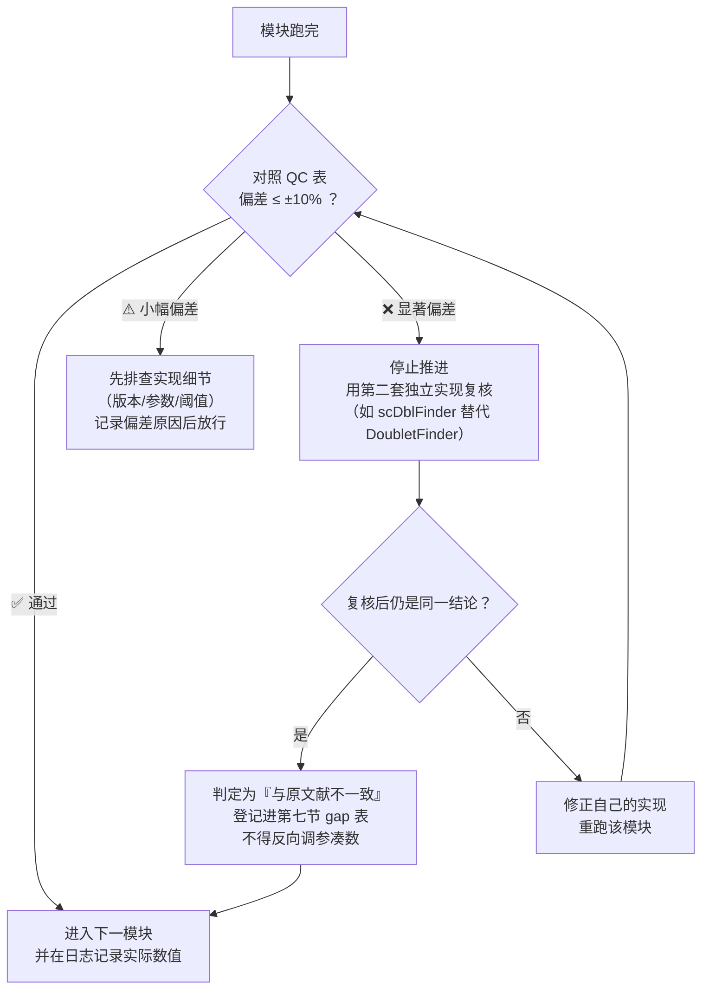

# 复现质控清单、跨模块排错与批判性评述

> **目标文献**：Wang R, Wu W, et al. *Integrative single-cell and spatial transcriptomic analysis reveals a lactate-driven crosstalk between NFATc4⁺ tumor cells and SPP1⁺ macrophages in glioblastoma.* *J Transl Med* (2026) 24:1253. DOI: 10.1186/s12967-026-08555-7
>
> **模块对应原文**：全文（Methods / Results / Discussion 全部）；本文件是整套复现方案的**收口文档**
> **前置依赖**：建议在 01–12 号文档全部产出结果后通读；亦可作为开工前的"风险预告"先行阅读
> **复现难度**：★★☆☆☆（无代码执行，但需要判断力）　**预计工时**：2–3 人日　**计算资源**：无
>
> **本文件的两个用途**：
> ① **质控手册**——每个模块"跑完没有"的客观判据（对照原文数值，允许 ±10%）；
> ② **审稿人视角的能力评估**——这套结论的证据强度到底有多高、哪些地方是"可以做但不能说"、如果我要接着做该往哪里走。
> 导师带学生的经验：**先读第 4、5 节，再回头动手**。知道边界在哪里，才不会被自己跑出来的漂亮图误导。

---

## 一、QC 检查点总表（按模块）

**使用方式**：每完成一个模块，在最后一列填"✅ / ⚠️ / ❌"，⚠️ 与 ❌ 必须写明偏差原因后再进入下一模块。

| # | 检查点 | 原文报告值 | 允许波动 | 判据 / 说明 | 结果 |
|---|---|---|---|---|---|
| 1 | scRNA QC 后细胞数 | 12,618 | ±10%（11,300–13,900） | 差异主要来自 DoubletFinder 的 pK 与双胞率设定；若偏差 >20% 先查 QC 阈值实现 | ☐ |
| 2 | cluster 数 | 24 | ±3 | 受 resolution 与 `dims` 影响；**能注释出同一套 10 大类细胞即可，cluster 数不必强求** | ☐ |
| 3 | 大细胞类型数 | 10 | 0（必须一致） | neoplastic / macrophages / T / astrocytes / oligodendrocytes / stem / neurons / endothelial / ILC / fibroblasts | ☐ |
| 4 | 恶性细胞判定（inferCNV） | 肿瘤细胞广泛 CNV | 定性一致 | 用 `plot_cnv` 目视核对 + CNV 分数分布双峰性 | ☐ |
| 5 | 细胞周期分布 | 多数肿瘤细胞 G1 期 | 定性一致 | `CellCycleScoring` 后按细胞类型统计 | ☐ |
| 6 | CytoTRACE 排序 | oligodendrocytes / fibroblasts 最高；neoplastic / macrophages 较低 | 定性一致 | 只比较相对排序，不比较绝对值（该分数受细胞数影响） | ☐ |
| 7 | 高/低乳酸分组 | 两组分离 | 定性一致 | 原文未报告阈值 → 见 03 号文档四种方案，**必须在日志中记录你选了哪个** | ☐ |
| 8 | 乳酸分数 vs glycolysis/hypoxia | 分布不一致（Fig. S1） | 相关系数 r < 0.6 视为"不一致" | 若 r > 0.8，说明你的乳酸基因集退化成了通用糖酵解集，需要核查基因集 | ☐ |
| 9 | 差异 TF（高乳酸组） | SPI1、NFATc4、HOXC9、POU3F3、FOXO1 | 至少命中 NFATc4 + 2 个 | 命中率低时先查：motif 数据库版本、细胞数、`aucMaxRank`、分组阈值 | ☐ |
| 10 | regulon 模块数 | 6 | ±1 | 模块数由聚类方法（层次/NMF）决定，**这是原文最不可复现的一步** | ☐ |
| 11 | 拟时序分支点 / state | 2 / 5 | ±1 / ±1 | root 选择策略写入日志；state 数与聚类分辨率强相关 | ☐ |
| 12 | 分支依赖基因 | AHCYL1 先升后降；CADPS 持续上调 | 定性一致 | 用 `plot_genes_branched_pseudotime` 目视核对趋势方向 | ☐ |
| 13 | 空间 spot 总数 | 11,970 | ±10% | **先确认原文这 11,970 是 4 张切片合计还是 2 张**（正文写 4 个样本，主图只展示 GSM5833533/34） | ☐ |
| 14 | RCTD 反卷积 | spot 注释成功 | 无 `NA` 主导 | 权重矩阵每 spot 主类型权重和应接近 1；`NA` 比例 >20% 需调 `min_count`/`CELL_MIN_INSTANCE` | ☐ |
| 15 | 邻域富集 | NFATc4⁺ ↔ SPP1⁺ 显著富集 | z-score 为正且 p<0.05 | **必须核对置换零模型**（见第五节 5.2） | ☐ |
| 16 | 距离统计 | 高乳酸组最近邻距离更小 | 方向一致（Wilcoxon p<0.05） | 报告中要同时给出中位数距离（µm）与检验方法 | ☐ |
| 17 | 六队列生存方向 | 多数队列高 NFATc4 预后差 | 至少 4/6 队列 HR>1 且 p<0.05 | 原文措辞为 "generally … across most cohorts" → **必须逐队列列出 HR/CI/p/n** | ☐ |
| 18 | ML 最优模型 | StepCox[forward] + RSF | 名称一致 | 若你的最优模型不同，**保留原文模型做可比对照**，不要只报自己的最优 | ☐ |
| 19 | 训练集 C-index | 0.87（TCGA） | 0.80–0.90 | 若你的值显著更高，先怀疑信息泄漏 | ☐ |
| 20 | 验证集 C-index | 0.64（GSE4412）/ 0.62（meta） | ±0.06 | 这是原文的**真实泛化性能**，不要试图"调上去" | ☐ |
| 21 | 5 年 timeROC AUC | 0.976（TCGA）/ 0.905（GSE4412） | ±0.05 | 若 5 年超出随访上限，`timeROC` 会报错或极不稳定 → 记录中位随访时间 | ☐ |
| 22 | meta pooled HR | 1.82（95% CI 1.64–2.02，p<0.001） | 方向一致 | 复核被合并的对象（模型风险分组 or NFATc4 表达）与效应模型（固定/随机） | ☐ |
| 23 | 免疫浸润 | 高风险组 macrophages / CD8⁺T / NK 升高 | 方向一致 | **主判据 ≥2 种算法方向一致**（如 MCPcounter + CIBERSORT），≥3 种为强证据（统一口径见第八节 D9） | ☐ |
| 24 | 高频突变基因 | TTN、TP53、PTEN、EGFR | 至少 3/4 命中 | 与 TCGA-GBM 公认图谱（EGFR 扩增 ~40–50%、PTEN 缺失 ~30–40%）交叉核对 | ☐ |
| 25 | 高风险组突变样本比例 | 97.7% | 95–99% | **核对是否把 Silent 变异计入 TMB** | ☐ |
| 26 | CNV 染色体 | 1、7、9 号 | 至少命中 2 个 | 注意 GBM 经典改变是 +7 / −9p / −10；原文未突出 −10，是**待核对的点** | ☐ |
| 27 | GSVA 通路 | leukocyte migration、cytokine signaling 上调；Wnt 负调控下调 | 方向一致 | 通路级结论比基因级稳；若相反先查高低风险分组的定义是否颠倒 | ☐ |
| 28 | CMAP top 化合物 | 含 fasudil、imatinib | 至少命中 1 个 | CMAP 对 signature 长度极敏感 → 做长度敏感性分析 | ☐ |
| 29 | 预测 IC₅₀ | A.443654、A.770041 在高风险组更低 | 方向一致 | 药物名在不同 GDSC/CTRP 版本中命名不同，需按 drug ID 而非名称匹配 | ☐ |
| 30 | 敲低效率 | > 60–70% | ≥60% | 低于 60% 必须重新设计 siRNA 或改用 shRNA/CRISPRi | ☐ |
| 31 | 表型方向 | Nfatc4 敲低：增殖↓、凋亡↑、S 期↓、迁移↓ | 全部一致 | 任一方向相反即停止推进，先排查转染/对照 | ☐ |
| 32 | 共培养 | F4/80⁺CD206⁺ 比例↓；共培养巨噬 SPP1 蛋白↓ | 方向一致 | 需同型对照/FMO；否则比例不可信 | ☐ |

---

## 二、跨模块排错速查表

| 现象 | 可能根因 | 解决 |
|---|---|---|
| `Read10X` 返回 `NULL` / 矩阵维度异常 | 缺 `barcodes.tsv.gz`/`features.tsv.gz`/`matrix.mtx.gz` 三者之一；GEO 压缩包层级多一层文件夹 | 检查目录树，用 `list.files(recursive=TRUE)` 定位；Seurat 5 用 `Read10X_h5` |
| DoubletFinder 在 Seurat 5 报 `slot` 错误 | DoubletFinder 依赖 Seurat 3/4 的 `@assays$RNA@counts` 槽位 | 降级 Seurat 或使用带 Seurat 5 补丁的分支；或改用 `scDblFinder`（Bioconductor，推荐作为 Plan B） |
| Harmony 后 UMAP 上样本间完全混匀、疾病/分组差异也消失 | `theta` 过大或 `dims` 包含噪声维度 | `theta=1`（默认）→ 试 0.5；只对前 20–30 个 PC 做校正；用 marker 表达保留性做判据 |
| `FindVariableFeatures` 返回 0 基因 | 数据未 `NormalizeData`；或 `nfeatures` 大于基因数（10x 全基因表未过滤） | 先归一化；用 `SelectIntegrationFeatures` 或提高 `loess.span` |
| inferCNV 报 `gene order file` 找不到 | 需下载 `gencode_v19_gene_pos.txt` 或 `hg38_gencode_v27.txt` 并匹配基因组版本 | 基因组与注释版本必须一致，否则窗宽错位 |
| inferCNV 结果整片都是 CNV | 参考"正常细胞"选错（把肿瘤细胞当参考） | 用 T 细胞/少突胶质细胞/内皮作参考；检查参考细胞数与纯度 |
| pySCENIC `ctx` 步骤报 motif 数据库不匹配 | feather 注释文件与 `t2g` 文件的基因组/物种版本不一致 | 用同一 release（如 `hg38__refseq-r80__10kb…` 的 feather 与 `hg38__refseq-r80__…tbl`） |
| GRNBoost2 结果每次不同 | 未固定 `--seed`，或 dask 分块顺序变化 | CLI 加 `--seed 20260101`；报告中声明这一点 |
| AUCell 活性分数几乎相同（无区分度） | `aucMaxRank` 设得太大（如 >10% 基因） | 设为 top 5%（约 1500–2500 基因，取决于基因数）；检查输入矩阵是否已 log 化且未归一化过度 |
| ssGSEA 分数出现 `NA` | 细胞只表达基因集中极少数基因；`kcdf` 选择与数据尺度不匹配 | 过滤低质量细胞；单细胞用 `kcdf="Gaussian"` 并对结果做 min-max 或 z-score |
| Monocle2 `reduceDimension` 卡死/OOM | 细胞数太多或用了全基因集 | 只保留排序基因（1000–2000）；必要时下采样或改用 Monocle3/Slingshot |
| 伪时间方向反了（干细胞端在末端） | root 选择错误 | 用已知 marker（如 stem cells 端）或最长分支末端重设 root，并在日志记录依据 |
| RCTD 报 `Reference contains too few cells` | `CELL_MIN_INSTANCE` 高于最小细胞类型的细胞数 | 下调该参数或合并稀有类型；参考图谱中每类 ≥25 细胞较稳 |
| `spatial.tar.gz` 未下载导致图像缺失 | 只下了 `filtered_feature_bc_matrix.h5` | 重新下载 `*_spatial.tar.gz`，解压得 `tissue_positions.csv` + `scalefactors_json.json` + `*_image.png` |
| squidpy 邻域富集全部不显著 | 邻接图 `n_neighs`/`radius` 设得过大，所有 spot 互为邻居 | 用 Visium 实际间距（spot 中心距 100 µm → 6 邻居网格）设定，或按 `coord_type="grid"` |
| 邻域富集 z-score 虚高 | 置换时破坏了空间自相关（简单打乱标签） | 使用保持空间结构的置换（旋转/区块置换），或报告 Moran's I 作补充 |
| KM 曲线阶梯巨大（每级只有 1–2 例） | 队列样本量过小或分组后每组 <15 | 报告中标注每组 n；不稳健的队列只做支持性证据 |
| `surv_cutpoint` 得到的 p 值漂亮但与中位数分组矛盾 | 最优截断点存在选择偏差（p 值被系统性高估） | **主分析用中位数或三分位**，最优截断仅作敏感性分析并声明 |
| `timeROC` 报 `times` 超出范围 | 设定的 5 年超过最大随访时间 | 检查 `max(time)`；改为随访上限内的时间点并在图注说明 |
| Mime/Mime1 函数找不到 | 包名与函数名混淆（`Mime1` 是否 CRAN/GitHub 包名取决于版本） | `remotes::install_github()` 安装后核对 `?Mime1`；不确定时用 09 号文档的分步替代实现（Lasso/RSF/StepCox 各自跑通） |
| 101 组合跑不完/内存爆 | 组合数 × 队列数 × 交叉验证嵌套 | 先只跑 TCGA 训练集筛组合，再对胜出模型做全队列验证；`future::plan(multisession)` |
| 验证集 C-index 只有 0.5–0.55 | 表达量尺度未统一、基因 ID 映射丢失、生存时间编码错误 | 逐项核对；检查不同平台是否做了 quantile 归一化；检查 CGGA 的 `Censor`（alive=0/dead=1）方向 |
| TCGA 突变率异常高 | 把 Silent/Intron 变异计入；或同一患者多 aliquot 重复计数 | 按 `Variant_Classification` 过滤；按患者 ID 去重（`-01A`/`-01B`） |
| `oncoPredict` 训练集与测试集基因不一致 | 未取交集或顺序错位 | 强制 `common <- intersect(rownames(train), rownames(test))` 后按相同顺序取子集 |
| CMAP 结果每次不同 | signature 基因数不对称（上调 vs 下调数量不等） | 强制上下调各取相同数量（如各 150） |
| scMetabolism 报物种错误 | 使用了人类 KEGG 集合跑小鼠数据（或反之） | 确认 GL261 是小鼠来源 → 用小鼠集合；本文 scMetabolism 用于人类 scRNA |
| 转染后细胞大量死亡 | 转染试剂与 siRNA 复合物毒性、浓度过高 | 降到 10–20 nM；设 mock（仅试剂）对照；8 h 换液 |
| 流式 CD206 阳性率异常高 | RAW 264.7 自发 M2 化；破膜不充分 | 低代次细胞、血清批次固定；做 FMO 对照 |
| WB 磷酸化/低丰度蛋白无信号 | 裂解未加磷酸酶抑制剂；上样量不足；抗体种属不匹配 | RIPA 加磷酸酶抑制剂；NFATc4 丰度低 → 核质分离浓缩后再跑 |

---

## 三、原文数值 → 复现预期对照表（跨模块一致性）

| 参数 | 原文值 | 复现预期 | 偏差可接受理由 |
|---|---|---|---|
| scRNA 细胞数 | 12,618 | 11,000–14,000 | 双胞去除率、QC 实现细节 |
| cluster 数 | 24 | 20–28 | resolution 主观 |
| 大细胞类型 | 10 | 10 | 必须一致 |
| 乳酸基因集 | 332 | 332（或按重建方案自报） | 重建方案差异需声明 |
| 差异 TF | 5 个（含 NFATc4） | ≥3 个中命中 NFATc4 | motif 数据库与阈值 |
| regulon 模块 | 6 | 5–8 | 聚类方法主观 |
| 分支点/state | 2 / 5 | 1–3 / 4–6 | root 与 feature 集 |
| 空间 spot | 11,970 | 10,800–13,200 | 组织过滤（`in_tissue`）标准 |
| ML 最优模型 | StepCox[forward] + RSF | 名称一致或并列最优 | 组合实现的版本差异 |
| 训练/验证 C-index | 0.87 / 0.64 / 0.62 | ±0.05–0.06 | 特征筛选与 CV 细节 |
| 5 年 AUC | 0.976 / 0.905 | ±0.05 | 删失分布敏感 |
| pooled HR | 1.82 (1.64–2.02) | 方向一致 | 效应模型选择 |
| 高风险组免疫 | 巨噬/CD8T/NK 升高 | 方向一致（≥2 算法） | 反卷积算法差异 |
| 高频突变 | TTN/TP53/PTEN/EGFR | ≥3/4 命中 | 队列构成 |
| 突变样本比例 | 97.7% | 95–99% | 变异过滤规则 |
| 敲低效率 | 60–70% | ≥60% | siRNA 设计 |

---

## 四、原文中的内部不一致与表述疏漏（逐条核对清单）

> 这一节是**复现者必须自己补齐的部分**。原文 Methods 写得相当含糊，多处函数名不规范、参数缺失、两处结论口径互相矛盾。以下逐条列出，并给出我方复现决策。

| # | 位置 | 问题 | 影响 | 复现决策 |
|---|---|---|---|---|
| 1 | Methods | 函数名不规范：`FindVariableGenes`（应为 `FindVariableFeatures`）、`Run PCA`、`Dimplot`（应为 `DimPlot`）、`DoubletFinder function`（应为包）、`Celltypist function`（应为 Python 包/CellTypist 模型） | 无法直接照抄代码 | 统一按 **Seurat 5.3.0** 的 API 实现，并在文档中标注对应关系（见 01/02 号文档） |
| 2 | Methods vs Discussion | Methods 说 "**GSVA 包 + ssGSEA**" 计算乳酸分数；Discussion 说 "used **AUCell** and LRGs" | 两种算法在稀疏单细胞数据上给出的排序可能不同 | 两种都跑，主分析用 ssGSEA，AUCell 作敏感性分析；报告二者的 Spearman 一致性 |
| 3 | Methods（Machine learning 段） | "univariate Cox regression analysis was used to **categorize the tumor cells** based on their lactate scores" | **单细胞没有生存数据**，此句与本段后文（bulk 五个队列）自相矛盾 | 理解为"在 bulk 层用 unicox 筛与生存相关的乳酸基因"，并在 03 号文档中明确记录该判断 |
| 4 | Methods | 高/低乳酸分组的**阈值未报告** | 直接决定差异 TF 结果 | 采用中位数为主方案（03 号文档给出 4 种方案的对比与交集稳健性检验） |
| 5 | Methods | 332 LRGs 的来源文献为「组蛋白乳酸化」相关基因（Zhang D, *Nature* 2019；Cheng Z, *Pharmaceuticals* 2023），而非「乳酸代谢」基因 | **存在语义漂移**：乳酸化修饰相关基因 ≠ 糖酵解/乳酸转运基因 | 主分析沿用 332 基因集以保证可比；**必须**用 HALLMARK_GLYCOLYSIS / GO lactate metabolic process 做平行验证，并在报告中讨论两者是否给出相同结论 |
| 6 | Methods（spatial） | 未说明 RCTD 的 `mode`、`min_count`、参考谱来源（哪个数据集、是否同源患者） | 反卷积结果不可复现 | 采用 `full` 模式（基因数 >1000）+ GSE138794 注释谱作参考；**明确记录参考与目标的来源差异**这一局限 |
| 7 | Results（spatial） | 正文写 4 个样本 / 11,970 spots，但主图（Fig. 4）只展示 GSM5833533 与 GSM5833534，另 2 张在 Fig. S3 | 11,970 的口径不清（4 张合计 or 2 张） | 复现时分别统计每张切片的 spot 数并列表，明确口径 |
| 8 | Methods（Monocle） | 未写 Monocle 版本、root 选择依据、排序基因数 | 拟时序方向无法唯一确定 | 记录所用版本（推荐 Monocle3，Monocle2 作对照）、root 依据（stem-like 端）、排序基因数与全文日志 |
| 9 | Results（生存） | "high NFATc4 expression was **generally** associated with poor patient prognosis **across most cohorts**" | "generally / most" 意味着**并非所有队列显著** | 逐队列列出 HR、95% CI、p、n（08 号文档模板），**不隐藏阴性队列** |
| 10 | Results（生存） | 未说明高/低分组阈值（中位数？最优截断？） | 不同阈值会显著改变 p 值 | 主分析中位数，最优截断仅作敏感性分析 |
| 11 | Methods（ML） | 特征筛选（共识聚类 DEG → unicox P<0.001）与模型评估**都在 TCGA 上完成**，随后报告 TCGA 训练集 C-index = 0.87 | **乐观偏差 / 信息泄漏**：训练集性能被系统性高估 | 复现时同时给出：① 原文流程（可比对照）；② **嵌套交叉验证**（特征选择放进训练折内）的诚实估计 |
| 12 | Results（ML） | 训练 C-index 0.87 vs 外部验证 0.62–0.64 的**巨大落差**未在正文讨论；Discussion 仅泛泛提到队列异质性 | 模型泛化能力被读者高估 | 在复现报告与 09 号文档中明确写出该落差与过拟合风险 |
| 13 | Results（ML） | 5 年 AUC = 0.976（TCGA）与 C-index = 0.87 并存；GSE4412 5 年 AUC 0.905 而 C-index 仅 0.64 | 指标间不一致，可能因 5 年超出随访上限导致 IPCW 估计不稳、删失分布主导 | 记录各队列**中位随访时间**；把 timeROC 时点限制在随访范围内；同时报告 C-index（主）与 AUC（辅） |
| 14 | Results（ML） | "Meta-analysis of univariate Cox regression results" 未说明合并的效应量是什么（风险分组 HR？NFATc4 HR？）、固定还是随机效应、异质性 I² | pooled HR 1.82 的含义不可核验 | 按 Fig. 7F 图注与森林图坐标轴判断，**两种解释都算一遍**并报告，明确标注不确定性 |
| 15 | Methods（ML） | 表述为 "**101 machine learning algorithms**"，并引用 Mime 框架；包名写作 "Mime1" | 概念上不是 101 个算法，而是**算法组合**；包名/函数名需核对 | 在 09 号文档中提供组合计数表与包名核对方法；**以 Mime 当前版本的组合列表为准** |
| 16 | Results（ML） | 未展示最终风险模型的**基因与系数**（RSF 为隐式模型），也无风险评分公式 | 模型不可复现、不可临床落地 | 复现时输出：① StepCox 选中基因及系数；② RSF 的变量重要性排名；③ 完整风险评分计算脚本 |
| 17 | Methods（immune） | IOBR 同时使用多种算法，但**未说明以哪个为准**，也未报告算法间一致性 | 结论可能是某一种算法的产物 | 至少两种算法方向一致才算通过（见 QC 表 #23） |
| 18 | Results（mutation） | 高风险组 **97.7%** 样本含体细胞突变 | 该比例偏高，需确认是否把 Silent/Non-coding 计入 | 复现时分别按"全部变异"和"仅非沉默编码变异"统计并报告 |
| 19 | Results（CNV） | 强调 1、7、9 号染色体；GBM 经典图谱是 **+7 / −9p / −10 / EGFR 扩增 / CDKN2A 缺失** | 未突出 −10 与 focal 事件，结论与公认图谱部分不符 | 复现时同时输出 focal 与 broad 事件，与 TCGA-GBM 公认图谱对照列表 |
| 20 | Results（drug） | CMAP 未报告 p 值/FDR；OncoPredict 结果无实验验证 | 药敏结论为纯 in silico | 报告中明确标注"未经实验验证"；给出 CMAP 敏感性分析（signature 长度/上下调对称性） |
| 21 | Discussion | "we identified NFATc4 as a key **prognostic indicator** specifically upregulated in neoplastic cells with **vigorous lactate metabolism**" | 把 bulk 层预后属性与单细胞层表达属性混在一句话中 | 报告中分层表述：单细胞层为"高乳酸亚群富集 TF"，bulk 层为"预后关联" |
| 22 | Discussion | "M2 极化"、"巨噬细胞 SPP1 下调"等结论的**因果方向**未确定 | 原文也承认（"mainly correlative"） | 报告中沿原文的措辞，不升级为因果结论 |
| 23 | 全篇 | 术语混用："neoplastic cells" 与 "tumor cells"；"NFATc4⁺"（TF 阳性应指 regulon AUC 高还是表达阳性未定义） | 复现时的细胞定义不一致 | 在 03/04/06/07 号文档中统一并显式定义每个"阳性"标签的判定规则 |
| 24 | Data availability | "Publicly available datasets were analyzed in this study."，未提供代码仓库 | 第三方无法独立复现 | 本套方案即为填补此空缺；建议复现完成后把代码与中间结果开源（GitHub + Zenodo DOI） |
| 25 | 全篇 | 大量图表未报告统计量（自由度、多重比较校正）、部分图注缺少 n | 结论稳健性无法评估 | 复现时所有出图脚本统一输出 `stat_compare_means` 或等效的检验量与 p 调整后数值 |

---

## 五、批判性评述（审稿人 / 导师视角）

### 5.1 证据链强度分级

把原文的每条结论按证据强度分档（这是给博士生最重要的一课：**同样"显著"的结论，证据等级可以差三个量级**）：

| 结论 | 支持证据 | 证据等级 | 评价 |
|---|---|---|---|
| GBM 微环境含 10 大类细胞、肿瘤与巨噬细胞互作频繁 | 单数据集 scRNA（12,618 细胞） | **中** | 细胞类型注释合理，但与已有 GBM 单细胞图谱（GSE131928 等）高度一致，属**验证性**发现 |
| 肿瘤细胞存在高/低乳酸两亚群 | ssGSEA 打分 + 基因集 | **弱–中** | 分数阈值人为设定；基因集为"乳酸化"相关而非"乳酸代谢"，语义漂移 |
| **NFATc4 是高乳酸亚群的驱动 TF** | pySCENIC 差异活性 + 六队列生存 + 体外敲低 | **中** | 相关性 + 必要性的组合证据；**缺少** NFATc4 靶基因的直接实验验证（ChIP-seq / 荧光素酶报告） |
| NFATc4 沿分化分支上调，与侵袭相关 | Monocle 拟时序 | **弱** | 拟时序方向依赖 root 选择；无谱系追踪、无 RNA velocity 交叉验证 |
| **NFATc4⁺ 肿瘤细胞与 SPP1⁺ 巨噬细胞空间共定位** | RCTD + 邻域富集 + 距离统计 | **弱–中** | spot 级（非单细胞级）证据；零模型构建未描述；4 个样本 |
| **NFATc4–SPP1 双向互作轴** | 共培养实验（两种单向敲低） | **弱** | 只证明了"肿瘤细胞需要 NFATc4 才能维持巨噬细胞 SPP1 表达"与"巨噬细胞需要 SPP1 才能支持肿瘤细胞生长"两个**并列单向关系**，**未证明双向**，中间介质（乳酸？细胞因子？）完全未知 |
| 乳酸直接上调 NFATc4 | 50 mM 乳酸处理 | **弱** | 超生理浓度、无 pH/渗透压对照、无剂量-时间关系、未区分转录/蛋白/入核层面 |
| 基于 LRG 的预后模型可用 | 101 组合 + 五队列验证 | **中（训练）/ 弱（泛化）** | 训练 0.87 vs 验证 0.62–0.64 → 真实泛化能力有限；无前瞻队列 |
| 高风险组免疫浸润升高、染色体 1/7/9 改变 | IOBR + maftools + GISTIC | **中** | 与 GBM mesenchymal 亚型的已知特征重叠，**可能不是乳酸特异的发现** |
| fasudil / imatinib 等对高风险患者有效 | CMAP_XSum / OncoPredict | **极弱（假说级）** | 纯 in silico、无细胞验证、无 BBB 通透性讨论 |

### 5.2 生物信息学部分的系统性问题

**（1）单数据集依赖——最致命的短板。**
全套 scRNA 结论（10 大类细胞、24 cluster、高低乳酸分组、pySCENIC 的 6 个模块、差异 TF 列表、拟时序分支）**全部来自 GSE138794 一个数据集（5 个样本、12,618 细胞）**。
- pySCENIC 对细胞数敏感：12,618 细胞推断 regulon 属于**小样本 GRN 推断**，regulon 数量与活性估计的稳定性应做 bootstrap 验证（原文未做）。
- 5 个样本无法区分"患者间异质性"与"真实的亚群结构"。**建议复现时立即补一个独立数据集做留出验证**（GSE131928 的 28 个样本 / GSE84465 / GSE148196 均可），把"NFATc4 是否在第二个数据集中同样富集于高乳酸肿瘤细胞"作为首要扩展。

**（2）"SPP1⁺ 巨噬细胞"没有经过亚群鉴定。**
原文从未展示巨噬细胞的再聚类，也没用 marker 定义 SPP1⁺ TAM 亚群——它只是按 `SPP1` 表达阈值贴标签。而 SPP1 在 GBM 的髓系细胞中本就广泛表达。正确做法：髓系细胞重新聚类 → 鉴定 SPP1⁺/SPP1⁻ 亚群 → 与已发表的 SPP1⁺ TAM 特征（如 CRC [44]、HNSCC [45] 中的特征基因）比对 → 再做空间与通讯分析。**同理，"NFATc4⁺ neoplastic cells" 也没有亚群鉴定**，只是 TF 活性高的一群细胞。

**（3）空间共定位的统计严格性不足。**
- spot 不是细胞；"细胞类型阳性"实为反卷积权重或基因表达阈值的结果，阈值一变结论可能变。
- 邻域富集（squidpy）本质是置换检验，但组织切片存在强空间自相关，**简单打乱标签的零模型会严重低估 p 值**；原文未描述置换方式与次数。
- 结论"高乳酸区距离更近"是**池化多切片**的结果，需按切片分层报告（切片间差异可能主导）。
- 建议补做：Moran's I / Geary's C 量化空间自相关；按切片分层的邻域富集；Ripley's K 或 L 函数；以及 spot 中心距 100 µm 的物理距离换算。

**（4）CellChat 用在 spot 数据上有方法论争议。**
把 Visium spot 当作"细胞"输入 CellChat，等价于假设一个 spot 是一个混合细胞，会系统性平滑掉配受体表达的真实异质性。原文并未讨论这一点。可行的替代：cell2location / RCTD 权重加权后的"细胞类型通讯"（如 `liana`、`CellChat` 的 pseudo-bulk by cell type），或直接在 scRNA 层做 RNA 层面通讯分析（原文 Fig. 2C–D 已经做了）。

**（5）机器学习模块的两个结构性问题。**
- **信息泄漏**：共识聚类分型（用全部 TCGA）→ 组间 DEG（用全部 TCGA）→ unicox 筛基因（用全部 TCGA）→ 在 TCGA 训练并报告 C-index 0.87。每一步都在用同一批样本"看答案"。正确做法是嵌套交叉验证（特征选择在训练折内）。
- **指标混用**：C-index 与 timeROC-AUC 衡量的是不同的东西（前者是全部可比对样本的一致性，后者是特定时点的分类性能），0.87 与 0.976 并存并不意味着"更准"。
- **临床可用性**：无 IDH 分层（作者已承认）、无 MGMT 状态、无治疗信息混杂；不同队列的高/低风险阈值不一致，无法跨中心迁移。

### 5.3 实验验证部分的缺口

| 缺口 | 为什么重要 | 可补的实验（成本递增） |
|---|---|---|
| **无 in vivo 验证**（作者已承认） | 肿瘤-巨噬细胞互作高度依赖微环境 | 小鼠 GL261 原位/皮下模型 + Nfatc4 敲低/SPP1 敲低；免疫健全 C57BL/6（GL261 同源）可评价免疫微环境 |
| **仅小鼠细胞系** | 种属差异、无法代表人类 GBM 基因型 | 人源 GBM 细胞系（LN229 / U251 / A172）+ 患者来源 GSC；人源 THP-1 或 iPSC 来源巨噬细胞 |
| **无回复实验（rescue）** | 敲低表型可能为脱靶效应 | 过表达 siRNA 抗性 NFATc4 / 重组 SPP1 蛋白恢复；或 CD44 中和抗体阻断 |
| **中间介质未知** | "双向轴"的分子桥梁完全空白 | 条件培养基（CM）+ LC-MS 代谢物/细胞因子阵列；乳酸梯度实验；MCT1 抑制剂 AZD3965、LDHA 抑制剂 FX11；GPR81 拮抗剂 |
| **NFATc4 靶基因未验证** | pySCENIC 只是预测 | NFATc4 的 ChIP-qPCR（ab99431 是 WB 级多抗，**其数据表未声明 ChIP 验证，用前必须自行验证或另选 ChIP 级抗体**）、荧光素酶报告基因、siNFATc4 后 qPCR 检测候选靶基因 |
| **NFATc4 活化状态未检测** | NFAT 的功能由去磷酸化入核决定，表达量不等于活性 | 核质分离 + p-NFATc4 检测；免疫荧光核转位；calcineurin 抑制剂（环孢素 A / FK506）处理对照 |
| **乳酸处理浓度超生理** | 50 mM 远超肿瘤内实测 10–40 mM 上限 | 剂量-时间梯度（0/5/10/25/50 mM × 6/12/24 h）+ 等摩尔 NaCl / pH 匹配对照 |
| **无 SPP1 受体侧证据** | 只见配体，未见受体 | GL261 上 CD44/ITGAV/ITGB1 表达检测；抗 CD44 阻断实验；FAK/AKT 磷酸化检测 |

### 5.4 可重复性评估

| 维度 | 评分 | 说明 |
|---|---|---|
| 数据可得性 | ★★★★☆ | 全部公共数据（GEO/TCGA/CGGA/cBioPortal），可获取 |
| 方法可复现性 | ★★☆☆☆ | Methods 参数大量缺失、函数名错误、阈值未报告 |
| 代码可得性 | ☆☆☆☆☆ | 未提供任何代码 |
| 结果可复现性 | ★★☆☆☆ | 关键中间结果（差异 TF 全表、regulon 靶基因、风险模型基因与系数）未公开 |
| 实验可复现性 | ★★★☆☆ | siRNA 序列、抗体货号、试剂型号齐全（这是原文最大的优点，值得学习）；但缺 pH 对照等关键细节 |
| 统计报告规范 | ★★☆☆☆ | 大量图未给统计量/自由度/多重校正；生存分析阈值不透明 |

> **导师总结**：这篇文章的**实验部分写得比生信部分规范**（试剂货号、抗体稀释比、siRNA 序列都给了），而**生信部分恰恰是结论的主体**。这就是为什么本套复现方案的价值不在于"跑出一样的图"，而在于**把它没说清的部分全部补齐、把它说满了的部分如实收窄**。

### 5.5 如果要写一篇"复现 + 批判"的论文，应该报告什么

1. 逐图复现结果 vs 原文数值的**对照表**（哪些一致、哪些不一致、不一致的可能原因）。
2. 关键步骤的**敏感性分析矩阵**（乳酸分组阈值 × 打分算法 × regulon 库版本 → 差异 TF 列表的稳定性）。
3. 独立单细胞数据集的外部验证结果（NFATc4 富集是否可重现）。
4. 用嵌套交叉验证给出的**诚实模型性能**，与原文乐观估计的对比。
5. 空间共定位的**正确零模型**下，邻域富集是否仍显著。

这五条中的任何一条单独成文，都比"再做一张和原文一样的 UMAP"有价值得多。

---

## 六、可扩展研究方向（按可行性排序）

| # | 方向 | 具体做法 | 难度 | 新意 |
|---|---|---|---|---|
| 1 | **单细胞外部验证** | 在 GSE131928/GSE84465/GSE148196 中用同一 332 LRG 打分，检验 NFATc4 是否仍富集于高乳酸肿瘤细胞 | ★★☆ | 直接加强原文最弱的一环 |
| 2 | **髓系亚群精细解剖** | 对 macros 再聚类，鉴定 SPP1⁺ TAM 亚群并与其他癌种 SPP1⁺ TAM 特征比对；追溯 BMDM vs 小胶质细胞来源（用 P2RY12/TMEM119 vs CCR2 等 marker） | ★★☆ | 原文完全没做 |
| 3 | **配体-受体因果链推断** | 用 NicheNet / CellOracle 从"配体→受体→下游靶基因"的因果角度重做通讯分析，替代只做共表达的 CellChat | ★★★ | 把"共定位"升级为"候选因果链" |
| 4 | **NFATc4 靶基因的实验落地** | 先用 pySCENIC 结果 + `FindMarkers` 取 NFATc4⁺ vs NFATc4⁻ 肿瘤细胞的差异基因作为候选靶，再做 ChIP-qPCR + 荧光素酶报告；文献先例可参考 [15] 的 CCNB1/CDK1（**注意 AHCYL1/CADPS 是本文的分支依赖基因，并非已证实的 NFATc4 靶基因**） | ★★★（湿实验） | 把"调控网络"变成"实验证据" |
| 5 | **乳酸-巨噬细胞中介分子筛选** | 高乳酸 GL261 条件培养基处理 RAW/人源巨噬 → 分泌组/代谢组学 → 找到上调 SPP1 的介质（乳酸本身？LIF？IL-6？） | ★★★★ | 填补"双向轴"的机制空白 |
| 6 | **空间多组学** | 同队列做 Visium + 多重免疫荧光（NFATc4/SPP1/CD68/CD44 共染色），在蛋白层验证共定位 | ★★★★ | 从 RNA 到蛋白的正交证据 |
| 7 | **治疗干预** | 在原位 GBM 模型中联合 MCT1 抑制剂（AZD3965）或 LDHA 抑制剂（FX11）+ 抗 PD-1，评价生存获益 | ★★★★★ | 转化价值最高 |
| 8 | **模型的可迁移性重建** | 用 nested CV + 多队列联合训练 + 树模型（RSF/XGBoost-Cox）与解释工具（SHAP），做真正可外部验证的模型 | ★★★ | 修正原文的过拟合问题 |
| 9 | **乳酸化组学** | 既然基因集来自乳酸化，可直接做 4D label-free 乳酸化蛋白质组，找出 GBM 中的乳酸化底物 | ★★★★★ | 与原文形成"从关联到修饰"的升级 |

---

## 七、本项目与原文的已知 gap 汇总表

复现完成后，把这张表填满，就是你自己的项目结题报告：

| 模块 | 原文 | 我方复现 | 是否一致 | 差异原因 | 处理方式 |
|---|---|---|---|---|---|
| 01 数据获取 | 5 scRNA / 4 空间 / 5 bulk 队列 / PDX | | ☐ | | |
| 02 单细胞 QC 与注释 | 12,618 细胞 / 24 簇 / 10 类 | | ☐ | | |
| 03 乳酸评分 | 332 LRG + ssGSEA，阈值未报告 | | ☐ | | |
| 04 pySCENIC | 5 个差异 TF，6 个模块 | | ☐ | | |
| 05 拟时序 | 2 分支 / 5 state | | ☐ | | |
| 06 空间反卷积 | 11,970 spot，共定位显著 | | ☐ | | |
| 07 细胞通讯 | SPP1 通路互作强 | | ☐ | | |
| 08 生存分析 | 六队列多数显著 | | ☐ | | |
| 09 机器学习 | StepCox[forward]+RSF，0.87/0.64/0.62 | | ☐ | | |
| 10 免疫/基因组 | 巨噬/CD8T/NK 升高；TTN/TP53/PTEN/EGFR | | ☐ | | |
| 11 药敏 | fasudil / imatinib；A.443654 / A.770041 | | ☐ | | |
| 12 体外实验 | Nfatc4/Spp1 敲低表型 | | ☐ | | |

---

## 八、复现决策登记表（PI 裁决：跨文档必须统一的 14 项）

> 下面每一条都是"原文没写清、但下游必须唯一确定"的参数。**开工前请把这张表复制到项目 `logs/DECISIONS.md` 里**，
> 每做一次修改就追加一行（谁、何时、改了什么、为什么）。这张表就是你论文方法学部分的素材，也是审稿人问"你们怎么处理的"时的答案。

| # | 决策项 | 涉及的文档 | **PI 裁决（主路径）** | 备选 / 敏感性分析 | 依据 |
|---|---|---|---|---|---|
| **D1** | 单细胞对象命名 | 02 → 03/04/05/06/07/08/09/11 | **`processed/seurat_gbm_qc_seurat5.rds`（Seurat 5 原生）** 为唯一权威名；`seurat_gbm_qc.rds` 仅作"必须走 Seurat 4 API 的工具"的 v3 Assay 别名；**废弃** `seurat_gbm_annotated.rds`（06 号文档的旧草稿名，已改） | 无 | 一个对象两个名字是复现事故的高发区；下游工具对 Assay 版本要求不同，必须显式区分 |
| **D2** | bulk 产物命名与用途分工 | 01 → 04/08/09/11/14 | 01 产出 **`processed/bulk_matrix.rds`**（全队列表达集合）与 **`processed/bulk_<cohort>.rds`**（单队列，`<cohort> ∈ {TCGA, CGGA693, CGGA325, CGGA301, GSE108474, GSE4412}`）；**不使用** `data/processed/` 前缀 | 无 | 与 SPEC §8 的 `processed/` 约定一致 |
| **D3** | meta-cohort 的构成 ★ | 01 / 08 / 09 | 采用 **M1：仅含外部队列**（CGGA325 + CGGA301 + GSE108474 + GSE4412，**不含 TCGA**），命名为 `meta_cohort.rds`，其 C-index **可称为 external validation**；若你坚持把 TCGA 并入，则必须改名为 `pooled_cohort.rds` 并**在正文与图注中禁止使用 "external validation"** 一词 | M2（并入 TCGA，改名 pooled）、M3（逐队列 HR meta 分析替代合并建模，最保守，与 08 号口径一致） | 含训练集 TCGA 的合并矩阵不是外部验证，这是审稿人必问的一点；08 号的逐队列 + HR meta 路径不受此影响 |
| **D4** | 模型系数产物出口名 | 09 → 11 / 14 | **`results/ml/stepcox_forward_coefficients.csv`**（列：`gene`, `coef`, `HR`）；风险分数出口 **`results/ml/risk_score_all_cohorts.csv`** | RSF 无显式系数 → 另导出变量重要性 `results/ml/rsf_vimp.csv` | 11 号曾写 `model_coef.rds`、14 号曾写 `model_final_coefficients.csv`，均已统一 |
| **D5** | "CGGA625" 的处理 ★ | 00 / 01 / 04 / 08 / 09 / 14 | **用 CGGA325 替代**，全库统一写作 `CGGA325 (CGGA625 replacement)`；`logs/DECISIONS.md` 记录"原文所写 CGGA625 在官网无可溯源数据集" | 备选：325 + 301 合并（注意合并后样本数并非 625，不可声称等同） | 已核实 CGGA 官网只提供 mRNAseq_693 / mRNAseq_325 / mRNA-array_301 |
| **D6** | Transwell 板型 ★ | 12 | **Corning 3422（6.5 mm / 24 孔 / 8.0 µm PC）**，按原文 200 µL / 700 µL 操作 | 3428（24 mm / 6 孔），体积放大至 1.5 mL / 2.6 mL 并重滴定密度 | 原文"says 3428 + 200/700 µL"二者不自洽；**体积与孔径自洽优先**，孔径 8.0 µm 是构型逻辑的前提 |
| **D7** | 突变/CNV 的参考基因组 | 10 | **hg38 + GDC 现算**（与 TCGA-GBM 主干一致）：MAF 用 GDC `Masked Somatic Mutation`，CNV 用 GDC segment 跑 GISTIC 2.0.23 | Firehose 预计算（hg19）——**必须 MAF 与 CNV 同版本**，且全链（含基因注释）一致 | 版本混用会产生"看起来对但坐标错位"的突变/CNV 结论 |
| **D8** | "11,970 spot" 的口径 | 00 / 06 / 13 | 以 **逐切片 spot 数列表**（`results/06_spot_counts_per_slice.csv`）为唯一证据；11,970 标注为"原文口径（疑为 4 切片合计，未明确）" | 若原文实为 2 张主图切片合计，则图注改写 | 原文正文说 4 个样本，主图只展示 2 张，口径不可核验 |
| **D9** | 免疫浸润算法一致性判据 | 10 / 13 | **主判据：≥2 种算法方向一致**；**强证据：≥3 种**。13 号 QC #23 与 10 号 Q2 已统一为该口径 | 报告全部算法的方向表（不做"择优"） | 不同解卷积算法的参考矩阵与正则化不同，单算法结论不可靠 |
| **D10** | RSF 的 `nodesize` | 09 | **主分析 15**（更保守，抑制小样本过拟合）；敏感性网格 5 / 10 / 15 / 25 | — | ⚠️ 注意：`randomForestSRC::rfsrc` 默认 15，而 **Mime1 内部默认 5**，原文未报告用了哪个；这是"训练集 C-index 能否接近 0.87"的主控旋钮，必须两者都跑并报告 |
| **D11** | `NFATC4` 是否在 332 LRGs 中 | 01 / 03 | 01 号的 `stopifnot(!("NFATC4" %in% lrgs))` **由"硬中断"改为"告警 + 落盘"**（`logs/01_lrg_membership.tsv`），并在 03 号中据此判断是否存在**循环论证**（用结论基因定义分组） | 若 `NFATC4` 确在基因集内 → 主分析剔除该基因重算乳酸分数，作为敏感性分析 | 未核实前硬失败会阻塞流水线；但必须留下判断痕迹 |
| **D12** | RCTD 的 `doublet_mode` | 06 / 13 | **主分析 `full`**（GBM 组织 RNA 含量高），`doublet` 作敏感性分析；**并在图注中明确写"原文未报告 mode"** | 逐切片分模式（低基因数切片用 doublet） | 原文未报告；RCTD 不支持逐 spot 混用模式 |
| **D13** | 07 号的阈值敏感性算力 | 07 | 先用 **`nboot = 100`** 跑完 12 组配置筛出稳定组合，再对胜出组合跑 **`nboot = 1000`** 定稿 | 若算力充足则全部 1000 | 12 × CellChat(1000) 成本高；先粗筛再精算可省 80% 机时 |
| **D14** | 乳酸打分的两套口径 | 03 / 04 / 07 | **ssGSEA 为主分析**（与 Methods 一致），**AUCell 为平行验证**（与 Discussion 一致）；两者必须报告 Spearman 一致性与分组重叠率（Jaccard） | 分组阈值以中位数为主，三分位 / 最优截断仅作敏感性分析 | 原文 Methods 与 Discussion 口径不一致，只跑一套无法与原文双向对照 |

> ⚠️ 表中带 ★ 的四项（D3 / D5 / D6 / 以及 D1）属于**会改变结论口径**的决策，必须在论文方法学中显式声明；其余属于工程实现细节，写进 `logs/DECISIONS.md` 即可。

---

## 九、结语：如何在报告中如实呈现复现结果

给博士生三条铁律：

1. **"跑不出原文的数"不叫失败，"改参数直到跑出原文的数"才叫失败。** 每一个偏离原文的数值都要有独立的解释（版本差异、实现细节、阈值不同），并且优先怀疑自己的实现，而不是反复调参。
2. **区分"我没复现出来"与"原文可能不可复现"。** 前者是你的问题，后者是学术贡献——但下结论前必须排除前者（至少用两种独立实现路径验证）。
3. **批判性评述要给出路，不只给批评。** 本文第五节 5.1 的"证据等级表"、第六节的"可扩展方向表"，都是可以直接写进你开题报告的材料——它们把"这篇文章的结论"翻译成了"接下来做什么"。

> **一句话总结这篇文章该被怎么用**：
> 它是一个**假说生成器**（hypothesis generator）——高乳酸肿瘤细胞与 SPP1⁺ 巨噬细胞的 NFATc4 关联值得追，但它的**证据强度只支撑"值得验证的假说"，不支撑"已被证明的机制"**。把它当起点，不要当结论。
