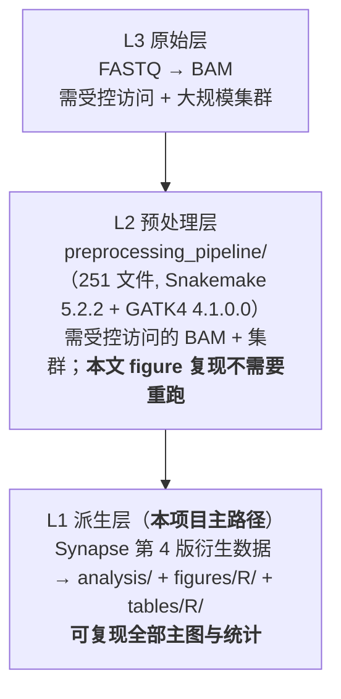
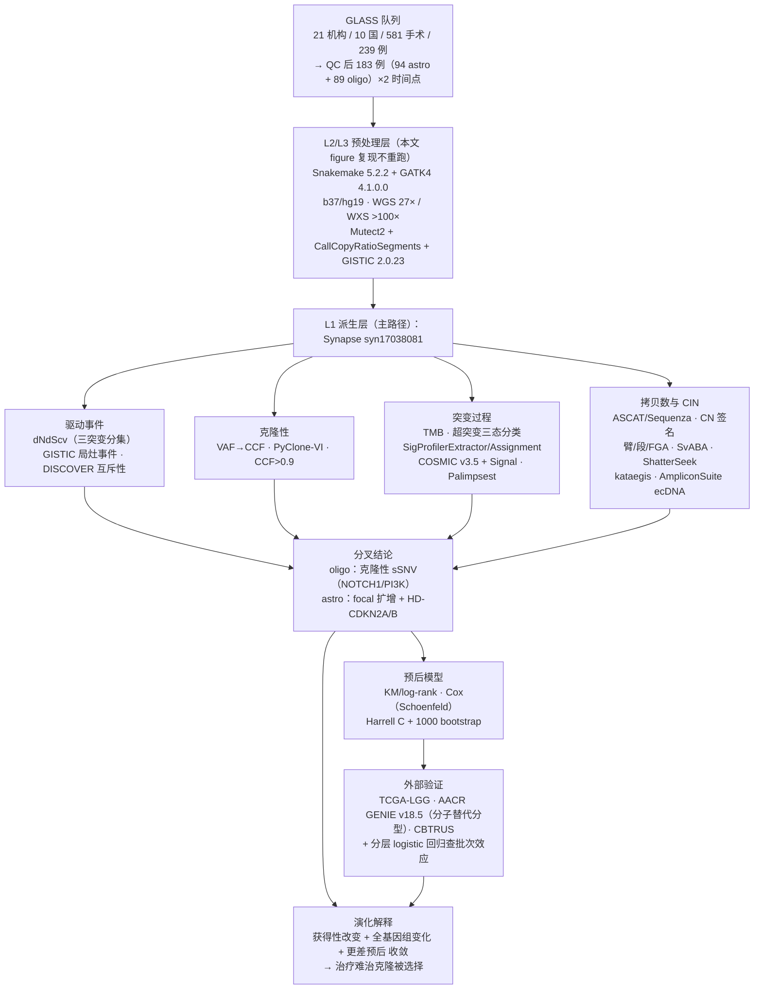

# 复现方案总目录与项目总览

> **目标文献**：The GLASS Consortium. *Divergent genomic evolution in astrocytomas and oligodendrogliomas.* **Nature**（Article，**Open access**），Received 2025-07-03 / Accepted 2026-09-10。PDF 标识 `s41586-026-11150-x`。通讯作者：Frederick S. Varn、Roel G. W. Verhaak。
> **数据**：Synapse 项目 **`syn17038081`**（Tables）+ 文件页 **`syn26465623`**（入口 <https://www.synapse.org/glass>）｜**代码**：GitHub **`github.com/verhaaklab/glass-idh`**（MIT；**经核实不是 `fsvarn/GLASSx` 的 fork**——694 commits、起始 2018-05-01、`.git/config` 无 upstream；复现锚点 HEAD = **`6bdd7292`**，2026-09-18）
>
> **规范**：遵守 **L0 通用规范 `../REPRO_SPEC.md`（v2.1）** 与 **L1 项目规范 `PROJECT_SPEC.md`**。效力：L0 > L1 > 质控门槛（13 号 §一）> 各模块文档。
>
> **本套文档的性质**：以博士生导师（PI）视角编写的**可执行复现方案**。每篇含：① 科学问题与逻辑位置；② 背景原理与公式；③ 原文逐句拆解；④ 可运行代码（优先复用官方仓库脚本）；⑤ 参数与调参空间；⑥ 预期结果与 QC 检查点；⑦ 陷阱与排错表；⑧ 与原文图表/官方脚本的对应表。

---

## ⭐ 本项目与前两个项目的根本差别：**这是本仓库第一个"数据 + 代码双公开"的文献**

| | MuM 空间多组学（20261016_mucosal_…） | 本文（GLASS IDH） |
|---|---|---|
| 原始数据 | ❌ "available upon reasonable request" | ✅ **Synapse `syn17038081` 公开**（去标识化的体细胞变异 + 临床） |
| 代码 | ❌ 无 | ✅ **GitHub 公开**，且**一图一脚本**（`figures/R/` 27 个） |
| 主要障碍 | **数据不可得** → 只能做算法复现 | **环境与依赖**、受控访问的原始测序数据、算力 |

**结论：本文可以做真正的复现，而不是"算法等价实现"。** 复现的成败取决于三件事：① 能否按 `SETUP.md` 把环境跑起来；② 能否锁定 Synapse 的**第 4 次发布**数据版本；③ 能否复算出原文的**统计量**（这是本文最可验证的部分）。

### 三级复现层级（每篇文档必须声明自己属于哪一级）

| 层级 | 需要什么 | 能复现什么 | 不能复现什么 |
|---|---|---|---|
| **L1（主路径）** | Synapse 账号 + 几十–几百 GB 磁盘 + 单机 32–64 GB 内存 | 全部主图/Extended Data 图/统计检验/生存分析/签名暴露/非整倍体/WGD/染色体碎裂判定 | 变异与拷贝数的**原始检出过程**（用的是官方已处理表） |
| **L2** | 受控访问的 BAM/WGS + 集群（GATK4/SvABA/ASCAT 全流程） | 从 BAM 重算变异/CN/SV，端到端 | FASTQ 级（比对、base recalibration） |
| **L3** | 受控访问的 FASTQ | 全部 | — |

---

## 一、文档清单（目录文件）

| 编号 | 文件名 | 内容一句话描述 | 层级 | 对应原文 |
|---|---|---|---|---|
| **规范** | `../REPRO_SPEC.md` | **L0 通用规范 v2.1**（仓库级，适用所有复现项目） | — | — |
| **规范** | `PROJECT_SPEC.md` | **L1 项目规范**：模块编号、产物契约、术语口径、D 表索引、偏离声明 | — | — |
| **00** | `00_目录与复现总览.md` | 本文件：三级层级、索引、流程图、图表映射、数据资产、算力、全局门槛 | — | Fig. 1 |
| **01** | `01_数据与代码可得性、环境与仓库结构.md` | **本项目最关键**：Synapse 表/文件页与 SQL API 查询、`glass-idh` 仓库结构与 commit 锚定、环境契约、受控访问申请、`legacy_codes/` 禁用说明 | L1/L2/L3 | Data/Code availability；SETUP.md |
| **02** | `02_队列构建、临床注释与样本QC.md` | 581 手术/239 例 → 231 → **183 例（94 astro + 89 oligo）**的口径梳理、**QC1–QC6**、GLASS barcode、配对结构（183 vs 144）、入组偏倚与 **OS-from-birth 的左侧截断** | L1 | Fig. 1；ED Fig. 1–2；Table 1；Supp. Table 1 |
| **03** | `03_变异检出与拷贝数调用.md` | GATK4 Best Practices、Mutect2/PairHMM、PoN、纵向多样本 consensus、10-kb bin、GATK CNV + GISTIC 2.0.23、中性段加权均值±2SD 阈值 | L1/L2 | Methods「Alignment and variant calling」「Copy-number calling」 |
| **04** | `04_驱动事件鉴定与互斥性分析.md` | dNdScv（三突变分集）、GISTIC GeneGISTIC 参数、**8 个染色体带**、38/94 vs 21/94、**DISCOVER 互斥性** | L1 | Fig. 2a；ED Fig. 3；Supp. Table 2–3 |
| **05** | `05_克隆性与纵向演化分析.md` | VAF→CCF 换算、**PyClone-VI**、CCF>0.9 判 clonal、获得事件的克隆性、共享比例（oligo 36%/astro 45%）、空间共享 53% | L1/L2 | ED Fig. 5、8b、8c |
| **06** | `06_突变负荷与超突变分类.md` | **TMB** 的分母陷阱、**超突变双条件定义**（>10 mut/Mb 且 SBS11 >25%）、三态分类、MSH6 与 MMR、TMZ 机制 | L1 | Fig. 3g；ED Fig. 8a；Methods「Mutational burden」 |
| **07** | `07_突变签名分析与治疗归因.md` | NMF 分解数学、**COSMIC v3.5 + Signal 拼接**、SigProfilerExtractor（max 10 / 100 replicates / 稳定性>0.8）、**Palimpsest 逐突变指派**、SBS11/SBS119/SBS97/SBS107、Fig. 4c 六个 P 值 | L1 | Fig. 4a–c；Supp. Table 12 |
| **08** | `08_拷贝数签名与全基因组加倍.md` | **ASCAT 多样本**（ρ/ψ 网格搜索）+ **Sequenza major CN fraction ≥0.5 二次过滤**、48-feature CN 矩阵、SigProfilerAssignment + COSMIC CN 签名、McNemar P=0.55/0.006 | L1/L2 | Fig. 5；ED Fig. 10–11 |
| **09** | `09_非整倍体与FGA量化.md` | 三层度量（**臂级 80% 规则/±0.1/±0.05、段级 \|log2\|>0.2、FGA 公式**）、**WGS 3×10⁹ vs WXS 5×10⁷ 分母**、复发 FGA 升高 | L1 | Fig. 5；ED Fig. 9 |
| **10** | `10_染色体不稳定性_结构变异-染色体碎裂-骤变-ecDNA.md` | **SvABA**（hs37d5 + dbSNP b138 + blacklist）、**ShatterSeek 高/低置信规则**、**kataegis**（100 模拟基因组 + 1-Mb 校正 + 仅非超突变）、**AmpliconSuite ecDNA**（18% 全在 astro） | L1/L2 | Fig. 5；ED Fig. 11–13 |
| **11** | `11_生存分析与预后模型.md` | 四个终点（OS/TTR/**OS from birth**/**PRS**）、KM/log-rank、Cox + **Schoenfeld**、**Harrell C + 1000 bootstrap**、逐步后向消除、CDKN2A/B 与局灶扩增的预后模型 | L1 | Fig. 3a–f；ED Fig. 7；Supp. Table 4–9 |
| **12** | `12_外部验证与批次效应检验.md` | TCGA-LGG / **AACR GENIE v18.5** / CBTRUS 的可比性；**GENIE 的分子替代分型规则**与错分模拟；**分层 logistic 回归**检验中心效应 | L1 | Fig. 3d,f；ED Fig. 2、4b、7c；Supp. Table 10 |
| **13** | `13_复现质控清单、排错与批判性评述.md` | QC 门槛表、跨模块排错、**原文疏漏与矛盾逐条核对**、证据等级、**D 表（决策登记）**、gap 表 | — | 全文 |
| **14** | `14_背景知识精讲与方法学原理速查.md` | IDH 胶质瘤分子病理与治疗、CIN 现象学、突变签名体系、克隆演化理论、工具速查、文献导读 | — | 全文 |

---

## 二、科学问题与证据链

### 2.1 科学问题（一句话版）

**同为 IDH 突变胶质瘤，为什么星形细胞瘤（astrocytoma）与少突胶质细胞瘤（oligodendroglioma）在复发时走向不同的基因组演化路径？这些路径由什么驱动、能否预测预后？**

原文答案链（复现时逐条验证，**并标注该条属于 L1 可复现还是 L2/L3**）：

1. **队列**：21 家机构、10 国；581 台手术 / 239 例 → QC 后 **183 例（94 astro + 89 oligo）** 的两个时间点；WGS（39/56）与 WXS（55/33）。
2. **既有结论的验证**：初诊富集 **TP53/ATRX（astro）** 与 **CIC/FUBP1（oligo）**；复发时获得 **超突变** 与 **CDKN2A/B 纯合缺失**。
3. **分叉点**：复发 **oligo 获得克隆性 sSNV（NOTCH1、PI3K/PIK3CA/PIK3R1）**；复发 **astro 获得局灶癌基因扩增与 CDKN2A/B 纯合缺失**（38/94 vs 21/94；8 个染色体带；**18% 的扩增为 ecDNA 且全在 astro**）——**与治疗无关**（irrespective of treatment）。
4. **预后**：**CDKN2A/B 纯合缺失**（中位 PRS 1.1 vs 3.2 年，P=0.01）与**局灶癌基因扩增**（1.2 vs 3.8 年，P=0.001）独立预测不良预后；验证了 WHO 2021 把 CDKN2A/B 缺失列为 astrocytoma grade 4 标志的合理性。
5. **突变过程**：**TMB 低**（初诊中位 1.5 / 1.6 mut/Mb）；复发时**排除超突变者后 TMB 仍显著升高**；**超突变由 TMZ+SBS11 定义**；**SBS97/SBS107 等新编号签名**与治疗/类型相关。
6. **染色体不稳定**：复发时 **FGA 在两型均升高**，但 **astro 的升高与获得性 focal CNA 汇合**，并伴随 **chromothripsis、WGD** 等 CIN 标志（**astro 的 WGD 进展显著：McNemar P=0.006**，oligo 不显著 P=0.55）。
7. **整合结论**：两型都在"获得性改变 + 全基因组变化 + 更差预后"上**收敛**，提示**治疗难治克隆被选择**；但**选择的靶点不同**——oligo 走 sSNV 路线，astro 走 CNA/CIN 路线。

### 2.2 全流程图

### 2.3 原文图表 → 文档映射

| 原文图 | 内容 | 复现文档 | 层级 |
|---|---|---|---|
| Fig. 1a–c | GLASS 队列地图/时间线/治疗与生存概览 | 02 | L1 |
| Fig. 2a–d | 驱动 sSNV/CNA 的纵向景观（含 8 个扩增带、38/94 vs 21/94、超突变标记） | 04 / 06 | L1 |
| Fig. 3a–f | 生存分析（HM、PI3K/NOTCH1、CDKN2A/B、focal amp、GENIE 验证） | 11 / 12 | L1 |
| Fig. 3g | 非超突变者复发 TMB 升高 | 06 | L1 |
| Fig. 4a–c | 签名时序、SBS/ID 比例（含 6 个 P 值） | 07 | L1 |
| Fig. 5 | 非整倍体/FGA、WGD、chromothripsis、kataegis、ecDNA | 08 / 09 / 10 | L1 |
| ED Fig. 1a,b | 分子数据队列选择流程（QC） | 02 | L1 |
| ED Fig. 2a–c | 与 TCGA/CBTRUS 的入组偏倚比较（含 OS-from-birth） | 02 / 12 | L1 |
| ED Fig. 3a–d | dNdScv 结果与复发获得突变 | 04 / 06 | L1 |
| ED Fig. 4b | GENIE 验证（HM 与复发） | 12 | L1 |
| ED Fig. 5a,b | 克隆性变化（clonal burden、驱动事件克隆性） | 05 | L1 |
| ED Fig. 6a–c | IDH 亚型与 OS/签名/FGA 的关系 | 04 / 11 | L1 |
| ED Fig. 7a–d | CDKN2A/B 与 focal amp 的亚组生存（含 grade 2–3 vs 4） | 11 / 12 | L1 |
| ED Fig. 8a–c | TMB 与 grade、共享突变比例、空间共享 | 06 | L1 |
| ED Fig. 9 | 非整倍体三层度量 | 09 | L1 |
| ED Fig. 10–11 | WGD 与拷贝数签名 | 08 | L1 |
| ED Fig. 11–13 | chromothripsis / kataegis / ecDNA | 10 | L1 |
| Supp. Table 1 | 每患者 QC 后分子数据摘要 | 01 / 02 | L1 |
| Supp. Table 2 | GISTIC 局灶事件统计 | 04 | L1 |
| Supp. Table 3a–f | IDH 亚型分布与各驱动事件比较 | 04 | L1 |
| Supp. Table 4–9 | 生存模型（单/多因素、逐步、手术时机） | 11 | L1 |
| Supp. Table 10a–c | 治疗与复发驱动改变的关联（**用 FDR**） | 12 | L1 |
| Supp. Table 12 | **novel 签名清单**（cosine <0.8 保留者） | 07 | L1 |

---

## 三、数据资产清单

| 资产 | 内容 | 可得性 | 入口 |
|---|---|---|---|
| Deidentified 体细胞变异 + 临床 | 本文主分析输入 | ✅ **公开** | **Synapse `syn17038081`（Tables）** |
| 文件页 | 数据文件（第 4 次发布） | ✅ 公开（需 Synapse 账号） | **`syn26465623`**；入口 <https://www.synapse.org/glass> |
| 每患者 QC 后摘要 | 汇总版 | ✅ | **Supplementary Table 1** |
| 官方代码 | 预处理 + 分析 + 一图一脚本 | ✅ 公开（MIT） | **`github.com/verhaaklab/glass-idh`** |
| 原始测序数据（FASTQ/BAM） | 重跑 L2/L3 才需要 | ⚠️ 受控访问 | dbGaP/EGA（**申请路径见 01 号文档**） |
| TCGA-LGG | 参考队列 | ✅ 公开 | GDC Data Portal |
| AACR GENIE v18.5 | 外部验证 | ✅ 公开（注册） | `synapse.org/genie` / `genie.cbioportal.org` |
| CBTRUS | 人群基线 | ✅ 公开 | CBTRUS 报告 |
| COSMIC v3.5 签名 + Signal | 签名参考库 | ⚠️ COSMIC 需注册/许可；Signal 公开 | 见 07 号文档 |
| 参考基因组 | **b37/hg19（human_g1k_v37_decoy）**；SvABA 用 **hs37d5** | ✅ 公开 | 见 01 号文档 |

> ⚠️ **导师批注**：本项目**没有任何"数据缺失"的借口**。凡本方案中写"原文未报告"的地方，都应优先在**官方代码与 Synapse 表中找出答案**——这正是与 MuM 项目最大的方法论差别。

> 🔎 **资源核实状态（PI，2026-10-16）**：
> - **GitHub 代码仓库：已实测核实** ✅ —— 通过 GitHub API 枚举出 `figures/R` **27 个脚本**、`analysis/R` **12 个**、`tables/R` **16 个**的真实文件名，完整清单见 `PROJECT_SPEC.md` §3.3（含「脚本 ↔ 图号」的**推断**映射，标注为推断）。
> - **Synapse 项目：PI 未能独立核实** ⚠️ —— 本机 DNS 解析 `repo-prod.prod.synapse.org` 失败（ENOTFOUND），网页端返回 **403**（需登录）。
>   **开工前必须由使用者登录 Synapse 人工确认** ① `syn17038081` 存在且可读 ② `tables/` 的实际表名与行数 ③ 是否需签 DUA；**确认前不得写入具体表名、不得声称数据已就绪**，结果记入 `logs/DECISIONS.md`。

---

## 四、计算资源与工期建议

| 模块 | 内存 | CPU | 时间 | 备注 |
|---|---|---|---|---|
| Synapse 取数（表查询 + 文件下载） | 8–16 GB | 4 核 | 数小时–1 天 | 表查询快；文件下载取决于体量 |
| L1 主图复现（`figures/R/` 27 脚本） | 16–32 GB | 8 核 | 1–3 天 | **单机可完成**；难点在依赖 |
| 突变签名（SigProfilerExtractor 100 replicates） | **32–64 GB** | 16–32 核 | 数小时–1 天 | NMF 100 次重复是瓶颈 |
| 生存分析全套（含 bootstrap C-index） | 8–16 GB | 8 核 | 数小时 | — |
| L2 预处理层（如做） | **256 GB+** | 集群 | 数周 | GATK4/SvABA/ASCAT 全流程 + 多样本 |
| L3 原始层 | 集群级 | — | 数月 | 一般不必要 |

**建议**：**只做 L1**。配置 32 GB/16 核单机 + 数百 GB 磁盘即可复现全部主图与统计；L2/L3 只在需要质疑官方变异检出时才做。

---

## 五、全局质控点（Go/No-Go 门槛）

复现者在每个阶段结束时核对（原文报告值；允许实现差异导致的 **±10%** 波动，超出即回查）：

1. **队列**：QC 后 **183 例 = 94 astro + 89 oligo**；WGS 39/56、WXS 55/33；**122 对 Tx–R1** 与 183/144 两套配对口径。
2. **临床**：中位 OS **astro 7.8 年 / oligo 21.4 年**；中位随访 **6.5 / 11.4 年**；grade 2 占比 **73% / 93%**；分级升高 **59% / 47%**；TMZ **71%**、放疗 **68% / 69%**。
3. **驱动**：初诊 TP53/ATRX（astro）、CIC/FUBP1（oligo）；**8 个扩增带命中**；**38/94（复发）vs 21/94（初诊）**；**CDKN2A/B HD 在非超突变 astro 的 McNemar P = 0.009**。
4. **克隆性**：CCF > 0.9 判 clonal；oligo 的获得性 PIK3CA/NOTCH1/PIK3R1 主要 clonal；astro 的获得性 CDKN2A 缺失主要 clonal。
5. **TMB/超突变**：初诊中位 **1.5 / 1.6 mut/Mb**；HM 计数 **oligo 16/70、astro 20/74**；共享突变比例 **36% / 45%**；空间共享 **53%（n=5）**。
6. **签名**：oligo 抽出 **7 SBS + 7 ID**；astro **10 SBS + 6 ID**；平均稳定性 **>0.8**；**Fig. 4c 六个 P 值（0.077 / 3.8e-5 / 8.7e-6 / 0.0034 / 6.5e-5 / 0.042）方向一致**。
7. **CIN（面板归属已按 PDF 坐标逐字核实）**：复发 FGA 两型均升高；**WGD（Fig. 5c）：n = 89/90，McNemar P = 0.55（oligo）/ 0.006（astro）**；**chromothripsis（Fig. 5d）：n = 56/38 → 56/39，Fisher P = 2.1×10⁻⁶ / 6.6×10⁻⁶**；**chromothripsis×放疗（Fig. 5e）：n = 51/38，Fisher P = 0.24 / 0.046**；**kataegis（Fig. 5f）：n = 45/33，Fisher P = 0.23 / 0.01**；**ecDNA 18% 且全在 astro**。
   > ⚠️ **纠正**：00/13 早期版本把 WGD 与 chromothripsis 的 n 与 P 值**串行**了（WGD 误写 n=56/38、chromothripsis 误写 n=45/33）。现已按 PDF 版面坐标核对改正（见 13 号 §四 #28）。
8. **生存**：HM 复发后生存 **oligo P=0.037、astro P=0.00041**；**CDKN2A/B HD P=0.01（中位 1.1 vs 3.2 年）**；**focal amp P=0.001（1.2 vs 3.8 年）**；**合并 P<0.001（1.5 vs 5.3 年）**；多因素 Cox **CDKN2A/B P<0.001、focal amp P=0.003**。
9. **验证**：GENIE **oligo n=465（P=0.03）/ astro n=452**；GLASS 内 PI3K/NOTCH1 **P=0.25（n=69，不显著）**——**方向不一致要如实报告**。

> **L1 复现的"最强验收判据"**：**从 Synapse 公开数据独立重算上述统计量**，与原文数值在容差内一致（p 值比量级、比例比 ±10%、方向必须一致）。这是本文相比前两个项目**唯一可做、也必须做**的硬核验收。

---

## 六、工程约定（本项目）

1. **目录**：`raw/{synapse,glass_raw,reference,cosmic,genie}/`、`processed/`、`results/`、`figures/`、`code/`、`logs/`（不用 `data/` 前缀）。
2. **官方代码隔离**：`code/glass-idh/` = **`git clone` 而来、只读、不改**（记录 `git rev-parse HEAD` 作为复现锚点）；我们的改造版放 `code/`；**`legacy_codes/` 禁用**（官方声明未与当前数据同步）。
3. **可复用脚本放仓库 `tools/`**（L0 §1.4）：本项目新增 `tools/repro_onboard.sh`（按 L0 附录 A/B 一键生成项目骨架）。
4. **随机种子**：R `set.seed(20260101)`；Python `np.random.seed(20260101)`（NMF replicates、bootstrap、模拟基因组、PyClone）。
5. **版本锚定**：Synapse release（第 4 次发布）日期 + `glass-idh` commit hash + COSMIC 版本（v3.5）+ 参考基因组（b37/hs37d5）——**四者必须写进 `logs/DECISIONS.md`**。
6. **统计**：非配对分类 Fisher/χ²、连续 Wilcoxon rank-sum/Kruskal–Wallis；配对分类 **McNemar**、连续 **Wilcoxon signed-rank**；多重校正 BH(FDR)；双侧 P<0.05。
7. **诚实性红线**（L0 §12）：L2/L3 未跑就明说；方向与原文不一致时**不得**只报一致的部分。

---

## 七、推荐执行路径（三档）

| 档位 | 目标 | 覆盖 | 工时 |
|---|---|---|---|
| **A. 快速验证** | 跑通环境 + 取数 + 复现 3 张最能代表结论的图（Fig. 2a、Fig. 3e、Fig. 5 的 FGA/WGD 面板） | 01 + 03（取数）+ 04 + 11 + 09 | 1–2 周 |
| **B. 完整 L1（推荐）** | 全部主图 + Extended Data 图 + 统计量独立重算 + 与原文逐项对照 | 01–12 | 4–8 周 |
| **C. L1 + L2（质疑型复现）** | 对官方变异/拷贝数检出提出质疑时，用受控访问 BAM 重跑关键样本 | 全部 + L2 | 3–6 个月 |

> **导师视角的收尾**：这是本仓库**第一个真正意义上"可复现"的文献**。它的复现价值不在"能不能跑出图"，而在**能否把原文的每一个统计量从公开数据重算出来、并如实报告不一致处**。做到这一点，这份方案就可以直接作为**方法学与可复现性教学的范本**。
