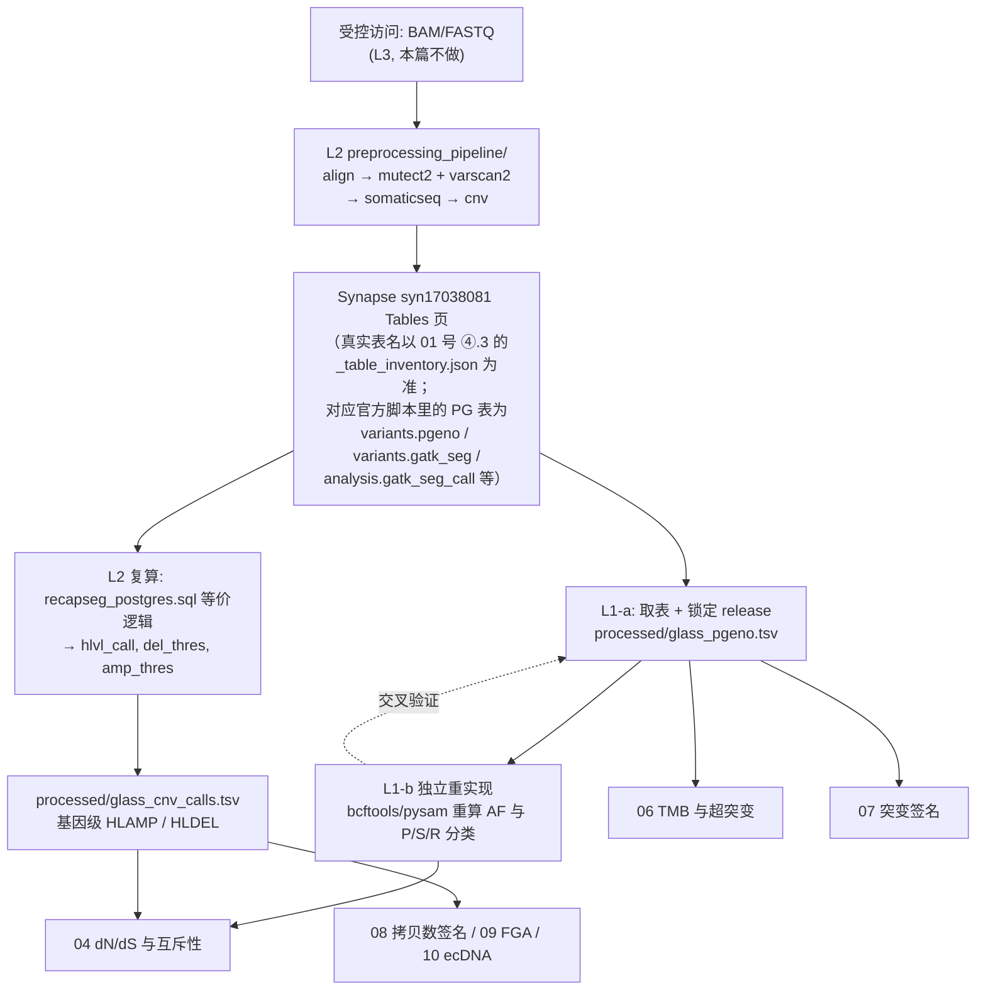
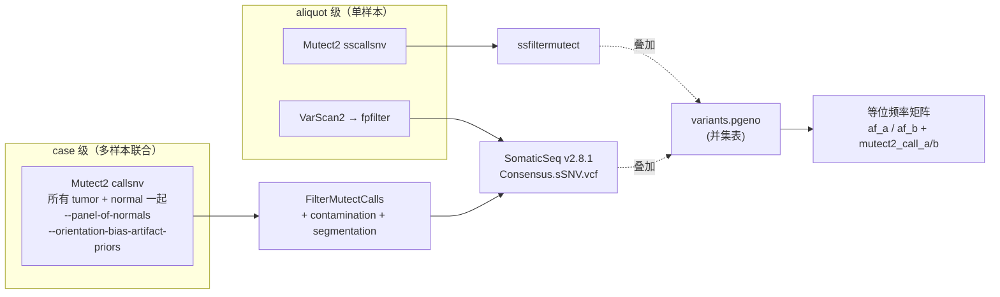
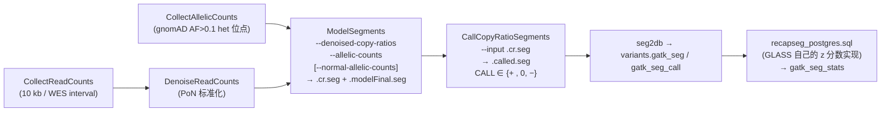

# 03 变异检出与拷贝数调用

> **目标文献**：The GLASS Consortium. *Divergent genomic evolution in astrocytomas and oligodendrogliomas.*
> *Nature* (2026). PDF 标识 s41586-026-11150-x. 数据：Synapse syn17038081；代码：github.com/verhaaklab/glass-idh
>
> **模块对应原文**：Fig. 2a（sSNV + CNA 联合 landscape 的"输入矩阵"）；Extended Data Fig. 1b（QC 漏斗）；Methods 中「DNA sequencing」「Computational pipelines」「Alignment and variant calling」「Copy-number calling」「Molecular data cohort selection」「sSNV calling」六段
> **复现层级**：**L1 派生层（主路径，本篇 90% 工作量）** ＋ **L2 预处理层（只写"怎么跑 + dry-run"，不实际重跑）**；**L3 原始层（从 FASTQ 端到端）本篇明确不做**
> **前置依赖**：`01_数据与代码可得性、环境与仓库结构.md`（Synapse 表清单、`code/glass-idh/` 的 clone 与 conda 环境）；`02_队列构建、临床注释与样本QC.md`（`analysis.gold_set` 的 183 例「首次 vs 末次」配对定义 + 产物契约 `processed/glass_gold_pairs.tsv`、`processed/glass_subtypes.tsv`）
> **下游依赖**：`04_驱动事件鉴定与互斥性分析.md`（消费本模块产出的等位频率矩阵 `processed/glass_pgeno.tsv` 与基因级高拷贝调用 `processed/glass_cnv_calls.tsv`）、`06_突变负荷与超突变分类.md`、`07_突变签名分析与治疗归因.md`、`08_拷贝数签名与全基因组加倍.md`、`09_非整倍体与FGA量化.md`、`10_染色体不稳定性_结构变异-染色体碎裂-骤变-ecDNA.md`
> **复现难度**：★★★★☆（**L1 单独只有 ★★☆☆☆**）　**预计工时**：L1 3 人日；含 L2 dry-run + 单样本最小子集打通 8 人日　**计算资源**：L1 8 核 / 16 GB 内存足够；L2 单样本 WGS 全链条 8–16 核 / 32 GB，按 `conf/cluster.json` 单节点 6–12 小时

---

## 0. 执行摘要（先读这 12 行）

**模块定位**：本文所有下游结论（差异演化、dN/dS、签名、生存）都建立在两张矩阵之上——**样本 × 变异的等位频率矩阵**与**样本 × 基因的拷贝数调用矩阵**。本模块就是讲清这两张矩阵**怎么来的、参数在哪、坑在哪**。

**本项目与前两个项目最根本的差别**：GLASS 的变异/拷贝数调用流程（`preprocessing_pipeline/`，251 文件、30 个 Snakemake 模块、44 个 conda 环境）**是公开的**，我们**能读到每一条 `gatk` 命令的原参数**。因此本模块的写法不是"猜参数"，而是**"读官方 Snakefile 反推 Methods 里没写的参数"**。这是本项目最大的复现红利。

**三条主路径**：

| 路径 | 做什么 | 是否本篇必做 | 产出 |
|---|---|---|---|
| **L1-a** | 从 Synapse syn17038081 Tables 页直接取已处理的 sSNV / CNA / 临床表，锁定 release 后做**数值一致性核对** | ✅ 必做 | `processed/glass_pgeno.tsv`、`processed/glass_cnv_calls.tsv` |
| **L1-b** | 用 `bcftools`/`pysam` **独立重实现**等位频率矩阵与「共享 / 初诊特异 / 复发特异」分类，与官方发布的逐变异表（PG 名 `variants.pgeno`；**Synapse 侧实际表名待人工核实**，见 `01` 号 §1.4）交叉验证 | ✅ 必做（这是"独立验证"的红线要求） | `results/qc/pgeno_reimpl_check.tsv` |
| **L2** | 官方 `preprocessing_pipeline/Snakefile` 的 `--dry-run` 复算 DAG；再打通**单样本最小 GATK4 链** | ⚠️ 选做（写清怎么跑，不实际重跑全队列） | `logs/dryrun_dag.txt` |

**四个必须记住的原文数值锚点**：183 例（94 astro + 89 oligo）；WGS 39 astro + 56 oligo，WXS 55 astro + 33 oligo（39+55=94 ✓，56+33=89 ✓）；WGS 平均 27×、WXS >100×；驱动突变深度 WGS 30–80×、WXS 80–300×。

> ⚠️ **导师批注（本模块最重要的一条）**：原文 Methods「Alignment and variant calling」写的是「GATK4 was used ... BCFTools (v.1.9) normalized, sorted and indexed variants to generate a consensus variant call format (VCF) file」。但仓库里 `preprocessing_pipeline/snakemake/somaticseq.smk` 的头部注释白纸黑字写着 **"Snakefile for SomaticSeq Varscan2 and Mutect2 consensus calling"**，命令是 `SomaticSeq.Wrapper.sh ... --mutect2-vcf ... --varscan-snv ... --varscan-indel ...`（SomaticSeq v2.8.1）。也就是说：**"consensus" 指的极可能是 Mutect2 ∩ VarScan2 的双调用器交集共识，而不是 BCFtools 的单纯归一化**。原文完全没提 VarScan2、没提 SomaticSeq。这直接决定"假阳性率"的复现口径，必须登记 D 表（见 §3.3 与 §7）。**在拿到 Synapse 数据前，不要假定自己能从 FASTQ 重跑出与官方一致的变异集**。

---

> **骨架对应（L0 §8.2）**：本篇按 ①–⑧ 骨架组织，为便于正文交叉引用而保留数字小节号 —— **① = §1 科学问题与逻辑位置**、**② = §2 背景原理**、**③ = §3 原文逐句拆解**、**④ = §4 逐步可运行代码**、**⑤ = §5 参数解释与调参空间**、**⑥ = §6 预期结果与 QC 检查点**、**⑦ = §7 陷阱与排错表**、**⑧ = §8 与原文图表/官方脚本的对应关系表**；§9–§11 为本模块附加的接口/交叉引用/D 表登记。

## 1. 科学问题与逻辑位置

### 1.1 上游给什么、下游要什么



### 1.2 为什么这一步在整个项目里"错不起"

本文的核心论点是**"复发时 astrocytoma 走 CNA 路线、oligodendroglioma 走 sSNV 路线"**。这个论点用到的三个关键统计量，全部直接由本模块产出：

1. **"复发特异突变"（R 集）的数量**——dN/dS 的输入（见 `04`）。若初诊与复发的覆盖度分布不对称，R 集会被系统性污染（§2.2 有定量模拟）。
2. **基因级高拷贝扩增 / 纯合缺失调用**——`38/94 vs 21/94`、`McNemar P = 0.009`、`18% ecDNA` 全部建立在 `hlvl_call ∈ {−2, +2}` 上（见 `04`）。阈值差一点点，"38/94" 就会变成 "34/94" 或 "43/94"。
3. **共享突变比例**——`oligo 36% / astro 45%` 是"复发肿瘤与初诊肿瘤系统发育距离"的核心读数（见 `06`），高度依赖检出灵敏度。

---

## 2. 背景原理

### 2.1 体细胞变异检出的统计基础

#### 2.1.1 等位基因深度似然：从二项到 beta-二项

设某位点覆盖 $n$ 条 reads，其中支持 alt 的有 $a$ 条，真实变异等位频率为 $f$。最简单模型是二项分布：

$$
P(a \mid f, n) = \binom{n}{a} f^{a}(1-f)^{n-a}
$$

但实测数据**永远比二项分布更"胖"**（overdispersion）：建库 PCR 重复、比对错误、局部比对歧义、肿瘤亚克隆混合都会让同一 $f$ 下的 $a$ 方差大于 $nf(1-f)$。工程上用 **beta-二项分布**吸收这部分：

$$
f \sim \mathrm{Beta}(\alpha, \beta),\quad
P(a \mid \alpha,\beta,n) = \binom{n}{a}\frac{B(a+\alpha,\; n-a+\beta)}{B(\alpha,\beta)},\qquad
B(x,y)=\int_0^1 t^{x-1}(1-t)^{y-1}dt
$$

把它改写成"均值 + 离散度"参数更直观（这也是 PyClone / CNA 拷贝数模型常用的写法）：

$$
f = \frac{\alpha}{\alpha+\beta},\qquad
\rho = \frac{1}{\alpha+\beta+1}\ \ (\text{intra-class correlation})
$$

$\rho \to 0$ 退化为二项分布；$\rho$ 越大，"深度涨了但信息量不涨"越严重。实作中 $\mathrm{Var}(a) = n f(1-f)\left[1+(n-1)\rho\right]$，**这正是"WGS 27× 与 WXS 100× 不能直接互换"的数学根源**。

> 与 GATK 的对应：Mutect2 的 `TLOD`（log-odds）就是"数据在 alt 存在 vs 不存在的似然比"的对数；仓库里 `mutect2.smk` 的 `callsnv` **显式传了** `--standard-min-confidence-threshold-for-calling 20`，即 **Phred 20 ≈ 1% 的错误概率**才进入 calling。⚠️ **这不等于是 GATK4 的默认值**——该参数的默认值在 GATK4 文档里通常标为 **30**，因此官方很可能是**显式下调**了 calling 阈值（更敏感、假阳性更多，随后靠 PoN + orientation bias + 双调用器共识压回来）。**用 `gatk Mutect2 --help` 在你实际安装的版本上核对，不要凭印象断言"官方没调"**。

**检出概率的实用近似**（后文模拟代码就用它）：一个真变异落到样本里的 reads 数 $X\sim \mathrm{Binom}(d, v)$，其中 $v$ 是该样本中该变异的观测等位频率。若要求"至少 $k$ 条 alt reads"（Mutect2 实践上 $k\approx 3$ 才能稳过 `TLOD 20` 与 `FilterMutectCalls`）：

$$
P_{\text{detect}}(d,v) = 1 - \sum_{i=0}^{k-1}\binom{d}{i}v^{i}(1-v)^{d-i}
$$

一个克隆的杂合 SNV 在没有 CNA 的情况下，$v \approx \text{纯度}\times 0.5$（更精确地 $v = \phi\, c_{\text{alt}} / (c_{\text{total}})$，$\phi$ 为肿瘤纯度、$c$ 为拷贝数态；见 §2.3.5）。**这个式子是本模块全部"覆盖度陷阱"的单一来源**。

#### 2.1.2 PairHMM 局部重组装：为什么 indels 和复杂位点需要它

纯 pileup 计数在三种情形下会系统性错判：(a) indel 附近的错位比对；(b) 含多个近邻变异的 haplotype；(c) 测序错误恰好落在变异位点。GATK（HaplotypeCaller / Mutect2）的对策是 **local reassembly + PairHMM**：

1. 在"活跃区域"内用 de Bruijn 图重建候选 haplotype；
2. 对**每一条 read**，用 **pair hidden Markov model（PairHMM）** 计算"该 read 由该 haplotype 生成"的似然 $P(\text{read}\mid h)$。PairHMM 的状态是 `M`（match）、`I`（insertion）、`D`（deletion），转移概率由 gap open/extend 参数给出，发射概率由碱基质量 $Q$ 转换得到（$P_{\text{err}} = 10^{-Q/10}$）；
3. 对候选 haplotype 做**边缘化**得到基因型似然。

**复现含义**：（i）PairHMM 是计算瓶颈，官方 `conf/cluster.json` 给 `callsnv` 分配了较高 CPU；做 L2 单样本演示时必须保留 `-bamout`（仓库里 `callsnv` 确实有 `-bamout {output.bam}`），这样你能用 IGV 目视核对重组装结果。（ii）`--dont-use-soft-clipped-bases true` 在仓库 `callsnv`/`sscallsnv` 都有——它**降低**了 SV/大 indel 邻域的假阳性，但**也降低了**断裂点附近的灵敏度。

#### 2.1.3 Orientation bias：FFPE 与氧化损伤伪影

**现象**：福尔马林固定会造成胞嘧啶脱氨（C→T/G→A），氧化会造成 8-oxoG（G→T/C→A）。这些损伤在**双链上的分布是不对称的**，因此"支持 alt 的 reads 来自 F1R2 还是 F2R1 方向"会出现异常偏斜。正常测序错误在两个方向上近似对称。

**GATK 的处理链**（仓库 `mutect2.smk` 三段齐全，可直接引用）：

```
CollectF1R2Counts        → {aliquot}.alt.tsv / {aliquot}.ref.metrics / {aliquot}.alt.metrics
LearnReadOrientationModel→ {aliquot}.priors.tsv     （每个 artifact × 上下文的 Dirichlet 先验）
FilterMutectCalls        ← --orientation-bias-artifact-priors ...priors.tsv（在 callsnv 阶段注入）
```

`LearnReadOrientationModel` 的本质是**为每个 (ref, alt, 三核苷酸上下文) 学一组 Dirichlet 超参数**，描述"F1R2/F2R1 偏斜"的期望分布；`FilterMutectCalls` 再用它算出一个后验，把偏斜过头的 call 打上 `orientation` 标签。**关键点：这是一个"用同一样本自身"估计的模型，不是跨样本借参数**——所以它对**每个样本都必须单独跑**，不能省。

> ⚠️ **导师批注**：文献 QC 条件 QC3 写的是 "mutation frequency was not zero and not abnormally elevated (indicative of FFPE artefacts)"——这是**队列级**的粗筛，而 orientation bias 过滤是**位点级**的细筛。二者不是同一件事，不要互相替代。原文没有报告 FFPE 样本占比，这是 `12_外部验证与批次效应检验.md` 需要追的一个缺口。

#### 2.1.4 PoN（panel of normals）：批次伪影的"照妖镜"

**为什么需要**：某些位点在特定建库/测序批次里会稳定出现低 VAF 的假 alt（mapping error hotspot、文库制备副产物）。它们**在单个样本里看像体细胞变异**，但在"全批次正常样本"里反复出现。

**Mutect2 的 PoN 机制**：`CreateSomaticPanelOfNormals` 把一堆**tumor-only 模式**下 called 的变异（注意：`callpon` 规则里**没有 `--germline-resource`**，这是故意的——否则真实生殖系变异会被排除掉，失去 PoN 的意义；同时**也没有 `--normal-sample`**，在 GATK 4.1.0.0 里正是"不给 normal"来实现 tumor-only / artifact-detection 模式，较新版本的 GATK 提供了显式的 `--tumor-only` 参数——**需按当前版本核对**）合并成一张"黑名单 + 背景等位频率"表。`callsnv` 时用 `--panel-of-normals` 注入：**任何在 PoN 中出现过的等位，其体细胞似然被大幅下调**。

**GLASS 的具体做法（仓库可查，原文只说"separating the cohort by sequencing centre"）**：

| 层级 | 规则 | 出处 |
|---|---|---|
| SNV PoN 分母 | `manifest.getBatchByCase()` —— **按 aliquot batch（中心）** | `mutect2.smk` `callsnv` / `createpon` |
| SNV PoN 构建 | 该 batch 全部正常样本 tumor-only 调用 → `MergeVcfs` → `CreateSomaticPanelOfNormals` | `mutect2.smk` `callpon`/`mergepon`/`createpon` |
| CNV PoN 分母 | `manifest.getPONAliquotsByBatchAndSex(...)` —— **按 batch × 性别 × 染色体集合（autosomal/allosomal）** | `cnv.smk` `createcnvpon` |

**按中心建 PoN 的理由**：不同中心的建库试剂、捕获试剂盒、测序仪版本、甚至比对参考的 decoy 处理都会产生**中心特异的伪影谱**。混合建 PoN 会：(a) 稀释掉中心特异伪影 → 假阳性上升；(b) 把 A 中心的伪影当成 B 中心的真变异去过滤 → 假阴性上升。

> ⚠️ **导师批注**：**按中心建 PoN 有一个致命副作用——小中心没有足够的正常样本**。若某中心只贡献 3 个正常样本，PoN 的统计功效极弱，该中心的假阳性率会显著高于大中心。原文「Assessment of batch effects」段只用**分层 logistic 回归**检验了"中心 × 复发 sSNV/CNA/签名"的关联并报告"no significant centre-specific effects"，但**没有报告每个中心进入 PoN 的正常样本数**。这是复现时第一个要去查的元数据（Synapse `biospecimen.aliquots` / manifest）。若某些中心 PoN 样本数 < 5，应在 `12` 号文档中把该中心单独标记。

#### 2.1.5 污染估计（contamination）

`GetPileupSummaries` + `CalculateContamination` 的两步法：

$$
\hat{c} = \text{在"已知高 MAF 生殖系位点"上观测到的非主等位比例}
$$

- 参考位点集：仓库 `conf/config.yaml` 里是 `small_exac_common_3_b37.vcf.gz`（ExAC 常见位点子集），GLASS 用它而不是 gnomAD 全集，是为了**位点数可控 + MAF 足够高**（否则污染信号被采样噪声淹没）。
- 仓库里 `calculatecontamination` 带 `--matched-normal`，即用**配对正常样本**的污染估计来校正肿瘤的污染估计——比 tumor-only 的 `CalculateContamination` 更可靠。
- 输出 `.contamination.txt` 与 `.segmentation.txt` 通过 `FilterMutectCalls` 的 `--contamination-table` / `--tumor-segmentation` 注入。

**污染对复现的影响**：污染 $c$ 直接抬高所有低 VAF 假阳性的似然。若 $c = 0.05$，一个真实 VAF 只有 0.02 的亚克隆变异与"污染带来的 0.05×0.5=0.025 背景"完全不可分。**原文未报告队列污染度分布**——这是必须自己算的 QC 量（见 §4.4 的检查清单）。

### 2.2 纵向样品的关键设计：为什么假阴性比假阳性更致命

#### 2.2.1 三套 calling + 叠加（原文与仓库的对应）

原文原句：*"BCFTools (v.1.9) normalized, sorted and indexed variants to generate a consensus variant call format (VCF) file, which was then annotated and used to compare allele frequencies between related samples, with single-sample variants overlaid on multi-sample calls to infer individual sample mutations."*

拆开是三件事：

| 步骤 | 原句关键词 | 仓库里的对应 | 作用 |
|---|---|---|---|
| ① 多样本联合 calling | "in tumour samples and patient cohorts" | `mutect2.smk` `callsnv`（case 级：一个 case 的所有 tumor + 所有 normal 一起 `-I`） | 让同一位点在**所有相关样本**里都被基因分型，产生 `mutect2_call_a`/`mutect2_call_b` 这类**跨样本布尔矩阵** |
| ② 单样本 calling | "single-sample variants overlaid" | `mutect2.smk` `sscallsnv`（aliquot 级） | 捞回那些"在联合 calling 里被别的样本的似然压低"的变异 |
| ③ 叠加 | "overlaid on multi-sample calls" | `variants.pgeno`（`processing_pipeline/sql/variants/passgeno.sql` 里 `t1 UNION t2`） | **并集**：`t1` 是 IDH/TERT 热点（无论 filter 状态，只要求 `sum_alt_case > 0`），`t2` 是 `info.filter = 'PASS'` 的全部变异 |
| ④ 双调用器共识 | "consensus VCF" | `somaticseq.smk`：Mutect2 ∩ VarScan2 | 假阳性控制（**原文未报告**，见 §0 导师批注） |



#### 2.2.2 为什么"假阴性"在这个设计里更危险

**核心不对称**：本文的比较对象是「**共享突变集 S**」vs「**仅初诊特异 P**」vs「**仅复发特异 R**」。这三个集合由**同一个真变异在两个样本里的检出状态**决定。设真变异 $i$ 在初诊/复发的检出概率分别为 $p_A^{(i)}, p_B^{(i)}$：

$$
P(i\in S)=p_Ap_B,\qquad P(i\in P)=p_A(1-p_B),\qquad P(i\in R)=(1-p_A)p_B
$$

- **假阳性**：只污染 $S$（或制造两个不存在的 $P$/$R$），且双调用器共识 + PoN + orientation filter 已把它压得很低；
- **假阴性**：**把真·共享变异"降级"成 P 或 R**。这不是"少了一个数据点"，而是**改变了分类标签**——一个真·truncal 的 driver 突变被误判成"复发新获得"，直接给出错误的生物学结论。

**更隐蔽的一点**：单独看 $S$ 的绝对数下降（"共享比例只有 36%"）还可以说成生物学（空间异质性、亚克隆），**但 P 与 R 的相对失衡会制造方向性偏差**。若复发样本平均覆盖度高于初诊，则 $(1-p_A)p_B > p_A(1-p_B)$，**凭空制造"复发特异突变"**。见下面的定量模拟。

#### 2.2.3 定量模拟：覆盖度 → 分类错误率

**模型设定**（全部可复现，种子 `20260101`）：

- 真·共享突变集，其细胞分数 $\phi$ 服从混合分布：60% 克隆（$\phi\sim U(0.9,1.0)$），40% 亚克隆（$\phi\sim U(0.05,0.9)$）；
- 观测 VAF $v = \phi \times 0.5 \times \text{纯度}$（二倍体杂合、无 CNA）；
- 检出需 ≥3 条 alt reads。

```r
# code/03_coverage_detection_simulation.R
# 目的：量化"覆盖度差异 → 共享/特异突变错分率"，并给出可发表的敏感性分析表
set.seed(20260101)

p_detect <- function(d, v, k = 3L) {
  # P(至少 k 条 alt reads)  for Binom(d, v)
  if (v <= 0 || d <= 0) return(0)
  stats::pbinom(k - 1L, size = d, prob = min(v, 1), lower.tail = FALSE)
}

draw_phi <- function(n) {
  is_clonal <- stats::runif(n) < 0.6
  ifelse(is_clonal, stats::runif(n, 0.90, 1.00), stats::runif(n, 0.05, 0.90))
}

simulate_sharing <- function(dA, dB, purity = 1.0, n = 20000L, phi = draw_phi(n)) {
  v <- phi * 0.5 * purity
  a <- stats::runif(n) < p_detect(dA, v)
  b <- stats::runif(n) < p_detect(dB, v)
  tot <- sum(a | b)
  c(S = sum(a & b) / tot, P = sum(a & !b) / tot, R = sum(!a & b) / tot)
}

grid <- expand.grid(dA = c(8, 15, 27, 30, 60, 80, 100),
                    dB = c(8, 15, 27, 30, 60, 80, 100),
                    purity = c(1.0, 0.6, 0.3))
res <- do.call(rbind, lapply(seq_len(nrow(grid)), function(i) {
  s <- simulate_sharing(grid$dA[i], grid$dB[i], grid$purity[i])
  data.frame(grid[i, ], as.list(s), ratio_S_over_PR = s["S"] / max(s["P"] + s["R"], 1e-9))
}))
readr::write_tsv(res, "results/qc/coverage_misclassification_grid.tsv")
```

**本机实跑结果（purity = 1.0）**：

| 初诊/复发深度 | S（正确） | P（误判） | R（误判） | S/(P+R) |
|---|---|---|---|---|
| 8× / 8×（QC3 下限） | **60.9%** | 19.7% | 19.5% | 1.6 |
| 27× / 27×（WGS 均值） | 93.8% | 3.0% | 3.1% | 15.2 |
| 30× / 30×（驱动深度下限） | 94.3% | 3.0% | 2.7% | 16.4 |
| 80× / 80×（驱动深度上限） | 98.1% | 0.9% | 1.0% | 51.2 |
| 100× / 100×（WXS） | 98.8% | 0.6% | 0.6% | 84.6 |
| **80× / 30×（不对称）** | 94.2% | **5.7%** | **0.2%** | 16.1 |
| **30× / 80×（不对称）** | 93.8% | **0.2%** | **6.0%** | 15.1 |
| 100× / 27×（跨平台） | 92.6% | **7.3%** | 0.1% | 12.6 |

**纯度下调的影响（30×/30×）**：纯度 1.0 → S = 94.3%；纯度 0.6 → S = 89.9%；**纯度 0.3 → S = 60.7%**。即**低纯度等价于低覆盖度**（$v$ 变小，$\mathrm{Binom}$ 的尾部概率塌陷）。

**在真实深度区间内做 400 次随机配对**（初诊、复发深度各自 $U(30,80)$，纯度 0.6，即原文"驱动突变深度 WGS 30–80×"）：

- S 中位 **94.1%**（5–95 分位 90.9–96.1%）；
- $(R-P)$ 的中位 **+0.01%**，但 **5–95 分位为 $[-5.88\%, +6.19\%]$**；
- $|R-P|$ 均值 **2.83%**。

**这就是结论**：在 QC3（WGS ≥8×）与"驱动突变 30–80×"的口径下，

1. **对称的深度波动不会制造方向性假象**（$R-P$ 中位 ≈ 0），所以原文"复发获得 NOTCH1/PI3K"这类**对称检测**的结论不会被覆盖度凭空造出来；
2. **不对称的深度差异会**：30×/80× 会把 6.0% 的真·共享变异误标成"复发特异"；反向则制造 5.7% 的"初诊特异"。若某批样本的复发测序普遍更深（临床常规如此：复发样本更常送 WGS），R 集会被系统性放大。**这是 dN/dS（`04`）必须在 R 集上做的第一个敏感性分析。**
3. **8× 附近完全不可用**（S 只有 60.9%）。原文用 8× 作为 WGS 入选下限，说明他们靠的是**驱动突变处 30–80×** 而非全基因组均值——**个体差异**是这个设计的关键假设，必须在 `12` 号文档中用真实深度分布检验。

**为什么观察到 36%/45% 的共享比例仍然"不是覆盖度的锅"**：在 27–30× 下真·克隆变异的检出率 >93%，因此观测到的中位共享比例 36%（oligo）/45%（astro）**远低于**检出率能解释的范围，只能归因于**真实生物学**（大量变异是亚克隆 / 空间私有的；原文用 WXS 多区域样本 n=5 得到空间共享中位 53% 作为佐证）。**这恰好支持原文的定性结论**——但要把它说成"已证明"仍不严谨，下一步敏感性分析见 §6.3。

### 2.3 拷贝数：read-depth 模型与分段

#### 2.3.1 read-depth 模型

对基因组 bin $j$，期望 read 数

$$
\mathbb{E}[N_j] = \underbrace{D}_{\text{平均深度}}\cdot \underbrace{L_j}_{\text{bin 长度}}\cdot \underbrace{\gamma_j}_{\text{GC/可映射性偏倚}}\cdot \underbrace{\frac{\phi\,c_j + (1-\phi)\,2}{2}}_{\text{肿瘤纯度与拷贝数态}}
$$

取 log2 后（$\log_2$ 的妙处：正常二倍体 → 0；单拷贝缺失 → −1；三拷贝 → $+0.585$）：

$$
\log_2 \text{CR}_j \approx \log_2\frac{\phi c_j + 2(1-\phi)}{2} + \varepsilon_j
$$

三个必须处理的干扰项：

| 干扰 | 后果 | GATK 的对策（仓库规则名） |
|---|---|---|
| **GC 偏倚** | 高/低 GC bin 的 read 数系统性偏低，产生"波浪形"假 CNA | `AnnotateIntervals`（`*.gcanno.tsv`）→ `CreateReadCountPanelOfNormals --annotated-intervals` 显式建模 GC |
| **可映射性 / 重复序列** | 特定 bin 深度异常 | `FilterIntervals` 预处理（`*.preprocessed.*.interval_list`）+ PoN 去噪 |
| **度/倍性差异** | 同一拷贝数态的 $\log_2$CR 在不同样本不同 | `DenoiseReadCounts`（PoN 标准化）+ **逐样本**阈值（§2.4） |

#### 2.3.2 bin 大小的权衡（10 kb vs 合并 WXS 区间）

| bin | 每 bin reads（27×, 150 bp） | copy ratio 相对 SD $\approx\sqrt{2/N}$ | 最小可辨 focal 事件（约需 ≥3 连续 bin） |
|---|---|---|---|
| 1 kb | 180 | **10.5%** | ~3 kb |
| **10 kb（原文 WGS）** | 1,800 | **3.3%** | **~30 kb** |
| 1 kb @100×（WXS config 口径） | 667 | 5.5% | ~3 kb |

（$\mathrm{sd}(r)\approx\sqrt{2/N}$ 来自"肿瘤 bin 与 PoN 参考各自独立 binned-Poisson"，见本模块计算脚本 `code/03_bin_noise_calc.py`。）

**结论**：10 kb 换来了 **3 倍的信噪比**（能稳定判出 $\log_2$CR = 0.2 即 ~15% 拷贝数变化），代价是 **focal 分辨率只有 ~30 kb**。本文关心的 focal 事件（CDK4/MYCN/EGFR/PDGFRA/CCND2 扩增、CDKN2A/B 纯合缺失）尺度在 **0.1–10 Mb**，10 kb bin 完全够用。**但 ecDNA（`10` 号文档）不能用这套 bin 去查**——ecDNA 常常只有几十 kb 且结构复杂；原文用的是 **AmpliconSuite 直接读 WGS BAM**（`analysis/snakemake/ampsuite.smk`），与 10 kb bin 无关。这是一个容易被误连的坑。

> ⚠️ **导师批注**：原文只写"overlapping regions from various capture kits were merged for WXS data"，**没有报告 WXS 的 bin 大小**。但仓库 `conf/config.yaml` 里 WES 的 interval 文件名是 `intersect_exome_hg19.filtered.preprocess.1kb.autosomal.interval_list` / `..._allosomal...`，**带 `1kb` 后缀**，暗示 WXS 走的是 1 kb bin（或"预处理到 1 kb 分辨率"）。这是"原文未报告、仓库可查"的典型例子，已登记 D 表。复现时以 `conf/config.yaml` 为准，并在 `06`/`09` 号文档中注意 WGS/WXS 的可调用碱基数不同（$3\times10^9$ vs $5\times10^7$）。

#### 2.3.3 为什么 PoN 要"按中心"

见 §2.1.4。CNV 侧更严格：`cnv.smk` 的 `createcnvpon` 用 `getPONAliquotsByBatchAndSex(aliquot_batch, sex, chromosomes)`，即**按 (中心批次 × 性别 × 常染色体/性染色体) 分别建 PoN**。

- **按性别分**是为了性染色体的倍性（男性 X/Y 单拷贝、女性 X 双拷贝）；
- **按染色体集合分**是因为 autosomal 与 allosomal 的 GC 分布与可映射性完全不同（`selectGCAnnotation()` 选不同的 `.gcanno.tsv`）。

#### 2.3.4 `CallCopyRatioSegments` 与 HMM 分割

GATK4 的拷贝数链条是**两段式**，务必区分（这两步在仓库里是两个独立 rule）：



- **`ModelSegments` 做分割**：在 denoised log2 拷贝比 + 等位深度上做一个分段模型（GATK 的 Somatic/TumorSegmentation 引擎），输出 `.cr.seg`（每段的 `MEAN_LOG2_COPY_RATIO`、`NUM_POINTS_COPY_RATIO`）与 `.modelFinal.seg`（等位特异性后验：MAJOR/MINOR 拷贝数、`LOG2_COPY_RATIO_POSTERIOR_10/50/90`、`MINOR_ALLELE_FRACTION_POSTERIOR_*`）。**注意 `modelsegments` 规则里 `--normal-allelic-counts` 只有存在配对正常样本时才注入**（`manifest.getMatchedNormal()` 非空）。
- **`CallCopyRatioSegments` 做判定**：把每个已分割的段判成 gain / neutral / loss。**仓库 SQL 的头部注释直接指出它的内部实现类**：

  > *"PostgreSQL implementation of the GATK `CallCopyRatioSegments` caller. Method described here: `SimpleCopyRatioCaller.java`"*

  并且把算法显式重述为**长度加权 z 分数规则**（这是复现时真正要用的东西，见 §2.4）：

  ```
  1) 用非-log2 拷贝比判定 copy-neutral 区间 (0.9–1.1)
  2) 以段长为权重计算 neutral 段的均值与标准差
  3) 按 z 分数剔除离群 neutral 段
  4) 用剩余的 neutral 段重算长度加权均值与标准差
  5) 用该均值/标准差做 z 分数判定
  ```

  > ⚠️ **导师批注**：文献正文写"GATK `CallCopyRatioSegments` and GISTIC"，容易被误读成"用 GISTIC2 做分割"。**实际上分割与调用是 GATK 做的（`ModelSegments` + `CallCopyRatioSegments`），GISTIC2 只负责"哪些区域是显著靶点"**（见 `04` 号文档 §2.2）。仓库里 `analysis/R/prepare_gistic_input.R` 把 `variants.gatk_seg` 导出成 `.seg` 喂给 GISTIC，正是这个分工的证据。原文关于 GATK HMM 的内部结构（状态数、转移先验）**未报告**；要精确复刻只能读 `SimpleCopyRatioCaller.java` 与对应 GATK 版本源码。

#### 2.3.5 等位特异拷贝数（ASCN）与 BAF

read-depth 只给**总拷贝数**（$\log_2$CR），无法区分"1 拷贝母源丢失"与"1 拷贝父源丢失"，也无法区分"2:0"（拷贝中性 LOH）与"1:1"（正常）。ASCN 需要 **B-allele frequency（BAF）**：

$$
\text{BAF} = \frac{a_{\text{minor}}}{a_{\text{minor}} + a_{\text{major}}} = \frac{\text{AF}}{\text{AF} + (1-\text{AF})}
$$

GATK 的实现：`CollectAllelicCounts --intervals af-only-gnomad.raw.sites.b37.AFgt0.1.vcf.gz`（**AF > 0.1 的常见生殖系杂合位点**），得到每个位点的 ref/alt 等位深度，再交给 `ModelSegments` 与等位深度联合建模。**BAF 的价值**：

- 正常：BAF ≈ 0.5；
- 单拷贝缺失（1:0）：BAF ∈ {0, 1}；
- 拷贝中性 LOH（2:0 或 2:1 的 LOH）：BAF 偏离 0.5 但总拷贝数 ≈ 2；
- 扩增（3:1）：BAF ≈ 0.25。

**与下游的接口**：`08`（拷贝数签名）与 `05`（克隆性/CCF）都要 ASCN，但它们用的**不是** GATK 的 ASCN，而是 **ASCAT 多样本模式**的输出（`analysis/R/ascat_analysis.R` + `analysis/snakemake/ascat.smk`，用 GATK CNV 的 denoised CR/allelic counts 转成 ASCAT 需要的 logR + BAF 输入）。**这是一个常见的复现误区**：以为 GATK 与 ASCAT 二选一；实际是 **GATK 出 master 拷贝数与基因级调用（本文 Fig. 2 的 CNA 面板），ASCAT 出等位特异谱（本文 Fig. 5 的拷贝数签名/WGD）**。

### 2.4 阈值构造：为什么不能用全局固定阈值

**仓库中的权威实现**：`preprocessing_pipeline/sql/cnv/recapseg_postgres.sql`（逐字可查）。核心逻辑：

**第 0 步：neutral 段定义与离群剔除（两次迭代）**

```sql
-- 第一轮：所有 0.9 ≤ 2^log2CR ≤ 1.1 的段，长度加权
wmean = Σ(len_i · cr_i) / Σ(len_i)
wsd   = sqrt( Σ(len_i · cr_i²) − (Σ(len_i · cr_i))²/Σ(len_i) ) / (Σ(len_i) − 1)
-- 第二轮：只保留 |cr_i − wmean| < 2·wsd 的段，重算 → fwmean, fwsd
WHERE (2^log2_copy_ratio - wmean) > -2.0*wsd AND (2^log2_copy_ratio - wmean) < 2.0*wsd
```

**第 1 步：常规增益/缺失阈值**

```sql
del_thres = LEAST(0.9,   neu_fwmean - 2 * neu_fwsd)   -- 上限被钳到 0.9
amp_thres = GREATEST(1.1, neu_fwmean + 2 * neu_fwsd)  -- 下限被钳到 1.1
```

判定：`2^log2CR ≥ 0.9 且 ≤ 1.1` → `0`；`(2^log2CR − fwmean) < −2·fwsd` → `−1`；`> +2·fwsd` → `+1`；否则 `0`。

**第 2 步：高拷贝（high-level）阈值**（这是 "38/94"、"CDKN2A/B HD" 的真正来源）

```sql
-- 缺失侧（优先用臂级信息，臂不可用时退回全段分布；都要求 n ≥ 3）
hldel_thres = CASE
  WHEN max_loss_arm_wmean < 0.9 AND max_loss_arm_n >= 3 THEN GREATEST(0, max_loss_arm_wmean - 2*max_loss_arm_wsd)
  WHEN del_fwmean       < 0.9 AND del_n            >= 3 THEN GREATEST(0, del_fwmean       - 2*del_fwsd)
  ELSE NULL END
-- 增益侧
hlamp_thres = CASE
  WHEN max_gain_arm_wmean > 1.1 AND max_gain_arm_n >= 3 THEN max_gain_arm_wmean + 2*max_gain_arm_wsd
  WHEN amp_fwmean        > 1.1 AND amp_n            >= 3 THEN amp_fwmean        + 2*amp_fwsd
  ELSE NULL END
```

**为什么必须逐样本、按臂、按纯度算，而不能用一个全局数**：

1. **纯度差异**：纯合缺失（$c_{\text{tumor}} = 0$）的期望拷贝比是 $\text{CR} = \frac{\phi\cdot 0 + (1-\phi)\cdot 2}{2} = 1-\phi$。于是
   - 纯度 $\phi = 0.3$ 的样本：$\text{CR} = 0.70$，$\log_2 = \mathbf{-0.515}$；
   - 纯度 $\phi = 0.9$ 的样本：$\text{CR} = 0.10$，$\log_2 = \mathbf{-3.32}$。

   **同一个生物学事件（纯合缺失），在两个样本里的拷贝比相差 7 倍**。全局阈值必然一边过松（纯度 0.3 的样本漏检）一边过严（纯度 0.9 的样本把单拷贝缺失也判成纯合缺失）。
2. **倍性/非整倍体背景**：一个整体三倍体的 astrocytoma，其"正常"段的拷贝比本来就是 ~1.5 而非 1.0，neutral 段（0.9–1.1）可能根本不存在。这时"用臂级阈值 + `n≥3` 保底"就是兜底设计。
3. **每样本噪声不同**：`fwsd` 因覆盖度、GC 覆盖均匀度而异。低质量样本的 `fwsd` 大 → 阈值自动放宽 → 抑制假阳性。

**"两次迭代去离群"的确切含义**（原文原句：*"iterative filtering performed twice to remove outliers"*）：对应 SQL 里的**两处** z 分数过滤——(a) neutral 段内部的离群剔除；(b) 在已判 del/gain 的段里再剔除离群，用于算 `hldel_fwmean`/`hlamp_fwmean`。**不是"同一件事做两遍"**，而是两个不同层级的过滤。

**基因级调用**（`GLASS-I_CNA_Data.sql` 的 `hlvl_call`）：

$$
\text{hlvl\_call} = \begin{cases}
-2 & \text{某个基因区间的 } \mathrm{wcr} \text{ 越过 } \texttt{hldel\_thres} \text{（且 } cnv\_direction=-1)\\
+2 & \text{越过 } \texttt{hlamp\_thres} \text{（且 } cnv\_direction=+1)\\
0 & \text{其他}
\end{cases}
$$

> ⚠️ **导师批注**：注意 `recapseg_postgres.sql` **没有实现 GISTIC 的"显著性（q 值）"环节**。它做的是**逐样本的绝对阈值调用**（"这个基因在这个样本里是不是高拷贝"），而 GISTIC 做的是**队列级的"这个区域在统计上是否显著非随机"**。原文 Fig. 2 的 CNA 面板用的是前者（仓库 `analysis/SQL/GLASS-I_CNA_Data.sql` + `tables/R/GLASS-I_Drivers_Table.R`），GISTIC 结果用于筛选基因清单与 `ref.gistic_genes`。**两套东西不能混用**，否则 "38/94" 复现不出来。

---

## 3. 原文逐句拆解

### 3.1 Methods「DNA sequencing」+「Computational pipelines」

| # | 原文句（节选） | 中文转述 | 对应操作 / 参数 | 原文是否给参数 | 复现决策 |
|---|---|---|---|---|---|
| 1 | "150 base pair (bp) paired-end sequencing using Novaseq" | 150 bp 双端，NovaSeq | 读长假设 | ✅ | 直接采用；L1 不影响 |
| 2 | "Sequencing coverage on average was 27× and more than 100×, respectively, across WGS and WXS" | WGS 均 27×、WXS >100× | 覆盖度口径 | ✅（平均值） | **原文未报告分布/SD**；用 `CollectWgsMetrics` 复算，报告 5/25/50/75/95 分位 |
| 3 | "driver mutations were consistently supported by sufficient depth (ranging from 30×–80× for WGS and 80×–300× for WXS)" | 驱动突变深度 30–80× / 80–300× | 单变异位点深度 | ✅（区间） | 用于 §2.2.3 的模拟区间 |
| 4 | "Snakemake (v.5.2.2)" | 流程引擎 | `preprocessing_pipeline/Snakefile` | ✅ | 锁定 |
| 5 | "GATK4, v.4.1.0.0" | GATK 版本 | `envs/gatk4.yaml` → `gatk4=4.1.0.0` | ✅ | **`envs/align.yaml` 里是 `gatk4=4.0.9.0`**，两个环境版本不一致（见 §7） |
| 6 | "BCFTools (v.1.9)" | 归一化/排序/建索引 | `envs/bcftools.yaml` → `bcftools=1.9` | ✅ | 锁定 |
| 7 | "homogeneous pipelines capable of processing raw FastQ files" | 所有数据从 FASTQ 起同一条流程 | `conf/config.yaml` → `from_source: 0`（**说明实际运行是从 BAM 起**） | ⚠️ | **矛盾项**：见 §3.3 |

### 3.2 Methods「Alignment and variant calling」

| # | 原文句（节选） | 中文转述 | 对应仓库规则 / 参数 | 原文是否给参数 | 复现决策 |
|---|---|---|---|---|---|
| 8 | "align sequences to the b37/hg19 genome (human_g1k_v37_decoy)" | b37 + decoy | `conf/config.yaml: reference_fasta` | ✅ | 锁定；**decoy 不能省**（§7） |
| 9 | "mark sequencing adapters" | 标接头 | `align.smk` `markadapters` → `MarkIlluminaAdapters` | ✅ | — |
| 10 | "merge and mark duplicates" | 合并 + 去重 | `align.smk` `samtofastq_bwa_mergebamalignment`（`SamToFastq`→`bwa mem -M`→`MergeBamAlignment`）、`markduplicates` | ✅（工具）| 顺序重要：Adapter 标记必须在 BWA 前，去重必须在 Merge 后 |
| 11 | "perform base recalibration" | BQSR | `align.smk` `baserecalibrator` + `applybqsr` | ✅ | 已知位点集在 `conf/config.yaml`（b37 的 dbSNP/indels/mills） |
| 12 | "germline variants called from control samples, and somatic variants identified in tumour samples and patient cohorts" | 生殖系来自对照、体细胞在肿瘤+患者队列 | `mutect2.smk` `callsnv`（case 级多 `-I`，含 `--normal-sample`）；生殖系侧的 haplotype map 见 `fingerprinting.smk` | ⚠️ 部分 | **"germline variants called from control samples" 没有说明用什么工具**（HaplotypeCaller？）→ **原文未报告**；L1 不影响，L2 需按仓库 `haplotype-map.smk` 补齐 |
| 13 | "QC measures included evaluating cross-sample contamination and read orientation artefacts" | 污染 + 方向偏倚 QC | `pileupsummaries` + `calculatecontamination`；`collectartifacts` + `filterorientation` | ✅（概念） | 具体参考位点集原文未报告，仓库是 `small_exac_common_3_b37.vcf.gz` |
| 14 | "BCFTools ... a consensus variant call format (VCF) file" | BCFtools 出 consensus VCF | **仓库实际是 SomaticSeq(Mutect2 ∩ VarScan2)** | ❌ | **重大未报告项**，见 §0 批注与 §3.3 |
| 15 | "compare allele frequencies between related samples, with single-sample variants overlaid on multi-sample calls to infer individual sample mutations" | 跨样本比 AF，单样本变异叠加到多样本 call 上 | `callsnv` + `sscallsnv` + `variants.pgeno`（`passgeno.sql` 的 `t1 UNION t2`） | ✅（机制） | 复现时直接消费 `variants.pgeno`，不要自己写叠加逻辑 |

### 3.3 原文未报告 / 需要决策的项（登记 D 表候选）

| 编号 | 缺失项 | 类型（L0 §9 分类） | 我们的复现决策 | 备选方案 |
|---|---|---|---|---|
| **D03-01** | "consensus VCF" 到底是 BCFtools 归一化还是 Mutect2 ∩ VarScan2 交集 | **A 类·口径类** | 以**仓库为准**：`variants.pgeno` 就是发布版本的变异集，**L1 直接消费**；L2 演示时按 `somaticseq.smk` 的 Mutect2+VarScan2 重现 | 若只想跑 GATK 单链，明确标注"单调用器口径，与发布版本不可直接比较" |
| **D03-02** | GATK 与 SomaticSeq/VarScan2 的具体子参数（`SomaticSeq.Wrapper.sh` 的 `--extra-homopolymers`、`--min-vaf` 等） | B 类·实现类 | 用仓库给的命令行（`somaticseq.smk` 只传了 6 个必需参数） | — |
| **D03-03** | SNV PoN 的**面板大小**（每个 batch 有多少正常样本） | **A 类·口径类** | 从 `biospecimen.aliquots` 复算每 batch 正常样本数，附 QC 报告 | 若 < 5，将该中心标记为"PoN 弱" |
| **D03-04** | WXS 的 bin 大小 | A 类 | 以 `conf/config.yaml` 的 `intersect_exome_hg19.filtered.preprocess.1kb.*.interval_list` 为准（1 kb） | 也可按"合并重叠捕获区间后保留原始外显子边界" |
| **D03-05** | 映射性/可映射性阈值、`FilterIntervals` 的具体参数 | B 类 | 使用 GATK 默认 + `*.preprocessed.*` 的现成 interval list | — |
| **D03-06** | 队列污染度分布、FFPE 样本占比 | **A 类** | 从 `CalculateContamination` 输出复算并报告分布 | 无 |
| **D03-07** | 低覆盖度样本（8× 附近）在最终 183 例中的占比 | **A 类** | 复算深度分布，做 §2.2.3 的敏感性分析 | 无 |
| **D03-08** | 阈值构造中"两次迭代"的具体迭代次数语义 | C 类·写作类 | 按 SQL 的两级过滤实现（neutral 内 + del/amp 内），并在文档中显式说明 | — |

---

## 4. 逐步可运行代码

### 4.1 环境准备（L0 §5 环境契约）

```bash
# ---------- 目录（L0 §9 / 项目 §9） ----------
cd /home/zhangxi/paper_read/20261016_GLASS_IDH_glioma_divergent_evolution
mkdir -p raw/{synapse,glass_raw,reference,cosmic,genie} processed results/qc figures logs code

# ---------- 官方仓库（不修改） ----------
mkdir -p code && cd code
git clone --depth 1 https://github.com/verhaaklab/glass-idh.git
# 记录 commit hash —— 这是"锁定 release"的第一条证据
git -C glass-idh rev-parse HEAD | tee ../logs/glass_idh_commit.txt

# ---------- R 环境（SETUP.md §2.1/§2.2/§2.3） ----------
# 本模块 L1 只需要 data.table / readr / DBI / RPostgres / VariantAnnotation
mamba create -n glass-r -c conda-forge -c bioconda \
    r-base=4.3 r-tidyverse r-data.table r-vroom r-fs r-dbi r-rpostgres \
    bioconductor-genomicranges bioconductor-variantannotation r-optparse
# 注意：SETUP.md 说 httpgd 非必需；glass-idh 的 figures/R 脚本里有安装后无法 headless 的坑
```

```bash
# ---------- Python 环境（用于 L1-b 独立重实现） ----------
python3 -m venv .venv && source .venv/bin/activate
pip install "synapseclient>=4,<5" pandas numpy pysam scipy statsmodels \
            matplotlib seaborn pyyaml requests tqdm
```

### 4.2 L1-a：从 Synapse 取表并锁定 release

**先做一个诚实的警告**（本次实测）：

> ⚠️ **网络实测（2026-10，本机 WSL2）**：`repo-prod.prod.synapse.org` **DNS 解析失败（ENOTFOUND）**；`www.synapse.org/Synapse:syn17038081/wiki` 返回 **HTTP 403**（需登录 / 反爬拦截）。
> ⇒ 本机**无法直接调 Synapse API，也无法核实表名**。**根因未定**（域名解析、登录墙/反爬、区域限制皆可能）——不要写成"地理封锁"这一确定结论（详见 `01` 号文档 §1.4 与 ⑦ 第 1 行）。
> 可行路径：(a) 在 DNS 正常且可登录的环境/节点跑 `synapseclient`，只把**结果表**传回本地；(b) 按 `01` 号 §1.4 在浏览器登录后**人工确认表名与行数**（网页可读 ≠ API 可用，两条路径要分别验证），再从 Tables 页导出 CSV/TSV；(c) 学术合作方代取。**所有 L1 脚本必须把"下载"与"分析"分离成两步**，且**在人工核实完成前，不得在代码里写死任何 Synapse 表名**。

```python
# code/03_synapse_fetch_tables.py
# 目的：发现 syn17038081 下的全部 Table，导出为 TSV，并生成"release 指纹"
# 运行位置：有 Synapse 访问权限的机器（见上面的网络实测警告）
# 前置：01 号文档 §1.4 的人工核实三件事（项目可读 / tables/ 表名与行数 / 是否需 DUA）已完成
# 依赖：synapseclient>=4,<5  (API 名需按当前版本核对；4.x 用 in-memory OAuth 登录是一次性交互)

import hashlib
import json
import os
import sys
from pathlib import Path

import pandas as pd
import synapseclient
from synapseclient import table as syn_table

PROJECT_SYNID = "syn17038081"
OUT_DIR = Path("raw/synapse")
OUT_DIR.mkdir(parents=True, exist_ok=True)

syn = synapseclient.Synapse()
syn.login()   # 交互式；CI 里改用 authToken=os.environ["SYNAPSE_AUTH_TOKEN"]

# --- 1. 枚举项目下所有 Table / EntityView -------------------------------
# getChildren 的 includeTypes 取值需按当前 synapseclient 版本核对
children = list(syn.getChildren(PROJECT_SYNID,
                                includeTypes=["table", "entityview", "dataset", "folder"]))
rows = []
for ch in children:
    rows.append({
        "id": ch["id"],
        "name": ch.get("name", ""),
        "type": ch.get("type", ""),
    })
inv = pd.DataFrame(rows).sort_values(["type", "name"])
inv.to_csv(OUT_DIR / "synapse_table_inventory.csv", index=False)
print(inv.to_string(index=False))

# --- 2. 导出需要的表 ---------------------------------------------------
# ★ 名称以实际 inventory 为准。下面这些是**官方 R 脚本 query 的 PostgreSQL 表名**，
#   不是"Synapse 上叫什么"的断言——Synapse 侧表名必须从 inventory 读。
#   SETUP.md §3 声称 "Most of the scripts that read the database carry an inline
#   comment naming the Synapse ID for the table they query"，但 01 号文档 ④.3 的
#   实测结论是：**仓库里的注释只给项目级 ID（syn17038081；GENIE 相关为 syn7222066）**，
#   没有一处给表级 ID。所以这套映射只能手工做。
WANTED = {
    "pgeno":            "variants.pgeno",       # 变异 × 样本 的基因型矩阵（核心）
    "gatk_seg":         "variants.gatk_seg",    # 分段（GISTIC / FGA 的输入）
    "gatk_seg_stats":   "analysis.gatk_seg_stats",   # neutral/amp/del 的加权均值与 SD
    "gatk_seg_call":    "analysis.gatk_seg_call",    # 逐段 CALL
    "gatk_cnv_by_gene": "analysis.gatk_cnv_by_gene_codel",  # 基因级拷贝比
    "gold_set":         "analysis.gold_set",    # 183 例配对（来自 02 号文档）
    "subtypes":         "clinical.subtypes",    # IDHmut-codel / IDHmut-noncodel
    "surgeries":        "clinical.surgeries",
    "aliquots":         "biospecimen.aliquots",  # batch / sex（PoN 分母）
}

inv_by_name = dict(zip(inv["name"], inv["id"]))
manifest = {}
for key, dbname in WANTED.items():
    tgt = None
    # 先精确匹配，再模糊匹配（Synapse Table 名与 DB 表名不一定完全一致）
    for nm, tid in inv_by_name.items():
        if nm.lower() == dbname.lower():
            tgt = tid
            break
    if tgt is None:
        cands = [nm for nm in inv_by_name if key in nm.lower() or dbname.split(".")[-1] in nm.lower()]
        if len(cands) == 1:
            tgt = inv_by_name[cands[0]]
            print(f"[fuzzy] {key} -> {cands[0]} ({tgt})")
        else:
            print(f"[SKIP ] {key}: 无唯一匹配，候选 = {cands}", file=sys.stderr)
            continue

    # ★ 正确 API：Synapse.tableQuery(sql) → QueryResult → .asDataFrame()（旧版也可能有 .as_dataframe()）
    #   注意 synapseclient.table.Query 是"按条件构造查询"的辅助类，不能用来包 SQL 字符串。
    qres = syn.tableQuery(f"SELECT * FROM {tgt}")
    df = qres.asDataFrame()
    out = OUT_DIR / f"{key}.tsv"
    df.to_csv(out, sep="\t", index=False)
    manifest[key] = {
        "synapse_table_id": tgt,
        "synapse_table_name": inv_by_name and [nm for nm, i in inv_by_name.items() if i == tgt][0],
        "rows": int(df.shape[0]),
        "cols": int(df.shape[1]),
        "columns": list(df.columns),
        "sha256": hashlib.sha256(out.read_bytes()).hexdigest(),
    }
    print(f"[OK   ] {key:22s} {df.shape}  -> {out}")

(OUT_DIR / "release_manifest.json").write_text(
    json.dumps(manifest, indent=2, ensure_ascii=False))
print("\nrelease 指纹已写入 raw/synapse/release_manifest.json")
```

**为什么必须写 `release_manifest.json`**：README 明写 *"These data are under active curation so future versions will include additional data as well as correct potential errors."* —— **Synapse 上的表会被原地修改**。没有 sha256 清单，你的 "94 astro / 89 oligo" 与别人的数字对不上时会无法定位原因。

### 4.3 L1-a 一致性核对（本模块的 Go/No-Go）

```r
# code/03_l1_consistency_checks.R
# 目标：用 Synapse 表重算原文报告的队列/深度/调用层数字，与原文比对
suppressPackageStartupMessages({library(data.table); library(dplyr); library(readr)})

raw <- function(f) fread(file.path("raw/synapse", f), sep = "\t", data.table = FALSE)

gold     <- raw("gold_set.tsv")
subtypes <- raw("subtypes.tsv")
pgeno    <- raw("pgeno.tsv")

# ---- 检查 1：183 例 = 94 astro + 89 oligo（原文核心队列数） ----
Q <- gold %>%
  distinct(case_barcode) %>%
  left_join(subtypes %>% select(case_barcode, idh_codel_subtype), by = "case_barcode") %>%
  filter(idh_codel_subtype != "IDHwt") %>%
  count(idh_codel_subtype) %>%
  tibble::deframe()
cat("检查 1 | 队列：", paste(names(Q), Q, sep = "=", collapse = ", "), "\n")
stopifnot(Q[["IDHmut-noncodel"]] == 94, Q[["IDHmut-codel"]] == 89)   # 94 astro / 89 oligo

# ---- 检查 2：WGS/WXS 分布 = 39/56 与 55/33 ----
#   aliquot_barcode 的第 6 个字段是平台（见 analysis/R/script_fga_calculation.R）
plat <- gold %>%
  select(case_barcode, tumor_barcode_a, tumor_barcode_b) %>%
  tidyr::pivot_longer(-case_barcode, values_to = "aliquot_barcode") %>%
  mutate(platform = vapply(strsplit(aliquot_barcode, "-"),
                           function(x) if (length(x) >= 6) x[6] else NA_character_, "")) %>%
  distinct() %>%
  left_join(subtypes %>% select(case_barcode, idh_codel_subtype), by = "case_barcode") %>%
  count(idh_codel_subtype, platform) %>%
  tidyr::pivot_wider(names_from = platform, values_from = n)
print(plat)
# 期望：IDHmut-noncodel WGS 39 / WXS 55 ; IDHmut-codel WGS 56 / WXS 33  （每个时间点各一套 -> 视表结构 ×1 或 ×2）

# ---- 检查 3：每个 case 恰好 2 次手术，间隔 >= 3 个月（QC4/QC5） ----
stopifnot(all(gold %>% count(case_barcode) %>% pull(n) == 2))

# ---- 检查 4：驱动基因位点的深度落在 30-80x（WGS）/ 80-300x（WXS） ----
#   pgeno 的列名以实际表为准；仓库中相关列：ad_ref, ad_alt, af, mutect2_call_a/b, gene_symbol
if (all(c("ad_ref", "ad_alt") %in% names(pgeno))) {
  pgeno <- pgeno %>% mutate(depth = ad_ref + ad_alt)
  drv <- pgeno %>% filter(!is.na(gene_symbol), gene_symbol != "")
  print(drv %>% group_by(gene_symbol) %>%
          summarise(n = n(), med_depth = median(depth), p05 = quantile(depth, .05),
                    p95 = quantile(depth, .95), .groups = "drop") %>%
          arrange(desc(n)) %>% head(20))
  # Go 判据：主要驱动基因的中位深度落在 30-300x；若中位 < 20x 说明取错了表或取错了版本
}

# ---- 检查 5：P / S / R 三分类的边际比例（供 04 号文档使用） ----
if (all(c("mutect2_call_a", "mutect2_call_b") %in% names(pgeno))) {
  frac <- pgeno %>%
    mutate(fraction = case_when(
      mutect2_call_a == 1 & mutect2_call_b == 1 ~ "S",
      mutect2_call_a == 1 & mutect2_call_b == 0 ~ "P",
      mutect2_call_a == 0 & mutect2_call_b == 1 ~ "R",
      TRUE ~ "none")) %>%
    filter(fraction != "none") %>%
    count(fraction)
  print(frac)   # 期望：S 占多数，P 与 R 量级相近（见 §2.2.3 的分析）
}
```

### 4.4 L1-b：独立重实现——从 VCF 重算等位频率矩阵与 P/S/R 分类

**为什么还要重实现一遍**（L0 §7.1 的红线要求）：官方的 `variants.pgeno` 是**黑盒产物**。只有自己从 VCF 起重算一次，才能回答"AF 是怎么算的、`mutect2_call_a` 的语义是 'called' 还是 'PASS'、多重命中的变异怎么折叠"这些决定下游结论的问题。

```python
# code/03_reimpl_af_matrix.py
# 目的：从 VCF 重算「变异 x 样本」的等位频率矩阵，并独立导出 P/S/R 分类
# 输入：raw/synapse/*.vcf.gz（或 Synapse 上的 VCF 文件实体 syn26465623 下的文件）
# 输出：processed/glass_pgeno_reimpl.tsv, results/qc/pgeno_reimpl_vs_official.tsv

import gzip
import sys
from collections import defaultdict
from pathlib import Path

import numpy as np
import pandas as pd
import pysam

PAIRS = pd.read_csv("processed/glass_gold_pairs.tsv", sep="\t")   # 来自 02 号文档
VCFDIR = Path("raw/glass_raw/vcf")

records = []          # (case, variant_key, aliquot, ad_ref, ad_alt, af, filters)

for _, row in PAIRS.iterrows():
    case = row["case_barcode"]
    for tag, col in (("A", "tumor_barcode_a"), ("B", "tumor_barcode_b")):
        aliquot = row[col]
        vcf_path = VCFDIR / f"{aliquot}.filtered.vcf.gz"
        if not vcf_path.exists():
            print(f"[MISS] {vcf_path}", file=sys.stderr)
            continue
        with pysam.VariantFile(str(vcf_path)) as vcf:
            for rec in vcf:
                # 只用 PASS（与 passgeno.sql 的 t2 一致）
                if rec.filter.keys() and "PASS" not in rec.filter.keys():
                    continue
                if len(rec.ref) != 1 or any(len(a) != 1 for a in rec.alts):
                    continue                      # 只用 SNV（sSNV）
                chrom = str(rec.chrom).replace("chr", "")
                pos = rec.pos
                key = f"{chrom}:{pos}:{rec.ref}>{rec.alts[0]}"
                # 取该记录的唯一/第一个样本。pysam 的 VariantRecord.samples 支持 keys()/values()，
                # 但两套接口在各版本间有差异 —— 需按当前 pysam 版本核对。
                smp = rec.samples[rec.samples.keys()[0]] if hasattr(rec.samples, "keys") \
                      else next(iter(rec.samples.values()))
                # 优先 AD（GATK 标准 FORMAT），退化到 AO/RO（VarScan/SomaticSeq 风格）
                ad = smp.get("AD")
                if ad is not None and len(ad) == 2 and ad[1] is not None:
                    ad_ref, ad_alt = int(ad[0] or 0), int(ad[1] or 0)
                else:
                    ad_ref = int(smp.get("RO") or 0)
                    ao = smp.get("AO")
                    ad_alt = int(ao[0]) if (ao is not None and ao[0] is not None) else 0
                denom = ad_ref + ad_alt
                records.append({
                    "case_barcode": case, "variant_key": key, "aliquot_barcode": aliquot,
                    "timing": tag, "ad_ref": ad_ref, "ad_alt": ad_alt,
                    "af_reimpl": (ad_alt / denom) if denom > 0 else np.nan,
                })

long = pd.DataFrame(records)
wide = (long.pivot_table(index=["case_barcode", "variant_key"], columns="timing",
                         values=["ad_ref", "ad_alt", "af_reimpl"], aggfunc="first")
             .reset_index())
wide.columns = ["_".join([c for c in tup if c]).strip("_") if isinstance(tup, tuple) else tup
                for tup in wide.columns]

# 最小检出证据：每侧至少 3 条 alt reads（与 §2.2.1 的 k=3 一致）
wide["call_a"] = (wide["ad_alt_A"].fillna(0) >= 3).astype(int)
wide["call_b"] = (wide["ad_alt_B"].fillna(0) >= 3).astype(int)
wide["fraction_reimpl"] = np.select(
    [(wide.call_a == 1) & (wide.call_b == 1),
     (wide.call_a == 1) & (wide.call_b == 0),
     (wide.call_a == 0) & (wide.call_b == 1)],
    ["S", "P", "R"], default="none")

wide.to_csv("processed/glass_pgeno_reimpl.tsv", sep="\t", index=False)

# ---- 与官方 variants.pgeno 逐变异比对 ---------------------------------
off = pd.read_csv("raw/synapse/pgeno.tsv", sep="\t")
off["variant_key"] = off["chrom"].astype(str) + ":" + off["pos"].astype(str) + ":" + \
                     off["ref"] + ">" + off["alt"]
cmp_cols = ["case_barcode", "variant_key"]
m = wide.merge(off, on=cmp_cols, how="outer", indicator=True, suffixes=("_re", "_off"))

summary = {
    "n_official_only": int((m._merge == "left_only").sum()),    # 官方有、我们没有
    "n_reimpl_only":   int((m._merge == "right_only").sum()),   # 我们有、官方没有
    "n_both":          int((m._merge == "both").sum()),
}
dis = m[m._merge == "both"]
if "af_a" in dis.columns:
    d = (dis["af_reimpl_A"] - dis["af_a"]).dropna()
    summary["af_a_median_abs_diff"] = float(np.median(np.abs(d)))
    summary["af_a_frac_within_0.05"] = float((np.abs(d) <= 0.05).mean())
summary["frac_agreement"] = float((dis["fraction_reimpl"] == dis["fraction"]).mean())
pd.Series(summary).to_csv("results/qc/pgeno_reimpl_vs_official.tsv", sep="\t", header=False)
print(summary)
```

**容差判据（Go/No-Go）**：

| 指标 | Go | 需调查 | No-Go |
|---|---|---|---|
| `frac_agreement`（P/S/R 标签一致率） | ≥ 0.98 | 0.90–0.98 | < 0.90 |
| `n_official_only / n_both` | ≤ 0.02 | 0.02–0.10 | > 0.10（说明官方有额外的变异来源，如 VarScan2-only 或 forced calling） |
| `af_a_median_abs_diff` | ≤ 0.005 | 0.005–0.02 | > 0.02（AD 列的语义与我们的假设不同） |

> ⚠️ **导师批注**：`n_official_only > 0` 是**预期**的，不是 bug。官方 `passgeno.sql` 的 `t1` 分支把 **IDH1 p.R132 / IDH2 p.R172 / TERT 启动子热点**（3 个基因共 **9 个坐标**：chr2:209113112/209113113、chr15:90631837/90631838/90631839、chr5:295169/1295228/1295242/1295250）**无论 filter 状态**都拉进来（另加 `sum_alt_case > 0` 的条件）。所以官方表里一定有一些 `filter != PASS` 的热点变异。**如果你的重实现"完全一致"，反而是可疑的**——去查你是不是也误把热点分支跳过了。

### 4.5 L2：官方 preprocessing_pipeline 的运行方式（只写不重跑）

```bash
# ---------- 先做 dry-run，看清 DAG 与资源需求 ----------
cd code/glass-idh/preprocessing_pipeline

# 1) 环境：pipeline 自带 44 个 conda env YAML，不要用 SETUP.md 的 §2/§4
conda env create -f envs/gatk4.yaml          # gatk4=4.1.0.0
conda env create -f envs/align.yaml          # bwa 0.7.17 + gatk4=4.0.9.0 + fastqc + multiqc
conda env create -f envs/bcftools.yaml       # bcftools 1.9
conda env create -f envs/somaticseq.yaml     # somaticseq 2.8.1 + varscan 2.4.3 + ...
# 注意 jar/ 下有随仓库分发的 Java 依赖；bin/ 下有包装脚本

# 2) 改配置：conf/config.yaml 里全是 /projects/verhaak-lab/... 的绝对路径
#    必须重定向到本项目的 raw/reference 与 raw/glass_raw
$EDITOR conf/config.yaml     # reference_fasta / reference_dict / gnomad_vcf /
                             # given_alleles / wgs_scatterdir / cnv.intervals_* / mutect2.tiny_vcf

# 3) dry-run（不执行任何命令，只打印将要跑的 job 与资源估计）
snakemake -s Snakefile -n -p --configfile conf/config.yaml \
          results/mutect2/m2filter/<CASE>.filtered.vcf.gz \
        > ../../logs/dryrun_dag.txt 2>&1
wc -l ../../logs/dryrun_dag.txt
# 也可以用 --dag | dot -Tpdf > dag.pdf 导出依赖图（仓库 dag/ 下有现成的）

# 4) 按目标文件批量提交（每个 job 的 mem/cpu/time 由 conf/cluster.json 提供）
#    conf/cluster.json 是 Snakemake 5.x 的 --cluster-config 格式（键名用连字符）
snakemake -s Snakefile --configfile conf/config.yaml \
          --cluster-config conf/cluster.json \
          --cluster "sbatch -J {cluster.job-name} -c {cluster.cpus-per-task} \
                     --mem {cluster.mem} -t {cluster.time} -p {cluster.partition} \
                     -o {cluster.output} -e {cluster.error}" \
          -j 20 --latency-wait 60 \
          $(sed 's|^|results/mutect2/m2filter/|; s|$|.filtered.vcf.gz|' ../../processed/case_barcodes.txt)

# 注意：Snakefile 第 36 行 CLUSTER_META = json.load(open(config["cluster_json"]))
# 说明集群资源在 Python 层也被读取（部分 rule 的 threads 来自 CLUSTER_META），
# 因此 --cluster-config 与 config.yaml 里的 cluster_json 必须指向同一个文件。
```

### 4.6 L2 最小可跑子集：单样本 GATK4 全链（照抄仓库规则，参数一一对应）

```bash
#!/usr/bin/env bash
# code/03_gatk4_min_chain.sh
# 严格照抄 code/glass-idh/preprocessing_pipeline/snakemake/{align,mutect2,cnv}.smk
# 的 shell 段，只把路径参数化。用途：在没有集群时验证"命令本身能不能跑通"。
set -euo pipefail

REF=/path/to/human_g1k_v37_decoy.fasta          # conf/config.yaml: reference_fasta
DICT=/path/to/human_g1k_v37_decoy.dict
DBSNP=/path/to/b37/dbsnp_138.b37.vcf.gz          # BQSR known-sites
MILLS=/path/to/b37/Mills_and_1000G_gold_standard.indels.b37.vcf.gz
HAPMAP=/path/to/hapmap_3.3.b37.vcf.gz            # fingerprinting.smk: haplotype_map
GNOMAD=/path/to/Mutect2/af-only-gnomad.raw.sites.b37.vcf.gz
TINY=/path/to/Mutect2/GetPileupSummaries/small_exac_common_3_b37.vcf.gz
GIVEN=/path/to/hotspot_idh1_tert_grc37.vcf.gz    # mutect2.given_alleles
WK=/path/to/INTERVAL_LIST_DIR                     # 10kb intervals + .gcanno.tsv
HETSITES=/path/to/af-only-gnomad.raw.sites.b37.AFgt0.1.vcf.gz   # cnv.hetsites

R1=$1; R2=$2; SM=$3; NORMAL_BAM=$4; OUT=out
mkdir -p $OUT

# ---------- 1) FASTQ -> uBAM（align.smk: fq2ubam）----------
gatk FastqToSam --FASTQ $R1 --FASTQ2 $R2 --OUTPUT $OUT/${SM}.unmapped.bam \
    --SAMPLE_NAME $SM --SORT_ORDER queryname --RGID $SM.1 --RGLB lib1 --RGPL ILLUMINA --RGPU unit1

# ---------- 2) 标接头（align.smk: markadapters）----------
gatk MarkIlluminaAdapters -I $OUT/${SM}.unmapped.bam -O $OUT/${SM}.markillumina.bam \
    -M $OUT/${SM}.adapters.txt

# ---------- 3) SamToFastq -> bwa mem -> MergeBamAlignment（align.smk: samtofastq_bwa_mergebamalignment）----------
gatk SamToFastq -I $OUT/${SM}.markillumina.bam --FASTQ $OUT/${SM}.fq1 --SECOND_END_FASTQ $OUT/${SM}.fq2 \
    --CLIPPING_ATTRIBUTE XT --CLIPPING_ACTION 2 --INTERLEAVE true --INCLUDE_NON_PRIMARY_ALIGNMENTS true

bwa mem -M -t 16 -p $REF $OUT/${SM}.fq1 \
  | gatk MergeBamAlignment --ALIGNED_BAM /dev/stdin --UNMAPPED_BAM $OUT/${SM}.unmapped.bam \
        -R $REF -O $OUT/${SM}.aligned.bam --ADD_MATE_CIGAR true --CLIP_ADAPTERS false \
        --MAX_INSERTIONS_OR_DELETIONS -1 --ATTRIBUTES_TO_RETAIN XS --UNMAPPED_READ_STRATEGY COPY_TO_TAG \
        --ALIGNER_PROPER_PAIR_FLAGS true --ATTRIBUTES_TO_REMOVE NM --ATTRIBUTES_TO_REMOVE MD \
        --ALIGNED_READS_ONLY false

# ---------- 4) 去重（align.smk: markduplicates）----------
gatk MarkDuplicates -I $OUT/${SM}.aligned.bam -O $OUT/${SM}.mdup.bam -M $OUT/${SM}.dupmetrics.txt \
    --CREATE_INDEX true --PROGRAM_RECORD_ID null --SORT_ORDER coordinate

# ---------- 5) BQSR（align.smk: baserecalibrator + applybqsr）----------
gatk BaseRecalibrator -R $REF -I $OUT/${SM}.mdup.bam --known-sites $DBSNP \
    --known-sites $MILLS --known-sites $HAPMAP -O $OUT/${SM}.recal.table
gatk ApplyBQSR -R $REF -I $OUT/${SM}.mdup.bam --bqsr-recal-file $OUT/${SM}.recal.table \
    -O $OUT/${SM}.realn.mdup.bqsr.bam

# ---------- 6) 身份核验（fingerprinting.smk: fingerprintcase）----------
gatk CrosscheckFingerprints --HAPLOTYPE_MAP $HAPMAP \
    --INPUT $OUT/${SM}.realn.mdup.bqsr.bam --INPUT $NORMAL_BAM \
    --CROSSCHECK_BY SAMPLE -O $OUT/${SM}.fingerprint.txt

# ---------- 7) 方向偏倚模型（mutect2.smk: collectartifacts + filterorientation）----------
# 注意！仓库用的是 GATK 4.0.x 风格的 CollectF1R2Counts 接口（直接吐三个文件）。
# 在 GATK 4.1.0.0 及以后，该工具改为输出一个 tar.gz，需再调 ExtractF1R2Counts 解包。
# 以下命令严格照抄仓库的 collectartifacts 规则；若你的 GATK 是 4.1.0.0+，见 §7 陷阱 #12。
gatk CollectF1R2Counts -R $REF -I $OUT/${SM}.realn.mdup.bqsr.bam \
    -alt-table $OUT/${SM}.alt.tsv \
    -ref-hist  $OUT/${SM}.ref.metrics \
    -alt-hist  $OUT/${SM}.alt.metrics

gatk LearnReadOrientationModel -alt-table $OUT/${SM}.alt.tsv \
    -ref-hist $OUT/${SM}.ref.metrics -alt-hist $OUT/${SM}.alt.metrics \
    -O $OUT/${SM}.priors.tsv

# ---------- 8) 污染估计（mutect2.smk: pileupsummaries + calculatecontamination）----------
gatk GetPileupSummaries -I $OUT/${SM}.realn.mdup.bqsr.bam -V $TINY -L $TINY -O $OUT/${SM}.pileups.table
gatk GetPileupSummaries -I $NORMAL_BAM -V $TINY -L $TINY -O $OUT/${SM}.normal.pileups.table
gatk CalculateContamination -I $OUT/${SM}.pileups.table --matched-normal $OUT/${SM}.normal.pileups.table \
    -O $OUT/${SM}.contamination.txt --tumor-segmentation $OUT/${SM}.segmentation.txt

# ---------- 9) Mutect2（mutect2.smk: callsnv 的等价单样本版）----------
# 正常样本的 SM tag 用 gatk GetSampleName 取（仓库用 manifest.getRGSampleTagByAliquot 拿到同一个值）
gatk GetSampleName -I $NORMAL_BAM -O $OUT/normal.sample_name.txt
NORMAL_SM=$(cat $OUT/normal.sample_name.txt)

gatk Mutect2 -R $REF \
    -I $OUT/${SM}.realn.mdup.bqsr.bam -I $NORMAL_BAM \
    --normal-sample "$NORMAL_SM" \
    --orientation-bias-artifact-priors $OUT/${SM}.priors.tsv \
    -L $WK/scatter-50/scattered.0001-scattered.interval_list \
    --panel-of-normals $OUT/pon.vcf.gz \
    --germline-resource $GNOMAD \
    --genotyping-mode GENOTYPE_GIVEN_ALLELES \
    --genotype-filtered-alleles true \
    --alleles $GIVEN \
    --dont-use-soft-clipped-bases true \
    --standard-min-confidence-threshold-for-calling 20 \
    -O $OUT/${SM}.vcf -bamout $OUT/${SM}.m2.bam

# ---------- 10) 过滤（mutect2.smk: filtermutect）----------
gatk FilterMutectCalls -V $OUT/${SM}.vcf \
    --tumor-segmentation $OUT/${SM}.segmentation.txt \
    --contamination-table $OUT/${SM}.contamination.txt \
    --stats $OUT/${SM}.filterstats.tsv -O $OUT/${SM}.filtered.vcf.gz

# ---------- 11) CNV（cnv.smk: collectreadcounts -> collecthets -> denoisereadcounts ->
#             modelsegments -> callsegments）----------
gatk CollectReadCounts -I $OUT/${SM}.realn.mdup.bqsr.bam \
    -L human_g1k_v37_decoy.preprocessed.10kb.autosomal.interval_list \
    --interval-merging-rule OVERLAPPING_ONLY -O $OUT/${SM}.autosomal.counts.hdf5

gatk CollectAllelicCounts -I $OUT/${SM}.realn.mdup.bqsr.bam -L $HETSITES -R $REF \
    -O $OUT/${SM}.allelicCounts.tsv

gatk DenoiseReadCounts --count-panel-of-normals $OUT/pon.hdf5 \
    --standardized-copy-ratios $OUT/${SM}.standardizedCR.tsv \
    --denoised-copy-ratios $OUT/${SM}.denoisedCR.tsv

gatk ModelSegments --denoised-copy-ratios $OUT/${SM}.denoisedCR.tsv \
    --allelic-counts $OUT/${SM}.allelicCounts.tsv \
    --normal-allelic-counts $OUT/${SM}.normal.allelicCounts.tsv \
    --output $OUT/modelseg --output-prefix ${SM}

gatk CallCopyRatioSegments --input $OUT/modelseg/${SM}.cr.seg --output $OUT/${SM}.called.seg
# ↑ 这一步才是 "CallCopyRatioSegments"；其阈值逻辑见 §2.4 的 SQL 等价实现
```

> ⚠️ **导师批注（L2 三个必须提前知道的坑）**：
> 1. **`conf/config.yaml` 里全是 `/projects/verhaak-lab/...` 绝对路径**，且没有任何示例文件。BQSR 的 known-sites、hotspot 的 `given_alleles`（`hotspot_idh1_tert_grc37.vcf.gz`，**仓库里没有这个文件**，需要自己按 IDH1 R132 / IDH2 R172 / TERT 启动子坐标构造）都要自备。这是 L2 最大的不可复现点之一。
> 2. **`gatk4.yaml`（4.1.0.0）与 `align.yaml`（4.0.9.0）版本不一致**。GATK 4.0.9 → 4.1.0 之间 `CollectF1R2Counts` 的**输出接口**有变化（新接口输出单个 tar.gz，需再调 `ExtractF1R2Counts` 解包；**具体从哪一个 4.x 版本起切换，需按你安装版本的 `gatk CollectF1R2Counts --help` 核对**）。而仓库的 `collectartifacts` 规则写的是三文件接口（`-alt-table/-ref-hist/-alt-hist`），与它自己 pin 的 4.1.0.0 存在矛盾——**照抄仓库会在这里报错**，降级路径是用单一版本 4.1.0.0 重跑 align 阶段，并让 `collectartifacts` 走新的两步接口。
> 3. **PoN 必须先建好**（`mutect2.smk` 的 `callpon` 需要该批次所有正常样本的 BQSR BAM）。单样本演示可以跳过 `--panel-of-normals`，但**必须明确标注"无 PoN 口径"**，否则假阳性率不可比。

### 4.7 阈值构造的独立重实现（R，对应 §2.4 的 SQL）

```r
# code/03_cnv_thresholds.R
# 目的：用 R 重实现 recapseg_postgres.sql 的阈值逻辑，便于做参数敏感性分析
# 输入：variants.gatk_seg 导出的 data.frame（aliquot_barcode, chrom, start, end, log2_copy_ratio）

weighted_mean_sd <- function(cr, len) {
  w <- len
  m <- sum(w * cr) / sum(w)
  num <- sum(w * cr^2) - (sum(w * cr)^2) / sum(w)
  s <- if (sum(w) > 1) sqrt(num / (sum(w) - 1)) else 0
  c(mean = m, sd = s)
}

seg_stats <- function(seg, neutral_lo = 0.9, neutral_hi = 1.1, z = 2, iters = 2) {
  # seg: one aliquot, columns cr = 2^log2_copy_ratio, len
  cr <- seg$cr; len <- seg$len
  is_neu <- cr >= neutral_lo & cr <= neutral_hi

  # --- 两次迭代去离群（原文 "iterative filtering performed twice"）---
  keep <- is_neu
  for (i in seq_len(iters)) {
    ms <- weighted_mean_sd(cr[keep], len[keep])
    keep <- is_neu & (cr - ms["mean"] > -z * ms["sd"]) & (cr - ms["mean"] < z * ms["sd"])
  }
  neu <- weighted_mean_sd(cr[keep], len[keep])

  # --- 常规阈值：钳位到 0.9 / 1.1 ---
  del_thres <- min(neutral_lo, neu["mean"] - z * neu["sd"])
  amp_thres <- max(neutral_hi, neu["mean"] + z * neu["sd"])

  # --- 逐段 CALL（等价 call_cnv CTE）---
  call <- ifelse(is_neu, 0L,
          ifelse(cr < neu["mean"] - z * neu["sd"], -1L,
          ifelse(cr > neu["mean"] + z * neu["sd"],  1L, 0L)))

  # --- 高拷贝阈值：先看被 call 出来的 del/amp 段的分布（要求 n >= 3）---
  hl <- function(vals, lens, side) {
    if (length(vals) < 3) return(c(thres = NA_real_, mean = NA_real_, sd = NA_real_))
    ms <- weighted_mean_sd(vals, lens)
    if (side == "del") {
      if (!(ms["mean"] < 0.9)) return(c(thres = NA_real_, mean = ms["mean"], sd = ms["sd"]))
      c(thres = max(0, ms["mean"] - z * ms["sd"]), mean = ms["mean"], sd = ms["sd"])
    } else {
      if (!(ms["mean"] > 1.1)) return(c(thres = NA_real_, mean = ms["mean"], sd = ms["sd"]))
      c(thres = ms["mean"] + z * ms["sd"], mean = ms["mean"], sd = ms["sd"])
    }
  }
  hl_del <- hl(cr[call == -1L], len[call == -1L], "del")
  hl_amp <- hl(cr[call ==  1L], len[call ==  1L], "amp")

  list(aliquot = seg$aliquot_barcode[1], call = call,
       neu_n = sum(keep), neu_fwmean = neu["mean"], neu_fwsd = neu["sd"],
       del_thres = del_thres, amp_thres = amp_thres,
       hldel_thres = hl_del["thres"], hlamp_thres = hl_amp["thres"])
}
```

**敏感性分析建议**（写进 `13` 号 QC 清单）：把 `neutral_lo/hi` 从 (0.9, 1.1) 放宽到 (0.85, 1.15)、`z` 从 2 改到 2.5，重算 `38/94` 与 `21/94`，报告漂移量。**若漂移 > ±3 例，说明 "38/94" 这个数字对阈值很敏感，必须在文中注明。**

---

## 5. 参数解释与调参空间

| 参数 | 文献取值 | 仓库实证值 | 可选范围 | 改变的后果 | 我方决策 |
|---|---|---|---|---|---|
| 参考基因组 | b37/hg19 + decoy | `human_g1k_v37_decoy.fasta` | b37 / hg38 / hs37d5 | 坐标系统变化；`hs37d5` 与 `hg19` 在 chr1-22+X 上坐标相同，但**含 decoy/EBV**，坐标数不同 | 锁定 b37+decoy（与 GISTIC/GATK 段一致） |
| SV 参考 | hs37d5 | `slurm/GLASS-I_SvABA.sbatch` | — | 与 variant calling 的 decoy 版本不同 filenames | 沿用（见 `10` 号） |
| Mutect2 `--standard-min-confidence-threshold-for-calling` | 未报告 | **20**（`callsnv`/`sscallsnv` 显式传入） | 10–30 | 提高 → 假阴性↑；降低 → 假阳性↑ | 20（仓库显式值；**是否为 GATK4 默认值须按版本核对**，文档默认通常为 30） |
| `--dont-use-soft-clipped-bases` | 未报告 | **true** | true/false | true → 断裂点邻域灵敏度↓、假阳性↓ | true（仓库值） |
| `--genotyping-mode` | 未报告 | `GENOTYPE_GIVEN_ALLELES` | — | 与 `--alleles` 配合，**强制对 IDH/TERT 热点基因分型**（这正是 `passgeno.sql` t1 分支的机制） | 保留 |
| 污染参考 | 未报告 | `small_exac_common_3_b37.vcf.gz` | ExAC / gnomAD | 位点数与 MAF 影响估计方差 | 沿用 |
| 方向偏倚模型 | 未报告 | 每样本独立 `LearnReadOrientationModel` | — | 省略 → FFPE 样本 C>T 伪影飙升 | 必跑 |
| SNV PoN 分层 | "by sequencing centre" | `getBatchByCase()` | centre / batch / platform | 混合分组 → 假阳性↑ | 按 batch |
| CNV PoN 分层 | "by sequencing centre" | batch × sex × chromosomes | — | 同上 + 性染色体假象 | 沿用 |
| WGS bin | **10 kb** | `*.preprocessed.10kb.*.interval_list` | 1 kb / 10 kb / 100 kb | 见 §2.3.2 | 10 kb |
| WXS bin | 未报告 | 文件名含 `1kb` | 1 kb / 原始外显子边界 | 同上 | 按 config |
| neutral 区间 | **0.9–1.1** | SQL 硬编码 | 0.85–1.15 / 0.9–1.1 | 放宽 → 纳入更多真 CNA 段污染 neutral 统计 → `fwsd` 变大 → 阈值变宽 → 灵敏度↓ | 0.9–1.1 |
| 离群 z | **2 SD** | SQL 硬编码 2.0 | 1.5 / 2 / 3 | 见 §2.4 | 2 |
| 高拷贝最小段数 | 未报告 | `n >= 3` | 2 / 3 / 5 | 见 §2.4 | 3 |
| 迭代次数 | "twice" | 两级过滤（neutral 内 + del/amp 内） | — | — | 按 SQL |
| QC3 覆盖度下限 | **WGS 8× / WXS 28×** | 未在代码中硬编码（QC 由人工 + 脚本完成） | — | 见 §2.2.3：8× 时 S 只有 60.9% | 采用，但必须做深度分布报告 |
| 手术间隔 | **≥3 个月** | QC4 | — | 更短 → 采样同一克隆 | 3 个月 |
| 每人手术数 | **2（首 + 末）** | `gold_set` | — | 多时间点会破坏配对统计 | 沿用 |

---

## 6. 预期结果与 QC 检查点

### 6.1 数值锚点（引用原文时必须逐字一致）

| 量 | 原文报告值 | 来源 | 允许波动 |
|---|---|---|---|
| 分子队列 | **183 例**（94 astro + 89 oligo） | Abstract / Methods | 0（这是定义） |
| 平台分布 | WGS **39 astro + 56 oligo**；WXS **55 astro + 33 oligo** | §8 事实清单 | 0 |
| 测序深度 | WGS 均 **27×**；WXS **>100×** | Methods「DNA sequencing」 | 均值的 ±10% |
| 驱动突变深度 | WGS **30–80×**；WXS **80–300×** | Methods | 区间 |
| 纵向配对 | Tx–R1 **122 对**，共 183 对；**primary–recurrent n = 144** | 事实清单 | 0 |
| 手术间隔 | **≥3 个月**（QC4） | Methods | 0 |
| 覆盖度下限 | WGS **≥8×**、WXS **≥28×**（QC3） | Methods | 0 |
| 共享突变比例中位 | oligo **36%**、astro **45%**（非超突变） | Results | ±5% |
| 空间共享比例中位 | **53%**（WXS, n=5 例多区域） | Results | — |

### 6.2 本模块的 QC 检查点（逐条给判据）

| # | 检查点 | 判据 | Go | No-Go 时先查 |
|---|---|---|---|---|
| 1 | `release_manifest.json` 存在且有 sha256 | 文件存在、行数 > 0 | ✅ | Synapse 表是否被原地更新 |
| 2 | 队列数 = 94 + 89 | `check 1` 通过 | ✅ | `analysis.gold_set` 与 `clinical.subtypes` 的 join 是否漏 IDHwt 过滤 |
| 3 | 平台分布 = 39/56/55/33 | `check 2` 通过 | ✅ | aliquot barcode 第 6 字段解析 |
| 4 | 每 case 恰好 2 次手术 | `check 3` | ✅ | QC5 是否已应用 |
| 5 | 主要驱动基因中位深度 ≥ 20× | `check 4` | ✅ | 是否取到了 WGS-only 子集 |
| 6 | P/S/R 三分类都能出现且 S 占多数 | `check 5` | ✅ | `mutect2_call_a/b` 的取值是否为 {0,1} |
| 7 | 重实现 vs 官方 P/S/R 标签一致率 | ≥ 0.98 | ✅ | AD 列语义、热点分支 |
| 8 | 污染度中位 < 2% | `CalculateContamination` 输出 | ✅ | 是否漏了 `--matched-normal` |
| 9 | `hlvl_call` 的基因级 HLAMP/HLDEL 数 | astro 复发 "Any Amplification" ≈ 38/94 | ±3 例 | 阈值、`cnv_direction` 表 |
| 10 | `gatk_seg_stats` 的 `neu_n` 占段数比例 | 通常 40–80% | — | 若 <20% 说明样本高度非整倍体或 PoN 失效 |
| 11 | FGA 可调用碱基（WGS 3e9 / WXS 5e7） | 与 `script_fga_calculation.R` 常量一致 | ✅ | 平台字段解析 |
| 12 | 无 NaN 的 `af_a`/`af_b`（对 PASS 变异） | < 1% 缺失 | ✅ | 联合 calling 是否覆盖了该位点 |

### 6.3 必须做的三个敏感性分析（否则"覆盖度不影响结论"只是口号）

1. **深度失衡敏感性**：把 `(R − P)` 与「初诊深度 − 复发深度」做回归。若斜率显著为正，说明 §2.2.3 的机制在真实数据里存在，**必须在 `04` 的 dN/dS 结果中报告校正前后对比**。
2. **纯度分层**：按纯度四分位重跑 §2.2.3 的 S 比例，检查 36%/45% 是否在低纯度层显著下滑。原文用 `analysis/R/create_idh_mut_gold_purity_coverage_from_files.R` 产出了 purity/coverage 表，直接可用。
3. **阈值敏感性**：见 §4.7，重算 38/94。

---

## 7. 陷阱与排错表

| # | 现象 | 根因 | 解决 |
|---|---|---|---|
| 1 | `synapseclient` 连不上（`ENOTFOUND` / HTTP 403） | 本机对 `repo-prod.prod.synapse.org` 的 DNS 解析失败，网页端 403；**根因未定**（域名解析 / 登录墙 / 反爬 / 区域限制皆可能，勿写成"地理封锁"） | ① 先在浏览器登录做 `01` 号 §1.4 的人工核实；② 在 DNS 正常且有权限的机器上跑下载步骤；③ 或从浏览器 Tables 页手动导出；④ **不要把 L1 分析脚本与下载脚本耦合**，也不要在核实前写死表名 |
| 2 | 队列数对不上（93 + 88 之类） | `analysis.gold_set` 里含 IDHwt 病例 | 必须 `JOIN clinical.subtypes` 并 `WHERE idh_codel_subtype != 'IDHwt'`（见 `GLASS-I_CNA_Data.sql` 末行） |
| 3 | b37 与 hg38 混用导致坐标错位 | `figures/R/` 脚本用 `BSgenome.Hsapiens.UCSC.hg38`，而 `analysis/bash/` 与 pipeline 用 hg19 | 分段/VCF 用 b37；只有 kataegis / chromothripsis 的**绘图相关**脚本用 hg38 → 坐标转换时必须用 `liftOver` 而不是直接改 chr 前缀 |
| 4 | chr 命名不一致（`chr1` vs `1`） | GATK b37 用 `1,2,...,X`；BSgenome 用 `chr1` | 统一在 `GLASS-I_CNA_Data.sql` 那种 `CASE WHEN chrom=23 THEN 'X'` 的规范化层处理；**不要在每个脚本里各改一次** |
| 5 | decoy / random contig 混入统计 | `human_g1k_v37_decoy` 含 `GL000191.1` 等；`hs37d5` 还含 EBV | 只保留 chr1–22 + X（SV 侧见 Methods 明写"Only autosomes and chromosome X were retained"）；`PlotDenoisedCopyRatios --minimum-contig-length 46709983` 已有的过滤可参考 |
| 6 | WXS 捕获区间合并后坐标错位 | 不同捕获试剂盒的 BED 直接 `cat` 会重叠并产生重复计数 | 用 `--interval-merging-rule OVERLAPPING_ONLY`（仓库 `collectreadcounts` 就是这么做的），**不要用 `ALL`**（会把相邻区间也合并，破坏 GC 注释对应） |
| 7 | 把 tumor-only 调用当成体细胞 | `callpon` 规则是 tumor-only 模式，输出**不是**体细胞变异 | PoN 的 VCF 只能喂 `CreateSomaticPanelOfNormals`，**绝不能**当作变异结果进入下游 |
| 8 | FFPE 的 C>T 伪影被当成 SBS1（年龄时钟） | 缺少 orientation bias 过滤 | 必跑 `CollectF1R2Counts → LearnReadOrientationModel → FilterMutectCalls --orientation-bias-artifact-prriors`；并在 QC 里报告 `orientation` filter 的命中数 |
| 9 | 覆盖度差异制造假"复发特异突变" | §2.2.3：30×/80× 会造出 6.0% 的假 R | 检查初诊/复发深度是否系统不对称；把深度差作为协变量做敏感性分析 |
| 10 | 多中心 PoN 缺失导致批次假象 | 小中心正常样本不足，PoN 功效弱 | 复算每 batch 的正常样本数；<5 的中心在 `12` 号文档单独标记 |
| 11 | `gatk4.yaml`(4.1.0.0) 与 `align.yaml`(4.0.9.0) 版本不一致 | 仓库里两个环境独立演进 | 统一到 4.1.0.0 重跑 align；或明确声明"align 用 4.0.9.0、variant calling 用 4.1.0.0" |
| 12 | `CollectF1R2Counts` 报"参数 `-alt-table` 不存在" | 仓库的 `collectartifacts` 规则用的是**旧式**三文件接口（`-alt-table/-ref-hist/-alt-hist`）。新版 GATK 改为**输出单个 tar.gz**（需再用 `ExtractF1R2Counts` 解包成三文件）——**版本分界需按你安装的 GATK 用 `--help` 核对** | 二选一：(a) 保持 4.0.9.0 跑这一阶段；(b) 用新版接口 `CollectF1R2Counts -O x.tar.gz` + `ExtractF1R2Counts` 生成同名的三文件，再喂 `LearnReadOrientationModel`。**这正是 `align.yaml`(4.0.9.0) 与 `gatk4.yaml`(4.1.0.0) 双版本并存的原因** |
| 13 | `given_alleles` 文件缺失 | `config.yaml` 指向 `hotspot_idh1_tert_grc37.vcf.gz`，仓库不分发 | 自建：IDH1 chr2:209113112/209113113、IDH2 chr15:90631837-90631839、TERT chr5:1295228/1295242/1295250/295169（**坐标来源：`passgeno.sql` 的 t1 分支，可直接引用**；⚠️ 其中 `295169` 与 TERT 启动子常用坐标（1295228/1295242/1295250）**不同量级，疑为原 SQL 的笔误或历史遗留**；但**复现时必须照抄原值**，否则与官方 `pgeno` 对不上） |
| 14 | `hlvl_call` 出不来（全 NA） | `hldel_thres`/`hlamp_thres` 的 `n >= 3` 门槛未满足 | 这是设计行为（样本太"干净"）；此时应以臂级阈值或全段分布兜底，并在 QC 中记录该样本的比例（**太高说明样本整体太干净，需查是否 PoN 过强**） |
| 15 | 用 GISTIC 的 q 值当 CNA 调用 | 混淆了"逐样本绝对阈值"与"队列级显著性" | 见 §2.4 批注：Fig. 2 的 CNA 面板用 `hlvl_call`，GISTIC 只用于筛基因清单 |
| 16 | 用 10 kb bin 查 ecDNA | 分辨率差 ~30 kb，ecDNA 常只有几十 kb | ecDNA 走 AmpliconSuite（`analysis/snakemake/ampsuite.smk`），与 bin 无关（见 `10` 号） |
| 17 | AF 从 `pgeno` 取但语义是"是否 called"而非"是否 PASS" | `passgeno.sql` 的 t1 分支硬编码了 **9 个热点坐标**（IDH1 ×2、IDH2 ×3、TERT ×4），不看 filter，只要求 `sum_alt_case > 0` | 分析前先 `SELECT info.filter` 或检查 `somaticseq` 的来源；对热点基因单独报告 |
| 18 | 下游用 `pgeno` 时把 INDEL 与 SNV 混在一起 | `dndscv` 输入要求 SNV 格式（chr/pos/ref/mut），indel 需分开 | 按 `variant_classification` 过滤；`tables/R/GLASS-I_Drivers_Table.R` 里用的白名单是 `FRAME_SHIFT_DEL, FRAME_SHIFT_INS, IN_FRAME_DEL, IN_FRAME_INS, MISSENSE, NONSENSE, SPLICE_SITE` |

---

## 8. 与原文图表 / 官方脚本的对应关系表

> **脚本名来源规则**：本表所有官方脚本名一律取自 `PROJECT_SPEC.md` **§3.3 官方脚本对照表**（PI 经 GitHub API 实测枚举）；**"脚本 ↔ 图号"的对应在该表中是推断**，引用时以仓库脚本的标题注释为准。§3.3 之外的路径已由本地 clone 核实存在。

| 原文位置 | 内容 | 官方脚本（`code/glass-idh/`） | 本模块产出的中间文件 | 备注 |
|---|---|---|---|---|
| Fig. 2a（sSNV 面板） | 样本 × 驱动 sSNV + 时序 + 覆盖率分箱 | ⚠️ **§3.3 已确证存在的 27 个 `figures/R/` 脚本里没有一个能生成这一面板**（见下方第二条批注） | `processed/glass_pgeno.tsv` | 覆盖率分箱（`<5× / ≥5× / ≥15× / ≥30×`，出自原文 Fig 2 图例）来自本模块的深度列 |
| Fig. 2a（CNA 面板） | 样本 × 驱动 CNA（扩增/纯合缺失） | `figures/R/GLASS-I_CN_Heatmap.R`（读 `gistic_circos_input_*.csv`） | `processed/glass_cnv_calls.tsv` | ⚠️ 该 CSV **不由仓库任何脚本生成**（见下方批注） |
| Fig. 2a（突变频率条） | 每 Mb 突变数（虚线 10 mut/Mb） | ⚠️ **无对应脚本**：§3.3 把 `figures/R/GLASS-I_Mutation_Burden_NHM.R` 归到 Fig. 3，而该脚本实测只产出两张**配对 TMB 小提琴图**（`coverage_adj_mut_freq_combine_{all,driver}_violin.pdf`），不是逐例突变频率条 | — | TMB 口径详见 `06` 号；本条归入 D03-10 |
| Fig. 2a（临床标记行） | 超突变 / 烷化剂 / 放疗 / 分级升高 | `figures/R/GLASS-I_SwimmersPlot.R` | — | 详见 `02` 号 |
| Extended Data Fig. 1b | QC 漏斗（QC1–QC6） | `figures/R/GLASS-I_Sankey_QC.R` | — | 详见 `02` 号 |
| Methods（图外） | CNA 数据选择 SQL | `analysis/SQL/GLASS-I_CNA_Data.sql` | `processed/glass_cnv_calls.tsv` | `hlvl_call` / `hldel_thres` / `hlamp_thres` 的定义在此 |
| Methods（图外） | GISTIC 输入准备 | `analysis/R/prepare_gistic_input.R` + `analysis/SQL/gistic_prepare.sql` | `processed/gistic/input/{codel,noncodel}_{primary,recurrence}.seg` | 输出文件名以脚本为准；GISTIC 运行在 `04` 号 |
| Methods（图外） | FGA 计算 | `analysis/R/script_fga_calculation.R` | `results/fga/fga_calc_annotated.txt` | `log2_threshold = 0.2`、WGS 3e9 / WXS 5e7 三个常量写死在脚本里 |
| Methods（图外） | 纯度 / 覆盖度表 | `analysis/R/create_idh_mut_gold_purity_coverage_from_files.R` | `results/qc/idh_mut_gold_purity_coverage.csv` | 输入是 `gold` / `seqz_ascat_gold_mut` / `glass5_coverage_all` 三个外部文件 |
| Methods（图外） | 分段统计（阈值） | `preprocessing_pipeline/sql/cnv/recapseg_postgres.sql` | `processed/glass_seg_stats.tsv` | 本篇 §2.4 的权威来源 |
| Methods（图外） | 基因级拷贝数 | `preprocessing_pipeline/sql/cnv/cnv_by_gene_gatk.sql` | `processed/glass_cnv_by_gene.tsv` | 与 `GLASS-I_CNA_Data.sql` 联合决定 `hlvl_call` |
| Methods（图外） | 臂级非整倍体 | `preprocessing_pipeline/sql/cnv/taylor_aneuploidy.sql` | — | 详见 `09` 号 |
| Methods（图外） | 对齐流水线 | `preprocessing_pipeline/snakemake/align.smk` | — | **14 个 rule**（revertsam/bam2ubam/fq2ubam/fastqc/markadapters/samtofastq_bwa_mergebamalignment/markduplicates/baserecalibrator/applybqsr/wgsmetrics/validatebam/multiqc/fastqc_bam/gencode_coverage）+ 1 条 `ruleorder: fq2ubam > bam2ubam` |
| Methods（图外） | 身份核验 | `preprocessing_pipeline/snakemake/fingerprinting.smk` | — | `gatk CrosscheckFingerprints --HAPLOTYPE_MAP {config[haplotype_map][file]}`。**`--LOD_THRESHOLD -5` 只出现在 `fingerprintall`（全队列一次跑）**，`fingerprintsample` / `fingerprintcase` 用的是 `--CROSSCHECK_BY SAMPLE` 而非该阈值（`fingerprintproject` 里的同名参数已被整段注释掉）——引用时不要张冠李戴。所有 rule 的 shell 末尾都是 `|| true`，即**指纹不匹配不会让流程失败**，QC2 的判定必须自己读 `.crosscheck_metrics` |
| Methods（图外） | 体细胞变异 | `preprocessing_pipeline/snakemake/mutect2.smk` + `mutect2-post.smk` | — | **14 + 7 个 rule**（`mutect2.smk` 14、`mutect2-post.smk` 7），本篇 §4.6 逐条照抄 |
| Methods（图外） | 第二调用器 + 共识 | `preprocessing_pipeline/snakemake/varscan2.smk` + `somaticseq.smk` | — | **原文未报告**（见 §0 批注） |
| Methods（图外） | 拷贝数 | `preprocessing_pipeline/snakemake/cnv.smk` | — | 11 个 rule |
| Methods（图外） | 结构变异（WGS only） | `analysis/slurm/GLASS-I_SvABA.sbatch` | — | 详见 `10` 号 |
| 环境契约 | 版本锁定 | `code/glass-idh/SETUP.md`；`preprocessing_pipeline/envs/*.yaml` | `logs/glass_idh_commit.txt` | SETUP.md 明确：**`legacy_codes/` 未与当前数据版本同步维护，勿用** |

> ⚠️ **导师批注（第二个"仓库里没有的中间脚本"）**：**Fig. 2a 的驱动 sSNV 面板与 Fig. 2b 的分组柱状图，在 §3.3 已确证存在的 27 个 `figures/R/` 脚本里找不到生成者。** 判据不是"名字看起来不像"，而是**内容可生成性**（§3.3 自己声明"脚本 ↔ 图号"是推断，所以只能这样判）：
> 1. 全仓库（27 个 figure + 16 个 table 脚本）**没有任何一个提到 `FUBP1`**；`FUBP1` 只出现在 `legacy_codes/`（`legacy_codes/R/snv/GLASS_gene_comparison_clean.R` 等 7 个文件，属禁用目录）。
> 2. 没有任何脚本画出"每例一列、按驱动基因分行"的景观图（`geom_tile`/`geom_raster` 只出现在 `figures/R/script_landscape_chromosomal_instability.R` 与 `figures/R/GLASS-I_CIN_Markers.R`，前者读 4 张外部预计算表且内容是 Fig. 5a 的非整倍体景观，后者是 Fisher 列联表 + 分组绘图）。
> 3. **最强的证据**：`tables/R/GLASS-I_Drivers_Table.R` 产出的 `driver_changes.txt` 的基因集只有 `{MSH6, NOTCH1/2/3, PIK3CA, PIK3R1}` + 派生标签 `{PI3K, CDKN2A/CDKN2B, CDK4/CDK6, MET/PTPRZ1, MYC/MYCN, Any Amplification, Any SNV, Any HD}` + CNV 基因，**根本不含 Fig 2a 行 (3) 里出现的 `TP53`、`ATRX`、`CIC`、`FUBP1`、`TERT`、`IDH1`、`IDH2`** —— 也就是说该面板的数据源本身就不在官方脚本链里。
> ⇒ **Fig. 2a/2b 需要我们自己重画**（驱动 sSNV 行还得另找数据源，如 Synapse 逐变异表按 dN/dS 显著基因清单自建），输入用 §9 的 `processed/glass_pgeno.tsv` + `processed/glass_cnv_calls.tsv` + `processed/driver_changes.tsv`，并在文档中标注"替代实现"。已登记 `13` 号文档与 D03-10。

> ⚠️ **导师批注**：`figures/R/GLASS-I_CN_Heatmap.R` 与 4 个 `GLASS-I_CN_Segments_*.R` 读的是 `~/gistic_circos_input_{codel,noncodel}_{primary,recurrence}.csv`，注释写 *"created with `prepare_gistic_input.R`"*——但仓库里的 `prepare_gistic_input.R` **实际写的是 `input/{codel,noncodel}_{primary,recurrence}.seg` 与 `input/markers.txt`**（GISTIC 的输入格式），**不是那两个 CSV**。也就是说：**从 `.seg` 到 `gistic_circos_input_*.csv` 之间存在一个仓库里没有的中间脚本**（推测是把 GISTIC 的 `all_lesions.conf_99.txt` / `scores.gistic` 或 `ref.gistic_genes` 折叠成基因级矩阵）。复现 Fig. 2a 的 CNA 面板时，这个中间步骤必须由我们自己补，并明确标注"替代实现"。已登记 `13` 号文档。

---

## 9. 与其他文档的接口（产物契约）

| 产物 | 生产者 | 消费者 | 契约（列名与类型） |
|---|---|---|---|
| `processed/glass_gold_pairs.tsv` | `02` | 本篇、`04`–`11` | `case_barcode, tumor_pair_barcode, tumor_barcode_a, tumor_barcode_b, idh_codel_subtype, platform_a, platform_b` |
| `processed/glass_pgeno.tsv` | 本篇（L1-a 导出） | `04`、`06`、`07`、`05` | `case_barcode, case, chrom, pos, ref, alt, gene_symbol, variant_classification, ad_ref_a, ad_alt_a, af_a, ad_ref_b, ad_alt_b, af_b, mutect2_call_a, mutect2_call_b, fraction ∈ {P,S,R}` |
| `processed/glass_pgeno_reimpl.tsv` | 本篇（L1-b） | 交叉验证 | 同上 + `af_reimpl_*` |
| `processed/glass_cnv_calls.tsv` | 本篇 | `04`、`09`、`11` | `case_barcode, tumor_pair_barcode, gene_symbol, cnv_direction, cn_a, cn_b, wcr_a, wcr_b, cnv_state ∈ {HLAMP,HLDEL,NA}, cnv_change ∈ {P,S,R,NA}` |
| `processed/glass_seg_stats.tsv` | 本篇 | `09`、`08` | `aliquot_barcode, neu_n, neu_fwmean, neu_fwsd, del_thres, amp_thres, hldel_thres, hlamp_thres` |
| `processed/gistic/input/*.seg` | 本篇 | `04` | GISTIC `.seg` 五列：`Sample, Chromosome, Start Position, End Position, Num markers, Seg.CN`（列名以 GISTIC2 文档为准） |
| `results/qc/pgeno_reimpl_vs_official.tsv` | 本篇 | `13` | 见 §4.4 的 summary 字段 |
| `raw/synapse/release_manifest.json` | 本篇 | 全体 | 每张表的 Synapse ID、行数、列名、sha256 |

## 10. 交叉引用

- 队列与 QC 漏斗：`02_队列构建、临床注释与样本QC.md`
- 从这两张矩阵出发的驱动基因与互斥性：`04_驱动事件鉴定与互斥性分析.md`
- 克隆性与 CCF：`05_克隆性与纵向演化分析.md`
- TMB 与超突变定义：`06_突变负荷与超突变分类.md`
- 签名（只用 WGS，故与本模块的平台字段强耦合）：`07_突变签名分析与治疗归因.md`
- 拷贝数签名与 WGD（用 ASCAT，不是 GATK 的 ASCN）：`08_拷贝数签名与全基因组加倍.md`
- FGA / 臂级 / 段级非整倍体：`09_非整倍体与FGA量化.md`
- SV / 染色体碎裂 / ecDNA：`10_染色体不稳定性_结构变异-染色体碎裂-骤变-ecDNA.md`
- 批效应与中心差异：`12_外部验证与批次效应检验.md`
- 本模块登记的全部缺口：`13_复现质控清单、排错与批判性评述.md`

## 11. 本模块登记到 D 表的条目（权威位置：`13_复现质控清单、排错与批判性评述.md` §七）

| 编号 | 条目 | 类型 | 已定口径 | 影响 |
|---|---|---|---|---|
| D03-01 | "consensus VCF" = BCFtools 归一化 vs Mutect2∩VarScan2 | A | 以 Synapse 发布版本为准（L1） | dN/dS 灵敏度、假阳性率 |
| D03-03 | 各中心 PoN 的正常样本数未报告 | A | 自行复算并报告 | 中心特异性假象 |
| D03-04 | WXS bin 大小未报告 | A | 按 `conf/config.yaml` 的 `1kb` interval list | 段级/FGA 分辨率 |
| D03-06 | 污染度分布、FFPE 占比未报告 | A | 自行复算 | QC3 的 FFPE 判断依据 |
| D03-07 | 低覆盖样本（8× 附近）占比未报告 | A | 自行复算 + 敏感性分析 | 假"复发特异突变" |
| D03-09 | `prepare_gistic_input.R` → `gistic_circos_input_*.csv` 缺中间脚本 | B | 自写替代实现并标注 | Fig. 2a 的 CNA 面板 |
| D03-10 | Fig. 2a 的驱动 sSNV 面板 / 逐例突变频率条 / Fig. 2b 分组柱状图**在 §3.3 确证的 27 个 `figures/R/` 脚本里都没有生成者**（全仓库无脚本提及 `FUBP1`；`driver_changes.txt` 基因集不含 TP53/ATRX/CIC/FUBP1/TERT/IDH1/IDH2） | B | 自写替代实现并标注 | Fig. 2a/2b 的展示层 |
