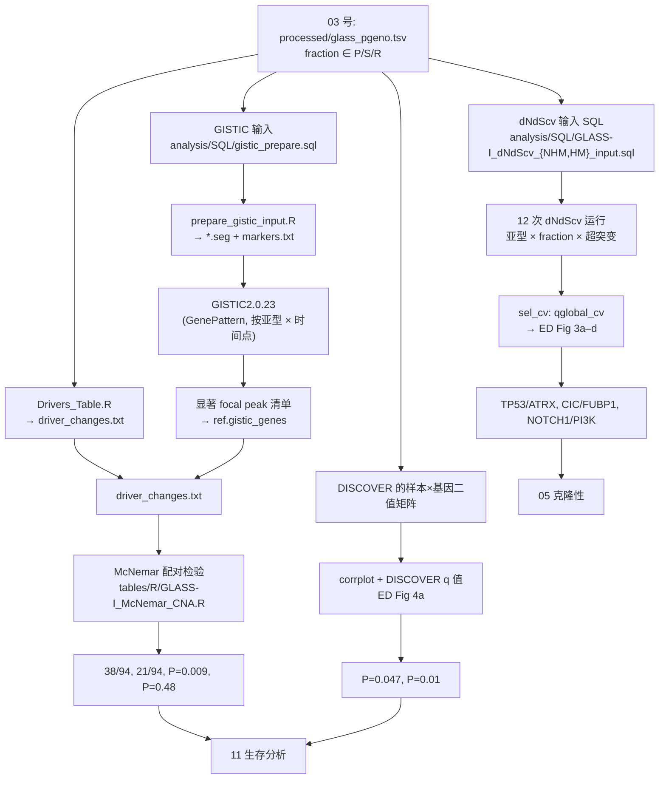
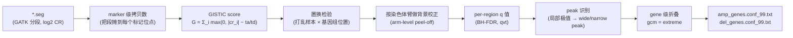

# 04 驱动事件鉴定与互斥性分析

> **目标文献**：The GLASS Consortium. *Divergent genomic evolution in astrocytomas and oligodendrogliomas.*
> *Nature* (2026). PDF 标识 s41586-026-11150-x. 数据：Synapse syn17038081；代码：github.com/verhaaklab/glass-idh
>
> **模块对应原文**：Fig. 2a–b；Fig. 3a–f（预后部分，与 `11` 号共担）；Extended Data Fig. 3a–d（dN/dS 分层）、Extended Data Fig. 4a（互斥性热图）、Extended Data Fig. 4b（MSH6 突变负荷）、Extended Data Fig. 5b（驱动基因克隆性）；Methods 中「sSNV calling」「GISTIC」「Mutual exclusivity analysis」「Clonality analysis」四段
> **复现层级**：**L1 派生层（主）** ＋ **L2 预处理层（仅 GISTIC 与 dN/dS 的输入准备）**；L3 不做
> **前置依赖**：`03_变异检出与拷贝数调用.md` 的产物契约 `processed/glass_pgeno.tsv`（等位频率与 P/S/R 分类）、`processed/glass_cnv_calls.tsv`（基因级 `hlvl_call` / `cnv_change`）、`processed/glass_seg_stats.tsv`；`02_队列构建、临床注释与样本QC.md` 的 `processed/glass_gold_pairs.tsv` 与超突变标签 `HM_group ∈ {HM, NHM}`
> **下游依赖**：`05_克隆性与纵向演化分析.md`（消费本模块的驱动基因清单做 CCF 汇总）、`11_生存分析与预后模型.md`（消费 CDKN2A/B HD 与 focal amplification 的分组标签）、`13_复现质控清单、排错与批判性评述.md`
> **复现难度**：★★★★☆（dN/dS 的**分层×超突变状态 = 12 次独立运行**是主要工作量）　**预计工时**：5 人日　**计算资源**：dNdScv 单次运行 4 核 / 8–16 GB（**超突变层因 `max_coding_muts_per_sample = NULL` 会显著变慢**）；GISTIC2 单队列运行 8 核 / 16 GB / 约 2–6 小时

---

## 0. 执行摘要（先读这 12 行）

**模块定位**：`03` 号给出了"每个样本有什么变异"，本模块回答"**哪些基因/区域在这两个 IDH 亚型里被正向选择，以及它们是否互相排斥**"——这是全文最核心的生物学论点（astrocytoma 靠 CNA、oligodendroglioma 靠 sSNV）的**直接证据层**。

**三个方法 + 一条主线**：

| 方法 | 回答的问题 | 官方脚本 | 关键参数（仓库实证） |
|---|---|---|---|
| **dNdScv v0.1.0** | 哪些基因的**非同义/同义比**显著高于背景（正选择） | `figures/R/GLASS-I_dNdScv.R` | `refdb="hg19"`, `outmats=TRUE`, **`max_coding_muts_per_sample=NULL`** |
| **GISTIC v2.0.23**（GenePattern 运行） | 哪些拷贝数区域是**队列级显著**的靶点（focal / broad） | `analysis/R/prepare_gistic_input.R` + `analysis/SQL/gistic_prepare.sql` | `GeneGISTIC` + `gene collapse = extreme` + `broad 1` + `focal cut-off 0.5` + `conf 99%` |
| **DISCOVER v3.1.7** | 哪些基因对**互斥**（提示同一通路冗余打击） | `figures/R/GLASS-I_sSNV_Mutual_Exclusivity.R` | `discover.matrix(t(X))` → `pairwise.discover.test()`，取 **`q.value`**，`q.threshold=1` |
| **PyClone-VI** | 获得性事件是克隆还是亚克隆 | `preprocessing_pipeline/snakemake/pyclone.smk` | beta-binomial 默认参数，CCF > 0.9 = clonal（**细节在 `05`**） |

**六个必须背下来的原文数值**（本模块的 QC 锚点）：

| 结论 | 数值 | 出处 |
|---|---|---|
| 初诊富集 | astrocytoma **TP53、ATRX**；oligodendroglioma **CIC、FUBP1** | Results「Diverging genomic driver events」 |
| 复发获得 | oligo **NOTCH1 + PIK3CA**（PIK3R1 趋势）；astro **局灶癌基因扩增 + CDKN2A/B 纯合缺失** | 同上 |
| 局灶高拷贝扩增的染色体带 | **CCND2 12p13、CDK4 12q14、CDK6 7q21、EGFR 7p11、MYC 8q24、MYCN 2p24、PDGFRA 4q12、MET–PTPRZ1 7q31** | 同上 |
| 局灶扩增例数 | 复发 astrocytoma **38/94**，初诊 **21/94** | 同上 |
| CDKN2A/B HD 的配对检验 | 非超突变 astro **McNemar P = 0.009**；非超突变 oligo **P = 0.48** | 同上 |
| 互斥性 | oligo 的 PI3K vs NOTCH1：**P = 0.047（初诊）**、**P = 0.01（非超突变复发）** | Results |

> ⚠️ **导师批注（本模块最重要的一条）**：原文正文写 "showed mutual exclusivity (**DISCOVER algorithm: P = 0.047 at primary and P = 0.01 at non-hypermutant recurrence**)"。但官方脚本 `figures/R/GLASS-I_sSNV_Mutual_Exclusivity.R` 里，从 DISCOVER 结果中**只取了 `q.value` 这一列**：
> ```r
> result.mutex <- pairwise.discover.test(events[, ])
> df <- as.data.frame(result.mutex, q.threshold = 1)[, c("gene1", "gene2", "q.value")]
> ```
> **也就是说正文里标为 "P" 的两个数，极可能是 FDR 校正后的 q 值。**这直接关系到"是否做了多重比较校正"这个红线条目。复现时必须**同时报告 raw `p.value` 与 `q.value`**（L0 §7 的"双口径复现"要求），并核对 Supplementary 里到底是哪个。已登记 D 表（D04-01）与 `13` 号文档。

> ⚠️ **导师批注（第二条）**：Reporting Summary 的软件清单里列了 **MutSigCV (v1.3.5)**，但 **Methods 与 Results 中从未出现 MutSigCV**。要么是"跑了但没用/结果未报告"，要么是清单误填。**复现时不要因为清单里有就去跑 MutSigCV**——它产出的 gene list 与 dNdScv 的口径不同（MutSigCV 用背景突变率模型 + 患者/基因特异性协变量，输出 q 值，不做 dN/dS）。已登记 `13` 号。

---

> **骨架对应（L0 §8.2）**：本篇按 ①–⑧ 骨架组织，为便于正文交叉引用而保留数字小节号 —— **① = §1 科学问题与逻辑位置**、**② = §2 背景原理**、**③ = §3 原文逐句拆解**、**④ = §4 逐步可运行代码**、**⑤ = §5 参数解释与调参空间**、**⑥ = §6 预期结果与 QC 检查点**、**⑦ = §7 陷阱与排错表**、**⑧ = §8 与原文图表/官方脚本的对应关系表**；§9–§11 为本模块附加的接口/交叉引用/D 表登记。

## 1. 科学问题与逻辑位置

### 1.1 上游给什么、下游要什么



### 1.2 为什么"驱动事件鉴定"在本文里比在别的文章里更难

IDH-mutant glioma 有一个**独特的统计困难**：它的 TMB 极低（WGS 初诊中位 **1.5–1.6 mut/Mb**），而复发时又可能出现 SBS11 驱动的**超突变**（>10 mut/Mb，高出 6–7 倍）。于是：

1. **同一队列里同时有"变异数几十个"和"变异数三万个"的样本**。任何"跨样本汇总"的方法都必须处理这种量级差异（dNdScv 的 `max_coding_muts_per_sample` 就是为此存在的开关）。
2. **非超突变层样本多但每位点信息少，超突变层信息多但样本极少**（HM oligo n=16、HM astro n=20）。这两个层的检验功效结构完全不同——**这就是原文把 dN/dS 按 `fraction × 亚型 × 超突变状态` 拆成 12 次运行的根本原因**（Extended Data Fig. 3a–d 四个面板）。
3. **本文的分析对象是"配对样本的分数"**（P = 仅初诊、S = 共享、R = 仅复发），每组都只是真变异的一个**子集**，进一步降低了功效。

> ⚠️ **导师批注**：把 dN/dS 拆成 12 次运行的代价是**每次运行的样本量骤降**（HM oligo 只有 16 例、HM astro 20 例）。这在统计上是必要设计，但也意味着**HM 层的"不显著"（如 astro 的 MSH6 7/20）不能解读为"没有选择"**，只能解读为"功效不足以判定"。原文措辞是 *"Although some hypermutated astrocytomas acquired MSH6 mutations (n = 7/20), this enrichment did not reach statistical significance"*——**这是阴性结果，必须原样保留在复现报告里**（L0 §12 第 5 条红线）。

---

## 2. 背景原理

### 2.1 dN/dS 与正选择：dNdScv 的协变量校正负二项框架

#### 2.1.1 dN/dS 的基本定义

设某基因内：

- $N_{\text{obs}}$ = 观测到的**非同义**突变数，$N_{\text{exp}}$ = 在该基因长度与碱基组成下**期望**的非同义突变数；
- $S_{\text{obs}}$、$S_{\text{exp}}$ 同义。

$$
\omega \;=\; \frac{d_N}{d_S} \;=\; \frac{N_{\text{obs}}/N_{\text{exp}}}{S_{\text{obs}}/S_{\text{exp}}}
$$

**直觉**：同义突变几乎"隐形"（不改变蛋白），因此 $S_{\text{obs}}/S_{\text{exp}}$ 提供了**该基因的局部突变率标尺**；$\omega>1$ 说明非同义突变比"纯中性漂变"应有的多 → **正选择**；$\omega<1$ → 纯化选择。肿瘤里只有极少数基因 $\omega$ 显著 >1（driver），绝大多数 <1（passenger，且被纯化选择轻微压制）。

#### 2.1.2 朴素做法的三个致命偏差（以及 dNdScv 怎么修）

| 偏差 | 机制 | dNdScv 的对策 |
|---|---|---|
| **① 三核苷酸上下文依赖** | C>T 在 `NpCpG` 上的发生率是其他上下文的 10 倍以上；TMZ 诱导的 SBS11 又特异地打 `NpCpY`。若用"统一突变率"算 $N_{\text{exp}}$，所有富含 CpG 的基因都会被误判为正选择 | **从样本自身的数据**用最大似然估计 192 通道（12 种替换 × 16 种上下文）的替换模型，而不是借用外部参考谱。**这一点对本文至关重要**：SBS11/SBS119/SBS97 都是 TMZ/放疗相关的新谱，用 COSMIC v2 的老谱会系统性偏 |
| **② 基因长度之外的协变量** | 复制时序晚、表达低、Hi-C 隔室（B compartment）区域的**背景突变率**系统性更高。长基因 + 高背景 = 假阳性 | 用**负二项回归**对每个基因的期望突变数建模：$\log \mu_g = \log(\text{位点数}_g) + \beta_0 + \sum_k \beta_k x_{gk}$，协变量含**复制时序、表达量、（部分版本含 GC/Hi-C）** |
| **③ 过离散** | 即使校正了协变量，跨基因的突变计数方差仍大于均值（泊松假设失效） | 用负二项（NB）而非泊松：$\mathrm{Var}(n_g) = \mu_g + \mu_g^2/\theta$，$\theta$ 由数据估计 |

即，dNdScv 的零模型是：

$$
n_g \sim \mathrm{NB}\!\left(\mu_g,\ \theta\right),\qquad
\mu_g = \sum_{t}\Big(\underbrace{w_{g,t}}_{\text{type } t \text{ 的位点数}}\cdot \underbrace{r_t}_{\text{由数据估的 192 通道率}}\Big)\cdot \underbrace{\exp(\hat{\boldsymbol\beta}^{\top}\mathbf{x}_g)}_{\text{协变量校正}}
$$

然后对每个基因做**似然比检验**：$\omega_g = 1$（零）vs $\omega_g$ 自由；再对全基因组基因做 **BH-FDR**，得到 `qglobal_cv`。给每个突变类型（sil/mis/non/spl）单独给 p/q（`p_sil`…`q_spl`）以及合并的 `pglobal_cv`/`qglobal_cv`。

**"对低频驱动基因比纯频率法更敏感"的原因**：纯频率法看"该基因突变在多少样本里出现"，在 TMB 1.5 mut/Mb 的队列里，5/94 = 5.3% 的频率就可能对应一个真 driver，但**统计功效几乎为零**（也是"某基因 5/94 vs 背景 3/94"）。dN/dS 利用的是**基因长度归一化后的功能类别富集**——一个 500 bp 的小基因和 15 kb 的 ATRX 不能用同一个频率阈值。dNdScv 还额外提供 `geneci()` 给出每个基因 $\omega$ 的置信区间，可以直接判"这个基因的 dN/dS 是真高还是估计噪声大"。

#### 2.1.3 为什么"按突变分数分层"计算是有意义的

| 分层 | 生物学含义 | 若不分层会掩盖什么 |
|---|---|---|
| **P（仅初诊）** | 初诊时存在、复发时丢失 → 很可能**不是**持续受选择的 driver（或被未采样/覆盖度问题漏掉） | 会与 S 混合，稀释 truncal driver 的信号 |
| **S（共享）** | 初诊和复发都存在 → **truncal / 早期驱动** | 会拉低"复发获得"的富集度 |
| **R（仅复发）** | 复发时新出现 → **获得性治疗耐药驱动**（NOTCH1/PI3K/MSH6 就在这里） | 不拆开就完全看不到 |

原文原句：*"dN/dS ratios were estimated using dNdScv (v.0.1.0) with the default and recommended parameters applied to all mutations in initial and recurrent tumour samples, as well as for each mutational fraction (unique to initial, unique to recurrent, and shared)."* —— **这句话是本模块的方法论核心：同一个方法跑三遍，唯一的差别是输入的突变子集。**

#### 2.1.4 一个必须知道的技术细节：`max_coding_muts_per_sample`

dNdScv 的默认设置是 `max_coding_muts_per_sample = 3000`（**需按 `dndscv` 包版本用 `args(dndscv::dndscv)` 核对**），即"每个样本的编码突变超过 3000 个就整例排除"。这是为了**防止超突变样本压倒背景似然**。但本文的样本正是超突变（>10 mut/Mb × 30 Mb 编码区 ≈ 30,000+ 突变，远超 3000）。因此官方脚本对 **HM 层和 NHM 层都设了** `NULL`：

```r
dnds_subset = dndscv(qres_subset, refdb = "hg19", outmats = TRUE,
                     max_coding_muts_per_sample = NULL)
```

⚠️ 这是一个**原文没有报告的参数改动**（原文说 "default and recommended parameters"）。**如果你照字面用默认参数跑，所有超突变样本会被静默排除**，`exclsamples` 里会堆满样本，结果完全错。**这是本模块最容易踩、也最容易发现不了的一个坑。** 已登记 D04-02。

> ⚠️ **导师批注（统计层面的保留意见）**：即使设了 `NULL`，**dNdScv 的似然仍假设突变之间（近似）独立**。一个超突变样本贡献的 30,000 个突变并不是 30,000 个独立观测——它们共享同一个样本的突变谱与克隆结构。设 `NULL` 只能让运行"跑得下去"，**不能修好这个假设违背**。因此 HM 层的 dN/dS 效应量与 p 值**应当保守解读**，并建议复现时额外做一次**"每样本最多 N 个突变"的抽稀（downsampling）敏感性分析**（见 §4.5）。

### 2.2 GISTIC 的原理

#### 2.2.1 从"分割数据"到"显著靶点"

GISTIC2.0（Mermel et al., Genome Biol 2011；本文引用为 ref. 26）解决的**不是**"某个样本某个基因是否高拷贝"，而是"**在整个队列里，哪个区域的高拷贝事件比随机背景更集中、且幅度更大**"。



**四个关键概念**：

1. **GISTIC score（amplification/deletion score）**：对每个标记位点 $j$，$G_j = \sum_i \max(0,\ |{\rm cn}_{ij}| - t)$，其中 $t$ 是 `-ta`/`-td`（本文与默认 0.1 的关系**原文未报告**），求和遍历所有样本 $i$。它同时反映**事件频率**与**幅度**——这就是为什么它能抓到"少数样本里振幅极高的局灶扩增"。
2. **置换检验**：将每个样本的拷贝数谱在基因组上**随机打乱**多次，得到 $G_j$ 的零分布 → 每个位点的 P 值 → 全基因组 BH-FDR → q 值（`-qvt`，默认 0.25）。**GLASS 用的是 99% 置信水平**（`-conf 0.99`），即取 q 阈值对应 99% 置信的 peak 集（输出文件名里的 `conf_99`）。
3. **broad vs focal 的区分**：`-broad 1` 打开宽事件检测；`-brlen`（本文 **0.5**）定义"宽"的阈值——覆盖超过染色**臂长 50%** 的事件算 broad。**`armpeel`（本文未明写但 GenePattern 的 GISTIC 模块默认开启）** 是核心：它把"整条臂的增益"这个 baseline 从 focal 信号里剥离出去，否则 7 号染色体整体多一份拷贝会淹没 7p11 的 EGFR 局灶扩增。**本文最关心的 8 个染色体带全部是 focal 事件**（见 §3.2）。
4. **GeneGISTIC（`-genegistic 1`）与 `-gcm extreme`**：把 peak 区域折叠到基因。`gcm = extreme` 表示"基因的值取该基因范围内**最极端**的标记值"（扩增取最大、缺失取最小），而不是取平均（`mean`）。**为什么是 extreme**：focal 扩增（如 ecDNA 上的 MYC 双微体）常常只覆盖基因的一部分；用均值会把信号抹平，用 extreme 才能捕捉"局部极高拷贝"。

#### 2.2.2 本文 GISTIC 的运行方式（"按亚型 × 时间点分开跑"）

原文原句：*"GISTIC was run on the public version of the GenePattern server, on the segmentation data of primary and recurrent tumours for each type of IDH-mutant glioma individually to identify broad and focal copy-number changes of significance in each group."*

仓库对应：`analysis/R/prepare_gistic_input.R` 生成 **8 个 `.seg` 文件** + 1 个 `markers.txt`：

```
input/idhwt_primary.seg          input/idhwt_recurrence.seg           (IDHwt, 本文不用)
input/codel_primary.seg          input/codel_recurrence.seg           (oligodendroglioma)
input/noncodel_primary.seg       input/noncodel_recurrence.seg        (astrocytoma)
input/primary.seg                input/recurrence.seg                 (全队列, 不分亚型)
+ input/markers.txt   （三列：marker id / chrom / pos；由 seg 的 start 与 end 去重得到）
```

**为什么必须分开跑**：GISTIC 的置换零模型假设"样本间的总体 CNA 负荷可比"。IDH-mutant astrocytoma 的 CNA 负荷远高于 oligodendroglioma（这正是本文的核心发现）。混在一起跑，**oligo 的 focal 事件会被 astro 的高背景彻底淹没**。这是"分组分析"而非"加协变量"的典型取舍。

> ⚠️ **导师批注**：`gistic_prepare.sql` 的实现是
> ```sql
> SELECT t1.*, 'P' AS sample_type FROM t1 INNER JOIN analysis.gold_set gs ON gs.tumor_barcode_a = t1.aliquot_barcode
> UNION
> SELECT t1.*, 'R' AS sample_type FROM t1 INNER JOIN analysis.gold_set gs ON gs.tumor_barcode_b = t1.aliquot_barcode
> ```
> 而 `preprocessing_pipeline/sql/set/gold_set.sql` 的头部注释明确说：**"Note that for GISTIC we instead took the deprecated gold set to define a set of unique primaries and unique recurrences"**。也就是说 GISTIC 的样本集与本文正文的 183 例**可能不是同一套**（"deprecated gold set"）。**复现时必须以 `analysis/SQL/gistic_prepare.sql` 实际 join 的 `analysis.gold_set` 为准**，先用 `SELECT COUNT(DISTINCT ...)` 核对到底是 183×2 还是别的数。已登记 D04-03。

### 2.3 互斥性统计

#### 2.3.1 为什么"互斥"值得检验

在肿瘤基因组学里，两个基因**显著地不同时改变**（mutual exclusivity）通常意味着它们在同一通路里**功能冗余**——任一被打掉就够，同时打掉没有额外选择优势。本文的具体解读：oligodendroglioma 里 **NOTCH1 与 PI3K 互斥**，原文给的机制假说是 *"In leukaemias, NOTCH1 has been implicated as a regulator of PTEN that has downstream effects on PI3K signalling"*——即两条路殊途同归。

#### 2.3.2 DISCOVER 的构造

DISCOVER（**D**iscrete **I**ndependence **S**tatistic **C**ontrolling for **O**bservations with **V**arying **E**vent **R**ates；Canisius, Martens & Wessels, *Bioinformatics* 2016；本文引用为 ref. 21）针对的是**朴素 Fisher 检验会造出大量假共现**这一已知问题。

**两步构造**：

**第一步——估计每个 (基因 $g$, 肿瘤 $j$) 的"背景改变概率" $p_{gj}$**，使得**行边际（每个基因在队列里的总改变数）与列边际（每个肿瘤的总改变数）都被保留**。这是一个**约束优化**问题（等价于 Rasch 模型的交替极大似然）。它的作用是把"超突变肿瘤更容易在任何基因里有改变"这一层异质性显式建模掉。

**第二步——在独立性零假设下构造共改变的分布**。对基因对 $(g,h)$，令

$$
q_j \;=\; p_{gj}\,p_{hj}\quad(\text{第 } j \text{ 个肿瘤同时被两个基因打击的概率})
$$

则共改变的样本数

$$
X = \sum_{j=1}^{J} \mathbb{1}\{g_j \wedge h_j\}
$$

在"离散独立性"零假设下是**独立但不同分布**的 Bernoulli 之和，即**泊松-二项分布（Poisson-binomial）**：

$$
\Pr(X = k) \;=\; \sum_{\substack{A\subseteq\{1,\dots,J\}\\ |A|=k}} \prod_{j\in A} q_j \prod_{j\notin A}(1-q_j)
$$

用 $O(J^2)$ 的动态规划精确计算（这就是 rediscover 包中 `Exact` 模式做的事；`Approx` 用 refined normal approximation 等近似）。**观测到的共改变数显著低于期望 → 互斥**；反之 → 共现。

**FDR**：DISCOVER 提供两种 q 值——标准 BH，以及一种**针对离散分布**（P 值不连续）的方法。官方脚本用 `as.data.frame(result.mutex, q.threshold = 1)`，`q.threshold = 1` 意味着**保留全部基因对**（不做筛选）。

#### 2.3.3 与其他互斥性方法的对比

| 方法 | 零模型 | 优点 | 缺点 | 本文是否用 |
|---|---|---|---|---|
| **Fisher 精确检验 / 超几何** | 固定行、列边际的超几何分布 | 简单、无需迭代 | **忽略样本级异质性（超突变、纯度、覆盖度）** → Canisius 等指出大部分"共现"是伪影 | ❌（本文用 DISCOVER） |
| **DISCOVER v3.1.7** | 保留边际的 $p_{gj}$ + **泊松-二项** | 显式处理 varying event rates；精确 PB 计算 | 迭代求解 $p_{gj}$ 慢（100 基因 ~500 s；1000 基因 ~4.8 h）；需要足够样本量 | ✅ **本文采用** |
| **MutComFocal**（Baur & Gagneur 2014） | 似然比 + de novo 搜索 | 能**无先验地发现互斥模块**（>2 基因一组） | 搜索空间大，对参数敏感 | ❌ |
| **MEMo**（Ciriello et al. 2012） | 校正 coverage / impurity 率的置换 | 把"模块"作为输出；对 CNA 友好 | 需要 coverage 与 impurity 输入；置换次数影响结果稳定性 | ❌ |
| **rediscover**（2021 重实现） | 同 DISCOVER，含 $O(J^2)$ 精确 PB | 快 1–2 个数量级（1000 基因：4.8 h → 6.3 s） | **注意：这是不同软件包，本文用的是 `discover`** | ❌ |

**本文的实际操作域极小**：进矩阵的只有 **7 个变量** —— 5 个原始基因（`NOTCH1`、`NOTCH2`、`NOTCH3`、`PIK3CA`、`PIK3R1`）加 2 个合并变量（`NOTCH = NOTCH1|NOTCH2|NOTCH3`、`PI3K = PIK3CA|PIK3R1`）。合并逻辑见 `GLASS-I_sSNV_Mutual_Exclusivity.R` 的 `mutate(NOTCH = if_else(NOTCH1==1|NOTCH2==1|NOTCH3==1, 1, 0))`；注意 **`PI3K` 那一列更特殊**：脚本读的是 `driver_changes.txt` 里 `gene_symbol == "PI3K"` 这一行（由 `GLASS-I_Drivers_Table.R` 的 `pik3ca_pik3r1_short` 合并产出），**不是在 R 里现算**——所以 `PI3K` 与 `PIK3CA`/`PIK3R1` 会同时出现在矩阵里，三者高度相关是设计使然。因此上图的 `corrplot` 是 **7×7** 的一个小子矩阵。**n = 70（非超突变 oligo 复发）时，任何互斥信号的检验功效都很低**——原文报的 q = 0.01 已经是很强的信号。

> ⚠️ **导师批注**：`GLASS-I_sSNV_Mutual_Exclusivity.R` 里 `corrplot()` 的**颜色深浅**来自 `cor(snv, method = "spearman")`，而**显著性星号**来自 DISCOVER 的 q 值矩阵（`p.mat = p.mat.*`）。**一张图混了两套统计量**：色块是相关，星号是互斥。读图时必须知道这个。另外 `sig.level = c(0.001, 0.01, 0.05)` 起效的前提是把 q 值当成 p 值用——这也是 D04-01 需要裁决的问题。

### 2.4 克隆性（CCF）：与 `05` 号文档的接口

**概念**：癌症细胞分数（cancer-cell fraction, CCF）$\phi$ = 携带该突变的癌细胞占全部癌细胞的比例。$\phi \approx 1$ = 克隆（truncal，全部癌细胞都有）；$\phi < 1$ = 亚克隆。

**从 VAF 反推 CCF**（需 ASCN 参与）：

$$
\mathrm{CCF} \;=\; \frac{\mathrm{VAF}\cdot\bigl(c_{\text{total}}^{\text{tumour}}\,\phi_{\text{purity}} + 2(1-\phi_{\text{purity}})\bigr)}{c_{\text{alt}}\,\phi_{\text{purity}}}
$$

其中 $c_{\text{total}}$ 是局部总拷贝数、$c_{\text{alt}}$ 是携带 alt 的拷贝数、$\phi_{\text{purity}}$ 是肿瘤纯度。**注意这个式子是本文 `05` 号的核心**，这里只给接口。

**本文的实操**（原文原句）：
- 用 **PyClone-VI**（Gillis & Roth 2020；ref. 51）在 **beta-binomial 模式**、**默认参数**下推断 CCF；
- 纳入标准：**至少在配对中一个样本里覆盖度 ≥ 10×**；
- **$\mathrm{CCF} > 0.9$ 记为 clonal**，否则 subclonal。

仓库对应：`preprocessing_pipeline/snakemake/pyclone.smk`、`preprocessing_pipeline/envs/pyclone.yaml`、以及表 `variants.pyclone_loci`（列：`cluster_id, cellular_prevalence, cellular_prevalence_sd, variant_allele_frequency`）。**注意**：仓库里同时存在 **TITAN**（`variants.titan_seg` 的 `cellular_prevalence`，见 `variants/passgeno.sql`）——说明 GLASS 历史上跑过两套 CCF 工具。本文 Text 明确说是 PyClone-VI，所以**以 `pyclone_ccf` 为准**，不要误用 `titan_ccf`。

**本文的克隆性结论**（Fig. 2 相关文本）：
- 获得性 **PIK3CA、NOTCH1、PIK3R1** 在 oligodendroglioma **主要 clonal**；
- 获得性 **CDKN2A 缺失**在 astrocytoma **主要 clonal** → *"suggesting a strong selection effect on cells containing CDKN2A homozygous deletions"*；
- 克隆突变负荷在**超突变 astrocytoma 复发时显著下降**，oligo 无显著纵向变化（Extended Data Fig. 5a）。

---

## 3. 原文逐句拆解

### 3.1 Methods 四段逐句表

| # | 原文句（节选） | 中文转述 | 对应操作 / 参数 | 原文是否给参数 | 复现决策 |
|---|---|---|---|---|---|
| 1 | "dN/dS ratios were estimated using dNdScv (v.0.1.0) with the default and recommended parameters" | 用 dNdScv 默认参数 | `figures/R/GLASS-I_dNdScv.R` | ⚠️ **"默认"不实** | 实际传了 `max_coding_muts_per_sample = NULL`、`outmats = TRUE`、`refdb = "hg19"`（见 D04-02） |
| 2 | "applied to all mutations in initial and recurrent tumour samples, as well as for each mutational fraction (unique to initial, unique to recurrent, and shared)" | 三个突变子集各跑一次 | SQL 里的 `fraction ∈ {P, S, R}` 由 `mutect2_call_a/b` 推导 | ✅ | 直接消费 `03` 号的 `processed/glass_pgeno.tsv` |
| 3 | "These analyses were performed separately for each of the two types of IDH-mutant glioma." | 按亚型分开 | `subtype ∈ {IDHmut-codel, IDHmut-noncodel}` | ✅ | 注意 `clinical.subtypes` 的取值就是这两个字符串 |
| 4 | （ED Fig 3 图注）"stratified by timing of surgery ... and further divided by hypermutation status and tumour type" | 再按超突变状态分层（共 4 个面板） | `analysis/SQL/GLASS-I_dNdScv_{NHM,HM}_input.sql`，`WHERE sbs11_r_hypermutation IS TRUE/FALSE` | ⚠️ 正文未写 | **正文只提"亚型 + fraction"，图注才说明还有超突变分层**。共 **2×3×2 = 12 次运行** |
| 5 | "Adequate sequencing depth and reciprocal mutation calling between paired samples minimized coverage-related false negatives" | 深度 + 相互调用降低假阴性 | `callsnv`（case 级）+ `sscallsnv`（aliquot 级）+ `pgeno` 并集 | ✅（机制） | 定量分析见 `03` 号 §2.2.3 |
| 6 | "because our analysis compares shared mutations with sample-specific ones, coverage variation is unlikely to affect the qualitative patterns observed" | 覆盖度差异不太影响定性结论 | — | ❌ 无定量支撑 | **`03` 号已给出定量模拟**：27–30× 下对称波动不影响，但**不对称**（30×/80×）会造出 6.0% 假 R。**复现时必须做深度失衡回归**（§6.3） |
| 7 | "We used PyClone-VI to assess the clonal status of all sSNVs ... minimum coverage of 10× in at least one sample from each paired set ... beta-binomial mode using default parameters" | PyClone-VI，≥10×，beta-binomial 默认 | `preprocessing_pipeline/snakemake/pyclone.smk` | ✅ | 见 `05` 号 |
| 8 | "Mutations with a cancer-cell fraction higher than 0.9 were classified as clonal" | CCF > 0.9 = clonal | 硬编码阈值 | ✅ | 0.9 是**很高的**门槛；0.5 附近的一大片会被归为亚克隆（§7 有专门陷阱） |
| 9 | "GISTIC was run on the public version of the GenePattern server, on the segmentation data of primary and recurrent tumours for each type of IDH-mutant glioma individually" | 按亚型 × 时间点分开跑 6 次 | `prepare_gistic_input.R` | ✅（分组） | 见 D04-03（样本集可能是 deprecated gold set） |
| 10 | "using the GeneGISTIC method, with broad event detection and gene collapse values set to extreme" | GeneGISTIC + broad + gcm=extreme | `-genegistic 1 -broad 1 -gcm extreme` | ✅ | 见 §5 的参数映射表 |
| 11 | "a focal length cut-off of 0.5 or higher, with a confidence level of 99% and a chromosome-arm adjustment capped at 1.0" | focal 长度 ≥0.5；conf 99%；臂级调整上限 1.0 | `-brlen 0.5 -conf 0.99 -armpeel ?` | ⚠️ **第三项无 CLI 对应** | 见 D04-04 |
| 12 | "Copy-number driver genes were identified from the GeneGISTIC results." | 驱动基因来自 GISTIC 输出 | `ref.gistic_genes` 表（`drivers_by_aliquot.sql` 里 join 它） | ✅（机制） | **`ref.gistic_genes` 的内容不在公开仓库里**，必须从 GISTIC 输出重建 |
| 13 | "Mutual exclusivity ... using the DISCOVER ... (v.3.1.7) algorithm, which computes tumour-specific probabilities of gene alterations while preserving the observed marginal totals per gene and per tumour" | DISCOVER 保留边际的 $p_{gj}$ | `discover.matrix()` + `pairwise.discover.test()` | ✅（机制） | 与 §2.3.2 一致 |
| 14 | "Expected co-occurrence rates between gene pairs were derived under a Poisson binomial model" | 泊松-二项零模型 | 包内实现 | ✅（机制） | — |
| 15 | "Significantly fewer co-alterations than expected under this null model were interpreted as evidence of mutual exclusivity." | 单侧（更少 = 互斥） | 包里默认 | ✅ | ⚠️ **原文自相矛盾**：ED Fig. 4a 的图注写的是 "two-sided mutual exclusivity DISCOVER test P values"，正文这句却是单侧解释。登记 `13` 号 |

### 3.2 Results「Diverging genomic driver events」逐句拆解

| # | 原文句（节选） | 中文转述 | 复现操作 | 期望数值（QC 锚点） |
|---|---|---|---|---|
| 16 | "At initial surgery, we found a significant enrichment of mutations in canonical driver genes using dNdScv analyses (astrocytomas, TP53 and ATRX; oligodendrogliomas, CIC and FUBP1), which were preserved at recurrence" | 初诊富集 4 个基因，复发保留 | `fraction = "P"` 与 `"S"` 的 dN/dS 结果里 `qglobal_cv < 0.05`（红虚线 `-log10(0.05)`） | astro: TP53, ATRX；oligo: CIC, FUBP1 |
| 17 | "We did not investigate non-coding drivers beyond TERT promoter mutations" | 只做 TERT 启动子（非编码） | 需要在 `given_alleles` 里强制基因分型 | 见 `03` 号陷阱 #13 |
| 18 | "a subset of both astrocytomas (21%) and oligodendrogliomas (18%) ... recurred with a significantly higher number of mutations (more than 10 mutations per Mb), of which more than 25% were attributed to the SBS11" | 超突变定义：>10 mut/Mb 且 >25% 复发特异突变归 SBS11 | `HM_group ∈ {HM, NHM}`（`analysis.tumor_clinical_comparison_2024` 的 `sbs11_r_hypermutation`） | 详见 `06`/`07` |
| 19 | "Among non-hypermutated recurrent oligodendrogliomas (n = 70), we discovered significant enrichments of sSNVs in NOTCH1 and the PI3K catalytic subunit PIK3CA, along with a trend towards enrichment of the regulatory subunit PIK3R1" | 非 HM oligo 复发（n=70）：NOTCH1、PIK3CA 显著；PIK3R1 趋势 | ED Fig 3a 的 **`fraction="R"`、`subtype="IDHmut-codel"`** 面板，取 `qglobal_cv` 最小的前 5 个基因（绘图脚本 `df[1:5, ]`） | **NOTCH1、PIK3CA 显著** |
| 20 | "NOTCH1 and PI3K mutations ... were not associated with specific previous treatments" | 与既往治疗无关 | `tables/R/GLASS-I_Drivers_Prior_Treatment.R` | 详见 §3.4 |
| 21 | "showed mutual exclusivity (DISCOVER algorithm: P = 0.047 at primary and P = 0.01 at non-hypermutant recurrence)" | 互斥：0.047 / 0.01 | ED Fig 4a（`corrplot` 热图） | **⚠️ 这两个数极可能是 q 值**（见 §0 批注） |
| 22 | "We observed the previously reported significant enrichment of MSH6 mutations at recurrence as well as newly acquired PIK3CA mutations in hypermutated oligodendrogliomas (mutations at diagnosis: MSH6 = 0/10, PIK3CA = 2/10; mutations at recurrence: MSH6 = 12/16, PIK3CA = 13/16)" | HM oligo：诊断 0/10、2/10；复发 12/16、13/16 | ED Fig 3b（`subtype=IDHmut-codel`、HM 层、`fraction="R"`） | **0/10, 2/10, 12/16, 13/16** |
| 23 | "a non-significant increase in the mutation burden in hypermutated ... gliomas with MSH6 mutations, compared with MSH6-wild-type hypermutants ... consistent in both the GLASS cohort and the ... GENIE cohort" | MSH6 突变型 HM 的 TMB 更高但不显著（GLASS + GENIE 一致） | ED Fig 4b：**Wilcoxon rank-sum（非配对，双侧）** | 详见 `06`（TMB）与 `12`（GENIE） |
| 24 | "Although some hypermutated astrocytomas acquired MSH6 mutations (n = 7/20), this enrichment did not reach statistical significance" | HM astro MSH6 7/20，不显著 | ED Fig 3d | **7/20，p 不显著**（阴性结果必须保留） |
| 25 | "In contrast to oligodendrogliomas, no gene mutations in astrocytomas were significantly associated with recurrence, regardless of hypermutation status" | astro 无复发相关基因突变 | ED Fig 3c（非 HM astro 的 `fraction="R"`） | **全不显著** —— 这是本文"astro 不由 sSNV 驱动"的关键阴性证据 |
| 26 | "Focal CDKN2A/B homozygous deletions were significantly enriched in recurrent non-hypermutant astrocytomas (McNemar's test: P = 0.009) but not in non-hypermutant oligodendrogliomas (McNemar's test: P = 0.48; Supplementary Table 2)" | 非 HM astro: P=0.009；非 HM oligo: P=0.48 | `tables/R/GLASS-I_McNemar_CNA.R`，`gene_symbol == "CDKN2A/CDKN2B"` | **0.009 / 0.48**（列联表原文未报告，反推见 §3.3） |
| 27 | "focal high-level oncogene amplifications (chromosomal bands: CCND2 12p13, CDK4 12q14, CDK6 7q21, EGFR 7p11, MYC 8q24, MYCN 2p24, PDGFRA 4q12 and MET–PTPRZ1 7q31) were detected at significantly increased frequency in recurrent astrocytomas" | **8 个染色体带**在复发 astro 显著增加 | ED Fig 3c 的 CNA 侧 + McNemar 的 `single.amp` 表 | 见 §3.3 的表 |
| 28 | "In total, 38 of 94 recurrent astrocytomas contained at least one focal oncogene amplification, compared with 21 of 94 initial astrocytomas." | **38/94 vs 21/94** | `driver_changes.txt` 里 `gene_symbol == "Any Amplification"` 且 `driver_status == "HLAMP"` | **38 / 21，分母 94** |
| 29 | "A minority (18%) of the individual WGS-derived focal gene amplifications were classified as extrachromosomal, and all were identified in the astrocytomas." | **18% 的单个 WGS 局灶基因扩增是 ecDNA，且全在 astro** | AmpliconSuite（`10` 号） | **分母 = 单个基因扩增事件，不是患者**（§7 陷阱 #11） |
| 30 | "There was no significant enrichment of amplifications or homozygous deletions in recurrent oligodendrogliomas (Supplementary Table 2)." | oligo 的 CNA 无复发富集 | 同 #26 | 阴性结果 |
| 31 | "A significant reduction in clonal mutation burden at recurrence was observed exclusively in hypermutant astrocytomas ... Acquired CDKN2A deletions were mostly clonal in astrocytomas" | 克隆性：见 §2.4 | `05` 号 | ED Fig 5a–b |
| 32 | "astrocytomas favoured other IDH1 p.R132 variants, whereas oligodendrogliomas favoured IDH2 mutations (Supplementary Table 3a). We did not observe significant differences in the distributions of focal oncogene amplifications, CDKN2A/B homozygous deletions or NOTCH1, PI3K or MSH6 mutations between IDH1 p.R132H and other IDH-mutant groups (Supplementary Table 3b–f)." | IDH 亚型分布有偏好，但**与驱动事件分布无显著关联** | `tables/R/GLASS-I_IDH_Mutations_Table.R` | **全是阴性**；*"potentially reflecting limited statistical power"* |
| 33 | "we observed no significant associations between IDH mutation types and overall survival, mutational signatures or fraction of genome altered (FGA)" | IDH 亚型与 OS/签名/FGA 无关联 | ED Fig 6a–c | 阴性 |
| 34 | "In summary, our results show that oligodendrogliomas acquire clonal sSNVs in driver genes at recurrence, whereas astrocytomas acquire clonal focal DNA copy-number alterations (CNAs)." | **全文最核心的一句话** | 由 #19 + #26 + #28 + #31 共同支撑 | — |

### 3.3 数值反推：McNemar 的列联表（原文未报告）

`tables/R/GLASS-I_McNemar_CNA.R` 构造的是 **2×2 一致性表**（注意：`matrix()` 按**列**填充，所以第一个参数是 `S`）：

$$
\begin{pmatrix}
 & \text{复发 AMP/HD} & \text{复发 No} \\
\text{初诊 AMP/HD} & S\ (\text{共享}) & P\ (\text{初诊特异}) \\
\text{初诊 No} & R\ (\text{复发获得}) & \text{NA}\ (\text{两者皆无})
\end{pmatrix}
$$

R 的 `mcnemar.test()` 默认 `correct = TRUE`，用连续性校正的 $\chi^2_1$：$\ \chi^2 = \dfrac{(|b-c|-1)^2}{b+c}$，其中 $b = R$、$c = P$。

**由报告的 P 值反推候选列联表**（本机实算，`code/04_mcnemar_backcalc.py`）：

| 目标 | P（原文） | 候选 $(b=复发获得,\ c=初诊特异)$ | $n=b+c$ | R 默认 P（连续性校正 $\chi^2$） | 精确二项 P |
|---|---|---|---|---|---|
| 非 HM **astro** CDKN2A/B HD | **0.009** | **(15, 3)** | 18 | **0.0095** ✅ | 0.0075 |
| 同上 | 0.009 | (13, 2) | 15 | 0.0098 ✅ | 0.0074 |
| 同上 | 0.009 | (11, 1) | 12 | 0.0094 ✅ | 0.0063 |
| 非 HM **oligo** CDKN2A/B HD | **0.48** | **(11, 7)** | 18 | **0.4795** ✅ | 0.4807 |
| 同上 | 0.48 | (19, 14) | 33 | 0.4862 | 0.4869 |
| astro「任意扩增」$^\ast$ | （未报告） | (23, 6) 若共享 15 例 | 29 | 0.0030 | — |
| astro「任意扩增」$^\ast$ | （未报告） | (38, 21) 若共享 0 例 | 59 | 0.0372 | — |

$^\ast$ 由 **21/94（初诊）与 38/94（复发）** 的边际数反推：令共享数为 $z$，则 $b = 38-z$、$c = 21-z$。**原文没有报告「任意扩增」的 McNemar P 值**，所以这一行只是"如果报告了会是多少"的参考——**这正好是一个用 Synapse 数据可以直接验证的预测**：算出真实 $(b,c)$ 后回代，若 R 默认 P 落在 §3.3 表的范围内，说明配对口径正确。

**8 个染色体带的完整清单**（原文表格化）：

| # | 基因 | 原文标注带 | 事件类型 | hg19 近似坐标（**我方补充，非原文报告**，供交叉核对） |
|---|---|---|---|---|
| 1 | **CCND2** | 12p13 | 局灶高拷贝扩增 | chr12:4.38–4.41 Mb |
| 2 | **CDK4** | 12q14 | 局灶高拷贝扩增 | chr12:58.14 Mb |
| 3 | **CDK6** | 7q21 | 局灶高拷贝扩增 | chr7:92.2–92.5 Mb |
| 4 | **EGFR** | 7p11 | 局灶高拷贝扩增 | chr7:55.1–55.3 Mb |
| 5 | **MYC** | 8q24 | 局灶高拷贝扩增 | chr8:128.75 Mb |
| 6 | **MYCN** | 2p24 | 局灶高拷贝扩增 | chr2:16.00 Mb |
| 7 | **PDGFRA** | 4q12 | 局灶高拷贝扩增 | chr4:55.1–55.2 Mb |
| 8 | **MET–PTPRZ1** | 7q31 | 局灶高拷贝扩增（**合并为一个事件**） | MET chr7:116.3–116.5 Mb；PTPRZ1 chr7:121.5–121.7 Mb |

> ⚠️ **导师批注**：第 8 项把 **MET（7q31.2）与 PTPRZ1（7q31.32）合并**成"MET–PTPRZ1 7q31"一个事件，但两者在 hg19 上**相距约 5.2 Mb**。5 Mb 的跨度已经接近"focal"与"broad"的边界（本文 `-brlen 0.5` 是臂长的 50%，7q 长约 159 Mb，故 `-brlen` 阈值为 ~80 Mb——5 Mb 仍算 focal）。**但实践上这意味着 `ref.driver_genes` 里这两个基因的 `cnv_direction` 很可能被同一段扩增同时命中，从而"1 个事件被数成 2 个"**。`tables/R/GLASS-I_Drivers_Table.R` 里确实专门写了一段 `met_ptprz1_short` 把它们 group_by(case_barcode) 后合并——**复现时必须用同一段代码，否则 38/94 会虚高**。这一点已登记 `13` 号。

### 3.4 治疗关联与亚型关联（全阴性，必须保留）

| 结论 | 原文措辞 | 复现操作 | 判据 |
|---|---|---|---|
| 驱动事件 × 既往治疗 | *"observed no significant differences across treatment groups after false discovery rate (FDR) correction (Supplementary Table 10a–c)"* | `tables/R/GLASS-I_Drivers_Prior_Treatment.R`：按 `RT` / `ALK_CHEMO` / `ANY_Rx` 分组，`gtsummary` 出 Fisher/χ²，再 BH-FDR | **FDR 校正后无显著**（未校正前也可能有几个 0.01–0.05，这正是"用 FDR 反而更严格"的例子） |
| IDH 突变亚型 × 驱动 CNA/SNV | *"We did not observe significant differences ... (Supplementary Table 3b–f)"* | `tables/R/GLASS-I_IDH_Mutations_Table.R` | 全阴性 |
| IDH 突变亚型 × OS / 签名 / FGA | *"we observed no significant associations ... potentially reflecting limited statistical power"* | ED Fig 6a–c | 全阴性；**原文自己承认是功效问题** |
| MSH6 突变型 vs 野生型 HM 的 TMB | *"a non-significant increase ... consistent in both the GLASS cohort and the external validation set of the ... GENIE cohort"* | ED Fig 4b，Wilcoxon rank-sum | 不显著但方向一致（GLASS + GENIE）——**这是"两个队列方向一致但都不显著"的典型，不能升级为"已证实"**（L0 §12 第 4 条） |

---

## 4. 逐步可运行代码

### 4.1 dNdScv：12 次分层的完整复现

```r
# code/04_dndscv_analysis.R
# 对应官方 figures/R/GLASS-I_dNdScv.R —— 原脚本 -> 改造点 -> 我们的版本
# 原脚本：从数据库直接 dbGetQuery(SQL)；循环 lapply(subtype) x lapply(fraction)
# 改造点：(1) 输入改为本地 TSV（Synapse 下载后）
#         (2) 结果落盘为 tidy 表，便于逐层核对
#         (3) 显式记录 exclsamples（原脚本只用 message() 打印）
#         (4) 修正原脚本对输出顺序的脆弱依赖（split(...)[c(1,3,2,4,6,5,7,9,8)]）
set.seed(20260101)

suppressPackageStartupMessages({
  library(dndscv); library(data.table); library(dplyr); library(tidyr)
  library(readr); library(ggplot2); library(patchwork)
})

OUT <- "results/dndscv"; dir.create(OUT, recursive = TRUE, showWarnings = FALSE)

# ---- 0) 官方使用的"癌症基因参考集"版本 -------------------------------
# 原脚本： data("cancergenes_cgc81", package = "dndscv")
data("cancergenes_cgc81", package = "dndscv")
known_cancergenes <- cancergenes_cgc81          # COSMIC CGC v81 —— 版本必须记录！
readr::write_lines(known_cancergenes, file.path(OUT, "known_cancergenes_cgc81.txt"))

# ---- 1) 构造 6 个突变子集：{NHM, HM} × {P, S, R} ----------------------
# 输入契约（来自 03 号文档）：
#  case_barcode, chrom, pos, ref, alt, fraction ∈ {P,S,R}, idh_codel_subtype, HM_group
pg <- readr::read_tsv("processed/glass_pgeno.tsv", show_col_types = FALSE) |>
  dplyr::filter(!is.na(fraction), fraction %in% c("P", "S", "R")) |>
  dplyr::transmute(
    case_barcode, chrom = as.character(chrom), pos = as.integer(pos),
    ref, mut = alt, fraction,
    subtype = idh_codel_subtype,        # IDHmut-codel / IDHmut-noncodel
    HM_group                            # HM / NHM
  ) |>
  dplyr::distinct()

run_one <- function(df, fraction, subtype, hm) {
  qres <- df |>
    dplyr::filter(fraction == !!fraction, subtype == !!subtype, HM_group == !!hm) |>
    dplyr::select(case_barcode, chrom, pos, ref, mut) |>
    dplyr::distinct()
  if (nrow(qres) == 0 || dplyr::n_distinct(qres$case_barcode) < 3) {
    return(list(globaldnds = NULL, sel_cv = NULL, gene_ci = NULL,
                n_samples = dplyr::n_distinct(qres$case_barcode), n_muts = nrow(qres)))
  }
  dnds <- dndscv(qres, refdb = "hg19", outmats = TRUE,
                 max_coding_muts_per_sample = NULL)   # <<< 关键：必须 NULL
  list(
    globaldnds = cbind(fraction = fraction, subtype = subtype, HM_group = hm, dnds$globaldnds),
    sel_cv     = cbind(fraction = fraction, subtype = subtype, HM_group = hm, dnds$sel_cv),
    gene_ci    = cbind(fraction = fraction, subtype = subtype, HM_group = hm,
                       geneci(dnds, gene_list = known_cancergenes)),
    exclsamples = dnds$exclsamples,
    n_samples  = n_distinct(qres$case_barcode),
    n_muts     = nrow(qres)
  )
}

grid <- expand.grid(fraction = c("P", "S", "R"),
                    subtype  = c("IDHmut-noncodel", "IDHmut-codel"),  # astro, oligo
                    HM_group = c("NHM", "HM"),
                    stringsAsFactors = FALSE)

runs <- lapply(seq_len(nrow(grid)), function(i)
  run_one(pg, grid$fraction[i], grid$subtype[i], grid$HM_group[i]))

# ---- 2) 汇总：把 12 次运行的 sel_cv / globaldnds 拼成一张长表 --------
sel_cv <- data.table::rbindlist(Filter(Negate(is.null), lapply(runs, `[[`, "sel_cv")))
readr::write_tsv(sel_cv, file.path(OUT, "sel_cv_all_strata.tsv"))

run_meta <- do.call(rbind, lapply(seq_along(runs), function(i) data.frame(
  grid[i, ],
  n_samples = runs[[i]]$n_samples,
  n_muts    = runs[[i]]$n_muts,
  n_excl    = length(runs[[i]]$exclsamples %||% character(0))
)))
readr::write_tsv(run_meta, file.path(OUT, "run_metadata.tsv"))
print(run_meta)   # <<< 这张表必须放进复现报告：它暴露每次运行的样本量

# ---- 3) ED Fig 3a-d：每个分层取 qglobal_cv 最小的前 5 个基因 ---------
#  官方绘图逻辑（原样复刻）：df[1:5,] + geom_hline(-log10(0.05)) + coord_flip(ylim=c(0,10))
make_panel <- function(dat, frac, sub, hm, title) {
  d <- dat |> dplyr::filter(fraction == frac, subtype == sub, HM_group == hm) |>
    dplyr::arrange(qglobal_cv, pglobal_cv) |>
    dplyr::slice_head(n = 5) |>
    dplyr::mutate(gene_name = factor(gene_name, levels = rev(gene_name)))
  ggplot(d, aes(x = gene_name, y = -log10(qglobal_cv))) +
    geom_col(width = 0.75, fill = "#2fb3ca") +
    geom_hline(yintercept = -log10(0.05), colour = "red", linetype = 2) +
    coord_flip(ylim = c(0, 10)) +
    labs(x = NULL, y = "-log10(q), FDR-adjusted",
         subtitle = sprintf("%s | %s | n=%d", title, frac,
                            run_meta$n_samples[run_meta$fraction == frac &
                                               run_meta$subtype == sub &
                                               run_meta$HM_group == hm][1])) +
    theme_linedraw(base_size = 14)
}
p_ed3 <- make_panel(sel_cv, "P", "IDHmut-noncodel", "NHM", "Astro") +
         make_panel(sel_cv, "S", "IDHmut-noncodel", "NHM", "Astro") +
         make_panel(sel_cv, "R", "IDHmut-noncodel", "NHM", "Astro") +
         make_panel(sel_cv, "P", "IDHmut-codel",   "NHM", "Oligo") +
         make_panel(sel_cv, "S", "IDHmut-codel",   "NHM", "Oligo") +
         make_panel(sel_cv, "R", "IDHmut-codel",   "NHM", "Oligo") +
         patchwork::plot_layout(ncol = 2)
ggsave("figures/ED_Fig3a_c_dNdScv_NHM.pdf", p_ed3, width = 14, height = 12)
ggsave("figures/ED_Fig3a_c_dNdScv_NHM.png", p_ed3, width = 14, height = 12, dpi = 300)

p_ed3_hm <- make_panel(sel_cv, "R", "IDHmut-noncodel", "HM", "Astro") +
            make_panel(sel_cv, "R", "IDHmut-codel",   "HM", "Oligo") +
            patchwork::plot_layout(ncol = 2)
ggsave("figures/ED_Fig3b_d_dNdScv_HM.pdf", p_ed3_hm, width = 14, height = 6)
```

**关键判读表（把 `sel_cv` 变成结论）**：

| 期望结论 | 查询 | 判据 |
|---|---|---|
| astro 初诊富集 | `fraction=="P" & subtype=="IDHmut-noncodel" & HM_group=="NHM"`，按 `qglobal_cv` 升序 | 前 2 名应为 **TP53、ATRX** |
| oligo 初诊富集 | 同上但 `IDHmut-codel` | 前 2 名应为 **CIC、FUBP1** |
| **oligo 复发获得** | `fraction=="R" & subtype=="IDHmut-codel" & HM_group=="NHM"` | 应含 **NOTCH1、PIK3CA**（PIK3R1 趋势）；**n = 70** |
| **HM oligo 复发获得** | `fraction=="R" & IDHmut-codel & HM_group=="HM"` | **MSH6、PIK3CA**（计数见 §3.2 第 22 行） |
| **astro 无复发获得** | `fraction=="R" & IDHmut-noncodel`，两个 HM 层都看 | **全部 `qglobal_cv > 0.05`**（关键阴性） |
| HM astro MSH6 | `fraction=="R" & IDHmut-noncodel & HM_group=="HM"` | MSH6 出现但 **不显著**（7/20） |

### 4.2 GISTIC：输入准备与运行

```r
# code/04_prepare_gistic_input.R
# 对应官方 analysis/R/prepare_gistic_input.R
# 原脚本的输入是 DB 查询（analysis/SQL/gistic_prepare.sql，用 odbc::odbc("glass5")）；
# 改造点：(1) 走本地 TSV；(2) 输出目录参数化；(3) 额外打印每个 .seg 的样本数（原脚本没有）
suppressPackageStartupMessages({library(dplyr); library(readr); library(fs)})

gistic_in <- "processed/gistic/input"; dir.create(gistic_in, recursive = TRUE, showWarnings = FALSE)

seg  <- readr::read_tsv("processed/glass_gatk_seg.tsv", show_col_types = FALSE) |>
  dplyr::filter(!is.na(start), !is.na(end), !is.na(num_snps))
sub  <- readr::read_tsv("processed/glass_gold_pairs.tsv", show_col_types = FALSE)

# gistic_prepare.sql 的逻辑：tumor_barcode_a -> 'P'，tumor_barcode_b -> 'R'
seg <- seg |>
  dplyr::mutate(sample_type = dplyr::case_when(
    aliquot_barcode %in% sub$tumor_barcode_a ~ "P",
    aliquot_barcode %in% sub$tumor_barcode_b ~ "R",
    TRUE ~ NA_character_)) |>
  dplyr::filter(!is.na(sample_type)) |>
  dplyr::mutate(case_barcode = sub("^(.*?-.*?-.*?)-.*$", "\\1", aliquot_barcode)) |>
  dplyr::left_join(sub |> dplyr::select(case_barcode, idh_codel_subtype) |> dplyr::distinct(),
                   by = "case_barcode")

write_seg <- function(df, fname) {
  out <- df |> dplyr::select(-sample_type, -case_barcode, -idh_codel_subtype)
  readr::write_tsv(out, file.path(gistic_in, fname), col_names = TRUE)
  cat(sprintf("%-34s  samples=%4d  segments=%6d\n", fname,
              dplyr::n_distinct(out$aliquot_barcode), nrow(out)))
}
for (tp in c("P", "R")) {
  d <- seg |> dplyr::filter(sample_type == tp)
  write_seg(d |> dplyr::filter(idh_codel_subtype == "IDHmut-noncodel"), sprintf("noncodel_%s.seg", ifelse(tp=="P","primary","recurrence")))
  write_seg(d |> dplyr::filter(idh_codel_subtype == "IDHmut-codel"),   sprintf("codel_%s.seg",   ifelse(tp=="P","primary","recurrence")))
}
# markers.txt：官方把 start 与 end 全部倒出来去重作为 marker 列表。
# ★ 官方格式是 **三列**（marker id / chr / pos），且 write.table(col.names = FALSE)：
#   markers = data.frame(id = 1:(2*nrow(seg)), chr = c(seg$chrom, seg$chrom),
#                        pos = c(seg$start, seg$end)) %>% distinct()
#   —— id 只是行号占位，GISTIC 读的是第 2/3 列。漏掉 id 列会让 GISTIC 解析失败。
markers <- dplyr::bind_rows(
  seg |> dplyr::transmute(chr = chrom, pos = start),
  seg |> dplyr::transmute(chr = chrom, pos = end)) |>
  dplyr::distinct() |> dplyr::arrange(chr, pos) |>
  dplyr::mutate(id = dplyr::row_number(), .before = 1)
readr::write_tsv(markers, file.path(gistic_in, "markers.txt"), col_names = FALSE)
```

```bash
# code/04_run_gistic2.sh
# 需要 GISTIC 2.0.23 与配套的 refgene 矩阵文件（hg19）
# 下载：GISTIC2.0 发行包的 refgenefiles/hg19.mat
GISTIC_BIN=/opt/gistic2/gistic2
REFGENE=/opt/gistic2/refgenefiles/hg19.mat
IN=processed/gistic/input
OUT=results/gistic

for SUBSET in codel_primary codel_recurrence noncodel_primary noncodel_recurrence; do
  echo "=== ${SUBSET} ==="
  $GISTIC_BIN \
      -b   ${OUT}/${SUBSET} \
      -seg ${IN}/${SUBSET}.seg \
      -refgene ${REFGENE} \
      -mk  ${IN}/markers.txt \
      -genegistic 1 \
      -gcm  extreme \
      -broad 1 \
      -brlen 0.5 \
      -conf 0.99 \
      -armpeel 1 \
      -savegene 1 \
      -smallmem 1 \
      -js 4 \
      -maxseg 2000 \
      -v 30
done
```

**参数到原文措辞的映射表**（⚠️ 第 4 行是我的推断，已在 §5 与本表显式标注）：

| 原文措辞 | GISTIC2 CLI | 说明 |
|---|---|---|
| "the GeneGISTIC method" | `-genegistic 1` | 生成基因级结果 |
| "gene collapse values set to extreme" | `-gcm extreme` | 基因取值 = 基因内最极端的 marker 值 |
| "broad event detection" | `-broad 1` | 打开宽事件检测 |
| "a focal length cut-off of 0.5 or higher" | **`-brlen 0.5`**（推断） | 超过臂长 50% 视为 broad。**"or higher" 的含义不清** |
| "a confidence level of 99%" | `-conf 0.99` | 对应输出文件后缀 `conf_99` |
| "a chromosome-arm adjustment capped at 1.0" | **无逐字对应参数** ⚠️ | 候选解释：`-armpeel 1`（臂级剥离）或 `-caps`（高拷贝封顶，但 GISTIC2 默认是 **1.5** 而非 1.0）。**必须核对 GenePattern 模块文档的 UI 标签** |
| （未报告） | `-ta` / `-td` | 阈值，默认 0.1（log2 单位）。本文是否改动**未报告** |
| （未报告） | `-qvt` | q 值阈值，默认 0.25。本文是否改动**未报告** |
| （未报告） | `-js` / `-maxseg` / `-smallmem` | 段合并与内存优化，不影响生物学结论 |

### 4.3 互斥性：官方脚本的复现 + 从 Synapse 自算的双口径版本

**路线 A：照搬官方（`figures/R/GLASS-I_sSNV_Mutual_Exclusivity.R` 的最小可运行版）**

```r
# code/04_mutex_official_style.R
suppressPackageStartupMessages({
  library(tidyverse); library(discover); library(corrplot)
})
set.seed(20260101)

# driver_changes.txt 由 drivers 表（04 号 §4.4）产出；此处直接读
# 注意：必须先把 PIK3CA/PIK3R1 合成为 PI3K、NOTCH1/2/3 合成为 NOTCH
md <- read.delim("processed/driver_changes.txt") |>
  mutate(timing.recurrent = substr(tumor_pair_barcode, 20, 21),
         timing.primary   = substr(tumor_pair_barcode, 14, 15))

surgeries <- read.delim("processed/glass_surgeries.tsv") |>
  mutate(timing.surgery = substr(sample_barcode, 14, 15)) |>
  filter(idh_codel_subtype != "IDHwt")

build_matrix <- function(stage = c("primary", "recurrence"), keep = c("HM", "NHM"),
                         type = c("IDH-mutant Oligodendrogliomas", "IDH-mutant Astrocytomas")) {
  stage <- match.arg(stage); type <- match.arg(type)
  genes <- c("NOTCH1", "NOTCH2", "NOTCH3", "PIK3CA", "PIK3R1")
  df <- surgeries |>
    left_join(md, by = "case_barcode") |>
    filter(if (stage == "primary") timing.primary == timing.surgery else timing.recurrent == timing.surgery) |>
    group_by(case_barcode) |>
    summarise(
      HM_group   = HM_group[1],
      tumor_type = if_else(idh_codel_subtype[1] != "IDHmut-codel",
                           "IDH-mutant Astrocytomas", "IDH-mutant Oligodendrogliomas"),
      across(all_of(genes),
             ~ as.integer(any(gene_symbol == cur_column() &
                              driver_status == "mutant" &
                              driver_change == (if (stage == "primary") "P" else "R")) |
                          any(gene_symbol == cur_column() &
                              driver_status == "mutant" & driver_change == "S"))),
      .groups = "drop") |>
    ungroup() |>
    mutate(PI3K  = as.integer(PIK3CA == 1 | PIK3R1 == 1),
           NOTCH = as.integer(NOTCH1 == 1 | NOTCH2 == 1 | NOTCH3 == 1)) |>
    filter(HM_group == keep, tumor_type == type) |>
    select(-case_barcode, -tumor_type, -HM_group) |>
    drop_na()
  df
}

m <- build_matrix("recurrence", "NHM", "IDH-mutant Oligodendrogliomas")
cat("非超突变 oligo 复发 n =", nrow(m), "\n")   # 期望 70

events <- discover.matrix(t(m))                 # 注意：逻辑判断按行 -> 需转置
res    <- pairwise.discover.test(events[, ])

# ---- 关键：同时导出 p.value 与 q.value（官方只取后者）----
both <- as.data.frame(res, q.threshold = 1)
readr::write_tsv(both, "results/mutex/mutex_oligo_NHM_recurrence_raw_and_qvalue.tsv")
print(both |> select(gene1, gene2, p.value, q.value) |>
      filter(gene1 %in% c("PI3K", "NOTCH1", "NOTCH") &
             gene2 %in% c("PI3K", "NOTCH1", "NOTCH")))
# 期望：PI3K vs NOTCH 的（p 与 q）中，至少一个 ≈ 0.01（原文报 0.01）
```

**路线 B：从变异矩阵自算 Fisher + 泊松-二项，与 DISCOVER 对拍**

```python
# code/04_mutex_reimplement.py
# 目的：(1) 独立算出 Fisher / 超几何的原始 P 值（作为"未校正多重比较"的基线）
#       (2) 用 Poisson-binomial DP 自算一个"保留边际的独立性"P 值
#       (3) 与 DISCOVER 输出对拍 —— 若差异大，说明 p_gt 的估计方式不同
import itertools
from pathlib import Path

import numpy as np
import pandas as pd
from scipy.stats import fisher_exact, hypergeom

MUTEX_DIR = Path("results/mutex"); MUTEX_DIR.mkdir(parents=True, exist_ok=True)

# --- 输入：样本 x 基因 的二值矩阵（由 R 版导出的同一张表）---
mat = pd.read_csv("results/mutex/oligo_NHM_recurrence_matrix.tsv", sep="\t", index_col=0)

def poisson_binomial_sf_lower(q):
    """P(X <= k) for X ~ PoissonBinomial(q_1..q_J)，返回完整分布"""
    dist = np.array([1.0])
    for qi in q:
        dist = np.convolve(dist, [1 - qi, qi])
    return dist                     # dist[k] = P(X = k)

def eigen_p_gt(mat, n_iter=200, tol=1e-10):
    """
    DISCOVER 第一步的简化复现：交替极大似然估计
        logit(p_gj) = a_g + b_j    (Rasch 型；保留行列边际)
    用 IPF / 迭代比例拟合近似（比原论文的约束优化简单，但保留边际的性质一致）。
    注意：原算法的目标函数与约束以 DISCOVER 论文为准，此处仅作教学/对拍用途。
    """
    X = mat.values.astype(float)
    J, G = X.shape
    a = np.zeros(G); b = np.zeros(J)
    for _ in range(n_iter):
        # 更新 b_j：使每列（样本）的期望改变数匹配观测
        for j in range(J):
            lo, hi = -20.0, 20.0
            for _ in range(60):
                mid = (lo + hi) / 2
                e = 1 / (1 + np.exp(-(a + mid)))      # 长度 G
                if e.sum() > X[:, j].sum(): hi = mid
                else:                       lo = mid
            b[j] = (lo + hi) / 2
        # 更新 a_g：使每行（基因）的期望改变数匹配观测
        for g in range(G):
            lo, hi = -20.0, 20.0
            for _ in range(60):
                mid = (lo + hi) / 2
                e = 1 / (1 + np.exp(-(mid + b)))
                if e.sum() > X[g, :].sum(): hi = mid
                else:                       lo = mid
            a[g] = (lo + hi) / 2
        if np.max(np.abs(X.sum(1) - (1/(1+np.exp(-(a[:,None]+b[None,:])))).sum(1))) < tol:
            break
    return 1 / (1 + np.exp(-(a[:, None] + b[None, :])))   # shape (G, J)

P = eigen_p_gt(mat)
genes = list(mat.index)
rows = []
for g1, g2 in itertools.combinations(range(len(genes)), 2):
    x_obs = int(((mat.iloc[g1] == 1) & (mat.iloc[g2] == 1)).sum())
    # (a) Fisher / 超几何（固定边际）
    tab = [[x_obs,
            int((mat.iloc[g1] == 1).sum()) - x_obs],
           [int((mat.iloc[g2] == 1).sum()) - x_obs,
            int(len(mat)) - int((mat.iloc[g1] == 1).sum())
                            - int((mat.iloc[g2] == 1).sum()) + x_obs]]
    or_, p_fisher = fisher_exact(tab, alternative="less")
    # (b) Poisson-binomial（保留边际的 p_gj）
    q = P[g1, :] * P[g2, :]
    dist = poisson_binomial_sf_lower(q)
    p_pb = float(dist[:x_obs + 1].sum())
    rows.append(dict(gene1=genes[g1], gene2=genes[g2], n_both=x_obs,
                     marginal_g1=int((mat.iloc[g1] == 1).sum()),
                     marginal_g2=int((mat.iloc[g2] == 1).sum()),
                     or_fisher=or_, p_fisher=p_fisher, p_poisson_binomial=p_pb,
                     expected_both=float(q.sum())))

out = pd.DataFrame(rows)
from statsmodels.stats.multitest import multipletests
for col in ("p_fisher", "p_poisson_binomial"):
    out[col.replace("p_", "q_")] = multipletests(out[col], method="fdr_bh")[1]
out.sort_values("p_poisson_binomial").to_csv(
    MUTEX_DIR / "mutex_reimplemented_oligo_NHM_recurrence.tsv", sep="\t", index=False)
print(out.sort_values("p_poisson_binomial").head(10).to_string(index=False))
```

**三方对比的判据**：

| 比较 | 若一致 | 若不一致 |
|---|---|---|
| 我们的 PB vs DISCOVER `p.value` | 数量级一致（差 < 2 倍）→ p_gt 估计方法等价 | 差 10 倍以上 → DISCOVER 的约束优化与我们的 Rasch/IPF 不同，**以 DISCOVER 为准**，我们的版本只用于"暴露 Fisher 的偏差" |
| **Fisher vs PB** | — | **预期 Fisher 显著更"松"**（会报出更多互斥/共现）。这正是 DISCOVER 论文的核心论点；把这个差异**写进复现报告**是有价值的负面证据 |

### 4.4 驱动变更表（`driver_changes.txt`）与 McNemar

```r
# code/04_drivers_table.R —— 对应官方 tables/R/GLASS-I_Drivers_Table.R
# 原脚本对 6 个 SNV 基因（MSH6/NOTCH1/NOTCH2/NOTCH3/PIK3CA/PIK3R1）各写了一段
# 近乎相同的代码（原脚本 30–126 行，共约 100 行重复）。这里用函数折叠，逻辑完全一致。
suppressPackageStartupMessages({library(dplyr); library(readr); library(tidyr)})

VARIANT_LIST <- c("FRAME_SHIFT_DEL","FRAME_SHIFT_INS","IN_FRAME_DEL","IN_FRAME_INS",
                  "MISSENSE","NONSENSE","SPLICE_SITE")   # 官方白名单，逐字照抄

df_gs <- readr::read_tsv("processed/glass_gold_pairs.tsv", show_col_types = FALSE)
hm    <- readr::read_tsv("processed/glass_hm_status.tsv", show_col_types = FALSE) |>
  mutate(HM_group = if_else(sbs11_r_hypermutation, "HM", "NHM"))
pg    <- readr::read_tsv("processed/glass_pgeno.tsv", show_col_types = FALSE)

snv_one <- function(gene) {
  pg |>
    filter(gene_symbol == gene) |>
    semi_join(df_gs, by = c("case_barcode", "tumor_pair_barcode")) |>
    mutate(driver_change = case_when(
             mutect2_call_a == 1 & mutect2_call_b == 0 ~ "P",
             mutect2_call_a == 0 & mutect2_call_b == 1 ~ "R",
             mutect2_call_a == 1 & mutect2_call_b == 1 ~ "S",
             TRUE ~ "none")) |>
    filter(driver_change != "none", variant_classification %in% VARIANT_LIST) |>
    full_join(df_gs, by = c("case_barcode", "tumor_pair_barcode")) |>
    mutate(driver_status = if_else(is.na(gene_symbol), "wildtype", "mutant")) |>
    left_join(hm, by = c("case_barcode", "tumor_pair_barcode")) |>
    group_by(case_barcode) |>
    mutate(multihit = if_else(n() > 1, "yes", "no")) |>
    slice_max(order_by = af_b, n = 1) |>   # 同基因多命中取 af_b 最大的一条
    slice(1) |>
    ungroup() |>
    mutate(gene_symbol = gene) |>
    select(case_barcode, tumor_pair_barcode, idh_codel_subtype, HM_group,
           gene_symbol, driver_status, driver_change)
}

snv_data <- purrr::map_dfr(c("MSH6","NOTCH1","NOTCH2","NOTCH3","PIK3CA","PIK3R1"), snv_one)

## ---- 组合基因（官方逻辑逐字照抄：HLAMP/HLDEL 优先，S > (P&R) > P > R）----
combine_genes <- function(df, src_genes, label, positive_status, status_col = "driver_status") {
  df |> filter(gene_symbol %in% src_genes) |>
    mutate(old_status = .data[[status_col]],
           old_change = if_else(is.na(driver_change), "NA", driver_change)) |>
    group_by(case_barcode) |>
    mutate(driver_status = if_else(any(old_status == positive_status), positive_status, "No_AMP/HD"),
           driver_change = if_else(all(old_change == "NA"), NA_character_,
                           if_else(any(old_change == "S"), "S",
                           if_else(any(old_change == "P") & any(old_change == "R"), "S",
                           if_else(any(old_change == "P"), "P", "R"))))) |>
    ungroup() |>
    select(case_barcode, tumor_pair_barcode, idh_codel_subtype, HM_group,
           gene_symbol, driver_status, driver_change) |>
    distinct() |>
    mutate(gene_symbol = label)
}

cnv_data <- readr::read_tsv("processed/glass_cnv_calls.tsv", show_col_types = FALSE) |>
  left_join(hm, by = c("case_barcode", "tumor_pair_barcode")) |>
  mutate(driver_status = if_else(is.na(cnv_state), "No_AMP/HD", cnv_state),
         driver_change = cnv_change) |>
  select(case_barcode, tumor_pair_barcode, idh_codel_subtype, HM_group,
         gene_symbol, driver_status, driver_change)

AMP_GENES <- c("MYC","MYCN","CDK4","CDK6","MET","PTPRZ1","CCND2","EGFR","PDGFRA")
HD_GENES  <- c("CDKN2A","CDKN2B","ATRX","PTEN")

driver_changes <- bind_rows(
  snv_data,
  combine_genes(snv_data, c("PIK3CA","PIK3R1"), "PI3K", "mutant"),
  cnv_data,
  combine_genes(cnv_data, c("CDKN2A","CDKN2B"), "CDKN2A/CDKN2B", "HLDEL"),
  combine_genes(cnv_data, c("CDK4","CDK6"),       "CDK4/CDK6",     "HLAMP"),
  combine_genes(cnv_data, c("MET","PTPRZ1"),      "MET/PTPRZ1",    "HLAMP"),
  combine_genes(cnv_data, c("MYC","MYCN"),        "MYC/MYCN",      "HLAMP"),
  combine_genes(cnv_data, AMP_GENES,              "Any Amplification", "HLAMP"),
  combine_genes(cnv_data, HD_GENES,               "Any HD",            "HLDEL"),
  combine_genes(snv_data, c("PIK3CA","PIK3R1","NOTCH1","MSH6"), "Any SNV", "mutant")
)
readr::write_tsv(driver_changes, "processed/driver_changes.tsv")
```

```r
# code/04_mcnemar_backcalc.R
# 对应官方 tables/R/GLASS-I_McNemar_CNA.R
# 改造点：(1) 折叠 4 个几乎相同的循环为一个函数
#         (2) 【关键】把 is.na(driver_change) 显式区分"两者皆无"与"数据缺失"
#             ——官方代码把两者都塞进 [2,2] 单元格，见 §7 陷阱 #6
suppressPackageStartupMessages(library(dplyr))

run_mcnemar <- function(driver_changes, subtype, hm_group, genes) {
  d <- driver_changes |>
    filter(idh_codel_subtype == !!subtype, HM_group == !!hm_group,
           gene_symbol %in% genes)

  purrr::map_dfr(unique(d$gene_symbol), function(g) {
    td <- d |> filter(gene_symbol == g)
    S <- sum(td$driver_change == "S", na.rm = TRUE)      # 共享（两时点都阳性）
    R <- sum(td$driver_change == "R", na.rm = TRUE)      # 复发获得
    P <- sum(td$driver_change == "P", na.rm = TRUE)      # 初诊特异
    N <- sum(is.na(td$driver_change))                    # 两者皆无
    m <- matrix(c(S, R, P, N), nrow = 2,
                dimnames = list(Primary = c("AMP/HD", "No_amp/hd"),
                                Recurrence = c("AMP/HD", "No_amp/hd")))
    data.frame(gene_symbol = g, S = S, R = R, P = P, N = N,
               p_R_default = suppressWarnings(mcnemar.test(m)$p.value),
               p_exact     = suppressWarnings(mcnemar.test(m, correct = FALSE)$p.value),
               n_pairs     = nrow(td))
  }) |>
    mutate(q_default = p.adjust(p_R_default, method = "fdr")) |>
    arrange(p_R_default)
}

print(run_mcnemar(driver_changes, "IDHmut-noncodel", "NHM",  # astro, 非超突变
                  c("CDKN2A/CDKN2B", "Any Amplification", "Any HD", "CDK4/CDK6")))
print(run_mcnemar(driver_changes, "IDHmut-codel", "NHM",      # oligo, 非超突变
                  c("CDKN2A/CDKN2B", "Any Amplification", "Any HD")))
```

> ⚠️ **导师批注**：上面这个改造版**必须与官方版同时跑**。官方版把 `is.na(driver_change)` 当作 [2,2] 单元格，我们的版本把它单列出来；如果两者 P 值不同，**说明原始数据里存在"基因未覆盖/未评估"的 NA**，而那部分样本在官方分析中被当作阴性——这是一个真实的偏倚来源（把"测不到"当成"没有"）。**这个差异必须在报告中显式披露**。

### 4.5 三个必做的敏感性分析

| # | 分析 | 做法 | 判据 |
|---|---|---|---|
| 1 | **覆盖度失衡对 R 集的影响** | 把 `fraction == "R"` 的变异数按（初诊深度 − 复发深度）分位回归（负二项或泊松），看斜率 | 斜率不显著 → 原文"coverage variation is unlikely to affect"成立；显著 → 必须做深度校正后重跑 dN/dS |
| 2 | **dNdScv 的突变抽稀** | 对 HM 层每样本随机抽稀到 3000 个突变（种子 `20260101`），重复 10 次，看 MSH6/PIK3CA 的 `qglobal_cv` 是否稳定 | 结论稳定 → 过离散假设违背的影响可忽略；不稳定 → 在报告中降级为"探索性" |
| 3 | **McNemar 阈值敏感性** | 把 `hldel_thres`/`hlamp_thres` 的 z 从 2 改到 1.5 / 2.5，重算 §3.3 的 $(b,c)$ 与 P | 若 38/94 漂移 > ±3 例 → 在正文注明该数字对阈值敏感 |

### 4.6 火山图与森林图：把 12 次 dN/dS 与 McNemar 结果可视化

**为什么必须有**：dN/dS 的 `qglobal_cv` 只告诉你"显著 / 不显著"，但**效应量**（$\omega$ 及其 CI 宽度）才是"功效不足"与"真的没有选择"的分界线（见 §6.3）。下面的森林图把 `geneci()` 的 CI 直接画出来——**CI 宽到跨过 1 的基因，不能写成"无选择"**。

```r
# code/04_volcano_forest.R
suppressPackageStartupMessages({
  library(dplyr); library(readr); library(ggplot2); library(ggrepel); library(patchwork)
})

sel_cv <- readr::read_tsv("results/dndscv/sel_cv_all_strata.tsv", show_col_types = FALSE)
gci    <- readr::read_tsv("results/dndscv/gene_ci_all_strata.tsv", show_col_types = FALSE)

## ---- (A) 火山图：12 个分层各一张，x = -log10(q) 的次序，y = 效应量 ----
##  注意：dN/dS 的"火山图"不是常规的 log2FC-vs-p 图。这里把
##  x 轴取 -log10(qglobal_cv)、y 轴取观测/期望的比值的 log2
##  （sel_cv 的 n_non 与 w_non 就是观测与期望的位点数）
volcano_one <- function(d, frac, sub, hm) {
  dd <- d |> filter(fraction == frac, subtype == sub, HM_group == hm, !is.na(qglobal_cv)) |>
    mutate(l2oe = log2((n_non + 1) / (w_non + 1)),
           sig  = qglobal_cv < 0.05)
  ggplot(dd, aes(x = l2oe, y = -log10(qglobal_cv), colour = sig)) +
    geom_point(size = 1.6, alpha = 0.8) +
    geom_hline(yintercept = -log10(0.05), linetype = 2, colour = "red") +
    ggrepel::geom_text_repel(data = dd |> filter(sig) |> slice_max(-log10(qglobal_cv), n = 12),
                             aes(label = gene_name), size = 3, max.overlaps = 30) +
    scale_colour_manual(values = c(`FALSE` = "grey70", `TRUE` = "#CA2F66"), guide = "none") +
    labs(x = "log2( 观测非同义 / 期望非同义 )", y = "-log10(qglobal_cv), FDR-adjusted",
         title = sprintf("%s | %s | %s", sub, frac, hm)) +
    theme_linedraw(base_size = 11)
}
grid <- expand.grid(frac = c("P","S","R"), sub = c("IDHmut-noncodel","IDHmut-codel"),
                    hm = c("NHM","HM"), stringsAsFactors = FALSE)
p_vol <- purrr::pmap(grid, function(frac, sub, hm) volcano_one(sel_cv, frac, sub, hm)) |>
  patchwork::wrap_plots(ncol = 3)
ggsave("figures/ED_Fig3_volcano_all_strata.pdf", p_vol, width = 16, height = 9)
ggsave("figures/ED_Fig3_volcano_all_strata.png", p_vol, width = 16, height = 9, dpi = 300)

## ---- (B) 森林图：驱动基因的 dN/dS 点估计 + 95% CI（来自 geneci()）----
##  geneci() 的输出列名以 dndscv 当前版本为准；典型为
##  gene_name, n_mut, dnds, ci_low, ci_high, pval (或 p_value)
forest_one <- function(g, frac, sub, hm, label) {
  d <- g |> filter(fraction == frac, subtype == sub, HM_group == hm) |>
    mutate(gene_name = factor(gene_name,
                              levels = gene_name[order(dnds, decreasing = TRUE)]))
  ggplot(d, aes(x = dnds, y = gene_name)) +
    geom_vline(xintercept = 1, linetype = 2, colour = "red") +
    geom_errorbarh(aes(xmin = ci_low, xmax = ci_high), height = 0.2) +
    geom_point(size = 2.2) +
    scale_x_log10() +
    labs(x = "dN/dS (95% CI, log 轴)", y = NULL, title = label) +
    theme_linedraw(base_size = 11)
}
p_forest <- forest_one(gci, "R", "IDHmut-codel", "NHM", "Oligo 非HM 复发特异 (n=70)") +
            forest_one(gci, "R", "IDHmut-noncodel", "NHM", "Astro 非HM 复发特异") +
            forest_one(gci, "P", "IDHmut-codel",   "NHM", "Oligo 非HM 初诊特异") +
            forest_one(gci, "P", "IDHmut-noncodel","NHM", "Astro 非HM 初诊特异") +
            patchwork::plot_layout(ncol = 2)
ggsave("figures/ED_Fig3_forest_dnds_ci.pdf", p_forest, width = 12, height = 8)
ggsave("figures/ED_Fig3_forest_dnds_ci.png", p_forest, width = 12, height = 8, dpi = 300)

## ---- (C) 森林图：McNemar 的优势比 + 精确 CI（CNA 驱动）----
##  配对设计的 OR = R / P（不一致对的红/绿比）；CI 用精确条件似然法
##  注意：只有当 R+P > 0 时才可估计；R+P = 0 时点估计为 NA（不要写成 0）
mc <- readr::read_tsv("results/mcnemar/astro_NHM_mcnemar.tsv", show_col_types = FALSE) |>
  mutate(or = ifelse(R + P > 0, R / P, NA_real_),
         lo = purrr::map2_dbl(R, P, ~ if (.x + .y == 0) NA_real_ else
              stats::qbeta(0.025, .x + 0.5, .y + 0.5)),
         hi = purrr::map2_dbl(R, P, ~ if (.x + .y == 0) NA_real_ else
              stats::qbeta(0.975, .x + 0.5, .y + 0.5)))
p_or <- ggplot(mc, aes(x = or, y = reorder(gene_symbol, or))) +
  geom_vline(xintercept = 1, linetype = 2, colour = "red") +
  geom_errorbarh(aes(xmin = lo, xmax = hi), height = 0.2, na.rm = TRUE) +
  geom_point(aes(size = R + P), na.rm = TRUE) +
  scale_x_log10() +
  labs(x = "McNemar 优势比 OR = R/P（配对，95% 精确 CI）", y = NULL,
       size = "不一致对数\nR+P", title = "Astro 非超突变：复发 vs 初诊") +
  theme_linedraw(base_size = 12)
ggsave("figures/ED_Fig3_forest_mcnemar_or.pdf", p_or, width = 9, height = 5)
```

**判读规则（把图变成结论）**：

| 图形特征 | 解释 | 表述强度 |
|---|---|---|
| 点估计高、CI 下界 > 1、`qglobal_cv < 0.05` | 明确的**正选择**证据 | 可写"显著富集" |
| 点估计高、CI 很宽且跨过 1、`q` 不显著 | **功效不足**（HM 层几乎全是这种） | 只能写"**未达统计学显著**"，绝不能写"无选择" |
| 点估计 ≈ 1、CI 窄 | 真正的"无正选择"（超突变层才可能有这种精度） | 可写"未见富集" |
| OR 的 `R+P` 很小（如 5） | McNemar 的功效极低 | 必须把 `R+P` 一并报告（所以图上用点大小编码它） |

---

## 5. 参数解释与调参空间

| 参数 | 文献取值 | 仓库实证值 | 可选范围 | 改变的后果 | 我方决策 |
|---|---|---|---|---|---|
| dNdScv 版本 | **v0.1.0** | `remotes::install_github("im3sanger/dndscv")`（**无版本钉死！**） | 0.1.0 / GitHub HEAD | HEAD 的协变量文件与默认参数可能与 0.1.0 不同 | **必须记录 `packageVersion("dndscv")`**；若不一致，从 tag 安装（D04-02） |
| `refdb` | 未报告 | `"hg19"` | hg19 / GRCh37 / GRCh38 | 坐标系统；与 `03` 号的 b37 必须一致 | `hg19` |
| `max_coding_muts_per_sample` | "默认参数" ❌ | **`NULL`** | 3000（默认）/ NULL / 自定义 | **不设 NULL 则超突变样本被静默排除** | NULL（但必须做 §4.5 的抽稀敏感性分析） |
| `outmats` | 未报告 | `TRUE` | TRUE/FALSE | TRUE 会额外返回大矩阵（内存↑） | TRUE（与官方一致，便于核对） |
| 癌症基因参考集 | 未报告 | **`cancergenes_cgc81`**（COSMIC CGC v81） | CGC 各版本 / OncoKB / 自定义 | `geneci()` 的基因清单变化 → 报出的 CI 集合变化 | 记录版本号；这是 D04-02 的一部分 |
| dN/dS 分层数 | 正文只写亚型 + fraction | **2×3×2 = 12 次** | 可合并超突变层 | 合并 → 功效↑但掩盖 HM 特异性（MSH6/PIK3CA 就藏在 HM oligo 层） | 12 次，与 ED Fig 3 一致 |
| FDR 方法 | "FDR-adjusted" | dndscv **内部**给 `qglobal_cv`（BH） | BH / Bonferroni | dndscv 已内置校正，**不要重复校正** | 用包内 `qglobal_cv`；绘图红线 `-log10(0.05)` |
| GISTIC 版本 | **v2.0.23** | 运行在 GenePattern（**云端**，非本地） | 本地 gistic2 2.0.23 | GenePattern 版本更新可能导致结果不可复现 | **优先本地 gistic2 2.0.23**；若必须用 GenePattern，记录运行日期 |
| `-genegistic` | "GeneGISTIC method" | — | 0/1 | 0 → 只有区域级结果，无基因级 | 1 |
| `-gcm` | **extreme** | — | mean / extreme / amp / del | mean → focal 局灶信号被抹平（§2.2.1） | extreme |
| `-broad` | "broad event detection" | — | 0/1 | 0 → 无 broad 结果 | 1 |
| `-brlen` | "focal length cut-off 0.5 or higher" | — | 0.5–0.98（默认 0.98） | 减小 → 更多区域被判为 broad（focal 变少） | **0.5**（但"or higher"含义需核对） |
| `-conf` | **99%** | — | 0.75（默认）/ 0.90 / 0.99 | 提高 → peak 集变小、更保守 | 0.99 |
| `-armpeel` | "chromosome-arm adjustment capped at 1.0" ⚠️ | — | 0/1 | 0 → 整臂事件淹没 focal peak（参见 §2.2.1） | **1**（推断，需核对 GenePattern 文档） |
| `-ta` / `-td` | **未报告** | — | 默认 0.1 | 提高 → score 只计大幅事件 | 默认 0.1 |
| `-qvt` | **未报告** | — | 默认 0.25 | 降低 → peak 更少 | 默认 0.25 |
| DISCOVER 版本 | **v3.1.7** | `install.packages("discover", repos="http://ccb.nki.nl/software/discover/repos/r")` | 3.x | **该私有 repo 可能失效**；备选 `rediscover`（CRAN） | 见 §7 陷阱 #9 |
| DISCOVER 显著阈值 | 报成 "P" | 代码取 **`q.value`** | p.value / q.value | **直接决定 0.047/0.01 这两个数的性质** | **双口径报告**（D04-01） |
| 互斥分析的基因集 | "PI3K 与 NOTCH1" | **NOTCH1/2/3 合并 + PIK3CA/PIK3R1 合并** | 只用 NOTCH1 / 不合并 | 不合并 → 边际计数变小 → 功效更低 | 按官方合并 |
| PyClone-VI 模式 | beta-binomial 默认 | `preprocessing_pipeline/snakemake/pyclone.smk` | — | 见 `05` | beta-binomial |
| CCF clonal 阈值 | **> 0.9** | 硬编码 | 0.5 / 0.8 / 0.9 | 0.5 → 大批亚克隆被归为克隆；0.9 → 保守 | 0.9（但报告 0.5/0.8 的敏感性） |
| 治疗关联的多重校正 | **FDR** | `tables/R/GLASS-I_Drivers_Prior_Treatment.R` | BH / 无 | 无校正 → 会报出假阳性治疗关联 | BH-FDR |

---

## 6. 预期结果与 QC 检查点

### 6.1 数值锚点（与原文逐字一致）

| 量 | 原文报告值 | 出处 | 容差 |
|---|---|---|---|
| 初诊富集（astro） | **TP53、ATRX** | Results | 基因身份必须完全一致 |
| 初诊富集（oligo） | **CIC、FUBP1** | Results | 同上 |
| 复发获得（oligo） | **NOTCH1、PIK3CA**（PIK3R1 趋势） | Results | PIK3R1 允许"趋势"（0.05 < q < 0.15） |
| 复发获得（astro, sSNV） | **无**（全不显著） | Results | **阴性必须复现** |
| 复发获得（astro, CNA） | 局灶扩增 + CDKN2A/B HD | Results | — |
| 局灶扩增的 8 个带 | CCND2 12p13 / CDK4 12q14 / CDK6 7q21 / EGFR 7p11 / MYC 8q24 / MYCN 2p24 / PDGFRA 4q12 / MET–PTPRZ1 7q31 | Results | 8/8 命中 |
| 局灶扩增例数 | 复发 **38/94**；初诊 **21/94** | Results | ±3 例 |
| ecDNA 比例 | **18%**（分母 = 单个 WGS 局灶基因扩增），**全部在 astro** | Results | 分母正确时 ±5% |
| CDKN2A/B HD McNemar | 非 HM astro **P = 0.009**；非 HM oligo **P = 0.48** | Results | P 值 ±30% 或"同侧" |
| 互斥性 | oligo PI3K vs NOTCH：**0.047（初诊）**、**0.01（非 HM 复发）** | Results | 需同时报 p 与 q，见 D04-01 |
| HM oligo 的 MSH6/PIK3CA 计数 | 诊断 **0/10、2/10**；复发 **12/16、13/16** | Results | 计数必须精确命中 |
| HM astro MSH6 | **7/20，不显著** | Results | 计数命中、p > 0.05 |
| 非 HM oligo 复发 n | **70** | Results | 0 |
| HM 分组样本数 | oligo HM **16** / non-HM **70**；astro HM **20** / non-HM **74** | Fig. 2b | 0 |
| 治疗关联 | **FDR 校正后无显著** | Results | 阴性 |
| IDH 亚型 × 驱动事件 | **无显著差异** | Results | 阴性 |

### 6.2 QC 检查点

| # | 检查点 | 判据 | Go | No-Go 时先查 |
|---|---|---|---|---|
| 1 | 12 次 dN/dS 运行全部完成，`run_metadata.tsv` 无 0 样本行 | 12 行 | ✅ | SQL 的 `sbs11_r_hypermutation` 是否为 NULL |
| 2 | `exclsamples` 为空（或极少） | 每层 ≤ 1 例 | ✅ | **`max_coding_muts_per_sample` 是否为 NULL** |
| 3 | astro P / oligo P 的 top-2 基因 | TP53/ATRX 与 CIC/FUBP1 | ✅ | 参考集版本、`refdb` |
| 4 | oligo NHM R 层含 NOTCH1 与 PIK3CA 且 `qglobal_cv < 0.05` | 是 | ✅ | `fraction` 标签的 P/S/R 方向（**极易反**） |
| 5 | astro 的 R 层**没有**任何 `qglobal_cv < 0.05` 的基因 | 是 | ✅ | 是否把 HM 层混进来了 |
| 6 | HM oligo 的 MSH6/PIK3CA 计数 = 12/16、13/16 | 精确 | ✅ | 「16」是否为 HM oligo 复发样本数 |
| 7 | GISTIC 六个 `.seg` 的样本数之和 | 与 183×2 或 deprecated gold set 一致 | ✅ | `gistic_prepare.sql` 用的 `gold_set` 版本（D04-03） |
| 8 | GISTIC 输出的 focal peak 覆盖 8 个染色体带 | 8/8 | ✅ | `-brlen` / `-armpeel` |
| 9 | 「任意扩增」复发 38/94、初诊 21/94 | ±3 | ✅ | `MET/PTPRZ1`、`CDK4/CDK6`、`MYC/MYCN` 的合并逻辑（§3.3 批注） |
| 10 | CDKN2A/B HD McNemar P | astro ≈0.009、oligo ≈0.48 | ✅ | NA 的处理（§4.4 批注）、`correct` 参数 |
| 11 | ecDNA 比例分母 = 单个局灶基因扩增 | 明确写进报告 | ✅ | AmpliconSuite 的输出粒度 |
| 12 | 互斥性同时报 p 与 q | 两者的**倍数关系**被记录 | ✅ | `as.data.frame(res, q.threshold=1)` 是否保留了 `p.value` 列 |
| 13 | 治疗关联的 FDR 校正前后对比 | 两者都报 | ✅ | BH 是否用了全部检验（含 CNA + SNV） |
| 14 | 阴性结果（astra R 层、IDH 亚型、FDR 治疗后）全部出现在报告里 | 逐条列出 | ✅ | L0 §12 第 5 条红线 |

### 6.3 三个必须做的稳健性检查（否则"阴性"可能是功效问题而非真阴性）

1. **每层的样本量必须随结果一起报告**。HM astro 只有 20 例、HM oligo 只有 16 例，"MSH6 不显著"与"MSH6 无选择"是两回事。**建议补一个功效计算**：给定 n=20、观察到的效应量，检验功效是多少。
2. **dN/dS 的效应量（$\omega$）而非只看 q 值**。`geneci()` 给出的 CI 宽度是"功效不足"的直接证据；一个 $\omega = 3$ 但 CI 为 $[0.5, 20]$ 的基因不能被说成"没有选择"。
3. **多口径的互斥性**：DISCOVER(q) / DISCOVER(p) / Fisher / 自算 PB 四个数字并列报告。若四个里只有 DISCOVER(q) 显著，**说明结论对方法高度敏感**，必须在正文注明。

---

## 7. 陷阱与排错表

| # | 现象 | 根因 | 解决 |
|---|---|---|---|
| 1 | dNdScv 全部报"不显著"，`exclsamples` 里堆满超突变样本 | **没设 `max_coding_muts_per_sample = NULL`**（默认 3000 会排除所有超突变样本） | 按官方脚本设为 `NULL`；并对比默认参数下的 `exclsamples` 长度作为"为什么必须改"的证据 |
| 2 | dN/dS 结果与原文差一个数量级 | 用了 `refdb="hg38"` 或错误参考集把 b37 坐标喂进去 | 全链条统一 b37/hg19（见 `03` 号陷阱 #3） |
| 3 | P / S / R 标签方向反了（把"初诊特异"当成"复发获得"） | `passgeno.sql` 里 `tumor_barcode_a` 是初诊、`_b` 是复发，但若 `gold_set` 的行顺序被重排则反 | 用 `02` 号文档的 `processed/glass_gold_pairs.tsv` 作为**唯一权威**，并断言 `tumor_barcode_a` 的取样时间早于 `_b` |
| 4 | **dNdScv 的 reference 基因集版本不一致** | `cancergenes_cgc81` 随 dndscv 包版本变化；`geneci()` 的基因清单变了 | 显式 `write_lines(known_cancergenes)` 落盘，记录长度与 md5；升级包后重跑并 diff |
| 5 | 把 passenger 当 driver | 只看"突变频率高"就下结论（TMB 1.5 mut/Mb 时 5/94 也可能是 passenger） | **只用 dN/dS 的 `qglobal_cv` 与 `geneci()` 的 CI 下界 > 1 同时成立**作为 driver 判据；频率表只用于展示 |
| 6 | McNemar 的 NA 被当作阴性 | 官方 `matrix(c(S, R, P, nrow(is.na(driver_change))))` 把"数据缺失"与"两者皆无"塞进同一个单元格 | 用 §4.4 的改造版把 `N` 单列；若 NA 数 > 0，必须在报告中披露"有多少样本被当作阴性" |
| 7 | McNemar 用在**非配对**比例上 | 用初诊 21/94 与复发 38/94 直接做两独立样本检验（χ²/Fisher） | **必须用配对设计**（同一 case 的两个时间点）；`11` 号文档的 38/94 是描述性数字，检验要看 $(b,c)$ |
| 8 | 配对错位（把 A 的初诊配 B 的复发） | `tumor_pair_barcode` 拼接/切割出错（官方代码用 `substr(tumor_pair_barcode, 14, 15)` 与 `20, 21` 取时间点编码） | 断言 `substr(tumor_pair_barcode,14,15) == substr(tumor_barcode_a, 14,15)`（A 的时间点编码）对全部 183 行成立 |
| 9 | DISCOVER 装不上（`install.packages("discover", repos="http://ccb.nki.nl/...")` 404） | 该私有 CRAN-style repo 可能已下线（SETUP.md 自己都提示 "Check https://github.com/NKI-CCB/DISCOVER for the current repository URL if this one has moved"） | 三选一：(a) 从 GitHub 装；(b) 用 CRAN 的 `rediscover`（同算法、快得多，但要注明是**不同实现**）；(c) 用 §4.3 路线 B 自算 PB |
| 10 | 互斥性"显著"但实际是多重比较未校正 | 正文报的是 `q.value` 而标为 "P"；或相反，取了 `p.value` 而未校正 | **双口径都报**；并明确说明矩阵里是 **7 个变量**（NOTCH1/2/3、PIK3CA、PIK3R1、PI3K、NOTCH），两两比较共 $C(7,2)=21$ 次，BH 后阈值约 0.005（若用 p 值） |
| 11 | **ecDNA 比例的分母搞混** | 18% 的分母是"**单个 WGS 局灶基因扩增事件**"，不是患者、不是"含扩增的样本"、不是"所有 focal CNA" | 严格按 "individual WGS-derived focal **gene** amplifications" 计数；样本级比例要另行计算并标注 |
| 12 | 把 38/94 当成"38% 的患者有扩增" | 分母 94 是**astro 患者数**（不是 183，也不是样本数 188） | 复算时断言 `n_distinct(case_barcode) == 94` 在 astro 子集里成立 |
| 13 | GISTIC 输入用了错误的参考基因组致 peak 全错 | `refgene` 矩阵（`hg19.mat`）与 `.seg` 的坐标系统不匹配 | `.seg` 必须是 b37/hg19；`refgenefiles` 与之一致；GISTIC 会用 `refgene` 的染色体长度算基因组坐标，不匹配会让所有 peak 错位 |
| 14 | 「任意扩增」的例数虚高 2 例 | `MET`（7q31.2）与 `PTPRZ1`（7q31.32）相距 ~5.2 Mb，同一段扩增同时命中两个基因，被数成 2 个事件 | 用官方 `met_ptprz1_short` 的 `group_by(case_barcode)` 合并逻辑（§4.4 `combine_genes`） |
| 15 | 「CDKN2A/B HD」虚高 | `CDKN2A` 与 `CDKN2B` 是相邻基因（相距约 12 kb），必然同增同减；不合并会双计 | 必须用 `"CDKN2A/CDKN2B"` 组合标签（官方 `cdkn2a_cdkn2b_short`） |
| 16 | HM 层 dN/dS 的 p 值过度乐观 | 超突变样本的 3 万个突变不是独立观测；dNdScv 的似然假设被违背 | 做 §4.5 的抽稀敏感性分析；在报告中降级表述（L0 §12 第 4 条） |
| 17 | PyClone-VI 的 CCF 用了 TITAN 的列 | `variants.pgeno`/`passgeno.sql` 里同时有 `pyclone_ccf` 与 `titan_ccf` | 本文用 **`pyclone_ccf`**（Methods 明写 PyClone-VI）；`titan_*` 是历史列 |
| 18 | CCF 阈值 0.9 下的"克隆"比例远低于预期 | 纯度低或覆盖度低的样本 CCF 估计被压缩（CCF 与 VAF 的关系见 §2.4） | 报告 CCF 的分布与 SD；对 ≥10× 的纳入门槛做敏感性（门槛降到 5× 会引入多少噪声） |
| 19 | 治疗关联"显著"但 FDR 后消失 | 未校正多重比较（驱动基因 × 3 种治疗 × 2 亚型 × 2 HM 层 ≈ 数十次检验） | 按官方做 BH-FDR，并**同时报告校正前后**（L0 §7 的双口径要求） |
| 20 | 拿 GENIE 的 MSH6 结果当独立验证却不看平台差异 | GENIE 多为 panel 测序、常无拷贝数与 TERT 覆盖（原文明写） | GENIE 侧的 oligo 定义是"IDH 突变且无 TP53/ATRX 改变"（原文 Methods）；引用时注明定义差异 |
| 21 | 把 `figures/R/GLASS-I_Univariable_KM_CNA.R` 的结果当"驱动鉴定" | 生存分析属于 `11` 号模块；本模块只做"哪些事件被选择" | 严格分工：本模块产出 driver 清单与 P 值；`11` 消费这些标签做 KM/Cox |
| 22 | 用了 `legacy_codes/` 里的旧脚本 | `SETUP.md` 明写 "not maintained against the current data release" | 只用 `analysis/`、`figures/`、`tables/`；`preprocessing_pipeline/` 只用于 L2 参考 |

---

## 8. 与原文图表 / 官方脚本的对应关系表

> **脚本名来源规则**：本表所有官方脚本名一律取自 `PROJECT_SPEC.md` **§3.3 官方脚本对照表**（PI 经 GitHub API 实测枚举）；**"脚本 ↔ 图号"的对应在该表中是推断**，引用时以仓库脚本的标题注释为准。§3.3 之外的路径已由本地 clone 核实存在。

| 原文位置 | 内容 | 官方脚本（`code/glass-idh/`） | 本模块产物 | 备注 |
|---|---|---|---|---|
| **Fig. 2a** 行 (3) | 驱动基因 sSNV 的存在/时序（TP53/ATRX/MSH6/PIK3R1/PIK3CA/NOTCH1/FUBP1/CIC/TERT/IDH2/IDH1） | ⚠️ **§3.3 确证存在的 27 个 `figures/R/` 脚本中没有生成者**（判据：全仓库无脚本提到 `FUBP1`；且 `driver_changes.txt` 的基因集不含 TP53/ATRX/CIC/FUBP1/TERT/IDH1/IDH2，见 `03` 号 §8 批注） | `processed/driver_changes.tsv` + 自建驱动 sSNV 行 | 行 (2) 的"突变频率升降"与行 (5) 的临床标记同图 |
| **Fig. 2a** 行 (4) | 驱动 CNA（MYC/MYCN、MET–PTPRZ1、CCND2、CDK4/6、CDKN2A/B、EGFR、PDGFRA） | `figures/R/GLASS-I_CN_Heatmap.R` | `processed/glass_cnv_calls.tsv` | ⚠️ `GLASS-I_CN_Heatmap.R` 读的 `gistic_circos_input_*.csv` **不由仓库脚本生成**（见 `03` 号 §8 批注） |
| **Fig. 2b** | HM / non-HM 分开的驱动事件柱状图（Focal onc. amp. / CDKN2A/B / MSH6 / PI3K / NOTCH1） | 驱动矩阵 = **`tables/R/GLASS-I_Drivers_Table.R`**；绘图脚本 = ⚠️ **§3.3 把 Fig. 2 归属到 `GLASS-I_dNdScv.R` / `GLASS-I_sSNV_Mutual_Exclusivity.R` / `GLASS-I_CN_Heatmap.R`（图↔脚本为推断），但三者都不是这张组合柱状图的生成者** | `processed/driver_changes.tsv` | 样本数：oligo HM 16 / non-HM 70；astro HM 20 / non-HM 74 |
| **Fig. 3a–f** | CDKN2A/B HD 与局灶扩增的 PRS | `figures/R/GLASS-I_Univariable_KM_CNA.R`、`tables/R/GLASS-I_Multivariable_PRS.R` | — | **归 `11` 号模块** |
| **ED Fig. 3a–d** | dN/dS 分层（non-HM oligo / HM oligo / non-HM astro / HM astro） | **`figures/R/GLASS-I_dNdScv.R`** | `results/dndscv/sel_cv_all_strata.tsv` | 红虚线 = `-log10(0.05)`；输入 SQL：`analysis/SQL/GLASS-I_dNdScv_{NHM,HM}_input.sql` |
| **ED Fig. 4a** | 互斥性热图（notchplot / corrplot） | **`figures/R/GLASS-I_sSNV_Mutual_Exclusivity.R`** | `results/mutex/*.tsv` | 颜色 = Spearman 相关；星号 = DISCOVER q 值（§2.3.3 批注） |
| **ED Fig. 4b** | MSH6 突变型 vs WT 的 TMB（GLASS + GENIE） | **§3.3 未收录该图的专属脚本**（§3.3 把 `GLASS-I_Mutation_Burden_NHM.R` 与 `GLASS-I_Univariable_KM_sSNV.R` 归到 Fig. 3）。实测：`figures/R/` 中只有 **`GLASS-I_IDH_Mutations.R`** 出现 `MSH6`（但它是 IDH1 p.R132H × MSH6 的 Fisher 检验）。⇒ 以仓库脚本标题注释为准，无法确定者按替代实现处理 | — | Wilcoxon rank-sum；GENIE 侧见 `12` 号 |
| **ED Fig. 5a** | 克隆突变比例的纵向变化 | `preprocessing_pipeline/snakemake/pyclone.smk` + **`figures/R/GLASS-I_CN_Heatmap.R`**（克隆性汇总） | — | **归 `05` 号** |
| **ED Fig. 5b** | 驱动基因 CCF 箱线图 | 同上 | `results/pyclone/*.tsv` | **归 `05` 号** |
| **ED Fig. 6a–c** | IDH 亚型 × OS / 签名 / FGA（全阴性） | `figures/R/GLASS-I_IDH_Mutations.R` | — | 阴性结果 |
| **Supplementary Table 2** | McNemar 的 CNA 结果 | **`tables/R/GLASS-I_McNemar_CNA.R`** | `results/mcnemar/*.tsv` | 4 个亚组 × 全部基因 |
| **Supplementary Table 3a–f** | IDH 突变亚型分布与关联（全阴性） | **`tables/R/GLASS-I_IDH_Mutations_Table.R`** | — | — |
| **Supplementary Table 4–9** | 单/多因素生存模型 | `tables/R/GLASS-I_{Univariable,Multivariable}_{OS,PRS,TTR}_*.R` | — | **归 `11` 号** |
| **Supplementary Table 10a–c** | 驱动事件 × 既往治疗（FDR 后无显著） | **`tables/R/GLASS-I_Drivers_Prior_Treatment.R`** | `results/treatment/*.tsv` | 依赖 `GLASS-I_Prior_Treatment_Table.R` 的产出 |
| **Supplementary Table 12** | novel signature 清单 | — | — | **归 `07` 号** |
| Methods「GISTIC」 | GISTIC 输入准备 | **`analysis/R/prepare_gistic_input.R`** + `analysis/SQL/gistic_prepare.sql`（另有 `preprocessing_pipeline/sql/cnv/gistic_prepare.sql`） | `processed/gistic/input/*.seg` | GISTIC 本体**不在仓库内**（跑在 GenePattern） |
| Methods（图外） | 驱动基因的 CNV 状态定义 | `preprocessing_pipeline/sql/cnv/cnv_by_gene_gatk.sql`、`driver_status_cnv.sql` | `processed/glass_cnv_calls.tsv` | `ref.gistic_genes` 的内容不在仓库里（D04-04） |
| Methods（图外） | dN/dS 的数据库输入 | `preprocessing_pipeline/sql/dndscv/dndscv_input_by_{fraction,sample}[_hyperm].sql` | — | 与 `analysis/SQL/` 的两个版本互为交叉验证 |
| 环境契约 | 版本锁定 | `SETUP.md` §2.3（`remotes::install_github("im3sanger/dndscv")`；`discover` 的私有 repo） | `logs/` 下记录 `packageVersion()` | **dndscv 与 DISCOVER 都没有版本钉死**，这是本模块最大的环境风险 |

---

## 9. 与其他文档的接口（产物契约）

| 产物 | 生产者 | 消费者 | 契约 |
|---|---|---|---|
| `results/dndscv/sel_cv_all_strata.tsv` | 本篇 | `13`、`11` | `fraction, subtype, HM_group, gene_name, n_sil, n_mis, n_non, n_spl, w_*, p_*, q_*, pglobal_cv, qglobal_cv` |
| `results/dndscv/run_metadata.tsv` | 本篇 | `13` | `fraction, subtype, HM_group, n_samples, n_muts, n_excl` |
| `results/dndscv/known_cancergenes_cgc81.txt` | 本篇 | `13`（版本证据） | 一行一个基因，含 md5 |
| `results/gistic/{codel,noncodel}_{primary,recurrence}/` | 本篇 | `11`、`13` | GISTIC 标准输出（`all_lesions.conf_99.txt`、`amp_genes.conf_99.txt`、`del_genes.conf_99.txt`、`scores.gistic`） |
| `processed/driver_changes.tsv` | 本篇 | `05`、`11` | `case_barcode, tumor_pair_barcode, idh_codel_subtype, HM_group, gene_symbol, driver_status ∈ {mutant,wildtype,HLAMP,HLDEL,No_AMP/HD}, driver_change ∈ {P,S,R,NA}` |
| `results/mcnemar/*.tsv` | 本篇 | `11`、`13` | `gene_symbol, S, R, P, N, p_R_default, p_exact, q_default, n_pairs` |
| `results/mutex/*.tsv` | 本篇 | `13` | `gene1, gene2, n_both, marginal_g1, marginal_g2, or_fisher, p_fisher, p_poisson_binomial, q_fisher, q_poisson_binomial, expected_both` |
| `processed/gistic/input/*.seg` | `03` → 本篇 | 本篇 | GISTIC `.seg` 格式 |

## 10. 交叉引用

- 变异与拷贝数矩阵的来源：`03_变异检出与拷贝数调用.md`
- 队列与超突变标签：`02_队列构建、临床注释与样本QC.md`、`06_突变负荷与超突变分类.md`
- 克隆性与 CCF 的完整实现：`05_克隆性与纵向演化分析.md`
- 驱动 CNA 的生存意义（Fig. 3a–f）：`11_生存分析与预后模型.md`
- GENIE 侧的验证与平台差异：`12_外部验证与批次效应检验.md`
- 本模块登记的全部缺口与批注：`13_复现质控清单、排错与批判性评述.md`
- dN/dS、互斥性、GISTIC 的方法学速查：`14_背景知识精讲与方法学原理速查.md`

## 11. 本模块登记到 D 表的条目（权威位置：`13_复现质控清单、排错与批判性评述.md` §七）

| 编号 | 条目 | 类型 | 已定口径 | 影响 |
|---|---|---|---|---|
| **D04-01** | 互斥性报的是 `p.value` 还是 `q.value`（正文标为 "P"） | **A 类·口径类** | **双口径报告**，并在报告中声明主口径 | 直接决定"0.047/0.01 是否已做多重校正" |
| **D04-02** | dNdScv 的"默认参数"不实（`max_coding_muts_per_sample = NULL`、`outmats = TRUE`）；dndscv 包版本未钉死 | A 类 | 按仓库实际参数；记录 `packageVersion("dndscv")` 与 `cancergenes_cgc81` 的 md5 | 超突变样本是否被排除；CI 的基因清单 |
| **D04-03** | GISTIC 用的可能是 "deprecated gold set"，样本集与正文 183 例可能不一致 | A 类 | 以 `analysis/SQL/gistic_prepare.sql` 实际 join 的表为准，先核样本数 | peak 清单、`ref.gistic_genes` |
| **D04-04** | "chromosome-arm adjustment capped at 1.0" 无 CLI 逐字对应 | A 类 | 暂定 `-armpeel 1`，需核对 GenePattern 模块文档 | focal peak 的构成 |
| **D04-05** | `ref.gistic_genes` 的内容不在公开仓库 | A 类 | 从 GISTIC 输出 + 8 个染色体带清单重建，并标注"重建版" | 驱动基因清单 |
| **D04-06** | ecDNA 18% 的分母 | A 类 | **单个 WGS 局灶基因扩增事件** | 该比例的解读 |
| **D04-07** | Reporting Summary 列了 MutSigCV 但正文未用 | C 类·写作类 | 不使用；在 `13` 号登记为"清单与正文不一致" | 无（除非有人照清单复现） |
| **D04-08** | 治疗关联的检验次数与 FDR 家族 | A 类 | 按官方脚本的检验集合做 BH | 阴性结论的强度 |
