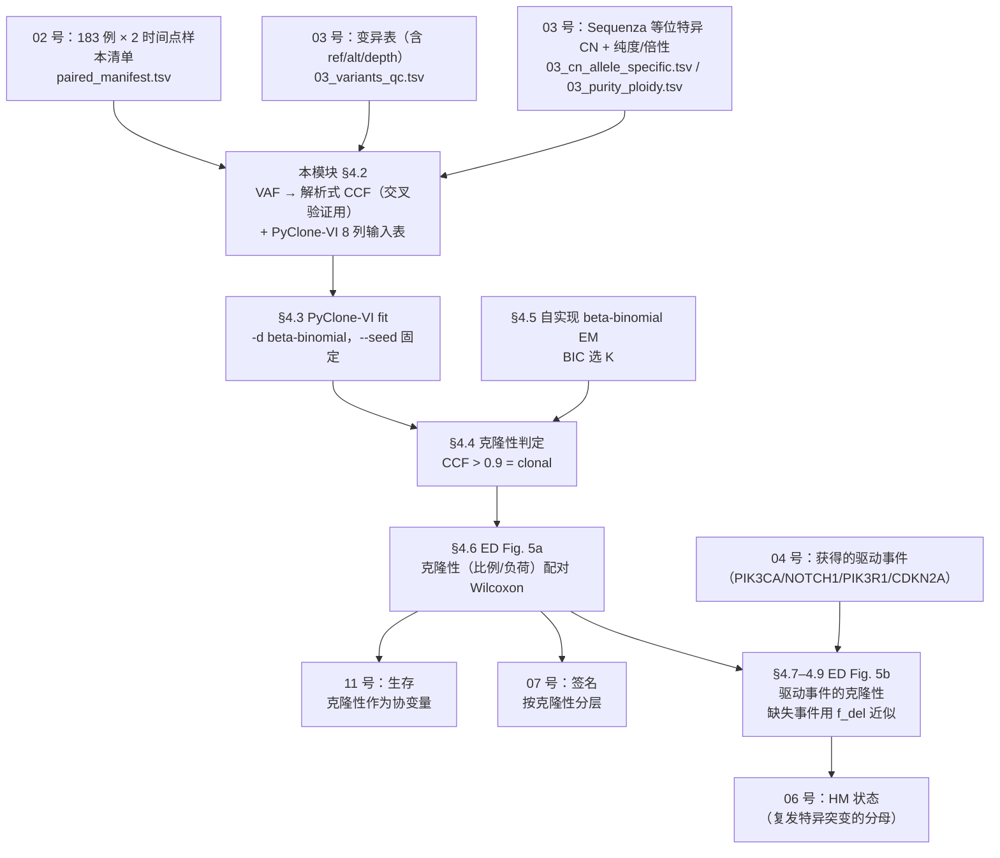

# 05 克隆性与纵向演化分析（VAF → CCF → PyClone-VI 变分聚类 → 克隆性阈值 → 纵向比较）

> **目标文献**：The GLASS Consortium. *Divergent genomic evolution in astrocytomas and oligodendrogliomas.*
> *Nature* (2026). PDF 标识 s41586-026-11150-x. 数据：Synapse syn17038081；代码：github.com/verhaaklab/glass-idh
>
> **模块对应原文**：Extended Data Fig. 5a,b（全模块主目标）；Fig. 2b（HM/non-HM 分组与驱动事件时序的输入）；
> Methods 中「**Clonality analysis**」整段 + 「**sSNV calling**」段的互惠 calling 说明 + 「**Mutational burden**」段的 HM 定义；
> Results「Diverging genomic driver events」中「Using Sequenza-derived allele-specific copy-number profiles and PyClone-VI clustering…」一段
> **复现层级**：**L1 派生层（主路径，可逐位复现）**——从 Synapse `syn17038081` 的变异表 + 等位特异拷贝数 + 纯度/倍性表出发，重算 VAF 与 CCF、跑 PyClone-VI、复现 ED Fig. 5a,b 及全部统计。
> **L2 例外（局部需要）**：PyClone-VI 要求每个突变在**所有**样本都有行；"仅复发检出"的突变若要保留，必须回初始样本的 **BAM** 取该位点 ref/alt 计数（受控访问）。**若只能做 L1**：可用"对侧总深度填 alt=0"的近似口径替代，但必须把由此产生的偏差登记入 gap 表（见 §4.2 与陷阱 T4）。**L3（FASTQ 起）不需要**。
> **前置依赖**：`02_队列构建、临床注释与样本QC.md`（183 例 × 2 时间点的样本清单与 `patient_id` 配对关系）、`03_变异检出与拷贝数调用.md`（产物契约：`processed/03_variants_qc.tsv`、`processed/03_cn_allele_specific.tsv`、`processed/03_purity_ploidy.tsv`）、`04_驱动事件鉴定与互斥性分析.md`（驱动基因清单与"获得性事件"的定义）
> **下游消费**：`06_突变负荷与超突变分类.md`（HM 状态与复发特异突变的分母）、`07_突变签名分析与治疗归因.md`（按克隆性分层）、`11_生存分析与预后模型.md`（克隆性作为协变量）
> **复现难度**：★★★☆☆　**预计工时**：3 人日　**计算资源**：PyClone-VI 单次 fit（2 样本 × ~5,000 突变 × `-c 40`）在 8 线程约 **1–5 分钟**、峰值内存 **< 4 GB**；本模块**不需要 GPU**。自实现的 EM（§4.5）为纯 numpy/scipy，单次 `K=10` 约 **10–30 s**、内存 < 2 GB。

---

## 0. 执行摘要（先读这 10 行）

1. 本模块要回答的是：**复发的肿瘤细胞群体，是从初始肿瘤的哪个亚群长出来的？获得的驱动突变是"已经有优势"（clonal）还是"刚冒头"（subclonal）？**
2. 原文的执行链只有三步，短到几乎一句话，但每一步都有陷阱：
   `Sequenza 等位特异 CN + 纯度` → `VAF` → **`PyClone-VI`（beta-binomial 模式、默认参数、覆盖率 ≥10× 的变异才纳入）** → **`CCF > 0.9` 记为 clonal**。
3. **CCF 不是 VAF**。不做拷贝数与纯度校正，同一批 VAF 在丢失区会被**低估 33–41%**、在扩增区会被**高估 11–88%**（§2.3 的数值表，已在本机用 R 复算）。原文的 0.9 阈值正好卡在这个误差量级上——所以"校正"不是精致化，而是**决定结论方向**的事。
4. 原文的核心结论有两条：**① 克隆突变负荷的下降只发生在超突变 astrocytoma**（oligo 无论超突变与否都无显著纵向变化）；**② 获得的 PIK3CA / NOTCH1 / PIK3R1 突变在 oligodendroglioma 中"以 clonal 为主"，获得的 CDKN2A 缺失在 astrocytoma 中"以 clonal 为主"**。
5. ⚠️ **原文对 ED Fig. 5 只给了检验方法、没给任何 p 值与 n**。因此本模块的 Go/No-Go **必须是方向性的**：HM astro 的克隆性下降须显著（P < 0.05），oligo 两亚组须不显著。**不要把"复现出原文没报告的具体 p 值"当目标**（L0 §12）。
6. ⚠️ **PyClone-VI 只处理 sSNV，不处理 CNA**。原文写「获得的 CDKN2A 缺失多为 clonal」，但缺失事件的"克隆性"在 PyClone-VI 里**无定义**——这是原文的一处口径空白，必须由本项目 D 表裁决（§4.8 给出三种可执行口径与公式）。
7. ⚠️ **PyClone-VI 默认 `--seed` 为 `None`（随机）**。原文说"默认参数"，意味着**其结果在严格意义上不可逐位复现**。我们复现时必须显式 `--seed 20260101`，并另跑一次"无种子"以量化随机重启动带来的波动（§5）。
8. 共享突变比例（oligo 36% / astro 45%）不是"truncal 比例"，而是**检出层面的下界**：它同时受覆盖度、纯度、空间取样位置影响。原文用 **5 例多区域 WXS** 给出的空间共享中位数 **53%** 正是为了说明这一点。
9. 本模块的实现路线是**双轨**：轨道 A 用官方仓库 + PyClone-VI（"原文怎么算"）；轨道 B 用我们自实现的 beta-binomial EM（"为什么这么算" + 独立验证）。轨道 B 的脚本已在本机跑通自检：BIC 选出 K=3（真值 3）、每突变 CCF 平均绝对误差 **0.044**、`CCF>0.9` 判定一致率 **0.932**（§4.5）。
10. 术语提醒：本文的 **CCF（cancer cell fraction）** 就是 PyClone 系列文档里的 **cellular prevalence**，PyClone-VI 输出列名即 `cellular_prevalence`。**PRS** 在本文指 post-recurrence survival，与"多基因风险评分"无关。

---

## 1. 科学问题与逻辑位置

### 1.1 本模块在证据链中的位置



**上游给什么**：一个"患者 → 两个时间点（initial / recurrence）→ 每个样本的变异表 + 等位特异拷贝数 + 纯度"的三元组。
**下游要什么**：每个样本每个突变的 `CCF` 与 `clonal/subclonal` 标签，以及每个样本的 `clonal_mutation_proportion` / `clonal_mutation_burden` 两个汇总量。

### 1.2 上游输入与下游输出（产物契约）

> 本项目契约表的**权威位置**是 `PROJECT_SPEC.md` §4（L0 §4.1）。下表为本模块相关的条目，新增/改名必须同步改契约表并记 `logs/DECISIONS.md`。

| 产物路径 | 生产者 | 格式 / 结构（下游必须知道的一切） | 消费方 |
|---|---|---|---|
| `processed/03_variants_qc.tsv` | 03 | `mutation_id, patient_id, sample_id, timepoint(I/R), chrom, pos, ref, alt, ref_counts, alt_counts, depth, platform(WGS/WXS)`；坐标 **b37/hg19**，染色体命名 **无 `chr` 前缀**（`1`…`22`,`X`）；`mutation_id` 为**跨样本一致**的全局 ID | 05/06/07 |
| `processed/03_cn_allele_specific.tsv` | 03 | `sample_id, chrom, start, end, major_cn, minor_cn, log2ratio`；Sequenza 等位特异；`log2ratio` 基线 = **二倍体**（GATK `CallCopyRatioSegments` 口径） | 05/09 |
| `processed/03_purity_ploidy.tsv` | 03 | `sample_id, purity(0–1), ploidy, caller`；**purity 即 ρ（tumour content）** | 05/08/09 |
| `processed/05_pyclone_input.tsv` | **05（唯一生产者）** | PyClone-VI 输入：`mutation_id, sample_id, ref_counts, alt_counts, major_cn, minor_cn, normal_cn, tumour_content`；**每个 mutation_id 必须在全部样本都有行**（见 §4.2） | 05 |
| `results/05_pyclone_results.tsv` | 05 | PyClone-VI `write-results-file` 原样输出：`mutation_id, sample_id, cluster_id, cellular_prevalence, cellular_prevalence_std, cluster_assignment_prob` | 05/07/11 |
| `results/05_ccf_merged.tsv` | 05 | `mutation_id, sample_id, patient_id, timepoint, ccf_pyclone, ccf_analytic, ccf_em, clonal_pyclone, clonal_analytic, clonal_em, cluster_prob`；**多轨并列**，便于差异定位 | 05/07 |
| `results/05_clonal_summary_paired.csv` | 05 | `patient_id, tumour_type(astro/oligo), hypermutation_status, platform,` 每时间点一组 `{n_mut, n_clonal, n_clonal_conf, clonal_prop, clonal_burden_bp, median_ccf}_{I,R}` `, delta_clonal_prop, delta_clonal_burden`；由 `code/05_03_clonality_calls.R` 的 `dcast` 生成（列名即该脚本的实际输出，改列名 = 改契约） | 06/11 |
| `results/05_shared_mutation_fraction.csv` | **05（唯一生产者）** | `patient_id, tumour_type, hypermutation_status, platform, n_initial, n_recurrence, n_shared, n_recurrence_only, n_recurrence_only_lowcov_initial, shared_frac_of_initial, recurrence_only_frac, frac_recurrence_only_uninformative`；**06 号消费 `recurrence_only_frac` / 自己的复发特异突变集以定义 SBS11 占比的分母**；`interval_years` 由 02 号清单 join 进来（本表不重复存储） | 06/07/11 |
| `results/05_driver_ccf_by_timepoint.csv` | 05 | 驱动事件级 CCF（含缺失事件的 `f_del` 近似）：`patient_id, gene, event_type(sSNV/CNA), timepoint, ccf, ccf_method, clonal` | 04/07/11 |
| `processed/05_mutation_pair_timing.tsv` | **05（唯一生产者）** | **每突变一行**（`PROJECT_SPEC.md` §3.1 登记）：`mutation_id, patient_id, sample_initial, sample_recurrence, in_initial, in_recurrence, shared, recurrence_specific, depth_initial, depth_recurrence, vaf_initial, vaf_recurrence, ccf_initial, ccf_recurrence, filled_from(observed/BAM/alt0)`；时序取值即 `initial-only / recurrent-only / shared` 三态；**06 号的"SBS11 复发特异占比"、07 号的签名分层、11 号的分层都消费本表**；`recurrence_specific` 的口径见 `06_突变负荷与超突变分类.md` §2.10 | 06/07/11 |
| `results/05_multisector_sharing.csv` | 05 | 同次手术多区域（WXS，n = 5）的 sector 归属与共享统计：`patient_id, tumour_type, sector, category(unique_s1 / unique_s2 / shared), n_mut, frac` | 06 |
| `figures/ED_Fig5a_clonal_proportion.{pdf,png}` | 05 | 复现 Extended Data Fig. 5a | — |
| `figures/ED_Fig5b_driver_ccf.{pdf,png}` | 05 | 复现 Extended Data Fig. 5b | — |

### 1.3 它解决什么、不解决什么

**解决**：给定两时间点的 VAF + 局部拷贝数 + 纯度，判定每个突变在每个时间点的**克隆性**，并检验克隆性在时间点之间是否变化、变化是否与获得的驱动事件相关。

**不解决（必须在文档里说死的边界）**：

- **不能证明"谱系关系"**。CCF 是"携带该突变的肿瘤细胞比例"，不是"细胞分化自谁"。同一簇里的两个突变只是**CCF 相同**，不等于**同一亚克隆**——用 CCF 拼树是一个额外的、有争议的推断步骤（§2.7）。
- **不能区分"新获得"与"一直存在但在初始样本没测到"**。这是纵向 WGS 的**根本限制**，只能靠覆盖度、纯度、多区域取样三条线索去界定上界（§2.8）。
- **不能给出 CNA 的"克隆性"**（PyClone-VI 只吃 sSNV）。原文此处口径缺失（§4.8）。

---

## 2. 背景知识与原理

### 2.1 克隆演化的概念框架：从"亚克隆"到"CCF"

肿瘤是**一群**在演化中的细胞。当一次体细胞突变发生在一个细胞里，它的所有后代都会带着它。因此在任何时刻，一个突变只可能有两种状态：

- 出现在**全部**肿瘤细胞中 → **clonal（克隆性）**，说明它发生在"最近的共同祖先"里，此后这个群体扩张到占据整个肿瘤；
- 只出现在**一部分**肿瘤细胞中 → **subclonal（亚克隆性）**，说明它发生在一个分支上。

**CCF（cancer cell fraction）**就是这个"一部分"的量化：**携带该突变的肿瘤细胞占全部肿瘤细胞的比例**，取值 0–1。

三个必须分清的概念：

| 记号 | 含义 | 常见叫法 |
|---|---|---|
| **VAF** | 测序读段中支持突变的比例，$alt/(ref+alt)$ | variant allele frequency / allele fraction |
| **VAF 的期望** $\mu$ | 由 ρ、局部拷贝数、CCF 共同决定（§2.2） | expected VAF |
| **CCF** $\phi$ | 携带突变的**肿瘤细胞**比例 | cellular prevalence（PyClone 系）/ cancer cell fraction |

**为什么不能在 VAF 上直接比大小**：一个 VAF = 0.25 的突变可能是"90% 的细胞在 4 拷贝区里各有 1 条突变拷贝"，也可能是"45% 的细胞在二倍体区各有 1 条突变拷贝"，还可能是"50% 纯度的样本里、所有细胞都带的一个 2 拷贝区的突变"。**三者的生物学含义完全不同**。所以必须先把 VAF 换算成 CCF。

### 2.2 从测序深度到 CCF：纯度、倍性、局部拷贝数的完整推导

**记号**

| 符号 | 含义 | 本文取值/来源 |
|---|---|---|
| $\rho$ | 肿瘤纯度（tumour content / cellularity），样本中肿瘤细胞的核酸比例 | Sequenza `cellularity` |
| $n_{tum}$ | **肿瘤细胞**中该位点的**局部总拷贝数** $= major\_cn + minor\_cn$ | Sequenza 等位特异 CN |
| $n_{norm}$ | **正常细胞**中该位点的拷贝数 | 常染色体 = 2，男性 X/Y 例外 |
| $m$ | 携带该突变的**拷贝数**（multiplicity） | sSNV 默认 $m=1$（见 §2.3.3） |
| $d$ | 位点总深度 | 变异表 `depth` |
| $a$ | 支持突变的读段数 | 变异表 `alt_counts` |

**推导（从"读段来自谁"开始）**

样本里的每一条读段，要么来自正常细胞、要么来自肿瘤细胞，概率分别是 $1-\rho$ 与 $\rho$。位点上共有三类"等位基因来源"，各自的**拷贝数贡献**为：

| 来源 | 占样本的比例 | 该来源贡献的拷贝数 | 其中带突变的拷贝数 |
|---|---|---|---|
| 正常细胞 | $1-\rho$ | $n_{norm}$ | 0（胚系不携带该体细胞突变） |
| 肿瘤细胞、不带该突变 | $\rho(1-\phi)$ | $n_{tum}$ | 0 |
| 肿瘤细胞、带该突变 | $\rho\phi$ | $n_{tum}$ | $m$ |

于是

$$
\boxed{\;VAF=\mu(\phi)=\frac{\rho\,\phi\,m}{\rho\,n_{tum}+(1-\rho)\,n_{norm}}\;}
\qquad\text{反解：}\qquad
\boxed{\;\phi=\frac{VAF\cdot\big[\rho\,n_{tum}+(1-\rho)\,n_{norm}\big]}{\rho\,m}\;}
$$

**三个特例，把直觉钉死**（下面的数字都可以在 R 里一行验算）：

1. **二倍体中性区 $(n_{tum}=n_{norm}=2)$、$m=1$**：$\mu=\rho\phi/2$，即 $\phi=2\,VAF/\rho$。
   例：ρ = 0.5，VAF = 0.25 → φ = 1.0（**全部**肿瘤细胞携带）。同一个 VAF = 0.25 在 ρ = 0.25 时 → φ = 2.0，**不可能**，说明**纯度不能再低**，或 VAF 被污染/伪影抬高。**"φ > 1" 是免费的 QC 信号，一定要统计它出现了多少次**（陷阱 T2）。
2. **单拷贝区 $(n_{tum}=1)$**：$\mu=\rho\phi/(\rho+2(1-\rho))=\rho\phi/(2-\rho)$，$\phi=VAF\,(2-\rho)/\rho$。分母变小 → 同样的 VAF 对应更大的 CCF。
3. **扩增区 $(n_{tum}=4)$、$m=1$**：$\phi=VAF\,(2+2\rho)/\rho$。分母变大 → 同样的 VAF 对应更小的 CCF。
   直觉：扩增区里"支持突变的读段"被 4 条拷贝稀释了。

> ⚠️ **导师批注**：写作简报里给的简化式 $\phi \approx VAF\cdot n_{tum}/(\rho m)$（即"$N_{tot}^{tum}/N_{copy}\cdot 1/\rho$"）**只在 $n_{tum}=n_{norm}$ 时才与上式等价**。它的物理含义是"假定本地没有任何正常细胞污染"。在小肿瘤活检、低纯度样本里这个假定会崩。文档里必须同时给出两式并量化差异（§2.3），否则复现者很容易只抄简化式。

**纯度 $\rho$ 从哪来，为什么它是最脆弱的一环**：Sequenza 用"深度比 + B 等位基因频率"两条曲线的联合拟合同时估出 $\rho$ 与倍性。这两者存在**已知的混淆（purity–ploidy confounding）**：一份"纯度高、拷贝数少"的样本与一份"纯度低、拷贝数多"的样本可以给出几乎相同的观测。误差通常 ±0.05–0.1。**$\phi$ 与 $\rho$ 大致成反比**，所以纯度 10% 的相对误差会在低 CCF 端放大成 20%+ 的 $\phi$ 误差。→ 复现时务必做"$\rho \pm 0.1$"的敏感性分析（§5），并核对 `03_purity_ploidy.tsv` 里 `ploidy` 是否与该样本的 WGD 状态自洽（与 `08_拷贝数签名与全基因组加倍.md` 对表）。

### 2.3 多拷贝通式 vs 简化式的量化偏差（★ 本模块最重要的一张表）

下表由 `code/05_01_vaf_ccf.R` 的第 5 段生成（本机 R 4.5.2 已复算）：固定"严谨式算出的 φ = 0.9"，再看简化式会给出什么。

| ρ | $n_{tum}$ | 该突变真实 VAF | 严谨式 CCF | 简化式 CCF | 简化式相对偏差 | 判为 clonal？ |
|---|---|---|---|---|---|---|
| 0.3 | 1（缺失） | 0.1588 | 0.900 | 0.529 | **−41.2%** | 严谨 ✅ / 简化 ❌ |
| 0.3 | 2（中性） | 0.1350 | 0.900 | 0.900 | 0.0% | 一致 |
| 0.3 | 3 | 0.1174 | 0.900 | 1.174 | **+30.4%** | 严谨 ✅ / 简化 ❌（φ>1） |
| 0.3 | 4 | 0.1038 | 0.900 | 1.385 | **+53.8%** | 同上 |
| 0.3 | 6 | 0.0844 | 0.900 | 1.688 | **+87.5%** | 同上 |
| 0.5 | 1 | 0.3000 | 0.900 | 0.600 | **−33.3%** | 严谨 ✅ / 简化 ❌ |
| 0.5 | 2 | 0.2250 | 0.900 | 0.900 | 0.0% | 一致 |
| 0.5 | 3 | 0.1800 | 0.900 | 1.080 | **+20.0%** | 严谨 ✅ / 简化 ❌ |
| 0.5 | 4 | 0.1500 | 0.900 | 1.200 | **+33.3%** | 同上 |
| 0.8 | 1 | 0.6000 | 0.900 | 0.750 | **−16.7%** | 严谨 ✅ / 简化 ❌ |
| 0.8 | 2 | 0.3600 | 0.900 | 0.900 | 0.0% | 一致 |
| 0.8 | 4 | 0.2000 | 0.900 | 1.000 | **+11.1%** | 边界 |

**这张表证明三件事**：

1. **$\rho$ 越低，偏差越大**：纯度 0.3 时，同一个"真 clonal"的突变在简化式下 CCF 从 0.53 到 1.69 不等——**方向都可能反**。
2. **简化式在丢失区系统性低估、在扩增区系统性高估**。这不是随机噪声，是**系统性偏倚**，会直接改变"哪些驱动事件是 clonal"的结论（而 §1 的原文结论 ② 正是关于驱动事件的克隆性）。
3. **$n_{tum}=2$ 时两式完全相同**。所以**如果一个队列的绝大多数突变落在中性二倍体区，简化式"看起来没问题"**——这正是最危险的假安全：astrocytoma 的复发样本富含局灶扩增（原文：38/94 复发 astrocytoma 含至少一个局灶癌基因扩增），恰恰是偏差最大的区域。

#### 2.3.3 multiplicity $m$ 为什么不能默认 1

$m$ 是"这个突变**坐在几条拷贝上**"。若一个突变发生在某次拷贝数增加**之前**，那次增加会把它一起复制 → $m>1$；若发生在其**之后** → $m=1$。

- 用 $m=1$ 而真值 $m=2$：$\phi$ 被**低估一半**，一个真 clonal 的突变会被误判成 subclonal。
- 直接从测序数据估 $m$ 与直接估 $\phi$ **在数学上不可分辨**（同一个 VAF 既可由"$m=1,\phi=0.9$"也可由"$m=2,\phi=0.45$"产生）——这是**模型必须引入额外先验**的地方。

**PyClone-VI 的处理**：它不要求用户给 $m$，而是对每个位点**枚举一族候选基因型**（突变位于 $1\ldots major\_cn$ 条拷贝，以及"突变早于拷贝数变化"这一支），赋予**均匀先验**并做边缘化；其内部期望等位分数的算法形如 `e_vaf = Σ_i prior_i · cn_i · μ_i / Σ_i prior_i · cn_i`，其中 `prior = [1-ρ, ρ(1-φ), ρφ]`。

> ⚠️ **导师批注（源码层面的描述必须现场复核）**：上面这段（含函数名 `get_major_cn_prior` / `log_pyclone_beta_binomial_pdf` 与 `e_vaf` 的写法）来自撰写时对 PyClone-VI 源码的**一次阅读，本项目未逐条复核其函数名与版本**。复现时请用 `python -c "import pyclone_vi, inspect; print(pyclone_vi.__file__)"` 找到实际安装路径，再确认对应符号是否仍存在；**不要**把函数名当成跨版本的稳定契约。若符号已改名，本段结论（"PyClone-VI 内部做基因型边缘化，因此不要求用户给 $m$"）不受影响，但引用时必须说明所依据的版本。

> ⚠️ **导师批注**：源码中"突变早于拷贝数变化"这一支写作 `cn = (normal_cn, normal_cn, total_cn)`，即**不带突变的肿瘤细胞群按 `normal_cn` 计权**，与"同一克隆局部总拷贝数是 `total_cn`"的直觉不一致。**我们不去断言它是对是错**（可能有意为之，也可能有版本差异），而是采取工程上稳妥的做法：**把 PyClone-VI 当黑箱**，另用 §4.2 的解析式与 §4.5 的独立 EM 做**方向性**交叉验证，只对"是否为 clonal"的**一致率**设判据（≥ 90%），不对 CCF 绝对值设窄容差。此点登记到 `13_复现质控清单、排错与批判性评述.md` 的 D 表。

### 2.4 PyClone-VI 的原理：beta-binomial 似然 + 变分推断

**模型（与 PyClone 一致的部分）**

对突变 $i$ 在样本 $s$：读段数 $d_{is}$ 固定，支持突变数 $a_{is}$ 服从以 $\mu_{is}$ 为均值的**过散布二项分布**。PyClone-VI 用 **beta-binomial**：

$$
a_{is}\sim \text{BetaBinom}\big(d_{is},\ \alpha=\mu_{is}\nu,\ \beta=(1-\mu_{is})\nu\big),\qquad
\mu_{is}=\frac{\rho_s\,\phi_{k(i),s}\,m_i}{\rho_s\,n^{i}_{tum}+(1-\rho_s)\,n_{norm}}
$$

其中 $\nu$ 是**精度（precision）**，把二项分布的方差放宽。按上式参数化，计数 $a$ 的方差有闭式：

$$
\mathrm{Var}(a)=d\,\mu(1-\mu)\Big[1+(d-1)\,\kappa\Big],\qquad \kappa=\frac{1}{\nu+1}
$$

（推导：$\mathrm{Var}=\dfrac{d\alpha\beta(d+\alpha+\beta)}{(\alpha+\beta)^2(\alpha+\beta+1)}$，代入 $\alpha=\mu\nu,\ \beta=(1-\mu)\nu$ 即得。**注意必须带前面的因子 $d$**——二项分布的方差是 $d\,\mu(1-\mu)$，漏掉 $d$ 会把过散布的幅度少算一个数量级，从而误判"要不要用 beta-binomial"。）$\kappa$ 随 $\nu$ 增大而减小：$\nu\to\infty$ 时 $\kappa\to0$、方差退回二项。`pyclone_vi` 的 `-d/--density` 有两个选项：`binomial` 与 `beta-binomial`；`--precision` 默认 **200**（仅 beta-binomial 生效）。⚠️ **`--density` 的默认值、`--precision` 的默认值都必须用现场 `pyclone-vi fit --help` 核对**（见 §5 表与 §4.3），本段写的是撰写时快照。

> ⚠️ **原文说的是"run in beta-binomial mode"**，而当前 `pyclone_vi` 的 **`--density` 默认值是 `binomial`**。也就是说：**"beta-binomial 模式"与"默认参数"是一句自相矛盾的话**——它至少显式改了 `--density`。复现时主路径取 `-d beta-binomial`（照原文文字），并跑一次 `-d binomial` 做敏感性分析。此点登记 D 表。

**为什么必须放宽方差**：真实 WGS 数据的等位读段计数存在**过散布**（GC 偏倚、比对偏倚、拷贝数段内的亚结构），纯 binomial 会低估方差 → 似然过尖 → 过度自信地把突变分进不同簇。

**簇与自由参数**：每个簇 $k$ 在样本 $s$ 上有一个 $\phi_{k,s}$；混合权重 $\pi_k$ 上有对称 Dirichlet 先验（`--alpha` 默认 1.0）。`-c/--num-clusters` 是**簇数上界**：官方 README 明确写"should be set to a value larger than the expected number of clusters. The software will then automatically determine how many to use"，常用 **10–40**。也就是说 **K 不是一个"要猜准"的参数，而是一个上界**——但上界过小会硬性合并真簇，这是单向错误（§5）。

**变分 vs MCMC（"去掉 MCMC"到底去掉了什么）**

| | PyClone（原版，2014） | **PyClone-VI**（本文所用，2020） |
|---|---|---|
| 后验推断 | Dirichlet-process 混合 + **MCMC（切片采样）** | **坐标上升变分推断（CAVI）**，把后验近似成因子化分布 |
| 收敛判据 | 链长、收敛诊断 | **ELBO 相对变化 < `--convergence-threshold`（默认 1e-6）**，`--max-iters` 默认 10000 |
| 随机性来源 | MCMC 抽样 | **随机初始化 + `--num-restarts`（默认 1）**；`--seed` **默认 None** |
| 速度 | 每样本小时级 | 全 WGS（数千突变 × 多样本）**分钟级** |
| CCF 的表示 | 从样本路径统计后验 | 输出 `cellular_prevalence` 与 `cellular_prevalence_std`（近似后验均值与标准误） |

**要真正"讲透"的一点**：变分推断给出的是**后验的近似**，而且**默认只跑 1 次随机重启**。所以官方建议 `-r 10-100`。原文用"默认参数"= `-r 1`（当前默认值），这意味着**局部最优的风险没有被缓解**。复现时的处置：主路径 `-r 10`，另跑 `-r 1` 与"不设种子"各一次，把结果差异写进 §6 的波动记录（这是把"不可复现的随机性"变成"可度量的不确定性"）。

### 2.5 工具横向对比：PyClone-VI 在克隆性推断工具谱系中的位置

> 本文**只用了 PyClone-VI**（原文唯一的克隆性工具，其参考文献为 Gillis & Roth, *BMC Bioinformatics* 2020）。下表其余工具**本文未使用、原文未引用**，列在这里只为说明"为什么在这个规模与这个问题下 PyClone-VI 是合理选择"，以及"换工具会付出什么代价"。**默认参数与当前版本行为以各自官方文档为准；本表只作选型理由，不作为参数引用依据。**

| 工具 | 输入要求 | 需要 CN + 纯度 | 多样本联合推断 | 是否建树 | 推断方式 | 速度（量级） | 本文用途 |
|---|---|---|---|---|---|---|---|
| PyClone（原版） | VAF + 等位特异 CN + 纯度（每突变×样本一行） | **是** | 是（联合，共享簇结构） | 否（只出 cluster，树需另拼） | Dirichlet process 混合 + **MCMC（切片采样）** | 慢（单样本小时级） | 未使用 |
| **PyClone-VI** | 同上（TSV，7 必需列 + `tumour_content` / `error_rate` 可选） | **是** | **是** | 否 | **变分推断（CAVI）+ 随机重启**，**无 MCMC** | **快**（全 WGS、多样本，分钟级） | **★ 本文唯一使用** |
| SciClone | VAF + CN + 纯度 | 是 | 原版按单样本（多样本需自行整合） | 否 | 1D 贝叶斯混合（在 VAF 轴上做后验） | 快 | 未使用 |
| QuantumClone | VAF + CN + 纯度（支持按区域聚合） | 是 | 是 | 否（只能提示"获得的先后"，不成树） | 期望最大化 + 聚类 | 中 | 未使用 |
| MOBSTER | VAF + CN + 纯度 | 是 | 否（单样本） | 否 | 混合模型（Beta 主体 + **Pareto 尾**显式建模亚克隆长尾） | 中 | 未使用 |
| PhyloWGS | VAF + CN + **SV**（SV 是其建树的关键证据） | 是 | 是 | **是（完整系统树 + 群体频率）** | 贝叶斯 MCMC | **很慢**（小时–天） | 未使用 |
| DPClust | VAF + CN + 纯度 | 是 | 可选（有多样本模式） | 否 | Dirichlet process 混合 | 中 | 未使用 |
| CITUP | VAF + CN + 事先枚举的候选树集 | 是 | 是 | **是** | 组合优化（在候选树上最小化拟合误差） | 慢 | 未使用 |

**为什么本文选 PyClone-VI（四条理由，逐条对得上原文的规模与结论）**：

1. **规模**：183 例患者 × 2 时间点 × 数十万突变，且必须**同一患者的两个样本联合推断**（否则两时间点的簇不可比）。MCMC 类（PyClone 原版、PhyloWGS）在这个规模上算力不可承受。
2. **不需要树**：本文的演化结论完全建立在「共享 / 特异」的**计数**与「驱动事件的克隆性」上，**没有**任何结论依赖系统树的拓扑。因此 PhyloWGS / CITUP 的额外能力用不上，而它们的代价（需要 SV、极慢、MCMC 诊断）全都得付。
3. **需要"自动定簇"**：`-c/--num-clusters` 是**上界**，变分推断会自动收缩到实际有效的簇数（官方 README 原话）。这避免了在 183 例上逐例做模型选择（BIC/交叉验证），而逐例模型选择在真实数据上极易过拟合。
4. **代价要认**：变分推断给的是后验近似；默认 `-r 1`（单次重启）与 `--seed None`（随机）意味着**同一输入不保证同一输出**。所以本文"用默认参数"这句话在可复现性上是有代价的 —— 我们复现时必须显式固定种子并多跑重启（§5、§4.3）。

**换用其他工具会怎样（对本模块结论的影响）**：

| 换成 | 会发生什么 |
|---|---|
| SciClone / MOBSTER（单样本） | 两时间点的簇**不能直接配对**，"克隆重负荷的纵向变化"这个核心结论失去可比性 → 需改成"每样本内 clonal 比例"，与原文口径不符 |
| PhyloWGS / CITUP（建树） | 会多出"树拓扑"这一层结论，但也会引入新的不确定性（树空间巨大、需要 SV、MCMC 收敛诊断），**且原文没有这一层** → 无法与原文数值对照 |
| 自实现 EM（§4.5） | 无自动剪枝（需 BIC/合并）、$m$ 固定为 1 → 只用于**方向性交叉验证**，不作为主口径 |

### 2.6 "clonal" 的定义：CCF > 0.9 的含义与敏感性

**原文口径（Methods「Clonality analysis」原文一句）**：
> "Mutations with a cancer-cell fraction higher than 0.9 were classified as clonal, and those below this threshold were considered subclonal."

**这个阈值在"承认什么"**：CCF 不是测出来的，是**推出来的**。对一个突变，单点估计的标准误大致是（一阶误差传播）

$$
\mathrm{SE}(\phi)\ \approx\ \frac{k}{\rho\,m}\sqrt{\frac{VAF\,(1-VAF)}{d}},\qquad k=\rho\,n_{tum}+(1-\rho)\,n_{norm}
$$

（推导：由 §2.2 的反解式 $\phi = \dfrac{VAF\cdot k}{\rho\,m}$，对 $VAF$ 做一阶误差传播，$\mathrm{Var}(\phi)=\left(\dfrac{k}{\rho m}\right)^2\mathrm{Var}(\widehat{VAF})$，而 $\mathrm{Var}(\widehat{VAF})\approx\dfrac{VAF(1-VAF)}{d}$。下表的算例取 $m=1$，故公式里 $\rho m$ 退化为 $\rho$；**$m>1$ 时（扩增区）必须带上 $m$**，否则 SE 会被高估。）

本机实算（代码见 §4.2 第 7 段）：

| ρ | $n_{tum}$ | 目标 CCF | 深度 $d$ | 该突变的 VAF | $\mathrm{SE}(\phi)$ |
|---|---|---|---|---|---|
| 0.3 | 2 | 0.90 | 30 | 0.135 | **0.416** |
| 0.3 | 2 | 0.90 | 100 | 0.135 | 0.228 |
| 0.5 | 4 | 0.90 | 30 | 0.150 | **0.391** |
| 0.5 | 2 | 0.90 | 100 | 0.225 | 0.167 |
| 0.8 | 2 | 0.90 | 30 | 0.360 | 0.219 |
| 0.8 | 4 | 0.90 | 100 | 0.200 | 0.180 |

**读法**：在 30× 深度、纯度 0.5 的样本里，**单个突变的 CCF 标准误约 0.3**——"CCF > 0.9"这件事对单突变几乎没有分辨力。**那为什么原文这么做还站得住？** 因为 PyClone-VI **不是逐突变估计，而是先聚类、再用整簇的信息反推每个突变的 CCF**：同一个簇内的成百上千个突变共享 $\phi_{k,s}$，簇级 CCF 的精度可以高一个数量级。这就是"为什么要聚类而不是逐突变反解"的**唯一的**正确答案——不是"为了画图好看"，而是**为了借信息**。

> ⚠️ **导师批注**：原文没有报告"CCF 估计的不确定性如何影响 0.9 判定"。本模块要求额外产出 `results/05_ccf_threshold_sensitivity.csv`：阈值取 **0.80 / 0.90 / 0.95** 三档、并要求"`cluster_assignment_prob ≥ 0.9`"才能计入 clonal（PyClone-VI 输出里就有这一列，正是为此设计的置信度过滤）。三档结论方向一致才算稳健。

**与常见做法的对比**（写进方法学的依据）：

| 口径 | 出处示例 | 含义 | 后果 |
|---|---|---|---|
| CCF > **0.9** | **本文** | 允许 10% 的估计误差/亚克隆混杂 | 偏保守（会有真 clonal 被判 subclonal） |
| CCF > **0.8** | 较常见的"宽松"口径 | 容忍低纯度/低深度 | 会有真 subclonal 被判 clonal；在本文语境下**会削弱"获得事件是 clonal"的论断** |
| CCF > **0.95** | 较严格的"高置信"口径 | 只认"几乎全细胞" | 在 30× 数据上假阴性率高，驱动事件的 n 会掉到个位数 |
| 基于 $p(\phi>0.5)$ 或"$\phi$ 的 95% CrI 下界 > 0.5" | 贝叶斯式口径 | 承认不确定性 | 更严谨，但需要后验样本（PyClone-VI 只给均值与标准误，需自实现实现 §4.5 或改输出） |

### 2.7 树与演化模式：truncal vs branch 能从哪里推、不能从哪里推

**能推的**（原文实际做的）：

1. **"两时间点都检出"⇒ 高于"任一单点检出"的共享度**。原文："Mutations shared between time points are expected to be mostly truncal, reflecting early derivation in the evolution of a given tumour."
2. **共享比例的量级用于**区分"炎症式治疗诱导产物"与"既有异质性"：原文得到初始肿瘤突变在复发中的**中位共享比例 oligo 36% / astro 45%**（非超突变肿瘤），并用 **5 例多区域 WXS 的空间共享中位数 53%** 说明"相当一部分'不共享'其实是**空间取样位置不同**，而不是时间上的新获得"。
3. **驱动事件的时序**：Fig. 2b 把每个驱动事件标成 initial / recurrence / shared。
4. **获得的驱动事件多为 clonal**（ED Fig. 5b）→ 推断存在**强选择**（"suggesting a strong selection effect on cells containing CDKN2A homozygous deletions"）。这个推断是**合理的但非唯一**：另一解释是该突变发生得很早、恰好在这个时间窗被检出。

**不能推的**：

- 用"共享"直接当"truncal 比例"。36% 是**检出层面**的数字，它同时受：① 覆盖度是否够（≥10× 且能支持 alt）；② 初始样本纯度 ρ 是否够（$\mathrm{VAF}\approx\rho\phi/2$，ρ=0.3 且 φ=0.1 时 VAF 只有 0.015，约需 200× 才稳定检出）；③ 初始肿瘤的**取样位置**（53% 那条线索）。
- **平行演化（parallel evolution）与"共享"无法仅凭 CCF 区分**：如果两个时间点各自独立获得了同一个基因的**不同**突变，这在 Fig. 2b 里表现为"两个事件"，但同一基因的**同一**位点在两时间点都出现，既可能是共享祖先，也可能是**回复突变/趋同**。原文用 dNdScv 的"初始/共享/复发"三套分集来规避（见 `04_驱动事件鉴定与互斥性分析.md`）。
- **"检出比例低"不等于"肿瘤更异质"**：覆盖度与纯度更低的样本天然给出更低的共享比例。所以 §4.6 的所有共享比例分析**必须按平台（WGS/WXS）分层**——原文本身就把 WGS/WXS 视为 **distinct tumour sets**，不做混合比较。

### 2.8 纵向分析的五个坑（按危害排序）

| # | 坑 | 机制 | 处置 |
|---|---|---|---|
| 1 | **两时间点的 ρ 与倍性不同，CCF 不可直接比较** | $\phi$ 依赖 $\rho$；同一群细胞的"同一"克隆在 ρ 从 0.7 掉到 0.4 时会算出不同的 $\phi$ | 主路径用**逐样本自己的 $\rho$**（这是唯一正确的做法，因为 $\phi$ 的定义就是"该样本中的比例"）；若做"跨时间点的绝对 CCF 比较"，必须报告两样本的 $\rho$ 差异，并在 $\Delta\rho > 0.15$ 的患者上做敏感性剔除 |
| 2 | **把 VAF 当 CCF** | §2.3 的表 | 禁止任何直接对 VAF 设阈值的写法；代码里用函数名 `expected_vaf` / `ccf_from_vaf` 强制区分 |
| 3 | **PyClone-VI 静默丢弃"缺行"突变** | README 明确警告：无全部样本记录的突变会被删除 | §4.2 第 5 段补齐；并打印被丢弃的突变数（**必须为 0 才算通过**） |
| 4 | **把"未检出"当"不存在"** | 复发的"新"突变可能初始就有、只是低于检出限 | 报告"复发特异"时同时给 `n_recurrence_only` 与该位点在初始样本的深度分布；深度 < 15× 的位点单列一类 |
| 5 | **样本间污染 / 索引跳变** | 会把一个患者的高 VAF 突变"漏"到另一样本 | 上游 `03` 已用 Picard CrosscheckFingerprints（QC2），复现时断言：任一患者的突变其 VAF 在**非本人**样本中不应系统 > 0 |

---

## 3. 原文方法逐句拆解

> 格式：**原文句** → 中文转述 → 对应操作 / 参数 / 脚本。

| # | 原文句（Methods「Clonality analysis」及相邻段落） | 中文转述 | 对应操作 / 参数 / 脚本 |
|---|---|---|---|
| 1 | "We used PyClone-VI to assess the clonal status of all sSNVs in our dataset." | 对所有 sSNV 判克隆性 | 只处理 sSNV；**CNA 不进 PyClone-VI**（→ §4.8） |
| 2 | "variants with a minimum coverage of 10× **in at least one sample from each paired set** were included" | 突变进入分析的覆盖门槛是**配对层面的 ≥10×（至少一侧）** | §4.2 第 4 段：按 `patient_id` 分组，`max(depth_I, depth_R) ≥ 10`；**不是**两侧都要 ≥10× |
| 3 | "PyClone-VI was run in beta-binomial mode using default parameters." | beta-binomial + 其余默认 | `-d beta-binomial`；其余默认值（当前版本）：`-c 10`、`-g 100`、`-r 1`、`--alpha 1.0`、`--precision 200`、`--seed None`。⚠️ "beta-binomial" 并非当前 `--density` 默认值 → 见 §2.4 批注 |
| 4 | "Mutations with a cancer-cell fraction higher than 0.9 were classified as clonal, and those below this threshold were considered subclonal." | CCF > 0.9 = clonal | §4.4：`clonal := cellular_prevalence > 0.90`；另用 `cluster_assignment_prob` 做置信度过滤，并做 0.8/0.9/0.95 三档敏感性 |
| 5 | （Results）"Using **Sequenza-derived allele-specific copy-number profiles** and PyClone-VI clustering…" | 局部拷贝数与纯度**来自 Sequenza**，不是 ASCAT | 输入用 `03_cn_allele_specific.tsv` + `03_purity_ploidy.tsv`（Sequenza）；**不要混用 ASCAT 的纯化结果**——ASCAT 在本项目里用于 WGD 与 CN 签名（`08` 号），口径不同 |
| 6 | "A significant reduction in **clonal mutation burden** at recurrence was observed **exclusively in hypermutant astrocytomas**, whereas oligodendrogliomas showed **no significant longitudinal change irrespective of hypermutation status** (Extended Data Fig. 5a)." | 克隆负荷下降只见于 HM astro | §4.6 的核心判据（方向性）。⚠️ **图注写的是 "clonal mutation proportion"，正文写 "burden"** → 两套都要算（§2.6 批注、陷阱 T9） |
| 7 | "Acquired PIK3CA, NOTCH1 and PIK3R1 mutations were **predominantly clonal** in oligodendrogliomas." | oligo 获得的 PI3K/NOTCH1 多为 clonal | §4.7：以**获得性事件**（recurrence-only，或 recurrent 有而 initial 无）为行，报 CCF 与 clonal 比例。原文**未报告**具体比例与 n |
| 8 | "Acquired CDKN2A deletions were **mostly clonal** in astrocytomas, suggesting a strong selection effect…" | astro 获得的 CDKN2A 缺失多为 clonal | ⚠️ **PyClone-VI 不能给缺失的 CCF**（它删除 `major_cn == 0` 的突变，且根本不处理 CNA）。§4.8 给三种口径 + `f_del` 公式；原文**未报告**具体口径与比例 |
| 9 | （Methods「sSNV calling」）"Adequate sequencing depth and **reciprocal mutation calling between paired samples** minimized coverage-related false negatives; because our analysis compares shared mutations with sample-specific ones, coverage variation is unlikely to affect the qualitative patterns observed." | 配对样本**互惠 calling**，以压低"覆盖度造成的假阴性" | 复现时对齐此口径：变异表应为"配对联合 calling"的产物；若手头只有单样本 VCF，需按 §4.2 第 5 段补齐并显式声明偏差 |
| 10 | （Results）"Among all mutations detected in the initial tumour, the median fraction that was also detected in the recurrent **non-hypermutant** tumour was **36% for oligodendrogliomas and 45% for astrocytomas** (Extended Data Fig. 8b). …the median fraction of spatially shared mutations in IDH-mutant gliomas was **53%** (n = 5; Extended Data Fig. 8c)." | 共享比例中位数 36%/45%；空间共享 53%（n=5） | `results/05_shared_mutation_fraction.csv`（**本模块是唯一生产者**，06 号消费）。ED Fig. 8b 分"全部肿瘤"与"仅 primary–recurrence 配对"两套（n=144 的那一套） |
| 11 | （Results）"The length of the surgical interval was **negatively correlated with the fraction of mutations shared** by primary–recurrent pairs in **non-hypermutant oligodendrogliomas**, and positively correlated with their recurrence-only fraction — associations that were **not seen in non-hypermutant astrocytomas** (Extended Data Fig. 8d)." | 手术间隔越长，oligo 共享越少；astro 无此关系 | §4.6 第 4 段：Spearman（时间间隔 vs 共享比例），**必须分型分层**。⚠️ ED Fig. 8d 归在 ED Fig. 8（属 06 号的主图），但数据来自本模块的契约表 → 契约上由 05 生产、06 绘图 |

---

## 4. 逐步可运行代码

### 4.0 脚本编排与目录

```
code/
├── 05_00_locate_official_scripts.sh    # 定位官方仓库中与本模块相关的脚本
├── 05_01_vaf_ccf.R                     # VAF → 解析式 CCF → 构建 PyClone-VI 输入
├── 05_02_run_pyclone_vi.sh             # 官方工具运行（双档种子）
├── 05_03_clonality_calls.R             # 结果解析、合成多轨、克隆性判定与敏感性
├── 05_04_betabinom_em.py               # 独立 beta-binomial EM（含 --selftest，已跑通）
├── 05_05_fig_ed5a.R                    # Extended Data Fig. 5a
├── 05_06_fig_ed5b_plus_assoc.R         # Extended Data Fig. 5b + 驱动事件关联检验
└── 05_07_shared_fraction.R             # 共享/复发特异比例 + ED Fig. 8b,8c,8d 的数据侧
```
规则（L0 §3.1）：全部脚本**幂等**（重跑覆盖同名产物），随机种子 `20260101`，结束写 `logs/05_0X_sessionInfo.txt`。脚本只写 `processed|results|figures|logs/`，**绝不写 `raw/`**。

### 4.1 官方仓库定位（不要凭记忆写脚本名）

```bash
# code/05_00_locate_official_scripts.sh
set -euo pipefail
GLASS_REPO=code/glass-idh

if [ ! -f "$GLASS_REPO/README.md" ]; then
  # 原样 clone、不修改（L0 工程约定）；我们的改造版放 code/ 下
  git clone https://github.com/verhaaklab/glass-idh "$GLASS_REPO"
fi
git -C "$GLASS_REPO" rev-parse HEAD > logs/05_00_glass_idh_commit.txt

echo "== 顶层结构（仓库当前版本）=="
ls "$GLASS_REPO"                       # analysis/ figures/ tables/ legacy_codes/ preprocessing_pipeline/ …

echo "== figures/R 的一图一脚本数量（SPEC 记录为 27）=="
ls "$GLASS_REPO/figures/R" | wc -l

echo "== 0. 先看权威名单：PROJECT_SPEC.md §3.3（GitHub API 实测枚举，可直接引用）=="
grep -n "GLASS-I_\|script_landscape" ../PROJECT_SPEC.md | head -60

echo "== 1. 若 §3.3 的 27 个 figures/R 名字里没有克隆性相关的（确实没有），再 grep 定位 =="
grep -ril --include='*.R' --include='*.py' -e 'pyclone' -e 'cellular_prevalence' -e 'ccf' \
     "$GLASS_REPO" | grep -v 'legacy_codes' | grep -v 'preprocessing_pipeline' || true

echo "== 定位「突变负荷 / 超突变」相关脚本（06 号用）=="
grep -ril --include='*.R' -e 'mutational_burden' -e 'burden' -e 'hypermut' \
     "$GLASS_REPO" | grep -v 'legacy_codes' || true

echo "== legacy_codes/ 明确「未与当前数据版本同步维护」→ 本项目禁止使用 =="
```

> **发现脚本后**，把实际文件名填入 §8 的对应关系表，并遵循"原脚本 → 改造点 → 我们的复现版本"三步：原脚本用于**跑出原文的图**；我们的 `code/05_*.R` 用于**参数敏感性、替代实现与教学注释**。

### 4.2 输入构建：VAF → 解析式 CCF → PyClone-VI 输入表

```r
# code/05_01_vaf_ccf.R
# 输入：processed/03_variants_qc.tsv、processed/03_cn_allele_specific.tsv、processed/03_purity_ploidy.tsv
# 输出：processed/05_pyclone_input.tsv、results/05_vaf_ccf_analytic.tsv、results/05_ccf_se_examples.csv
set.seed(20260101)
suppressPackageStartupMessages({
  library(data.table); library(GenomicRanges); library(dplyr)
})

## ---- 1. 读取与契约断言（静默失败的头号来源）----
vars <- fread("processed/03_variants_qc.tsv")
cnsg <- fread("processed/03_cn_allele_specific.tsv")
pur  <- fread("processed/03_purity_ploidy.tsv")

need_v <- c("mutation_id","patient_id","sample_id","timepoint","chrom","pos",
            "ref_counts","alt_counts","depth","platform")
need_c <- c("sample_id","chrom","start","end","major_cn","minor_cn")
stopifnot(all(need_v %in% names(vars)), all(need_c %in% names(cnsg)),
          all(c("sample_id","purity") %in% names(pur)))
stopifnot(all(vars$timepoint %in% c("I","R")))
stopifnot(all(pur$purity > 0 & pur$purity < 1))
# 染色体命名与坐标必须同源（b37 无 chr 前缀）
stopifnot(!any(grepl("^chr", vars$chrom)), !any(grepl("^chr", cnsg$chrom)))
# 标签一致性断言（大小写/单复数不一致 → 取子集为空）
stopifnot(setequal(unique(vars$sample_id), unique(pur$sample_id)))
# 每个 sample 只能有一行纯度，否则后续 merge 会静默产生笛卡尔积
stopifnot(uniqueN(pur$sample_id) == nrow(pur))
pur_unique <- pur[, .(sample_id, purity)]
cat("突变数:", nrow(vars), " 样本数:", uniqueN(vars$sample_id),
    " 患者数:", uniqueN(vars$patient_id), "\n")

## ---- 2. VAF 与深度 ----
vars[, vaf := alt_counts / pmax(depth, 1L)]

## ---- 3. 构建「配对宽表」：每个突变一行，两时间点的计数并列 ----
# 先做宽表 → 再用同一次操作补齐缺行 → 再展开成长表贴 CN。顺序很重要：
# 若先贴 CN 再补齐，补齐出来的行会没有 CN（静默 NA）。
smap <- unique(vars[, .(patient_id, timepoint, sample_id)])
wide_sid <- dcast(smap, patient_id ~ timepoint, value.var = "sample_id")
stopifnot(all(c("I","R") %in% names(wide_sid)))
stopifnot(!anyNA(wide_sid$I), !anyNA(wide_sid$R))   # 每个患者必须两时间点都有样本

key <- unique(vars[, .(mutation_id, patient_id, chrom, pos, timepoint,
                       ref_counts, alt_counts, depth)],
              by = c("mutation_id","patient_id","timepoint"))
w <- dcast(key, mutation_id + patient_id + chrom + pos ~ timepoint,
           value.var = c("ref_counts","alt_counts","depth"), fill = NA)
# 列名形如 ref_counts_I / ref_counts_R / alt_counts_I / alt_counts_R / depth_I / depth_R

## 覆盖率门槛（原文：配对层面「至少一侧 ≥10×」，不是两侧都要）
w[, pair_max_depth := pmax(depth_I, depth_R, na.rm = TRUE)]
w <- w[is.finite(pair_max_depth) & pair_max_depth >= 10L]
message(sprintf("覆盖度门槛后保留 %d 个突变（患者-位点）", nrow(w)))

## ---- 4. ★ 补齐「对侧缺行」的位点（PyClone-VI 会静默删除它们）----
# PyClone-VI 只保留在所有被试样本都有行的突变（README 明确警告）。
# 纵向设计下，"仅复发检出"的突变若在初始样本没有行，会被整条丢弃，
# 克隆负荷的纵向比较就退化成"只在两时间点交集上做"，结论方向可能被改变。
#
# 口径 A（首选，需要 L2 的 BAM）：在对侧 BAM 的相同坐标用 bcftools mpileup 取真实 ref/alt 计数，
#   落盘 processed/05_crosscounts.tsv（列：mutation_id, sample_id, ref_counts, alt_counts）。
# 口径 B（仅 L1 可用）：用对侧样本在该位点的**总深度**填 alt = 0。
#   ★ alt = 0 表示"测不到"，不是"不存在"；它会把该突变在对侧样本强推为 CCF ≈ 0。
# 两条口径由 D-05-3 裁决；无论用哪条都必须在方法学里显式声明。
USE_BAM_COUNTS <- file.exists("processed/05_crosscounts.tsv")   # 存在即用口径 A，不自动搜索其它路径

fill_side <- function(w, tp, cc_side) {
  rc <- paste0("ref_counts_", tp); ac <- paste0("alt_counts_", tp); dc <- paste0("depth_", tp)
  if (is.null(cc_side)) {                       # 口径 B
    other_d <- w[[if (tp == "I") "depth_R" else "depth_I"]]
    need <- is.na(w[[dc]]) & !is.na(other_d)
    w[[rc]][need] <- other_d[need]
    w[[ac]][need] <- 0L
    w[[dc]][need] <- other_d[need]
    message(sprintf("口径 B：%s 侧补齐 %d 个突变-样本对（alt=0，近似口径）", tp, sum(need)))
  } else {                                      # 口径 A
    idx <- match(paste(w$mutation_id, w$patient_id),
                 paste(cc_side$mutation_id, cc_side$patient_id))
    hit <- !is.na(idx)
    w[[rc]][hit] <- cc_side$ref_bam[idx[hit]]
    w[[ac]][hit] <- cc_side$alt_bam[idx[hit]]
    w[[dc]][hit] <- cc_side$ref_bam[idx[hit]] + cc_side$alt_bam[idx[hit]]
    message(sprintf("口径 A：%s 侧用对侧 BAM 计数覆盖 %d 个突变-样本对", tp, sum(hit)))
  }
  w
}
cc_side <- list(I = NULL, R = NULL)
if (USE_BAM_COUNTS) {
  cc_all <- fread("processed/05_crosscounts.tsv")
  stopifnot(all(c("mutation_id","sample_id","ref_counts","alt_counts") %in% names(cc_all)))
  mk_side <- function(tp) {
    s <- merge(unique(smap[timepoint == tp, .(patient_id, sample_id)]), cc_all,
               by = "sample_id", allow.cartesian = TRUE)
    unique(s[, .(mutation_id, patient_id, ref_bam = ref_counts, alt_bam = alt_counts)])
  }
  cc_side <- list(I = mk_side("I"), R = mk_side("R"))
}
w <- fill_side(w, "I", cc_side$I)
w <- fill_side(w, "R", cc_side$R)
stopifnot(sum(is.na(w$depth_I)) == 0L, sum(is.na(w$depth_R)) == 0L)   # 不允许残留缺行

## ---- 5. 展开为长表并贴 CN 段（精确区间查询，禁止最近邻）----
sid_of <- function(p, tp) wide_sid[[tp]][match(p, wide_sid$patient_id)]
long <- rbindlist(list(
  w[, .(mutation_id, patient_id, chrom, pos, sample_id = sid_of(patient_id, "I"),
        timepoint = "I", ref_counts = ref_counts_I, alt_counts = alt_counts_I, depth = depth_I)],
  w[, .(mutation_id, patient_id, chrom, pos, sample_id = sid_of(patient_id, "R"),
        timepoint = "R", ref_counts = ref_counts_R, alt_counts = alt_counts_R, depth = depth_R)]))
stopifnot(nrow(long) == 2L * nrow(w))                       # 配对完整性硬断言
stopifnot(!anyNA(long$sample_id), !anyNA(long$ref_counts), !anyNA(long$alt_counts))

gr_mut <- GRanges(long$chrom, IRanges(long$pos, width = 1L))
gr_cn  <- GRanges(cnsg$chrom, IRanges(cnsg$start, cnsg$end))
gr_cn$sample_id <- cnsg$sample_id
gr_cn$major_cn  <- cnsg$major_cn
gr_cn$minor_cn  <- cnsg$minor_cn
hits <- as.data.table(findOverlaps(gr_mut, gr_cn))
setnames(hits, c("q","s"))
hits <- hits[gr_cn$sample_id[s] == long$sample_id[q]]   # 只保留同一样本的段
dup <- hits[, .N, by = q][N > 1L]
if (nrow(dup) > 0L) stop("有突变落在多个同源 CN 段中（段表有重叠段）：先修段表，不要静默取第一个")
long[hits$q, `:=`(major_cn = gr_cn$major_cn[hits$s], minor_cn = gr_cn$minor_cn[hits$s])]
stopifnot(sum(is.na(long$major_cn)) == 0L)   # 贴不上的突变必须显式暴露，不是静默丢掉

## ---- 6. 生成 PyClone-VI 输入（8 列，含 tumour_content）----
# 性染色体：男性 X/Y 的 normal_cn = 1（PyClone-VI 文档明确）。性别取自临床表；
# 若缺失，用 chrX 的 B 等位基因频率判性别，或直接剔除性染色体突变并在日志中记录条数。
sex_dt <- fread("processed/02_clinical.tsv")[, .(patient_id, sex)]     # 见 02 号契约
py_in  <- merge(long, pur_unique[, .(sample_id, tumour_content = purity)], by = "sample_id")
py_in  <- merge(py_in, sex_dt, by = "patient_id", all.x = TRUE)
py_in[, normal_cn := fifelse(chrom == "X" & sex == "male", 1L,
                      fifelse(chrom == "Y", 1L, 2L))]
py_in[, normal_cn := fifelse(is.na(normal_cn), 2L, normal_cn)]
py_in <- py_in[, .(mutation_id, sample_id, ref_counts, alt_counts,
                   major_cn, minor_cn, normal_cn, tumour_content)]
stopifnot(nrow(py_in) == 2L * uniqueN(py_in$mutation_id))   # PyClone-VI 的硬要求
stopifnot(!anyNA(py_in))
stopifnot(all(py_in$tumour_content > 0 & py_in$tumour_content < 1))   # 忘传 purity 的头号症状
fwrite(py_in, "processed/05_pyclone_input.tsv", sep = "\t")

## ---- 7. 解析式 CCF（交叉验证的参照 + 标准误诊断）----
ccf_from_vaf <- function(vaf, rho, n_tum, m = 1, n_norm = 2) {
  vaf * (rho * n_tum + (1 - rho) * n_norm) / (rho * m)
}
ccf_naive <- function(vaf, rho, n_tum, m = 1) vaf * n_tum / (rho * m)   # 简化式，仅供对照
se_ccf <- function(vaf, rho, n_tum, d, m = 1, n_norm = 2) {
  k <- (rho * n_tum + (1 - rho) * n_norm) / (rho * m)
  k * sqrt(pmax(vaf * (1 - vaf), 0) / pmax(d, 1))
}
py_in <- merge(py_in, pur_unique[, .(sample_id, rho = purity)], by = "sample_id")
py_in[, `:=`(vaf         = alt_counts / pmax(ref_counts + alt_counts, 1L),
             n_tum       = major_cn + minor_cn)]
py_in[, `:=`(ccf_analytic = ccf_from_vaf(vaf, rho, n_tum),
             ccf_naive    = ccf_naive(vaf, rho, n_tum),
             se_ccf       = se_ccf(vaf, rho, n_tum, ref_counts + alt_counts))]
py_in[, ccf_analytic := pmin(ccf_analytic, 1)]

## QC：有多少突变落在"物理不可能"的区间
n_over <- py_in[ccf_analytic >= 0.9999 & vaf > 0, .N]
message(sprintf("CFC 触发上限截断的突变-样本对：%d（%.2f%%）—— 检查纯度是否被低估",
                n_over, 100 * n_over / nrow(py_in)))
fwrite(py_in, "results/05_vaf_ccf_analytic.tsv", sep = "\t")
```

**第 7 段的"标准误示例表"生成**（对应 §2.6 的表）：

```r
## ---- 8. 生成 CCF 标准误示例表（写进日志，供方法学引用）----
grid <- CJ(rho = c(0.3, 0.5, 0.8), n_tum = c(2, 4), d = c(30, 100))
grid[, `:=`(target_ccf = 0.9)]
grid[, `:=`(vaf = target_ccf * rho / (rho * n_tum + (1 - rho) * 2))]
grid[, se := se_ccf(vaf, rho, n_tum, d)]
fwrite(grid[, .(rho, n_tum, d, target_ccf, vaf, se)], "results/05_ccf_se_examples.csv")
print(grid)
```

### 4.3 运行 PyClone-VI（双档种子对照）

```bash
# code/05_02_run_pyclone_vi.sh
set -euo pipefail
IN=processed/05_pyclone_input.tsv
SEED=20260101

# 环境（第一次执行；版本以 bioconda recipe 当前版本为准，装完把版本写进 logs/）
if ! command -v pyclone-vi >/dev/null 2>&1; then
  conda create -y -n glass-pyclone-vi bioconda::pyclone-vi
fi
eval "$(conda shell.bash hook)"; conda activate glass-pyclone-vi
pip freeze > logs/05_02_pip_freeze.txt 2>/dev/null || conda list > logs/05_02_conda_list.txt
pyclone-vi fit --help | tee logs/05_02_pyclone_vi_help.txt   # ★ 先固化参数表，再跑

# --- 主路径：显式种子 + 10 次重启（把随机性压住）---
pyclone-vi fit -i "$IN" -o processed/05_pyclone_main.h5 \
  -c 40 -d beta-binomial -r 10 -g 100 --seed "$SEED" --num-threads 8
pyclone-vi write-results-file -i processed/05_pyclone_main.h5 \
  -o results/05_pyclone_results.tsv

# --- 敏感性 A：贴近原文「默认参数」（-r 1），但**仍然固定种子**才有意义 ---
pyclone-vi fit -i "$IN" -o processed/05_pyclone_r1.h5 \
  -c 10 -d beta-binomial -r 1 -g 100 --seed "$SEED" --num-threads 8
pyclone-vi write-results-file -i processed/05_pyclone_r1.h5 \
  -o results/05_pyclone_results_r1.tsv

# --- 敏感性 B：量化「不设种子」的波动（这一档允许不可复现，仅用于度量不确定性）---
pyclone-vi fit -i "$IN" -o processed/05_pyclone_noseed.h5 \
  -c 40 -d beta-binomial -r 1 -g 100 --num-threads 8
pyclone-vi write-results-file -i processed/05_pyclone_noseed.h5 \
  -o results/05_pyclone_results_noseed.tsv

# --- 敏感性 C：density = binomial（当前版本的默认值）---
pyclone-vi fit -i "$IN" -o processed/05_pyclone_binom.h5 \
  -c 40 -d binomial -r 10 -g 100 --seed "$SEED" --num-threads 8
pyclone-vi write-results-file -i processed/05_pyclone_binom.h5 \
  -o results/05_pyclone_results_binom.tsv
```

> ⚠️ **导师批注**：`--seed` 在 PyClone-VI 里是**全局随机种子**（默认 `None`）。**"不设种子"那一档的产物不允许参与主结论**，它的唯一用途是给出"同一输入下 clonal 判定的抖动幅度"（写进 §6 的波动记录）。这符合 L0 §12「跑不出文献的数不叫失败；改参数直到跑出文献的数才叫失败」——我们是在**显式分离**随机性与口径差异，而不是在调参。

### 4.4 结果解析、多轨合成与克隆性判定（含三档阈值）

```r
# code/05_03_clonality_calls.R
set.seed(20260101)
suppressPackageStartupMessages({ library(data.table) })

## ---- 1. 读 PyClone-VI 输出（列名以当前版本为准：write-results-file 输出 6 列）----
py <- fread("results/05_pyclone_results.tsv")
need <- c("mutation_id","sample_id","cluster_id","cellular_prevalence",
          "cellular_prevalence_std","cluster_assignment_prob")
stopifnot(all(need %in% names(py)))   # 若列名不同 → 以 pyclone-vi --help 的说明为准，改此处
setnames(py, c("cellular_prevalence","cellular_prevalence_std"),
             c("ccf_pyclone","ccf_sd"))

## ---- 2. 合并三个轨道（PyClone-VI / 解析式 / 自实现 EM）----
an  <- fread("results/05_vaf_ccf_analytic.tsv")[, .(mutation_id, sample_id, ccf_analytic)]
em  <- fread("results/05_ccf_em.tsv")[, .(mutation_id, sample_id, ccf_em)]
man <- fread("processed/02_paired_manifest.tsv")[, .(sample_id, patient_id, timepoint,
                                                     tumour_type, hypermutation_status, platform)]
df  <- Reduce(function(a, b) merge(a, b, by = c("mutation_id","sample_id"), all.x = TRUE),
              list(py, an, em))
df  <- merge(df, man, by = "sample_id")

## ---- 3. 克隆性判定（主口径 0.90；三档敏感性）----
for (th in c(0.80, 0.90, 0.95)) {
  df[[paste0("clonal_", sprintf("%02d", th * 100))]] <- df$ccf_pyclone > th
}
df[, clonal_pyclone   := ccf_pyclone  > 0.90]
df[, clonal_analytic  := ccf_analytic > 0.90]
df[, clonal_em        := ccf_em       > 0.90]
# ★ 置信度过滤（PyClone-VI 为此专门输出 cluster_assignment_prob）
df[, clonal_conf := clonal_pyclone & cluster_assignment_prob >= 0.90]

## ---- 4. 轨道一致性检验（这是本模块最重要的 QC，不是"通过性"而是"定位差异"）----
agree <- df[!is.na(ccf_em),
            .(n = .N,
              agree_pyclone_vs_analytic = mean(clonal_pyclone == clonal_analytic),
              agree_pyclone_vs_em       = mean(clonal_pyclone == clonal_em),
              cor_ccf_pyclone_analytic  = cor(ccf_pyclone, ccf_analytic, method = "spearman"),
              cor_ccf_pyclone_em        = cor(ccf_pyclone, ccf_em,       method = "spearman"),
              med_abs_diff_ccf_em       = median(abs(ccf_pyclone - ccf_em)))]
print(agree)
# Go/No-Go（§6）：agree_pyclone_vs_analytic ≥ 0.90、agree_pyclone_vs_em ≥ 0.85
# 不一致处**不得平均**、不得丢弃：按 rho 与 n_tum 分层输出 results/05_ccf_disagreement.csv
fwrite(df[is.na(ccf_em) | clonal_pyclone != clonal_em],
       "results/05_ccf_disagreement.csv")

## ---- 5. 样本级汇总（供 §4.6 与下游消费）----
cl <- fread("processed/03_variants_qc.tsv")[, .(mutation_id, sample_id, platform, depth)]
df <- merge(df, unique(cl), by = c("mutation_id","sample_id"), all.x = TRUE)
summ <- df[, .(n_mut            = .N,
               n_clonal         = sum(clonal_pyclone),
               n_clonal_conf    = sum(clonal_conf),
               clonal_prop      = mean(clonal_pyclone),
               clonal_burden_bp = sum(clonal_pyclone) / (fifelse(platform == "WGS", 3e9, 5e7) / 1e6),
               median_ccf       = median(ccf_pyclone)),
           by = .(patient_id, sample_id, timepoint, tumour_type,
                  hypermutation_status, platform)]
wide <- dcast(summ, patient_id + tumour_type + hypermutation_status + platform ~ timepoint,
              value.var = c("n_mut","n_clonal","clonal_prop","clonal_burden_bp","median_ccf"))
wide[, `:=`(delta_clonal_prop   = clonal_prop_R   - clonal_prop_I,
            delta_clonal_burden = clonal_burden_bp_R - clonal_burden_bp_I)]
fwrite(wide, "results/05_clonal_summary_paired.csv")
```

### 4.5 独立重实现：beta-binomial EM（已在本机跑通 `--selftest`）

**为什么还要自己写**：① PyClone-VI 的内部似然有本文档 §2.3.3 批注指出的可疑之处，独立实现是对"结论是否只在某个实现里成立"的检验；② 教学上这是唯一能让读者看清"聚类到底在做什么"的路径；③ 它产出**后验均值**，可用于三档阈值的敏感性分析。

```python
# code/05_04_betabinom_em.py
"""独立的 beta-binomial EM 复现（不依赖 PyClone-VI），用于交叉验证其 CCF 调用。
依赖：numpy / scipy / pandas。输入与 PyClone-VI 完全相同的 TSV。
用法：python3 code/05_04_betabinom_em.py --selftest
      python3 code/05_04_betabinom_em.py --input processed/05_pyclone_input.tsv \
          --output results/05_ccf_em.tsv --select-k --num-restarts 3
"""
from __future__ import annotations

import argparse
import sys

import numpy as np
import pandas as pd
from scipy.optimize import minimize_scalar
from scipy.special import logsumexp
from scipy.stats import betabinom

SEED = 20260101  # 项目统一随机种子（L0 §6）


def expected_vaf(phi, rho, n_tum, n_norm, m=1.0):
    """PyClone 的 VAF 期望：VAF = rho*phi*m / (rho*n_tum + (1-rho)*n_norm)。"""
    return (rho * phi * m) / (rho * n_tum + (1.0 - rho) * n_norm)


def _logpdf(alt, dep, mu, nu):
    """BetaBinomial(dep, alpha=mu*nu, beta=(1-mu)*nu) 的 log pmf；dep==0 处返回 0（缺失）。"""
    mu = np.clip(mu, 1e-9, 1.0 - 1e-9)
    ll = betabinom.logpmf(alt, dep, mu * nu, (1.0 - mu) * nu)
    return np.where(dep > 0, ll, 0.0)


def loglik_matrix(phi, alt, dep, n_tum, n_norm, rho, nu):
    """phi: (K, S) -> (K, I, S) 的逐样本 log 似然。"""
    K, S = phi.shape
    I = alt.shape[0]
    out = np.zeros((K, I, S), dtype=float)
    for k in range(K):
        for s in range(S):
            mu = expected_vaf(phi[k, s], rho[s], n_tum, n_norm)
            out[k, :, s] = _logpdf(alt[:, s], dep[:, s], mu, nu)
    return out


def fit_em(df, K=40, nu=200.0, max_iters=500, tol=1e-6, seed=SEED):
    """返回 (per-mutation CCF (I,S), phi (K,S), weights (K,), loglik 轨迹, 突变/样本名, 责任矩阵)。"""
    rng = np.random.default_rng(seed)
    muts = df["mutation_id"].astype(str).unique()
    samples = np.sort(df["sample_id"].astype(str).unique())
    mi = {m: i for i, m in enumerate(muts)}
    si = {s: j for j, s in enumerate(samples)}
    I, S = len(muts), len(samples)

    alt = np.zeros((I, S))
    dep = np.zeros((I, S))
    n_tum = np.zeros(I)
    n_norm = np.full(I, 2.0)
    rho = np.ones(S)
    for r in df.itertuples(index=False):
        i, j = mi[str(r.mutation_id)], si[str(r.sample_id)]
        alt[i, j] = float(r.alt_counts)
        dep[i, j] = float(r.ref_counts) + float(r.alt_counts)
        n_tum[i] = float(r.major_cn) + float(r.minor_cn)
        n_norm[i] = float(getattr(r, "normal_cn", 2.0))
        rho[j] = float(getattr(r, "tumour_content", 1.0))

    phi = rng.uniform(0.05, 0.95, size=(K, S))
    weights = np.full(K, 1.0 / K)
    prev = -np.inf
    trace = []
    for _ in range(max_iters):
        ll = loglik_matrix(phi, alt, dep, n_tum, n_norm, rho, nu)   # (K, I, S)
        ll_mut = ll.sum(axis=2)                                     # (K, I)
        log_joint = np.log(weights)[:, None] + ll_mut               # (K, I)
        log_tot = logsumexp(log_joint, axis=0)                      # (I,)
        resp = np.exp(log_joint - log_tot).T                        # (I, K)
        # M-step 1：混合权重（Dirichlet(1) 先验的 MAP == MLE）
        weights = resp.sum(axis=0) / I
        # M-step 2：逐 (k, s) 一维最大化 phi
        for k in range(K):
            w = resp[:, k]
            if w.sum() < 1e-8:
                continue
            for s in range(S):
                def neg_obj(phi_val, _s=s, _w=w):
                    mu = expected_vaf(phi_val, rho[_s], n_tum, n_norm)
                    return -float((_w * _logpdf(alt[:, _s], dep[:, _s], mu, nu)).sum())
                res = minimize_scalar(neg_obj, bounds=(1e-6, 1.0 - 1e-6),
                                      method="bounded", options={"xatol": 1e-4})
                phi[k, s] = float(res.x)
        cur = float(log_tot.sum())
        trace.append(cur)
        if abs(cur - prev) < tol * max(1.0, abs(prev)):
            break
        prev = cur
    ll = loglik_matrix(phi, alt, dep, n_tum, n_norm, rho, nu)
    lj = np.log(weights)[:, None] + ll.sum(axis=2)
    resp = np.exp(lj - logsumexp(lj, axis=0)).T
    ccf = resp @ phi                                                # (I, S)
    return ccf, phi, weights, np.array(trace), muts, samples, resp


def cluster_report(phi, weights, merge_gap=0.05):
    """把 phi 在任一样本上相差 < merge_gap 的簇合并，报告有效簇数（近似 PyClone-VI 的自动剪枝）。"""
    live = np.where(weights > 1e-3)[0]
    reps = []
    for k in live:
        if all(np.abs(phi[k] - phi[j]).max() >= merge_gap for j in reps):
            reps.append(k)
    return len(reps)


def select_k_bic(df, k_grid, nu=200.0, seed=SEED, n_restarts=3):
    """在 k_grid 上用 BIC 选簇数：BIC = -2*loglik + p*log(N)，p = K*S + (K-1)。

    注意：PyClone-VI 用「K 取上界 + 变分自动剪枝」，本实现用 BIC，两者簇数不可直接比较。
    """
    N = int((df["ref_counts"] + df["alt_counts"] > 0).sum())
    S = df["sample_id"].nunique()
    rows = []
    for K in k_grid:
        best = None
        for r in range(n_restarts):
            out = fit_em(df, K=K, nu=nu, seed=seed + r)
            if best is None or out[3][-1] > best[3][-1]:
                best = out
        ll, phi, w = best[3][-1], best[1], best[2]
        p = K * S + (K - 1)
        rows.append({"K": K, "loglik": ll, "n_par": p,
                     "BIC": -2 * ll + p * np.log(N),
                     "n_cluster_merged": cluster_report(phi, w)})
    return pd.DataFrame(rows)


def simulate(n_mut=1500, rho=(0.65, 0.55), nu=200.0, seed=SEED):
    """构造含 3 个真簇的双时间点数据，用于 --selftest。"""
    rng = np.random.default_rng(seed)
    true_pairs = np.array([[0.98, 0.97], [0.95, 0.40], [0.25, 0.20]])
    lab = rng.choice(len(true_pairs), size=n_mut)
    n_tum = rng.choice([2, 3, 4], size=n_mut, p=[0.6, 0.3, 0.1])
    n_norm = np.full(n_mut, 2.0)
    rows = []
    for s in range(2):
        mu = expected_vaf(true_pairs[lab, s], rho[s], n_tum, n_norm)
        dep = np.maximum(20, rng.poisson(60, size=n_mut))
        alt = betabinom.rvs(dep, mu * nu, (1.0 - mu) * nu, random_state=rng)
        for i in range(n_mut):
            rows.append(dict(mutation_id=f"mut{i}", sample_id=f"S{s+1}",
                             ref_counts=int(dep[i] - alt[i]), alt_counts=int(alt[i]),
                             major_cn=int(n_tum[i]), minor_cn=0, normal_cn=2,
                             tumour_content=rho[s]))
    return pd.DataFrame(rows), true_pairs[lab]


def main(argv=None):
    ap = argparse.ArgumentParser(description="PyClone-VI 的独立 beta-binomial EM 复现")
    ap.add_argument("--input")
    ap.add_argument("--output")
    ap.add_argument("--num-clusters", type=int, default=40)
    ap.add_argument("--num-restarts", type=int, default=3)
    ap.add_argument("--precision", type=float, default=200.0)
    ap.add_argument("--ccf-cutoff", type=float, default=0.90)
    ap.add_argument("--seed", type=int, default=SEED)
    ap.add_argument("--select-k", action="store_true",
                    help="在 --k-grid 上用 BIC 选簇数（推荐；此点与 PyClone-VI 行为不同）")
    ap.add_argument("--k-grid", default="2,3,4,5,6,8,10",
                    help="BIC 搜索的簇数网格，逗号分隔")
    ap.add_argument("--selftest", action="store_true")
    a = ap.parse_args(argv)

    if a.selftest:
        df, truth = simulate(seed=a.seed)
        k_grid = [int(x) for x in a.k_grid.split(",")]
        bic_tab = select_k_bic(df, k_grid, nu=a.precision, seed=a.seed,
                               n_restarts=a.num_restarts)
        print(bic_tab.to_string(index=False))
        k_hat = int(bic_tab.loc[bic_tab["BIC"].idxmin(), "K"])
        print(f"[selftest] BIC 选出的 K = {k_hat}（真值 3）")
        best = None
        for r in range(a.num_restarts):
            out = fit_em(df, K=k_hat, nu=a.precision, seed=a.seed + r)
            if best is None or out[3][-1] > best[3][-1]:
                best = out
        ccf, phi, w, trace, muts, samples, resp = best
        print(f"[selftest] 迭代 {len(trace)} 次；最终 log-lik {trace[-1]:.1f}")
        print(f"[selftest] 合并同值簇后的有效簇数 {cluster_report(phi, w)}")
        mae = float(np.abs(ccf - truth.reshape(ccf.shape)).mean())
        print(f"[selftest] 每突变 CCF 平均绝对误差 = {mae:.4f}")
        pred = ccf > a.ccf_cutoff
        acc = float((pred == (truth.reshape(ccf.shape) > a.ccf_cutoff)).mean())
        print(f"[selftest] CCF>{a.ccf_cutoff} 克隆性判定一致率 = {acc:.3f}")
        ok = (mae < 0.08) and (acc > 0.90)
        print("[selftest]", "PASS" if ok else "FAIL")
        return 0 if ok else 4

    if not a.input or not a.output:
        ap.error("--input 与 --output 为必需（或使用 --selftest）")
    df = pd.read_csv(a.input, sep="\t")
    need = {"mutation_id", "sample_id", "ref_counts", "alt_counts", "major_cn", "minor_cn"}
    missing = need - set(df.columns)
    if missing:
        print(f"输入缺少必需列：{sorted(missing)}", file=sys.stderr)
        return 2
    if a.select_k:
        k_grid = [int(x) for x in a.k_grid.split(",")]
        bic_tab = select_k_bic(df, k_grid, nu=a.precision, seed=a.seed,
                               n_restarts=a.num_restarts)
        bic_tab.to_csv("results/05_ccf_em_bic.tsv", sep="\t", index=False)
        a.num_clusters = int(bic_tab.loc[bic_tab["BIC"].idxmin(), "K"])
        print(f"BIC 选出的 K = {a.num_clusters}")
    best = None
    for r in range(a.num_restarts):
        out = fit_em(df, K=a.num_clusters, nu=a.precision, seed=a.seed + r)
        if best is None or out[3][-1] > best[3][-1]:
            best = out
    ccf, phi, w, trace, muts, samples, resp = best
    rows = [{"mutation_id": muts[i], "sample_id": samples[s],
             "ccf_em": ccf[i, s], "cluster_id": int(np.argmax(resp[i])),
             "cluster_prob": float(resp[i].max()), "clonal_em": bool(ccf[i, s] > a.ccf_cutoff)}
            for i in range(len(muts)) for s in range(len(samples))]
    pd.DataFrame(rows).to_csv(a.output, sep="\t", index=False)
    print(f"写出 {a.output}（{len(rows)} 行）；有效簇数 {cluster_report(phi, w)}")
    return 0


if __name__ == "__main__":
    sys.exit(main())
```

**本机实跑结果（`python3 code/05_04_betabinom_em.py --selftest`，R 4.5.2 环境下的 Python 3 + numpy/scipy）**：

```
 K       loglik  n_par          BIC  n_cluster_merged
 2 -9214.420991      5 18468.873820                 2
 3 -8812.966798      8 17689.984537                 3
 4 -8812.031140     11 17712.132324                 4
 5 -8811.492241     14 17735.073628                 5
 6 -8811.490698     17 17759.089645                 5
 8 -8811.450155     23 17807.046765                 5
10 -8811.198813     29 17854.582285                 7
[selftest] BIC 选出的 K = 3（真值 3）
[selftest] 迭代 22 次；最终 log-lik -8813.0
[selftest] 合并同值簇后的有效簇数 3
[selftest] 每突变 CCF 平均绝对误差 = 0.0444
[selftest] CCF>0.9 克隆性判定一致率 = 0.932
[selftest] PASS
```

**必须写进方法学的三条自实现局限**：① 如果**不用** `--select-k` 而硬取 `K=40`，有效簇会被拆到 13 个（真值 3）——**过参数化 EM 不会自动剪枝**，这是与 PyClone-VI 的行为差异；② 本实现的似然**不含** PyClone-VI 的"多基因型边缘化"，$m$ 固定为 1，因此在扩增区的 CCF 会系统性高于 PyClone-VI；③ 因此**只对"是否 clonal"的一致率（≥ 85%）设判据，不对 CCF 绝对值设窄容差**。

### 4.6 复现 Extended Data Fig. 5a：克隆性（比例与负荷两套口径）的配对比较

原文图注：`Clonal mutation proportion across IDH-mutant tumour types and by hypermutation status; significance determined by paired two-sided Wilcoxon's signed-rank test and sample sizes represent patients with matched initial-recurrence data per category.`

```r
# code/05_05_fig_ed5a.R
set.seed(20260101)
suppressPackageStartupMessages({ library(data.table); library(ggplot2); library(ggpubr) })

wide <- fread("results/05_clonal_summary_paired.csv")
# 只保留两时间点都有的患者，并按"分型 × 超突变状态 × 平台"分组（原文按分型与超突变状态）
w <- wide[!is.na(n_mut_I) & !is.na(n_mut_R)]
w[, grp := sprintf("%s\n%s", fifelse(tumour_type == "oligo", "Oligodendroglioma", "Astrocytoma"),
                   fifelse(hypermutation_status == "HM", "HM", "Non-HM"))]

## 两套口径都要算（原文正文说 burden、图注说 proportion）
long <- melt(w, id.vars = c("patient_id","grp","platform"),
             measure.vars = list(prop = c("clonal_prop_I","clonal_prop_R"),
                                 burden = c("clonal_burden_bp_I","clonal_burden_bp_R")),
             variable.name = "timepoint", value.name = c("prop","burden"))
long[, timepoint := fifelse(as.integer(timepoint) == 1L, "Initial", "Recurrence")]

# ★ 在 data.table 的 j 里取动态列名必须走 .SD 并声明 .SDcols；
#   直接 get("clonal_prop_R") 会在调用帧里找、找不到就报错（这是最常见的 data.table 陷阱）。
paired_test <- function(d, y, by) {
  cr <- paste0(y, "_R"); ci <- paste0(y, "_I")
  d[, {
    x <- .SD[[cr]]; z <- .SD[[ci]]
    ok <- is.finite(x) & is.finite(z)
    x <- x[ok]; z <- z[ok]
    if (length(x) < 3L) .(n = length(x), p = NA_real_, med_initial = NA_real_,
                          med_recurrence = NA_real_, median_delta = NA_real_)
    else .(n = length(x),
           p = wilcox.test(x, z, paired = TRUE, alternative = "two.sided")$p.value,
           med_initial = median(z), med_recurrence = median(x), median_delta = median(x - z))
  }, by = by, .SDcols = c(cr, ci)]
}
res <- rbind(
  paired_test(w, "prop",   "grp")[,  metric := "clonal_proportion"],
  paired_test(w, "burden", "grp")[,  metric := "clonal_burden_per_Mb"])
fwrite(res, "results/05_ed5a_paired_tests.csv")

## 出图（ED Fig. 5a 的口径：箱线 + 个体连线 + 每格 n）
p <- ggplot(long, aes(timepoint, prop)) +
  geom_boxplot(width = .6, outlier.shape = NA, fill = "grey92") +
  geom_line(aes(group = patient_id), colour = "grey60", linewidth = .2, alpha = .5) +
  geom_point(size = .8, alpha = .7) +
  facet_wrap(~ grp, nrow = 1) +
  labs(x = NULL, y = "Clonal mutation proportion",
       caption = "Wilcoxon signed-rank (paired, two-sided); lines = individual patients") +
  theme_classic(base_size = 11)
ggsave("figures/ED_Fig5a_clonal_proportion.pdf", p, width = 7.5, height = 3.2)
ggsave("figures/ED_Fig5a_clonal_proportion.png", p, width = 7.5, height = 3.2, dpi = 300)

## ---- ED Fig. 8b：共享突变比例（非超突变；HM vs non-HM 用 unpaired Wilcoxon rank-sum）----
sh <- fread("results/05_shared_mutation_fraction.csv")
sh <- sh[!is.na(shared_frac_of_initial)]
p2 <- ggplot(sh[platform == "WGS"],
             aes(hypermutation_status, shared_frac_of_initial)) +
  geom_boxplot(width = .6, outlier.shape = NA) + geom_jitter(width = .15, size = .8) +
  facet_wrap(~ tumour_type) +
  stat_compare_means(method = "wilcox.test", label = "p.format") +
  labs(x = "Hypermutation status", y = "Fraction of initial-tumour mutations shared with recurrence") +
  theme_classic(base_size = 11)
ggsave("figures/ED_Fig8b_shared_fraction.pdf", p2, width = 6.5, height = 3.2)
ggsave("figures/ED_Fig8b_shared_fraction.png", p2, width = 6.5, height = 3.2, dpi = 300)

## ---- ED Fig. 8d：手术间隔 vs 共享/复发特异比例（分型分层，Spearman）----
# 手术间隔来自 02 号的配对清单契约（不在本模块的产物里；此处显式 join，不做隐式推断）
man <- fread("processed/02_paired_manifest.tsv")[, .(patient_id, interval_years)]
stopifnot(uniqueN(man$patient_id) == nrow(man))    # 每患者一行，防笛卡尔积
sh <- merge(sh, man, by = "patient_id", all.x = TRUE)
stopifnot(sum(is.na(sh$interval_years)) == 0L)
cor_res <- sh[hypermutation_status == "non-HM",
              .(r_shared         = cor(interval_years, shared_frac_of_initial,    method = "spearman"),
                p_shared         = cor.test(interval_years, shared_frac_of_initial, method = "spearman")$p.value,
                r_recurrence_only= cor(interval_years, recurrence_only_frac,       method = "spearman"),
                p_recurrence_only= cor.test(interval_years, recurrence_only_frac,  method = "spearman")$p.value,
                n = .N),
              by = .(tumour_type, platform)]
fwrite(cor_res, "results/05_ed8d_interval_correlations.csv")
```

**`results/05_shared_mutation_fraction.csv` 的生成**（`code/05_07_shared_fraction.R` 的要点）：

```r
# 共享 = 在两时间点**都被调用**（reciprocal calling 口径）。
# ★ 必须同时报告"未共享"的两种成因，否则 36%/45% 会被误读成"truncal 比例低"：
#   (a) 真新获得；(b) 初始样本该位点深度 < 15× → "检不出"
sh <- dcast(vars[, .(mutation_id, patient_id, tumour_type, hypermutation_status, platform,
                     timepoint, depth)], patient_id + mutation_id + tumour_type +
            hypermutation_status + platform ~ timepoint, value.var = "depth")
setnames(sh, c("I","R"), c("depth_I","depth_R"))   # ★ 列名不能叫 I / R：I() 是 base R 函数
sh[, `:=`(in_initial = !is.na(depth_I), in_recurrence = !is.na(depth_R))]
sh[, `:=`(shared = in_initial & in_recurrence,
          recurrence_only = !in_initial & in_recurrence)]
summ <- sh[, .(n_initial          = sum(in_initial),
               n_recurrence       = sum(in_recurrence),
               n_shared           = sum(shared),
               n_recurrence_only  = sum(recurrence_only),
               # ★ "复发特异"里有多少是"初始侧深度 < 15× → 可能根本检不出"
               n_recurrence_only_lowcov_initial =
                 sum(recurrence_only & (is.na(depth_I) | depth_I < 15))),
           by = .(patient_id, tumour_type, hypermutation_status, platform)]
summ[, `:=`(shared_frac_of_initial  = n_shared / pmax(n_initial, 1),
            recurrence_only_frac   = n_recurrence_only / pmax(n_recurrence, 1),
            frac_recurrence_only_uninformative =
              n_recurrence_only_lowcov_initial / pmax(n_recurrence_only, 1))]
fwrite(summ, "results/05_shared_mutation_fraction.csv")

# ★ 逐突变的时间点归属（每突变一行；06 号的 SBS11 复发特异占比、07 号的签名分层都消费本表）
smap  <- unique(vars[, .(patient_id, timepoint, sample_id)])
sid_w <- dcast(smap, patient_id ~ timepoint, value.var = "sample_id")
setnames(sid_w, c("I","R"), c("sample_initial","sample_recurrence"))
tim <- merge(sh, sid_w, by = "patient_id")
stopifnot(uniqueN(tim$mutation_id) == nrow(tim))       # 每突变一行，防 merge 出错
# VAF / CCF 从 05_01 的解析式产物 join 进来（L1 契约要求本表自带 VAF 与 CCF）
ccf_tbl <- fread("results/05_vaf_ccf_analytic.tsv")[, .(mutation_id, sample_id, vaf, ccf_analytic)]
for (tp in c("initial","recurrence")) {
  key <- if (tp == "initial") "sample_initial" else "sample_recurrence"
  add <- setnames(ccf_tbl, c("vaf","ccf_analytic"),
                  c(paste0("vaf_", tp), paste0("ccf_", tp)))
  tim <- merge(tim, add, by.x = c("mutation_id", key),
               by.y = c("mutation_id","sample_id"), all.x = TRUE)
}
stopifnot(nrow(tim) == nrow(sh))     # merge 不得放大行数
fwrite(tim[, .(mutation_id, patient_id, sample_initial, sample_recurrence,
               in_initial, in_recurrence, shared,
               recurrence_specific = recurrence_only,
               depth_initial = depth_I, depth_recurrence = depth_R,
               vaf_initial, vaf_recurrence, ccf_initial, ccf_recurrence,
               filled_from = "observed")],
       "processed/05_mutation_pair_timing.tsv", sep = "\t")
```

### 4.7 复现 Extended Data Fig. 5b：驱动事件的 CCF 与克隆性

```r
# code/05_06_fig_ed5b_plus_assoc.R
set.seed(20260101)
suppressPackageStartupMessages({ library(data.table); library(ggplot2) })

df   <- fread("results/05_ccf_merged.tsv")
drv  <- fread("results/04_driver_events_paired.tsv")   # 来自 04 号：patient_id, gene, event_type, timing(I/R/S)
m    <- merge(df, drv, by = c("mutation_id","patient_id"), allow.cartesian = TRUE)
m[, gene_grp := fcase(gene %in% c("PIK3CA","PIK3R1"), "PI3K",
                      gene == "NOTCH1", "NOTCH1",
                      gene == "MSH6",   "MSH6",
                      gene %in% c("CDKN2A","CDKN2B"), "CDKN2A/B",
                      default = "other")]

## ED Fig. 5b：按驱动基因 × 时间点（I / R / S）画 CCF 箱线
p <- ggplot(m[event_type == "sSNV" & gene_grp != "other"],
            aes(timing, ccf_pyclone)) +
  geom_boxplot(width = .6, outlier.size = .6) +
  geom_hline(yintercept = 0.9, linetype = 2, colour = "red") +
  facet_grid(gene_grp ~ fifelse(tumour_type == "oligo", "Oligodendroglioma", "Astrocytoma")) +
  labs(x = "Timing of the driver sSNV", y = "Cancer-cell fraction (CCF)",
       caption = "Red dashed line = clonal threshold (CCF = 0.9)") +
  theme_classic(base_size = 10)
ggsave("figures/ED_Fig5b_driver_ccf.pdf", p, width = 8, height = 6)
ggsave("figures/ED_Fig5b_driver_ccf.png", p, width = 8, height = 6, dpi = 300)

## ---- 关联检验 1：获得的驱动 sSNV 是否 clonal（oligo）----
acq <- m[event_type == "sSNV" & timing == "R" & tumour_type == "oligo" & gene_grp %in% c("PI3K","NOTCH1")]
acq_sum <- acq[, .(n = .N, n_clonal = sum(clonal_pyclone), frac_clonal = mean(clonal_pyclone)),
               by = .(gene_grp)]
# 原文只说 "predominantly clonal"，未给比例 → 我们报告 frac_clonal 与 Wilson 95% CI
wilson <- function(k, n, z = qnorm(0.975)) {
  p <- k / n; d <- 1 + z^2 / n
  c((p + z^2 / (2*n) - z*sqrt(p*(1-p)/n + z^2/(4*n^2))) / d,
    (p + z^2 / (2*n) + z*sqrt(p*(1-p)/n + z^2/(4*n^2))) / d)
}
acq_sum[, c("ci_lo","ci_hi") := as.data.table(t(mapply(function(k, n) wilson(k, n),
                                                       n_clonal, n)))]
fwrite(acq_sum, "results/05_acquired_driver_clonality.csv")

## ---- 关联检验 2：克隆性「变化」是否与获得驱动事件相关 ----
ws <- fread("results/05_clonal_summary_paired.csv")
ev <- drv[timing == "R", .(n_acquired_driver = uniqueN(gene)), by = patient_id]
ws <- merge(ws, ev, by = "patient_id", all.x = TRUE)
ws[is.na(n_acquired_driver), n_acquired_driver := 0L]
ws[, acquired_any := n_acquired_driver > 0]

# 2a 组间：获得/未获得驱动事件的患者，其 Δ克隆比例是否不同（非配对连续量）
#    → 用 unpaired Wilcoxon rank-sum（L0 §7：非配对用 Wilcoxon rank-sum）
print(ws[!is.na(delta_clonal_prop) & tumour_type == "oligo",
         .(n = .N,
           p = wilcox.test(delta_clonal_prop ~ acquired_any)$p.value,
           med_acquired    = median(delta_clonal_prop[acquired_any]),
           med_notacquired = median(delta_clonal_prop[!acquired_any])),
         by = platform])

# 2b 组内：同一患者两时间点的克隆比例是否变化（配对连续量）→ Wilcoxon signed-rank
print(ws[!is.na(clonal_prop_I) & !is.na(clonal_prop_R),
         .(n = .N, p = wilcox.test(clonal_prop_R, clonal_prop_I, paired = TRUE)$p.value,
           med_delta = median(clonal_prop_R - clonal_prop_I)),
         by = .(tumour_type, hypermutation_status, platform)])

# 2c 事件级 McNemar：检验「驱动事件的克隆性」是否随时间点改变。
#   ★ 注意两种配对变量的区别（L0 §7）：
#     - McNemar 的对象是**配对的两个二元判定**（此处：初始是否 clonal 携带事件 vs 复发是否 clonal 携带事件）；
#     - 而原文那句 "acquired ... were predominantly clonal" 说的是**单组比例**，对应的是
#       检验 1 的 frac_clonal + Wilson CI，**不是** McNemar。两者不可混用。
evc <- fread("results/05_driver_ccf_by_timepoint.csv")[event_type == "sSNV" & !is.na(ccf)]
evc[, clonal := ccf > 0.90]
mc  <- dcast(unique(evc[, .(patient_id, gene, timepoint, clonal)]),
             patient_id + gene ~ timepoint, value.var = "clonal", fill = FALSE)
setnames(mc, c("I","R"), c("tp_I","tp_R"))   # ★ 不要用 I / R 作列名：I() 是 base R 的 as-is 函数
mc_res <- mc[, {
  tab <- table(factor(tp_I, levels = c(TRUE, FALSE)),
               factor(tp_R, levels = c(TRUE, FALSE)))
  if (sum(tab) < 5L) .(n = sum(tab), p = NA_real_,
                       n_I_only = sum(tp_I & !tp_R), n_R_only = sum(!tp_I & tp_R))
  else .(n = sum(tab), p = mcnemar.test(tab)$p.value,
         n_I_only = sum(tp_I & !tp_R), n_R_only = sum(!tp_I & tp_R))
}, by = gene]
mc_res[, p_adj := p.adjust(p, method = "BH")]   # L0 §7：多重比较用 BH(FDR)
fwrite(mc_res, "results/05_driver_clonality_mcnemar.csv")
```

> ⚠️ **导师批注（McNemar 与"单组比例"是两个问题，别混用）**：McNemar 检验的对象是**配对的两个二元判定**，检验的是"事件的判定是否随时间点发生系统性翻转"。`04` 号文档用它对 CDKN2A/B 纯合缺失做的事就是这一类（astro non-HM **P = 0.009**、oligo non-HM **P = 0.48**，检验的是**事件频率**是否随复发升高）。而原文那句「acquired PIK3CA/NOTCH1/PIK3R1 were **predominantly clonal**」说的是**单组比例的估计**，其正确表述是 `frac_clonal` + **Wilson 95% CI**（关联检验 1），**不是** p 值。上文 2c 的 McNemar 只回答"同一基因事件在初始与复发是否 clonal"这一问题，**不要**用它去支持"获得事件多为 clonal"。

### 4.8 缺失事件的"克隆性"：三种可执行口径与 `f_del` 公式（★ 补原文空白）

原文写「获得的 CDKN2A 缺失多为 clonal」，但 **PyClone-VI 不处理 CNA**（且其 `data.py::_remove_cn_zero_mutations` 会**直接把 `major_cn == 0` 的突变删掉**，只在终端打印一行提示）。所以"缺失的克隆性"必须另立口径。下式由"观测总拷贝数 = 正常细胞 + 肿瘤细胞加权"直接推出：

$$
CN_{obs}=2\cdot 2^{\,\log_2 ratio}=\begin{cases}
2(1-\rho)+\rho\big[(1-f)\cdot 2+f\cdot 0\big]=2\,(1-\rho f) & \text{纯合缺失 }(n_{del}=0)\\[2pt]
2(1-\rho)+\rho\big[(1-f)\cdot 2+f\cdot 1\big]=2-\rho f & \text{半合缺失 }(n_{del}=1)
\end{cases}
\quad\Longrightarrow\quad
\boxed{\;f_{del}=\frac{1-CN_{obs}/2}{\rho}=\frac{1-2^{\log_2 ratio}}{\rho}\;}
$$

（$f_{del}$ = **携带该缺失的肿瘤细胞比例**，功能上等价于缺失事件的 CCF。）

```r
# code/05_08_cna_clonality.R
# ★ 函数名不要叫 f_del：与要生成的列名同名会有解析歧义
frac_del_carriers <- function(log2ratio, rho) (1 - 2^log2ratio) / rho

seg <- fread("processed/03_cn_allele_specific.tsv")
pur <- fread("processed/03_purity_ploidy.tsv")
seg <- merge(seg, pur[, .(sample_id, rho = purity)], by = "sample_id")
# ★ 前提：log2ratio 的基线是二倍体（GATK CallCopyRatioSegments 口径）。
#   若换成"相对样本自身倍性"的基线，必须先换算，否则 f_del 全错（陷阱 T11）。
seg[, f_del := frac_del_carriers(log2ratio, rho)]
seg[, clonal_del := f_del > 0.9]

# QC 诊断：f_del > 1 在物理上不可能 → 纯度被低估 / 基线口径不对 / 段内噪声
bad <- seg[f_del > 1]
message(sprintf("f_del > 1 的段：%d（%.2f%%）—— 通常是纯度低估或 log2 基线口径不一致",
                nrow(bad), 100 * nrow(bad) / nrow(seg)))
fwrite(seg[, .(sample_id, chrom, start, end, major_cn, minor_cn, log2ratio, rho,
               f_del, clonal_del)], "results/05_cna_clonality_fdel.csv")
```

**自洽性验证（本机 R 已复算）**：对"100% 细胞携带的纯合缺失"，$CN_{obs}=2(1-\rho)$，反解 $f_{del}=1$：

| ρ | 期望 log2ratio | $f_{del}$ |
|---|---|---|
| 0.4 | −0.737 | 1.000 |
| 0.6 | −1.322 | 1.000 |
| 0.8 | −2.322 | 1.000 |

**三种口径并列（必须全部报告，供 D 表裁决）**：

| 口径 | 定义 | 优点 | 缺点 |
|---|---|---|---|
| **A. 拷贝比反解（本模块主推）** | $f_{del}=(1-2^{\log_2 ratio})/\rho$ | 直接、可算、与 CCF 语义一致 | 依赖 ρ 与 log2 基线；段长/噪声敏感 |
| **B. 时间点一致性** | "初始与复发均检出该缺失" ⇒ 视为 clonal | 与 Fig. 2b 的 timing 标注口径一致 | 是**检出**层面的代理，非比例，阈值只能是 0/1 |
| **C. 同区段 sSNV 代理** | 用落在 CDKN2A/B 区段内的 sSNV 的 CCF 近似 | 复用 PyClone-VI 输出 | CDKN2A/B 常无 sSNV（本身就是缺失型失活）→ n 很小，偏倚大 |

> ⚠️ **导师批注**：原文**未报告**用的是哪一种（原文未报告）。A/B 两口径的结论**可能不同**（B 会把"低纯度样本里的亚克隆缺失"也算成 clonal）。本模块要求 A 为主、B 为敏感性、C 仅在 A 不可算时作为兜底，并把三者的一致率写进 gap 表。

---

## 5. 参数解释与调参空间

| 参数 | 原文取值 | 可选范围 | 改变后果 | 我方决策 / 备选 |
|---|---|---|---|---|
| 覆盖度门槛 | **≥10×，配对层面至少一侧**（原文明确） | 10–30× | 门槛升高 → 低纯度样本的突变被整体剔除 → 共享比例上升（假性好） | 主路径 **10×**；敏感性 15×（与 06 号 TMB 门槛对齐）与 20× |
| density | **beta-binomial**（原文明确） | `beta-binomial` / `binomial` | binomial 方差更小 → 似然更尖 → 簇更多、CCF 更极端 | 主路径 beta-binomial；敏感性 binomial（§4.3 档 C） |
| `--precision` | 原文未报告（当前默认 **200**） | 50–1000 | 越小 → 过散布越强 → 簇被合并 | 主路径默认 200；敏感性 100 / 500 |
| `-c/--num-clusters` | 原文未报告；仅说"默认参数"（当前默认 **10**） | 10–40（官方建议） | **是上界不是目标值**；过小会硬合并真簇（单向错误） | 主路径 **40**；敏感性 10（贴"默认参数"） |
| `-r/--num-restarts` | 原文未报告（当前默认 **1**） | 1–100 | 越大越不易落局部最优，越慢 | 主路径 **10**；敏感性 **1** |
| `--seed` | 原文未报告（**默认 None**） | 任意整数 | 不设 → 结果不可复现 | 主路径 **20260101**（L0 §6）；另跑"无种子"仅用于量化抖动 |
| `--alpha`（混合权重 Dirichlet） | 原文未报告（默认 **1.0**） | 0.1–10 | <1 促稀疏（更少有效簇） | 默认 1.0 |
| CCF 阈值 | **> 0.9**（原文明确） | 0.8 / 0.9 / 0.95 | 见 §2.6 表 | 主路径 **0.9**；三档全跑 |
| `cluster_assignment_prob` 过滤 | 原文未报告 | 无 / ≥0.9 | 过滤低置信突变，减少假 clonal | 主路径**加 ≥0.9 过滤**并同时输出未过滤版 |
| multiplicity $m$ | 原文未报告（由 PyClone-VI 内部边缘化） | 固定 1 / 枚举 | 固定 1 在扩增区高估 CCF | PyClone-VI 内部处理；自实现固定 $m=1$（已声明） |
| 纯度来源 | **Sequenza**（原文明确） | Sequenza / ASCAT / PURITY | 见 §2.2；ASCAT 在本项目用于 WGD（`08` 号） | 主路径 **Sequenza**；敏感性 $\rho\pm0.1$ |
| 缺失事件克隆性口径 | **原文未报告** | A/B/C（§4.8） | 直接决定"CDKN2A 缺失多为 clonal"是否复现 | 主路径 **A**；B 为敏感性；C 兜底 |

> ⚠️ **表中所有"当前默认"值都以现场 `pyclone-vi fit --help` 的输出为准**（§4.3 已把该输出落盘到 `logs/05_02_pyclone_vi_help.txt`）。**不要把本表当作参数引用依据**：PyClone-VI 的 CLI 默认值（`--density` / `--precision` / `--num-clusters` / `--num-restarts` / `--seed`）在小版本之间变动过，且"默认参数"正是本文最容易产生口径歧义的地方（§2.4 批注）。同理，本模块 §8 引用的官方脚本名，请以 **`PROJECT_SPEC.md` §3.3「官方脚本对照表」**为准（该表由 GitHub API 实测枚举，**脚本名可直接引用**；但其「脚本 ↔ 具体图号」的对应是推断，落地时须读脚本头部注释确认）。§3.3 未覆盖的（`analysis/SQL/` 下的 SQL 文件名、`analysis/bash/` 驱动脚本的**参数名与默认值**等）一律用 `ls` / `--help` 现场枚举，**不要凭记忆写**。

---

## 6. 预期结果与 QC 检查点

### 6.1 数值层（原文报告的确切数值 + 容差）

| # | 检查点 | 原文值 | 我方复现判据 | Go/No-Go |
|---|---|---|---|---|
| 1 | 进入分析的配对样本数 | **183 例**（initial–recurrence）；其中 **95 例有 WGS** | 必须 = 183；WGS 子集 = 95 | ❌ 不等则上游 `02/03` 有 QC 差异，先排查再继续 |
| 2 | WGS 分型构成 | **39 astro + 56 oligo** | 必须 = 39/56 | ✅ |
| 3 | ≥10× 过滤后保留的突变数 | **原文未报告** | 记录绝对值与被丢弃比例；丢弃 > 20% 需说明 | ⚠️ 记录 |
| 4 | clonal 判定阈值 | **CCF > 0.9** | 代码中硬编码常量 + 三档敏感性 | ✅ |
| 5 | ED Fig. 5a 方向：HM astro 克隆负荷/比例**下降** | 原文："significant reduction … exclusively in hypermutant astrocytomas" | Wilcoxon signed-rank（双侧）**P < 0.05 且中位数下降** | ✅ 推进 / ❌ 走 §7 排查 |
| 6 | ED Fig. 5a 方向：oligo（HM 与非 HM）**无显著变化** | "no significant longitudinal change irrespective of hypermutation status" | 两亚组 **P > 0.05** | ✅ |
| 7 | ED Fig. 5a 的 p 值与每格 n | **原文未报告** | 我们报告，但**不设容差**（L0 §12） | ⚠️ 记录 |
| 8 | 获得的 PIK3CA/NOTCH1/PIK3R1 在 oligo "predominantly clonal" | 定性；**原文未报告比例** | `frac_clonal > 0.5`（主）且 Wilson CI 下界 > 0.5（辅） | ✅ |
| 9 | 获得的 CDKN2A 缺失在 astro "mostly clonal" | 定性；**原文未报告比例/口径** | 口径 A 的 `frac_clonal > 0.5`；同时报告口径 B | ✅（口径 A）/ ⚠️ 需记 D 表 |
| 10 | 共享突变比例中位数（非 HM） | **oligo 36% / astro 45%** | 与原文差 ≤ 5 个百分点（±10% 相对） | ✅ 通过 / ⚠️ 5–10 pt 记录 / ❌ >10 pt 走 §7 |
| 11 | 空间共享比例中位数 | **53%（n = 5：1 oligo + 4 astro）** | n 必须 = 5；中位数在 40–70% | ✅ |
| 12 | 三轨一致性（§4.4 第 4 段） | 原文未报告（原文只有单轨） | PyClone-VI vs 解析式 clonal 一致率 **≥ 0.90**；vs 自实现 EM **≥ 0.85** | ✅ / 否则按 ρ 与 $n_{tum}$ 分层定位 |

### 6.2 判据层（Go / No-Go）

- **✅ 通过**：上表 1/2/4/5/6/12 全绿。
- **⚠️ 小幅偏差**：3/8/9/10 在容差内但方向略微偏移 → 记录进 `logs/DECISIONS.md`，排查实现细节后放行。
- **❌ 显著偏差**：5/6/12 任一失败 → **必须**用第二套独立实现复核（L0 §12.2：区分"我没复现出来"与"文献不可复现"）。具体顺序：
  1. 检查 ρ 的来源是否同为 Sequenza（用 ASCAT 的纯度会系统性不同）；
  2. 检查 `n_tum` 的基线口径（log2 是否相对二倍体）；
  3. 检查"缺行补齐"是否把复发特异突变推成了 CCF = 0（陷阱 T4）；
  4. 检查分组标签（`hypermutation_status` 的取值是 `HM/non-HM/unassigned` 还是 `Yes/No (SBS11 absent)`——与 `06` 号文档的口径表对齐，**标签错配是"取子集为空"的头号原因**）。

### 6.3 波动记录（必须写进 `logs/05_03_sessionInfo.txt`）

| 变体 | 用途 | 记录内容 |
|---|---|---|
| 主路径（`-c 40 -d beta-binomial -r 10 --seed 20260101`） | 主结论 | clonal 判定数、有效簇数、ELBO 轨迹 |
| `-r 1`（贴"默认参数"） | 口径敏感性 | 与主路径的 clonal 判定一致率 |
| 无 `--seed`（跑 3 次） | **随机性上界** | 三次之间 clonal 判定一致率的范围（就是"不可复现"的量级） |
| `-d binomial` | density 敏感性 | 与主路径一致率 |
| CCF 阈值 0.80 / 0.95 | 阈值敏感性 | 三档下 §6.1 第 5/6 条的结论方向是否一致 |

---

## 7. 陷阱与排错表

| # | 现象 | 根因 | 解决 |
|---|---|---|---|
| T1 | 所有突变都"像 clonal"（CCF 普遍接近 1） | 忘传 `tumour_content`，PyClone-VI 默认 **1.0**（README 明确）；或直接用简化式 $\phi=VAF\,n_{tum}/\rho$ | 断言输入表 `tumour_content ∈ (0,1)` 且**不等于 1**；用 `03_purity_ploidy.tsv` 的 ρ 填列；核对 φ 的分布是否覆盖 0–1 |
| T2 | 出现大量 $\phi > 1$（严谨式也不会） | ρ 被低估 / 位点落在 CN 段边界 / 样本污染 / FFPE 伪影 | 统计 $\phi \ge 0.9999$ 的比例（§4.2 第 7 段）；> 5% 则先只保留 ρ ≥ 0.4 的样本重跑 |
| T3 | 同一突变在两时间点被判为"完全不同"的簇 | 两时间点的 $\rho$ **不同**，CCF 尺度不可直接比较 | **不要**跨时间点比较 CCF 绝对值；比较**判定结果**（clonal/subclonal）与**样本内的相对排序**；报告两样本 $\Delta\rho$ |
| T4 | 复发的"克隆负荷"看起来没变化，或"复发特异突变"异常多 | PyClone-VI **静默删除**在任一被试样本无行的突变（README 警告）→ 分析实际只在交集上做；反过来，若用"对侧深度填 alt=0"补齐，会把该突变在初始样本强推为 CCF ≈ 0 | 打印被删除的突变数（**必须为 0**）；补齐优先用**对侧 BAM 的真实 ref/alt 计数**（口径 A）；用 alt=0 近似时，把该口径写进方法学并做"仅保留两侧都 ≥10× 的位点"的敏感性分析 |
| T5 | `findOverlaps` 返回 0 个命中，CN 全为 NA | 染色体命名不一致（`chr1` vs `1`）或坐标参考不同（GRCh38 vs b37） | 断言 `!any(grepl("^chr", chrom))`；断言参考基因组版本（GLASS 用 **b37/hg19, human_g1k_v37_decoy**）；把"CN 为 NA 的突变数"作为硬断言（必须为 0，不得静默丢弃） |
| T6 | 结果每次跑都不一样 | `--seed` **默认 None** | 显式 `--seed 20260101`；"无种子"那一档只用于量化抖动，不参与主结论 |
| T7 | 有效簇数远少于预期，不同克隆被合并 | `-c` 设得过小（当前默认仅 10，官方建议 10–40） | `-c` 设为**上界**（40）；若仍合并，检查 `--precision` 是否过小 |
| T8 | 自己写的 EM 与 PyClone-VI 的簇数对不上 | 变分自动剪枝 vs BIC/合并启发式，**两者簇数本就不可比** | 只比"是否 clonal"的**一致率**与 CCF 的 **Spearman 相关**，不比簇数、不比 CCF 绝对值（§4.5 局限） |
| T9 | 阈值从 0.9 换成 0.8/0.95 后结论翻转 | CCF 估计误差量级与阈值间距同阶（§2.6 表） | 三档全跑并报告；若结论只在 0.9 成立，**必须显式声明**这是阈值敏感性结论 |
| T10 | 正文说 "clonal mutation **burden**"、图注说 "clonal mutation **proportion**"，两套算出的方向不同 | 超突变样本复发 TMB 大涨 → 比例下降但计数可能不降 | 两套都算、都报（§4.6）；在方法学里说明本文的结论以哪一套为准 |
| T11 | `f_del` 普遍 > 1 | log2ratio 的基线不是二倍体（有些调用器给"相对样本自身倍性"），或 ρ 被低估 | 换算基线后再算；把 `f_del > 1` 的比例作为**纯度估计的独立体检指标**（§4.8） |
| T12 | 用 ASCAT 的纯度喂给 PyClone-VI | 原文用的是 **Sequenza**；两个调用器的纯度口径不同 | 严格用 `03_purity_ploidy.tsv` 的 Sequenza 列；ASCAT 只用于 WGS/CN 签名（`08` 号） |
| T13 | 把 WGS 与 WXS 样本放在同一张克隆性箱线图里比较 | 原文明确 WGS/WXS 是 **distinct tumour sets**；两者深度差 4 倍以上 | 所有跨样本比较按 `platform` 分层，或只做配对（同一样本两时间点）比较 |
| T14 | 分组标签取子集为空（n = 0） | `hypermutation_status` 的取值在 `06` 号里是 `HM/non-HM/unassigned`，本模块若按 `Yes/No` 过滤就全空 | 术语表（`PROJECT_SPEC.md` §5）统一取值；每次 `subset` 后断言 `nrow > 0`（L0 附录 C 的"标签错配"） |

---

## 8. 与原文图表 / 官方脚本的对应关系

> **脚本名的权威来源是 `PROJECT_SPEC.md` §3.3「官方脚本对照表」**（GitHub API 实测枚举：`figures/R/` 27 个、`analysis/R/` 12 个、`tables/R/` 16 个，另有 5 个 bash/python/slurm/snakemake 入口）——**名单内的名字可直接引用**。
> ⚠️ 但 §3.3 自己声明 **「脚本 ↔ 具体图号」的对应是推断**（脚本头部注释未逐一核对）；而本模块的两张主图 **ED Fig. 5a / 5b 与 ED Fig. 8b–d 在 §3.3 中并未被映射到任何脚本**。因此本表第三列给出"如何定位"的命令，**定位后连同上表的限定一起回填**，不要把推断当成事实。

| 原文图表 | 内容 | 官方仓库中的对应位置（以当前版本为准） | 我们的脚本 | 产物 |
|---|---|---|---|---|
| **Extended Data Fig. 5a** | 克隆性（比例）在 initial vs recurrence 的配对比较，按分型与超突变状态分组 | ⚠️ **§3.3 未把任何脚本映射到 ED Fig. 5**；候选需现场定位：`grep -ril -e pyclone -e cellular_prevalence -e clonal code/glass-idh/figures/R`。克隆性汇总多半在 `figures/R/` 的某一个一图一脚本内，PyClone-VI 的输入构建可能在 `analysis/R/`（后者 12 个脚本的清单见 §3.3，**其中没有任何名字含 pyclone/ccf**） | `code/05_05_fig_ed5a.R` | `figures/ED_Fig5a_clonal_proportion.{pdf,png}`、`results/05_ed5a_paired_tests.csv` |
| **Extended Data Fig. 5b** | 富集驱动基因的 CCF（按时间点 I/R/S） | 同上（与 5a 通常同一脚本或相邻脚本） | `code/05_06_fig_ed5b_plus_assoc.R` | `figures/ED_Fig5b_driver_ccf.{pdf,png}`、`results/05_acquired_driver_clonality.csv` |
| Fig. 2b（时序条带） | 驱动事件的 initial/recurrence/shared 标注 | §3.3 把 Fig. 2 映射到 `GLASS-I_dNdScv.R` / `GLASS-I_sSNV_Mutual_Exclusivity.R` / `GLASS-I_CN_Heatmap.R`（**推断**）；时序条带最可能出自其中第一个，但**须读头部注释确认**。定位命令：`grep -l -e 'timing\|initial\|shared' code/glass-idh/figures/R/GLASS-I_dNdScv.R` | 由 `04` 号生产时序表，本模块消费 | `results/04_driver_events_paired.tsv` |
| **Extended Data Fig. 8b** | 共享突变比例（HM vs non-HM，两套队列口径） | ⚠️ **§3.3 未把任何脚本映射到 ED Fig. 8**；需现场定位：`grep -ril -e 'shared' -e 'multisector' -e 'mutation_burden' code/glass-idh/figures/R` | `code/05_05_fig_ed5a.R` 第 3 段 + `code/05_07_shared_fraction.R` | `results/05_shared_mutation_fraction.csv`、`figures/ED_Fig8b_shared_fraction.{pdf,png}` |
| **Extended Data Fig. 8c** | 同次手术多区域（WXS，n = 5）的 sector 内/间突变分布 | 同上 | `code/05_07_shared_fraction.R`（需多区域样本子集） | `results/05_multisector_sharing.csv` |
| **Extended Data Fig. 8d** | 手术间隔 vs 共享/复发特异比例（非 HM，分型分层） | 同上 | `code/05_05_fig_ed5a.R` 第 4 段 | `results/05_ed8d_interval_correlations.csv` |
| Methods「Clonality analysis」 | PyClone-VI 运行逻辑 | 无独立脚本（大概率内嵌在 figures/R 的克隆性脚本里） | `code/05_02_run_pyclone_vi.sh`、`code/05_01_vaf_ccf.R` | `processed/05_pyclone_input.tsv`、`results/05_pyclone_results.tsv` |

**§3.3 里与本模块（克隆性 / CCF）可能相关的名字，一个都没有**——`figures/R/` 的 27 个名字中没有任何含 `clon`/`ccf`/`pyclone` 的，`analysis/R/` 的 12 个也没有。所以 ED Fig. 5 的生成脚本只能**现场用 `grep -ril` 定位**（也可能作者把它合进了某张主图的脚本里，或该图由本文档未掌握的代码产出）。定位后请把真实文件名回填到本表，并同步 `PROJECT_SPEC.md` §3.3 与产物契约表（唯一生产者原则）。

---

## 9. 与上下游的接口、以及本模块提出的 D 表条目

### 9.1 接口小结

| 方向 | 对象 | 契约 |
|---|---|---|
| 入 | `02` → `processed/02_paired_manifest.tsv` | 必须含 `sample_id, patient_id, timepoint(I/R), tumour_type(astro/oligo), hypermutation_status, platform`；**`hypermutation_status` 的取值由 `06` 号统一定义** |
| 入 | `03` → 三张表（变异 / 等位特异 CN / 纯度倍性） | 见 §1.2；坐标 b37、无 `chr` 前缀 |
| 入 | `04` → `results/04_driver_events_paired.tsv` | `patient_id, gene, event_type, timing(I/R/S)` |
| 出 | `06` ← `results/05_shared_mutation_fraction.csv` | 06 号用 `shared_frac` 定义"复发特异突变"的分母（SBS11 占比的分母！） |
| 出 | `07` ← `results/05_ccf_merged.tsv` | 按克隆性分层看签名 |
| 出 | `11` ← `results/05_clonal_summary_paired.csv` | 克隆性作为生存协变量 |

### 9.2 本模块提出的 D 表条目（★ = 会改变结论口径）

| # | 决策项 | 涉及模块 | 裁决（主路径） | 备选/敏感性 | 依据 | ★ |
|---|---|---|---|---|---|---|
| D-05-1 | PyClone-VI 的 `--density`：原文说"beta-binomial 模式"又说"默认参数"，而当前默认是 `binomial` | 05 | 显式 `-d beta-binomial`（照原文文字） | `-d binomial` | 原文句自相矛盾；`pyclone-vi` 当前 CLI 默认值 | ★ |
| D-05-2 | 原文未报告 `-c/-r/--seed/--precision`；`--seed` 默认 `None` | 05 | `-c 40 -r 10 --seed 20260101 --precision 200` | `-c 10 -r 1`（贴默认）；无种子（仅量化抖动） | 官方 README 与 `pyclone_vi/cli.py` 的默认值 | ★ |
| D-05-3 | "缺行"突变（仅一侧检出）的补齐口径 | 05/06 | 主路径用对侧 **BAM 的真实计数**（L2） | L1 近似：对侧深度填 `alt=0`，并声明偏差 | PyClone-VI README 明确警告会删除缺行突变 | ★ |
| D-05-4 | 缺失事件（CDKN2A/B HD）的"克隆性"口径 | 05/04/11 | 口径 A：$f_{del}=(1-2^{\log_2 ratio})/\rho$ | 口径 B：两时间点均检出即视为 clonal | 原文"acquired CDKN2A deletions were mostly clonal"**未给口径**；PyClone-VI 不处理 CNA | ★ |
| D-05-5 | ED Fig. 5a 的纵轴：正文 "burden" vs 图注 "proportion" | 05 | 两套都算、都报；结论以**比例**为主（与图注一致） | 以计数为主 | 原文正文/图注用词不一致 | ★ |
| D-05-6 | CCF 阈值 | 05/07/11 | **0.9**（原文明确） | 0.80 / 0.95；另加 `cluster_assignment_prob ≥ 0.9` 过滤 | 原文 Methods；§2.6 的误差量级分析 | ★ |
| D-05-7 | 纯度来源 | 05/08/09 | **Sequenza**（原文明确） | ρ ± 0.1 扰动 | 原文 Results 明确 "Sequenza-derived" | ★ |
| D-05-8 | 自实现 EM 的簇数选择 | 05 | BIC 在 `K ∈ {2..10}` 上选 | 固定 `K=40` + 合并同值簇 | PyClone-VI 用变分自动剪枝，本实现无此机制 | |

---

## 附：本模块的"最小可验证集"（若只能做一件事）

> 用 Synapse 的变异表 + 纯度表，对 **10 例 WGS 患者**（5 astro + 5 oligo，覆盖至少 1 例 HM astro）复算：
> ① 用 §4.2 的 `ccf_from_vaf()` 得到解析式 CCF；
> ② 用 `code/05_04_betabinom_em.py --selftest` 验证实现正确（BIC K=3、MAE 0.044、一致率 0.932）；
> ③ 对每一患者，比较"初始 vs 复发"的 clonal 比例（§4.6 的 `delta_clonal_prop`）。
> **若 10 例中 HM astro 的 `delta_clonal_prop` 为负、而 oligo 接近 0**，即已方向性复现原文 ED Fig. 5a 的核心结论。这一步**不需要**任何原始 BAM，是纯 L1。
