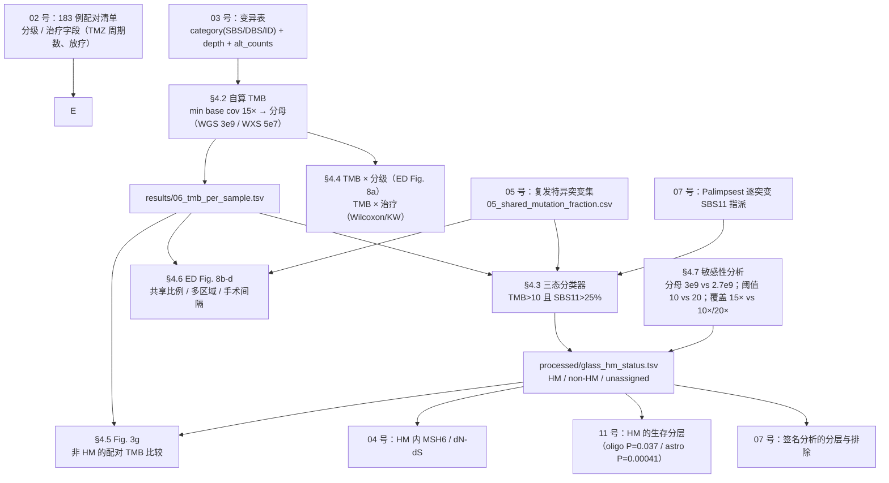
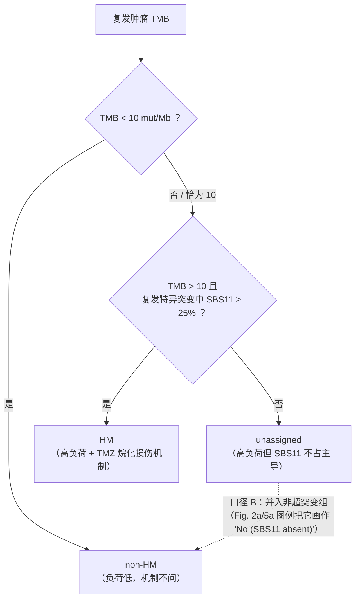

# 06 突变负荷与超突变分类（TMB 的分母 → 三态分类器 → TMZ/SBS11 机制）

> **目标文献**：The GLASS Consortium. *Divergent genomic evolution in astrocytomas and oligodendrogliomas.*
> *Nature* (2026). PDF 标识 s41586-026-11150-x. 数据：Synapse syn17038081；代码：github.com/verhaaklab/glass-idh
>
> **模块对应原文**：Fig. 2a,b（HM 条带与 HM / non-HM 的分组计数）；**Fig. 3g**（非 HM 肿瘤 TMB 的配对比较）；**Extended Data Fig. 8a–d**（TMB×分级、共享比例、多区域共享、手术间隔）；Extended Data Fig. 3b,d 与 4b（MSH6 与 TMB）；
> Methods 中「**Mutational burden**」整段（本模块的核心定义）+「**Mutational signatures**」段中关于 SBS11 逐突变指派的部分 +「Molecular data cohort selection」段的 QC3；Results「Diverging genomic driver events」（21% / 18% 那句）与「**Mutational processes shape glioma genomes**」整节前半
> **复现层级**：**L1 派生层（主路径）**——从 Synapse 的变异表 + 覆盖度列出发自算 TMB、复现 Fig. 3g 与 ED Fig. 8a–d、跑三态分类器。
> **L2 局部需要**：仅当要把 TMB 的分母换成"实际 ≥15× 的碱基数"（§2.2 的口径 B）时，需要 BAM 或 coverage BED（受控访问）。**若只能做 L1**：用固定的可调用碱基数（WGS 3×10⁹ bp、WXS 5×10⁷ bp，均为原文给出的值）作分母——这**正是**原文最可能的口径（§2.2 有量化论证）。**L3 不需要**。
> **前置依赖**：`02_队列构建、临床注释与样本QC.md`（183 例配对清单、WHO 分级、治疗字段 `tmz_cycles` / `radiotherapy`、手术间隔）、`03_变异检出与拷贝数调用.md`（变异表含 `category(SBS/DBS/ID)` 与每突变 `depth`）、`05_克隆性与纵向演化分析.md`（`results/05_shared_mutation_fraction.csv`：共享 / 复发特异的划分——**SBS11 占比的分母就是它**）
> **下游消费**：`07_突变签名分析与治疗归因.md`（HM 状态是签名分析的分层与排除条件）、`11_生存分析与预后模型.md`（HM 作为生存分层）、`04_驱动事件鉴定与互斥性分析.md`（HM 内的 MSH6 / dN/dS 分层）
> **复现难度**：★★☆☆☆　**预计工时**：2 人日　**计算资源**：全队列（183 × 2 样本、数十万条变异）在单机 **8 核 / 8 GB** 内存下分钟级完成；**不需要 GPU**。唯一重活是口径 B 的 coverage BED 统计（需 `mosdepth` 对每个 BAM 跑一遍，属 L2）。

---

## 0. 执行摘要（先读这 10 行）

1. 本模块要回答两个问题：**① 每个肿瘤的突变负荷是多少（TMB）？② 哪些复发肿瘤是"超突变"（hypermutant, HM）？** 第一个问题完全取决于"分母怎么取"，第二个问题的答案直接决定了 `07`（签名）与 `11`（生存）的分组。
2. **TMB 的定义式极简，但每一项都是选择**：$\text{TMB}=\dfrac{\text{计入的突变数}}{\text{分母碱基数}}\times 10^{6}$。原文明确了三件事：**分子含 SBS + DBS + ID**、**要求最小碱基覆盖 15×**、**WGS 与 WXS 是两套不同的肿瘤集合（distinct tumour sets），不可混算**。原文**未报告**的：最小支持读段数、最小 VAF、DBS 的识别规则、分母是"固定的可调用基因组"还是"实测的 ≥15× 碱基数"。
3. **分母是数值最容易翻车的地方**：原文给的锚点是初诊 WGS 中位 TMB = **1.5（oligo）/ 1.6（astro）mut/Mb**。以 3×10⁹ bp 为分母，这意味着中位肿瘤约 **4,500 / 4,800 个突变**。若改用 2.7×10⁹ bp（去掉 N gap / blacklist 后的"有效基因组"），**所有 WGS 的 TMB 一律 ×1.111**（§4.7 已在本机实测），阈值附近样本的 HM 判定会翻。**这不是噪声，是系统偏移。**
4. ⚠️ **QC3 与 TMB 口径之间存在一处实质冲突**：QC3 允许 WGS 样本的**样本级**覆盖低到 **8×**，但 TMB 要求"最小**碱基**覆盖 15×"。按泊松近似（λ=8），只有 **1.73%** 的碱基能达到 15×（λ=27 时是 99.54%）。若把分母理解为"实测 ≥15× 的碱基数"，8× 样本的分母会缩到约 **52 Mb ≈ 一个外显子组**，TMB 会爆炸性偏高。→ 必须 D 表裁决（§2.2、D-06-1）。
5. **超突变是"双条件"定义**：复发肿瘤同时满足 **TMB > 10 mut/Mb** 与 **>25% 的复发特异突变归因于 SBS11**。双条件的意义是**把"负荷高"和"机制是 TMZ 烷化损伤"绑在一起**——单纯的高负荷可能来自其他机制（POLE/POLD1、胚系 MMR 缺陷、其他烷化剂）。代价是产生一个灰区。
6. **三态分类（HM / non-HM / unassigned）的第三态必须有明确去向**。原文 Methods 写"left unassigned"，但 Fig. 2a/5a 的图例把该类别画成 `No (SBS11 absent)`（视觉上当非超突变处理）。而 Fig. 2b 的分组计数 **oligo 86 = 16 HM + 70 non-HM**、**astro 94 = 20 + 74**，说明 oligo 有 **3 例没有进入 HM/non-HM 二分**（astro 为 0）。这 3 例是 unassigned 还是数据缺失，**原文未说明** → 本模块必须逐例核对（用 Synapse 表可以精确判定），并把两种口径都跑一遍（D-06-3 ★）。
7. **TMZ → SBS11 的因果链是本模块的生物学骨架**：TMZ 甲基化 O⁶-鸟嘌呤 → MMR 识别 O⁶-meG:T 错配后反复徒劳修复 → MMR 缺失（**MSH6 是关键**）的细胞存活下来并累积 **C>T** 突变 → SBS11。所以"SBS11 高"同时意味着"曾经接受过 TMZ"**和**"肿瘤丢掉了 MMR"。原文报告的 MSH6 频率（HM oligo 复发 12/16、初诊 0/10；HM astro 7/20 未达显著）正是这条链的直接读出。
8. ⚠️ **原文未测 MGMT 启动子甲基化**。MGMT 是 O⁶-meG 的直接修复酶，它的沉默状态决定了"TMZ 是先杀细胞还是先造突变"。**缺这一层，本模块只能描述相关性，不能解释为什么同一剂量下有的肿瘤死亡、有的肿瘤超突变**（§2.8，登记为局限）。
9. **一个必须写进方法学的口径提醒**：本文的 TMB 含 **DBS 与 ID**，而临床与多数文献里的 "TMB"（如 panel 报告的 TMB-H）通常是 **SBS-only 且多为非同义**。**两者数值不可直接比较**，与 GENIE 等 panel 队列对比时尤其危险（GENIE 主要是 panel 数据，原文只在生存分析中使用它，未做 TMB 平行比较）。
10. 共享/复发特异突变的划分归 `05` 号（唯一生产者，`results/05_shared_mutation_fraction.csv`），本模块只消费。**这是 SBS11 占比的分母**——把"复发特异突变占比"误写成"全部突变占比"，会把 HM 的判定整体放松（§2.10、陷阱 T5）。

---

## 1. 科学问题与逻辑位置

### 1.1 本模块在证据链中的位置



**上游给什么**：带覆盖度与变异类别的变异表、分级与治疗字段、共享/复发特异划分。
**下游要什么**：**一个二元/三态标签**（HM 状态）与一个连续量（每样本 TMB）。这两个东西的**定义必须唯一**（L0 §0.3 口径唯一），所以本模块是 `PROJECT_SPEC.md` 术语表里 `HM`、`non-HM`、`unassigned`、`TMB` 四个词的**唯一定义处**。

### 1.2 上游输入与下游输出（产物契约）

| 产物路径 | 生产者 | 格式 / 结构（下游必须知道的一切） | 消费方 |
|---|---|---|---|
| `processed/03_variants_qc.tsv` | 03 | `mutation_id, patient_id, sample_id, timepoint(I/R), chrom, pos, ref, alt, ref_counts, alt_counts, depth, category(SBS/DBS/ID), platform(WGS/WXS)`；**`category` 的 DBS 识别规则必须与 `07` 一致**（见 §2.2.4） | 06/07 |
| `processed/02_paired_manifest.tsv` | 02 | `patient_id, sample_id, timepoint, tumour_type(astro/oligo), platform, interval_years, grade_who, tmz_cycles, radiotherapy` | 05/06/11 |
| `results/05_shared_mutation_fraction.csv` | 05 | 共享 / 复发特异划分；**06 消费 `recurrence_only_frac` 与（更重要的）逐突变的时间点归属** | 06/07/11 |
| `results/07_sbs11_per_mutation.tsv` | 07 | `mutation_id, sample_id, signature, prob`（Palimpsest 逐突变指派） | **06** |
| `results/06_tmb_per_sample.tsv` | **06（唯一生产者）** | `sample_id, patient_id, timepoint, platform, n_mut_counted, n_dropped_lowcov, denominator_bp, tmb`；单位 **mut/Mb**；**不含 DBS 折叠差异**（由 `category` 列决定） | 05/07/11 |
| `processed/glass_hm_status.tsv` | **06（唯一生产者）** | **项目核心共享对象**（`PROJECT_SPEC.md` §3.1 登记）。列：`case_barcode`（GLASS 24 字符条码）、`tumor_pair_barcode`（配对条码）、`patient_id`、`sample_id_recurrence`、`tmb`（mut/Mb，分母口径见 §4.2）、`sbs11_recurrence_specific_frac`、`sbs11_r_hypermutation`（**逻辑值，仅三态中的 HM 为 TRUE**）、`hypermutation_status ∈ {HM, non-HM, unassigned}`。**04/07/11/12 只能消费本表**，不得各自重算 | 04/07/11/12 |
| `results/06_hypermutation_status.tsv` | **06（唯一生产者）** | **模块明细版**（`PROJECT_SPEC.md` §3.2 登记）：在上一张表的基础上加 `tmb_cutoff, sbs11_cutoff, boundary_rule, denom_bp, min_base_cov, hypermutation_status_loose`（口径 B：unassigned 并入 non-HM）；供 `13` 号 gap 表与敏感性复核 | 13 |
| `results/06_tmb_sensitivity.csv` | 06 | 各敏感性口径下的 TMB 与 HM 判定：`sample_id, denom_bp, tmb_cutoff, min_base_cov, tmb, hypermutation_status`（长表） | 13 |
| `results/06_tmb_missingness_check.csv` | 06 | Fig. 3g 与 Fig. 2b 的样本数差（oligo 70→46、astro 74→62）的**缺失机制检验**：缺失 vs 非缺失样本的 纯度/覆盖度/平台 分布（Wilcoxon / Fisher） | 13 |
| `figures/Fig3g_tmb_paired.{pdf,png}` | 06 | 复现 Fig. 3g | — |
| `figures/ED_Fig8a_tmb_grade.{pdf,png}` | 06 | 复现 ED Fig. 8a | — |
| `figures/ED_Fig8b_shared_fraction.{pdf,png}` | 06 | 复现 ED Fig. 8b（数据侧由 `05` 生产） | — |
| `figures/ED_Fig8c_multisector.{pdf,png}` | 06 | 复现 ED Fig. 8c（数据侧由 `05` 生产） | — |

### 1.3 它解决什么、不解决什么

**解决**：把一个连续的突变负荷变成可分层、可作生存协变量的标签，并且让这个标签的**定义可审计**（分母、过滤、类别、平台全部落在契约表里）。

**不解决**：
- **不能单独证明"TMZ 造成了这些突变"**。SBS11 的归因是**统计推断 + 文献先验**（Hunter 2006、Touat 2020），不是实验证明。原文自己也只敢说 "associated with"（L0 §12.4 相关性 ≠ 因果）。
- **不能给出 MGMT 状态**（原文未测，§2.8）。
- **不能跨平台比较**：WGS 与 WXS 的 TMB 数值差异主要来自分母而非生物学。
- **不能回答"为什么某些肿瘤超突变、某些没有"**：MSH6 突变是**结果**（TMZ 选择下的二次事件），把它当"原因"是因果倒置。原文对此很克制（"this enrichment did not reach statistical significance"，HM astro 7/20）。

---

## 2. 背景知识与原理

### 2.1 TMB 的定义链条：四个必须显式做出的选择

$$
\text{TMB}\ [\text{mut/Mb}]=\frac{\text{计入的突变数}}{\text{分母碱基数}\ [\text{Mb}]}
$$

看起来只有两项，实际上退化为四个独立选择：

| # | 选择 | 候选口径 | 本文选择 | 量级影响 |
|---|---|---|---|---|
| 1 | **数什么** | SBS only / SBS+DBS / SBS+DBS+ID / 再加 SV | **SBS + DBS + ID**（Results 明确："TMB, comprising SBSs, DBSs and ID"） | ID 通常占 5–10%（随 MMR 缺陷升高），DBS 占 1–3% → 合计使 TMB 比 SBS-only **高 6–15%** |
| 2 | **分子的过滤** | 最小支持读段 / 最小 VAF / 去除常见多态 | 原文只写了**最小碱基覆盖 15×**，其余**原文未报告** | 最小 alt reads 从 3 提到 10，会把低 VAF 亚克隆突变剔除，TMB 下降 |
| 3 | **分母** | 全基因组 / 可调用基因组 / 捕获靶区 / 实测 ≥15× 碱基 | "per Mb sequenced"；并结合 FGA 段的 **WGS 3×10⁹ bp、WXS 5×10⁷ bp** | 3e9 vs 2.7e9 → 一律 **×1.111**（§4.7 实测）；WGS vs WXS 差 **60 倍** |
| 4 | **单位与阈值** | mut/Mb（=mut/Mbp）| mut/Mb；阈值 **10**、SBS11 占比 **25%** | 阈值 10 → 20 会砍掉大部分 HM（§4.7） |

**同一块肿瘤的 TMB 可以因为口径不同差 2 倍以上**。所以本文的 1.5 / 1.6 mut/Mb 必须**连同口径一起引用**，否则数字没有意义。

> ⚠️ **导师批注**：写作简报与多数临床文献里的 "TMB" 默认指 **SBS-only、非同义、panel 靶区**（例如 FDA 的 TMB-H 判据 10 mut/Mb 就是建立在这个口径上，用于泛癌免疫治疗决策）。**本文的 10 mut/Mb 与临床 TMB-H 的 10 mut/Mb 数值上撞车但口径不同，纯属巧合**。任何把本文 HM 比例（astro 21% / oligo 18%）与临床 TMB-H 发生率对比的做法都是错的，必须在文档里禁止。

### 2.2 "最小碱基覆盖 15×"的三种读法（★ 与 QC3 的实质冲突）

原文句（Methods「Mutational burden」）：
> "Mutational burden was determined by the number of mutations per Mb sequenced, requiring a minimum base coverage of 15×."

这句话有两种几乎同样合理的读法，并且在低覆盖样本上给出**完全不同的结果**：

| 口径 | 含义 | 实现 | 在 27× WGS 上 | 在 8× WGS 上 |
|---|---|---|---|---|
| **A. 位点级过滤**（主流实现） | 只计入该突变位点 read depth ≥15× 的突变；分母仍用固定可调用碱基数 | `vars[depth >= 15]`，分母 3e9 | 剔除极少突变 | 剔除绝大部分突变 → TMB 趋近 0 |
| **B. 区间级分母** | 分母 = **实测** ≥15× 的碱基数；分子限制在同一区间 | 需要 `mosdepth`/`samtools depth` 的 coverage BED | 与 A 差异 < 0.5% | **分母骤降到约 52 Mb**（见下）→ TMB 爆炸性偏高 |
| **C. 样本级门槛** | 样本平均覆盖 ≥15× 才纳入 | `mean(depth) >= 15` | 与 A 类似 | 8× 样本整体被排除 |

**把 B 的后果算清楚**（泊松近似，本机实算）：

| 样本平均覆盖 λ | $P(\text{碱基深度} \ge 15)$ | 3×10⁹ bp 中 ≥15× 的碱基数 | 相对 3×10⁹ |
|---|---|---|---|
| **8×**（QC3 的 WGS 下限） | **0.0173** | **≈ 5.2×10⁷ bp（52 Mb）** | 1.73% |
| 15× | 0.5343 | 1.60×10⁹ bp | 53.4% |
| 20× | 0.8951 | 2.69×10⁹ bp | 89.5% |
| **27×**（本文 WGS 平均） | **0.9954** | 2.99×10⁹ bp | 99.5% |
| 30× | 0.9991 | 3.00×10⁹ bp | 99.9% |
| 100×（本文 WXS 平均） | ≈1.0000 | — | — |

**三件事因此被钉死**：

1. **在本文的 WGS（平均 27×）上，A 与 B 的差别 < 0.5%**，可以忽略 → 我们**不需要 BAM 就能做 L1**。这是"若只能做 L1 能做到什么程度"的正面答案。
2. **QC3 的 8× 下限与口径 B 不可共存**：8× 样本若按 B 算，分母是 52 Mb——**恰好等于 WXS 的分母量级**，等于把 WGS 样本悄悄变成了 WXS 口径。所以在 QC3 允许 8× 的前提下，**原文的 TMB 大概率用的是 A 或 C，而不是 B**。
3. **B 在 WXS 上不能照搬**：WXS 平均 >100×，但覆盖极不均匀（捕获边缘、GC 极端区），实测 ≥15× 的比例可能只有靶区的 80–95% → 分母 4–5×10⁷ bp，比原文的 5×10⁷ 低 5–20%。想用 B 就必须实测（L2），否则不要用。

**本方决策（D-06-1 ★）**：主路径用 **口径 A + 固定分母（WGS 3×10⁹ bp / WXS 5×10⁷ bp）**；口径 B 仅在覆盖率 ≥25× 的样本子集上报（作为敏感性）；口径 C 只用于**诊断**（列出被 QC3 放行的 <15× 样本，报告它们如果被排除会改变什么）。

#### 2.2.4 分母之外的两个隐藏选择

**(a) 分母是不是"外显子组 / 全基因组"**：WGS 的分母 3×10⁹ bp 与 WXS 的 5×10⁷ bp **相差 60 倍**。同一个 3,000 个突变的肿瘤，按 WGS 算是 1.0 mut/Mb，按 WXS 算是 60 mut/Mb。原文明确说两者是 **"distinct tumour sets rather than matched samples sequenced on both platforms"**，因此**本文从未把两者放在同一张图上直接比**。复现时任何跨平台比较都是错的（陷阱 T1）。

**(b) DBS 怎么数**：绝大多数变异调用器只输出 SNV 与 indel。要得到 "DBS"，需要把**相邻的（±1 bp）两个 SNV** 折叠为一个 DBS。这一步在 `SigProfilerMatrixGenerator` 里是标准功能，但**它改变了分子**：
- 若不折叠，这两个相邻 SNV 会各计一次 → 分子多算 1；
- 若折叠，计 1 次。
差异是 1–3% 量级，**但它必须与 `07` 号的签名矩阵口径一致**，否则同一个突变在 TMB 与签名暴露里被数了两次/零次。→ 契约上由 `03` 在变异表里给出 `category` 列，`06`/`07` 都只读这一列（L0 §4.2 生产者唯一）。

### 2.3 为什么不能把 WGS 与 WXS 混算（三重原因）

| 层次 | 机制 | 后果 |
|---|---|---|
| 分母 | 3×10⁹ vs 5×10⁷ bp | 数值差 60 倍，**任何统计都无意义** |
| 可检出突变类型 | WGS 能检出非编码、重复区、结构变异；WXS 只有编码区 | 突变谱不同 → 签名不同（这也是原文签名分析**只用 WGS** 的原因） |
| 覆盖深度分布 | WGS 平均 27×、WXS >100× | 位点级 ≥15× 过滤对两者的"损失率"完全不同 |

**原文的实际处置**：所有 TMB/签名/CN 分析都按平台分开；生存分析（Fig. 3g 除外）用的是把两平台都放进去但**在亚组内比较**（Fig. 3g 明确分 WGS / WXS 子组给出 n 与 P）。复现时对齐这一点即可。

### 2.4 FFPE 伪影：为什么它对**这个**模块特别危险

FFPE（福尔马林固定石蜡包埋）样本的 DNA 在固定过程中发生**胞嘧啶脱氨**（C→U→T）与 5-甲基胞嘧啶脱氨（5mC→T），产生**假 C>T / G>A**，其低 VAF、在 CpG 处富集、且与片段化程度相关。这一点对本模块是**致命的巧合**，因为：

- **HM 的判据之一是 SBS11，而 SBS11 正是 C>T 主导的谱型**（§2.7）→ FFPE 的假 C>T 会**伪装成 SBS11**；
- 另一类氧化损伤（8-oxoG）产生 **G>T 颠换**（SBS18/SBS36 样），可与 SBS11 区分。

**原文的防线**：QC3 要求 "the mutation frequency was not zero and **not abnormally elevated** (indicative of FFPE artefacts)"。注意这里的措辞是"**变异频率**异常升高"，即他们检查的是**整体突变频率**而不是单看某个谱型。**原文未报告**具体阈值。

**本模块的补充防线（建议写入方法学）**：
1. 计算每个样本的 **FFPE 嫌疑指标**：`frac_C>T / frac_G>A` 之比（二者应接近 1；FFPE 会同时抬高，但若调用器在单链上工作则可能不对称）、以及 C>T 中落在 **CpG** 上下文的比例；
2. 把每个样本的"样本制备方式（FFPE vs 新鲜冷冻）"作为协变量做**敏感性分析**：剔除 FFPE 样本重跑 HM 分类，看 HM 计数是否变化；
3. 见 `13_复现质控清单、排错与批判性评述.md` 的样本 QC 表（若 `02` 号已登记制备方式，直接 join）。

> ⚠️ **导师批注**：原文在讨论 SBS119 时明确测试了它"not associated with artefact mutational patterns of FFPE tissue or guanine oxidation"，**但对 SBS11 没有做同样的说明**。考虑到 SBS11 才是 HM 判据本身，这是一个应该在复现时补上的检验（本项目登记为 D-06-6）。

### 2.5 超突变：为什么是"双条件"

**原文定义（Methods「Mutational burden」原文）**：
> "DNA hypermutation was defined for recurrent tumours with a combination of **more than 10 mutations per Mb** and **more than 25% of recurrence-specific mutations attributable to the COSMIC mutational signature SBS11**. Tumours with fewer than 10 mutations per Mb were classified as non-hypermutant, whereas hypermutation status was left **unassigned** for tumours with more than 10 mutations per Mb but fewer than 25% of recurrence-specific mutations attributable to SBS11."

**拆解成决策树**：



**为什么必须双条件（只用负荷不行）**：

| 只有高负荷的可能来源 | 是否由 TMZ 造成 | SBS11 是否升高 |
|---|---|---|
| TMZ 烷化 + MMR 缺失 | 是 | **是** |
| 其他烷化剂（procarbazine / lomustine，本文 74% 接受烷化剂而 TMZ 仅 71%，即约 3% 是非 TMZ 烷化剂） | 部分 | 部分（同类机制，可能给出类似谱型） |
| POLE / POLD1 校对域突变 | 否 | 否（给出 SBS10a/b 样谱型） |
| 胚系 MMR 缺陷（Lynch 综合征） | 否 | 否（给出 MSI 样谱型，如 SBS26 / SBS44） |
| 放疗相关高负荷 | 否 | 否（给出 ID8 / SBS 小缺失类谱型） |

**双条件的代价：产生了第三条路（unassigned）**。这不是完美的设计——"高负荷但 SBS11 不主导"的肿瘤被悬空了。原文用 "left unassigned" 承认了它，但下游图表怎么处理它，是需要复现者拍板的事（§2.9）。

**为什么是"复发特异突变"作分母**：因为 SBS11 是 TMZ 暴露后**新增**的突变过程，把初始肿瘤里就有的年龄相关 C>T（SBS1）算进来会**稀释** SBS11 的占比，使真 HM 被误判为 unassigned。这个分母的选择直接决定 HM 的灵敏度（§2.10、陷阱 T5）。

### 2.6 TMZ 的化学与突变机制：从甲基化到 SBS11

**第 1 步：TMZ 是前药**。替莫唑胺（temozolomide，一种咪唑并四嗪）在生理 pH 下**自发水解**为 MTIC，后者进一步分解为 AIC 与**甲基重氮离子**（methyldiazonium，真正的亲电试剂）。这一步不需要酶，因此**任何细胞都会发生**——这也是 TMZ 相对"靶向药"的特殊性：它的损伤是**化学计量**的，谁复制得多、谁修复得差，谁积累得多。

**第 2 步：DNA 甲基化的三个位点**（文献常见比例，具体数值随文献不同，本项目只用于定性排序）：

| 加合物 | 占甲基化损伤的比例 | 生物学后果 |
|---|---|---|
| N7-甲基鸟嘌呤 | 约 70% | 主要被 BER 修复，相对"无害" |
| N3-甲基腺嘌呤 | 约 9% | BER（MPG/AAG）修复，复制叉阻滞 |
| **O⁶-甲基鸟嘌呤（O⁶-meG）** | 约 5–8% | **关键的细胞毒与致突变损伤**（本模块的核心） |

**第 3 步：为什么 5–8% 的那个决定了结局**。O⁶-meG 的甲基在**碱基配对面上**，使甲基化的 G 优先与 **T** 配对。于是：

$$
\text{O}^6\text{-meG} : \text{T}\ \xrightarrow{\ \text{MMR}\ }\ \text{识别错配} \Rightarrow \text{切除新合成链上的 T} \Rightarrow \text{重新合成} \Rightarrow \text{又是 O}^6\text{-meG:T}
$$

**这是一个死循环（futile cycle）**：模板上的损伤没被修掉，MMR 每轮都只是把"正确的"那条链切掉重来，最终导致**复制叉崩塌、双链断裂、G2/M 阻滞与凋亡**。所以：

> **MMR 完好的细胞被 TMZ 杀死；MMR 缺失的细胞反而存活，但会在 O⁶-meG 的模板上不断插入 T → G:C→A:T 转换 → SBS11。**

**第 4 步：MSH6 为什么是关键**。MMR 的错配识别由 **MutSα = MSH2–MSH6** 承担（MSH6 负责识别单碱基错配与 1–2 nt ID loop）。MSH6 失活 → MMR 丧失 → 细胞对 TMZ 的细胞毒作用耐受 → 成为"超突变幸存者"。原文的数据与这条链完全吻合：

| 原文报告 | 数值 | 解读 |
|---|---|---|
| HM oligodendroglioma 的 MSH6 突变 | **初诊 0/10 → 复发 12/16** | MSH6 突变是**在 TMZ 选择下获得的二次事件**，不是先天背景 |
| HM oligodendroglioma 的 PIK3CA 突变 | **初诊 2/10 → 复发 13/16** | PI3K 通路同样在复发时富集（与 `04` 号互参） |
| HM astrocytoma 的 MSH6 突变 | **7/20**，原文："this enrichment did **not** reach statistical significance" | 型别差异；原文如实报告了阴性结果（L0 §12.5） |
| MSH6 突变 vs 野生型 HM 的 TMB 比较 | 原文：非显著升高；GLASS 与 GENIE **趋势一致** | 说明"MSH6 失活 → 更高负荷"这个方向在外部数据里也成立，但**功效不足** |

### 2.7 SBS11 的谱型特征，以及它与 SBS1 / SBS5 / SBS97 的区分

| 签名 | 主导替换 | 上下文偏好 | 公认成因 | 在本文的角色 |
|---|---|---|---|---|
| **SBS11** | **C>T**（为主） | **CpC / CpT** 上下文 | **TMZ 烷化 + MMR 缺失** | **HM 的判据之一** |
| SBS1 | C>T | **CpG**（5mC 自发脱氨） | 年龄时钟，随分裂次数线性累积 | 原文在初诊与共享突变中检出（与 ID1/ID2 并列） |
| SBS5 | 平坦（C>T 略多） | 无明显上下文偏好 | 未知，"时钟样" | 原文：oligo 侧显著（与 SBS40 并列） |
| SBS97（Signal 库） | **C>T** | — | 既往与**错配修复缺陷**相关 | 原文：**只见于 astrocytoma** |
| SBS119 | **T>C** 富集 | 与 MSI 相关签名（如 SBS26）相似 | 与 TMZ 暴露相关（体外 iPSC 处理 TMZ 后可见） | 原文：TMZ 处理且**非超突变**的样本（oligo 8/13、astro 3/12） |
| ID8 | 小缺失 | — | **放疗**相关（Kocakavuk 2021） | 原文：放疗处理且非超突变的 astro 显著升高 |

**两个必须讲清的区分点**：

1. **SBS11 vs SBS1**：两者都是 C>T，区别在**上下文**——SBS1 是 **CpG**（甲基化 CpG 自发脱氨），SBS11 是 **CpC/CpT**。如果只按"C>T 比例高"来判 HM，会**把年龄时钟（SBS1）误当 TMZ 印记**——年轻患者的 SBS1 低，老年患者高，于是会得到一个假的"老年更易超突变"的结论。**必须按上下文区分，不能只看替换类型。**
2. **SBS11 vs SBS97**：两者都与 MMR 缺陷相关，且都以 C>T 为主。原文报告 **SBS97 只见于 astrocytoma**，这提供了一个**混杂路径**：astro 的 C>T 高负荷可能有相当部分不是 TMZ 的 SBS11，而是 SBS97。**双条件定义恰好防住这一点**（它要求 SBS11 具体占比 >25%，而不是"C>T 总体占比"）。复现时务必核对：astro 的 unassigned 是否富集了 SBS97？——这是一个**可检验的、有价值的**复现增值点。

> ⚠️ **导师批注（两处原文措辞问题）**：
> ① 原文写 "**SBS11 is dominated by C>T transversions**"——**C>T 是转换（transition），不是颠换（transversion）**。这是术语错误（同一句里把 SBS119 的 T>C 也称作 "substitutions"，用词不一致）。按 COSMIC v3.5 参考谱，SBS11 以 **C>T 为主，集中于 CpC/CpT 上下文**（复现时以下载的 `COSMIC_v3.5_SBS_GRCh37.txt` 文件为准，见 §4.4 的读取代码）。
> ② 原文在 Fig. 2a/5a 图例里把超突变标为三档 `No (<10 mut per Mb)` / `No (SBS11 absent)` / `Yes`，而 Methods 说第三种"left unassigned"。**图例把它归到了 "No"（即非超突变），与 Methods 的"悬空"口径不一致** → D-06-3 ★。

### 2.8 MGMT：本模块缺失的关键一环（局限）

**MGMT（O⁶-甲基鸟嘌呤-DNA 甲基转移酶）** 是唯一能**直接、化学计量地**把 O⁶-meG 上的甲基移走的酶（自杀式反应，一个酶分子修一个损伤）。因此：

- **MGMT 表达活跃** → O⁶-meG 迅速被清除 → TMZ 既不杀细胞也难致突变（**耐受**）；
- **MGMT 启动子甲基化（沉默）** → O⁶-meG 持续存在 → 若 MMR 完好则**凋亡**（对 TMZ 敏感）；若 MMR 也缺失则**超突变**。

也就是说，**"超突变"需要两个条件同时成立：MGMT 沉默 + MMR 缺失**。原文**未测 MGMT 启动子甲基化（原文未报告）**，因此：

- 无法回答"为什么 71% 接受 TMZ 的患者中只有 21%/18% 超突变"——原文只能给出 MSH6 这一个侧面证据，且 astro 未达显著；
- **不能**把 HM 当作"TMZ 暴露的剂量标志"，它同时是"修复能力标志"。

**复现层面的补救（若可行）**：`02` 号的临床表若包含 MGMT 甲基化状态（GLASS 部分队列有），可做 `HM ~ MGMT_status + TMZ_cycles` 的 logistic 回归；若无，则必须在文档与结题报告里**显式声明这是无法复现的局限**，而不是用"SBS11 高 = 用过 TMZ"来悄悄替代。登记 D-06-7。

### 2.9 三态分类的统计后果，以及 unassigned 到底去哪了（★ 本模块最有价值的复现发现）

**先把原文给出的数字摆出来**：

| 来源 | astrocytoma | oligodendroglioma | 备注 |
|---|---|---|---|
| Fig. 2a 的样本数 | **n = 94** | **n = 89** | 全部 QC 通过的分子集 |
| Fig. 2b 的样本数 | **n = 94** | **n = 86** | ⚠️ oligo 少了 3 例 |
| Fig. 2b 的 HM / non-HM | **20 / 74**（20+74=94 ✅） | **16 / 70**（16+70=86 ✅） | 两者相加恰好等于各自的 n |
| 原文文字 | "astrocytomas (**21%**)" | "oligodendrogliomas (**18%**)" | 20/94 = 21.3%；16/89 = 18.0% ✅ |

**这张表推出两件事**：

1. **百分比的分母是"该型全部患者"（94 / 89），不是"接受烷化剂治疗者"**。但原文的句子是："a subset of both astrocytomas (21%) and oligodendrogliomas (18%) **that received alkylating chemotherapy** recurred with a significantly higher number of mutations"。⚠️ **这是原文的一处措辞不严谨**：接受烷化剂的是 74% × 183 ≈ 135 例，若百分比的分母真是"接受烷化剂者"，则比例应为 20/（astro 中接受烷化剂者）≈ 20/？，绝不会正好等于 20/94。→ 登记 `13` 号。
2. **oligodendroglioma 有 3 例（89 − 86）没有进入 HM / non-HM 二分**，而 astrocytoma 是 0 例。这 3 例是什么？**原文未说明**。两种假设：

| 假设 | 内容 | 支持证据 | 可检验性（用 Synapse 表就能判） |
|---|---|---|---|
| **假设 A：它们是 unassigned** | TMB > 10 但 SBS11 < 25% → 按 Methods 悬空、按图例归为 "No (SBS11 absent)" | Fig. 2a 与 Fig. 5a 的 `Hypermutation` 图例确实有第三档 `No (SBS11 absent)`，**说明该类别在注释层面存在** | ✅ 完全可判：算出这 3 例的 TMB 与 SBS11 占比即可 |
| **假设 B：它们缺复发 TMB** | 复发样本覆盖不足（<15×）或未测 → 无法定 HM | 若图例的第三档是为极少数样本预留的"技术上无法判定" | ✅ 完全可判：看这 3 例的 `n_mut_counted` 与覆盖度分布 |

> ⚠️ **导师批注（本模块必须显式登记的一处原文疏漏：unassigned 的去向，原文从未交代）**：这不是"我们没读懂"，而是**原文确实没写**。三条证据：
> ① Methods 只写到 "hypermutation status was left **unassigned**"，**此后再未出现**——没有说 unassigned 是否进入任何下游分析、是否画进任何图、是否在统计里被当作一个独立组；
> ② Fig. 2a / Fig. 5a 的 `Hypermutation` 图例只有三档 `No (<10 mut per Mb)` / `No (SBS11 absent)` / `Yes`，**没有 "unassigned" 这一档**——也就是说 unassigned 在**注释层面**被折叠进了 "No"（= 非超突变），与 Methods 的"悬空"口径**直接冲突**；
> ③ Fig. 2b 的分组计数（oligo **16 HM + 70 non-HM = 86**，而这些患者的 Fig. 2a 总数是 **89**）说明 oligo 有 **3 例没有进入 HM/non-HM 二分**；**原文对这是哪 3 例、为什么被排除，一字未提**（astro 侧 20 + 74 = 94，无缺口）。
>
> **因此本模块不接受"把 unassigned 当空气"的处理**：必须三态落盘（`results/06_hypermutation_status.tsv` 保留 `unassigned`），并用 Synapse 表**逐例判定**那 3 例究竟属于"假设 A（unassigned）"还是"假设 B（复发侧技术性缺失）"（两种假设都可判，见下表）。**判不出来就如实写"判不出来"并说明卡在哪一步**（例如复发样本根本无变异表），不得默认归入 non-HM 了事。此条登记 D-06-3（★）。

**为什么这件事很重要**：unassigned 的去向**同时改变两份结论**：

- **HM 频率**：若这 3 例是 unassigned 而不计入 86，则 oligo 的"高负荷"总数是 16 + 3 = 19（19/89 = **21.3%**，与 astro 的 21.3% **完全一致**）；若它们是数据缺失，则 oligo 的高负荷率是 16/89 = 18.0%。**"两型超突变率相近"vs"oligo 略低"这两句话的差别就在这里。**
- **non-HM 组的构成**：若 unassigned 被并入 non-HM（图例口径），则 non-HM 里混入了高负荷但机制不同的肿瘤 → Fig. 3g 的"non-HM TMB 随复发升高"可能被**稀释或抬高**；若被排除，则 n 变小、功效下降。
- **生存分析（`11` 号）**：原文报 oligo HM n=14 vs non-HM n=24（**注意：这是生存分析的 n，不是 Fig. 2b 的 16/70**——两处的 n 不同，说明生存分析还有额外的临床数据完整性门槛）。unassigned 若并入 non-HM，会直接影响这条 KM 曲线（P = 0.037，本就接近 0.05 的边缘）。

**本模块的处置（D-06-3 ★）**：**两种口径都跑**（L0 §9.3「文献自相矛盾 → 两套都跑」）：
- **口径 A（严格，贴 Methods）**：三态，unassigned 单列，**不进入任何 HM/non-HM 比较**；
- **口径 B（宽松，贴 Fig. 2a/5a 图例）**：unassigned 并入 non-HM；
- **主表 `processed/glass_hm_status.tsv` 用口径 A（三态）**；口径 B 作为 `results/06_hypermutation_status.tsv` 的 `hypermutation_status_loose` 列同时输出；
- 两份都要写进 `13` 号的 gap 表，记录"哪一份支持原文报告的数字（16/70 与 20/74）"。

> ⚠️ **导师批注（跨模块口径冲突，必须在执行前解决）**：`04_驱动事件鉴定与互斥性分析.md` 现有的代码是
> `hm |> mutate(HM_group = if_else(sbs11_r_hypermutation, "HM", "NHM"))` ——
> 它只读**逻辑列** `sbs11_r_hypermutation`，因此 **unassigned 会被静默并入 "NHM"（= 口径 B）**，而且标签写作 `NHM` 而非本模块的 `non-HM`。
> 若本项目主路径采用口径 A（三态，unassigned 单列），则 `04` 号的 non-HM 组构成与本模块不一致 → 两篇文档的同一比较会给出不同结论。
> **处置**：① `04` 号改用 `hypermutation_status` 三态列（并保留 `HM_group` 作为派生标签，取值加一个 `unassigned`）；② 术语表（`PROJECT_SPEC.md` §4）登记 `HM` / `non-HM`（规范）/ `NHM`（派生于逻辑列的局部标签，等价于 `non-HM ∪ unassigned`）；
> ③ 登记 D-06-10 并通知 `04` 号。**这是一次真实的口径漂移风险，不是文字问题。**

### 2.10 "复发特异突变"的定义与 SBS11 占比的分母

**原文没有写"recurrence-specific"的定义**（原文未报告），但结合 Methods「sSNV calling」的互惠 calling 与 Results 的"shared mutation"用语，可操作的三种口径是：

| 口径 | 定义 | 与原文证据的一致性 |
|---|---|---|
| **R1：复发检出、初始未检出** | 在复发样本被调用、在初始样本**未被调用**（无论初始是否有覆盖） | 与 Results「recurrence-only fraction」的用语一致（ED Fig. 8d） |
| **R2：复发检出、初始检出但 CCF 低** | 初始样本检出但 CCF < 阈值（如 0.1） | 需要 `05` 号的 CCF；更贴近生物学"新获得" |
| **R3：复发特异 = 全部复发突变** | 不区分共享 | **❌ 与原文不符**：会使 SBS11 占比被年龄时钟稀释 |

**本模块主路径用 R1**（与 `05` 号的 `recurrence_only` 列一致），并把 R2 作为敏感性分析。**R3 只作为反面对照**（用来展示"用错分母会让 HM 判定放松多少"）——这是一个很好的教学演示（§4.7）。

**协议接口（L0 §4）**：R1 的逐突变归属由 `05` 号产出（`results/05_shared_mutation_fraction.csv` 的逐突变版；`06` 只消费，不重算）；**SBS11 的逐突变指派由 `07` 号产出**（`results/07_sbs11_per_mutation.tsv`，Palimpsest）；**`06` 只做"计数 + 比值 + 阈值"**。这样"谁是生产者"清晰无歧义。

---

## 3. 原文逐句拆解

| # | 原文句 | 中文转述 | 对应操作 / 参数 / 脚本 |
|---|---|---|---|
| 1 | "The median WGS-derived TMB of primary oligodendrogliomas and astrocytomas was **1.5 mutations per Mb and 1.6 mutations per Mb**, respectively, which is low relative to other tumour types." | 初诊 WGS 中位 TMB = 1.5 / 1.6 | §4.2、§6.1 第 1 条（**全模块最重要的数值锚点**）。以 3×10⁹ bp 反推 ⇒ 中位肿瘤约 **4,500 / 4,800** 个突变（SBS+DBS+ID）。原文**未报告**该 TMB 的 IQR |
| 2 | "**TMB, comprising SBSs, DBSs and ID**" | TMB 的分子含三类变异 | §2.1 选择①；契约上要求 `03` 给出 `category` 列 |
| 3 | "Mutational burden was determined by the number of mutations per Mb sequenced, **requiring a minimum base coverage of 15×**." | 最小碱基覆盖 15× | §2.2 的三种读法；**原文未报告**是位点级还是区间级 |
| 4 | "**WGS and WXS represent distinct tumour sets rather than matched samples sequenced on both platforms.**" | 两平台是不可混算的两套样本 | §2.3；所有分析按平台分层 |
| 5 | "**DNA hypermutation was defined for recurrent tumours** with a combination of **more than 10 mutations per Mb** and **more than 25% of recurrence-specific mutations attributable to the COSMIC mutational signature SBS11**." | 双条件定义（仅对复发肿瘤） | §4.3 分类器；`>` 是严格大于（文本 "more than"） |
| 6 | "Tumours with **fewer than 10** mutations per Mb were classified as non-hypermutant, whereas hypermutation status was left **unassigned** for tumours with more than 10 … but fewer than 25% … attributable to SBS11." | 三态分类；第三态悬空 | §4.3 的 `boundary` 参数；**TMB 恰等于 10 时原文两支都不覆盖**（陷阱 T7） |
| 7 | "a subset of both astrocytomas (**21%**) and oligodendrogliomas (**18%**) **that received alkylating chemotherapy** recurred with a significantly higher number of mutations (more than 10 mutations per Mb), of which more than 25% were attributed to the SBS11 … We therefore labelled these samples as **hypermutators**." | 21% / 18% | §2.9：百分比的分母是 **94 / 89**（全型队列），**不是**接受烷化剂者 → 原文表述不严谨 |
| 8 | "Among **non-hypermutated recurrent oligodendrogliomas (n = 70)**, we discovered significant enrichments…" | 非超突变复发 oligo n = 70 | 与 Fig. 2b 的 70 一致；`04` 号在此子集上做 dN/dS |
| 9 | "We observed the previously reported significant enrichment of **MSH6** mutations at recurrence as well as newly acquired **PIK3CA** mutations in hypermutated oligodendrogliomas (mutations at diagnosis: **MSH6 = 0/10, PIK3CA = 2/10**; mutations at recurrence: **MSH6 = 12/16, PIK3CA = 13/16**)." | HM oligo 的 MSH6 与 PIK3CA 获得 | §2.6 的机制读出；`04` 号的 dN/dS 证据；n = 10（初诊）/16（复发）说明**恰是 HM 亚组** |
| 10 | "We also noticed a **non-significant** increase in the mutation burden in hypermutated IDH-mutant gliomas with MSH6 mutations, compared with MSH6-wild-type hypermutants, and found that this trend was consistent in both the GLASS cohort and the external validation set of the AACR GENIE cohort (Extended Data Fig. 4b)." | MSH6 突变者 TMB 更高但**不显著** | §6.1 第 8 条：**阴性结果必须保留**（L0 §12.5） |
| 11 | "Although some hypermutated astrocytomas acquired MSH6 mutations (**n = 7/20**), this enrichment did **not** reach statistical significance (Extended Data Fig. 3d)." | HM astro 的 MSH6 7/20 不显著 | 同上 |
| 12 | "**TMB at diagnosis increased significantly with higher tumour grade** (Extended Data Fig. 8a)." | 初诊 TMB 随分级升高 | §4.4；ED Fig. 8a 图注为 "Two-sided **Spearman's correlations** of the mutation frequency stratified by WHO molecular grade" → 用 Spearman。原文**未报告** r 与 P |
| 13 | "At recurrence, and **excluding hypermutators**, TMB increased significantly in **both** oligodendrogliomas and astrocytomas (Fig. 3g). **However, in oligodendrogliomas, TMB increases were only significantly associated with tumours acquiring driver-gene alterations.**" | 非 HM 肿瘤复发 TMB 升高；oligo 中此升高**只发生在获得驱动改变的肿瘤** | §4.5：Fig. 3g 的三层分组（Total / sSNV± for oligo；Total / CNA± for astro） |
| 14 | "Among all mutations detected in the initial tumour, the median fraction that was also detected in the recurrent non-hypermutant tumour was **36% for oligodendrogliomas and 45% for astrocytomas** (Extended Data Fig. 8b)." | 共享比例中位 36% / 45% | 数据由 `05` 号生产（本模块消费）；ED Fig. 8b 分"全部肿瘤"与"仅 primary–recurrence 配对（n = 144）"两套 |
| 15 | "WXS datasets from different sectors of the same tumour are available for a subset of the GLASS cohort (**n = 5**), and the median fraction of spatially shared mutations in IDH-mutant gliomas was **53%**" | 同次手术多区域共享中位 53%（n = 5：1 oligo + 4 astro） | ED Fig. 8c，Kruskal–Wallis；数据由 `05` 号生产 |
| 16 | "The length of the surgical interval was negatively correlated with the fraction of mutations shared … in **non-hypermutant oligodendrogliomas** … associations that were **not seen in non-hypermutant astrocytomas** (Extended Data Fig. 8d)." | 手术间隔与共享比例的负相关只见于 oligo | §4.6；Spearman，分型分层 |
| 17 | "We **excluded four cases** from downstream mutational signature analyses in which the **initial, but not the recurrent sample, had a mutation burden exceeding 10 mutations per Mb**." | 4 例（初始而非复发 TMB > 10）被排除出签名分析 | ⚠️ 与 HM 定义（只看复发）**不矛盾但容易被误读**：这 4 例不是 HM（复发不超突变），只是"初始已高负荷"，会污染 de novo 提取 → 被排除的是**签名分析**，不是 HM 分类。见陷阱 T9 |
| 18 | "（78 genomes from **39 astrocytomas** and **106 genomes from 52 oligodendrogliomas**）" | 签名分析的基因组数 | ⚠️ **106 ≠ 52 × 2 = 104**。ED Fig. 1 图注另说 "A total of **95 patients** … had WGS data"（39 + 56 = 95），减去被排除的 4 例 oligo ⇒ 39 + 52 = **91 例**、应为 **182** 个基因组。**106 与 52×2 不符** → 疑为排版/OCR 问题，登记 `13` 号，以 Supplementary Table 为准 |
| 19 | （Methods「Mutational signatures」）"To curate the reference signature list, we combined two public mutational signature databases: the **COSMIC database for SBS signatures 1–96 and all ID signatures**, and the **Signal database for SBS signatures 97 and higher**. **To ensure confidence in signature assignment probability, we used only WGS data** from our cohort, aligning with the WGS-based curated reference." | 只用 WGS 做签名；参考库 = COSMIC（SBS1–96 + 全部 ID）+ Signal（SBS97+） | 本模块的 HM 判据依赖 SBS11 的逐突变指派 ⇒ **只对 WGS 样本可判**；WXS 样本的 HM 状态**原文未报告如何取得** → 但 Fig. 2b/Fig. 3g 的 n 显然含 WXS 样本 ⚠️ **这是一处重要的口径漏洞**（陷阱 T8） |
| 20 | （QC3）"（QC3）that sequencing coverage was at least **8× for WGS** samples and at least **28× for WXS** samples, and that the **mutation frequency was not zero and not abnormally elevated** (indicative of FFPE artefacts)" | QC3 门槛与 FFPE 防线 | §2.2 冲突点；§2.4 FFPE |

---

## 4. 逐步可运行代码

### 4.0 脚本编排

```
code/
├── 06_00_locate_official_scripts.sh   # 定位官方仓库中与 TMB/超突变相关的脚本
├── 06_01_tmb.py                       # ★ 自算 TMB（含分母/过滤/平台分层，已验证可运行）
├── 06_02_hypermutation_classify.py    # ★ 三态分类器（建议提升到 ../tools/，已验证可运行）
├── 06_03_tmb_grade_treatment.R        # TMB × 分级（ED Fig. 8a）、TMB × 治疗
├── 06_04_fig3g_tmb_paired.R           # Fig. 3g 复现
├── 06_05_ed8_shared_multisector.R     # ED Fig. 8b/8c/8d 的绘图侧（数据侧在 05 号）
└── 06_06_sensitivity.R                # 分母 / 阈值 / 覆盖度的敏感性分析
```

### 4.1 官方仓库定位

```bash
# code/06_00_locate_official_scripts.sh
set -euo pipefail
GLASS_REPO=code/glass-idh
test -d "$GLASS_REPO" || git clone https://github.com/verhaaklab/glass-idh "$GLASS_REPO"

echo "== 0. 先看权威名单：PROJECT_SPEC.md §3.3（GitHub API 实测枚举，可直接引用）=="
grep -n "Mutation_Burden\|Mutational_Signature\|Univariable_KM" ../PROJECT_SPEC.md

echo "== 1. 再按内容 grep 确认哪一个真正产这张图 =="
grep -ril --include='*.R' --include='*.py' --include='*.sh' \
     -e 'mutational_burden' -e 'mutation_burden' -e 'hypermut' -e '\btmb\b' \
     "$GLASS_REPO" | grep -v legacy_codes | grep -v preprocessing_pipeline || true

echo "== 定位签名相关（SBS11 的逐突变指派在 07 号，但管线入口在此确认）=="
ls "$GLASS_REPO/analysis/bash" 2>/dev/null                # SPEC 记录含 mutational_signature_pipeline.sh
grep -n 'dry-run' "$GLASS_REPO"/analysis/bash/*.sh 2>/dev/null || true

echo "== tables/R/：队列描述表通常含 TMB 汇总（16 个脚本）=="
ls "$GLASS_REPO/tables/R" 2>/dev/null | head -20
```

### 4.2 自算 TMB（已在本地跑通，含分母/过滤/平台）

```python
# code/06_01_tmb.py
"""从 Synapse 变异表自算 TMB（mutations per Mb），与原文报告值比对。

原文口径要点（Methods「Mutational burden」段）：
  * 分子 = SBS + DBS + ID（Results 明确 "TMB, comprising SBSs, DBSs and ID"）
  * 要求最小**碱基覆盖 15×**
  * WGS 与 WXS 是两套不同的肿瘤集合（distinct tumour sets），不可混算
依赖：numpy / pandas。用法见 --help。
"""
from __future__ import annotations

import argparse
import sys

import pandas as pd

# 原文「Aneuploidy calculation」段给出的可调用碱基数（同时用于 FGA 的分母）
CALLABLE_BP = {"WGS": 3.0e9, "WXS": 5.0e7}
CLASSES = ("SBS", "DBS", "ID")


def compute_tmb(df, platform_col="platform", category_col="category",
                depth_col="depth", sample_col="sample_id",
                callable_bp=None, min_base_cov=15, classes=CLASSES,
                collapse_sites=True, pos_col="site_id", denom_scale=1.0):
    """返回每样本的 TMB 明细表。

    denom_scale：分母的缩放因子，用于敏感性分析（如 3e9 -> 2.7e9 时取 0.9）。
    collapse_sites：同一 pos_col 只计一次（DBS 常被拆成两条相邻 SBS 记录）。
    """
    callable_bp = dict(CALLABLE_BP if callable_bp is None else callable_bp)
    d = df[df[category_col].isin(classes)].copy()
    n_in = len(d)

    # 1) 覆盖度过滤（原文：最小碱基覆盖 15×）
    n_low = int((d[depth_col] < min_base_cov).sum())
    d = d[d[depth_col] >= min_base_cov].copy()

    # 2) 同位点去重
    n_dup = 0
    if collapse_sites:
        before = len(d)
        d = d.drop_duplicates(subset=[sample_col, pos_col])
        n_dup = before - len(d)

    # 3) 分母
    plat = d.groupby(sample_col)[platform_col].agg(lambda s: s.iloc[0])
    denom = plat.map(lambda p: callable_bp[p] * denom_scale)

    out = (d.groupby(sample_col)
             .size().rename("n_mut_counted").to_frame()
             .join(denom.rename("denominator_bp")))
    out["tmb"] = out["n_mut_counted"] / out["denominator_bp"] * 1e6
    out = out.reset_index()
    out["platform"] = out[sample_col].map(plat)
    out.attrs["n_variants_in"] = n_in
    out.attrs["n_dropped_lowcov"] = n_low
    out.attrs["n_dropped_dup_site"] = n_dup
    return out


def parse_args(argv=None):
    ap = argparse.ArgumentParser(description="自算 TMB（mutations per Mb）")
    ap.add_argument("--input", required=True, help="变异表 TSV（需含 sample_id/platform/category/depth/site_id）")
    ap.add_argument("--output", required=True)
    ap.add_argument("--min-base-cov", type=int, default=15, help="最小碱基覆盖（原文 15）")
    ap.add_argument("--wgs-bp", type=float, default=3.0e9, help="WGS 分母碱基数（原文 3e9；敏感性可用 2.7e9）")
    ap.add_argument("--wxs-bp", type=float, default=5.0e7, help="WXS 分母碱基数（原文 5e7）")
    ap.add_argument("--no-collapse-sites", action="store_true")
    return ap.parse_args(argv)


def main(argv=None):
    a = parse_args(argv)
    df = pd.read_csv(a.input, sep="\t")
    need = {"sample_id", "platform", "category", "depth", "site_id"}
    missing = need - set(df.columns)
    if missing:
        print(f"输入缺少必需列：{sorted(missing)}", file=sys.stderr)
        return 2
    bad = set(df["platform"].unique()) - {"WGS", "WXS"}
    if bad:
        print(f"未知 platform：{sorted(bad)}", file=sys.stderr)
        return 2
    out = compute_tmb(df, callable_bp={"WGS": a.wgs_bp, "WXS": a.wxs_bp},
                      min_base_cov=a.min_base_cov,
                      collapse_sites=not a.no_collapse_sites)
    out.to_csv(a.output, sep="\t", index=False)
    print(f"变异输入 {out.attrs['n_variants_in']} 条；"
          f"因覆盖 <{a.min_base_cov}× 剔除 {out.attrs['n_dropped_lowcov']}；"
          f"同位点去重 {out.attrs['n_dropped_dup_site']}")
    for plat, g in out.groupby("platform"):
        print(f"  {plat}: n={len(g)}  中位 TMB={g['tmb'].median():.3f} mut/Mb "
              f"(IQR {g['tmb'].quantile(.25):.3f}-{g['tmb'].quantile(.75):.3f})")
    return 0


if __name__ == "__main__":
    sys.exit(main())
```

**本机实跑（用合成数据模拟初诊 WGS：4,500 / 4,800 / 12,000 个突变，另加 5% 低覆盖位点）**：

```
=== 3×10⁹ bp 分母（原文口径）===
变异输入 22459 条；因覆盖 <15× 剔除 1091；同位点去重 0
  WGS: n=3  中位 TMB=1.598 mut/Mb (IQR 1.548-2.797)
  WXS: n=1  中位 TMB=1.800 mut/Mb (IQR 1.800-1.800)

=== 2.7×10⁹ bp 分母（敏感性）===
  WGS: n=3  中位 TMB=1.776 mut/Mb (IQR 1.720-3.108)
  WXS: n=1  中位 TMB=1.800 mut/Mb (IQR 1.800-1.800)   ← WXS 不变（分母仍是 5e7）

逐样本对比（ratio = TMB(2.7e9) / TMB(3e9)）：
sample_id  platform   tmb_3e9  tmb_2p7e9    ratio
     S001       WGS  1.497667   1.664074 1.111111
     S002       WGS  1.598333   1.775926 1.111111
     S003       WGS  3.996667   4.440741 1.111111
     S004       WXS  1.800000   1.800000 1.000000
```

**这段输出的三个用途**：① 4,500 个突变 / 3×10⁹ bp = **1.5 mut/Mb**，与原文的 oligo 中位值**逐位对上**，说明"1.5"这个数字背后的突变数量级就是 **≈4.5×10³**（这是全模块最好的自检）；② 更换分母的效应是**纯粹的 ×1.111 系统缩放**，对**阈值附近**的样本会翻转 HM 判定；③ WXS 不受 WGS 分母影响，提醒我们**两个平台必须分开做敏感性分析**。

### 4.3 三态超突变分类器（建议提升到 `../tools/`）

```python
# code/06_02_hypermutation_classify.py
"""三态超突变分类器：HM / non-HM / unassigned（GLASS IDH 论文口径）。

判据（原文 Methods「Mutational burden」段）：
  TMB > 10 mut/Mb 且 复发特异突变中 SBS11 占比 > 25%  ->  HM
  TMB < 10 mut/Mb                                      ->  non-HM
  其余（TMB > 10 但 SBS11 <= 25%，或 TMB 恰为 10）      ->  unassigned

设计目标：**不含任何项目/队列/路径常量**，可直接提升为 ../tools/hypermutation_classify.py
（L0 §1.4「提升机制」）。退出码：0 成功 / 2 输入校验失败 / 3 质量断言失败。
"""
from __future__ import annotations

import argparse
import sys

import pandas as pd

LEVELS = ("HM", "non-HM", "unassigned")


def classify(tmb, sbs11_frac, tmb_cutoff=10.0, sbs11_cutoff=0.25,
             boundary="unassigned"):
    """返回单个样本的三态标签。

    原文 Methods 只定义了 TMB<10（non-HM）与 TMB>10（HM / unassigned）两支，
    **TMB 恰等于阈值时口径缺失**，故用 boundary 显式裁决：
      "unassigned"（默认，最贴近字面）: 恰等于阈值 -> unassigned
      "non-HM"                      : 恰等于阈值 -> non-HM（把判据读作 TMB<=10 为低负荷）
      "high"                        : 恰等于阈值 -> 进入 HM/unassigned 分支
    """
    if tmb < tmb_cutoff:
        return "non-HM"
    is_high = tmb > tmb_cutoff
    if not is_high:                                  # tmb == tmb_cutoff
        if boundary == "non-HM":
            return "non-HM"
        if boundary == "high":
            is_high = True
        else:
            return "unassigned"
    if is_high and sbs11_frac is not None and sbs11_frac > sbs11_cutoff:
        return "HM"
    return "unassigned"


def classify_table(df, tmb_col="tmb", sbs11_col="sbs11_recurrence_specific_frac",
                   tmb_cutoff=10.0, sbs11_cutoff=0.25, boundary="unassigned",
                   merge_unassigned=False):
    out = df.copy()
    out["hypermutation_status"] = [
        classify(t, (None if pd.isna(s) else float(s)), tmb_cutoff, sbs11_cutoff,
                 boundary)
        for t, s in zip(out[tmb_col], out[sbs11_col])
    ]
    if merge_unassigned:
        out["hypermutation_status"] = out["hypermutation_status"].replace(
            {"unassigned": "non-HM"})
    return out


def check_input(df, tmb_col, sbs11_col):
    errs = []
    for c in (tmb_col, sbs11_col):
        if c not in df.columns:
            errs.append(f"缺少必需列：{c}")
    if errs:
        return errs
    bad = df.loc[df[tmb_col].notna() & (df[tmb_col] < 0)]
    if len(bad):
        errs.append(f"{len(bad)} 行 TMB < 0")
    s = df[sbs11_col].dropna()
    if len(s) and ((s < 0) | (s > 1)).any():
        n_out = int(((s < 0) | (s > 1)).sum())
        errs.append(f"{n_out} 行 SBS11 比例不在 [0,1]（注意：该列必须是**复发特异**突变的"
                    "占比，不是全部突变的占比）")
    if df[tmb_col].isna().any():
        errs.append(f"{int(df[tmb_col].isna().sum())} 行 TMB 缺失 -> 无法分类")
    return errs


def main(argv=None):
    ap = argparse.ArgumentParser(description="三态超突变分类器（HM / non-HM / unassigned）")
    ap.add_argument("--input", required=True, help="输入 TSV/CSV（每行一个复发样本）")
    ap.add_argument("--output", required=True)
    ap.add_argument("--sep", default="\t")
    ap.add_argument("--tmb-col", default="tmb")
    ap.add_argument("--sbs11-col", default="sbs11_recurrence_specific_frac")
    ap.add_argument("--tmb-cutoff", type=float, default=10.0)
    ap.add_argument("--sbs11-cutoff", type=float, default=0.25,
                    help="复发特异突变中 SBS11 的占比阈值（原文 0.25）")
    ap.add_argument("--boundary", choices=("unassigned", "non-HM", "high"),
                    default="unassigned",
                    help="TMB 恰等于阈值时的裁决（原文未定义，默认 unassigned）")
    ap.add_argument("--merge-unassigned", action="store_true",
                    help="把 unassigned 并入 non-HM（口径 B；默认口径 A 保留三态）")
    a = ap.parse_args(argv)

    df = pd.read_csv(a.input, sep=a.sep)
    errs = check_input(df, a.tmb_col, a.sbs11_col)
    if errs:
        for e in errs:
            print(f"[输入校验失败] {e}", file=sys.stderr)
        return 2
    out = classify_table(df, a.tmb_col, a.sbs11_col, a.tmb_cutoff, a.sbs11_cutoff,
                         boundary=a.boundary,
                         merge_unassigned=a.merge_unassigned)
    out.to_csv(a.output, sep="\t", index=False)
    counts = out["hypermutation_status"].value_counts().to_dict()
    print(f"写出 {a.output}；分组计数：{ {k: int(counts.get(k, 0)) for k in LEVELS} }")
    if sum(counts.values()) != len(df):
        return 3
    return 0


if __name__ == "__main__":
    sys.exit(main())
```

**本机实跑（边界行为逐条验证）**：

```
输入（6 个样本）：
 sample_id   tmb  sbs11_recurrence_specific_frac
         a   1.6                            0.00   <- 低负荷
         b  10.0                            0.10   <- 恰在阈值上（原文未定义）
         c  12.0                            0.30   <- 高负荷 + SBS11 主导
         d  12.0                            0.25   <- 高负荷，SBS11 恰为 25%（"more than 25%" 不成立）
         e  25.0                            0.60
         f   9.9                            0.90   <- 低负荷但 SBS11 高 → 仍是 non-HM

--boundary unassigned（默认）: ['non-HM', 'unassigned', 'HM', 'unassigned', 'HM', 'non-HM']
--boundary non-HM            : ['non-HM', 'non-HM',    'HM', 'unassigned', 'HM', 'non-HM']
--boundary high              : ['non-HM', 'unassigned','HM', 'unassigned', 'HM', 'non-HM']
--merge-unassigned           : ['non-HM', 'non-HM',    'HM', 'non-HM',     'HM', 'non-HM']

CLI 端到端：写出 out.tsv；分组计数：{'HM': 1, 'non-HM': 1, 'unassigned': 1}  exit=0
```

**写出 L1 契约表（`processed/glass_hm_status.tsv`）的收尾步骤**（必须补 GLASS 条码与逻辑列，否则 `04` 号无法 join）：

```python
# code/06_02b_write_contract.py  —— 把分类结果写成 PROJECT_SPEC §3.1 登记的共享对象
# 输入：results/06_tmb_per_sample.tsv（06_01 产出）、07 号的 SBS11 逐突变占比、03 号的条码映射
import pandas as pd

tmb  = pd.read_csv("results/06_tmb_per_sample.tsv", sep="\t")
frac = pd.read_csv("results/06_sbs11_fraction_per_patient.tsv", sep="\t")   # patient_id, sbs11_recurrence_specific_frac
bc   = pd.read_csv("processed/03_barcode_map.tsv", sep="\t")                # patient_id, sample_id, case_barcode, tumor_pair_barcode
rec  = tmb[tmb["timepoint"] == "R"].merge(frac, on="patient_id", how="left").merge(
    bc[["patient_id", "sample_id", "case_barcode", "tumor_pair_barcode"]],
    left_on=["patient_id", "sample_id"], right_on=["patient_id", "sample_id"], how="left")

# ★ 与 06_02_hypermutation_classify.py 的 classify() 必须同源：此处直接调用它，不重写阈值逻辑
import importlib.util
spec = importlib.util.spec_from_file_location("h", "code/06_02_hypermutation_classify.py")
h = importlib.util.module_from_spec(spec); spec.loader.exec_module(h)
rec["hypermutation_status"] = [h.classify(t, (None if pd.isna(f) else f))
                               for t, f in zip(rec["tmb"], rec["sbs11_recurrence_specific_frac"])]
rec["sbs11_r_hypermutation"] = rec["hypermutation_status"].eq("HM")   # ★ 逻辑列：仅 HM 为 TRUE
assert rec["case_barcode"].notna().all() and rec["tumor_pair_barcode"].notna().all()
cols = ["case_barcode", "tumor_pair_barcode", "patient_id", "sample_id",
        "tmb", "sbs11_recurrence_specific_frac", "sbs11_r_hypermutation", "hypermutation_status"]
rec[cols].to_csv("processed/glass_hm_status.tsv", sep="\t", index=False)
```

**四个必须看到的点**：① 样本 **b（TMB = 10.0）** 暴露了原文判据的**空洞**——"fewer than 10" 与 "more than 10" 都不覆盖它，代码必须显式裁决；② 样本 **d（SBS11 = 25.0%）** 说明 "more than 25%" 是**严格大于**，恰等于 25% 归 unassigned；③ 样本 **f（TMB 9.9 但 SBS11 0.90）** 说明**负荷是硬门槛**——机制像 TMZ 但负荷不足仍然不是 HM（这正是双条件设计的方向性：宁可漏，不可错）；④ `--merge-unassigned` 一键切换 §2.9 的两套口径，**两种输出都要落盘**。

#### 提升到 `../tools/` 的建议（L0 §1.4）

`hypermutation_classify.py` **完全不含项目常量**（阈值全部是带默认值的参数、无任何路径硬编码、无队列名），符合 L0 §1.4 对 `tools/` 脚本的全部要求。建议的提升方案：

| 项 | 内容 |
|---|---|
| 目标路径 | `../tools/hypermutation_classify.py` |
| 触发条件 | **当第二个项目也需要超突变三态分类时**（L0 §1.4 的提升机制）——目前只有本项目需要，**故暂留在 `code/`**，不提前上移 |
| 上移时需补的 | `--help` 已具备；需再补：`--version`、退出码表写入 docstring、`--selftest`（用本文档 §4.3 的 6 例边界用例做断言）、登记到 `REPRO_SPEC.md` §1.4 的 `tools/` 清单 |
| 契约 | 入参：含 `tmb` 与 `sbs11_recurrence_specific_frac` 两列的表格；出参：原表 + `hypermutation_status` 列（三态字符串）。**入参列名可配置但语义不可变**（TMB 单位必须是 mut/Mb、SBS11 列必须是**复发特异**占比） |

### 4.4 TMB × 分级与治疗

```r
# code/06_03_tmb_grade_treatment.R
set.seed(20260101)
suppressPackageStartupMessages({ library(data.table); library(ggplot2); library(ggpubr) })

tmb <- fread("results/06_tmb_per_sample.tsv")
man <- fread("processed/02_paired_manifest.tsv")[, .(patient_id, sample_id, timepoint,
                                                     tumour_type, grade_who,
                                                     tmz_cycles, radiotherapy)]
d <- merge(tmb, man, by = c("sample_id","patient_id","timepoint"))
stopifnot(nrow(d) == nrow(tmb))          # 一对一 join，防重复
d[, grade_num := as.integer(sub(".*(\\d).*", "\\1", as.character(grade_who)))]

## ---- ED Fig. 8a：初诊 TMB vs WHO 分级（原文用 two-sided Spearman）----
prim <- d[timepoint == "I" & !is.na(grade_num) & !is.na(tmb)]
res_grade <- prim[, .(n = .N,
                      rho = suppressWarnings(cor(tmb, grade_num, method = "spearman")),
                      p   = suppressWarnings(cor.test(tmb, grade_num, method = "spearman")$p.value)),
                  by = .(tumour_type, platform)]
res_grade[, p_adj := p.adjust(p, method = "BH")]
fwrite(res_grade, "results/06_ed8a_tmb_grade.csv")
print(res_grade)

p_grade <- ggplot(prim[platform == "WGS"], aes(factor(grade_num), tmb)) +
  geom_boxplot(width = .6, outlier.shape = NA) + geom_jitter(width = .12, size = .8) +
  facet_wrap(~ tumour_type) +
  stat_compare_means(method = "kruskal.test", label = "p.format") +   # 多组 → Kruskal–Wallis
  labs(x = "WHO grade at primary surgery", y = "TMB (mutations per Mb)") +
  theme_classic(base_size = 11)
ggsave("figures/ED_Fig8a_tmb_grade.pdf", p_grade, width = 6.5, height = 3.4)
ggsave("figures/ED_Fig8a_tmb_grade.png", p_grade, width = 6.5, height = 3.4, dpi = 300)

## ---- TMB × 治疗：非配对连续量 → Wilcoxon rank-sum；多于两组 → Kruskal–Wallis ----
# ★ 必须按平台分层（WGS/WXS 的 TMB 不可比，§2.3）
tx <- d[timepoint == "R" & !is.na(tmz_cycles)]
res_tx <- tx[, .(n = .N,
                 p_tmz = if (.N >= 5L) wilcox.test(tmb ~ (tmz_cycles > 0))$p.value else NA_real_,
                 med_tmz_pos = median(tmb[tmz_cycles > 0]),
                 med_tmz_neg = median(tmb[tmz_cycles == 0])),
             by = .(tumour_type, platform)]
print(res_tx)
fwrite(res_tx, "results/06_tmb_treatment_tests.csv")

## ---- TMZ 周期数与 SBS11 占比的相关（对照 ED Fig. 10b：HM 中"无相关"）----
# 该相关属 07 号的主图，本模块只做复核：数据来自 07 号的逐突变指派
sbs <- fread("results/07_sbs11_per_mutation.tsv")
rel <- fread("results/05_shared_mutation_fraction.csv")
hm  <- fread("processed/glass_hm_status.tsv")
sbs_rec <- merge(sbs, unique(fread("processed/03_variants_qc.tsv")[, .(mutation_id, patient_id, timepoint)]),
                 by = "mutation_id")
frac <- sbs_rec[timepoint == "R",
                .(sbs11_frac_of_all = mean(signature == "SBS11")), by = patient_id]
chk <- Reduce(function(a, b) merge(a, b, by = "patient_id", all.x = TRUE),
              list(frac, rel[, .(patient_id, recurrence_only_frac)], hm, man[, .(patient_id, tmz_cycles)]))
# ★ 注意：这里的 sbs11_frac_of_all 是"全部复发突变"的占比（对照口径）；
#   真正的判据用的是"复发特异突变"的占比，其计算在 §4.5
```

### 4.5 复现 Fig. 3g：非超突变肿瘤的配对 TMB 比较

原文图注（`Fig. 3g`）：`Comparison of the mutation burden … for non-hypermutant glioma between matched primary and recurrent samples, using two-sided Wilcoxon's signed-rank tests for paired data analysis per group and sequencing platform subgroups. Patients are grouped by glioma type and tumour-type-enriched driver-gene alterations; that is, sSNVs for non-hypermutant oligodendrogliomas (mutations of NOTCH1, PIK3CA and PIK3R1) and CNAs for non-hypermutant astrocytomas (focal oncogene amplifications of CCND2, CDK4, CDK6, EGFR, MET, MYC, MYCN, PDGFRA and PTPRZ1 or homozygous deletions of CDKN2A/B).`

```r
# code/06_04_fig3g_tmb_paired.R
set.seed(20260101)
suppressPackageStartupMessages({ library(data.table); library(ggplot2) })

tmb <- fread("results/06_tmb_per_sample.tsv")
hm  <- fread("processed/glass_hm_status.tsv")
drv <- fread("results/04_driver_events_paired.tsv")   # patient_id, gene, event_type, timing

## ---- 1. 只保留非 HM（口径 A：三态，unassigned 不入组；见 §2.9）----
nonhm <- hm[hypermutation_status == "non-HM", patient_id]

## ---- 2. 按型别定义"获得驱动改变"----
oligo_drv <- c("NOTCH1","PIK3CA","PIK3R1")
astro_drv <- c("CCND2","CDK4","CDK6","EGFR","MET","MYC","MYCN","PDGFRA","PTPRZ1","CDKN2A","CDKN2B")
acq <- drv[timing == "R",                       # 复发才出现（05 号的 timing 口径与 Fig. 2b 一致）
           .(has_acq = any(gene %in% c(oligo_drv, astro_drv))), by = patient_id]

d  <- merge(tmb, hm[, .(patient_id, tumour_type, hypermutation_status, hy_status_all = hypermutation_status)],
            by = "patient_id", all.x = TRUE)
d  <- merge(d, acq, by = "patient_id", all.x = TRUE)
d[is.na(has_acq), has_acq := FALSE]
d  <- d[patient_id %in% nonhm]                  # ★ 图注：非超突变
d[, grp := fcase(tumour_type == "oligo" &  has_acq, "sSNV+",
                 tumour_type == "oligo" & !has_acq, "sSNV-",
                 tumour_type == "astro" &  has_acq, "CNA+",
                 tumour_type == "astro" & !has_acq, "CNA-",
                 default = NA_character_)]
d <- d[!is.na(grp)]
d[, total_grp := fifelse(tumour_type == "oligo", "Non-HM oligodendroglioma",
                         "Non-HM astrocytoma")]

## ---- 3. 配对 Wilcoxon signed-rank（分层：分组 × 平台）----
w <- dcast(d, patient_id + total_grp + grp + platform ~ timepoint, value.var = "tmb")
setnames(w, c("I","R"), c("tmb_I","tmb_R"))
paired <- function(x, y) if (sum(is.finite(x) & is.finite(y)) >= 5L)
  wilcox.test(x, y, paired = TRUE, alternative = "two.sided")$p.value else NA_real_
res <- w[, .(n = sum(is.finite(tmb_I) & is.finite(tmb_R)),
             med_I = median(tmb_I, na.rm = TRUE), med_R = median(tmb_R, na.rm = TRUE),
             p = paired(tmb_R, tmb_I)),
         by = .(total_grp, grp, platform)]
res[, p_adj := p.adjust(p, method = "BH")]
fwrite(res, "results/06_fig3g_paired_tests.csv")
print(res)

## ---- 4. 出图（三层面板：Total / 驱动分组，两平台分面）----
long <- melt(w, id.vars = c("patient_id","total_grp","grp","platform"),
             measure.vars = c("tmb_I","tmb_R"),
             variable.name = "timepoint", value.name = "tmb")
long[, timepoint := fifelse(timepoint == "tmb_I", "Primary", "Recurrence")]
p <- ggplot(long, aes(timepoint, tmb)) +
  geom_boxplot(width = .6, outlier.shape = NA) +
  geom_line(aes(group = patient_id), colour = "grey60", linewidth = .2, alpha = .5) +
  geom_point(size = .8, alpha = .7) +
  facet_grid(platform ~ grp, scales = "free_y") +
  labs(x = NULL, y = "Mutation burden (mutations per Mb)",
       caption = "Paired two-sided Wilcoxon signed-rank per group × platform") +
  theme_classic(base_size = 10)
ggsave("figures/Fig3g_tmb_paired.pdf", p, width = 8, height = 6)
ggsave("figures/Fig3g_tmb_paired.png", p, width = 8, height = 6, dpi = 300)
```

**原文 Fig. 3g 面板印刷的数值（作为 QC 锚点；转写自面板文字，逐项待与 Supplementary Table 核对）**：

| 型别 | 分组 | 配对中位 TMB（初诊 → 复发） | 亚组 n 与 P（面板给出） |
|---|---|---|---|
| oligodendroglioma（非 HM） | **Total** | **1.30 → 1.86**，Wilcoxon **P = 0.028** | WGS n = 24，P = 7.6×10⁻⁵；WXS n = 22，P = 0.92 |
| oligodendroglioma（非 HM） | **sSNV+** | **1.3 → 2.06**，P = 0.0032 | WGS n = 10，P = 0.0098；WXS n = 10，P = 0.13 |
| oligodendroglioma（非 HM） | **sSNV−** | **1.26 → 1.7**，P = 0.63 | WGS n = 14，P = 0.0085；WXS n = 12，P = 0.20 |
| astrocytoma（非 HM） | **Total** | **1.56 → 2.26**，Wilcoxon **P = 8.5×10⁻⁸** | WGS n = 29，P = 4.0×10⁻⁶；WXS n = 33，P = 2.7×10⁻⁴ |
| astrocytoma（非 HM） | **CNA+** | **1.55 → 2.74**，P = 2.1×10⁻⁷ | WGS n = 15，P = 6.1×10⁻⁵；WXS n = 12，P = 0.0024 |
| astrocytoma（非 HM） | **CNA−** | **1.56 → 1.85**，P = 0.001 | WGS n = 14，P = 0.025；WXS n = 21，P = 0.026 |

> ⚠️ **导师批注（三点，都影响结论的读法）**：
> ① **两平台的分层 P 值方向可以相反**：oligo Total 的合并 P = 0.028 显著，但拆开看 **WXS n = 22 的 P = 0.92（完全不显著）**，全部信号来自 WGS。这正是"WGS/WXS 不是同一套数据"的又一个实证。**复现时如果只得到 WGS 显著、WXS 不显著，那不是失败，是与原文一致**。
> ② **oligo 的"TMB 升高"几乎全部由 sSNV+ 驱动**（sSNV+ P = 0.0032 vs sSNV− P = 0.63），而 astro 的升高在 CNA± 两组都显著（P = 2.1×10⁻⁷ 与 P = 0.001）。这与原文的措辞完全对应（"in oligodendrogliomas, TMB increases were only significantly associated with tumours acquiring driver-gene alterations"），但注意 astro 的 **CNA− 组也显著**——所以"astro 的升高普遍存在、oligo 的升高只发生在获得驱动者"这句话才是准确的。
> ③ **n 的口径对不上**：非 HM oligo 在 Fig. 2b 是 **70** 例，而 Fig. 3g 的 Total 只有 **46** 例（缺失 24 例 = 34%）；astro 是 **74 → 62**（缺失 12 例 = 16%）。**原文未说明这 36 例为什么缺**。这是必须做的缺失机制检验（见 §6.2 第 6 条与 `results/06_tmb_missingness_check.csv`）：如果缺失与纯度、覆盖度或平台系统相关（"信息性缺失"），那 Fig. 3g 的结论就带有选择偏倚。

### 4.6 ED Fig. 8b/8c/8d 的绘图侧

```r
# code/06_05_ed8_shared_multisector.R
set.seed(20260101)
suppressPackageStartupMessages({ library(data.table); library(ggplot2); library(ggpubr) })

sh  <- fread("results/05_shared_mutation_fraction.csv")   # 数据侧由 05 号生产
man <- fread("processed/02_paired_manifest.tsv")[, .(patient_id, interval_years)]

## ED Fig. 8b：HM vs non-HM 的共享比例（非配对连续量 → Wilcoxon rank-sum）
p8b <- ggplot(sh[!is.na(shared_frac_of_initial)],
              aes(hypermutation_status, shared_frac_of_initial)) +
  geom_boxplot(width = .6, outlier.shape = NA) + geom_jitter(width = .15, size = .8) +
  facet_grid(platform ~ tumour_type, scales = "free_y") +
  stat_compare_means(method = "wilcox.test", label = "p.format") +
  labs(x = "Hypermutation status", y = "Shared fraction (of initial-tumour mutations)",
       caption = "Unpaired two-sided Wilcoxon rank-sum; WGS/WXS shown separately (distinct tumour sets)") +
  theme_classic(base_size = 10)
ggsave("figures/ED_Fig8b_shared_fraction.pdf", p8b, width = 7, height = 4.5)
ggsave("figures/ED_Fig8b_shared_fraction.png", p8b, width = 7, height = 4.5, dpi = 300)

## ED Fig. 8c：同次手术多区域（n = 5：1 oligo + 4 astro）→ Kruskal–Wallis
ms <- fread("results/05_multisector_sharing.csv")          # 05 号生产的逐 sector 比例
p8c <- ggplot(ms, aes(category, frac)) +
  geom_boxplot(width = .6, outlier.shape = NA) + geom_jitter(width = .15, size = .8) +
  stat_compare_means(method = "kruskal.test", label = "p.format") +
  labs(x = NULL, y = "Fraction of mutations",
       subtitle = "unique to sector 1 / unique to sector 2 / shared between sectors",
       caption = "Two-sided Kruskal–Wallis; n = 5 tumours (1 oligodendroglioma, 4 astrocytomas)") +
  theme_classic(base_size = 11)
ggsave("figures/ED_Fig8c_multisector.pdf", p8c, width = 5.5, height = 3.4)
ggsave("figures/ED_Fig8c_multisector.png", p8c, width = 5.5, height = 3.4, dpi = 300)

## ED Fig. 8d：手术间隔 vs 共享/复发特异比例（非 HM；分型分层 → Spearman）
sh2 <- merge(sh, man, by = "patient_id", all.x = TRUE)
stopifnot(sum(is.na(sh2$interval_years)) == 0L)
cor_res <- sh2[hypermutation_status == "non-HM" & !is.na(shared_frac_of_initial),
               .(n = .N,
                 rho_shared   = cor(interval_years, shared_frac_of_initial, method = "spearman"),
                 p_shared     = cor.test(interval_years, shared_frac_of_initial, method = "spearman")$p.value,
                 rho_reconly  = cor(interval_years, recurrence_only_frac,    method = "spearman"),
                 p_reconly    = cor.test(interval_years, recurrence_only_frac, method = "spearman")$p.value),
               by = .(tumour_type, platform)]
cor_res[, `:=`(p_shared_adj = p.adjust(p_shared, "BH"),
               p_reconly_adj = p.adjust(p_reconly, "BH"))]
fwrite(cor_res, "results/06_ed8d_interval_correlations.csv")
print(cor_res)
```

### 4.7 敏感性分析（本模块的"诚实性"部分）

```r
# code/06_06_sensitivity.R
set.seed(20260101)
suppressPackageStartupMessages({ library(data.table) })

vars <- fread("processed/03_variants_qc.tsv")
sbs  <- fread("results/07_sbs11_per_mutation.tsv")            # mutation_id, signature, prob
eid  <- fread("processed/05_mutation_pair_timing.tsv")       # 05 号的逐突变时间点归属（口径 R1/R2）

## ---- 1. 分母：3e9 vs 2.7e9（WGS）；5e7 vs 4.5e7（WXS，±10%）----
grid <- CJ(wgs_bp = c(3.0e9, 2.7e9), wxs_bp = c(5.0e7, 4.5e7))
sens_denom <- rbindlist(lapply(seq_len(nrow(grid)), function(i) {
  bp <- list(WGS = grid$wgs_bp[i], WXS = grid$wxs_bp[i])
  n  <- vars[category %in% c("SBS","DBS","ID") & depth >= 15L, .N, by = .(sample_id, platform)]
  # ★ 必须向量化取值：bp[[platform[1]]] 只取到第一个样本的平台，会静默算错（典型陷阱）
  n[, denom_bp := vapply(platform, function(pp) bp[[pp]], numeric(1))]
  n[, tmb := N / denom_bp * 1e6]
  n[, `:=`(wgs_bp = bp$WGS, wxs_bp = bp$WXS)]
  n
}))

## ---- 2. 覆盖度门槛：10× / 15× / 20× ----
sens_cov <- rbindlist(lapply(c(10L, 15L, 20L), function(mc) {
  n <- vars[category %in% c("SBS","DBS","ID") & depth >= mc,
            .N, by = .(sample_id, platform)][, min_cov := mc]
  n[, tmb := N / fifelse(platform == "WGS", 3.0e9, 5.0e7) * 1e6]
  n
}))

## ---- 3. SBS11 占比的分母：复发特异（原文口径）vs 全部复发突变（✗ 反面对照）----
stopifnot(all(c("mutation_id","patient_id","sample_initial","sample_recurrence",
                "in_recurrence","recurrence_specific") %in% names(eid)))
stopifnot(uniqueN(eid$mutation_id) == nrow(eid))       # 每突变一行 -> merge 不会放大
sbs_rec <- merge(sbs, eid[, .(mutation_id, patient_id, sample_recurrence,
                              in_recurrence, recurrence_specific)], by = "mutation_id")
sbs_rec <- sbs_rec[sample_id == sample_recurrence]     # 只取复发样本上的逐突变指派
stopifnot(nrow(sbs_rec) > 0L)
frac <- sbs_rec[, .(n_rec = .N,
                    n_recspec = sum(recurrence_specific),
                    sbs11_frac_recurrence_specific = sum(signature == "SBS11" & recurrence_specific) /
                                                     pmax(sum(recurrence_specific), 1L),
                    sbs11_frac_of_all              = mean(signature == "SBS11")),
                by = patient_id]

## ---- 4. 三种口径下的三态分类（用同一个分类器保证逻辑一致）----
# ★ 正式脚本不要在这里重写分类逻辑！唯一实现是 code/06_02_hypermutation_classify.py：
#     reticulate::source_python("code/06_02_hypermutation_classify.py")
#     res <- reticulate::r_to_py(dt)$copy() |> (\(x) classify_table(x))()
#   下面这个 R 版本只用于把"逻辑是什么"写清楚，**不得与 Python 版并存**（L0 §0.3 口径唯一）。
classify_r <- function(tmb, frac, tmb_cut = 10, sbs_cut = 0.25, boundary = "unassigned") {
  out <- rep("non-HM", length(tmb))
  hi  <- tmb > tmb_cut
  eq  <- abs(tmb - tmb_cut) < 1e-9
  hm  <- hi & !is.na(frac) & frac > sbs_cut
  out[hi] <- "unassigned"
  out[hi & !is.na(frac) & frac > sbs_cut] <- "HM"
  out[eq] <- switch(boundary, "non-HM" = "non-HM", "high" = "unassigned", "unassigned")
  out
}

all_sens <- rbindlist(list(
  sens_denom[, .(sample_id, scenario = sprintf("denom WGS=%.1fG WXS=%.1fM", wgs_bp/1e9, wxs_bp/1e6),
                 tmb)],
  sens_cov[,   .(sample_id, scenario = sprintf("min_base_cov=%d", min_cov), tmb)]))
all_sens <- merge(all_sens, frac, by = "sample_id", all.x = TRUE)
all_sens[, hypermutation_status := classify_r(tmb, sbs11_frac_recurrence_specific)]
all_sens[, hypermutation_status_all_mut := classify_r(tmb, sbs11_frac_of_all)]   # ✗ 反面对照
fwrite(all_sens, "results/06_tmb_sensitivity.csv")
print(all_sens[, .N, by = .(scenario, hypermutation_status)][order(scenario)])
```

> ⚠️ **导师批注**：上面第 4 段用 `classify_r()` 在 R 里**重写了一遍**分类逻辑。这违反 L0 §0.3「口径唯一」的风险很高——两处实现会漂移。**正确做法**是把 Python 分类器当唯一实现，用 `reticulate::source_python("code/06_02_hypermutation_classify.py")` 调用它的 `classify_table()`；或者把敏感性分析也写到 Python 里。本节保留 R 版本**仅用于说明"逻辑是什么"**，正式脚本必须二选一、不得两份并存（登记 `logs/DECISIONS.md`）。

**敏感性分析的三个必答问题**（写进 `13` 号的 gap 表）：

| 问题 | 判据 |
|---|---|
| HM **计数**是否随分母/阈值显著变化？ | 各情景下 astro/oligo 的 HM 数；若任一情景使 astro 的 HM 从 20 变到 ±3 以上，必须在方法学中声明 |
| **"两型超突变率相近"**（21% vs 18%，或 §2.9 的 21.3% vs 21.3%）是否稳健？ | 该结论对分母不敏感（因为分母是**统一**缩放，两型同向变化），但对**阈值附近样本**的分布敏感 |
| 用"全部复发突变"作 SBS11 分母（反面对照）会怎样？ | 预期 **HM 数下降、unassigned 数上升**（SBS11 被年龄时钟稀释）。若实测相反，说明共享突变划分有误，回头查 `05` 号 |

---

## 5. 参数解释与调参空间

| 参数 | 原文取值 | 可选范围 | 改变后果 | 我方决策 / 备选 |
|---|---|---|---|---|
| TMB 分子包含的类别 | **SBS + DBS + ID**（Results 明确） | SBS only / +DBS / +ID / +SV | SBS-only 会让 TMB 低 6–15%；加 SV 会引入 CN 与 SV 调用的噪声 | 主路径 **SBS+DBS+ID**；敏感性 SBS-only（与临床 TMB-H 可比时用） |
| 最小碱基覆盖 | **15×**（原文明确） | 10× / 15× / 20× | 提高会剔除低覆盖样本的突变；对 WXS 影响大于 WGS | 主路径 **15×**；敏感性 10×/20× |
| 最小支持读段（alt reads） | **原文未报告** | 2 / 3 / 5 / 10 | 这是**原文未报告的关键参数**；提高会剔除低 VAF 亚克隆突变 | 主路径 **3**（与 `03` 号的变异调用阈值一致）；敏感性 5/10 |
| 最小 VAF | **原文未报告** | 0.05 / 0.1 | 同上 | 主路径**不设**（让覆盖度门槛起作用）；敏感性 0.1 |
| 分母（WGS） | **3×10⁹ bp** | 3.0×10⁹（本文 FGA 段）／2.7×10⁹（有效基因组） | 一律 **×1.111**（§4.7 实测） | 主路径 **3×10⁹**（原文值）；敏感性 2.7×10⁹ |
| 分母（WXS） | **5×10⁷ bp** | 4.5–5.0×10⁷ | **±10%** | 主路径 **5×10⁷**；敏感性 4.5×10⁷ |
| TMB 阈值 | **>10 mut/Mb** | 10 / 20 | 20 会砍掉绝大多数 HM（§4.7） | 主路径 **10**（原文）；敏感性 20（与临床 TMB-H 对齐时的常见口径） |
| SBS11 占比阈值 | **>25%** | 10% / 25% / 50% | 放松到 10% → unassigned 减少、HM 增加；收紧到 50% → HM 大幅减少 | 主路径 **25%**（原文） |
| SBS11 占比的**分母** | **复发特异突变**（原文明确） | 复发特异（R1）/ 复发达 CCF≥0.1（R2）/ 全部复发突变（R3 ✗） | R3 会稀释 → 假 unassigned | 主路径 **R1**；R2 敏感性；**R3 只作反面对照** |
| unassigned 的去向 | **原文两处口径不一致**（Methods 悬空 / 图例归 No） | 口径 A 单列 / 口径 B 并入 non-HM | 直接改变 HM 比例与 non-HM 组构成（§2.9） | **两套都跑、都落盘**（D-06-3 ★） |
| TMB 恰等于 10 | **原文未定义** | unassigned / non-HM / high | 影响极少数样本 | 主路径 **unassigned**（贴字面）；三档全测（§4.3） |
| 计算的"时间点" | **复发肿瘤** | 初诊 / 复发 | HM 定义**只看复发**；初诊 TMB > 10 的 4 例被排除出**签名分析**而非 HM 分类 | 主路径 **复发**；初诊仅用于 TMB×分级（ED Fig. 8a） |

---

## 6. 预期结果与 QC 检查点

### 6.1 数值层（原文报告值 + 容差）

| # | 检查点 | 原文值 | 我方复现判据 | Go/No-Go |
|---|---|---|---|---|
| 1 | 初诊 WGS 中位 TMB | **oligo 1.5 / astro 1.6 mut/Mb** | 与原文差 ≤ 0.15（±10%） | ✅ / ⚠️ / ❌ |
| 2 | 初诊 TMB 反推的突变数 | 原文未报告 | 约 **4,500 / 4,800** 个（分母 3×10⁹ bp） | ✅ 数量级一致 |
| 3 | 初诊中位 TMB 的 IQR | **原文未报告** | 报告出来 | ⚠️ 记录 |
| 4 | HM 分组计数 | **oligo HM 16 / non-HM 70；astro HM 20 / non-HM 74** | 必须完全一致（口径 A 下若出现非零 unassigned，见第 5 条） | ✅ / ❌ 走 §7 |
| 5 | unassigned 计数 | **原文未报告**；由 §2.9 的算术推出 oligo 最多 3 例、astro 0 例 | 报告口径 A 与 B 的两组计数 | ⚠️ **必须记录哪一套复现出 16/70 与 20/74** |
| 6 | 超突变比例 | **astro 21%（20/94）、oligo 18%（16/89）** | 20/94 = 21.3%、16/89 = 18.0% | ✅ |
| 7 | 部分队列的 HM 计数（生存分析） | oligo **HM 14 / non-HM 24**；astro **HM 20 / non-HM 30**（Fig. 3a,b） | 这组 n **小于** Fig. 2b 的 16/70 与 20/74 → 说明生存分析另有临床数据门槛 | ⚠️ 核对临床完整性门槛 |
| 8 | HM oligo 的 MSH6 频率 | **初诊 0/10 → 复发 12/16** | 完全一致 | ✅ |
| 9 | HM oligo 的 PIK3CA 频率 | **初诊 2/10 → 复发 13/16** | 完全一致 | ✅ |
| 10 | HM astro 的 MSH6 频率 | **7/20**，**不显著** | 数值一致；p > 0.05 | ✅（阴性结果必须保留，L0 §12.5） |
| 11 | Fig. 3g 的配对中位 TMB | 见表（**1.30→1.86 / 1.56→2.26** 等 6 组） | 各组中位数差 ≤ 0.2 mut/Mb | ✅ |
| 12 | Fig. 3g 的配对 P 值 | 见 §4.5 表 | 方向一致；**分层后 WGS/WXS 可以不一致**（见导师批注①） | ✅ 方向 / ⚠️ 具体值 |
| 13 | Fig. 3g 的样本数缺失 | 非 HM oligo **70 → 46**、astro **74 → 62** | 缺失率与原文一致；并做**缺失机制检验**（第 6.2 节第 6 条） | ⚠️ 必做 |
| 14 | 共享比例中位（非 HM） | **oligo 36% / astro 45%** | ±5 个百分点 | ✅（数据侧在 `05` 号） |
| 15 | 多区域空间共享中位 | **53%**（n = 5 = 1 oligo + 4 astro） | n 必须 = 5；中位数 40–70% | ✅ |
| 16 | 签名分析被排除的样本 | **4 例**（初始 TMB > 10 而复发不超突变；且全为 oligo） | 必须 = 4，且逐例核对确为"初始 > 10 且复发非 HM" | ✅ / ⚠️ |

### 6.2 判据层（Go / No-Go）

1. **✅ 通过**：6.1 的 1、4、6、8、9、11 全绿。
2. **⚠️ 小幅偏差**：第 3、5、7、13 条（原文未报告或需额外核对者）记录即可。
3. **❌ 显著偏差**：第 1 或第 4 条失败 → 按以下顺序排查（**同时**用两条独立实现路径排除"我没复现出来"，L0 §12.2）：
   - ① **平台混算**了吗？（WGS/WXS 必须分开：若把 WXS 样本计到 WGS 分母上，TMB 会低 60 倍）
   - ② **分母**取的是 3×10⁹ 还是别的？（3e9 vs 2.7e9 → ×1.111）
   - ③ **覆盖度过滤**做了吗？门槛是 15× 还是别的？（§4.7 的三档）
   - ④ 分子是否含 **DBS 与 ID**？（SBS-only 会低 6–15%）
   - ⑤ **SBS11 占比的分母**是"复发特异"还是"全部"？（陷阱 T5）
   - ⑥ 样本分组标签是否是本模块产出的 `hm_status`？（**标签错配是取子集为空/全空的头号原因**，L0 附录 C）
4. **第 6 条（缺失机制检验）是强制项**：对"有配对 TMB"与"无配对 TMB"的非 HM 样本，比较纯度、平均覆盖度、平台、初诊 TMB 的分布（Wilcoxon rank-sum / Fisher）。**若任一维度 p < 0.05，则该 Fig. 3g 的结论带有选择偏倚，必须写进 gap 表。** 输出 `results/06_tmb_missingness_check.csv`。

### 6.3 波动记录（写入 `logs/06_0X_sessionInfo.txt`）

| 变体 | 记录内容 |
|---|---|
| 分母 3e9 / 2.7e9（WGS）、5e7 / 4.5e7（WXS） | 每型 HM 计数、unassigned 计数 |
| 覆盖度 10× / 15× / 20× | 同上，及"被 15× 剔除但被 10× 保留"的样本列表 |
| TMB 阈值 10 / 20 | HM 计数（预期 20 会显著减少） |
| SBS11 分母：复发特异 / 全部复发 | HM 与 unassigned 计数（**预期反面对照会减少 HM**） |
| unassigned 口径 A / B | HM / non-HM 计数（§2.9 的两套） |
| FFPE 样本剔除前后 | HM 计数（§2.4 的补充防线） |

---

## 7. 陷阱与排错表

| # | 现象 | 根因 | 解决 |
|---|---|---|---|
| T1 | WXS 样本的 TMB 普遍是 WGS 的几十倍 | 把 WGS 的分母（3×10⁹）用到了 WXS 上；或反之 | 分母按 `platform` 查表；断言 `platform ∈ {WGS, WXS}`；**所有比较按平台分层**（原文："distinct tumour sets"） |
| T2 | 中位 TMB 比 1.5/1.6 高约 10% | 分母用了 2.7×10⁹（有效基因组）而非 3×10⁹ | 主路径用原文的 3×10⁹；2.7×10⁹ 只作敏感性（§4.2 实测 ratio = 1.111111） |
| T3 | TMB 比原文低 6–15% | 分子只数了 SBS，漏掉 DBS 与 ID | 断言 `category` 三类都在；`06_01_tmb.py` 默认 `classes=("SBS","DBS","ID")` |
| T4 | 低覆盖样本的 TMB 异常高 | 分母被换成了"实测 ≥15× 的碱基数"（口径 B），而样本平均覆盖只有 8× → 分母缩到约 52 Mb（§2.2） | 主路径用固定分母 + 位点级 ≥15× 过滤（口径 A）；口径 B 只在平均覆盖 ≥25× 的子集上报 |
| T5 | HM 数量明显偏多 | SBS11 占比的分母用了**全部复发突变**而非**复发特异突变**（年龄时钟 SBS1 稀释了占比，本该是 HM 的样本反而…**注意方向**：用错分母既可能造成假 HM 也可能造成假 unassigned，取决于队列的 SBS1 水平） | 断言 `recurrence_specific` 标记来自 `05` 号契约；对比两种分母下的 HM 计数（§4.7 反面对照） |
| T6 | **HM 计数为 0**（低负荷样本照常判为 non-HM，但**高负荷样本全部落进 `unassigned` 而不是 `HM`**） | SBS11 逐突变指派表为空/未生成（`07` 号未跑完）→ `sbs11_frac = NA`。此时分类器把"测不到 SBS11"与"测到了但占比低"混为一谈（§4.3 的 `classify()` 在 `sbs11_frac is None` 时返回 `unassigned`），**不会报错** | `check_input()` 只对 TMB 缺失报错，对 SBS11 全 NA 是**静默**的 → 必须额外断言：`sbs11_frac` 的非 NA 比例 > 90%、`>0` 的样本数 > 10、且 **HM 计数 > 0**；再补一条"`sbs11_frac` 为 NA 但 TMB > 10 的样本数"日志（**这个数必须是 0**，否则说明指派表与 TMB 表的样本根本没对上） |
| T7 | 有样本的 TMB 恰好等于 10 却"无法分类" | 原文判据只定义了 `<10` 与 `>10` 两支 | `--boundary` 显式裁决（默认 unassigned）；报告该情形有几例 |
| T8 | WXS 样本的 HM 状态无从判定 | 签名分析**只用 WGS**（原文明确），而 HM 判据需要 SBS11 占比 | 逐例核对：原文 Fig. 2b/3g 的 n 显然含 WXS 样本 → **这是原文的一处口径未说明处**，登记 D-06-5；复现时对 WXS 样本标 `hypermutation_status = NA` 并**在分层中排除**，同时报告"若把 WXS 的非 HM 视为非 HM"的备选口径 |
| T9 | 把"初始 TMB > 10 的 4 例"误当成 HM 或被排除 | 混淆了两件事：**HM 定义只看复发**；那 4 例被排除的是**签名分析**（因为初始高负荷会污染 de novo 提取） | 分开实现两个集合：`hm_status`（复发判定）与 `signature_excluded`（4 例）；断言两者不是同一个集合 |
| T10 | 超突变比例算出来不是 21%/18% | 分母用错：原文的 21% = 20/94（全 astro）、18% = 16/89（全 oligo），**不是**"接受烷化剂者"（原文措辞误导） | 用型别全队列作分母；把这一条写进方法学（§2.9） |
| T11 | HM 计数在两种软件/两次运行间不稳定 | 覆盖率过滤、分母、SBS11 分母或**样本集**（是否含 unassigned）任一不同 | 把 4 个参数（min_base_cov / denom_bp / tmb_cutoff / sbs11 分母）写进产物文件名或 `results/06_tmb_sensitivity.csv` 的 `scenario` 列 |
| T12 | HM 样本集中在 FFPE 来源 | FFPE 的假 C>T 伪装成 SBS11（§2.4） | 走 §2.4 的三条补充防线；把"制备方式"作为协变量；报告剔除 FFPE 前后的 HM 计数 |
| T13 | 把 21%/18% 与临床 "TMB-H" 的发生率相比 | 本文 TMB 含 DBS+ID、是 WGS 全基因组口径；临床 TMB-H 多为 SBS-only、panel 靶区 | 明确声明两者不可比（§2.1 导师批注）；**禁止**在文档与报告中做这种对比 |
| T14 | `merge` 后样本数悄悄变多 | 临床表或分级表里同一 `patient_id` 有多行（多手术/多分级记录） | 每次 `merge` 后断言 `nrow` 不变（§4.4 已用 `stopifnot(nrow(d) == nrow(tmb))`）；这是 L0 附录 C「静默失败」的典型形态 |
| T15 | ED Fig. 8d 的相关方向与原文相反 | 手术间隔的单位（天/年）或共享比例的分子分母出错 | 间隔统一为**年**；共享比例 = `n_shared / n_initial`（不是 /n_recurrence）；按型别分层（原文只在 oligo 显著、astro 无） |

---

## 8. 与原文图表 / 官方脚本的对应关系

| 原文图表 | 内容 | 官方仓库中的对应位置（★ 脚本名取自 `PROJECT_SPEC.md` §3.3；**「脚本↔图号」为推断**，须读头部注释确认） | 我们的脚本 | 产物 |
|---|---|---|---|---|
| **Fig. 2a,b** 的 HM 条带与分组 | HM/non-HM 计数、驱动事件时序 | §3.3 把 Fig. 2 映射到 `GLASS-I_dNdScv.R` / `GLASS-I_sSNV_Mutual_Exclusivity.R` / `GLASS-I_CN_Heatmap.R`（**推断**）；HM 条带最可能在其中之一，须读头部注释确认。定位：`grep -ril -e hypermut -e 'mutational_burden' code/glass-idh/figures/R` | `code/06_02_hypermutation_classify.py` + `code/06_02b_write_contract.py` | `processed/glass_hm_status.tsv`（+ `results/06_hypermutation_status.tsv` 明细） |
| **Fig. 3g** | 非 HM 肿瘤的配对 TMB 比较 | §3.3 把 Fig. 3 映射到 `GLASS-I_Mutation_Burden_NHM.R` 与 4 个 `GLASS-I_Univariable_KM_*.R`（**推断**）；**Fig. 3g 的负荷图最可能出自 `GLASS-I_Mutation_Burden_NHM.R`**。定位：`grep -n -e 'signed-rank' -e 'wilcox' code/glass-idh/figures/R/GLASS-I_Mutation_Burden_NHM.R` | `code/06_04_fig3g_tmb_paired.R` | `figures/Fig3g_tmb_paired.{pdf,png}`、`results/06_fig3g_paired_tests.csv` |
| **Extended Data Fig. 8a** | 初诊 TMB × WHO 分级（Spearman） | ⚠️ **§3.3 未把任何脚本映射到 ED Fig. 8**；需现场定位：`grep -ril -e 'spearman' -e 'grade' code/glass-idh/figures/R`（`GLASS-I_FGA_NHM_Grade.R` 是「分级」的候选之一，但它属 FGA，须核对） | `code/06_03_tmb_grade_treatment.R` | `figures/ED_Fig8a_tmb_grade.{pdf,png}`、`results/06_ed8a_tmb_grade.csv` |
| **Extended Data Fig. 8b** | 共享突变比例（HM vs non-HM，两套队列口径） | 同上（数据来自 `05` 号） | `code/06_05_ed8_shared_multisector.R` | `figures/ED_Fig8b_shared_fraction.{pdf,png}` |
| **Extended Data Fig. 8c** | 多区域（n = 5）sector 内/间突变分布（Kruskal–Wallis） | 同上 | `code/06_05_ed8_shared_multisector.R` | `figures/ED_Fig8c_multisector.{pdf,png}` |
| **Extended Data Fig. 8d** | 手术间隔 vs 共享/复发特异比例（非 HM，分型分层） | 同上 | `code/06_05_ed8_shared_multisector.R` | `results/06_ed8d_interval_correlations.csv` |
| **Extended Data Fig. 4b** | MSH6 突变 vs 野生型 HM 的 TMB（GLASS + GENIE） | ⚠️ **§3.3 未把任何脚本映射到 ED Fig. 4**；需现场定位：`grep -ril -e MSH6 code/glass-idh/figures/R code/glass-idh/tables/R` | `code/06_03_tmb_grade_treatment.R` 的第 4 段（数据合并后交 `11` 号绘图） | `results/06_msh6_tmb_comparison.csv` |
| Methods「Mutational burden」 | TMB 与 HM 的定义 | 无独立脚本（内嵌在 Fig. 2/3 的脚本中，候选见 `GLASS-I_Mutation_Burden_NHM.R`） | `code/06_01_tmb.py`、`code/06_02_hypermutation_classify.py` | `results/06_tmb_per_sample.tsv` |
| Methods「Mutational signatures」的 SBS11 逐突变指派 | Palimpsest 指派（**属 07 号**） | `analysis/bash/mutational_signature_pipeline.sh`（已确证存在；带 `--dry-run`，步骤名以现场 `--help` 为准） | 由 `07` 号生产；本模块消费 | `results/07_sbs11_per_mutation.tsv` |

---

## 9. 与上下游的接口、D 表提案与 `tools/` 提升建议

> ⚠️ **脚本名从哪里来**：本表第三列一律给出 `ls`/`grep` 定位命令而不写死文件名，原因是「图号 ↔ 脚本」的对应必须读脚本头部注释才能确认。**可引用的脚本名清单在 `PROJECT_SPEC.md` §3.3**（GitHub API 实测枚举：`figures/R/` 27 个、`analysis/R/` 12 个、`tables/R/` 16 个，另有 5 个 bash/python/slurm/snakemake 入口）；§3.3 自己声明该**映射为推断**，因此定位后请把实际文件名回填到本表。

### 9.1 接口小结

| 方向 | 对象 | 契约 |
|---|---|---|
| 入 | `03` → 变异表 | 必须含 `category(SBS/DBS/ID)` 与每突变 `depth`；**DBS 的折叠规则与 `07` 一致** |
| 入 | `02` → 配对清单 | `grade_who`、`tmz_cycles`、`radiotherapy`、`interval_years`；**字段缺失会使 ED Fig. 8a 与治疗关联无法复现**（需在 `02` 号补） |
| 入 | `05` → 逐突变时间点归属 | 口径 R1/R2；**这是 SBS11 占比的分母** |
| 入 | `07` → 逐突变签名指派 | Palimpsest 输出；`06` 只做计数与比值 |
| 出 | `04/07/11/12` ← `processed/glass_hm_status.tsv` | **全项目 HM 分组的唯一来源**（`PROJECT_SPEC.md` §3.1 登记）。**04 号现有代码只读 `sbs11_r_hypermutation` → 会把 unassigned 静默并入 NHM，见 §2.9 导师批注** |

### 9.2 本模块提出的 D 表条目（★ = 会改变结论口径）

| # | 决策项 | 涉及模块 | 裁决（主路径） | 备选/敏感性 | 依据 | ★ |
|---|---|---|---|---|---|---|
| **D8（L1 已登记）** | TMB 分母与过滤 | 06 | **分平台；覆盖 ≥15×**（`PROJECT_SPEC.md` §7 的 D8） | 见 D-06-1/2 的敏感性表 | L1 已裁决；本模块的 D-06-1/D-06-2 是它的执行细则，**不另立编号** | ★ |
| D-06-1 | "最小碱基覆盖 15×"是位点级过滤还是区间级分母 | 06 | **位点级过滤 + 固定分母**（WGS 3e9 / WXS 5e7） | 区间级分母（需 BAM，L2；仅 ≥25× 样本） | 27× WGS 下两者差 <0.5%；而 QC3 的 8× 与区间级口径不可共存（§2.2） | ★ |
| D-06-2 | WGS 分母用 3×10⁹ 还是 2.7×10⁹ | 06/09 | **3×10⁹**（原文 FGA 段的值） | 2.7×10⁹（×1.111 系统缩放） | 原文值与实测缩放比例 | ★ |
| D-06-3 | unassigned 的去向（Methods 悬空 vs 图例归 No） | 06/07/11 | **两套都跑**：口径 A 三态单列；口径 B 并入 non-HM | — | 原文自相矛盾（L0 §9.3）；且 oligo 有 3 例未进二分（§2.9） | ★ |
| D-06-4 | TMB 恰等于 10 的裁决 | 06 | **unassigned**（贴 Methods 字面） | non-HM / high | 原文两支都不覆盖 | |
| D-06-5 | WXS 样本的 HM 状态如何取得（原文只说签名分析用 WGS） | 06/07 | 标 `NA` 并在分层中排除 | 把 WXS 的非 HM 视为非 HM | 原文未说明（陷阱 T8） | ★ |
| D-06-6 | SBS11 的 FFPE 混淆检验 | 06/07 | **补做**（原文只对 SBS119 做了） | 不做并声明 | SBS11 是 HM 判据本身，FFPE 假 C>T 会伪装它 | |
| D-06-7 | MGMT 启动子甲基化缺失如何处理 | 06/11 | 声明为**无法复现的局限**；若 `02` 号有该字段则做 logistic 回归 | 不做并声明 | 原文未测（原文未报告） | ★ |
| D-06-8 | 最小支持读段 / 最小 VAF | 06 | 最小 alt reads = 3（与 `03` 一致）；不设 VAF 门槛 | 5/10；VAF ≥ 0.1 | 原文未报告 | |
| D-06-9 | DBS 的识别规则 | 03/06/07 | 由 `03` 统一折叠并写入 `category` 列（唯一生产者） | 各模块各自折叠 | 避免 TMB 与签名矩阵对同一突变重复计数 | ★ |
| D-06-10 | unassigned 在跨模块消费时的归属（`04` 号只读逻辑列 → 静默并入 NHM） | 04/06/07/11 | **统一读三态列 `hypermutation_status`**；`HM_group` 保留为派生标签并增加 `unassigned` 取值 | 全项目统一用口径 B（unassigned 并入 non-HM） | `04_驱动事件鉴定与互斥性分析.md` 的现有代码与本模块口径 A 冲突（§2.9 导师批注） | ★ |

### 9.3 QC 门槛（结题用 gap 表模板）

| 文献值 | 我方复现值 | 是否一致 | 差异原因 | 处理方式 |
|---|---|---|---|---|
| 初诊 WGS 中位 TMB：oligo 1.5 / astro 1.6 | | | | |
| HM 计数：oligo 16/70；astro 20/74 | | | | |
| 超突变比例：astro 21%（20/94）、oligo 18%（16/89） | | | | |
| HM oligo MSH6：0/10 → 12/16 | | | | |
| HM astro MSH6：7/20（不显著） | | | | |
| Fig. 3g 六组的中位 TMB 与 P | | | | |
| 共享比例中位：oligo 36% / astro 45% | | | | |
| 多区域空间共享中位：53%（n = 5） | | | | |
| 被排除出签名分析的 4 例 | | | | |

---

## 附：本模块的"最小可验证集"（若只能做一件事）

> 用 Synapse 的变异表（含 `depth` 与 `platform`）与 `07` 号产出的 SBS11 逐突变指派，对**全部 WGS 样本**做三件事：
> ① 用 `code/06_01_tmb.py --min-base-cov 15` 算每样本 TMB；
> ② **核对初诊 WGS 中位 TMB 是否落在 1.5 / 1.6 附近**（这是全模块唯一的"逐位比对锚点"）；若不在，先按 §6.2 第 3 条的六项排查，不要改参数凑数（L0 §12.1）；
> ③ 用 `code/06_02_hypermutation_classify.py` 做三态分类，核对 HM 计数是否为 **astro 20 / oligo 16**，并**报告 unassigned 的实际例数**——这个数原文没给，是我们对原文最有价值的补充。
> 这一步**完全不需要** BAM 或 FASTQ，是纯 L1，且在单机 8 GB 内存下几分钟内完成。
