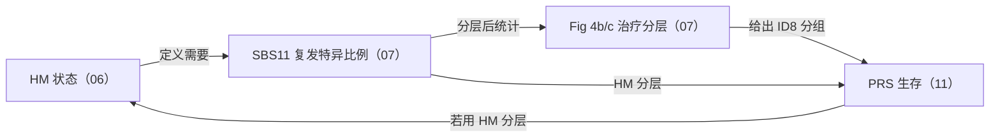
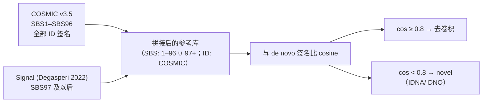

# 07 突变签名分析与治疗归因（SBS11 / SBS119 ↔ TMZ，ID8 ↔ 放疗）

> **目标文献**：The GLASS Consortium. *Divergent genomic evolution in astrocytomas and oligodendrogliomas.*
> *Nature* (2026). PDF 标识 s41586-026-11150-x. 数据：Synapse syn17038081；代码：github.com/verhaaklab/glass-idh
>
> **模块对应原文**：**Fig. 4a–e**（主图）；**Extended Data Fig. 9**（签名全景）、**Extended Data Fig. 10**（TMZ 周期数 ↔ SBS119/SBS11）；Supplementary Tables 11a–d（暴露度）、12a–d（参考签名匹配与 novel 签名）；Methods 中「**Mutational signatures**」整段 +「**Mutational burden**」段（超突变定义的另一半在本模块）；Results「**Mutational processes shape glioma genomes**」与「**Therapy-associated mutational signatures**」两节
> **复现层级**：**L1 派生层（主路径）** —— 从 Synapse 第 4 版发布的 sSNV 变异表 + 逐突变签名指派表出发，用 `analysis/bash/mutational_signature_pipeline.sh`（**这个脚本名已确证存在**）与 **`figures/R/GLASS-I_Mutational_Signature_Boxplots.R`**（脚本名见 `PROJECT_SPEC.md` §3.3 的 GitHub API 枚举表；★「脚本↔图号」的对应是**推断**，需读脚本头部注释确认） 复现全部面板与统计；**L2 预处理层（可选）** —— 用 `analysis/snakemake/sigprofilertoolkit.smk` 从 BAM/ASCAT 谱级重跑矩阵生成；**L3 原始层** —— 不做（需 EGAS/dbGaP 受控访问）
> **前置依赖**：`01_数据与代码可得性、环境与仓库结构.md`（仓库 clone、conda 环境契约）、`02_队列构建、临床注释与样本QC.md`（183 例 / 183 对口径、治疗字段）、`03_变异检出与拷贝数调用.md`（b37 下的 PASS sSNV 与覆盖度）、`06_突变负荷与超突变分类.md`（TMB≥15× 口径、HM/non-HM/unassigned 三分、被排除的 4 例名单）。需要的中间产物：`processed/variants_snv_wgs.rds`、`results/06_tmb_per_sample.tsv`（06 号契约）、**`processed/glass_hm_status.tsv`**（06 号核心共享对象，`PROJECT_SPEC.md` §3.1）、`processed/prior_treatment.csv`
> **下游依赖**：`11_生存分析与预后模型.md`（消费 Fig. 4d,e 的 ID8 分组）、`12_外部验证与批次效应检验.md`（消费签名暴露度的中心效应检验）、`13_复现质控清单、排错与批判性评述.md`（本模块的 ⚠️ 批注与 D 表项集中登记在那里）
> **复现难度**：★★★★☆　**预计工时**：6–10 人日（其中 SigProfilerExtractor 的 100 replicates × 2 队列 × 3 签名类型是纯算力等待）　**计算资源**：16 核 / 64 GB 内存（与仓库 bash 驱动的 `--cpus-per-task=8 --mem=64G` 对齐）；SigProfiler 参考基因组（GRCh37）安装后约 3 GB

---

## 0. 执行摘要（先读这 12 行）

本模块回答全文最"有临床指向性"的一个问题：**IDH 突变胶质瘤的两种亚型，在治疗压力下留下的突变足迹是否不同？** 原文的答案是"不同"——**TMZ 相关：SBS11 + SBS119（两型都有）；放疗相关：ID8（只在星形细胞瘤中显著）**。

复现链路只有一条主干，但每一环都有"版本陷阱"：

```
WGS 的 PASS sSNV（b37）
  → 96/78/83 类突变类型矩阵 M
  → NMF 分解 M ≈ S·E（max signatures = 10，replicates = 100）
  → stability > 0.8 的 de novo 签名
  → 与 COSMIC v3.5(SBS1–96 + 全部 ID) ∪ Signal(SBS97+) 比 cosine
      · cos ≥ 0.8 → 去卷积
      · cos < 0.8 → 保留为 novel（IDNA / IDNO）
  → Palimpsest v2.0.0 逐突变指派
  → 按 Initial / Recurrence / Shared 三分聚合
  → Fig. 4a（签名 × 时序矩阵）、Fig. 4b,c（治疗分层）、Fig. 4d,e（ID8 生存）
```

本模块的六个 QC 锚点（数值全部来自原文，见 §6）：

| 锚点 | 原文值 | 复现目标 |
|---|---|---|
| WGS 基因组数 / 患者数 | 39 astro × 2 = **78**；52 oligo 写 **106**（⚠️ 见 §3.1） | 与 Synapse 表逐一对上 |
| de novo 抽取数 | oligo **7 SBS + 7 ID**；astro **10 SBS + 6 ID** | 允许 K 差 ±1 但必须报告 |
| 平均稳定性 | **> 0.8** | 逐签名 stability 落盘，均值 > 0.8 |
| 去卷积判据 | cosine **≥ 0.8** | 阈值写进配置文件，不可硬编码到两处 |
| Fig. 4c 的 6 个 P 值 | 0.077 / 3.8×10⁻⁵ / 8.7×10⁻⁶ / 0.0034 / 6.5×10⁻⁵ / 0.042 | 逐格对照（**正确的格位映射见 §3.6**，与文本流的阅读顺序不同！） |
| ID8 生存 | oligo **P = 0.022**（n=22 vs 11）；astro **P = 0.00034**（n=7 vs 33） | 分组用"全部复发肿瘤的 ID8 均值"切分 |

> ⚠️ **导师批注（本模块最重要的一条）**：**"SBS11 来自 TMZ"这句话在原文里是"治疗归因"，不是"机制证明"。** 所有患者都做过手术、绝大多数接受过治疗，因此**没有任何未治疗的对照组可以完全排除"治疗无关的克隆性内源过程"**。复现报告必须把证据分级写清：SBS11 有较强的外源证据（烷化剂体外/体内诱导一致）；SBS119 有 iPSC 体外 TMZ 处理证据（原文引 ref 29、36）；**ID8 只有"放疗组更高 + 高复发分数与更差 PRS 相关"这两条关联证据**，原文自己都谨慎地写成"radiation increases **selection for** ID8 mutations, but does not necessarily increase their **formation**"（放疗增加对 ID8 突变的**选择**，而不必然增加其**形成**）。把这条写成"放疗产生 ID8"就是越界（REPRO_SPEC §12 第 4 条）。

---

## 1. 科学问题与逻辑位置

### 1.1 为什么必须在 TMB 之后、生存之前做这一步

`06_突变负荷与超突变分类.md` 只算了一个标量（mut/Mb）和一个二分标签（HM / non-HM / unassigned）。但**突变负荷高不等于治疗导致**：一个肿瘤可以有 30 mut/Mb 却全是 SBS1（年龄时钟），也可以有 3 mut/Mb 却全部集中在一条染色体上的一小段（kataegis）。要把"负荷"翻译成"过程"，必须做**签名分解**——把 96 维的突变类型谱拆成若干个已知机制（或未知但可重复）的叠加：

$$
\underbrace{M}_{96\times N}\;\approx\;\underbrace{S}_{96\times K}\cdot\underbrace{E}_{K\times N}
$$

其中 $S$ 是 $K$ 个签名谱，$E$ 是每个样本（或每个时序分数）对这 $K$ 个过程的暴露度。这一步的输出同时喂给三条下游：

- **治疗归因**（本模块 §3.5–3.7）：SBS11/SBS119 ↔ TMZ；ID8 ↔ 放疗；
- **生存**（`11`）：ID8 高/低分组的 PRS；
- **亚型差异的机制解释**（`14_背景知识精讲与方法学原理速查.md`）：SBS5/SBS40（oligo）vs SBS8（astro）的复制时序区差异。

### 1.2 ⚠️ 本模块与 06 号文档之间存在一个"定义闭环"，必须显式打破

原文的超突变定义是**双条件**：

> "DNA hypermutation was defined for recurrent tumours with a combination of **more than 10 mutations per Mb** and **more than 25% of recurrence-specific mutations attributable to the COSMIC mutational signature SBS11**."

注意第二条件**需要 SBS11 的暴露度**，而 SBS11 的暴露度只有做完签名分解才能得到——于是形成闭环：



**打破闭环的三条硬性约定（写进 `13` 号文档的 D 表，主路径用第 1 条）：**

| # | 约定 | 说明 |
|---|---|---|
| 1 | **SBS11 暴露度的分母固定为"复发特异突变"（recurrence-specific）**，而不是"该样本全部突变" | 原文措辞就是 "recurrence-specific mutations"。用全样本做分母会把共享的克隆性 SBS11 也算进去，在 low-TMB 样本上会系统性低估 |
| 2 | HM 判定**只允许用 SBS 层的 SBS11**，不允许用 ID 层签名或 Palimpsest 逐突变结果的"比例" | 两层数值不可互换（§2.6、陷阱表第 8 行） |
| 3 | HM 状态与签名暴露度的**计算顺序固定**：先算暴露度 → 再判 HM → 再用 HM 分层画 Fig. 4b/c | 避免"用结果反推分组" |

### 1.3 与 `08_拷贝数签名与全基因组加倍.md` 的分工

| 维度 | `07`（本文档） | `08` |
|---|---|---|
| 输入层 | sSNV 上下文（96/78/83 类） | 等位特异拷贝数片段（ASCAT/Sequenza） |
| 签名语义 | **碱基替换/插入缺失的机制**（脱氨、烷化剂、MMR 缺陷） | **事件类型与片段长度分布**（获得/缺失/LOH × 长度箱） |
| 参考库 | COSMIC v3.5（SBS+ID）∪ Signal（SBS97+） | COSMIC v3.5 **CN 签名集** |
| 工具 | SigProfilerMatrixGenerator / Extractor / Assignment + **Palimpsest** | SigProfilerMatrixGenerator（CNV48）/ Assignment + ASCAT + Sequenza |
| 主图 | Fig. 4 | Fig. 5c + ED Fig. 13a,b |

**两张签名表绝不能合并解读**：SBS 签名的第 $i$ 个分量是"某个三核苷酸上下文"，CN 签名的第 $i$ 个分量是"某个片段长度箱 × CN 状态 × 杂合状态"。原文也从未把 SBS11 与 CN2 放在同一个模型里比较。

### 1.4 输入 / 输出契约

**输入（必须与上游文档的产物格式严格一致）：**

```
processed/
├── variants_snv_wgs.rds      # data.frame(sample, chrom, pos, ref, alt, coverage, mutect2_call)  b37，无 chr 前缀
├── glass_hm_status.tsv       # ★ 06 号的核心共享对象（PROJECT_SPEC.md §3.1）：case_barcode,
│                             #   tmb, sbs11_recurrence_specific_frac, sbs11_r_hypermutation,
│                             #   hypermutation_status ∈ {HM, non-HM, unassigned}
├── 06_tmb_per_sample.tsv     # 06 号模块产物：sample_id, tmb, platform(WGS|WXS), n_mut_counted, denom_bp
├── prior_treatment.csv       # case_barcode, sample_barcode, temozolomide_prior_to_recurrence,
│                             #   radiotherapy_prior_to_recurrence, TMZ_cycles
├── 05_mutation_pair_timing.tsv  # 突变级时序（initial-only / recurrent-only / shared）+ VAF + CCF（05 号契约）
├── 07_sbs11_per_mutation.tsv    # ★ 本模块自己产出的逐突变签名指派（见 §4.7b），同时被 06 号消费
└── signature_reference/
    ├── COSMIC_v3.5_SBS96.tsv      # 96 x 96
    ├── COSMIC_v3.5_ID83.tsv       # 83 x 32
    ├── Signal_SBS97plus.tsv       # 96 x N（SBS97 起）
    └── REFERENCE_MANIFEST.tsv     # db, version, download_date, md5  ← 缺这一行就是事故
```

**输出（本模块是唯一生产者）：**

| 产物路径 | 生产者(唯一) | 格式/结构 | 消费方 | 生成脚本 |
|---|---|---|---|---|
| `results/07_sig_de_novo_stability.csv` | 07 | `signature, signature_type, cohort, stability`（行数 = K_SBS + K_ID 之和） | 07、13 | `code/07_01_extract_and_stability.R` |
| `results/07_sig_cosine_match.csv` | 07 | `de_novo_sig, best_ref, cosine, decision(deconvoluted\|novel)` | 07、13 | `code/07_02_cosine_and_deconvolution.R` |
| `results/07_sig_exposure_by_timing.csv` | 07 | `case_barcode, mut_sig, variant_state(P\|R\|S), sig_prop`（$\in[0,1]$，**比例**） | 07、11、12 | `code/07_03_timing_fractions.R` |
| `results/07_sig_exposure_absolute.csv` | 07 | `case_barcode, mut_sig, variant_state, abs_score`（**绝对量**，与上一行同源但不同尺度） | 07 | 同上 |
| `results/Fig4c_kruskal.csv` | 07 | `mut_sig, glioma_type, n, kruskal_p, bh_q` | 11、13 | `code/07_04_treatment_attribution.R` |
| `results/07_sbs11_per_mutation.tsv` | 07 | `mutation_id, sample_id, signature, prob`（Palimpsest 逐突变指派；**已与 `06` 号文档约定**） | **06** | `code/07_07_per_mutation_export.R` |
| `processed/sbs11_sbs119_id8_Rprop.csv` | 07 | 患者级宽表：`case_barcode, SBS11_R, SBS119_R, ID8_R`（float，**0–1**，**复发特异**比例；**已与 `11` 号文档约定**） | **11**（Fig. 4d,e）、12 | `code/07_08_rprop_export.R` |
| `figures/Fig4a_signature_timing.{pdf,png}` 等 | 07 | 双份，dpi=300 | 报告 | `code/07_05_figures.R` |

> ⚠️ **尺度契约（REPRO_SPEC §4.2，本项目最易踩的坑之一）**：`sig_prop` 是**每对（pair, timing fraction）内部归一化到 1 的比例**，不是"突变数占比"，也不是"全样本占比"。写图注/报告时必须带单位说明；`abs_score` 才是可加减的绝对量。
>
> ⚠️ **命名契约（口径唯一，先定死再写代码）**：`variant_state` 的**唯一合法取值是 `P` / `R` / `S`**（Primary / Recurrence / Shared）——这是仓库 `make_fraction_vcf()` 造出的伪样本后缀（`{case}-P` / `{case}-R` / `{case}-shared`，见 §2.6）。而**原文图与本文档行文里把同一个分量标成 `I`（Initial）**（Fig. 4a 的轴标签就是 I/R/S）。**两者是同一个东西，但字符串不同**：代码里只允许 `P`/`R`/`S`，图表标签/正文里写 `I`/`R`/`S`，并在图注里加一句 "I = primary (P), R = recurrence, S = shared"。**绝不要在同一个脚本里混用 `I` 与 `P`**——`filter(variant_state == "I")` 会静默得到 0 行，是本节最典型的"取子集为空"事故（L0 附录 C）。

---

## 2. 原理精讲（本模块的技术核心，要写透）

### 2.1 突变类型矩阵 $M$：SBS96 / DBS78 / ID83

**SBS（单碱基替换）** 不用"6 种替换"（C>A、C>G、C>T、T>A、T>C、T>G）而用 **96 类**，因为突变率强烈依赖**紧邻的碱基**（5′ 和 3′ 各 4 种）：

$$
96 = \underbrace{6}_{替换} \times \underbrace{4}_{5'\text{碱基}} \times \underbrace{4}_{3'\text{碱基}}
$$

关键约定：**按嘧啶参考链折叠**。即一个 `A>C` 的突变，要看它的参考链；如果参考链是 A（嘌呤），则取反向互补写成 `T>G` 并反转上下文。这一步不做好，矩阵会凭空损失一半（正负链各记成两类），NMF 会抽出成对出现的"假签名"。

**DBS（双碱基替换）**：SigProfiler 用 **DBS78**（78 类）——把**相邻的两个碱基替换当作一个事件**，按参考双碱基类型（反向互补折叠后）与两侧翼碱基的类别展开。

**ID（插入缺失）**：SigProfiler 用 **ID83**（83 类），按"1bp 插入 / 1bp 删除 / >1bp 插入 / >1bp 删除 / 微同源缺失"的事件类型，叠加重复或微同源长度与序列上下文展开。生物学上 **ID1（长 T 重复中的 1bp 删除）与 ID2（胞嘧啶重复中的 1bp 删除）是天然的时钟样签名**——它们反映 DNA 聚合酶在滑移链上的复制错误，随年龄线性累积（原文明确把 **SBS1、ID1、ID2** 并列为 age-related clock-like 签名）。

> ⚠️ **导师批注（不要把 78 / 83 的分解算式背下来）**：本节**故意不复述** DBS78 / ID83 的分类算式。原因是文献对"两侧翼碱基如何归类""微同源长度分几档""哪些双碱基类型被合并"的写法并不统一，凭记忆写出的分解极易差几类（把 5 × 7 × 2 之类的乘积硬凑成 83 是最常见的错误）。**唯一可靠的做法是从工具产物里读特征名**：`SigProfilerMatrixGenerator` 会写出 `output/DBS/<project>.DBS78.all` 与 `output/ID/<project>.ID83.all`，其**行名**就是全部 78 / 83 个特征的确切定义与顺序。复现时在 §4.3 的 STEP 1 后加断言 `stopifnot(nrow(m_dbs) == 78, nrow(m_id) == 83)`，且**任何情况下都不得手工重排或改名特征**。

**矩阵的构造**：$M_{ij}$ = 样本 $j$ 中第 $i$ 类突变的**计数**。必须是**计数**而不是频率——NMF 的 Poisson/KL 目标函数假设计数；用频率会让低 TMB 样本的方差被错误地压平。

### 2.2 NMF：目标函数与乘法更新规则

NMF 求

$$
\min_{S\ge 0,\,E\ge 0}\; D(M \,\|\, SE)
$$

两种经典散度：

**（a）Frobenius（欧氏）目标**

$$
D_F = \tfrac{1}{2}\left\| M - SE \right\|_F^2
= \tfrac{1}{2}\sum_{i,j}\left(M_{ij} - (SE)_{ij}\right)^2
$$

乘法更新（Lee & Seung 2001）：

$$
S \leftarrow S \odot \frac{M E^{\top}}{S E E^{\top}},
\qquad
E \leftarrow E \odot \frac{S^{\top} M}{S^{\top} S E}
$$

（$\odot$ 为逐元素乘，分式为逐元素除。）**几何直觉**：分子是"当前 $S$ 下 $E$ 的最优最小二乘方向"，分母是"当前重构的期望值"；比值 >1 就放大、<1 就缩小，因此保持非负。

**（b）KL 散度目标（计数数据的正确似然）**

$$
D_{KL}(M \,\|\, SE) = \sum_{i,j}\left( M_{ij}\log\frac{M_{ij}}{(SE)_{ij}} - M_{ij} + (SE)_{ij}\right)
$$

对应更新：

$$
S \leftarrow S \odot \frac{\dfrac{M}{SE}E^{\top}}{\mathbf{1}E^{\top}},
\qquad
E \leftarrow E \odot \frac{S^{\top}\dfrac{M}{SE}}{S^{\top}\mathbf{1}}
$$

**KL 与 Frobenius 在签名分析中的差别不是学术细节**：突变计数服从近似 Poisson，$D_{KL}$ 等价于 Poisson 极大似然（只差常数项），因此**对低计数类（每类常常只有 0–3 个突变）的表现显著更好**；$D_F$ 是高斯似然，会让高计数类主导拟合，低 TMB 样本的签名被"抹平"。SigProfilerExtractor 默认走的是与 $D_{KL}$ 同族的更新（其文档称之为 "Poisson" 目标）；**具体走哪条分支以 `SigProfilerExtractor` 当前版本 `nmf` 模块的实现为准**（`python -c "import inspect,SigProfilerExtractor; print(inspect.getsource(SigProfilerExtractor.nmf))"` 可当场核对）。

**为什么必须多 replicate**：NMF 的优化是**非凸**的，$D(M\|SE)$ 在 $(S,E)$ 空间上有大量局部极小。一次运行抽出的"签名"可能只是某个局部解；你再跑一次，得到的谱可能明显不同。这不是 bug，是算法本性。

### 2.3 Replicates = 100 与 stability > 0.8

SigProfilerExtractor 的做法是：对每个候选签名数 $K$，用**不同随机初始化**跑 `nmf_replicates` 次 NMF，得到 $K \times \text{replicates}$ 个谱向量；把这些谱做聚类，再用 **silhouette（轮廓系数）** 评估"同一个签名在多次运行中是否稳定复现"，并报告每个签名的 `stability` 指标（越接近 1 越稳定，SigProfiler 文档把它定义为 silhouette 的补量形式，即"越大越稳定"）。

原文用 **`maximum signatures = 10`、`NMF replicates = 100`**，并要求 **平均 stability > 0.8**。这两件事的意义完全不同，不能混：

- `maximum signatures = 10` 是**搜索上界**：算法会在 $K=1,2,\dots,10$ 之间按自己的选择准则（reconstruction error / 稳定性权衡）挑一个最优点；
- `replicates = 100` 是**每次 $K$ 的重复次数**，只影响稳定性估计的方差。replicates 从 100 降到 10，抽取的签名数**通常不会变**，但 stability 点估计会抖动 ±0.1 量级，可能把稳定签名误判成不稳定。

**复现时的硬性要求**：把 `results/07_sig_de_novo_stability.csv` 逐签名落盘（而不是只留一个"平均 > 0.8"），并在报告中同时给出（a）选择的 $K$、（b）$K$ 附近 ±1 的重构误差曲线、（c）**每个**签名的 stability。

> ⚠️ **导师批注（原文两处口径未交代，必须在执行前拍板，不得圆场）**：
>
> **① `maximum signatures = 10` 是"SBS 与 ID 各自 10"还是"两类合计 10"？原文没写。** 原句是 "We used the b37/hg19 reference genome, maximum signatures of 10 and non-negative matrix factorization replicates of 100 for the SigProfiler run"，紧接着才给出"**oligo 抽出 7 SBS + 7 ID**、**astro 抽出 10 SBS + 6 ID**"两组数。从算术上看**必然不是合计 10**（oligo 7+7 = 14 > 10；astro 10+6 = 16 > 10），所以**只能是"每个签名类型各自 10"**——即 SBS 跑一次 `maximum_signatures=10`、ID 再跑一次 `maximum_signatures=10`，DBS 同理。这一推论本身是可核验的（若按"合计 10"跑，oligo 的两类之和不可能超过 10）。**但原文没有明说**，因此 §4.3 的代码必须**显式地对每个 `sig_type` 分别传 `--max-signatures 10`**，并在方法学里写明本模块采用的是"每种突变类型各自取上界"这一读法。同时注意一个**由此产生的红旗**：**astro 的 SBS 抽取数恰好等于上界 10**（见 §6.1 第 6 条）——这正是"K 被上界截断"的典型信号，所以 astro 侧必须额外跑 `maximum_signatures = 12 / 15` 的敏感性，确认 10 不是被截断的结果；oligo（7 SBS）不受此影响。
>
> **② "average stability higher than 0.8" 的 "average" 是什么平均，原文没给定义。** 可能是（a）推荐解里**全部**签名的 stability 算术均值、（b）按暴露度加权的均值、（c）每个 $K$ 的均值再跨 $K$ 平均——三种读法在 stability 分布偏斜时给出的数可以差 0.05–0.1。**我方决策**：主路径取读法 (a)（最贴字面），并同时落盘 (b)(c) 两列备查；`results/07_sig_de_novo_stability.csv` 必须**逐签名**给出值，报告里同时给出三种均值。**禁止**为了凑过 "> 0.8" 这个门槛而反复提高 replicates（L0 §12.1）。此外，SigProfiler 文档对 `stability` 的定义在不同版本间也调整过（有的版本给的是"越大越稳定"、有的给置信度式表述）——**具体定义以当前安装版本 `SigProfilerExtractor` 的文档字符串为准**（`python -c "import SigProfilerExtractor, inspect; print(inspect.getdoc(SigProfilerExtractor.sigProfilerExtractor))"`），不要凭记忆断言。

### 2.4 Cosine similarity 与去卷积判据

两签名谱 $a, b$（都是 96 维非负向量）的余弦相似度：

$$
\cos(a,b) = \frac{a\cdot b}{\|a\|_2\,\|b\|_2} = \frac{\sum_i a_i b_i}{\sqrt{\sum_i a_i^2}\,\sqrt{\sum_i b_i^2}} \in [0,1]
$$

（非负向量下不会为负。）**余弦只比较"形状"，不比较"幅度"**——两个谱可以是同一个机制但总突变数差 100 倍，余弦仍为 1。这正是我们想要的：签名定义的就是形状。

原文的判据：

> "Extracted signatures with a cosine similarity to a reference signature of **0.8 or higher** were deconvolved, whereas those with a similarity **lower than 0.8** were **retained as novel signatures**."

**两种处置的后续动作完全不同**：

| cos | 动作 | 后果 |
|---|---|---|
| ≥ 0.8 | **去卷积**（把 de novo 谱换成参考签名谱，用参考库做约束拟合） | 标志可与其他研究直接比较；暴露度可用 COSMIC/Signal 编号引用 |
| < 0.8 | **作为 novel 签名保留** | 不能命名成 COSMIC 编号（会污染跨研究比较）；必须自命名并在 Supplementary Table 12 登记 |

原文 ED Fig. 9 的图注给出了 novel 签名的实际清单：

> "De novo extracted signatures without >0.8 similarity to known reference signatures were classified as novel signatures; this included **two ID signatures for oligodendrogliomas and one ID signature for astrocytomas**."

并在图上命名为 **IDNA**（astrocytoma cohort 的未报道 ID 签名）与 **IDNO**（oligodendroglioma cohort）。**复现时若把 IDNA/IDNO 丢掉，Fig. 4a 的 olgio/astro 特异性计数会对不上。**

**余弦判据的三个必须自查的地方：**

1. **"最佳匹配"是 argmax 还是"所有 > 0.8 都算"？** 原文措辞是 "a cosine similarity to a reference signature of 0.8 or higher were deconvoluted"——语义上是**只要存在一个 ≥0.8 的参考签名即去卷积**。务必落盘完整的 cosine 矩阵（de novo × ref），让读者能自己数。
2. 余弦高**不等于**欧氏距离小。举个会踩的例子：真实签名 `A=[50,50]`，参考 `B=[0.5,0.5]`，cos = 1，但绝对量差 100 倍。**因此判据只在"谱形状"层使用，绝不能用来判断"这个样本有没有这个机制"。** 判断"有没有"要看 §2.6 的最小突变数/暴露阈值。
3. **阈值敏感性必须做**：0.75 / 0.80 / 0.85 三档各跑一遍，看 novel 签名清单是否变化。若 novel 数量在 0.8 与 0.85 之间从 3 个变成 8 个，说明这个队列的 de novo 谱与参考库整体相似度偏低，应当在报告中说明。

### 2.5 参考签名库的"打补丁"：COSMIC v3.5 + Signal，以及版本陷阱

原文的拼接策略写得很清楚：

> "we combined two public mutational signature databases: the **COSMIC** database … for **SBS signatures 1–96 and all ID signatures**, and the **Signal** database … for **SBS signatures 97 and higher**."

即：



**为什么需要打补丁？** COSMIC 的 SBS 编号止于 SBS96（v3.x）。而 Signal（UK 人群 WGS 的 RefSig，ref 29 = Degasperi et al., *Science* 2022）扩到了 SBS97 之后——原文关心的 **SBS97、SBS107、SBS119、SBS120** 全部来自这边。若只用 COSMIC，这几个签名在参考库里根本不存在，会全部被误判为 novel。

**版本陷阱（本模块最需要写透的一条）**：

| 风险 | 具体表现 | 防御 |
|---|---|---|
| **同一编号在不同 COSMIC 版本里含义不同** | COSMIC v3.x 的历次更新中，SBS 集合与编号发生过重组（例如 v3.1→v3.2 加入 SBS93–96 前后，部分低频/低置信签名的收录与编号有调整；2023 年后的重组进一步改变了 SBS 集合）。"SBS96" 这个词在不同版本里**不一定指同一个谱** | 契约表登记 `(database, version, download_date, md5)`；**任何"SBS<编号>"都要带上版本** |
| **Signal 与 COSMIC 的重叠/冲突** | Signal 的 RefSigSBS 与 COSMIC 的 SBS1–96 有大量**同一过程两个编号**的对应（Signal 另有自己的 RefSig### 编号体系，并被映射到 COSMIC 编号）；同一谱在两套库里可能名为 `SBS22` 与 `RefSigSBS…`，直接 concat 会造成重复计数、NMF 拟合时产生"两个几乎相同的基向量" | 以原文口径为准：**SBS1–96 只取 COSMIC，SBS97+ 只取 Signal**；拼接后**跑一次库内两两余弦矩阵**，若有任一对 > 0.95 就打印告警 |
| **仓库自带版本 ≠ 原文版本** | ⚠️ 见 §3.9 与陷阱表第 2 行：`analysis/bash/mutational_signature_pipeline.sh` 的默认 SBS 参考对象名是 **`SBS_cosmic3.2_sigs`**（v3.2），`analysis/snakemake/sigprofilertoolkit.smk` 的文件头注释写的是 **「embedded in SigProfilerToolkit, COSMIC v3.4」**，而原文 Methods 明写 **COSMIC v3.5** | **三处不一致必须显式声明并统一到 v3.5**；把 `cosmic_version` 写进配置文件，禁止依赖工具内嵌默认 |
| **Signal 是 WGS 来源** | Signal 的 refsig 建立在 UK 人群 **WGS** 上；用 WXS 数据去拟合会严重不匹配 | 原文的处置：**"To ensure confidence in signature assignment probability, we used only WGS data from our cohort, aligning with the WGS-based curated reference."** 只保留 `platform == "WGS"` |

### 2.6 逐突变指派：Palimpsest v2.0.0 的原理，以及它与"样本级暴露"的区别

**两层输出必须分清**（本模块最容易被含糊过去的地方）：

| 层 | 问的问题 | 输出 | 单位 |
|---|---|---|---|
| **样本级暴露（NMF / SigProfilerAssignment）** | "这个样本（或这个时序分数）里，各签名各占多少比例？" | $E_{kj}$ | 比例（和为 1）或绝对量 |
| **逐突变指派（Palimpsest）** | "**这一个具体突变**最可能来自哪个签名？" | 每个突变一个标签 + 概率 | 计数 |

Palimpsest 的机制（思想，非源码级复述）：每个突变都携带自己的**局部证据**——

1. **上下文证据**：该突变的 96 类上下文向量 $c_m$ 在各参考签名下的似然 $P(c_m \mid s)$；
2. **样本级暴露先验**：来自上一步的暴露度 $E_{\cdot j}$（这就是为什么 Palimpsest 必须在暴露度估计**之后**跑）；
3. 合成后 $\hat{s}_m = \arg\max_s P(s \mid c_m, E_{\cdot j})$。

**因此在"样本级暴露"和"逐突变计数比例"之间会系统性出现小幅不一致**：样本级是连续分解，逐突变是硬指派（hard assignment），后者会把模糊的突变全部推给某一个签名。原文用 Palimpsest 的目的正是为了得到**可以按 Initial / Recurrence / Shared 分组计数的离散标签**（Fig. 4a 的 timing fractions 需要它）。别把两者当成同一组数字。

**仓库里真实可用的 API（已从 `analysis/bash/mutational_signature_pipeline.sh` 内嵌的 R 脚本中逐行核实）**：

```r
library(Palimpsest)
library(BSgenome.Hsapiens.UCSC.hg19)   # 脚本显式要求，缺失直接 stop

# 1) 给 VCF 加三核苷酸上下文 / ID 分类
ann <- annotate_VCF(vcf = vcf, ref_genome = ref_genome,
                    add_strand_and_SBS_cats = TRUE,
                    add_ID_cats = FALSE, add_DBS_cats = FALSE)

# 2) 编码成 Palimpsest 的输入矩阵
input_sample <- palimpsest_input(vcf = ann, Type = "SBS")

# 3) 参考签名约束下的暴露度拟合
exp_sample <- deconvolution_fit(input_matrices = input_sample,
                                input_signatures = ref,
                                resdir = sig_out, input_vcf = ann, doplot = FALSE)

# 4) 逐突变指派 ← Fig. 4a 的 timing 分数就靠这一步
origins_sample <- signature_origins(input = ann, Type = "SBS",
                                    input_signatures = ref,
                                    signature_contribution = exp_sample)
```

> ⚠️ **需按当前版本核对**：`annotate_VCF()` 的形参在不同 Palimpsest 版本间有过调整（尤其是 `add_strand_and_SBS_cats` / `ref_fasta` 的组合）；上表的写法**以仓库脚本里实际使用的形式为准**（它是能跑通的版本），但若你装了更新的 Palimpsest，请用 `args(annotate_VCF)` 先自查一遍。

**"共享 / 私有"是怎么造出来的（仓库做法，很有启发性）**：脚本里有一个 `make_fraction_vcf()`，把配对样本按 `case_barcode` 合并，对每个 `(case, Type, CHROM, POS, REF, ALT)` 统计在几个样本里出现：

```r
mutate(variant_fraction = ifelse(n_distinct(Sample) > 1, "shared", "private"))
# shared 的突变被赋给一个伪样本 "{case}-shared"，再单独跑一次 Palimpsest
```

这正是 Fig. 4a 的 **I（Initial）/ R（Recurrence）/ S（Shared）** 三个时序分数的来源：同一套流程跑两遍——一遍按真实样本、一遍按"真实样本 + `{case}-shared` 伪样本"，后者给出共享分量的暴露度。

> ⚠️ **导师批注（数据库侧还有第二条实现路径，与 Methods 描述不完全一致）**：`preprocessing_pipeline/` 下的**签名比例派生表 SQL**（★ **文件名以仓库当前版本为准**：先 `find code/glass-idh/preprocessing_pipeline -name '*.sql' | xargs grep -ln 'mut_sig\|signature'` 现场定位）里，P/R/S 三分用的是**另一套算法**：从变异表的 `mutect2_call_a` / `mutect2_call_b` 判定
> `S = call_a AND call_b`、`P = call_a AND NOT call_b`、`R = call_b AND NOT call_a`（并要求相关样本 `ref_count + alt_count > 14`），然后对每个 `(tumor_pair_barcode, fraction)` 用 PostgreSQL 的 **`lsqnonneg`（非负最小二乘）** 对参考签名概率表求解，且**把签名下标范围写成 `generate_series(1, 30)`（即 30 个 SBS 签名）**。
>
> 这与 Methods"Palimpsest v2.0.0 逐突变指派 + COSMIC v3.5 ∪ Signal 参考"的描述**不是同一套东西**：目标函数不同（NNLS vs Palimpsest 的多项后验）、参考集规模不同（30 vs 96+）、且该 SQL 只处理 SNP（不含 ID）。图脚本读入的比例 CSV（`mut_sig_prop.csv` / `sbs11_sbs119_id8_Rprop.csv` 一类）在注释里写的是 "created with `mutational_signature_pipeline.sh`"，但从 SQL 到 CSV 的最后一跳**在仓库当前快照中未见对应脚本**。
>
> ⚠️ **上面这段描述的每一个细节（SQL 文件名、列名 `mutect2_call_a`/`pgeno`、常量 `14`、`generate_series(1, 30)`、CSV 名）都来自撰写时对仓库快照的一次阅读，本项目未逐条复核**。请按 `13` 号文档的规则，把它当作"**待现场确认的线索**"而不是事实：先 `find` + `grep` 定位文件，再 `sed -n` 读一遍确认这些字面量还在。
>
> **复现决策**：主路径走 `analysis/bash/mutational_signature_pipeline.sh`（Palimpsest 路），把 SQL 路作为**第二套独立实现**做交叉验证（两条路算出的 SBS11 复发特异比例应高度相关；若 Spearman ρ < 0.8，说明 SBS11 的数值对实现方式敏感，必须在报告中明说）。这条已登记到 `13` 号文档。

### 2.7 SBS / DBS / ID 的生物学速查（原文提到过的全部签名）

| 签名 | 原文中的定位 | 机制/关联（含不确定性） |
|---|---|---|
| **SBS1** | "age-related clock-like" | 5-甲基胞嘧啶自发脱氨（C>T at CpG）。与年龄线性相关，**是判断"样本年龄是否可信"的内参** |
| **SBS5** | "associated with late replication regions" | 未知病因的时钟样签名；原文在 **oligo 中富集**（vs SBS8） |
| **SBS8** | 同上 | 未知病因，晚期复制区；原文在 **astro 中富集** |
| **SBS40** | 同上 | 未知病因，晚期复制区；原文在 **oligo 中富集** |
| **SBS11** | **TMZ 相关超突变签名** | 烷化剂诱导的 C>T；**原文唯一的"机制较硬"的治疗签名** |
| **SBS97** | "C>T … previously associated with deficiencies in mismatch repair" | **只在 astro 中出现** |
| **SBS107** | "C>A transversions dominated" | 与 SBS4（吸烟）相似；既往见于膀胱癌、肾癌、肝癌。原文明确：**IDH 突变胶质瘤与吸烟无显著风险关联，且未检出 SBS22a/b，因此不能用吸烟解释** |
| **SBS119** | **TMZ 相关（非超突变样本）** | T>C 富集，与 MSI 相关签名 SBS26 相似；既往在 3 例 CNS 肿瘤中观察到，且**与 iPSC 体外 TMZ 处理诱导的签名相似**（ref 29、36）。原文额外排除了 FFPE 伪影与鸟嘌呤氧化 |
| **SBS120** | "a signature of unknown origin that is unique to tumours in the CNS" | 两种 IDH 突变胶质瘤中均出现 |
| **SBS37 / SBS101** | "signatures of unknown aetiology" | 只在 astro 中 |
| **ID1 / ID2** | "age-related clock-like" | 长 T 重复 / 胞嘧啶重复中的 1bp 删除，聚合酶滑移 |
| **ID3** | 与吸烟相关 | 只在 astro 的部分样本中 |
| **ID5** | "reported to be a clock-like signature" | **oligo 有、astro 无** |
| **ID8** | **放疗相关（本模块的关键结果）** | ⚠️ 生物学尚有争议，见下 |
| **ID23** | 与马兜铃酸暴露相关 | 只在 astro 的部分样本中；原文注意到若真为马兜铃酸暴露，应同时出现 SBS22a/b，**但未检出**，故认为存在替代机制 |
| **IDNA / IDNO** | ED Fig. 9 命名的 **novel** 签名 | astro / oligo 队列中与参考库 cos < 0.8 的 ID 签名（分别为 1 个和 2 个） |

> ⚠️ **关于 ID8 的必须写清的争议**：ID8 在文献中被反复报告为"放疗相关"，但**它到底是被辐射"造出来"的，还是辐射筛选了本来就存在的带有该过程的克隆，并没有定论**。原文的处理非常克制：
> "Although this signature was also detected in **non-irradiated astrocytomas**, it was **highest** in radiation-treated astrocytomas, suggesting that radiation increases **selection for** ID8 mutations, but does not necessarily increase their **formation**."
> 复现报告中的措辞**不得超过**这一条：可以说"RT 组更高、复发分数高者 PRS 更差"，**不能说"放疗诱导了 ID8"**。同时必须如实报告原文的阴性结果——**放疗处理过的 oligo 也有 ID8 时序差异，但未达显著（Fig. 4c 中 P = 0.077）**。

### 2.8 治疗归因的逻辑，以及必须讨论的反事实问题

**原文的归因设计（三重对照）**：

1. **时间点比对**：把每个突变分成 I / R / S。如果某签名在 **R（复发特异）** 分量上显著富集，说明它是在初诊之后、复发之前被引入或扩增的；
2. **治疗分层**：按 `temozolomide_prior_to_recurrence` / `radiotherapy_prior_to_recurrence`（**"在复发手术之前是否接受过"**，仓库图脚本已核实字段名）把患者分层，做 Kruskal–Wallis（unpaired，因为不同患者的 timing 分数不是配对量）；
3. **剂量-反应（辅助证据）**：TMZ 周期数 vs 复发特异比例的 Spearman 相关（ED Fig. 10）。

**反事实问题（必须写进报告的 Limitation）**：

- **没有未治疗组**。所有患者至少做过两次手术，`仅手术 17% / 14%`（astro/oligo）这部分人虽未接受放化疗，但 n 很小，且**被分到"Non-treated"意味着"复发前没治疗"，而不是"从未治疗"**——原文 Fig. 4b 的 "Non-treated" 列就是这个意思，必须按此理解；
- **SBS11/SBS119 的生物学通路（烷化剂 → O⁶-甲基鸟嘌呤 → C>T / T>C）有外源实验支持**，这属于"机制较硬"的一档；
- **ID8 只有关联证据**，且"辐射增加选择而非形成"这一解释本身也未被独立验证；
- **治疗与分子亚型高度共线**：TMZ 71%、放疗 68%/69%，两型几乎相同，但也正因如此，**"astro 有 ID8 而 oligo 没有"不能被治疗强度差异解释**——这反而增强了原文的亚型特异性结论。

**证据分级（写给 `13` 号文档的结论表）**：

| 结论 | 证据类型 | 等级 |
|---|---|---|
| SBS11 与 TMZ 暴露相关 | 外源诱导实验 + 时间点富集 + 治疗分层（HM & TMZ 两组 P = 8.7×10⁻⁶ / 0.0034） | **中–强（关联 + 机制）** |
| SBS119 与 TMZ 暴露相关 | 外源诱导实验（iPSC）+ 剂量-反应（R = 0.58, P = 0.0037）+ 分层显著 | **中（关联 + 剂量-反应）** |
| **ID8 与放疗相关（仅 astro）** | 分层（P = 3.8×10⁻⁵）+ 与 PRS 相关（P = 0.00034）+ **oligo 不显著（P = 0.077）** | **弱–中（纯关联，"选择"而非"形成"）** |
| SBS5/SBS40（oligo）vs SBS8（astro）的复制时序区差异 | 描述性富集，无功能实验 | **弱（描述性）** |

---

## 3. 原文逐句拆解

> 引文全部来自 `/tmp/nat_paper_clean.txt`；引号内为原文英文，随后为中文转述与对应操作。

### 3.1 输入范围与排除的 4 例（Methods + Results）

> "We examined the developmental history of IDH-mutant gliomas by analysing mutational signatures using sSNVs extracted from **all WGS datasets**, **excluding four non-hypermutant oligodendrogliomas that had a TMB higher than 10 mutations per Mb only at the initial surgery** (78 genomes from 39 astrocytomas and 106 genomes from 52 oligodendrogliomas; Supplementary Tables 11a–d and 12a–d)."

**转述与操作**：签名分析只用 WGS。排除的 4 例的共同特征是——**只有初始样本** TMB > 10 mut/Mb，而复发样本不是超突变。这类样本的"初始"分量被高 TMB 污染，会把 timing 分数算歪。

> ⚠️ **导师批注（原文自身的算术不一致，必须登记）**：`78 genomes from 39 astrocytomas` 一致（39 × 2 = 78），但 `106 genomes from 52 oligodendrogliomas` **不一致**：52 × 2 = **104**，不是 106。若 106 正确则应写 53 例；若 52 例正确则应写 104。复现时**以 `52 例 oligodendroglioma`（患者数）为准**，并在 gap 表中记录"基因组数（104 vs 106）原文自相矛盾"。这是原文 Methods 层面的算术错误，不是我们的复现失败。

> ⚠️ **导师批注（"4 例"的具体身份：原文只给了"型别 + 判定条件"，没给名单）**：原文对 4 例的描述只有两条，**都写在正文里，但没有一处给出可核对的标识**——
> ① Results：「excluding **four non-hypermutant oligodendrogliomas** that had a **TMB higher than 10 mutations per Mb only at the initial surgery**」；
> ② Methods：「We **excluded four cases** from downstream mutational signature analyses in which the **initial, but not the recurrent sample**, had a mutation burden exceeding 10 mutations per Mb」。
>
> 因此，**可以确定的**是：型别 = **均为 oligo**、总数 = **4**、判定条件 = **初始 TMB > 10 且复发 TMB ≤ 10**（同时按"非超突变"表述，复发侧还应满足 SBS11 ≤ 25%）。**不能确定的**是：这 4 例的 **case_barcode / sample_barcode 具体是哪些**、它们是**哪 4 个患者的哪两次手术**、以及**用哪一组 TMB 数值判定**（是 `06` 号的口径 A 固定分母、还是样本内实测分母——两套口径在阈值附近可能给出不同的 4 例名单；见 `06_突变负荷与超突变分类.md` §2.2）。原文亦未报告这 4 例是否包含在 Fig. 4 的任何面板中、以及是否被排除出 Fig. 4 之外的模块（如 `11` 号的生存分析）。
>
> **复现要求**：把 4 例**逐例列出**（`results/07_excluded_4_cases.csv` 必须含 `case_barcode, sample_barcode, glioma_type, tmb_initial, tmb_recurrence, sbs11_frac_recurrence, 排除理由`），并做**口径敏感性**：用 `06` 号三种 TMB 分母口径各筛一次，报告 4 例名单是否稳定（不稳定则说明该筛选条件本身贴近阈值、结论对口径敏感，必须写进 gap 表）。**不要**因为在 Synapse 表里筛出的不是恰好 4 例就改阈值凑数（L0 §12.1）；如果是 3 例或 5 例，如实报告并说明差异来源。

**复现动作**：从 Synapse 变异表重建这个子集，并落盘：

```r
# 07_00_build_signature_input.R  ——  构造签名分析输入集（口径唯一，见 §1.2）
suppressPackageStartupMessages({ library(tidyverse) })

set.seed(20260101)                       # REPRO_SPEC §6：全项目统一种子

tmb   <- read_csv("results/06_tmb_per_sample.tsv")        # 来自 06 号文档
clin  <- read_csv("processed/prior_treatment.csv")
hm    <- read_csv("processed/glass_hm_status.tsv")     # 06 号核心共享对象（PROJECT_SPEC.md §3.1）

sig_input_excluded <- tmb %>%
  filter(platform == "WGS", coverage_ok) %>%
  group_by(case_barcode) %>%
  filter(sum(tmb > 10 & timing == "Initial") >= 1,
         sum(tmb > 10 & timing == "Recurrence") == 0) %>%   # 初始超突变、复发不超突变
  ungroup()
stopifnot(nrow(sig_input_excluded) == 4)                    # QC 锚点：必须正好 4 例
write_csv(sig_input_excluded, "results/07_excluded_4_cases.csv")

sig_input <- tmb %>%
  filter(platform == "WGS", coverage_ok) %>%
  anti_join(sig_input_excluded, by = c("case_barcode", "sample_barcode"))

# 平台/患者数断言（对照原文 39 / 52）
print(sig_input %>% distinct(case_barcode, glioma_type) %>% count(glioma_type))
# 期望：astro 39, oligo 52 —— 若大于此，说明 WGS 过滤或 coverage 口径与原文不同
```

### 3.2 参考库里"出现"的签名数

> "This analysis revealed **28 SBS or DBS signatures and 12 ID signatures** similar to those previously reported in the combined databases of COSMIC and Signal."

**转述**：拼接后的参考库中，有 28 个 SBS/DBS 与 12 个 ID 签名"与既往报道相似"。

> ⚠️ **原文未报告**：这 40 个数字的**统计口径**（是"参考库总量"？"与 de novo 签名 cos ≥ 0.8 的参考签名数"？"在数据中实际检出（暴露度 > 0）的签名数"？）原文没有说清。三种读法给出的数字完全不同。
> **我方决策**：主路径按读法 (c)"在数据中有非零暴露的签名数"复现，因为它与 Supplementary Table 12 的表结构最相符；同时把读法 (a)(b) 的数字也落盘，在报告中并列呈现。**判定为 D 表 ★ 项**（影响"本文一共用到几个签名"这一叙述）。

### 3.3 ≥5 例的筛选门槛

> "Amongst mutations that were detected in **untreated primary tumours** and mutations that were **shared between primary and matching recurrent tumours**, **six SBS and seven ID signatures were found in at least five samples**."

**转述与操作**：注意筛选的**突变子集是"未治疗初始肿瘤的突变"∪"共享突变"**——即有意剔除了"复发特异"分量，避免用治疗后突变去描述"肿瘤固有的发育史"。门槛是"至少 5 个样本中存在该签名"。

Fig. 4a 展示的正是这 6 + 7 个签名（外加 olgio/astro 各自特异的那些）。**复现时的两个易错点**：

1. `untreated primary` 定义为"**该初始样本采集时尚未接受任何治疗**"，不要用 `temozolomide_prior_to_recurrence == "not treated"` 来近似（那是"复发前**是否**治疗"，与"初始样本时是否已治疗"是两件事）；
2. "至少 5 个样本"——是**样本**还是**患者**？原文写 "five samples"。复现时按患者计数（避免同一患者两时间点被算两次），并落盘两版数字。

### 3.4 亚型特异的签名清单（Fig. 4a）

> "These include the age-related clock-like **SBS1, ID1 and ID2** signatures (Extended Data Fig. 9). We observed the presence of **SBS120** … in both types of IDH-mutant glioma. The **SBS5, SBS8 and SBS40** signatures are associated with late replication regions … and were differentially observed between oligodendrogliomas and astrocytomas (**SBS5 and SBS40 versus SBS8**, respectively; Fig. 4a)."

> "In oligodendrogliomas, **four** treatment-agnostic SBS and ID signatures were detected that were not seen in astrocytomas (oligodendroglioma-specific), and conversely, **six** other signatures were exclusively detected in astrocytomas (astrocytoma-specific)."（Fig. 4 图注）

**我从 PDF 页面上按坐标逐一核对出的 Fig. 4a 完整清单（这是原文正文没写全、只有图上才有的信息）：**

| 分组 | 签名（按图内从左到右） | 患者数（I / R / S） |
|---|---|---|
| **Oligodendroglioma-specific（4 个）** | SBS5 | 22 / 20 / 35 |
| | SBS40 | 38 / 33 / 25 |
| | SBS107 | 11 / 11 / 16 |
| | **ID5** | 41 / 42 / 47 |
| **Astrocytoma-specific（6 个）** | SBS8 | 28 / 30 / 25 |
| | SBS37 | 15 / 15 / 6 |
| | SBS97 | 3 / 5 / 3 |
| | SBS101 | 15 / 19 / 14 |
| | ID3 | 13 / 9 / 10 |
| | ID23 | 22 / 29 / 29 |

（纵轴：`Average signature proportion`，刻度 20% / 40% / 60%；圆点大小 = 平均比例，圆内数字 = 至少有一个突变归入该签名的**患者数**；Astro. n = 39，Oligo. n = 52。）

**QC 用途**：这 30 个数字是复现 Fig. 4a 的**逐格对照锚点**，比"oligo 4 个 / astro 6 个"这句定性描述强得多。原文正文只给了定性计数，这 30 个数只有看图才能拿到——复现时优先保证"哪些签名出现在哪一型"（定性）正确，再对齐患者数（定量，允许 ±3 的患者归因差异）。

### 3.5 SBS97 / SBS107 / 烟草与马兜铃酸的"替代机制"论证

> "The **C>T SBS97** signature, which has previously been associated with deficiencies in mismatch repair, was found **only in astrocytomas**, as were **SBS37** and **SBS101** … By contrast, **C>A transversions dominated the SBS107** signature, which was detected in **oligodendrogliomas but not in astrocytomas**. This signature shows similarity to the **SBS4 tobacco smoking** signature and previous SBS107 associations have been found in bladder, renal and liver carcinomas. Signatures **ID3**, also associated with tobacco smoking, and **ID23**, related to **aristolochic acid** exposure, were exclusively detected in subsets of astrocytomas. **Smoking is not associated with an appreciably increased risk of IDH-mutant glioma**, and exposure to aristolochic acid also results in increased fractions of **SBS22a and SBS22b, which were not detected**, suggesting that **alternative mechanisms** are able to generate SBS107, ID3 and ID23. **ID5**, reported to be a clock-like signature, was found in oligodendrogliomas but not in astrocytomas."

**转述与操作**：这一段是"**用缺失的伴随签名反驳外源暴露假设**"的教科书式论证：

- 若 SBS107/ID3 真来自吸烟 → 应同时出现 SBS4、且应有吸烟暴露史 → 但胶质瘤与吸烟无显著风险关联；
- 若 ID23 真来自马兜铃酸 → 应同时出现 **SBS22a/SBS22b** → 未检出；
- 因此**存在能产生相同谱的替代（内源）机制**。

**复现时的动作**：把 **SBS22a / SBS22b 的暴露度也算出来并报告为阴性**（哪怕全为 0）。这是"阴性结果必须出现在报告里"（REPRO_SPEC §12 第 5 条）的典型场景。同时在附录里给出 SBS107 ↔ SBS4 的余弦值，让读者能判断"相似"到底有多相似。

### 3.6 ⚠️ Fig. 4c 的六个 P 值：**文本流的阅读顺序不等于图上的格位顺序**

正文只给了一句话：

> "c, Box plots from b assessing significant differences between timing fractions per glioma type, using the **two-sided Kruskal–Wallis test** for unpaired data. Sample sizes represent the number of patients for whom **all three timing fractions were assessed** for each mutational signature and tumour type."

六个 P 值在 Supplementary/图上打印为 **0.077 / 3.8×10⁻⁵ / 8.7×10⁻⁶ / 0.0034 / 6.5×10⁻⁵ / 0.042**。**如果按 PDF 文本流顺序去对应格位，会全部错位。** 我用 PyMuPDF 取出 Fig. 4c 每个词的页面坐标后重建的真实格位如下（与 Results 正文的定性描述完全自洽）：

| 签名 | 分层（治疗 + 超突变状态） | 肿瘤类型 | n（三个时序分数都齐的患者数） | Kruskal–Wallis P |
|---|---|---|---|---|
| **SBS11** | **HM and TMZ-treated** | Oligodendroglioma | 10 | **8.7 × 10⁻⁶** |
| **SBS11** | HM and TMZ-treated | Astrocytoma | 6 | **0.0034** |
| **SBS119** | **Non-HM and TMZ-treated** | Oligodendroglioma | 13 | **6.5 × 10⁻⁵** |
| **SBS119** | Non-HM and TMZ-treated | Astrocytoma | 12 | **0.042** |
| **ID8** | **Non-HM and RT-treated** | Oligodendroglioma | 9 | **0.077** |
| **ID8** | Non-HM and RT-treated | Astrocytoma | 17 | **3.8 × 10⁻⁵** |

**自洽性验证（这三条能对上就说明格位映射对了）**：

1. 正文说"**Radiation-treated astrocytomas that were not hypermutated showed a significant enrichment of signature ID8**" → ID8/astro 必须显著 → **3.8×10⁻⁵** ✓
2. 正文说"**Radiation-treated oligodendrogliomas also showed a difference … but this trend did not reach statistical significance**" → ID8/oligo 必须不显著 → **0.077** ✓
3. 正文说 SBS119 在"**temozolomide-treated and non-hypermutated**"中出现 8/13 oligo 与 3/12 astro，而 Fig. 4c 中 SBS119/non-HM+TMZ 的 n 恰好是 **oligo 13 / astro 12** ✓（13 与 12 两个数与正文的 13、12 精确吻合）

**复现动作**：把格位映射写进 `code/07_04_treatment_attribution.R` 的注释，并在 QC 表里逐格对照。若你的数字"看起来都对但顺序不同"，先把本表抄下来再排查。

### 3.7 TMZ 剂量-反应（ED Fig. 10）

> "Spearman's correlation analyses revealed that there was a positive association between the **number of temozolomide cycles** and the proportion of the **recurrence-specific SBS119** signature in **non-hypermutant** gliomas (**R = 0.58, P = 0.0037**; Extended Data Fig. 10a). **No correlation** was observed in hypermutant gliomas between **cumulative temozolomide exposure** and the proportion of **recurrence-specific SBS11** mutations in either tumour type (Extended Data Fig. 10b). We also tested whether the **baseline** mutational signature composition of the initial tumours predicted the subsequent acquisition of alkylating-agent-associated signatures, and **did not find any significant associations with acquired SBS11 hypermutation after FDR correction**."

**注意这里有两条阴性结果，必须原样保留：**

- **HM 组：TMZ 周期数与 SBS11 复发特异比例无关**（这与直觉相反——剂量越大 SBS11 越多？原文没看到）；
- **初始肿瘤的签名组成不能预测后续 SBS11 超突变**（FDR 校正后无显著）。

**复现要点**：口径是"SBS119 只在 non-HM 中算、SBS11 只在 HM 中算"（见 `figures/R/GLASS-I_TMZ_Cycles.R`，表现为一个 `if_else(... HM_group == "HM", ...)` 式的条件列；★ 脚本名见 `PROJECT_SPEC.md` §3.3，列名/函数名以现场阅读为准），并且**比例乘了 100 变成百分数**（`sig_prop_sbs119*100`）——这会让 Spearman 的 R 不变但图的 y 轴刻度不同。别把"乘不乘 100"当成复现失败。

### 3.8 治疗结果汇总（本模块的结论句）

> "The temozolomide-associated hypermutation signature **SBS11 was detected in 7 out of 18 astrocytomas (39%) and in 12 out of 23 oligodendrogliomas (52%)** that were treated with temozolomide before tumour recurrence (Fig. 4b). **SBS119 was detected in 8 out of 13 oligodendrogliomas and in 3 out of 12 astrocytomas** that were temozolomide-treated and non-hypermutated (Fig. 4c)."
> "High-recurrence fractions of the **ID8** signature were significantly associated with **inferior post-recurrence outcomes** in both glioma types (Fig. 4d,e)."

**这四个分数是 Fig. 4b 的逐格锚点**：SBS11 → 7/18（39%）astro、12/23（52%）oligo；SBS119 → 3/12 astro、8/13 oligo。

### 3.9 ⚠️ 仓库脚本与原文 Methods 的三处不一致（复现前必读）

我把仓库当前快照的三个签名相关入口逐一读过，发现**参考库版本在仓库内部就不统一**：

| 位置 | 撰写时快照里看到的默认值（★ **必须现场核对，不得直接引用**） | 与原文 Methods 的差异 |
|---|---|---|
| `analysis/bash/mutational_signature_pipeline.sh` | `--sbs-ref-object` 默认 **`SBS_cosmic3.2_sigs`**；`--max-signatures` 默认 **20**；`--min-signatures` 默认 1；`--subtype` 默认 **`IDHmut-codel`**；`--project-name` 默认 **`GLASS5`**；`--genome` 默认 GRCh37；`--cushion` 默认 100 | 参考库写的是 **COSMIC v3.2**（原文 v3.5）；签名数上界 **20**（原文 10）；默认只跑 **codel** 亚型（原文两型都跑） |
| `analysis/snakemake/sigprofilertoolkit.smk` | 文件头注释写的是内嵌 **COSMIC v3.4**；另含 MuSiCal（Jin）与 Degasperi（Signal）两套外部参考 | 内嵌 **v3.4**（原文 v3.5） |
| 原文 Methods | "**COSMIC v.3.5** reference … for SBS 1–96 and all ID；Signal for SBS 97 and higher" | 基准 |

> ⚠️ **上表第 1、2 行是对仓库快照的观察，不是对当前版本的断言。** 表格里的每一个**默认值、参数名、常量名、文件头注释里的版本号**都会随仓库更新而变。**落地时先跑这两条命令把真实值印出来，再照本表逐项对照**（不要拿本表当引用依据）：
>
> ```bash
> bash analysis/bash/mutational_signature_pipeline.sh --help        # ★ 参数名与默认值以此为准
> sed -n '1,40p' analysis/snakemake/sigprofilertoolkit.smk          # ★ 内嵌版本号以此为准
> grep -rn "cosmic" analysis/bash analysis/snakemake | head          # ★ 兜底：全目录搜版本号
> ```
>
> 同时，**仓库 `analysis/SQL/` 下的 SQL 文件名与 `figures/R/`、`analysis/R/` 下的脚本文件名在本项目中并未逐一确证**——凡是要传给 `--sql` / `--reference-rdata` 的路径，一律**先用 `ls` 枚举再填**（`ls analysis/SQL`、`ls code/glass-idh/figures/R`、`ls code/glass-idh/analysis/R`），**禁止凭记忆写文件名**。

**三个版本号（3.2 / 3.4 / 3.5）同时存在于"官方复现路径"中。** 因此：

```bash
# ★ 第 0 步：先把路径枚举出来，绝不凭记忆写文件名（本项目未确证 SQL 文件名）
ls analysis/SQL                                  # 4 个 SQL；按下文用途挑，名称以仓库当前版本为准
ls analysis/bash                                 # 确认驱动脚本名（mutational_signature_pipeline.sh 已确证）
SQL_INPUT=$(ls analysis/SQL | grep -i 'dndscv' | head -1)     # ★ 无匹配时请人工指定，不要默认取第一个
test -n "$SQL_INPUT" || { echo "请先 ls analysis/SQL 选定 dNdScv 输入 SQL"; exit 1; }
SQL_INPUT="analysis/SQL/$SQL_INPUT"

# ★ 主路径必须显式覆盖默认值，绝不裸跑
bash analysis/bash/mutational_signature_pipeline.sh \
     --workdir  $PWD/processed/mutsig_oligo \
     --sql      "$SQL_INPUT" \
     --subtype  IDHmut-codel \
     --max-signatures 10 \
     --min-signatures 1 \
     --steps    filter,input,matrix,extract \
     --data-types wgs --sig-types SBS,DBS,ID \
     --sbs-ref-object  SBS_cosmic3.5_sigs \
     --reference-rdata raw/reference/signature_references.RData \
     --r-env palimpsest --sigprofiler-env sigprofiler \
     --dry-run                                   # 先 dry-run 核对全部命令
```

> ⚠️ `SBS_cosmic3.5_sigs` 这个名字**不是仓库里现成的对象名**（撰写时的快照里默认给的是 `SBS_cosmic3.2_sigs`），你必须**自己准备一个 `signature_references.RData`**，内含名为 `SBS_cosmic3.5_sigs` 的对象（COSMIC v3.5 的 SBS1–96 概率矩阵，$96\times 96$）。构造方法见 §4.5。**正确的行为正是"对象名找不到就 `stop()`"**——它是**显式失败**而不是静默用错版本；若你的脚本没有这层保护，请自己在调用前加一条 `stopifnot(exists("SBS_cosmic3.5_sigs"))`。

---

## 4. 逐步可运行代码

### 4.0 环境准备（两个 conda 环境，与仓库 `SETUP.md` §4.2/§5.1 对齐）

```bash
# ── Python 侧：SigProfiler 工具链 ─────────────────────────────────
conda create -n sigprofiler -c conda-forge python=3.10 pip -y
conda activate sigprofiler
pip install SigProfilerMatrixGenerator SigProfilerExtractor \
            SigProfilerSimulator SigProfilerClusters
# 参考基因组只需装一次，装到 conda 环境的 pkgs 目录，约 3 GB
python -c "from SigProfilerMatrixGenerator import install as g; g.install('GRCh37')"
python -c "import SigProfilerExtractor, SigProfilerMatrixGenerator, sys; print(sys.version)"

# ── R 侧：Palimpsest + hg19 ──────────────────────────────────────
conda create -n palimpsest -c conda-forge -c bioconda \
      r-base=4.3 r-tidyverse r-dbi r-odbc r-devtools \
      bioconductor-bsgenome.hsapiens.ucsc.hg19 -y
conda activate palimpsest
R -e 'remotes::install_github("FunGeST/Palimpsest")'   # 仓库 SETUP.md §2.3 指定的来源
R -e 'library(Palimpsest); packageVersion("Palimpsest")'   # 目标 v2.0.0（原文口径）
```

**版本钉死表（写进 `01` 号文档的环境契约）：**

| 组件 | 原文报告版本 | 复现钉死版本 | 备注 |
|---|---|---|---|
| SigProfilerExtractor | **v1.2.1** | 先试 `1.2.1`；若与 Python 3.10 不兼容则用同大版本最新，并记录 D 表 | 主版本变更有 API/选择准则变化风险 |
| Palimpsest | **v2.0.0** | `FunGeST/Palimpsest` 的 v2.0.0 tag | 低于 v2 时 `signature_origins()` 形参不同 |
| 参考基因组 | **b37/hg19** | SigProfiler 的 `GRCh37`；Palimpsest 用 `BSgenome.Hsapiens.UCSC.hg19` | 两者都是"GRCh37/hg19 无 chr 前缀"语境，但**不是同一份文件**，见陷阱表第 3 行 |
| R / Python | R v4.3.2 / Python v3.10.13 | 同 | 原文「Other statistical methods」段 |
| 随机种子 | 原文未报告 | `20260101` | REPRO_SPEC §6 |

### 4.1 官方路径 A：`analysis/bash/mutational_signature_pipeline.sh`

这是**最接近原文的一站式驱动**（**这个脚本名已确证存在**）。它有 5 个 `--steps`（`filter` / `input` / `matrix` / `extract` / `palimpsest`），用 marker 文件做断点续跑，并且**自带 `--dry-run`**。⚠️ **下面每一步的 step 名、参数名与默认值都必须以现场 `--help` 的输出为准**（本小节给出的是撰写时快照的形状，不是引用依据）。

```bash
# 0) 先 dry-run，把将要执行的每条命令打印出来核对（尤其是参考库对象名与 max-signatures）
bash analysis/bash/mutational_signature_pipeline.sh --help
# ★ 输入 SQL 的文件名本项目未确证 —— 先枚举再挑，不要凭记忆写：
ls analysis/SQL
SQL_INPUT="analysis/SQL/$(ls analysis/SQL | grep -i 'dndscv' | head -1)"
test -n "$(basename "$SQL_INPUT")" -a "$(basename "$SQL_INPUT")" != "SQL" \
  || { echo "请先 ls analysis/SQL 选定 dNdScv 输入 SQL，再手工赋给 SQL_INPUT"; exit 1; }
WD="$PWD/processed/mutsig_oligo"; REPO="code/glass-idh"

bash analysis/bash/mutational_signature_pipeline.sh \
    --workdir "$WD" --sql "$REPO/$SQL_INPUT" \
    --subtype IDHmut-codel --max-signatures 10 --project-name GLASS5 \
    --genome GRCh37 --matrix-project codel --dry-run

# 1) 只跑矩阵 + 抽取（Palimpsest 需要单独的 --reference-rdata）
bash analysis/bash/mutational_signature_pipeline.sh \
    --workdir "$WD" --sql "$REPO/$SQL_INPUT" \
    --subtype IDHmut-codel --max-signatures 10 \
    --steps matrix,extract --data-types wgs --sig-types SBS,DBS,ID \
    --sigprofiler-env sigprofiler --no-module-load

# 2) 再跑 Palimpsest 逐突变指派（需要 hg19 FASTA 与参考 RData）
bash analysis/bash/mutational_signature_pipeline.sh \
    --workdir "$WD" --sql "$REPO/$SQL_INPUT" \
    --steps palimpsest --data-types wgs --sig-types SBS,ID \
    --reference-rdata "$PWD/raw/reference/signature_references.RData" \
    --sbs-ref-object SBS_cosmic3.5_sigs --id-ref-object ID_cosmic \
    --ref-fasta "$PWD/raw/reference/hg19.fa" \
    --r-env palimpsest --no-module-load
```

**原脚本 → 改造点 → 我们的复现版本**：

| 项 | 原脚本默认值（★ 以现场 `--help` 为准） | 改造点 | 我们的版本 |
|---|---|---|---|
| `--max-signatures` | 快照里为 **20** | 显式传 **10**（原文口径；且**每个 `--sig-types` 各自 10**，见 §2.3 批注①） | 命令行覆盖，不改仓库代码 |
| 参考库对象 | 快照里为 `SBS_cosmic3.2_sigs` | 自建 `SBS_cosmic3.5_sigs` | `code/07_05_build_cosmic35_reference.R` |
| 亚型 | 默认 `IDHmut-codel`（单跑） | 两型各跑一次 | 包一层 shell：`for st in IDHmut-codel IDHmut-noncodel` |
| 驱动语言 | 面向 SLURM（`#SBATCH` 头） | 本地跑用 `bash` 直接执行 + `--no-module-load` | `code/07_run_official_pipeline.sh` |
| marker 断点 | 已有 | 保留（避免 100 replicates 重跑） | 不改 |

**关键产物（由内嵌脚本写死，可直接用于下游）**：

```
processed/mutsig_oligo/SBS/
├── .SBS.palimpsest.done                          # marker
├── SBS_annotated_vcf.tsv                         # 加过上下文的突变表
├── SBS_palimpsest_input_sample.rds
├── SBS_signature_exposure_sample.rds / .tsv      # 样本级暴露（含绝对与相对）
├── SBS_mutation_origins_sample.tsv               # ★ 逐突变指派
├── SBS_palimpsest_input_fraction.rds             # {"{case}-shared"} 伪样本
├── SBS_signature_exposure_fraction.tsv           # ★ 按 I/R/S 的暴露
└── SBS_mutation_origins_fraction.tsv             # ★ 按 I/R/S 的逐突变指派
```

### 4.2 官方路径 B：`analysis/snakemake/sigprofilertoolkit.smk` + `SigProfilerToolkit` CLI

这条路的样本粒度是 **aliquot**（每样本一个目录），与"按队列抽 de novo"不同，但**CN 签名（`08` 号文档）必须走它**。签名相关的三条 rule：

```bash
# 三条 rule 的 CLI 形态（★ 出自仓库当前快照的 smk；**rule 名、CLI 子命令与参数名以现场
#    `cat analysis/snakemake/sigprofilertoolkit.smk` + `<tool> --help` 为准，不要照抄本段**）
# (1) 生成 SBS96 矩阵
SigProfilerToolkit matrix_generator matrix_generator \
    GLASS GRCh37 <in_dir> --plot TRUE
# (2) 用 COSMIC 参考做 Assignment（cosmic_fit）
SigProfilerAssignment cosmic_fit \
    <out_dir>/SBS/GLASS.SBS96.all <output_dir> \
    --input_type matrix --genome_build GRCh37 --cosmic_version 3.5 \
    --export_probabilities_per_mutation True --exome False --collapse_to_SBS96 False
# (3) 用自定义参考（Signal / MuSiCal）做 Assignment
SigProfilerAssignment decompose_fit \
    <out_dir>/SBS/GLASS.SBS96.all <output_dir> \
    --input_type matrix --genome_build GRCh37 \
    --signatures <ref.csv> --signature_database <ref.csv> \
    --export_probabilities_per_mutation True --exome False --context_type 96
```

> ⚠️ **`SETUP.md` §4.3 明确提示**：三个 `.smk` "their helper-script paths need editing before they run"——每个 rule 里调用的 `scripts/R/snakemake/...` 路径是原集群上的相对路径，**必须先改**。另外 rule 内部用 `conda activate sigprofilertoolkit` 并依赖 `~/bin/myconda.sh`，裸机需要替换（`--no-module-load` 类做法或改成 `conda run`）。
> ⚠️ **`cosmic_version` 来自 `config["sigprofiler"]["cosmic_version"]`，但 `config` 文件不在本仓库内**（集群配置）。复现时需自建 `config.yaml` 并把 `cosmic_version: 3.5` 写死。这是"默认值可能悄悄变成工具内嵌的 v3.4"的典型风险点。

### 4.3 独立重实现（关键）：矩阵 → 抽取 → 稳定性 → 余弦 → Assignment

这是"教学 + 独立验证 + 参数敏感性"三合一的路径。**也是唯一能让你拿到逐签名 stability 的路径**（官方 bash 驱动只打印汇总）。

```python
#!/usr/bin/env python3
# code/07_10_de_novo_pipeline.py
# 用途：对每个队列（oligo / astro）独立跑 SigProfiler 的「矩阵 → de novo 抽取」，
#       并把逐签名 stability 与重构误差落盘。
# 运行：conda activate sigprofiler && python code/07_10_de_novo_pipeline.py --cohort oligo
import argparse, json, os, sys
from pathlib import Path
import pandas as pd          # 用于 stability 汇总（STEP 3）

# ⚠️ 需按当前 SigProfilerExtractor 版本核对 import 路径（仓库 bash 驱动用的是下面这个）
from SigProfilerMatrixGenerator.scripts import SigProfilerMatrixGeneratorFunc as matGen
from SigProfilerExtractor import sigpro as sig

def parse_args():
    p = argparse.ArgumentParser()
    p.add_argument("--cohort", required=True, choices=["oligo", "astro"])
    # ★ 输入格式：SigProfilerMatrixGenerator 接受「每样本一个制表符分隔的文本文件」的目录
    #   （SigProfiler 自定义的简单表格；列名/列序以当前版本文档与 install 示例为准），
    #   也可直接给 VCF 目录。转换脚本必须自己写，别假设调用器 VCF 能直接喂进去。
    p.add_argument("--vcf-dir", required=True,
                   help="SigProfilerMatrixGenerator 的输入目录（每样本一个表格文件，或 VCF 目录）")
    p.add_argument("--outdir", required=True)
    p.add_argument("--project", default="GLASS")
    p.add_argument("--genome", default="GRCh37")
    p.add_argument("--max-signatures", type=int, default=10)   # 原文口径
    p.add_argument("--min-signatures", type=int, default=1)
    p.add_argument("--replicates", type=int, default=100)      # 原文口径
    p.add_argument("--sig-types", default="SBS,ID")            # DBS 一并算但不进主分析
    return p.parse_args()

def main():
    a = parse_args()
    indir, outdir = Path(a.vcf_dir).resolve(), Path(a.outdir).resolve()
    outdir.mkdir(parents=True, exist_ok=True)
    if not list(indir.glob("*.txt")) and not list(indir.glob("*.vcf")):
        sys.exit(f"[FATAL] {indir} 下没有输入文件；请先确认 VCF→SigProfiler 输入表的转换")
    sig_types = [s.strip().upper() for s in a.sig_types.split(",")]

    # ── STEP 1：突变类型矩阵 ─────────────────────────────────────────
    # 96 类 SBS / 78 类 DBS / 83 类 ID 一次生成，落盘 <project>.SBS96.all 等
    matGen.SigProfilerMatrixGeneratorFunc(
        a.project, a.genome, str(indir),
        plot=True, exome=False, bed_file=None,
        chrom_based=False, tsb_stat=False, seqInfo=False, cushion=100,
    )
    # 断言矩阵存在、非空、且**特征行数恰好等于规范值**（见 §2.1 批注：78/83 不要凭记忆构造）
    for st, suf, n_row in [("SBS", "SBS96", 96), ("DBS", "DBS78", 78), ("ID", "ID83", 83)]:
        m = indir / "output" / st / f"{a.project}.{suf}.all"
        assert m.exists() and m.stat().st_size > 0, f"[FATAL] 缺矩阵 {m}"
        n_feat = sum(1 for _ in m.open()) - 1        # 首行为样本列名
        assert n_feat == n_row, f"[FATAL] {suf} 特征行数 = {n_feat}，应为 {n_row}；不要手工重排/改名特征"

    # ── STEP 2：de novo 抽取（每个签名类型单独跑）────────────────────
    for st in sig_types:
        matrix = indir / "output" / st / f"{a.project}.{'SBS96' if st=='SBS' else 'ID83' if st=='ID' else 'DBS78'}.all"
        sig_out = outdir / st
        sig_out.mkdir(parents=True, exist_ok=True)
        sig.sigProfilerExtractor(
            input_type="matrix", output=str(sig_out), input_data=str(matrix),
            reference_genome=a.genome, exome=False,
            minimum_signatures=a.min_signatures,
            maximum_signatures=a.max_signatures,
            nmf_replicates=a.replicates,       # ★ 原文 100；影响 stability 的方差
            cpu=-1,                            # 用满核
        )
        print(f"[OK] {st} -> {sig_out}", flush=True)

    # ── STEP 3：抽取 stability（★ 官方驱动不给逐签名 stability，必须自己取）──
    # SigProfilerExtractor 在每个 K 的 Solution 目录下写
    #   <ST><K>/Solution_<K>/Signatures/Signature_Stability.txt（列：Signature, Stability）
    # ⚠️ 文件名与列名以当前版本为准，下面的 glob 已做兼容
    rows = []
    for st in sig_types:
        for f in sorted((outdir / st).glob(f"{st}*/Solution_*/Signatures/*tability*.txt")):
            k = int(f.parts[-3].split("_")[-1])          # Solution_<K>
            df = pd.read_csv(f, sep="\t")
            df.columns = [c.strip() for c in df.columns]
            for _, r in df.iterrows():
                rows.append(dict(cohort=a.cohort, sig_type=st, K=k,
                                 signature=str(r.iloc[0]), stability=float(r.iloc[1])))
    stab = pd.DataFrame(rows)
    assert not stab.empty, "[FATAL] 没找到 stability 文件；请核对 Solution 目录结构"
    stab.to_csv(outdir / "sig_de_novo_stability.csv", index=False)
    print(stab.groupby(["sig_type", "K"]).stability.mean())

    # ── STEP 4：把"每个 K 的平均 stability"与"重构误差"一起落盘，供选 K 用 ──
    # SigProfilerExtractor 在 <outdir>/<ST>/Suggested_Solution/ 下给出推荐解，
    # 但选 K 的依据应当同时看 stability 与 reconstruction error（§2.3）
    summary = (stab.groupby(["sig_type", "K"])
                   .agg(mean_stability=("stability", "mean"), n_sig=("signature", "count"))
                   .reset_index())
    summary.to_csv(outdir / "sig_K_selection_summary.csv", index=False)
    json.dump(vars(a), open(outdir / "run_meta.json", "w"), indent=2)

if __name__ == "__main__":
    main()
```

**运行**：

```bash
conda activate sigprofiler
python code/07_10_de_novo_pipeline.py --cohort oligo \
    --vcf-dir processed/mutsig_input/oligo --outdir processed/mutsig_denovo/oligo
python code/07_10_de_novo_pipeline.py --cohort astro \
    --vcf-dir processed/mutsig_input/astro --outdir processed/mutsig_denovo/astro
# QC：oligo 期望 7 SBS + 7 ID；astro 期望 10 SBS + 6 ID（见 §6）
```

### 4.4 构造 COSMIC v3.5 ∪ Signal 参考库，并做库内去重检查

```r
# code/07_05_build_cosmic35_reference.R
# 输入：raw/cosmic/COSMIC_v3.5_SBS_GRCh37.txt  （96 x 96，官方格式：MutationType + SBS1..SBS96）
#       raw/cosmic/COSMIC_v3.5_ID_GRCh37.txt   （83 x 32，含全部 ID 签名）
#       raw/signal/RefSig_SBS_v2.03.tsv        （Signal / Degasperi 2022；SBS97 以后在此）
# 输出：raw/reference/signature_references.RData，内含 SBS_cosmic3.5_sigs / ID_cosmic
suppressPackageStartupMessages({ library(tidyverse) })

read_sig_matrix <- function(path, drop_col = "MutationType") {
  m <- read.delim(path, check.names = FALSE, stringsAsFactors = FALSE)
  # COSMIC 以 Type/SubType 两列标识上下文；Signal 以 MutationType 标识 —— 统一成 96 类标签
  key_col <- intersect(c("MutationType", "SubType", "Type"), names(m))[1]
  rownames(m) <- m[[key_col]]
  m[[key_col]] <- NULL
  as.matrix(m)                      # 96(或 83) x n_sig
}

sbs_cosmic <- read_sig_matrix("raw/cosmic/COSMIC_v3.5_SBS_GRCh37.txt")   # 96 x 96
id_cosmic  <- read_sig_matrix("raw/cosmic/COSMIC_v3.5_ID_GRCh37.txt")    # 83 x 32

# ── Signal：SBS97 及以后（原文口径）────────────────────────────────
sig_signal <- read_sig_matrix("raw/signal/RefSig_SBS_v2.03.tsv")
keep <- colnames(sig_signal)[grepl("^SBS([0-9]{2,})$", colnames(sig_signal))] %>%
        { as.integer(sub("^SBS", "", .)) >= 97 }
sig_signal <- sig_signal[, keep, drop = FALSE]

# ── 拼接：SBS1-96 取 COSMIC，SBS97+ 取 Signal ────────────────────
stopifnot(nrow(sbs_cosmic) == nrow(sig_signal))            # 必须都是 96 维
SBS_cosmic3.5_sigs <- cbind(sbs_cosmic, sig_signal)
ID_cosmic <- id_cosmic

# ── ★ 库内两两余弦：任何一对 > 0.95 都要告警（§2.5 的防御措施）────
cos_mat <- function(X) {
  Xn <- sweep(X, 2, sqrt(colSums(X^2)), "/")
  t(Xn) %*% Xn
}
C <- cos_mat(SBS_cosmic3.5_sigs); diag(C) <- 0
dup <- which(C > 0.95, arr.ind = TRUE)
if (nrow(dup)) {
  message("[WARN] 参考库内存在高度相似的签名对（cos > 0.95）：")
  print(data.frame(a = colnames(SBS_cosmic3.5_sigs)[dup[, 1]],
                   b = colnames(SBS_cosmic3.5_sigs)[dup[, 2]],
                   cos = C[dup]) %>% filter(a < b))
}

save(SBS_cosmic3.5_sigs, ID_cosmic,
     file = "raw/reference/signature_references.RData")
cat(sprintf("SBS 参考签名数 = %d；ID 参考签名数 = %d\n",
            ncol(SBS_cosmic3.5_sigs), ncol(ID_cosmic)))
```

### 4.5 稳定性与去卷积判据的自实现（余弦矩阵 + 阈值 + novel 保留逻辑）

官方 bash 驱动**不会打印"哪个 de novo 签名匹配哪个参考签名"**——它只把结果写进 Supplementary Table 12 级别的表里。为了能做敏感性分析（阈值 0.75/0.80/0.85）与复现对照，必须自己算一遍：

```r
# code/07_02_cosine_and_deconvolution.R
suppressPackageStartupMessages({ library(tidyverse) })

COSINE_CUTOFF <- 0.80      # ★ 原文口径；敏感性分析改这里，别改函数体

cos_vec <- function(a, b) sum(a * b) / (sqrt(sum(a^2)) * sqrt(sum(b^2)))

# cohort 只影响 novel 签名的命名后缀（O = oligodendroglioma, A = astrocytoma），
# 与原文 ED Fig. 9 的 IDNO / IDNA 对应
match_de_novo_to_ref <- function(de_novo, ref, cutoff = COSINE_CUTOFF, cohort = "oligo") {
  stopifnot(identical(rownames(de_novo), rownames(ref)))
  map_dfr(colnames(de_novo), function(s) {
    cs <- apply(ref, 2, function(r) cos_vec(de_novo[, s], r))
    best <- which.max(cs)
    tibble(de_novo_sig = s, best_ref = names(cs)[best], cosine = unname(cs[best]),
           n_ref_above = sum(cs >= cutoff),
           decision = ifelse(cs[best] >= cutoff, "deconvoluted", "novel"),
           cohort = cohort)
  })
}

# de_novo：从 SigProfilerExtractor 的 Suggested_Solution 读出的签名矩阵
#   <outdir>/SBS/Suggested_Solution/SBS96_De-Novo_Solution/Signatures/SBS96_De-Novo_Signatures.txt
#   注意：该文件是 96(行) x K(列)，且列名形如 SBS96A / SBS96B ...（de novo 编号，不是 COSMIC 编号！）
load("raw/reference/signature_references.RData")

dn_sbs <- read.delim("processed/mutsig_denovo/oligo/SBS/Suggested_Solution/SBS96_De-Novo_Solution/Signatures/SBS96_De-Novo_Signatures.txt",
                     check.names = FALSE, stringsAsFactors = FALSE)
rownames(dn_sbs) <- dn_sbs[[1]]; dn_sbs[[1]] <- NULL
dn_sbs <- as.matrix(dn_sbs)

match_tbl <- match_de_novo_to_ref(dn_sbs, SBS_cosmic3.5_sigs, cohort = "oligo")
write_csv(match_tbl, "results/07_sig_cosine_match.csv")

# ── novel 签名必须"保留"而不是"丢掉"（原文 ED Fig. 9：IDNA / IDNO）──
novel_sigs <- match_tbl %>% filter(decision == "novel") %>% pull(de_novo_sig)
if (length(novel_sigs)) {
  # 命名规则与原文 ED Fig. 9 一致：IDNO（oligo 队列）/ IDNA（astro 队列）
  suffix <- if (unique(match_tbl$cohort) == "oligo") "O" else "A"
  novel_export <- dn_sbs[, novel_sigs, drop = FALSE]
  colnames(novel_export) <- paste0("IDN", suffix, seq_along(novel_sigs))
  write.csv(novel_export, sprintf("results/07_novel_signatures_IDN%s.csv", suffix))
  message(sprintf("[INFO] 保留 %d 个 novel 签名（原文 ED Fig. 9 报告 oligo 2 个 ID、astro 1 个 ID）",
                  length(novel_sigs)))
}

# ── 阈值敏感性：0.75 / 0.80 / 0.85 三档，看 novel 清单是否变化 ────────
sens <- map_dfr(c(0.75, 0.80, 0.85), function(th) {
  match_de_novo_to_ref(dn_sbs, SBS_cosmic3.5_sigs, cutoff = th, cohort = "oligo") %>%
    transmute(cutoff = th, de_novo_sig, best_ref, cosine, decision)
})
write_csv(sens, "results/07_sig_cosine_threshold_sensitivity.csv")
sens %>% count(cutoff, decision) %>% print()      # ← 必须出现在复现报告附录
```

### 4.6 治疗归因的统计（Kruskal–Wallis + BH；配对 Wilcoxon signed-rank）

```r
# code/07_04_treatment_attribution.R
suppressPackageStartupMessages({
  library(tidyverse); library(rstatix)
})
set.seed(20260101)

sig   <- read_csv("results/07_sig_exposure_by_timing.csv")   # case_barcode, mut_sig, variant_state, sig_prop
tx    <- read_csv("processed/prior_treatment.csv")
hm    <- read_csv("processed/glass_hm_status.tsv")     # 06 号核心共享对象

# ── 骨架：与原文图注的三种分层严格一致（§3.6 的格位映射）───────────
skeleton <- expand_grid(case_barcode = unique(sig$case_barcode),
                        mut_sig = c("SBS11", "SBS119", "ID8"),
                        variant_state = c("P", "R", "S"))

sig_full <- skeleton %>%
  left_join(sig, by = c("case_barcode", "mut_sig", "variant_state")) %>%
  mutate(sig_prop = replace_na(sig_prop, 0)) %>%        # 零暴露 = 该签名在该时序分量为 0
  left_join(hm,  by = "case_barcode") %>%
  left_join(tx,  by = "case_barcode")

# ── 三条 Kruskal–Wallis（与仓库 figures/R/GLASS-I_Mutational_Signature_Boxplots.R 同构；
#    ★ 脚本名见 PROJECT_SPEC.md §3.3；「脚本↔图号」为推断，函数名以现场阅读为准）──
kw_inputs <- list(
  SBS11  = sig_full %>% filter(mut_sig == "SBS11",  hypermutation_status == "hypermutant",
                               temozolomide_prior_to_recurrence == "treated"),
  SBS119 = sig_full %>% filter(mut_sig == "SBS119", hypermutation_status == "non-hypermutant",
                               temozolomide_prior_to_recurrence == "treated"),
  ID8    = sig_full %>% filter(mut_sig == "ID8",    hypermutation_status == "non-hypermutant",
                               radiotherapy_prior_to_recurrence == "treated")
)

fig4c <- imap_dfr(kw_inputs, function(d, sig_name) {
  d %>% group_by(glioma_type) %>%
    kruskal_test(sig_prop ~ variant_state) %>%        # ★ 两两比较的时序三分组
    mutate(mut_sig = sig_name, n = d %>% group_by(glioma_type) %>%
                 summarise(n = n_distinct(case_barcode)) %>% pull(n)) %>%
    ungroup()
}) %>%
  mutate(bh_q = p.adjust(p, method = "BH")) %>%
  select(mut_sig, glioma_type, n, kruskal_p = p, bh_q)
write_csv(fig4c, "results/Fig4c_kruskal.csv")
print(fig4c)   # QC：与 §3.6 的表逐格对照

# ── 配对 Wilcoxon signed-rank：初始 vs 复发的同一签名暴露度 ────────
paired <- sig_full %>%
  filter(variant_state %in% c("P", "R")) %>%
  select(case_barcode, mut_sig, glioma_type, hypermutation_status, variant_state, sig_prop) %>%
  pivot_wider(names_from = variant_state, values_from = sig_prop)

# ★ rstatix::wilcox_test() 的 paired 模式要求**长表**（formula 的右侧是分组列），
#   直接写 `wilcox_test(P ~ R, paired = TRUE)` 会把 R 当成分组变量、得到错误结果或报错。
#   正确做法是在长表上按 group_by 调用；等价的 base R 写法见下方注释。
pw <- paired %>%
  pivot_longer(c(P, R), names_to = "timing", values_to = "sig_prop_tp") %>%
  group_by(mut_sig, glioma_type) %>%
  wilcox_test(sig_prop_tp ~ timing, paired = TRUE, detailed = TRUE) %>%
  adjust_pvalue(method = "BH") %>%
  add_significance() %>%
  ungroup()
# 等价且最不易出错（逐组调用 base R，不依赖 rstatix 的 formula 语义）：
#   paired %>% group_by(mut_sig, glioma_type) %>%
#     summarise(n = sum(is.finite(P) & is.finite(R)),
#               p = wilcox.test(P, R, paired = TRUE, alternative = "two.sided")$p.value,
#               .groups = "drop")
write_csv(pw, "results/07_paired_wilcoxon_initial_vs_recurrence.csv")

# ── 剂量-反应（ED Fig. 10）：SBS119（non-HM）× TMZ 周期数 ─────────
tmz_dose <- sig_full %>%
  filter(variant_state == "R", !is.na(TMZ_cycles)) %>%
  mutate(sig_prop_sbs119 = if_else(mut_sig == "SBS119" & hypermutation_status == "non-hypermutant",
                                   sig_prop * 100, NA_real_),
         sig_prop_sbs11  = if_else(mut_sig == "SBS11"  & hypermutation_status == "hypermutant",
                                   sig_prop * 100, NA_real_))
map_dfr(c("sig_prop_sbs119", "sig_prop_sbs11"), function(v) {
  tmz_dose %>% filter(!is.na(.data[[v]])) %>%
    group_by(glioma_type) %>%
    summarise(var = v, R = cor(TMZ_cycles, .data[[v]], method = "spearman"),
              P = cor.test(TMZ_cycles, .data[[v]], method = "spearman", exact = FALSE)$p.value,
              n = n(), .groups = "drop")
}) %>% write_csv("results/07_tmz_dose_response.csv")
# QC 锚点：non-HM 全队列 SBS119 应为 R = 0.58, P = 0.0037（原文报告的是合并两型的口径）
```

### 4.7 签名时序（Fig. 4a 的 "signature timing"）

```r
# code/07_03_timing_fractions.R
# I / R / S 三分量：来源见 §2.6（make_fraction_vcf 造 "{case}-shared" 伪样本）
# 交付格式（契约）：case_barcode, mut_sig, variant_state(P|R|S), sig_prop
suppressPackageStartupMessages({ library(tidyverse) })

read_exposure <- function(dir, cohort, timing) {
  f <- file.path(dir, "SBS_signature_exposure_fraction.rds")   # I/R/S 三分数在同一文件内
  e <- readRDS(f)                                              # 结构随版本不同：list 或 matrix
  as_tibble(e, rownames = "sample") %>%
    pivot_longer(-sample, names_to = "mut_sig", values_to = "abs_score") %>%
    mutate(cohort = cohort, timing = timing)
}

raw <- bind_rows(read_exposure("processed/mutsig_oligo/SBS", "oligo", NA),
                 read_exposure("processed/mutsig_astro/SBS", "astro", NA))

# 关键：比例必须在"每个 (case, timing fraction) 内部"归一化到 1 —— 见 §1.4 尺度契约
sig_by_timing <- raw %>%
  group_by(sample) %>%                       # sample = {case}-shared / {case}-P / {case}-R
  mutate(sig_prop = abs_score / sum(abs_score, na.rm = TRUE)) %>%
  ungroup() %>%
  mutate(case_barcode = str_remove(sample, "-(shared|P|R)$"),
         variant_state = case_when(str_ends(sample, "-shared") ~ "S",
                                   str_ends(sample, "-P")      ~ "P",
                                   str_ends(sample, "-R")      ~ "R")) %>%
  select(case_barcode, mut_sig, variant_state, sig_prop, abs_score)

stopifnot(all(abs(sig_by_timing %>% group_by(case_barcode, variant_state) %>%
                   summarise(s = sum(sig_prop)) %>% pull(s) - 1) < 1e-6))   # ★ 归一化断言

write_csv(sig_by_timing %>% select(-abs_score), "results/07_sig_exposure_by_timing.csv")
write_csv(sig_by_timing %>% select(-sig_prop),  "results/07_sig_exposure_absolute.csv")

# Fig. 4a 的"患者数 ≥5"矩阵（对照 §3.4 的 30 个数字）
fig4a <- sig_by_timing %>%
  filter(variant_state %in% c("P", "S")) %>%          # ← 原文口径：未治疗初始 + 共享
  group_by(mut_sig, variant_state) %>%
  summarise(n_patients = n_distinct(case_barcode),
            mean_prop  = mean(sig_prop), .groups = "drop") %>%
  filter(n_patients >= 5)
write_csv(fig4a, "results/Fig4a_signature_timing_matrix.csv")
```

### 4.7b 两个跨模块契约的显式导出（必须先看这一段，否则 `06` / `11` 的代码跑不起来）

`06_突变负荷与超突变分类.md` 与 `11_生存分析与预后模型.md` 已经把本模块的两个产物写进了它们各自的契约表。**契约是单向纪律：只要它们声明了、我们就必须按那个格式产出**，不能各写各的。

```r
# code/07_07_per_mutation_export.R
# 契约（06 号文档）：results/07_sbs11_per_mutation.tsv
#   列 = mutation_id, sample_id, signature, prob
#   来源 = Palimpsest 的 signature_origins()（见 §2.6 与 §4.1 的产物 *_mutation_origins_sample.tsv）
suppressPackageStartupMessages({ library(tidyverse) })

origins <- read_tsv("processed/mutsig_oligo/SBS/SBS_mutation_origins_sample.tsv")   # 与 astro 侧合并
# ⚠️ 不同 Palimpsest 版本的列名不同（可能为 Sample/CHROM/POS/REF/ALT/Signature/Probability，
#    也可能是已经摊平的长表）。用 names() 打印一次再按实际列名映射，不要凭记忆写。
print(names(origins))

per_mut <- origins %>%
  transmute(mutation_id = paste(Sample, CHROM, POS, REF, ALT, sep = ":"),
            sample_id   = Sample,
            signature   = Signature,
            prob        = Probability) %>%
  filter(!is.na(signature))
write_tsv(per_mut, "results/07_sbs11_per_mutation.tsv")

# 给 06 号文档的一条硬性提示（写进报告）：本表是"每个突变最可能的签名"，
# 计数得出的比例 ≠ NMF 暴露度比例（§2.6）。06 号用它做"分母为复发特异突变"的
# SBS11 计数时，必须先在突变层做 Initial/Recurrence 的时序划分（来自 05 号的
# processed/05_mutation_pair_timing.tsv），再计数。
```

```r
# code/07_08_rprop_export.R
# 契约（11 号文档）：processed/sbs11_sbs119_id8_Rprop.csv
#   列 = case_barcode, SBS11_R, SBS119_R, ID8_R
#   尺度 = float, 0–1, 【复发特异】比例（variant_state == "R"）
suppressPackageStartupMessages({ library(tidyverse) })

rprop <- read_csv("results/07_sig_exposure_by_timing.csv") %>%
  filter(mut_sig %in% c("SBS11", "SBS119", "ID8"), variant_state == "R") %>%
  select(case_barcode, mut_sig, sig_prop) %>%
  pivot_wider(names_from = mut_sig, values_from = sig_prop,
              names_glue = "{mut_sig}_R",
              values_fill = 0) %>%                    # 缺失 = 该签名暴露为 0（不是 NA！与 11 的 KM 分组一致）
  select(case_barcode, SBS11_R, SBS119_R, ID8_R)

stopifnot(all(c("SBS11_R", "SBS119_R", "ID8_R") %in% names(rprop)))
stopifnot(all(between(unlist(rprop[, -1]), 0, 1)))
write_csv(rprop, "processed/sbs11_sbs119_id8_Rprop.csv")

# QC 锚点：11 号文档用 ID8_R 的【全部复发肿瘤均值】做二分（不是组内中位数），
# 并按 hypermutation_status == "non-hypermutant" 过滤。切分点必须在 11 号那边算，
# 本模块只提供连续值 —— 这是"生产者唯一"的边界。
```

> ⚠️ **命名口径说明**：本模块的私有产物一律用 `<NN>_` 前缀（`results/07_*`），与图表对齐的产物用 `Fig4a_/Fig4c_/Fig4d_/Fig4e_` 前缀，跨模块共享的对象用 `input/processed` 下的无编号名（`processed/sbs11_sbs119_id8_Rprop.csv`）——与 `PROJECT_SPEC.md` §2.2 的命名规则一致。逻辑名与规范名的对照关系只在本文档出现一次，不在别处重复。

### 4.8 最小可跑替代（仅用于交叉验证，不进主流程）

当 SigProfiler 环境装不上（Python 版本冲突是常态）时，用 **MutationalPatterns** 或 **deconstructSigs** 做一版"形状级"交叉验证：**只要两套实现给出的 SBS11/SBS119/ID8 复发特异比例高度相关（Spearman ρ > 0.8），主结论就站得住**；若相关性低，说明结论对实现方式敏感，必须降级表述。

```r
# code/07_11_crosscheck_mutationalpatterns.R
# ⚠️ 需按当前 Bioconductor / CRAN 版本核对函数签名（这两个包的 API 有过变动）：
#    install.packages("BiocManager"); BiocManager::install("MutationalPatterns")
suppressPackageStartupMessages({
  library(MutationalPatterns)
  library(BSgenome.Hsapiens.UCSC.hg19)
  library(GenomicRanges)
  library(VariantAnnotation)
  library(tidyverse)
})

vcf_files <- list.files("processed/vcf_wgs", pattern = "\\.vcf\\.gz$", full.names = TRUE)

# 方式一（推荐，需 MutationalPatterns >= 3.x）：直接给 VCF 路径，包内完成读取与过滤
grl <- get_mut_type(vcf_files, type = "snv", ref_genome = "BSgenome.Hsapiens.UCSC.hg19")

# 方式二（把现有 VCF 转成 GRangesList；两条路任选其一，不要同时用）
# grl <- map(vcf_files, function(f) {
#   vcf <- readVcf(f, genome = "hg19")
#   rowRanges(vcf)
# }) %>% GRangesList()

# ref_genome 必须与变异调用所用参考基因组一致（b37/hg19）
mut_mat <- mut_matrix(vcf_list = grl, ref_genome = "BSgenome.Hsapiens.UCSC.hg19")

# 用与主流程同一份参考库（COSMIC v3.5 的 96 列）拟合
signatures <- as.matrix(read.delim("raw/cosmic/COSMIC_v3.5_SBS_GRCh37.txt",
                                   row.names = 1, check.names = FALSE))
fit <- fit_to_signatures(mut_mat, signatures)
rel <- sweep(fit$contribution, 2, colSums(fit$contribution), "/")

# 形状层的一致性：每个样本的 96 类谱 vs 参考库的余弦
cos_sim_matrix(mut_mat, signatures) %>%
  as_tibble(rownames = "sample") %>%
  write_csv("results/07_crosscheck_cos_sim.csv")

# 与主流程逐样本对照（SBS11 复发特异比例）—— 目标 ρ > 0.8
main <- read_csv("results/07_sig_exposure_by_timing.csv") %>%
  filter(mut_sig == "SBS11", variant_state == "R") %>%
  transmute(sample = case_barcode, sig_prop_main = sig_prop)
alt  <- rel %>% as_tibble(rownames = "sample") %>% transmute(sample, sig_prop_alt = SBS11)
main %>% inner_join(alt, by = "sample") %>%
  summarise(rho = cor(sig_prop_main, sig_prop_alt, method = "spearman"),
            p   = cor.test(sig_prop_main, sig_prop_alt, method = "spearman",
                           exact = FALSE)$p.value,
            n   = n())
```

> ⚠️ **`deconstructSigs` 作为第三条对照（可选，不推荐依赖）**：写法是
> `deconstructSigs::whichSignatures(tumor.ref = ..., sample.id = ..., signatures.ref = deconstructSigs::signatures.cosmic, contexts.needed = TRUE, tri.counts.method = "exome2genome")`。
> 该包**已停止维护**（`signatures.cosmic` 是 v2 时代的 30 个签名，且不含 SBS97+），因此**只能用来验证 SBS1–30 这些老签名的相对关系**，无法用于本模块的主结论对照。复现报告中应明确写出这一限制。

> ⚠️ **两条独立实现的判据**：REPRO_SPEC §12 第 2 条要求"下结论前用 ≥2 条独立实现路径排除'我没复现出来'"。本模块的**两条路径**是：（a）SigProfiler 的 `nmf`/KL 族分解 + Assignment；（b）`MutationalPatterns::fit_to_signatures` 的 NNLS 分解。两条路径的目标函数与参考库版本都不同，**只有 ρ > 0.8 才认为 SBS11/SBS119 的结论稳健**；若 ρ 低，必须在报告中把"治疗归因"的结论降级为"依赖特定实现"。

### 4.9 出图（Fig. 4d,e 的 ID8 生存）

```r
# code/07_06_figures_id8_km.R   —— 与仓库 figures/R/GLASS-I_Univariable_KM_ID8.R 口径一致
#                                 （★ 脚本名见 PROJECT_SPEC.md §3.3；映射为推断）
suppressPackageStartupMessages({
  library(tidyverse); library(survival); library(survminer); library(ggpubr)
})
set.seed(20260101)

# ★★ 切分点必须在**过滤之前**算：原文图注写的是 "cohort split by mean ID8 for all recurrent gliomas"
#     —— 均值取"全部复发肿瘤"（两型、含 HM），**不是**取 non-HM 子集、也不是组内中位数。
#     先 filter 再 mean 是这一模块最容易犯的错（会把切分点抬高，改变 22/11 与 7/33 的人数）。
id8_all <- read_csv("results/07_sig_exposure_by_timing.csv") %>%
  filter(mut_sig == "ID8", variant_state == "R") %>%
  transmute(case_barcode, sig_prop_id8 = sig_prop)
ID8_MEAN <- mean(id8_all$sig_prop_id8)          # ← 全部复发肿瘤（不做任何 HM / 分型过滤）

id8 <- id8_all %>%
  left_join(read_csv("processed/glass_hm_status.tsv"), by = "case_barcode") %>%
  left_join(read_csv("processed/11_patient_level.tsv"), by = "case_barcode") %>%
  # ★ 上表来自 11 号契约（PROJECT_SPEC.md §3.2）；下面用到的 os_time_years / os_status /
  #   surgical_interval_years 三个列名**以 11 号文档的契约表为准**，先 names() 打印一次再改这里。
  filter(hypermutation_status == "non-hypermutant") %>%     # ← 只影响"画谁"，不影响切分点
  mutate(id8 = sig_prop_id8 > ID8_MEAN,
         prs_time = os_time_years - surgical_interval_years)   # PRS = OS − 手术间隔

km <- function(d, title) {
  ggsurvplot(survfit(Surv(prs_time, os_status) ~ id8, data = d), d,
             ggtheme = theme_linedraw(), palette = c("gray60", "#377EB8"),
             legend.labs = c("ID8 low", "ID8 high"), legend.title = title,
             surv.median.line = "v", break.x.by = 2.5, pval = TRUE,
             risk.table = "nrisk_cumcensor", risk.table.y.text = FALSE,
             xlab = "Post-recurrence survival (years)")
}
ggsave("figures/Fig4d_ID8_PRS_oligo.pdf", km(filter(id8, glioma_type == "oligo"), "NHM Oligo.")$plot,
       width = 5, height = 5);  ggsave("figures/Fig4d_ID8_PRS_oligo.png", dpi = 300, width = 5, height = 5)
ggsave("figures/Fig4e_ID8_PRS_astro.pdf", km(filter(id8, glioma_type == "astro"), "NHM Astro.")$plot,
       width = 5, height = 5);  ggsave("figures/Fig4e_ID8_PRS_astro.png", dpi = 300, width = 5, height = 5)

# 打印 n 与 log-rank P，用于与原文对照（oligo 22 vs 11 / P=0.022；astro 7 vs 33 / P=0.00034）
id8 %>% group_by(glioma_type, id8) %>% summarise(n = n(), .groups = "drop") %>% print()
id8 %>% group_by(glioma_type) %>%
  summarise(p = survdiff(Surv(prs_time, os_status) ~ id8)$pvalue) %>% print()
```

---

## 5. 参数解释与调参空间

| # | 参数 | 原文取值 | 可选范围 | 改变后的后果 | 我方决策 |
|---|---|---|---|---|---|
| 1 | 输入数据类型 | **仅 WGS** | WGS / WGS+WXS | 加 WXS 会破坏 96 类上下文的完整性（捕获区间裁剪），参考库（Signal 是 WGS 来源）不匹配 | **跟原文，只 WGS**。WXS 只用于 `06` 的 TMB |
| 2 | 参考基因组 | **b37/hg19** | GRCh37 / GRCh38 | 换 build 必须同步换参考库与 Palimpsest 的 BSgenome；混用会让 SNP 上下文错配 | 固定 GRCh37 + `BSgenome.Hsapiens.UCSC.hg19` |
| 3 | `minimum_signatures` | 未报告 | 通常 1 | 设太大可能漏掉真实签名 | **1**（仓库默认一致） |
| 4 | `maximum_signatures` | **10** | 5–30 | 太小会合并签名（SBS11 与 SBS119 可能被并成一个）；太大会抽出噪声签名、稳定性下降 | **10**；敏感性分析跑 8/10/12 |
| 5 | `nmf_replicates` | **100** | 20–1000 | 只影响 stability 的方差与运行时长（100 replicates 在 8 核上按队列数小时到十几小时） | **100**；若算力不足降到 50 并在报告中声明 |
| 6 | 签名类型 | **SBS + ID**（DBS 也算） | SBS / DBS / ID 任意组合 | 只做 SBS 会丢掉 ID8（本文的关键放疗签名！）和 ID1/ID2 | **SBS + ID 为主**，DBS 一并算并落盘备查 |
| 7 | cosine 阈值 | **0.8** | 0.75 / 0.8 / 0.85 | 阈值越低，越多 de novo 谱被强行套到参考签名上（假匹配）；越高，越多被记为 novel | **0.8** 主路径 + 三档敏感性（§4.5） |
| 8 | 参考库拼接 | COSMIC v3.5（SBS1–96 + ID）+ Signal（SBS97+） | 也可以只用 COSMIC 或加 MuSiCal | 只用 COSMIC → SBS97/107/119/120 全部变 novel，与原文无法比 | **跟原文**，并把三处版本号不一致显式声明（§3.9） |
| 9 | 逐突变指派工具 | **Palimpsest v2.0.0** | 无等价替代 | 只有 Palimpsest 能给出 I/R/S 三分量下的逐突变标签 | **跟原文**；数据库侧 `lsqnonneg` 路作第二实现（§2.6 批注） |
| 10 | 超突变判据 | > 10 mut/Mb **且** > 25% 复发特异突变归 SBS11 | 单条件 / 双条件 | 单条件会把"高 TMB 但非 TMZ 驱动"的样本误判为 HM | **双条件**（`06` 号文档主口径）；分母 = 复发特异突变 |
| 11 | ≥5 例门槛 | **5** | 3–10 | 门槛越低越多稀有签名进入 Fig. 4a，噪声比例上升 | **5**，标本源一致 |
| 12 | ID8 切分点 | **全部复发肿瘤的 ID8 均值** | 组内中位数 / 最优截断点 | 用最优截断点会膨胀 I 类错误（REPRO_SPEC §7 明确禁止作为主分析） | **跨型均值**（跟原文）；组内中位数作敏感性分析 |
| 13 | 治疗分层字段 | `temozolomide_prior_to_recurrence` / `radiotherapy_prior_to_recurrence` | 累积剂量 / 周期数 | 前者是"复发手术前是否接受过"的二分，后者是连续剂量 | **二分字段做 Fig. 4c**；`TMZ_cycles` 只用于 ED Fig. 10 的剂量-反应 |
| 14 | 随机种子 | 原文未报告 | — | 影响 NMF 初始化与 bootstrap | **20260101**（项目统一） |

**原文未报告、需要我方拍板的项（登记到 `13` 号文档 D 表）：**

- **D★**：§3.2 的"28 SBS/DBS + 12 ID"的统计口径（三种读法）；
- **D★**：Fig. 4a 的"≥5 样本"是样本数还是患者数；
- **D**：`maximum_signatures` 的选择依据（是原文的"固定 10"还是"按 stability 自动选"）；
- **D**：是否把 DBS 签名纳入主分析（原文说算了 28 个 SBS **或 DBS** 签名，但 Fig. 4a 只展示 SBS 与 ID）；
- **D★**：I/R/S 三分量用 Palimpsest 路还是数据库 `lsqnonneg` 路（§2.6 批注）。

---

## 6. 预期结果与 QC 检查点

### 6.1 数值层：原文报告值 vs 复现判据

| # | 检查点 | 原文数值 | 允许波动 | GO 判据 | 不达标怎么办 |
|---|---|---|---|---|---|
| 1 | WGS 基因组数（astro） | **78**（= 39 × 2） | — | 精确等于 78 | 检查 `platform` 字段与 coverage 过滤 |
| 2 | WGS 基因组数（oligo） | 原文写 **106 / 52 例**（⚠️ 算术不一致，§3.1） | — | 按 52 例 × 2 = **104**，并在 gap 表登记 | 不构成 No-Go；必须公开差异 |
| 3 | 被排除的例数 | **4** | 0 | 精确等于 4 | 若 0 → 排除条件写错（多半用了"复发 TMB>10"）；若 >4 → coverage 口径不同 |
| 4 | de novo SBS 数（oligo） | **7** | ±1 | 6–8 | 差 ≥2 → 检查是否混入 WXS、是否漏了链折叠 |
| 5 | de novo ID 数（oligo） | **7** | ±1 | 6–8 | 同上 |
| 6 | de novo SBS 数（astro） | **10** | ±1 | 9–11 | 若正好等于 `maximum_signatures` 上界 → 说明 K 被上界截断，需提高上界重跑 |
| 7 | de novo ID 数（astro） | **6** | ±1 | 5–7 | 同上 |
| 8 | 平均 stability | **> 0.8** | — | 逐签名均值 > 0.8；**且**至少一个签名的 stability < 0.9（若全部 > 0.99 反而可疑） | < 0.8 → 提高 replicates 到 200 后重跑 |
| 9 | novel 签名数 | oligo **2 ID**、astro **1 ID** | ±1 | 与 ED Fig. 9 一致 | 差得多 → cosine 阈值实现有误 |
| 10 | SBS11 阳性率 | astro **7/18 (39%)**、oligo **12/23 (52%)** | ±3 例 | 落在 4–10 / 9–15 | 见陷阱表第 6 行（分母） |
| 11 | SBS119 阳性率 | oligo **8/13**、astro **3/12** | ±2 例 | 6–10 / 1–5 | 见陷阱表第 9 行（治疗分层字段） |
| 12 | Fig. 4c SBS11/oligo | **8.7×10⁻⁶**（n=10） | 同量级（10⁻⁶–10⁻⁵） | p < 10⁻⁴ | 见 §3.6 格位映射 |
| 13 | Fig. 4c SBS11/astro | **0.0034**（n=6） | 同量级 | p < 0.05 | 同上 |
| 14 | Fig. 4c SBS119/oligo | **6.5×10⁻⁵**（n=13） | 同量级 | p < 10⁻³ | 同上 |
| 15 | Fig. 4c SBS119/astro | **0.042**（n=12） | 同量级 | p < 0.05（临界） | 若变 0.06–0.1 → **如实报告"未达显著"** |
| 16 | Fig. 4c ID8/astro | **3.8×10⁻⁵**（n=17） | 同量级 | p < 10⁻³ | 同上 |
| 17 | Fig. 4c ID8/oligo | **0.077**（n=9） | — | **必须不显著（p > 0.05）** | ⚠️ 若变成显著，说明分层或时序分数与原文不同，须排查 |
| 18 | TMZ 剂量-反应 | non-HM SBS119：**R = 0.58, P = 0.0037** | R ±0.15 | R > 0.4 且 P < 0.05 | 见陷阱表第 12 行（比例乘 100 与否不影响 R） |
| 19 | 剂量-反应阴性对照 | HM 组 SBS11 **无相关** | — | **必须报告为阴性** | 不得为了"更漂亮"而删除 |
| 20 | ID8 生存（oligo） | **P = 0.022**，n = 22 vs 11 | — | p < 0.05 | 若分组人数差 >2，检查切分点是否用了组内中位数 |
| 21 | ID8 生存（astro） | **P = 0.00034**，n = 7 vs 33 | — | p < 10⁻³ | 同上 |
| 22 | SBS22a / SBS22b | 原文："**not detected**" | — | **暴露度须为 0 或近 0** | 若显著非零 → 参考库或上下文错配 |

### 6.2 判据层：三条 Go / No-Go

| 判据 | 通过条件 | 不通过的处置 |
|---|---|---|
| **G1 输入可追溯** | 4 例排除名单 + 78/52 例样本清单可逐条对上 Synapse 表 ID | 停下排查，**不进入下游**（否则后续所有 p 值都是错的） |
| **G2 结构与稳定性** | 抽取数在 ±1 内 **且** 平均 stability > 0.8 | 提高 replicates 重跑一次；仍不达标则登记 gap 表并用 `SigProfilerAssignment` 的固定参考拟合作为替代主路径（会失去 de novo 发现能力） |
| **G3 双向自洽** | （a）ID8/astro 显著 且 ID8/oligo 不显著；（b）SBS11 与 SBS119 在各自分层下都显著 | 若 (a) 失败 → 大概率是 §3.6 的格位映射或 `radiotherapy_prior_to_recurrence` 字段用错；(b) 失败 → 检查 HM 判定闭环（§1.2） |

### 6.3 结题层：必须出现在报告里的"阴性/不一致"清单

1. 4 例排除的样本 ID 与排除理由（**逐例**列出）；
2. oligodendroglioma 的 WGS 基因组数 `106`（原文写法）与我们按 52 例 × 2 算出的 `104` 之间的算术矛盾（§3.1）；
3. SBS22a/SBS22b 未检出（支持"替代机制"论证）；
4. HM 组 TMZ 周期数与 SBS11 比例**无相关**（ED Fig. 10b）；
5. 初始肿瘤签名组成**不能**预测后续 SBS11 超突变（FDR 后无显著）；
6. ID8 在**放疗未处理的 astro 中也被检出**（原文明确），因此是"选择"而非"形成"；
7. RT-oligo 的 ID8 时序差异 **P = 0.077 不显著**；
8. 我们是否复现到了原文的 novel 签名数（oligo 2 / astro 1）。

---

## 7. 常见陷阱与排错表

| # | 现象 | 根因 | 解决 |
|---|---|---|---|
| 1 | 抽取出的 SBS 签名形状很奇怪，出现两个几乎互补的谱；TMB 计算却又正常 | 把 **WXS** 混进了签名分解。外显子捕获只在编码区间取样，96 类上下文的相对丰度被系统性扭曲 | 只保留 `platform == "WGS"`；单独打印 `table(platform)` 断言 |
| 2 | 同一个 "SBS96" 在你的结果与原文里谱形明显不同 | **COSMIC 版本漂移**（v3.2 / v3.4 / v3.5 之间 SBS 集合与编号有调整）。仓库内部就有三个版本号（§3.9） | 契约表登记 `(db, version, download_date, md5)`；`cosmic_version=3.5` 显式配置；**任何"SBS<编号>"必须带版本** |
| 3 | 矩阵生成"成功"但大量突变被丢弃；`ref_context` 出现大量 N | **突变上下文与参考基因组不一致**：b37 与 hg19 在 chrM/部分区域、以及 `chr` 前缀上不同；hs37d5 的 decoy 序列会带来 N | 统一用 `human_g1k_v37_decoy` 的变异调用 + SigProfiler 的 `GRCh37` 安装；断言"参考碱基与 VCF REF 一致率 > 99%" |
| 4 | 每次重跑抽出的签名数与形状都变 | NMF 的**非凸性 + 随机初始化** | `nmf_replicates=100`（甚至 200）+ 固定种子；把逐签名 stability 落盘；报告 K±1 的重构误差曲线 |
| 5 | 复现不出"oligo 2 个 novel ID、astro 1 个 novel ID" | 把 cos < 0.8 的 de novo 签名当垃圾丢掉（或强行就近套一个参考签名） | **保留并命名**（IDNA/IDNO，跟原文 ED Fig. 9）；把 cos 矩阵完整落盘 |
| 6 | 超突变样本名单与 `06` 号文档对不上 | **SBS11 比例的分母错**：用了"该样本全部突变"而不是"**复发特异**突变" | 分母固定为 `variant_state == "R"` 的突变数；把判据写进**一个**函数、两处调用（见陷阱 8） |
| 7 | 很多低 TMB 样本被判为"该签名活跃" | 把**比例**当**绝对量**：某样本 30 个突变里 10 个归 SBS11 → 比例 33%，但绝对值只有 10 | 同时报 `sig_prop` 与 `abs_score`；对绝对量设下限（如 ≥10 个突变）后再谈"有无" |
| 8 | Fig. 4a 的 timing 分数与 §3.6 的 P 值完全对不上 | **逐突变指派（Palimpsest）与样本级暴露（NMF/Assignment）被混用**；或两条实现路径（§2.6 的 SQL 路 vs Palimpsest 路）混着用 | 严格分离两层：Fig. 4a 的 timing 用 Palimpsest 的 fraction 输出；暴露度用 Assignment。两条路径各跑一遍并算 Spearman ρ（目标 > 0.8） |
| 9 | "Treated" 分组里混进了初始样本；或复发前未治疗被当成"从未治疗" | 治疗字段口径错：`*_prior_to_recurrence` 是"**复发手术前**是否接受过"，不是"该样本采集时是否已治疗" | 用仓库图脚本中已核实的字段名（★ 现场枚举命令：`grep -rn 'prior_to_recurrence\|radiotherapy' code/glass-idh/tables/R code/glass-idh/figures/R`）；Fig. 4b 的 "Non-treated" 明确指"复发前未接受该治疗" |
| 10 | 4 例排除后复发特异分数仍然异常 | 排除条件写成"复发 TMB > 10"（方向反了）；原文是"**仅初始** TMB > 10 而非复发" | 用 `sum(tmb>10 & timing=="Initial")>=1 & sum(tmb>10 & timing=="Recurrence")==0`，并 `stopifnot(nrow == 4)` |
| 11 | n 与 p 值口径对不上（一会儿 183，一会儿 232/234，一会儿 39/52） | **分析单位混用**：患者 / 样本 / 基因组 / 配对。原文自己就在 183 例、183 对、78+106 个基因组之间切换 | 契约表固定"**患者**为主分析单位"；每个表都带 `n_distinct(case_barcode)` 列；图注写清 n 是什么 |
| 12 | ED Fig. 10 的 R 与原文差很多，但形状相似 | 比例是否 ×100（百分点 vs 小数）在同一图里混用；或 Spearman 用了 `exact=TRUE` 得到不同 P | Spearman 的 ρ 与尺度无关，但 **P 会因 `exact` 与 ties 处理而变**；统一 `exact = FALSE` 并记录 |
| 13 | 直接跑官方 bash 驱动得到完全不同的签名数 | 驱动的**默认值**与原文口径不一致（撰写时快照：`--max-signatures` 默认 20、`--subtype` 默认 `IDHmut-codel`、`--project-name` 默认 `GLASS5`、参考库默认是**旧的 COSMIC 对象**；★ **以现场 `--help` 为准**） | **永远显式传参**；先 `--help` 打印真实默认值、再 `--dry-run` 核对命令；不要裸跑 |
| 14 | Palimpsest 步骤报 `Package BSgenome.Hsapiens.UCSC.hg19 is required` 或 `reference object not found` | 缺少 hg19 BSgenome，或 `signature_references.RData` 里没有你指定的对象名 | 按 §4.0 装 `bioconductor-bsgenome.hsapiens.ucsc.hg19`；按 §4.4 自建 RData 并**与 `--sbs-ref-object` 的名字严格一致**；这类 `stop()` 是保护而非障碍 |
| 15 | 把 ID8 写成"放疗诱导的突变签名" | **过度解读**：原文只说"增加选择，不必然增加形成" | 措辞降级到关联；同时报告 RT 未处理组也检出 ID8、以及 RT-oligo 不显著（P = 0.077） |
| 16 | `SETUP.md` 提示的 smk 路径问题导致 rule 全线失败 | 三个 `.smk` 的 helper-script 路径是集群绝对/相对路径 | 按 `SETUP.md` §4.3 先改路径；把 `~/bin/myconda.sh` 换成 `conda run -n <env>` 或手工 `conda activate` |

---

## 8. 与原文图表 / 官方脚本的对应关系表

| 原文要素 | 内容 | 官方脚本（仓库当前路径） | 我方复现脚本 | 关键参数 / 契约产物 |
|---|---|---|---|---|
| **Fig. 4a** | 签名 × 时序（I/R/S）矩阵，圆点大小 = 平均比例，圆内数字 = 患者数；oligo 特异 4 个（SBS5/SBS40/SBS107/ID5）、astro 特异 6 个（SBS8/SBS37/SBS97/SBS101/ID3/ID23） | ⚠️ **`figures/R/` 的 27 个脚本里没有哪一个能从文件名上判定为「生成 Fig. 4a」**：`PROJECT_SPEC.md` §3.3 把 Fig. 4 一栏只映射到 `GLASS-I_Mutational_Signature_Boxplots.R` 与 `GLASS-I_TMZ_Cycles.R`，且 §3.3 自己声明该映射是**推断**。**定位办法**：`ls code/glass-idh/figures/R` 列出全部 27 个一图一脚本 → `grep -ril -e 'signature' -e 'SBS' code/glass-idh/figures/R` 缩小到候选 → 对候选逐一 `grep -n 'Average signature proportion\|variant_state\|n_distinct'` 并**读头部注释**确认 | `code/07_03_timing_fractions.R` + `code/07_06_figures.R` | 输入 `SBS_signature_exposure_fraction.rds`；≥5 患者门槛；口径见 §3.3 |
| **Fig. 4b** | 治疗分层（HM/non-HM × Non-treated/Treated）× 3 签名（SBS11/SBS119/ID8）的时序分数矩阵。图上分组 n：HM-oligo 11 / HM-astro 6 / non-HM-oligo 41 / non-HM-astro 33 | `figures/R/GLASS-I_Mutational_Signature_Boxplots.R`（★ 脚本名见 `PROJECT_SPEC.md` §3.3）；定位：`grep -ril -e 'kruskal' -e 'crossing' code/glass-idh/figures/R` | `code/07_04_treatment_attribution.R`（同一骨架） | 分组字段：`hypermutation_status`、`temozolomide_prior_to_recurrence`、`radiotherapy_prior_to_recurrence` |
| **Fig. 4c** | 三个 Kruskal–Wallis 分层 × 两型 = 6 个 P 值（**格位映射见 §3.6**） | `figures/R/GLASS-I_Mutational_Signature_Boxplots.R`（`rstatix::kruskal_test(sig_prop ~ variant_state)`，按 `glioma_type` 分组；另有一条 SBS119 复发分数的跨型 Wilcoxon）；★ 脚本名见 §3.3 | `code/07_04_treatment_attribution.R` | 输出 `results/Fig4c_kruskal.csv`；两型分层 |
| **Fig. 4d,e** | ID8 高/低的 PRS KM（非超突变；切分点 = **全部复发肿瘤** ID8 均值） | `figures/R/GLASS-I_Univariable_KM_ID8.R`（★ 脚本名见 `PROJECT_SPEC.md` §3.3）；定位：`grep -ril -e 'ID8' code/glass-idh/figures/R` | `code/07_06_figures_id8_km.R` | `results/07_sig_exposure_by_timing.csv` → `mut_sig == "ID8"`, `variant_state == "R"`；切分点算法见 §4.9 的 ★★ 注释 |
| **Extended Data Fig. 9** | 签名全景（含 novel 签名 IDNA / IDNO） | ⚠️ **未能从脚本名判定**哪一个是 ED Fig. 9（`PROJECT_SPEC.md` §3.3 未把任何 `figures/R/` 脚本映射到 ED Fig. 9）；按 Fig. 4a 同样方式（`ls` + `grep -ril 'IDNA\|IDNO\|novel'`）现场定位；★ 脚本名见 §3.3 | `code/07_02_cosine_and_deconvolution.R` + `code/07_06_figures.R` | novel 签名保留逻辑；`results/07_novel_signatures_IDN*.csv` |
| **Extended Data Fig. 10** | TMZ 周期数 ↔ 复发特异 SBS119（non-HM）/ SBS11（HM）的 Spearman 相关 | `figures/R/GLASS-I_TMZ_Cycles.R`（★ 脚本名见 `PROJECT_SPEC.md` §3.3）；定位：`grep -ril -e 'TMZ_Cycles\|tmz_cycles' code/glass-idh/figures/R` | `code/07_04_treatment_attribution.R` 尾部 | `TMZ_cycles`；分型着色（astro `#800074` / oligo `#298c8c`） |
| **Methods「Mutational signatures」** | 三步流程、v1.2.1、b37、max 10、replicates 100、7+7 / 10+6、stability > 0.8、cos ≥ 0.8、参考库拼接、只用 WGS、Palimpsest v2.0.0、排除 4 例 | **`analysis/bash/mutational_signature_pipeline.sh`（已确证存在；`--dry-run`；步骤名以现场 `--help` 为准）** | `code/07_10_de_novo_pipeline.py` + `code/07_05_build_cosmic35_reference.R` + `code/07_run_official_pipeline.sh` | 必传 `--max-signatures 10`（每个签名类型各自 10，见 §2.3 批注①）；自建 `signature_references.RData` |
| **Methods「Mutational burden」**（签名相关部分） | HM 判据中的"**>25% 复发特异突变归 SBS11**" | `figures/R/GLASS-I_Mutation_Burden_NHM.R`（负荷侧；★ 脚本名见 §3.3）；HM 状态主口径在 `06` 号文档 | `06` 号文档 + 本文档 §1.2 的 D 表项 | 分母 = 复发特异突变 |
| **Supplementary Tables 11a–d** | 样本级签名暴露度 | `analysis/bash/mutational_signature_pipeline.sh` 的样本级暴露产物（`*_signature_exposure_sample.{rds,tsv}` 一类；★ 确切文件名以现场运行为准） | `code/07_03_timing_fractions.R` | `results/07_sig_exposure_absolute.csv` |
| **Supplementary Tables 12a–d** | 参考签名匹配与 novel 签名 | 同上（fraction 级暴露产物 + 自算 cosine） | `code/07_02_cosine_and_deconvolution.R` | `results/07_sig_cosine_match.csv` |
| **snakemake 路径（L2）** | aliquot 级矩阵生成 + Assignment（SBS/DBS/ID/CN/SV 五类） | **`analysis/snakemake/sigprofilertoolkit.smk`（已确证存在）**；`analysis/snakemake/ascat.smk` 见 `08` 号文档；rule 名与 CLI 参数以现场 `cat` + `--help` 为准 | `code/07_12_sigprofilertoolkit_wrapper.sh` | 需自建 `config.yaml`（含 `cosmic_version: 3.5`）；按 `SETUP.md` §4.3 改路径 |
| **批次效应（签名侧）** | 用"肿瘤类型 + 超突变状态分层的 logistic 回归"检验测序中心与复发签名的关联 | 中心效应在 Methods「Assessment of batch effects」段；**实现脚本位置未确证**——`figures/R/GLASS-I_CIN_Markers.R` 与 `tables/R/` 的 16 个脚本都是候选（见 `PROJECT_SPEC.md` §3.3）→ 先 `grep -ril 'batch\|center' code/glass-idh/figures/R code/glass-idh/tables/R` 定位 | 见 `12_外部验证与批次效应检验.md` | 输出为 `12` 号文档消费 |

> **门禁说明（★ 名字从哪来、什么算"已确证"，务必读）**：
>
> **① 脚本名的权威来源**：本项目 `PROJECT_SPEC.md` §3.3「官方脚本对照表」列出的是**经 GitHub API 实测枚举**的仓库文件名（`figures/R/` 27 个、`analysis/R/` 12 个、`tables/R/` 16 个，外加 5 个 bash/python/slurm/snakemake 入口），**可以直接引用**。本表第三列的 `GLASS-I_Mutational_Signature_Boxplots.R`、`GLASS-I_Univariable_KM_ID8.R`、`GLASS-I_TMZ_Cycles.R`、`GLASS-I_Mutation_Burden_NHM.R`、`GLASS-I_CIN_Markers.R` 均取自该表。
>
> **② 但这张表"脚本 ↔ 图号"的对应是推断**：§3.3 自己写明"脚本名确凿；但'脚本 ↔ 具体图号'的对应为**推断**（脚本头部注释未逐一核对）"。因此本表左列与第三列的配对，**落地时必须读脚本头部注释/主函数确认**；本表不主张"这个脚本就是这篇图的生成者"。
>
> **③ 仍未确证、必须现场枚举的是**：`analysis/SQL/` 的 4 个 SQL 文件名、`preprocessing_pipeline/` 下的 SQL 文件、三个 `.smk` 内部的 **rule 名**、`scripts/R/snakemake/` 的 helper 脚本路径、以及所有**参数名 / 参数默认值 / 函数名 / 输出文件名**。这些一律按本表第三列给出的 `ls` / `grep` / `--help` 命令现场确认，**不要凭记忆写**。
>
> **④ 关于"已核实 / 已逐行核实"字样**：本文档（及其他模块文档）里出现的这类表述，指的是**撰写时对仓库快照的一次阅读**，不是可复现的验证结论。请一律按 ②③ 两条处理。


