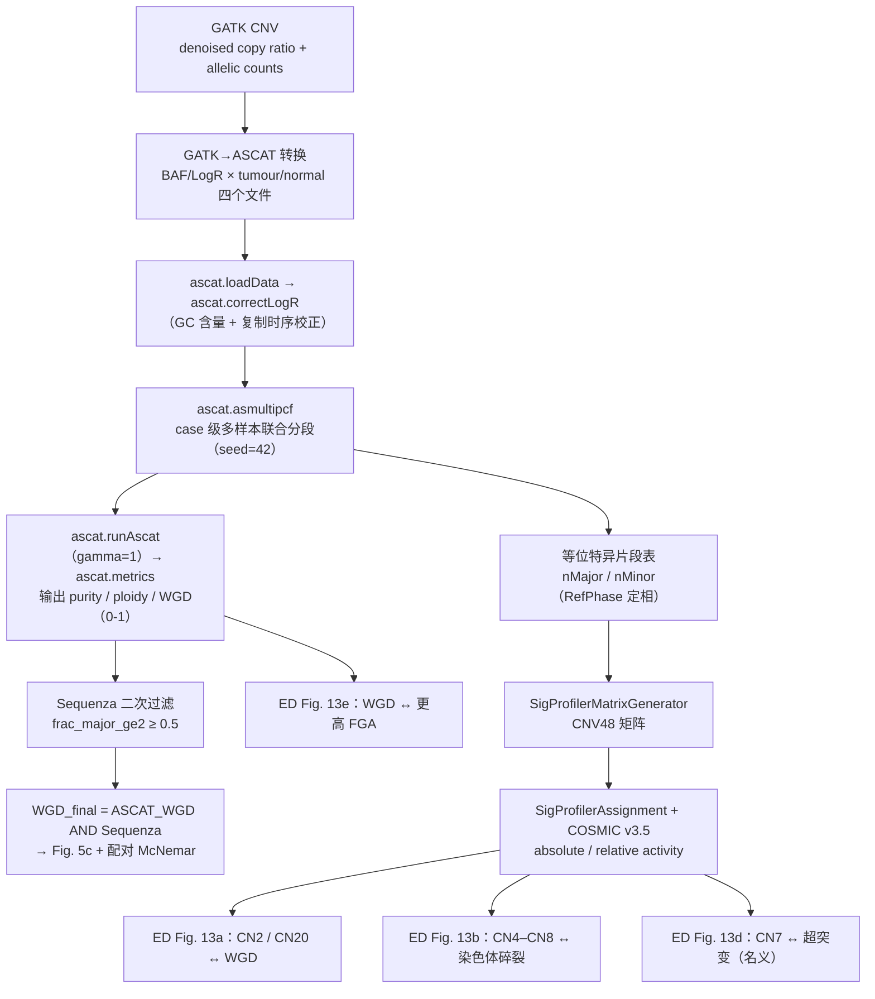

# 08 拷贝数签名与全基因组加倍（ASCAT 等位特异谱 → WGD 判定 → 48-feature CN 签名）

> **目标文献**：The GLASS Consortium. *Divergent genomic evolution in astrocytomas and oligodendrogliomas.*
> *Nature* (2026). PDF 标识 s41586-026-11150-x. 数据：Synapse syn17038081；代码：github.com/verhaaklab/glass-idh
>
> **模块对应原文**：**Fig. 5c**（WGD 患病率与配对 McNemar 检验，主结果）；**Fig. 5a**（非整倍体景观中的 `WGD` 行）；**Extended Data Fig. 13a**（WGD ↔ CN2/CN20 富集）、**Extended Data Fig. 13b**（染色体碎裂 ↔ CN4–CN8）、**Extended Data Fig. 13d**（超突变 ↔ CN7 名义关联）、**Extended Data Fig. 13e**（WGD ↔ 更高 FGA）；Methods 中「**WGD**」与「**Copy-number signatures**」两整段；Results 中「**Increasing chromosomal instability in astrocytoma**」节里 WGD 与 CN 签名的两个句子
> **复现层级**：**L1 派生层（主路径，推荐）** —— 从 Synapse 第 4 版发布的 ASCAT QC 指标表、等位特异片段表、CN 签名 activity 表出发，用 `figures/R/GLASS-I_CIN_Markers.R` 重算 WGD 状态、McNemar 检验与 CN2/CN20 富集；**L2 预处理层（可选但要诚实）** —— 用 `analysis/snakemake/ascat.smk` 从 `gatk2ascat` 的四文件重跑 `ascat.asmultipcf`（需 BAM 与 GC/RT 参考）；**L3 原始层** —— 不做（需受控访问）
> **前置依赖**：`01_数据与代码可得性、环境与仓库结构.md`（仓库 clone 与 conda 环境）、`02_队列构建、临床注释与样本QC.md`（配对口径、QC1–QC6、纯度/倍性字段）、`03_变异检出与拷贝数调用.md`（GATK `CallCopyRatioSegments` 的 denoised copy ratio 与 allelic count 两路输出——**这是本模块输入的源头**）、`06_突变负荷与超突变分类.md`（`HM_group` 字段，用于 ED Fig. 13d）。需要的中间产物：`raw/synapse/ascat_qc_metrics.tsv`、`raw/synapse/sequenza_segments.tsv`、`raw/synapse/cnsig_activities.tsv`、`processed/gold_set.csv`、`processed/pairs.csv`
> **下游依赖**：`09_非整倍体与FGA量化.md`（FGA 与 WGD 的关系、臂级/段级/全基因组三层非整倍体）、`10_染色体不稳定性_结构变异-染色体碎裂-骤变-ecDNA.md`（染色体碎裂与 ecDNA 的 CN 签名交叉验证）、`11_生存分析与预后模型.md`（`12_外部验证与批次效应检验.md` 也会用到 CN 签名的中心效应）、`13_复现质控清单、排错与批判性评述.md`（本模块的 ⚠️ 批注与 D 表项集中登记在那里）
> **复现难度**：★★★★☆（L1）/ ★★★★★（L2）　**预计工时**：L1 部分 3–5 人日；若要把 L2 的 ASCAT 跑通再加 5–8 人日（BAM 下载 + 集群排队的等待）　**计算资源**：L1 8 核 / 16 GB；L2 每样本 ASCAT `asmultipcf` 需 8 核 / 32 GB，按 case 并行

---

## 0. 执行摘要（先读这 12 行）

本模块有两个产物，**它们的证据强度完全不同**，不能混在一段里说：

| 产物 | 一句话结论 | 证据强度 |
|---|---|---|
| **WGD（全基因组加倍）** | 初诊时两型相同（各 **7%**）；复发时**星形细胞瘤显著升高到 20%（McNemar P = 0.006）**，少突胶质瘤不升高（10%，**P = 0.55**） | **中–强**：配对设计（同一患者两时间点）、有明确的双工具交叉过滤、且与 FGA 独立相关（ED Fig. 13e） |
| **CN 签名** | WGD 样本富集 **CN2 与 CN20**（与肿瘤类型无关）；染色体碎裂样本富集 **CN4–CN8**（CN7、CN8 贡献最大） | **中**：`Extended Data Fig. 13a,b` 是**描述性富集**，原文没有给这两个面板的 p 值，也没有做多因素校正 |

复现链路：



**QC 锚点（数值全部来自原文，见 §6.1）：**

| 锚点 | 原文值 |
|---|---|
| WGD 面板样本量（Fig. 5c） | **Oligodendroglioma n = 89；Astrocytoma n = 90** |
| WGD 患病率 | 初诊 astro **7%** / oligo **7%**；复发 astro **20%** / oligo **10%** |
| 配对检验 | **McNemar P = 0.006（astro）、P = 0.55（oligo）** |
| **⚠️ 注意** | 内部事实清单里写作 "WGD 初始 n = 56/38、复发 n = 56/39" 的**是 Fig. 5d（染色体碎裂）**，不是 WGD 面板——见 §3.2 的核对 |

> ⚠️ **导师批注（本模块的方法学要害）**：WGD 的判定**不是一个工具的一次输出，而是两次不同模型的一致意见**。ASCAT 的 `WGD` 只是一个"summary metric"，它在**低纯度、局灶高扩增、亚克隆**三种情形下会**系统性高估**；原文用 Sequenza 的 `major copy-number fraction ≥ 0.5` 做二次过滤，本质是要求"**基因组的多数（按长度加权）处在 major CN ≥ 2 的状态**"——这是 WGD 的**定义性特征**（四倍体化后每条染色体至少 4 个拷贝，2:2 或 3:1 分配）。复现时若只抄 ASCAT 的 `WGD` 字段，或只抄 Sequenza 的 `frac_major_ge2`，都会得到偏离原文的患病率。仓库里两种写法都出现过（`analysis/R/WGD_sequenza_script.R` 给三态输出，`figures/R/GLASS-I_CIN_Markers.R` 给"两者取与"的二态输出），**必须明说自己用的是哪一种**。

---

## 1. 科学问题与逻辑位置

### 1.1 为什么要在"驱动事件"与"非整倍体总量"之间插一层

前几个模块已经建立了三条线索：

- `04`：复发 astro 获得**局灶癌基因扩增**（38/94 vs 初诊 21/94）与 **CDKN2A/B 纯合缺失**；
- `05`：这些获得性事件在 astro 中**主要是 clonal**（CCF > 0.9）；
- `09`（FGA）：复发时两型的 FGA 都升高。

但"局灶扩增多了"与"全基因组都乱了"是两种量的现象。**WGD 是连接两者的机制节点**：一次错误的细胞分裂（有丝分裂失败 / 胞质分裂失败）让整个基因组翻倍，此后——

1. 多出的拷贝**缓冲有害缺失**（一个拷贝坏了还有备份），提高可演化性；
2. 染色体重排的"原料"翻倍，**CIN（染色体不稳定性）加速**；
3. 大量基因的剂量失衡，选择压力转向"能否容忍非整倍体"。

所以本模块的因果位置是：

$$
\underbrace{\text{局灶驱动事件}}_{04/05}
\;\longleftarrow\;
\underbrace{\text{WGD（一次全基因组事件）}}_{\textbf{08}}
\;\longleftarrow\;
\underbrace{\text{CIN 的分子表型：chromothripsis / ecDNA / 臂级获得}}_{10}
$$

而 **CN 签名**是给这一步"分型"的工具：WGD 不是唯一的一次性基因组事件，染色体碎裂也是。Steele 等（ref 38）的 48-feature CN 签名集恰好把"事件类型 + 片段长度分布"编码成了可分解的谱。

### 1.2 与相邻模块的分工（三张表，别写重了）

| 模块 | 输入 | 输出 | 与 `08` 的边界 |
|---|---|---|---|
| `03` 变异检出与拷贝数调用 | 原始 BAM | GATK 的 denoised copy ratio + allelic counts；分段表 | `08` **消费**它；反过来不产出 |
| `09` 非整倍体与 FGA | 分段表（Sequenza / GATK） | 臂级 −1/0/+1、段级 altered 数、**FGA** | FGA 是**连续量**；WGD 是**二态事件**。ED Fig. 13e 的"WGD → 更高 FGA"是把两者连起来的那张图 |
| `10` CIN（SV/染色体碎裂/骤变/ecDNA） | SvABA SV + ShatterSeek + AmpliconSuite | 染色体碎裂/ecDNA/BFB 的样本级标签 | `08` 的 CN 签名在 ED Fig. 13b 与 `10` 的染色体碎裂标签交叉验证 |

### 1.3 输入 / 输出契约

**输入（L1 主路径，全部来自 Synapse）：**

```
raw/synapse/
├── ascat_qc_metrics.tsv        # 由 ascat.metrics() 产出；至少含 pair_barcode/aliquot_barcode,
│                               #   AberrantCellFraction(纯度), Ploidy, WGD
├── sequenza_segments.tsv       # 片段级：pair_barcode, chrom, pos([start,end]), major_cn, minor_cn,
│                               #   cellularity, ploidy        ← WGD 二次过滤的输入
└── cnsig_activities.tsv        # SigProfilerAssignment 输出：
                                #   Samples + 每个 CN 签名一列（绝对值）
processed/
├── gold_set.csv               # tumor_barcode_a / tumor_barcode_b（initial / recurrence）
├── pairs.csv                  # pair_barcode ↔ tumor_barcode ↔ aliquot_barcode
└── cn_segments_allelespecific.rds   # 等位特异分段（nMajor/nMinor），CN 签名的直接输入
```

**输出（本模块是唯一生产者）：**

| 产物路径 | 生产者(唯一) | 格式/结构 | 消费方 | 生成脚本 |
|---|---|---|---|---|
| `results/08_wgd_sequenza.csv` | 08 | `pair_barcode, aliquot_barcode, frac_major_ge2, purity, ploidy, WGD_status_pre, confidence, WGD_status_final(WGD\|No_WGD\|WGD_uncertain)` | 08、09、10 | `code/08_01_wgd_sequenza_filter.R` |
| `results/08_wgd_final_by_timepoint.csv` | 08 | `case_barcode, idh_codel_subtype, timepoint(Initial\|Recurrence), ascat_wgd, seqz_frac_major_ge2, WGD_final(Absent\|Present)` | **09、10、11** | `code/08_02_wgd_final.R` |
| `results/08_wgd_mcnemar.csv` | 08 | `idh_codel_subtype, n, AA, AP, PA, PP, prop_initial, prop_recurrence, mcnemar_p` | 11、13 | `code/08_03_mcnemar_and_figure.R` |
| `results/08_cnsig_relative_activity.csv` | 08 | `aliquot_barcode, CN, abs_score, rel_score`（`rel_score` 在每个样本内求和为 1） | 08、10 | `code/08_04_cnsig_activity.R` |
| `results/08_cnsig_by_wgd.csv` | 08 | `WGD_final, CN, frac_with_CN, median_prop` | 10、13 | `code/08_05_cnsig_enrichment.R` |
| `figures/Fig5c_WGD_McNemar.{pdf,png}`、`figures/ED_Fig13a_cnsig_WGD.{pdf,png}` | 08 | 双份，dpi = 300 | 报告 | `code/08_03_mcnemar_and_figure.R`、`code/08_05_cnsig_enrichment.R` |

> ⚠️ **尺度契约**：`frac_major_ge2` ∈ [0,1] 是**长度加权比例**；`rel_score` ∈ [0,1] 是**样本内归一化的相对活性**；`abs_score` 是**绝对活性**（可与事件数近似挂钩）。三者不可混用（陷阱表第 13 行）。

---

## 2. 原理精讲

### 2.1 等位特异拷贝数谱：从 logR / BAF 到 (ρ, ψ, n_A, n_B)

普通拷贝数分析只给"总拷贝数"，但**同样的总拷贝数可以对应完全不同的等位配置**：`2:0`（拷贝数中性 LOH）、`1:1`（正常）、`0:2` 是**三种完全不同的生物学事件**。因此必须做**等位特异**分析，输入就是两路信号：

- **logR**（总深度比）：肿瘤/正常在某个位点的测序深度比取 log2；
- **BAF**（B 等位基因频率）：肿瘤中携带 B 等位基因的读段比例。

设肿瘤细胞比例为 **ρ（purity / aberrant cell fraction）**，肿瘤平均倍性为 **ψ（ploidy）**，某片段肿瘤细胞的**主要等位拷贝数 $n_A$（major）** 与**次要等位拷贝数 $n_B$（minor）**（$n_A \ge n_B$，总拷贝数 $n_{tot} = n_A + n_B$）。则（忽略 CN 亚克隆性）：

$$
\mathrm{BAF} \;\approx\; \frac{\rho\, n_B + (1-\rho)\cdot 1}{\rho\,(n_A+n_B) + (1-\rho)\cdot 2}
\;=\; \frac{\rho\, n_B + (1-\rho)}{\rho\, n_{tot} + 2(1-\rho)}
$$

$$
\log R \;\approx\; \log_2\!\left(\frac{\rho\, n_{tot} + 2(1-\rho)}{\rho\, \psi + 2(1-\rho)}\right)
$$

**三条必须记住的推论（它们解释了后面所有的失败模式）：**

1. **BAF 偏离 0.5 的"方向"只由 $n_B$ 是否为零决定，而"幅度"同时依赖 $n_B$ 与 $n_{tot}$。** 把上式对 $n_A\ge n_B$ 展开可以看到：$\mathrm{BAF}<0.5$ 恒成立（$n_A=n_B$ 时恰为 0.5），且 $n_B=0$ 时 $\mathrm{BAF}=\dfrac{1-\rho}{\rho\,n_{tot}+2(1-\rho)}$——**这个值随 $n_{tot}$ 变**：$\rho=0.5$ 时 `2:0` → 0.250、`4:0` → 0.167、`6:0` → 0.125。所以：
   - **"n_B = 0"这件事（即 LOH）只能从 BAF 的方向看出来**，不能从幅度反推 LOH 发生在几条拷贝上；
   - 但**幅度本身并非无用**——它随 $n_{tot}$ 单调下降，正是"BAF + logR 联合反解 $(n_A,n_B)$"的信息来源之一。
   - 因此正确的说法不是"2:0/4:0/6:0 的 BAF 都是 0 或 1"（只有在 $\rho=1$、没有正常细胞污染时才近似成立），而是"**它们都落在 0.5 的同一侧，且彼此可区分，必须结合 logR 才能定拷贝数**"。**把 BAF 当成"{0, 0.5, 1} 三值离散量"是低纯度样本上最常见的误判来源**（$\rho$ 越小，所有 BAF 越向 0.5 收缩，这个假设越错）。
2. **logR 在分母里含 ψ（全基因组平均倍性）**，于是"整条基因组翻倍"与"局部扩增"会以不同方式改变 logR。这正是为什么**倍性必须与等位配置联合估计**，而不是先估倍性再定拷贝数。
3. **ρ 越接近 1，区分度越好；ρ 越小（肿瘤含量越低），(BAF, logR) 的观测点越向中心收缩**，$n_A/n_B$ 的组合越难分辨——**这就是低纯度样本 WGD 高估/误判的物理根源**（§2.3）。

**ASCAT 的求解流程（与仓库 `analysis/R/ascat_analysis.R` 对应；脚本名见 `PROJECT_SPEC.md` §3.3，★ 下表函数名与顺序以现场阅读为准）：**

| 步骤 | 函数 | 做什么 |
|---|---|---|
| 1 | `ascat.loadData(Tumor_BAF_file, Tumor_LogR_file, Germline_BAF_file, Germline_LogR_file, genomeVersion="hg19", gender)` | 读入**四个**文件：肿瘤与正常的 BAF/LogR 各一份。**gender 必须正确**（决定 X 染色体的处理；仓库代码把 `female/f/xx` → `"XX"`，`male/m/xy` → `"XY"`，无法识别时**默认 XX 并 warning**——这是个静默风险，见陷阱表第 1 行） |
| 2 | `ascat.correctLogR(bc, GCcontentfile, replictimingfile)` | GC 含量与复制时序校正。**不同测序平台（WGS/WXS）必须用不同的参考文件**；仓库 `ascat.smk` 用 `config["ascat_wgs"]` / `config["ascat_wes"]` 区分 |
| 3 | **多样本模式**：`ascat.asmultipcf(gcrt, out.dir, seed=42)` | 把同一患者的多个时间点**联合分段**，共享断点。原文的关键一步：`ASCAT was used in **multi-sample mode** to derive **patient- and sample-level** WGD status`。多样本的收益是"更好的 shared vs private breakpoint 识别"（仓库 smk 文件头注释原话） |
| 4 | `ascat.runAscat(seg, gamma = 1, pdfPlot = TRUE)` | 在 (ρ, ψ) 网格上做**联合搜索**：对每个候选 (ρ, ψ)，把每个片段的 (logR, BAF) 与整数 $(n_A, n_B)$ 网格匹配，取拟合误差最小的组合。`gamma` 是**复杂度惩罚**（惩罚偏离"更少片段/更整齐的拷贝数状态"的解） |
| 5 | `ascat.metrics(seg, output)` | 汇总输出 QC 指标：`AberrantCellFraction`（即 ρ）、`Ploidy`（ψ）、**`WGD`**、片段统计等 |

**多样本模式与单样本模式的差别（复现时必须区分）**：

- `single_ascat`：每样本独立分段（`ascat.aspcf`），得到 `results/ascat/single/qc/{pair_barcode}.QC_metrics.txt`；
- `multi_ascat`：先 `multi_ascat_merge` 把同一 case 的两个时间点**按 (chromosome, position) 全连接合并**，再用 `ascat.asmultipcf` 联合分段，得到 `results/ascat/multi/qc/{case_barcode}.QC_metrics.txt`。

原文要求的是 **case-based multi-sample** 口径。**但仓库的 `figures/R/GLASS-I_CIN_Markers.R`（生成 Fig. 5c 的脚本）读的却是 `results/ascat/single/qc/*.QC_metrics.txt`（单样本）**——这是一处真实的不一致，见 §3.5。

**`analysis/R/ascat_merge.R` 的合并规则（脚本名见 `PROJECT_SPEC.md` §3.3；★ **函数体与 `max_missing` 默认值未逐条复核**，用现场 `sed -n '1,80p'` 读一遍确认）**：用 `(chromosome, position)` 全连接，然后**丢弃在超过 `max_missing = 1` 个样本中缺失的位点**，并打印 QC 行
`[QC] merged N loci; dropping D loci (>1 NAs); keeping K (xx.x%)`。
**复现时这一行必须留存**——如果 "keeping" 的比例低于 60%，说明两个时间点的位点交集太差（多半是 BAM 版本或 caller 参数不同），此时多样本分段的结果不可信。

### 2.2 ASCAT vs Sequenza：差异从哪来

原文用 **两个工具**做同一件事，这不是冗余，是**设计上的交叉验证**（§2.3）。两者的差异来源：

| 维度 | ASCAT | Sequenza |
|---|---|---|
| 输入 | BAF + logR 两路（未定相的等位频率） | 深度比 + BAF；另有自己的分段 |
| 分段 | ASPCF 双轨分段，惩罚项**同时**惩罚 BAF 与 logR 的断点（因此对 LOH 边界更敏感） | 基于 BAF/深度比的后向分割 + 似然 |
| 混合模型 | (ρ, ψ) 网格 + 整数拷贝数面板，带 `gamma` 复杂度惩罚 | (cellularity, ploidy) 网格 + **每个片段的 (n_A, n_B) 独立优化**，允许**片段级 subclonal 混合** |
| 多样本 | **有** `asmultipcf`（本文所用） | 无原生多样本模式（需自己对齐断点） |
| 对亚克隆的处理 | 主要给"平均"解 | 显式建模亚克隆片段 |
| 输出 WGD | `ascat.metrics()` 的 `WGD` 字段（summary metric） | 需要**自己算**（仓库就是这么做的：长度加权的 `frac_major_ge2`） |

**结论：两个工具对同一批肿瘤的 WGD 判定会不一致，尤其在极性和边界样本上。**这让"二次过滤"从一个"保守偏置"变成了一个**真实的信息来源**：只有两个模型都同意 WGD 的样本才被算作 WGD，剩下的被记为不确定/阴性（§2.3、§3.4）。

### 2.3 WGD 判定：为什么必须"倍性 > 2 且多数染色体获得"

**WGD 的定义性特征**不是"平均倍性 > 2"，而是**全基因组范围的拷贝数翻倍**：

- 一个真正的 WGD 肿瘤，其**大部分基因组**处在 $n_{tot} \ge 4$ 的状态（多为 `2:2`，也有 `3:1`）；
- 一个仅有一条染色体臂上有高拷贝扩增的肿瘤，其**平均**倍性可能被拉高到 2.2，但基因组的大部分仍是 `1:1`。

所以判定必须用"**多数（按长度加权）**"而不是"平均"。原文的二次过滤正是如此：

> "To avoid overestimating WGD, we applied a **second filter** and used a **cut-off of major copy-number fraction ≥ 0.5** assessed by **Sequenza** in samples that were predicted to have undergone WGD by ASCAT."

**仓库里 Sequenza 侧的实现在 `analysis/R/WGD_sequenza_script.R`（脚本名见 `PROJECT_SPEC.md` §3.3；★ **函数体与三个常量未逐条复核**）**：

```r
WGD_FRAC_CUTOFF <- 0.50     # 长度加权的"major_cn >= 2 的常染色体比例"阈值
PURITY_CUTOFF   <- 0.40     # 纯度下限
PLOIDY_CUTOFF   <- 3        # 倍性下限（严格大于）

# frac_major_ge2 = Σ(seg_len | major_cn >= 2) / Σ(seg_len)   ← 只在常染色体 1–22 上算
WGD_status_pre <- if_else(frac_major_ge2 >= WGD_FRAC_CUTOFF, "WGD", "No_WGD")
confidence     <- if_else(purity >= PURITY_CUTOFF & ploidy > PLOIDY_CUTOFF, "High", "Low")
WGD_status_final <- case_when(
  WGD_status_pre == "WGD"    & confidence == "High" ~ "WGD",
  WGD_status_pre == "No_WGD"                        ~ "No_WGD",
  TRUE                                              ~ "WGD_uncertain"
)
```

**三态输出（WGD / No_WGD / WGD_uncertain）是仓库脚本给出的，原文只报告了二分结果。** 复现时要落盘三态，才能做敏感性分析（把 uncertain 归到哪一边会改变患病率）。

**而 Fig. 5c 用的最终口径（`figures/R/GLASS-I_CIN_Markers.R`，脚本名见 `PROJECT_SPEC.md` §3.3；★ **代码块未逐条复核**）是更简单的二态"取与"：**

```r
ascat_seqz_joined <- ascat %>%
  left_join(seqz_wgd_query, by = "aliquot_barcode") %>%
  mutate(WGD      = ifelse(WGD == "0", "Absent", "Present"),   # ASCAT 侧：0/1 → Absent/Present
         WGD_final = ifelse(frac_major_ge2 < 0.5, "Absent", WGD))
```

即

$$
\text{WGD}_{\text{final}} = \text{WGD}_{\text{ASCAT}} \;\wedge\; \left[\texttt{frac\_major\_ge2} \ge 0.5\right]
$$

> ⚠️ **两种写法必须二选一并在报告中写明**：
> - **口径 A（仓库 Fig. 5c 实际所用）**：ASCAT 判 WGD **且** Sequenza `frac_major_ge2 ≥ 0.5`；
> - **口径 B（`analysis/R/WGD_sequenza_script.R` 的三态）**：pre-WGD 且 (purity ≥ 0.4 **且** ploidy > 3) 才叫 WGD，否则 `WGD_uncertain`。
>
> 两者的差别在于：口径 B 会**额外剔掉纯度 < 0.4 或倍性 ≤ 3 的样本**（把它们标成 uncertain），因此患病率**只会更低**。**主路径用口径 A**（它才是产出 Fig. 5c 的那段代码）；口径 B 作为敏感性分析，并统计"口径 B 下有多少样本从 WGD 变成 WGD_uncertain"。

**ASCAT 高估 WGD 的三种机制（这是原理部分必须讲透的地方）：**

| 机制 | 物理图像 | 后果 | 缓解 |
|---|---|---|---|
| **低纯度（ρ 小）** | 观测 (logR, BAF) 向中心收缩；一个 `2:2` 的真实状态与 `1:1` 在噪声内难以区分，而网格搜索倾向于用**更大的 ψ** 解释"整体抬高"的 logR | 伪 WGD | Sequenza 的 `frac_major_ge2` 过滤 **+** `PURITY_CUTOFF = 0.4`。原文另有一句：FGA 的复发升高"persisted after adjusting for Sequenza-estimated purity and ploidy and after excluding low-purity samples (purity < 0.4)" |
| **局灶高扩增** | 一条染色体上一段 20 拷贝的 ecDNA/扩增把全基因组平均倍性 ψ 拉高 | ψ > 2 但**基因组多数仍是 1:1** → 不是 WGD | 用"多数（长度加权）"而不是"平均"→ 正是 `frac_major_ge2` 的设计目的 |
| **亚克隆** | 一部分克隆已加倍、另一部分未加倍，混合信号让 BAF 变得"半高" | 判 WGD 还是非 WGD 都说得通 | 双工具一致 + 明确输出 uncertain 类 |

**四倍体肿瘤的"伪 WGD"与相反的错误**：

- 一个**真的四倍体**肿瘤，在**低纯度**下可能被算成 `2:2` 的"二倍体"（因为 `(1-ρ)·2` 的正常污染把信号压回 1:1 附近），于是**漏判 WGD**；
- 反过来，一个**高纯度的二倍体 + 大量 LOH** 肿瘤，可能因为 `2:0` LOH 的 BAF 极端值被误判为 `2:2` 甚至 `3:1`。

**这两种错误方向相反，正是必须双工具交叉的原因**。复现时的保守做法：**在 `|ψ − 2| < 0.15` 的样本上打 uncertain 标签**并单独报告（见 §4.4 的敏感性分析）。

### 2.4 拷贝数签名：48-feature 矩阵与它的解读方式

**特征定义（Steele 等 2022，ref 38）**：每个拷贝数**片段**被分到一个三元组里

$$
48 = \underbrace{6}_{\text{总拷贝数状态}} \times \underbrace{2}_{\text{杂合状态}} \times \underbrace{4}_{\text{片段长度箱}}
$$

| 维度 | 取值（以 SigProfilerMatrixGenerator 的 CNV 模块文档为准） |
|---|---|
| 总拷贝数状态 | 0、1、2、3–4、5–8、9+ |
| 杂合状态 | **LOH**（minor = 0）/ **保留杂合**（minor ≥ 1） |
| 片段长度 | 0.01–0.1 Mb、0.1–1 Mb、1–10 Mb、>10 Mb |

于是矩阵 $M_{ij}$ = 样本 $j$ 中第 $i$ 个"CN 状态 × 长度箱"的**片段数**（不是碱基数）。**这一点与 SBS 矩阵完全不同**：SBS 矩阵的计数单位是突变，CN 矩阵的计数单位是**片段**。所以 CN 签名反映的是**事件数与长度分布的联合**，而不是"发生了多少次碱基替换"。

**构造与赋值的完整链路（仓库当前快照，逐行核实）**：

```mermaid
flowchart LR
    A["RefPhase 定相片段<br/>results/refphase/{case}/{case}-phased-segments.tsv<br/>含 cn_a / cn_b"] --> B["analysis/R/sigp_matgen_cnv_prepare.R<br/>nMajor = pmax(cn_a,cn_b)<br/>nMinor = pmin(cn_a,cn_b)"]
    B --> C["ASCAT 风格 TSV<br/>sample, chromosome, startpos, endpos, nMajor, nMinor"]
    C --> D["SigProfilerToolkit matrix_generator<br/>cnv_matrix_generator ASCAT ..."]
    D --> E["GLASS.CNV48.matrix.tsv<br/>（每样本一个 48 维向量）"]
    E --> F["SigProfilerAssignment cosmic_fit<br/>--cosmic_version 3.5"]
    F --> G["Assignment_Solution/Activities/<br/>Assignment_Solution_Activities.txt<br/>按样本的绝对活性"]
    G --> H["rel = abs / rowSums(abs)<br/>（仓库 analysis/R/cnsig_expl.R + figures/R/GLASS-I_CIN_Markers.R 的归一化）"]
```



**CN 签名与 SBS 签名的解读差异（必须写进报告的一段）：**

| 维度 | SBS 签名 | CN 签名 |
|---|---|---|
| 计数单位 | 突变（碱基替换） | 片段 |
| 谱的语义 | 三核苷酸上下文（分子机制的直接痕迹） | CN 状态 × 长度箱（**事件类型与长度分布**，不是机制） |
| 能否说成"某致癌物暴露" | 通常可以（SBS4 ↔ 烟草、SBS11 ↔ TMZ） | **不能**。CN2 只能说"大片段、2 拷贝、LOH 状态为主"——对应"WGD 后的 2:2 状态"，而不是某个外源物 |
| 与突变量级的关系 | 计数直接可比 | **片段数受分段算法影响极大**（分段越细，片段计数越多）→ **CN 签名对分段参数敏感** |

> ⚠️ 最后一行是本模块的**头号方法学风险**：CN 矩阵的输入是"分段"，而分段的分辨率/最小片段长度由 ASCAT/Sequenza 的参数决定。**换一个分段参数，48 维向量的形状就会变，CN 签名的相对活性也随之变。**原文没有报告分段参数，也没有做敏感性分析——这是我们必须自己补的一项（§4.6、§5 第 6 行）。

**原文报告的 CN 签名结果（只有描述性富集）：**

| 面板 | 关联 | 具体签名 |
|---|---|---|
| ED Fig. 13a | WGD | **CN2、CN20** 在 WGD 样本中富集，"independent of glioma type" |
| ED Fig. 13b | 染色体碎裂 | **CN4–CN8** 富集，其中**CN7 与 CN8（amplification 类）贡献最大** |
| ED Fig. 13d | 超突变（复发） | **CN7** 名义关联（unadjusted P < 0.05） |
| ED Fig. 13e–g | FGA | WGD / 染色体碎裂 / 超突变**各自**与更高 FGA 显著相关 |

> ⚠️ **原文未报告**：ED Fig. 13a/13b 的**任何 p 值**；ED Fig. 13d 只有"名义关联"。因此这两张图在本项目中的定位是**描述性支持证据**，不能当成"WGD 导致 CN2"的因果证据。

### 2.5 WGD 的演化含义

| 命题 | 原文依据 | 证据等级 |
|---|---|---|
| WGD 与更高的 FGA 相关 | ED Fig. 13e，"WGD, chromothripsis and hypermutation were each associated with a significantly higher FGA" | 中（有检验、有 n，但为横断面关联） |
| WGD 与染色体碎裂、ecDNA 构成 CIN 的组合表型 | ED Fig. 13a/13b + Fig. 5d/e/f | 中（同图内的相互印证，非因果） |
| WGD 是"演化加速器"（缓冲有害缺失、提高可塑性） | **原文未直接验证**（Discussion 层面的机制解释） | 弱（属推论，报告须标注为"我们采纳的解释框架"） |
| WGD 率在复发 astro 升高 | Fig. 5c，配对 McNemar P = 0.006 | **中–强**（配对设计，是本文少见的"时间序列内变化"证据） |
| 两型初诊的 WGD 率相同（各 7%） | Fig. 5c + Results 原句 | 中（描述性，n=89/90） |

> ⚠️ **导师批注（解读红线）**：**WGD 升高 ≠ WGD 导致预后差**。原文的生存分析里 WGD 并未进入 PRS 的多因素模型（进模型的是 **CDKN2A/B 纯合缺失**与**局灶癌基因扩增**，见 `11_生存分析与预后模型.md`）。因此本模块的结论句只能是"复发星形细胞瘤中 WGD 频率显著升高，且 WGD 与更高的 FGA 相关"，**不能**写成"WGD 驱动了不良预后"。REPRO_SPEC §12 第 4 条（相关性 ≠ 因果）在这里要特别当心。

---

## 3. 原文逐句拆解

> 引文来自 `/tmp/nat_paper_clean.txt`；引号内为原文英文，随后为中文转述与对应操作。

### 3.1 Methods「WGD」整段

> "**ASCAT was used in multi-sample mode to derive patient- and sample-level WGD status**⁵⁶. **Denoised copy ratio and tumour and normal allelic count files from the GATK CNV caller were transformed into tumour and normal B-allele frequency as well as tumour and normal logR files** as input for ASCAT. ASCAT was run in **case-based multi-sample mode**. WGD was called from the ASCAT solution as part of the **reported summary metrics**. To avoid overestimating WGD, we applied a **second filter** and used a cut-off of **major copy-number fraction ≥ 0.5** assessed by **Sequenza** in samples that were predicted to have undergone WGD by ASCAT."

**逐项映射到操作：**

| 原文句 | 我的操作 | 原文给了参数吗 | 缺失项的复现决策 |
|---|---|---|---|
| "multi-sample mode … patient- and sample-level" | 用 `ascat.asmultipcf`（case 级）；输出同时落 patient 级与 sample 级 | ✅ 给了模式 | — |
| "Denoised copy ratio and tumour and normal allelic count files from the GATK CNV caller were transformed into tumour and normal B-allele frequency as well as tumour and normal logR" | 这是 **GATK→ASCAT 的转换步骤**，产出四个文件 `*.BAF.tumor.txt` / `*.LogR.tumor.txt` / `*.BAF.normal.txt` / `*.LogR.normal.txt` | ✅ 说了输入来源 | ⚠️ **转换脚本在 `analysis/snakemake/ascat.smk` 之外的路径**（smk 直接读取 `results/gatk2ascat/{pair_barcode}/...`，**生成该目录的脚本不在 `analysis/` 的三个 smk 中**）→ L2 复现的一处空白，登记为 D 表项 |
| "WGD was called from the ASCAT solution as part of the reported summary metrics" | 即 `ascat.metrics()` 输出里的 `WGD` 列 | ❌ **未给 ASCAT 内部的 WGD 阈值** | 以 ASCAT 当前版本的 `ascat.metrics` 实现为准；**必须打印 `table(WGD)` 核对取值域**（陷阱表第 1 行） |
| "major copy-number fraction ≥ 0.5 assessed by Sequenza" | 仓库实现为**长度加权的 `frac_major_ge2`**（常染色体）≥ 0.50 | ⚠️ 原文只写"major copy-number fraction"，**没说"长度加权"也没说"仅常染色体"** | **跟仓库实现**（长度加权 + 常染色体）：这是仓库当前快照里唯一可执行的写法，且与"多数基因组"的语义一致。落盘未加权的版本做敏感性 |

> ⚠️ **导师批注（一）："二次过滤"到底剔掉了多少样本，原文完全没报告。** 原文只写"To avoid **overestimating** WGD, we applied a **second filter**"，随后给出患病率（初诊 7%/7%，复发 20%/10%）。**缺失的关键量有四个，一个都没给**：① ASCAT 判 WGD 但 Sequenza `frac_major_ge2 < 0.5` 而被剔掉的**样本数**；② 这些样本在两型、两时间点之间是否**分布不均**（若集中在复发 astro，则"astro 复发 WGD 升高"这个**核心结论**就可能部分来自过滤步骤而非真实生物学）；③ Sequenza `frac_major_ge2` 恰好落在 0.5 附近的**边界样本数**；④ 被 ASCAT 判为 WGD 却没做 Sequenza 过滤的样本（例如 Sequenza 片段表缺失）如何处置。**复现时这四项必须全部落盘**（建议产出 `results/08_wgd_filter_attrition.csv`：`case_barcode, timepoint, ascat_wgd, frac_major_ge2, WGD_final, drop_reason`），并给出"**只过滤前**"和"**过滤后**"两套患病率与两套 McNemar P——**这是本模块对原文最有价值的补白**。注意 L0 §12.1：如果过滤前的 astro 复发率远高于 20%，**不要**去调 `frac_major_ge2` 阈值把它压到 20%（那就是"改参数直到跑出文献的数"）；如实报告两套数并解释差异。

> ⚠️ **导师批注（二）：ASCAT 与 Sequenza 在**同一批样本**上的口径可能不一致，而原文没有报告任何一致率。** 这两条路是**两个独立的混合模型**（§2.2）：ASCAT 在 (ρ, ψ) 网格上做联合搜索并带 `gamma` 复杂度惩罚；Sequenza 允许**片段级亚克隆混合**、对 `major_cn` 的取整规则也与 ASCAT 不同。因此对同一份肿瘤，**两者对"这是不是 WGD"、"这条染色体是 2:2 还是 3:1"完全可能给出不同答案**——尤其在**低纯度、局灶高扩增、亚克隆片段**三类样本上（正是 §2.3 列出的三种高估机制）。而原文的处置是"**取交集**"（先 ASCAT 判 WGD，再用 Sequenza 过滤），这**在逻辑上会把两模型的分歧全部推给"阴性"一侧**（不一致 → 不算 WGD），于是：① 患病率**只会被压低，不会抬高**（对 astro 复发的 20% 而言这是保守的、可接受的方向）；② 但**"两工具一致率"这个最关键的 QC 指标原文从未给出**，因此我们无法判断那 20% 是"两模型都同意"还是"两模型在阈值边缘恰好都过了"。
>
> **复现要求**：产出 `results/08_wgd_tool_concordance.csv`，报告 ASCAT 侧与 Sequenza 侧各自的 WGD 判定、**Cohen's κ**、**分歧样本清单**、以及分歧样本的**纯度/倍性分布**。判据见 §4.4 的读表规则（κ > 0.6 才认为"两模型可互相替代"）；**κ 低时必须把"WGD 计数依赖工具选择"写进方法学**，而不是隐去。此外，**ASCAT 的 `WGD` 字段本身的阈值原文也未报告**（§3.1 表第 3 行），这使"ASCAT 侧判定"实际上是一个**不可追溯的黑箱常量**——复现时请直接打印 `unique(ascat$WGD)` 与 ASCAT 源码里该字段的生成位置，把阈值文档化。

### 3.2 ⚠️ 数值核对：`n = 56/38` 属于染色体碎裂面板，不属于 WGD 面板

内部事实清单里有一行写的是"**WGD 初始 n = 56/38、复发 n = 56/39（oligo/astro）**"。**这处归属需要纠正。** 我直接从 PDF 第 9 页取出 Fig. 5 每个词的页面坐标后重建了两个面板：

| 面板 | 图上原样打印的样本量标签 | 结论 |
|---|---|---|
| **Fig. 5c（WGD）** | `Oligodendroglioma (n = 89)`、`Astrocytoma (n = 90)`；x 轴为 `Initial` / `Recurrent` | WGD 面板的 n 是 **89 / 90** |
| **Fig. 5d（染色体碎裂）** | `Initial (n = 56/38)`、`Recurrence (n = 56/39)`；四个堆叠柱的标签为 `53 (95%)` / `3 (5%)`（oligo 初诊）、`20 (53%)` / `18 (47%)`（astro 初诊）、`48 (86%)` / `8 (14%)`（oligo 复发）、`16 (41%)` / `23 (59%)`（astro 复发） | **56/38、56/39 属于 Fig. 5d**，且与 WGS 的 56 oligo / 39 astro 一致 |

另外，`Fisher P = 2.1 × 10⁻⁶` 与 `6.6 × 10⁻⁶` 也都是 **Fig. 5d（染色体碎裂）**的初诊/复发比较，**不是**"WGD 的 Fisher"、更不是"CDKN2A/B HD 的 Fisher"。

**由堆叠柱标签可直接推出的染色体碎裂患病率（Present 段）：**

| 时点 | oligo | astro |
|---|---|---|
| 初诊 | **5%**（3/56） | **47%**（18/38） |
| 复发 | **14%**（8/56） | **59%**（23/39） |

**这与正文"increased in both tumour types, and continued to be significantly more frequent in astrocytomas"完全自洽**；而 56/38、56/39 是 **WGS 样本数**（56 oligo WGS、39 astro WGS，其中初诊 astro 有 1 例缺注释 → 38），与 WGD 面板的 89/90（全部样本，含 WXS）明显不同。

> ⚠️ **导师批注（必须登记到 `13` 号文档）**：本模块的 WGD 数字一律**以 `Fig. 5c` 的 `n = 89 / 90` 与 `7% / 7% / 20% / 10%` 为准**；`56/38`、`56/39`、`2.1×10⁻⁶`、`6.6×10⁻⁶` 属于 Fig. 5d（染色体碎裂），应移入 `10_染色体不稳定性_结构变异-染色体碎裂-骤变-ecDNA.md` 的数值表。这类"面板归属错位"是复现项目里最隐蔽也最常见的错误来源（图注是散装文本，PDF 抽取后顺序会乱）。**每一次引用 n 与 p 值，都要回到图上去数一遍。**

### 3.3 Methods「Copy-number signatures」整段

> "**Allele-specific copy-number profiles from ASCAT** were used as input for copy-number signature calling using the **SigProfilerToolkit**⁵⁵. Sample-level **48-feature copy-number matrices** were generated using **SigProfilerMatrixGenerator**. Assignment of copy-number signatures was performed using **SigProfilerAssignment**⁵⁵ with the **COSMIC v.3.5** reference copy-number signature set³⁸. **Per-sample absolute and relative signature activities were exported** for downstream analyses."

**逐项映射：**

| 原文句 | 我的操作 | 缺失项与决策 |
|---|---|---|
| "Alele-specific copy-number profiles from ASCAT" | 取等位特异片段表（含 major/minor） | ⚠️ 仓库 `sigprofilertoolkit.smk` 的 `analysis/R/sigp_matgen_cnv_prepare.R` 实际读的是 **`results/refphase/{case_barcode}/{case_barcode}-phased-segments.tsv`**（RefPhase 定相输出，含 `cn_a` / `cn_b`），而非 ASCAT 的 segments 文件。RefPhase 属 ASCAT 多样本流程的定相步骤，两者语义相容，但**多了一层，且 RefPhase 的运行参数在仓库中未见** → D 表项 |
| "48-feature copy-number matrices" | `SigProfilerToolkit matrix_generator cnv_matrix_generator ASCAT <in> <project> <out>`，产出 `GLASS.CNV48.matrix.tsv` | ✅ 特征数明确（48）；**特征顺序由工具决定，不得手工重排** |
| "SigProfilerAssignment with the COSMIC v.3.5 reference copy-number signature set" | `SigProfilerAssignment cosmic_fit <matrix> <out> --input_type matrix --genome_build GRCh37 --cosmic_version 3.5 --export_probabilities_per_mutation True --exome False --collapse_to_SBS96 False` | ⚠️ **`cosmic_version` 来自 `config["sigprofiler"]["cosmic_version"]`，而该 config 文件不在仓库内**（集群配置）→ 必须自建并写死 3.5（与 `07` 号文档 §3.9 的版本陷阱同源） |
| "Per-sample absolute and relative signature activities were exported" | 读 `Assignment_Solution/Activities/Assignment_Solution_Activities.txt`；**绝对活性 = 文件里的原始值，相对活性 = 行内归一化**（仓库 `analysis/R/cnsig_expl.R` glob 的正是这个文件路径） | ✅ 两套都落盘（`abs_score` / `rel_score`） |

### 3.4 Results 中与 WGD / CN 签名相关的句子

> "Whereas **whole-genome doubling (WGD) rates were comparable between initial astrocytomas and oligodendrogliomas**, WGD frequency **increased significantly in recurrent astrocytomas (20% versus 7%; McNemar's test: P = 0.006)** but **not in recurrent oligodendrogliomas (10% versus 7%; McNemar's test: P = 0.55; Fig. 5c)**. Samples that had undergone WGD showed **enrichment for the WGD-associated signatures CN2 and CN20** (Extended Data Fig. 13a), **independent of glioma type**."

> "Finally, **treatment-associated hypermutation showed a nominal association with the chromothripsis signature CN7**, potentially linked to the longitudinal increase in FGA in hypermutators (Extended Data Fig. 13d). **WGD, chromothripsis and hypermutation were each associated with a significantly higher FGA** (Extended Data Fig. 13e–g)."

**注意三处措辞的精度差异（复现报告必须保留）：**

1. `20% versus 7%` —— **前一个是复发、后一个是初诊**（不是"初诊 vs 复发"）。oligo 的 `10% versus 7%` 同理。这一顺序与 `Fig. 5c` 的 x 轴（`Initial` 在左、`Recurrent` 在右）**相反**，抄写时极易颠倒，但**颠倒不影响 P 值的方向性**（McNemar 是配对对称检验）；
2. `independent of glioma type` —— 指的是 ED Fig. 13a 的 WGD-CN2/CN20 富集**在两型中都能看到**，不是"做了多因素校正"；
3. `nominal association` —— **未校正**（unadjusted P < 0.05）。ED Fig. 13d 的图注写得更明确："Orange colour indicates **nominal** copy-number signature association (**unadjusted P < 0.05**) determined using two-sided unpaired Wilcoxon rank-sum tests"。**报告里不能把 nominal 写成显著。**

### 3.5 ⚠️ 仓库侧的三处口径不一致（复现前必读）

| # | 位置 | 实际情况 | 与原文/彼此的差异 | 复现处置 |
|---|---|---|---|---|
| 1 | `analysis/snakemake/ascat.smk` 提供 `single_ascat` 与 `multi_ascat` 两条路；`multi_ascat_merge` 也只服务多样化 | 原文要求 **multi-sample** | — | 主路径用 `multi_ascat`；但见第 2 项 |
| 2 | `figures/R/GLASS-I_CIN_Markers.R`（**产出 Fig. 5c 的脚本**）读的是 `results/ascat/single/qc/*.QC_metrics.txt`（**单样本**），注释写 "created with cnsig_expl.R + ascat.smk + ascat_merge.R + ascat_analysis.R" | 与原文"multi-sample mode"不一致 | 两种可能：(a) 图脚本沿用了早期单样本产物；(b) multi 产物只是没被这张图消费。**无法从仓库断定** | ⚠️ **登记为 D 表 ★ 项**：主线用哪一套？建议**两套都算**，报告两者的 WGD 患病率差；若差异 <3 个百分点，说明结论对模式不敏感 |
| 3 | `analysis/R/WGD_sequenza_script.R` 输出**三态**（含 `WGD_uncertain`）；`figures/R/GLASS-I_CIN_Markers.R` 输出**二态取与** | 原文只报二分 | 两者对同一批样本的 WGD 计数**必然不同** | 主路径用二态取与（才是 Fig. 5c）；三态做敏感性，统计 uncertain 的数量 |

---

## 4. 逐步可运行代码

### 4.0 环境准备

```bash
# L1 主路径只需要 R + tidyverse + 生存/绘图包
R -e 'install.packages(c("tidyverse","data.table","vroom","fs","survival","rstatix","ggpubr","ggalluvial","ggh4x"))'

# L2 需要 ASCAT（从 GitHub 装，仓库 SETUP.md §2.3 明确指定来源）
R -e 'install.packages("remotes"); remotes::install_github("VanLoo-lab/ascat", subdir = "ASCAT")'

# CN 签名需要 SigProfiler 工具链（与 07 号文档共用环境）
conda create -n sigprofilertoolkit -c conda-forge python=3.10 -y
conda activate sigprofilertoolkit
pip install SigProfilerMatrixGenerator SigProfilerAssignment
python -c "from SigProfilerMatrixGenerator import install as g; g.install('GRCh37')"
```

**版本钉死表：**

| 组件 | 原文报告版本 | 复现钉死版本 | 备注 |
|---|---|---|---|
| ASCAT | 未报告（引 ref 56 = Ross et al. 2021 的多样本扩展） | `VanLoo-lab/ascat` 当前 master；记录 commit hash | 多样本 API（`asmultipcf`）由 ref 56 引入，**旧版没有这个函数** |
| Sequenza | **未报告** | 以 `analysis/R/WGD_sequenza_script.R` 消费的列（`cellularity`/`ploidy`/`major_cn`/`minor_cn`）为准 | ⚠️ 原文与仓库都未给 Sequenza 版本与参数 → D 表项；L1 复现**不需要**重跑 Sequenza（直接用 Synapse 的片段表） |
| SigProfilerMatrixGenerator | 未报告具体版本 | 与 `SigProfilerAssignment` 同大版本 | CNV48 模块的可用性在 1.2.x 之后 |
| SigProfilerAssignment | 未报告 | `>= 0.1.0` | 需支持 `--cosmic_version` |
| COSMIC CN 参考集 | **v3.5** | **3.5** | ⚠️ `sigprofilertoolkit.smk` 文件头注释说内嵌的是 **v3.4**（与 `07` 号文档同源陷阱） |
| 参考基因组 | b37/hg19 | `GRCh37`（SigProfiler）/ `hg19`（ASCAT `genomeVersion="hg19"`） | 染色体命名一致性见陷阱表第 6 行 |

### 4.1 L1：从 Synapse 数据重算 WGD 的二次过滤

```r
# code/08_01_wgd_sequenza_filter.R
# 对应仓库 analysis/R/WGD_sequenza_script.R（脚本名见 PROJECT_SPEC.md §3.3）（把数据库查询换成 Synapse 表读取）
suppressPackageStartupMessages({ library(tidyverse) })
set.seed(20260101)

WGD_FRAC_CUTOFF <- 0.50     # 原文：major copy-number fraction >= 0.5
PURITY_CUTOFF   <- 0.40     # 仓库脚本值
PLOIDY_CUTOFF   <- 3        # 仓库脚本值（严格大于）

is_autosome <- function(chr) {
  x <- suppressWarnings(as.integer(str_remove(as.character(chr), regex("^chr", ignore_case = TRUE))))
  !is.na(x) & x >= 1 & x <= 22
}

seqz <- read_tsv("raw/synapse/sequenza_segments.tsv")   # pair_barcode, chrom, pos, major_cn, minor_cn,
                                                        # cellularity, ploidy
# pos 形如 "[start,end]"（仓库脚本的 parse_pos 逻辑）
parse_pos <- function(pos) {
  p <- str_split_fixed(str_remove_all(as.character(pos), "[\\[\\]\\(\\)\\s]"), ",", 2)
  tibble(start = as.numeric(p[, 1]), end = as.numeric(p[, 2]))
}

wgd_sequenza <- seqz %>%
  transmute(pair_barcode = as.character(pair_barcode),
            chrom  = str_remove(as.character(chrom), regex("^chr", ignore_case = TRUE)),
            major_cn = as.numeric(major_cn), minor_cn = as.numeric(minor_cn),
            purity = as.numeric(cellularity), ploidy = as.numeric(ploidy),
            start = parse_pos(pos)$start, end = parse_pos(pos)$end) %>%
  mutate(seg_len = end - start) %>%
  filter(is_autosome(chrom), is.finite(seg_len), seg_len > 0,
         is.finite(major_cn), is.finite(minor_cn))
stopifnot(nrow(wgd_sequenza) > 0)

summ <- wgd_sequenza %>%
  group_by(pair_barcode) %>%
  summarise(total_len        = sum(seg_len),
            # ★ 长度加权的 frac_major_ge2（不是片段计数比例！）
            frac_major_ge2   = sum(if_else(major_cn >= 2, seg_len, 0)) / total_len,
            purity = median(purity), ploidy = median(ploidy),
            .groups = "drop") %>%
  mutate(WGD_status_pre = if_else(frac_major_ge2 >= WGD_FRAC_CUTOFF, "WGD", "No_WGD"),
         confidence     = if_else(purity >= PURITY_CUTOFF & ploidy > PLOIDY_CUTOFF, "High", "Low"),
         WGD_status_final = case_when(
           WGD_status_pre == "WGD" & confidence == "High" ~ "WGD",
           WGD_status_pre == "No_WGD"                      ~ "No_WGD",
           TRUE                                            ~ "WGD_uncertain"))

write_csv(summ, "results/08_wgd_sequenza.csv")
print(table(summ$WGD_status_final, useNA = "ifany"))     # 必须留痕：三态各多少

# ⚠️ frac_major_ge2 的分布必须画出来看：双峰说明阈值 0.5 落在谷底（好），
#    单峰驼背说明阈值切在斜坡上（此时 WGD 计数对阈值极敏感，须做敏感性分析）
p_hist <- ggplot(summ, aes(frac_major_ge2)) +
  geom_histogram(bins = 50, fill = "grey70", colour = "black") +
  geom_vline(xintercept = WGD_FRAC_CUTOFF, linetype = 2, colour = "red") +
  labs(x = "Sequenza major-CN fraction (frac_major_ge2)", y = "Patients") + theme_bw()
ggsave("figures/08_frac_major_ge2_hist.pdf", p_hist, width = 5, height = 4)
ggsave("figures/08_frac_major_ge2_hist.png", p_hist, dpi = 300, width = 5, height = 4)
```

### 4.2 L1：WGD 最终口径（ASCAT ∧ Sequenza）与时间点对齐

```r
# code/08_02_wgd_final.R  —— 复刻 figures/R/GLASS-I_CIN_Markers.R 的 Fig. 5c 口径（脚本名见 PROJECT_SPEC.md §3.3）
suppressPackageStartupMessages({ library(tidyverse) })

ascat <- read_tsv("raw/synapse/ascat_qc_metrics.tsv") %>%
  rename(pair_barcode = aliquot_barcode)            # 注意：QC 文件的首列名随版本变化
pairs <- read_csv("processed/pairs.csv")            # pair_barcode, tumor_barcode, case_barcode
gold  <- read_csv("processed/gold_set.csv")         # case_barcode, tumor_barcode_a, tumor_barcode_b

# ★ 取值域断言：ASCAT 的 WGD 可能是 0/1（数值）也可能是 "0"/"1"（字符）
print(unique(ascat$WGD))
stopifnot(all(unique(ascat$WGD) %in% c(0, 1, "0", "1", "TRUE", "FALSE")))
stopifnot(all(c("AberrantCellFraction", "Ploidy") %in% names(ascat)))   # 纯度/倍性字段必须在

seqz <- read_csv("results/08_wgd_sequenza.csv")

joined <- ascat %>%
  left_join(seqz, by = "pair_barcode") %>%
  left_join(pairs %>% select(pair_barcode, tumor_barcode, case_barcode), by = "pair_barcode") %>%
  filter(!is.na(WGD)) %>%
  mutate(timepoint = case_when(tumor_barcode %in% gold$tumor_barcode_a ~ "Initial",
                               tumor_barcode %in% gold$tumor_barcode_b ~ "Recurrence",
                               TRUE ~ "Other"),
         # 复刻图脚本：ASCAT 的 0/1 → Absent/Present，再与 Sequenza 的 frac_major_ge2 取与
         ascat_wgd   = if_else(as.character(WGD) == "0", "Absent", "Present"),
         WGD_final   = if_else(frac_major_ge2 < 0.5, "Absent", ascat_wgd)) %>%
  filter(timepoint != "Other", idh_codel_subtype != "IDHwt")

write_csv(joined %>% select(case_barcode, idh_codel_subtype, timepoint, pair_barcode,
                            ascat_wgd, seqz_frac_major_ge2 = frac_major_ge2, WGD_final),
          "results/08_wgd_final_by_timepoint.csv")

# ── QC：初诊两型患病率都应约为 7%（原文），复发 astro 约 20%、oligo 约 10% ──
joined %>%
  group_by(idh_codel_subtype, timepoint) %>%
  summarise(n = n(), n_wgd = sum(WGD_final == "Present"),
            prop = n_wgd / n, .groups = "drop") %>%
  print()
```

### 4.3 L1：配对 McNemar 检验与 Fig. 5c 出图

```r
# code/08_03_mcnemar_and_figure.R
suppressPackageStartupMessages({
  library(tidyverse); library(ggalluvial); library(ggh4x); library(ggpubr)
})

d <- read_csv("results/08_wgd_final_by_timepoint.csv")

wide <- d %>%
  select(case_barcode, idh_codel_subtype, timepoint, WGD_final) %>%
  pivot_wider(names_from = timepoint, values_from = WGD_final,
              id_cols = c(case_barcode, idh_codel_subtype)) %>%
  filter(!is.na(Initial), !is.na(Recurrence))       # ★ 只保留两时间点都有 WGD 判定的患者

counts <- wide %>%
  count(idh_codel_subtype, Initial, Recurrence, name = "Freq") %>%
  group_by(idh_codel_subtype) %>% mutate(n = sum(Freq), prop = Freq / n) %>% ungroup()

# 2x2 列联表（按 byrow = TRUE 的行优先顺序：AA, AP, PA, PP）
mcnemar_tbl <- counts %>%
  group_by(idh_codel_subtype) %>%
  summarise(
    AA = coalesce(first(Freq[Initial == "Absent"  & Recurrence == "Absent"]),  0L),
    AP = coalesce(first(Freq[Initial == "Absent"  & Recurrence == "Present"]), 0L),
    PA = coalesce(first(Freq[Initial == "Present" & Recurrence == "Absent"]),  0L),
    PP = coalesce(first(Freq[Initial == "Present" & Recurrence == "Present"]), 0L),
    n  = sum(Freq),
    prop_initial    = (PA + PP) / n,
    prop_recurrence = (AP + PP) / n,
    .groups = "drop") %>%
  rowwise() %>%
  mutate(mcnemar_p = mcnemar.test(matrix(c(AA, AP, PA, PP), nrow = 2, byrow = TRUE))$p.value) %>%
  ungroup() %>%
  mutate(label = case_when(idh_codel_subtype == "IDHmut-codel" ~ sprintf("Oligodendroglioma (n = %d)", n),
                           idh_codel_subtype == "IDHmut-noncodel" ~ sprintf("Astrocytoma (n = %d)", n),
                           TRUE ~ idh_codel_subtype),
         p_label = paste0("McNemar, p = ", signif(mcnemar_p, 2)))
write_csv(mcnemar_tbl, "results/08_wgd_mcnemar.csv")
print(mcnemar_tbl)
# ★ QC 锚点：astro prop_initial ~0.07 → prop_recurrence ~0.20，p ~0.006
#            oligo prop_initial ~0.07 → prop_recurrence ~0.10，p ~0.55

# ── Fig. 5c：alluvial + McNemar 标注（与仓库 panel_a 同构）──
plot_df <- counts %>%
  left_join(mcnemar_tbl %>% select(idh_codel_subtype, label), by = "idh_codel_subtype") %>%
  mutate(flow = paste(Initial, Recurrence, sep = "_"))

panel_c <- ggplot(plot_df, aes(axis1 = Initial, axis2 = Recurrence, y = prop, fill = flow)) +
  geom_alluvium(width = 0.25, knot.pos = 0.3, alpha = 0.8) +
  geom_stratum(width = 0.25, fill = "grey90", colour = "black") +
  geom_text(stat = "stratum", aes(label = after_stat(stratum)), size = 3) +
  geom_text(data = mcnemar_tbl, aes(x = 1.5, y = 1.02, label = p_label),
            inherit.aes = FALSE, size = 4) +
  ggh4x::facet_grid2(~ label) +
  scale_x_discrete(limits = c("Initial", "Recurrence"), expand = c(0.15, 0.05)) +
  scale_fill_manual(values = c("Absent_Absent" = "#999999", "Absent_Present" = "#800074",
                               "Present_Absent" = "#cccccc", "Present_Present" = "#298C8C"),
                    breaks = c("Absent_Absent", "Absent_Present", "Present_Present"),
                    labels = c("Absent→Absent", "Absent→Present", "Present→Present"),
                    name = "WGD") +
  labs(x = "WGD", y = "Proportion") + theme_bw() + theme(panel.grid = element_blank())
ggsave("figures/Fig5c_WGD_McNemar.pdf", panel_c, width = 7, height = 4)
ggsave("figures/Fig5c_WGD_McNemar.png", panel_c, dpi = 300, width = 7, height = 4)
```

### 4.4 独立重实现：自算"WGD-like"指征并与 ASCAT 对照

**这是 REPRO_SPEC §12 第 2 条要求的"第二条独立路径"**：完全不用 ASCAT 的 `WGD` 字段，只用 Sequenza 的片段表推一个 WGD 指征，然后与 ASCAT 的判定做一致性分析。

```r
# code/08_06_wgd_independent_reimplementation.R
suppressPackageStartupMessages({ library(tidyverse) })
set.seed(20260101)

d <- read_csv("results/08_wgd_final_by_timepoint.csv") %>%
  left_join(read_csv("results/08_wgd_sequenza.csv") %>% select(pair_barcode, purity, ploidy),
            by = "pair_barcode")

indep <- d %>%
  mutate(
    # 指征 1：Sequenza 倍性（最朴素）
    wgd_by_ploidy   = ploidy > 2.5,
    # 指征 2：长度加权 major-CN fraction（= 原文的二次过滤本身）
    wgd_by_frac     = seqz_frac_major_ge2 >= 0.5,
    # 指征 3：更严的口径 —— 要求倍性 > 2.5 且 frac >= 0.5（"多数染色体获得"）
    wgd_by_both     = ploidy > 2.5 & seqz_frac_major_ge2 >= 0.5,
    # 边界样本标记：倍性贴近 2 时判定不稳健
    borderline      = abs(ploidy - 2) < 0.15,
    ascat_present   = ascat_wgd == "Present"
  )

# ── 一致性：与 ASCAT 判定的 Cohen's kappa（目标 kappa > 0.6 才算"可互相替代"）──
kappa_agree <- function(a, b) {
  tb <- table(a, b); n <- sum(tb)
  po <- sum(diag(tb)) / n
  pe <- sum(rowSums(tb) * colSums(tb)) / n^2
  (po - pe) / (1 - pe)                      # Cohen's kappa
}
walk(c("wgd_by_ploidy", "wgd_by_frac", "wgd_by_both"), function(v)
  cat(sprintf("%-16s kappa = %.3f  (n = %d)\n",
              v, kappa_agree(indep$ascat_present, indep[[v]]), nrow(indep))))

# ── 敏感性：把 borderline 样本剔除后的患病率（报告必须同时给这两行）────
indep %>%
  group_by(idh_codel_subtype, timepoint) %>%
  summarise(n_all = n(),
            prop_frac_all      = mean(wgd_by_frac),
            n_no_borderline    = sum(!borderline),
            prop_frac_no_border= mean(wgd_by_frac[!borderline]), .groups = "drop") %>%
  write_csv("results/08_wgd_sensitivity.csv")
```

**判读规则（写进复现报告的执行摘要）：**

| 一致性结果 | 结论 |
|---|---|
| `wgd_by_frac` 与 ASCAT 的 kappa > 0.7 | 两种模型高度一致 → 原文的 WGD 结论稳健，可放心引用 |
| 0.4 < kappa ≤ 0.7 | 中等一致 → 必须报告"WGD 计数依赖工具选择"，并在 §6 的两套患病率都写出来 |
| kappa ≤ 0.4 | 低一致 → **原文的 WGD 数字不可在我们的数据上重现**，登记 gap 表（但**不得**反向调阈值去凑 20%/7%） |

### 4.5 L2：用 `analysis/snakemake/ascat.smk` 重跑 ASCAT（可选）

```bash
# 三条 rule 的输入输出与调用形态（已从 smk 文件逐行核实）
# (1) 单样本
Rscript scripts/R/snakemake/ascat_analysis.R single \
    results/gatk2ascat/{pair}/{pair}.BAF.tumor.txt \
    results/gatk2ascat/{pair}/{pair}.LogR.tumor.txt \
    results/gatk2ascat/{pair}/{pair}.BAF.normal.txt \
    results/gatk2ascat/{pair}/{pair}.LogR.normal.txt \
    XY_or_XX  <GCfile>  <RTfile>  results/ascat/single/pdf \
    results/ascat/single/qc/{pair}.QC_metrics.txt \
    results/ascat/single/seg/{pair}.segments.txt

# (2) 同一 case 的多个时间点合并（保留位点至少出现在 2/3 的样本中）
Rscript scripts/R/snakemake/ascat_merge.R \
    "t1.BAF.tumor.txt,t2.BAF.tumor.txt" "t1.LogR.tumor.txt,t2.LogR.tumor.txt" \
    normal.BAF.normal.txt normal.LogR.normal.txt \
    out.merged.BAF.tumor.txt out.merged.LogR.tumor.txt \
    out.merged.BAF.normal.txt out.merged.LogR.normal.txt

# (3) 多样本联合分段 + WGD 汇总
Rscript scripts/R/snakemake/ascat_analysis.R multi \
    <merged.BAF.tumor> <merged.LogR.tumor> <merged.BAF.normal> <merged.LogR.normal> \
    "XY,XY" <GCfile> <RTfile> results/ascat/multi/pdf \
    results/ascat/multi/qc/{case}.QC_metrics.txt \
    results/ascat/multi/seg/{case}.segments.txt
```

**ASCAT 驱动脚本的关键实参（撰写时快照为 11 个位置参数，顺序不能错；★ 参数个数与顺序必须用现场 `sed -n '1,60p' <脚本>` 确认，不要照抄本段）**：
`mode, tumor_baf, tumor_logr, normal_baf, normal_logr, gender, gcfile, rtfile, pdfdir, output_qc, output_seg`。

**内部调用（★ 参数名与调用形态**未逐条复核**，以现场阅读为准）**：

```r
ascat.bc   <- ascat.loadData(Tumor_BAF_file = tumor_baf, Tumor_LogR_file = tumor_logr,
                             Germline_BAF_file = normal_baf, Germline_LogR_file = normal_logr,
                             genomeVersion = "hg19", gender = genders)
ascat.gcrt <- ascat.correctLogR(ascat.bc, GCcontentfile = gcfile, replictimingfile = rtfile)
ascat.seg  <- if (mode == "multi") ascat.asmultipcf(ascat.gcrt, out.dir = pdfdir, seed = 42)
              else                  ascat.aspcf(ascat.gcrt, out.dir = pdfdir, seed = 42)
ascat.out  <- ascat.runAscat(ascat.seg, gamma = 1, pdfPlot = TRUE, img.dir = pdfdir)
QC       <- ascat.metrics(ascat.seg, ascat.out) %>% tibble::rownames_to_column("aliquot_barcode")
segments <- ascat.out[["segments"]]
```

> ⚠️ **前移到陷阱表的两个点**：（a）`gender` 解析失败时**默认 "XX" 并只给 warning**（`map_gender()`），错误不会中止流程；（b）`seed = 42` 是**仓库写的**，原文未报告 → 需在报告中声明（NMF/分段的随机性属 REPRO_SPEC §6 要求固定的环节）。

**运行 smk 前必须做的三件事：**

```yaml
# code/config.yaml（自建；仓库未提供 config 文件）
sigprofiler:
  genome_build: GRCh37
  project: GLASS
  cosmic_version: 3.5          # ★ 不要依赖工具内嵌默认（可能是 3.4）
ascat_wgs:
  GCfile: raw/reference/GRCh37.wgs.gc5.windowsize1000000.bpmap.tsv
  RTfile: raw/reference/GRCh37.wgs.rt.windowsize1000000.bpmap.tsv
ascat_wes:
  GCfile: raw/reference/GRCh37.wes.gc5.windowsize1000000.bpmap.tsv
  RTfile: raw/reference/GRCh37.wes.rt.windowsize1000000.bpmap.tsv
```

1. 按 `SETUP.md` §4.3 **改掉三个 `.smk` 的 helper-script 路径**；
2. 把每个 rule 里的 `source ~/bin/myconda.sh && conda activate <env>` 换成 `conda run -n <env>`；
3. 准备好 GC / RT 参考文件（**WGS 与 WXS 必须用各自的**，混用会让 logR 的分段整段偏移）。

### 4.6 L1/L2：CN 签名的 48-feature 矩阵与 Assignment

```bash
# (1) 从等位特异片段生成 CNV48 矩阵（★ 两条 rule 名以现场 `cat analysis/snakemake/sigprofilertoolkit.smk` 为准）
Rscript scripts/R/snakemake/sigp_matgen_cnv_prepare.R \
    --seg_file  results/refphase/{case}/{case}-phased-segments.tsv \
    --pair      {pair_barcode} --aliquot {aliquot_barcode} \
    --out_txt   results/sigprofiler/matrixgenerator/cnv/input/{case}/{aliquot}/{aliquot}.CNV.txt
# 该脚本产出 ASCAT 风格表：sample, chromosome, startpos, endpos, nMajor, nMinor
# 其中 nMajor = pmax(cn_a, cn_b)、nMinor = pmin(cn_a, cn_b)（已从脚本逐行核实）

SigProfilerToolkit matrix_generator cnv_matrix_generator \
    ASCAT <in_dir> GLASS <out_dir>
# → <out_dir>/GLASS.CNV48.matrix.tsv     ★ 48 行（feature）× 样本列

# (2) 与 COSMIC v3.5 的 CN 参考集比对，导出绝对与相对活性
SigProfilerAssignment cosmic_fit \
    <out_dir>/GLASS.CNV48.matrix.tsv <assign_out> \
    --input_type matrix --genome_build GRCh37 --cosmic_version 3.5 \
    --export_probabilities_per_mutation True --exome False --collapse_to_SBS96 False
# → <assign_out>/Assignment_Solution/Activities/Assignment_Solution_Activities.txt
```

**Python API 等价写法**（若 Toolkit CLI 不可用；⚠️ 关键字名以当前版本为准）：

```python
# code/08_10_cnsig_assignment.py
from SigProfilerAssignment import Analyzer as Analyze   # ⚠️ 需按当前版本核对 import 名
Analyze.cosmic_fit(
    samples      = "processed/cnv_input",     # 含 *.CNV.txt 的目录，或 GLASS.CNV48.matrix.tsv
    output       = "processed/cnsig_assignment",
    input_type   = "matrix",
    context_type = "CNV48",                   # 若版本使用 "CN" / "DINUC"，以文档为准
    cosmic_version = 3.5,                     # ★ 不能省
    genome_build = "GRCh37",
    exome        = False,
    collapse_to_SBS96 = False,
    export_probabilities = True,
    sample_reconstruction_plots = False,
)
```

```r
# code/08_04_cnsig_activity.R  —— 读 Assignment 输出并做行内归一化
suppressPackageStartupMessages({ library(tidyverse); library(fs); library(vroom) })
set.seed(20260101)

# 与仓库 analysis/R/cnsig_expl.R 相同的 glob 模式
files <- dir_ls("processed/cnsig_assignment", recurse = TRUE,
                glob = "*/*/Assignment_Solution/Activities/Assignment_Solution_Activities.txt")
stopifnot(length(files) > 0)
act <- vroom(files, delim = "\t", .name_repair = "minimal") %>%
  rename(aliquot_barcode = Samples)

cnsig <- act %>%
  pivot_longer(-aliquot_barcode, names_to = "CN", values_to = "abs_score") %>%
  group_by(aliquot_barcode) %>%
  mutate(rel_score = abs_score / sum(abs_score, na.rm = TRUE)) %>%   # ★ 尺度契约
  ungroup()

# 断言：每个样本的 CN 数 = 参考集签名数；rel_score 和为 1
stopifnot(all(abs(cnsig %>% group_by(aliquot_barcode) %>%
                    summarise(s = sum(rel_score)) %>% pull(s) - 1) < 1e-6))
write_csv(cnsig, "results/08_cnsig_relative_activity.csv")
```

### 4.7 ED Fig. 13a：CN2 / CN20 与 WGD 的富集（含原文未给 p 值的补齐）

```r
# code/08_05_cnsig_enrichment.R
suppressPackageStartupMessages({ library(tidyverse); library(ggpubr) })

cnsig <- read_csv("results/08_cnsig_relative_activity.csv")
wgd   <- read_csv("results/08_wgd_final_by_timepoint.csv") %>%
  rename(aliquot_barcode = pair_barcode)      # 视 Synapse 表的键而定，必须断言 join 命中率

joined <- cnsig %>% inner_join(wgd, by = "aliquot_barcode") %>%
  filter(!is.na(WGD_final))
stopifnot(nrow(joined) > 0)                   # ★ 断言：join 全空是最常见的静默失败

# 原文口径：frac_with_CN = 该组中 rel_score > 0 的样本比例；median_prop = rel_score>0 的中位数
by_wgd <- joined %>%
  group_by(WGD_final, CN) %>%
  summarise(frac_with_CN = mean(rel_score > 0, na.rm = TRUE),
            median_prop  = median(rel_score[rel_score > 0], na.rm = TRUE),
            .groups = "drop")

# ★ 原文未报告这两个面板的 p 值 —— 我们补齐并明确标注"我方补充，原文未报告"
pvals <- joined %>%
  filter(CN %in% c("CN2", "CN20", "CN4", "CN5", "CN6", "CN7", "CN8")) %>%
  group_by(CN) %>%
  summarise(p_wilcox = wilcox.test(rel_score ~ WGD_final)$p.value,
            p_adj_BH = NA_real_, .groups = "drop") %>%
  mutate(p_adj_BH = p.adjust(p_wilcox, method = "BH"))   # ★ 多重校正（REPRO_SPEC §7）
write_csv(by_wgd, "results/08_cnsig_by_wgd.csv")
write_csv(pvals, "results/08_cnsig_by_wgd_pvalues_supplementary.csv")

# 气泡图（与仓库 edf_panel_a 同构）
panel_a <- by_wgd %>% filter(CN %in% c("CN2", "CN20")) %>%
  ggplot(aes(x = WGD_final, y = CN)) +
  geom_point(aes(size = frac_with_CN, fill = median_prop), shape = 21, colour = "black") +
  geom_text(data = pvals %>% filter(CN %in% c("CN2", "CN20")),
            aes(x = 1.5, y = CN, label = sprintf("BH q = %.2g", p_adj_BH)),
            inherit.aes = FALSE, vjust = -2.2, size = 3) +
  scale_size(range = c(0, 20), labels = scales::percent) +
  scale_fill_viridis_c(na.value = "grey90") +
  labs(x = "WGD", y = NULL, size = "Fraction with any contribution",
       fill = "Median contribution") +
  theme_bw()
ggsave("figures/ED_Fig13a_cnsig_WGD.pdf", panel_a, width = 5, height = 3.4)
ggsave("figures/ED_Fig13a_cnsig_WGD.png", panel_a, dpi = 300, width = 5, height = 3.4)
```

> ⚠️ **与原文的差异必须显式声明**：原图的 `pval_cn_df` 那行是**被注释掉的**（仓库脚本里 `#geom_text(data = pval_cn_df, ...)`），也就是说 **ED Fig. 13a 在原图上确实没有 p 值**。我们补上 BH 校正后的 q 值属于**增量贡献**，图注要写清"我方补充"。

---

## 5. 参数解释与调参空间

| # | 参数 | 原文取值 | 可选范围 | 改变后的后果 | 我方决策 |
|---|---|---|---|---|---|
| 1 | ASCAT 模式 | **case-based multi-sample** | single / multi | multi 共享断点 → 更准的 shared/private 划分；single 快但断点不一致 | 主路径与原文一致用 multi，**同时**跑 single 做敏感性（因仓库 Fig. 5c 脚本用的是 single，§3.5） |
| 2 | `gamma`（ASCAT 复杂度惩罚） | **1** | 0.5–2 | 越小越倾向"更多、更复杂的拷贝数状态"（易过拟合），越大越保守（可能把真实异质性抹平） | **1**（跟仓库/原文） |
| 3 | `seed`（分段） | 原文未报告；仓库写 **42** | 任意 | ASPCF/asmultipcf 的分段含随机成分 | **42**（仓库值）；若分段结果在 seed 间不稳，说明信号弱，须在报告中说明 |
| 4 | `max_missing`（多样本合并时允许的缺失位点数） | 原文未报告；仓库 **1** | 0–2 | 越大保留位点越多但噪声越大 | **1**（仓库值）；打印 `[QC] keeping xx.x%` 并断言 > 60% |
| 5 | `frac_major_ge2` 阈值 | **0.50** | 0.4–0.6 | 阈值越小 WGD 越多 | **0.5** + 敏感性曲线（0.4/0.45/0.5/0.55/0.6） |
| 6 | 是否长度加权 | 原文只说 "major copy-number fraction" | 加权 / 不加权（片段计数比例） | 不加权会让**短片段主导**（短片段数量多），远离"多数基因组"的语义 | **长度加权**（跟仓库实现），不加权版本作敏感性 |
| 7 | 染色体的纳入范围 | 原文未说；仓库 `is_autosome()` **仅 1–22** | 含 X / 含性染色体 | 含 X 会因男女差异引入偏倚 | **仅常染色体**（跟仓库） |
| 8 | Sequenza 纯度下限 | 原文未报告；仓库 **0.40** | 0.3–0.5 | 越高越保守，但样本损失大 | 0.40 作三态口径的边界；二态主口径不设此限（但单独报告 `<0.4` 样本的 WGD 比例） |
| 9 | Sequenza 倍性下限 | 原文未报告；仓库 **3**（严格大于） | 2–3.5 | 越高越保守 | 3（仓库值），仅用于三态口径 |
| 10 | CN 签名的 feature 定义 | **48 = 6 × 2 × 4** | 固定 | 换 feature 方案（如 32/64）会改变所有活性值 | **跟 SigProfilerMatrixGenerator 的 CNV48**，不手工重排 |
| 11 | CN 参考集 | **COSMIC v3.5** | 3.4 / 3.5 | 版本漂移 → 同编号含义可能不同 | **3.5**，写进 `config.yaml`（⚠️ `sigprofilertoolkit.smk` 头注释写的是内嵌 v3.4） |
| 12 | 绝对 vs 相对活性 | 原文"导出绝对与相对活性" | — | 相对活性丢失"事件总量"信息；绝对活性受分段分辨率影响 | **两者都落盘**；所有富集分析用相对活性（与原文图一致），事件数分析用绝对活性 |
| 13 | 生存/结局中是否用 WGD | **原文**：WGD 未进入 PRS 多因素模型 | — | 强行加进模型会因共线性（WGD ↔ FGA ↔ CDKN2A/B HD）产生不稳定系数 | **不把 WGD 作为独立预后因子**（见 §2.5 批注） |

**原文未报告、需要我方拍板的项（登记到 `13` 号文档 D 表）：**

- **D★**：WGD 主口径用"单样本 ASCAT"还是"多样本 ASCAT"（§3.5 第 2 项，仓库图脚本用 single 而 Methods 写 multi）；
- **D★**：`frac_major_ge2` 是否长度加权、是否仅常染色体（原文只写 "major copy-number fraction"）；
- **D★**：WGD 三态中的 `WGD_uncertain` 在最终计数里归哪一边；
- **D**：Sequenza 的版本与运行参数（原文与仓库均未给，L1 复现直接消费其输出）；
- **D**：CN 签名的分段分辨率为默认值，未做敏感性（原文未报告）。

---

## 6. 预期结果与 QC 检查点

### 6.1 数值层：原文报告值 vs 复现判据

| # | 检查点 | 原文数值 | 允许波动 | GO 判据 | 不达标怎么办 |
|---|---|---|---|---|---|
| 1 | WGD 面板样本量（oligo） | **89** | — | 精确等于 89 | 差得多 → `pair_barcode`/`aliquot_barcode` 的主键口径错（Junior 陷阱第 1 行） |
| 2 | WGD 面板样本量（astro） | **90** | — | 精确等于 90 | 同上（注意 astro 队列是 94 例，Fig. 5c 只有 90） |
| 3 | WGD 患病率（初诊 oligo） | **7%** | ±3 个百分点 | 4%–10% | 见陷阱表第 3–5 行（纯度/局灶扩增/阈值） |
| 4 | WGD 患病率（初诊 astro） | **7%** | ±3 个百分点 | 4%–10% | 同上 |
| 5 | WGD 患病率（复发 oligo） | **10%** | ±3 个百分点 | 7%–13% | 同上 |
| 6 | **WGD 患病率（复发 astro）** | **20%** | ±4 个百分点 | 16%–24% | ⚠️ **这是本模块的核心结论**。若远低（如 10%）→ 检查是否漏了"复发获得"的样本；若远高（如 30%）→ 多半没做 Sequenza 二次过滤 |
| 7 | **McNemar P（astro）** | **0.006** | 同量级 | p < 0.05 | 若 > 0.05 → 复发/初诊的方向或配对键错了 |
| 8 | **McNemar P（oligo）** | **0.55** | — | **必须 > 0.05（不显著）** | ⚠️ 若变显著 → 亚型特异性结论被推翻，必须排查而非"调参" |
| 9 | `frac_major_ge2` 分布 | 原文未报告 | — | 呈**双峰**且 0.5 落在谷底 | 单峰驼背 → 阈值切在斜坡上，WGD 计数对阈值极敏感，须在报告中警示 |
| 10 | 多样本合并保留率 | 原文未报告 | — | `[QC] keeping > 60%` | < 60% → 位点交集太差，多样本分段结果不可信，退回单样本 |
| 11 | CN2 / CN20 富集方向 | WGD 组**更高** | — | 方向一致（ED Fig. 13a） | 方向相反 → join 键或归一化尺度错（陷阱表第 13 行） |
| 12 | CN4–CN8 与染色体碎裂 | 碎裂组**更高**，CN7/CN8 贡献最大 | — | 方向一致（ED Fig. 13b） | 需与 `10` 号文档的 ShatterSeek 标签对齐后再判 |
| 13 | ED Fig. 13d 的 CN7 | **名义关联（未校正 P < 0.05）** | — | p < 0.05（unadjusted） | 若 BH 校正后不显著，**如实报告"校正后不显著"**（原文本来就只说 nominal） |
| 14 | 平均 CN 签名数（每样本非零活性） | 原文未报告 | — | 记录分布 | 作为"矩阵是否合理"的自检：若每样本只有 1–2 个非零签名，说明矩阵构造有误 |
| 15 | 低纯度样本占比（`AberrantCellFraction < 0.4`） | 原文未报告 | — | 报告占比 + 分层结果 | 若 > 30%，WGD 结论必须加纯度敏感性分析 |

### 6.2 判据层：三条 Go / No-Go

| 判据 | 通过条件 | 不通过的处置 |
|---|---|---|
| **G1 键对齐** | `raw/synapse` 的三张表（ASCAT QC / Sequenza 片段 / CN 签名活性）都能通过 `pair_barcode` 或 `aliquot_barcode` **落到同一批样本**，且 join 命中率 > 95% | join 全空或命中率低 → **立刻停下**。这是本模块最可能的静默失败（陷阱表第 1、6 行） |
| **G2 双工具一致** | 口径 A 与口径 B 的 WGD 计数差异 < 5%，**且**自算的 `frac_major_ge2` 与 ASCAT 判定的 Cohen's kappa > 0.6 | 不达标 → 报告"WGD 计数依赖工具"，把两套患病率都写出来，**不调阈值凑数** |
| **G3 方向性自洽** | oligo 的 McNemar **不显著** 且 astro 的 McNemar **显著** 且 astro 复发患病率 > oligo 复发患病率 | 若方向反了 → 检查 §3.2 的 `versus` 顺序是否被颠倒、或 `WGD_final` 的 Present/Absent 是否判反 |

### 6.3 结题层：必须出现在报告里的"阴性/不一致"清单

1. `Fig. 5c` 的 `n = 89 / 90`，以及它**不等于**队列的 89 / 94 的原因（部分患者缺 WGD 判定）；
2. 口径 A（二态取与）与口径 B（三态含 uncertain）的 WGD 计数差；
3. 单样本 ASCAT 与多样本 ASCAT 的 WGD 患病率差（§3.5 第 2 项）；
4. `frac_major_ge2` 阈值敏感性曲线（0.4–0.6）；
5. 低纯度样本（纯度 < 0.4）与 `|ψ − 2| < 0.15` 的边界样本的 WGD 比例；
6. **ED Fig. 13a/13b 的 p 值原文未报告**——我们补的 BH q 值属于增量，图注必须写明；
7. ED Fig. 13d 的 CN7 关联**未校正**；
8. 我们的 48-feature 矩阵里每个样本的非零签名数分布（作为矩阵合理性的自检）；
9. **WGD 未进入原文的 PRS 多因素模型**（§2.5 批注），因此本文档不把 WGD 当作独立预后因子；
10. **★ Sequenza 二次过滤的淘汰量（原文未报告）**：过滤前/后两套患病率与两套 McNemar P、被剔样本在两型×两时间点的分布、`frac_major_ge2 ∈ [0.45, 0.55]` 的边界样本数（§3.1 批注一）；
11. **★ ASCAT 与 Sequenza 的同批样本一致率（原文未报告）**：Cohen's κ、分歧样本清单与其纯度/倍性分布；**ASCAT `WGD` 字段自身的阈值（原文亦未报告）**（§3.1 批注二）。

---

## 7. 常见陷阱与排错表

| # | 现象 | 根因 | 解决 |
|---|---|---|---|
| 1 | `ascat.loadData()` 跑完没报错，但纯度/倍性完全不合理（如 purity = 1.00、ploidy = 1.9） | **四个输入文件的顺序错了**。`analysis/R/ascat_analysis.R` 的 11 个位置参数按 `mode, tumor_baf, tumor_logr, normal_baf, normal_logr, gender, gcfile, rtfile, pdfdir, output_qc, output_seg` 排，**tumour 与 normal 颠倒、BAF 与 LogR 颠倒都不会报错**，只会静默产出垃圾 | 断言：`BAF ∈ [0,1]`、`logR` 中位数 ≈ 0、normal 与 tumour 的位点交集 > 95%；并检查 `ascat.metrics` 的纯度量级（IDH 突变胶质瘤通常在 0.3–0.9） |
| 2 | 分段碎得离谱（几千个片段），或整条染色体被分成两块 | **GC / 复制时序校正文件与测序平台不匹配**（WGS 用了 WXS 的 bpmap，或根本没跑 `ascat.correctLogR`） | 用 `ascat.smk` 的 `config["ascat_wgs"]` / `config["ascat_wes"]` 区分；断言片段数落在合理区间（WGS 通常数百到数千） |
| 3 | WGD 患病率显著高于原文（如复发 astro 30%） | **未做 Sequenza 二次过滤**，直接用了 ASCAT 的 `WGD` 字段。ASCAT 在低纯度/局灶高扩增/亚克隆下会高估 | 用口径 A（取与）或口径 B（三态）；把 `WGD_uncertain` 的数量单独报告 |
| 4 | 有一条染色体上有 20+ 拷贝的扩增，样本被判成 WGD | **把局灶高扩增当 WGD**——平均倍性被拉高但基因组多数仍是 `1:1` | 判定必须用**长度加权的"多数"**（`frac_major_ge2`），不能用平均倍性。ESCAT 的 `Ploidy` 字段单独看是不够的 |
| 5 | `frac_major_ge2` 在 0.5 附近聚集，改一点阈值结果就大变 | 阈值正好切在斜坡上（分布单峰驼背），判定不稳健 | 输出阈值敏感性；对 `0.45–0.55` 的样本标 uncertain 并分层报告 |
| 6 | `left_join` 之后行数为 0，或大量 `NA` | **染色体命名不一致**：ASCAT/Sequenza 用 `"1"`、SigProfiler/GRCh37 用 `"1"`、某些表用 `"chr1"`；性染色体有 `"23"/"X"`、`"24"/"Y"` 两套写法 | 统一 `str_remove(chrom, "^chr")` 并把 `23→X`、`24→Y`；`is_autosome()` 只留 1–22；**每次 join 都断言命中率** |
| 7 | `frac_major_ge2` 与原文的 WGD 数对不上 | 用了**片段计数比例**而不是**长度加权比例**（短片段数量多，会把结果往 0 拉或往 1 推） | 分母必须是 `sum(seg_len)`；写进契约表 |
| 8 | McNemar 的 n 明显大于 89/90 | 用了**全部样本**而不是"两时间点都有 WGD 判定"的**配对**子集 | 先 `pivot_wider` 再 `filter(!is.na(Initial), !is.na(Recurrence))`；断言 n 落在 85–95 |
| 9 | `WGD_final` 的 Present/Absent 判反，导致"复发反而降低" | ASCAT 的 `WGD` 字段是 **0/1 或 "0"/"1"**，仓库图脚本用 `ifelse(WGD == "0", "Absent", "Present")`。若字段实际是 `TRUE/FALSE` 或 `"No"/"Yes"`，比较会**静默地全判为 Present** | 断言：`print(unique(ascat$WGD))` 并 `stopifnot(all(unique(...) %in% c(0,1,"0","1","TRUE","FALSE")))`。**永远先看取值域** |
| 10 | `ASCAT` 的 gender 解析失败（如 `sex` 列为空） | `map_gender()` 遇未知值**默认 "XX" 并只给 warning**，不中止 | 断言 `table(genders)`；把"未知性别"的样本单独列出，检查其 X 染色体的 logR（XX 与 XY 的模式差异极大） |
| 11 | CNV48 矩阵的行数不是 48，或列名与参考集对不上 | 手工重排/改名了 feature；或输入不是 `SigProfilerMatrixGenerator` 认可的 ASCAT 风格表 | 不要手工构造 48 维向量；**必须**让 `cnv_matrix_generator` 生成 `GLASS.CNV48.matrix.tsv`；断言 `nrow == 48` |
| 12 | 用 WXS 样本做 CN 签名，活性分布与 WGS 完全不同 | 外显子捕获的片段长度分布被严重扭曲（捕获得失把片段切碎/合并） | CN 签名**只用 WGS**；WXS 样本在 CN 签名部分单独标记或排除（原文未明说，但我们按"与 WGS 参考可比"原则处理） |
| 13 | 把 `rel_score` 当事件数用（"这个样本有 0.3 个 CN2 事件"） | **相对活性**在每个样本内被归一化到 1，丢失总量信息 | 事件数用 `abs_score`；富集/占比用 `rel_score`；契约表已写明 |
| 14 | 把 CN 签名当 SBS 签名解释（"CN2 是某种碱基替换机制"） | 概念混淆：CN 签名的 feature 是"CN 状态 × 长度箱"，不是三核苷酸上下文 | 报告里加一段"CN 签名 ≠ SBS 签名"的说明（§2.4）；两者永不合并解读 |
| 15 | ED Fig. 13b 的分组标注与原图注不一致 | 原图注写 "**CN4–CN8**"，而仓库代码把 CN4/CN5/CN6 归为 `"CN4-6"`、CN7/CN8 归为 `"CN7-8"`，**两个面板各画一组** | 按代码分组（它才是实际作图逻辑），在图注中同时给出"CN4–CN8（代码中拆为 CN4-6 与 CN7-8 两行）" |
| 16 | `results/gatk2ascat/` 目录不存在，`ascat.smk` 全线报错 | 生成 `BAF/LogR` 四文件的 GATK→ASCAT 转换脚本**不在仓库的 `analysis/` 目录内** | L2 复现时需自己实现该转换（由 GATK 的 denoised copy ratio → logR、allelic counts → BAF），并登记为 D 表项；L1 复现**不需要**这一步 |
| 17 | 复发 astro 的 WGD 差异在剔除低纯度样本后消失 | WGD 与纯度共线（低纯度样本既更容易被误判 WGD，又更容易出现在复发样本中） | 按纯度分层报告；原文的做法是"adjusting for Sequenza-estimated purity and ploidy and after excluding low-purity samples (purity < 0.4)"，要照做 |

---

## 8. 与原文图表 / 官方脚本的对应关系表

> ⚠️ **读表前必读（命名边界）**：本表第三列的**脚本名**取自 `PROJECT_SPEC.md` §3.3「官方脚本对照表」——该表由 **GitHub API 实测枚举**（`figures/R/` 27 个、`analysis/R/` 12 个、`tables/R/` 16 个，外加 5 个 bash/python/slurm/snakemake 入口），**脚本名可以直接引用**。但 §3.3 自己声明：**「脚本 ↔ 具体图号」的对应是推断**（脚本头部注释未逐一核对）。因此本表左列与第三列的配对**必须读脚本头部注释/主函数确认**，本表不主张「这个脚本就是这张图的生成者」。
>
> 仍然**未确证、必须现场枚举**的是：三个 `.smk` 内部的 **rule 名**（`single_ascat` / `multi_ascat_merge` / `multi_ascat` 等）、`scripts/R/snakemake/` 的 helper 脚本路径、以及全部**参数名 / 默认值 / 函数名 / 对象名 / 输出文件名**（`panel_a`、`one_b_sankey`、`edf_panel_a`、`plot_cn2_df` 等只用于示意「要去找什么」）。这些一律按本表第三列的 `grep` / `sed -n` 命令现场确认，**不得作为引用依据**。

| 原文要素 | 内容 | 官方脚本（仓库当前路径） | 我方复现脚本 | 关键参数 / 契约产物 |
|---|---|---|---|---|
| **Fig. 5c（主结果）** | WGD 患病率（`Initial` / `Recurrent` × 两型）+ 配对 McNemar（astro **P = 0.006**、oligo **P = 0.55**）；n = **89 / 90** | `figures/R/GLASS-I_CIN_Markers.R` 的 `panel_a`（`one_b_sankey` → `one_b_mcnemar`，`mcnemar.test(matrix(c(AA,AP,PA,PP), nrow=2, byrow=TRUE))`；`ggalluvial` + `ggh4x::facet_grid2`） | `code/08_03_mcnemar_and_figure.R` | `results/08_wgd_mcnemar.csv`；`results/08_wgd_final_by_timepoint.csv` |
| **Fig. 5a**（WGD 行） | 非整倍体景观中的 `WGD` 这一行（`No / Yes / Unknown`）；n = 89 oligo / 94 astro | `figures/R/script_landscape_chromosomal_instability.R`（`facet_grid(. ~ idh_codel_subtype)` 的多行景观） | `code/08_07_fig5a_wgd_row.R` | 复用 `results/08_wgd_final_by_timepoint.csv`；`Unknown` = 无判定 |
| **Methods「WGD」** | multi-sample ASCAT → `ascat.metrics` 的 WGD → Sequenza `major copy-number fraction ≥ 0.5` 二次过滤 | `analysis/snakemake/ascat.smk`（`single_ascat` / `multi_ascat_merge` / `multi_ascat`）+ `analysis/R/ascat_analysis.R` + `analysis/R/ascat_merge.R` + `analysis/R/WGD_sequenza_script.R` | `code/08_01_wgd_sequenza_filter.R` + `code/08_02_wgd_final.R` + `code/08_06_wgd_independent_reimplementation.R` | `WGD_FRAC_CUTOFF = 0.50`、`PURITY_CUTOFF = 0.40`、`PLOIDY_CUTOFF = 3`；`gamma = 1`、`seed = 42`、`max_missing = 1` |
| **Methods「Copy-number signatures」** | ASCAT 等位特异谱 → SigProfilerMatrixGenerator 的 48-feature 矩阵 → SigProfilerAssignment + COSMIC v3.5 → 每样本绝对与相对活性 | **`analysis/snakemake/sigprofilertoolkit.smk`（已确证存在）**——其 CNV48 相关的 rule 名、以及 `analysis/R/` 下被它调用的两个脚本（矩阵准备、签名导出）的**文件名均以仓库当前版本为准**；定位：`grep -n 'cnv\|CNV48' analysis/snakemake/sigprofilertoolkit.smk` 与 `ls analysis/R` | `code/08_04_cnsig_activity.R` + `code/08_10_cnsig_assignment.py` | `file_type = "ASCAT"`；`GLASS.CNV48.matrix.tsv`；`--cosmic_version 3.5`；`results/08_cnsig_relative_activity.csv` |
| **Extended Data Fig. 13a** | WGD 样本富集 **CN2、CN20**（与肿瘤类型无关） | `figures/R/GLASS-I_CIN_Markers.R` 的 `edf_panel_a`（`plot_cn2_df`：`frac_with_CN` + `median_prop`，`geom_point(shape = 21)`） | `code/08_05_cnsig_enrichment.R` | `results/08_cnsig_by_wgd.csv`；**p 值原文未报告**，我方补 BH q 并标注 |
| **Extended Data Fig. 13b** | 染色体碎裂样本富集 **CN4–CN8**，CN7/CN8 贡献最大 | `figures/R/GLASS-I_CIN_Markers.R` 的 `edf_panel_b`（代码分组为 `CN4-6` 与 `CN7-8`） | `code/08_05_cnsig_enrichment.R`（第二段） | 需耦合 `10` 号文档的 ShatterSeek 标签（`chromothripsis.any.conf`） |
| **Extended Data Fig. 13d** | 复发样本中**超突变 ↔ CN7** 的**名义**关联（`unadjusted P < 0.05`，unpaired Wilcoxon rank-sum；x 轴 `log2(FC)`、y 轴 `-log10(P)`） | `figures/R/GLASS-I_CIN_Markers.R` 的 `panel_f` | `code/08_08_cnsig_hypermutation.R` | 消费 `06` 的 `HM_group`；只取复发样本（`tumor_barcode_b`） |
| **Extended Data Fig. 13e–g** | WGD / 染色体碎裂 / 超突变**各自**与更高 FGA 相关 | `figures/R/GLASS-I_CIN_Markers.R` 的 `edf_panel_c/d/e` | 与 `09_非整倍体与FGA量化.md` 联合实现 | 消费 `09` 的 FGA 表；p 值来自 `stat_compare_means`（双侧 Wilcoxon rank-sum） |
| **批次效应（CN 签名侧）** | 用"肿瘤类型 + 超突变状态分层 logistic 回归"检验中心与**复发 CNA / 签名**的关联 | Methods「Assessment of batch effects」段；实现见 `figures/R/GLASS-I_CIN_Markers.R` 或 `tables/R/` 对应脚本（以仓库当前版本为准） | 见 `12_外部验证与批次效应检验.md` | 输出为 `12` 号文档消费 |
| **方法与统计总则** | R v4.3.2 / Python v3.10.13；配对分类用 **McNemar**，非配对连续用 **Wilcoxon rank-sum / Kruskal–Wallis**，配对连续用 **Wilcoxon signed-rank**；双侧 P < 0.05 | 无单一脚本（散布在 `figures/R/` 与 `tables/R/`） | 全模块统一 | 种子 `20260101`；多重比较 **BH(FDR)**（REPRO_SPEC §7） |

> **门禁说明**：① **脚本名**的权威来源是 `PROJECT_SPEC.md` §3.3（GitHub API 实测枚举，可直接引用），本表第三列全部取自该表；② 但 **§3.3 明确「脚本 ↔ 图号」为推断**，落地时须读脚本头部注释确认，本表不承担该映射的正确性；③ **rule 名、helper 脚本路径、参数名与默认值、内部函数名/对象名、产物文件名**本项目**未逐一确证**，需现场 `grep`/`sed -n`/`--help` 确认；④ 本文档（及其他模块文档）中出现的「已核实 / 已逐行核实」一律理解为「撰写时对仓库快照的一次阅读」，不是可复现的验证结论。`Extended Data Fig. 13e–g` 的**脚本归属**未确证（无证据表明它与 Fig. 5 主脚本同文件）；其 FGA 输入由 `analysis/R/script_fga_calculation.R` 产出（脚本名见 §3.3），具体归属详见 `09_非整倍体与FGA量化.md`。

