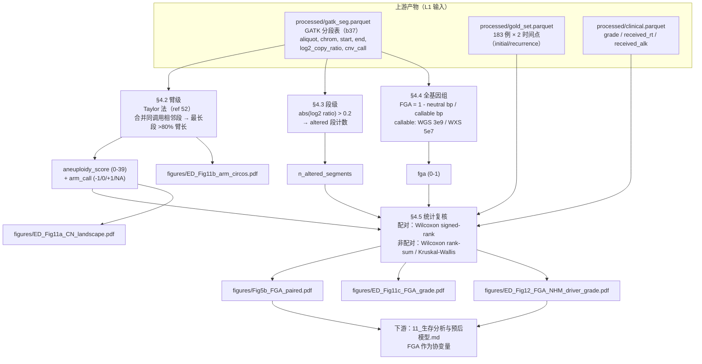

# 09 非整倍体与 FGA 量化（臂级 / 段级 / 全基因组三层次）

> **目标文献**：The GLASS Consortium. *Divergent genomic evolution in astrocytomas and oligodendrogliomas.*
> *Nature* (2026). PDF 标识 s41586-026-11150-x. 数据：Synapse syn17038081；代码：github.com/verhaaklab/glass-idh
>
> **模块对应原文**：Fig. 5a（非整倍体景观）、Fig. 5b（FGA 配对比较）；Extended Data Fig. 11a–c（配对 CN 谱 / 臂级环状图 / 分级-FGA 相关）、
> Extended Data Fig. 12a–b（非超突变样本按驱动状态与分级的 FGA 配对比较）、Extended Data Fig. 13e（FGA × WGD）；
> Methods 中「**Aneuploidy calculation**」整段 + 「**Copy-number calling**」中 high-level amplification / homozygous deletion 阈值句；Results 中「**Increasing chromosomal instability in astrocytoma**」节前半段
> **复现层级**：**L1 派生层（主路径）**。但有一个关键例外：**臂级调用的官方实现不在 `analysis/` 或 `figures/` 下，而在 `preprocessing_pipeline/sql/cnv/taylor_aneuploidy.sql`（属 L2 产物生成层）**，它的产物 `analysis.gatk_aneuploidy` 才是 L1 的现成输入。
> 因此本模块的纯 L1 复现必须**自己从 segment 表重算臂级调用**（§4.2/§4.3 即为此步），这是本篇相对其他模块要多做的一件事。
> **前置依赖**：`03_变异检出与拷贝数调用.md`（产出 `processed/gatk_seg.parquet`：GATK 分段表，必需列 `aliquot_barcode, chrom, start, end, log2_copy_ratio, cnv_call, number_probes`）、
> `02_队列构建、临床注释与样本QC.md`（产出 `processed/gold_set.parquet`：183 例「首次–末次」两时间点配对表）
> **复现难度**：★★★☆☆　**预计工时**：2 人日　**计算资源**：单机 8 核 / 16 GB 内存；全队列 183 例 × 2 时间点 × ~10⁴ 段，峰值内存 < 1 GB，**不需要 GPU**

---

## 1. 科学问题与逻辑位置

### 1.1 在证据链中的位置

前序模块解决的是「**哪些具体的基因/位点被改变了**」：`03` 给出分段与拷贝数调用，`04` 给出驱动事件，`05` 给出克隆结构，`08` 给出拷贝数签名与 WGD。本模块回答的是**另一个量纲**的问题：

> **一个肿瘤基因组"整体上被改变得有多厉害"？这个"厉害程度"在初诊→复发之间是否升高？升高只发生在 astrocytoma 吗？**

这是全文核心二分论点（astrocytoma 走 CNA 路线、oligodendroglioma 走 sSNV 路线）在**全基因组层面**的量化表述。三处关键断言都直接依赖本模块的数字：

1. 摘要："acquired focal oncogene amplifications and CDKN2A/B homozygous deletions were associated with **an increase in chromosomal imbalances**"；
2. Results："**At recurrence, FGA increased significantly in astrocytomas and in hypermutant but not in non-hypermutant oligodendrogliomas**"；
3. Results："**The overall level of aneuploidy, defined as FGA, increased with grade in both tumour types**"。



### 1.2 上游输入与下游输出（产物契约）

| 产物路径（规范名） | 生产者 | 格式/结构（列名·尺度·单位） | 消费方 | 生成脚本 |
|---|---|---|---|---|
| `processed/gatk_seg.parquet` | 03 | 分段表；必需列 `aliquot_barcode`(str)、`case_barcode`(str)、`chrom`(**整数或去 chr 前缀的字符串**)、`start`/`end`(**1-based 闭区间**)、`log2_copy_ratio`(float，**已中心化**) 、`cnv_call ∈ {-1,0,1,NA}`、`number_probes`(int) | **09**/08/04 | `code/03_*` |
| `processed/gold_set.parquet` | 02 | 183 行 × (initial, recurrence) 宽表；`tumor_barcode_a`（initial）、`tumor_barcode_b`（recurrence）、`idh_codel_subtype ∈ {IDHmut-codel, IDHmut-noncodel}` | **09**/05/06/11 | `code/02_*` |
| `processed/clinical.parquet` | 02 | `case_barcode, surgery_number, grade, received_rt, received_alk, seq(WGS/WXS)` | **09**/11/12 | `code/02_*` |
| `processed/purity_ploidy.parquet` | 02/08 | 样本级 `aliquot_barcode, purity`（Sequenza cellularity）、`ploidy`（Sequenza ploidy）；来源为 `analysis/R/WGD_sequenza_script.R`（输出 `WGD_sequenza_all.csv` 含 `purity`/`ploidy`）与 `analysis/R/create_idh_mut_gold_purity_coverage_from_files.R` | **09**/05/08/11 | `code/02_*` 或 `code/08_*` |
| `processed/aneuploidy_metrics.parquet` | **09** | 样本级长表，**每行 = 一个 aliquot**；列见下 | 11/12/13 | `code/09_01_aneuploidy_metrics.R` |
| `results/09_fga_paired_tests.csv` | **09** | 配对检验结果：`group, platform, n_pairs, V, p_wilcox_signedrank, median_initial, median_recurrence, median_delta` | 11/12/13 | `code/09_03_paired_tests.R` |
| `results/09_arm_level_calls.csv` | **09** | 每个 (aliquot × 臂)：`aliquot_barcode, chrom, arm, arm_call, prop_arm, arm_wmean_cr, arm_len_bp` | 08/12 | `code/09_02_arm_level.R` |
| `results/09_sensitivity.csv` | **09** | 阈值 × 分母 × 纯度过滤的敏感性网格 | 13 | `code/09_04_sensitivity.R` |
| `figures/Fig5b_FGA_paired.pdf`+`.png` | **09** | 小提琴 + 配对连线 + Wilcoxon（对应 `figures/R/GLASS-I_FGA.R` 的 `gg_fga_norm_combined`） | 12 | `code/09_05_plots.R` |
| `figures/ED_Fig11b_arm_circos.pdf`+`.png` | **09** | 环状图（circlize），按臂平均 log2(CN ratio)，±0.1 着色 | 12 | `code/09_05_plots.R` |
| `figures/ED_Fig12_FGA_NHM_driver_grade.pdf`+`.png` | **09** | 非超突变分层的配对比较（驱动状态 / 分级） | 12/13 | `code/09_05_plots.R` |

> ⚠️ **导师批注（契约纪律）**：`chrom` 列的类型是本模块最贵的契约项。臂级调用需要把 segment 与臂边界求交，**一旦 segment 写 `"chr7"` 而臂表写 `"7"`，`findOverlaps()` 会静默返回 0 条重叠**，全部样本 `arm_call` 变成 NA，而下游 `summarise(mean, na.rm=TRUE)` 会把 NA 抹掉、给出"看起来正常"的空表。§4.2 的 `assert_arm_overlap()` 就是为拦截这件事而写。`gatk_seg.parquet` 在本项目统一**存整数 chrom 列**（1–22, X→23），在进入 R 时统一转字符并去 `chr` 前缀。

### 1.3 它解决什么、不解决什么

| 它能支持 | 它**不能**支持 |
|---|---|
| 「同一患者的复发肿瘤比初诊肿瘤有更大比例的基因组处于非中性拷贝数状态」这一**样本内配对**陈述 | 「非整倍体**导致**了复发/耐药」——G2 逻辑上 FGA 与复发互为结果，REPRO_SPEC §12.4：相关 ≠ 因果 |
| 「FGA 与 WGD / chromothripsis / 超突变各自独立地相关」的**共现**陈述（ED Fig 13e–g） | 「FGA 是 WGD 的**替代指标**」——两者只是共变，§2.6 给出为何不可互换 |
| 用公开数据**逐位重算** Fig. 5b / ED Fig 12 的 Wilcoxon p 值（分子分母都来自同一张分段表） | 「FGA 越高的患者预后越差」——原文**未报告** FGA 的生存分析；本模块不产出该结论（见 §6.3 gap 表） |
| 三个不同量纲的 CNA 负荷读数，互为稳健性检查 | 跨平台（WGS vs WXS）的 FGA **绝对值**比较（§2.4.3 给出为何不可比） |

---

## 2. 背景知识与原理

### 2.1 为什么同一份数据能给出三个不同的数

这是复现者最容易困惑的一点：**同一个 segment 表，原文却在三个地方报了三个不同量级的数**（0–39 的臂计数、几十到几千的段计数、0–1 的 FGA）。原因是三者的**统计单位**根本不同：

| 层次 | 统计单位 | 分子 | 分母/归一尺 | 输出 | 回答的问题 | 对交并噪声的稳健性 |
|---|---|---|---|---|---|---|
| **臂级**（Taylor, ref 52） | 39 条染色体臂 | 满足覆盖规则的非中性**臂数** | 39（固定） | `aneuploidy_score ∈ [0,39]` | 「有几条臂整条被增减？」 | **最高**（合并同调用段先消掉断点抖动） |
| **段级** | 分段算法输出的段 | 满足 `|log2|>0.2` 的**段数** | 无（纯计数） | `n_altered_segments` | 「分段图上有多大面积被判为改变？」 | **最低**（强依赖分段粒度与 bin 大小） |
| **全基因组** | 碱基 | 非中性 **bp 数** | 可调用 bp（3e9 / 5e7） | `FGA ∈ [0,1]` | 「基因组的百分之多少被改变？」 | **中等**（与 bp 挂钩，对分段粒度免疫） |

**同一个生物学事件在三层的读数是不同的**——以「7 号染色体整条获得（+7）」为例：

```text
事件：chr7 (159,138,663 bp) 整条一拷贝获得，其余基因组中性

臂级   : 7p 与 7q 各 1 个非中性臂 → aneuploidy_score = 2（满分 39，占 5.1%）
段级   : GATK 会把 chr7 切成 k 段（k 取决于 bin 噪声，实测常见 k = 1~6）；
         若噪声让某子段的 log2 ratio 掉到 0.2 以下，该段不计入 → n_altered_segments 在 1~6 抖动
全基因组: altered_bp ≈ 159.1 Mb（+7 带来的额外拷贝不计入 bp 长度，bp 是"位置"而非"剂量"）
         FGA = 159.1e6 / 3.0e9 = 0.053
```

**三条可直接写进方法学讨论的结论**：
1. 若目标是「跨研究可比」，选 **FGA**（分母是常数，与分段算法无关）；
2. 若目标是「抗噪声的分类变量（有/无某臂改变）」，选**臂级**（先合并再判，天然降噪）；
3. **永远不要**把段级计数当作跨队列可比的负荷指标——它同时受 bin 大小、分段算法、覆盖深度三重影响。

### 2.2 臂级：Taylor 方法的逐步推导

原文（Methods「Aneuploidy calculation」）：

> "For the arm-level aneuploidy calculation, a previously described method was used⁵². In brief, adjacent segments with identical arm-level calls (−1, 0 or 1) were merged, resulting in a single call for each merged segment. The proportion of the chromosome arm spanned by each merged segment was calculated. Segments covering over 80% of the arm were called −1 (loss), 0 (neutral), +1 (gain) or NA, if no segment covered at least 80%. For each sample, the number of arms with non-neutral events was then counted."

对应的官方实现是 `preprocessing_pipeline/sql/cnv/taylor_aneuploidy.sql`（**Postgres 移植版，不在 `analysis/R/` 下**）。它含 6 个 CTE，逐步含义如下：

| CTE | 做什么 | 关键代码 | 不可省略的原因 |
|---|---|---|---|
| `arrange_segments_by_arm` | 把 `analysis.gatk_seg_call` 的段与 `ref.chr_arms` 求交，并按臂分区排序 | `WHERE gs.chrom NOT IN (23,24) AND ca.arm <> '21p'` | **剔除性染色体（23=X, 24=Y）与 21p**，见 §2.2.5 |
| `unfiltered_join_adjacent_segments` | 用 `row_number()` 差值法给「相邻同 `cnv_call`」的段打同一个 `grp`，即**合并** | `row_number() OVER w2 - row_number() OVER w3 AS grp` | 这是"合并相邻同调用段"的核心技巧：同组内序号差恒定 |
| `filtered_join_adjacent_segments` | 对合并段算**长度加权**的均值/标准差，并剔除偏离加权均值 >2·WSD 的段 | `(cr - wcr) > -2.0*wsd AND (cr - wcr) < 2.0*wsd` | 一次内建的离群过滤（注意：**只过滤，不重算合并**） |
| `sort_by_longest_segment` | 每条臂内按 `seg_size/arm_size` 降序编号 | `row_number() OVER w ... ORDER BY t2.seg_size/t2.arm_size DESC` | 取「覆盖该臂最大比例的合并段」作为该臂的代表 |
| `cnv_by_arm` | 代表段的 `prop_arm > 0.80` 才给 −1/0/+1，否则 `NULL` | `WHEN prop_arm > 0.80 AND cnv = 1 THEN 1 ...ELSE NULL END` | **这就是 80% 规则**；`ELSE NULL` 即 NA |
| `taylor_aneuploidy` | 按样本汇总 `arm_call <> 0` 的臂数 | `sum(CASE WHEN arm_call <> 0 THEN 1 ELSE 0 END)` | 输出 `aneuploidy_score`（0–39）、`aneuploidy_amp_score`、`aneuploidy_del_score` |

#### 2.2.1 为什么必须先经 `cnv_call`（−1/0/+1）而不能直接用 log2 ratio

Taylor 法的输入是**三态调用**而不是连续 log2 ratio。这是因为「臂级」问的是「**整条臂处于哪个离散状态**」，而离散化把"纯度压缩"、"局部噪声"这类连续量问题转化成了"过阈/不过阈"的鲁棒问题：一旦某段被判为 +1，它的 log2 ratio 具体是 0.25 还是 0.9 就不再影响臂级读数。

GLASS 的 `cnv_call` 由 ReCapSeg 的 Postgres 移植（`analysis.gatk_seg_call`）给出，语义与 **GATK4 `CallCopyRatioSegments`** 一致（`+`/`0`/`-`/`NaN` → `1`/`0`/`-1`/NA）。**这也是一个陷阱点**：`03` 若只用 `CallCopyRatioSegments` 默认参数，其 `-`/`+` 的判定阈值由 `--neutral-segment-cn-thresholds`（默认 0.1/0.1）决定，与后续 `±0.2` 的段级阈值**不是一回事**，两套阈值不能混用（见 §7 陷阱表）。

#### 2.2.2 为什么"合并相邻同调用段"能降噪

分段算法（CBS / GATK）在断点位置上有 ±数个 bin 的不确定性；同一个真实的"整臂获得"事件，在不同样本里可能被切成 1 段或 6 段。若不合并，直接"看最长段"会因切分位置不同而产生样本间不可比的抖动。合并后，**臂内所有 +1 的段被拼成一段**，其 `prop_arm` 直接逼近该臂被改变的真实比例，与分段粒度解耦。

#### 2.2.3 为什么是 ">80% 臂长" 而不是多数投票

| 方案 | 在"整臂 +1，仅臂末端 10% 中性"场景的行为 | 在"臂中央 30% 局灶缺失（focal），两端中性"场景的行为 | 判定 |
|---|---|---|---|
| **多数投票**（哪个状态 bp 最多就取哪个） | 判 +1 ✓ | 判 0 ✓ | 看似合理 |
| **平均 log2** | 平均 ≈ 0.9×真实值 → 可能仍过 0.1 阈值 ✓ | 平均被局灶事件拉低，**可能仍过 0.1 阈值 → 把 focal 误判为整臂事件** ✗ | 差 |
| **最长合并段 > 80%**（原文规则） | 判 +1 ✓ | 最长段 = 中性段 = 70% 臂长 < 80% → **判 NA，即"这条臂不给调用"** ✓ | 优 |

关键差异在于**对"不确定"的处理**：多数投票与平均法**必须**给出一个答案（信息被强行压缩），而 80% 规则允许输出 **NA**——当一条臂处于"混合状态"（例如臂中央一个 30% 的 focal 缺失）时，它**拒绝**给出臂级调用，而不是把它错报成整臂事件。

**代价**：NA 会损失样本数。原文未报告被 NA 掉的臂比例（**原文未报告**），我们把它作为 QC 指标之一（§6.1）。

**为什么是 80% 而不是 90% 或 70%？** 该阈值继承自 Taylor et al. 2018（ref 52）。它的直觉是：分段断点自身的定位误差通常在臂长的 1–5%；把阈值放在 80% 意味着"允许 20% 的臂长处于异状态而仍给整臂调用"，从而在**容忍断点误差**与**避免把 focal 抹成整臂**之间取平衡。30% 的 focal 事件（如 `CDKN2A/B` 在 9p21 的缺失，约 0.2 Mb）远小于 20% 臂长，因此**永远不会**被 80% 规则误判为整臂缺失——这正是该规则想保护的性质。

#### 2.2.4 ±0.1 与 ±0.05：为什么另设一套阈值

原文：

> "As a secondary method, average log2(copy-number ratios) were calculated to compare arm-level aneuploidies between groups. Lower thresholds were set at ±0.1 for significant arm-level gain or loss at any time point and ±0.05 for significant arm-level changes (Δgains or losses)."

这套阈值用于 **Extended Data Fig. 11b 的环状图**（原文图注："arm-level aneuploidies (mean log2(CN ratio) ≤ −0.1 or ≥ 0.1) shown"），即"把每条臂的所有段按长度加权平均，得到该臂的连续 log2(CN ratio)"，再用阈值着色。**它是连续版的臂级读数**，与 §2.2 的离散版并行存在。

两条阈值的量纲差异来自**比较对象不同**：

- **±0.1 用于"状态量"**（某时间点某臂是增还是减）。直觉标定：一条 70 Mb 的 q 臂上如果只有 20 Mb 是单拷贝获得（log2 ≈ 0.58），长度加权平均 ≈ 0.58 × 20/70 ≈ **0.166**；若只有 10 Mb 被改变，平均 ≈ 0.083，接近但不达 0.1。也就是说 **±0.1 大致对应"臂的 ~1/6 以上被改变"**。
- **±0.05 用于"变化量"**（同一患者两时间点的臂均值之差）。作差时两边的独立噪声方差相加，标准差增 $\sqrt{2}$ 倍，因此判"变化"的阈值应当**更松**（0.05 = 0.1/2），换来的是 Δ 的假阳性上升——原文用它在 ED Fig 11b 右列"比较初诊与复发的臂级差异"中标记 Δ 显著的臂。

> ⚠️ **导师批注**：Methods 用词是 "Lower thresholds were set at"（**下**阈值），但 ±0.1/±0.05 显然指**幅值**阈值（`|mean log2| > 0.1`）。这可能只是行文笔误（原文没有"upper"与之配对）。复现时按幅值理解；若要严格照字面（只有下界 −0.1），结果会漏掉所有臂获得。本模块按幅值实现，并在 `13_复现质控清单、排错与批判性评述.md` 登记。

#### 2.2.5 为什么剔除性染色体与 21p

`taylor_aneuploidy.sql` 明写 `WHERE gs.chrom NOT IN (23,24) AND ca.arm <> '21p'`。两层原因：

1. **性染色体**（X=23, Y=24）在肿瘤中经常出现**全染色体水平**的获得/丢失（尤其 X 丢失在高级别胶质瘤中常见），但它与"体细胞非整倍体"的生物学含义不同（也受患者性别、染色体失活影响），且**跨性别不可比**——男性（XY）与女性（XX）的基线拷贝数不同。纳入会引入系统性偏倚。
2. **21p**：21 号是近端着丝粒染色体（acrocentric），其 **p 臂只有 rDNA 重复序列**，无编码基因、且参考基因组装配几乎不可用，任何分段算法在 21p 上都是噪声。同理 13p/14p/15p/22p 也应剔除——这就是 `aneuploidy_score` 上限是 **39** 而不是 44 的原因（44 − 5 条近端着丝粒短臂 = 39）。SQL 里只显式写了 `<> '21p'`，其余四条短臂应是通过 `ref.chr_arms` 本身不含这些臂而实现的（**需按 Synapse 上 `ref.chr_arms` 表内容核对**）。

#### 2.2.6 臂级 vs 段级在"全臂获得"场景下的差异（结合 §2.1 的表）

| 读数量 | +7 时 | 机制 |
|---|---|---|
| `aneuploidy_score` | +2 | 7p、7q 各贡献 1，且两臂的 `prop_arm` 都 ≈ 1，稳定 |
| `n_altered_segments` | 1 ~ 6（抖动） | 计数完全由分段算法决定，+7 可以被切成任意段数 |
| `FGA` | +0.053（精确可加） | bp 指标对分割免疫；多条臂的 FGA 贡献**严格可加**（不同臂无重叠） |

最后一行有一个很有用的推论：**FGA 是"可加的 bp 指标"，因此 FGA 与 arm 计数之间不存在单调映射**——一个"整条 7 号获得"（arm = 2, FGA = 0.053）与"7 条不同的臂各丢失 20 Mb"（arm = 7, FGA = 0.047）在 arm 计数上差 3.5 倍，在 FGA 上几乎相同。**复现时若发现 FGA 与 aneuploidy_score 的散点图相关性不高（Spearman ρ < 0.7），这是预期行为而非 bug**。

### 2.3 段级：|log2 ratio| > 0.2

原文：

> "For segment-level calculation, each segment was assigned a status of gain, loss or neutral on the basis of the log2 copy ratio threshold of ±0.2. Segments with an absolute log2 ratio greater than 0.2 were considered altered. In each sample, the total number of altered segments (gains and losses) was counted."

注意三个实现细节：

1. **严格大于**。官方脚本写的是 `|log2_copy_ratio| > log2_threshold`（`script_fga_calculation.R:71`），**不是 ≥**。恰好等于 0.2 的段不计入。这看起来吹毛求疵，但在 sensivity 分析里会让结果有微小跳变（连续分布下概率为 0，但分段值常被四舍五入到 3 位小数，仍可能有恰好 0.2 的样本）。
2. **`seg_size = end - start`**（`script_fga_calculation.R:70`），**没有 +1**。若 `start`/`end` 是 1-based 闭区间，真实长度应为 `end - start + 1`；少算 1 bp 对 10 kb 级段是 0.01%，对 100 bp 级段是 1%。WGS 分 10-kb bin 时影响可忽略；**WXS 单外显子级段时需注意**。原文未说明坐标系（**原文未报告**），我们按 1-based 闭区间、`end - start + 1` 实现，并把它列为敏感性项（§5）。
3. **这个 0.2 和 §2.2 的 cnv_call 不是一套**。`cnv_call` 来自 GATK `CallCopyRatioSegments`（默认 neutral 阈值 0.1），而 `altered` 用 0.2。因此**同一个段可以 `cnv_call = 1` 但 `altered = FALSE`**。混用会导致"FGA 与 arm 级用两套阈值"的隐性不一致（§7 陷阱表有专门一行）。

**0.2 的物理含义**：线性拷贝比 $2 \times 2^{0.2} = 2.30$，即"观测拷贝数达到中性二倍体基线的 1.15 倍"才算改变。这个 1.15 与**纯度**强耦合——见 §2.5，一个单拷贝获得在纯度 30% 的肿瘤里恰好落在 0.2 附近，在纯度 20% 时完全掉到阈值之下。

**长度加权 vs 计数**：段级回答的是"有几段"，但"段"是一个**由算法定义的对象**，不是生物学对象。所以：
- **计数**（原文做法）：用于景观图（Fig. 5a 第 1 行的"shared / private CN segment fractions"）与"被改变的段数"描述；跨样本比较时受分段粒度影响。
- **长度加权**（即 FGA）：用于统计学比较与生存分析协变量。**若把段计数直接放进统计检验，等于把分段算法的输出当作生物学信号**，这是我们不推荐的做法（§5 给出我们的主口径：段计数只做描述，不做推断）。

**与 focal vs broad 的关系**：GISTIC（`04` 模块）用"长度"区分 focal（≤ 0.5 个臂长级别）与 broad。段级计数与 focal/broad 是**正交互补**的两个轴：段级计数惩罚"多而小"的改变，FGA 惩罚"少而大"的改变。这解释了为什么原文需要同时报两者。

### 2.4 FGA：公式、分母与替代指标对比

#### 2.4.1 公式与两种等价写法

原文：

> "For genome-wide level calculation, FGA was calculated with the following formula: FGA = 1 − (total base pairs in neutral segments / total callable base pairs). For WGS samples, the callable genome size was assumed to be 3 × 10⁹ bp. For WXS samples, callable size was set to 5 × 10⁷ bp on the basis of the exome capture target region. FGA values were calculated per sample using platform-specific copy-number profiles and normalized to a 0–1 scale; WGS and WXS represent mostly non-overlapping tumour sets."

$$FGA = 1 - \frac{\sum_{i \in \text{neutral}} L_i}{\sum_{i \in \text{callable}} L_i} = \frac{\sum_{i \in \text{altered}} L_i + \sum_{i \in \text{uncallable}} L_i}{\text{callable bp}}\quad(\text{当 }\sum_{\text{callable}} L_i \text{ 取常数时})$$

两种写法在**"分段覆盖了全部可调用区间"**的前提下等价。官方脚本用的是第二形态（`altered_bp / total_bp`，`script_fga_calculation.R:95`）。**这个前提不是自动成立的**：GATK 分段只覆盖有足够 bin 的区域，未被分段的缺口（低覆盖、重复区、N-gap）既不在 `altered_bp` 也不在「neutral bp」里。于是：

- 用 `altered_bp / 3e9`（脚本做法）：缺口被**算作中性** → FGA **偏低**；
- 用 `1 − neutral/3e9`（Methods 字面）：缺口也被**算作非中性** → FGA **偏高**。

两式之差 = `缺口 bp / 3e9`。对 b37 WGS 这是几百 Mb（~5–10%），**足以改变低 FGA 样本的排序**。原文的 Methods 与 Code 在这一点上口径不同（**原文自相矛盾**，L0 §9「矛盾项→两套都跑」）：

> ⚠️ **导师批注**：Methods 写 `1 − neutral/callable`，而官方脚本 `analysis/R/script_fga_calculation.R` 实现的是 `altered_bp / callable`。二者只在"分段覆盖全部可调用区间"时相等。**本模块主口径 = 脚本口径**（因为它是真正生成原文数字的那一套），并在敏感性分析里报告 Methods 口径（§5、§4.6）。两口径的差异应登记到 `13` 的 gap 表。

#### 2.4.2 官方脚本的真实行为（★ 本模块最重要的发现）

`analysis/R/script_fga_calculation.R` 做了 Methods 没写的一步：

```r
# script_fga_calculation.R:132-144（原文代码，逐字）
cnv_summary_gold <- cnv_summary_gold %>%
  group_by(seq) %>%
  mutate(
    fga_norm = if_else(
      max(fga, na.rm = TRUE) > min(fga, na.rm = TRUE),
      (fga - min(fga, na.rm = TRUE)) /
        (max(fga, na.rm = TRUE) - min(fga, na.rm = TRUE)),
      NA_real_
    )
  ) %>% ungroup()
```

**论文图里画的 `fga_norm`，是"在平台内部做 min–max 拉伸到 [0,1]"之后的量**——这正是 Methods 里 "normalized to a 0–1 scale" 那句话的实现。它有四个必须写进方法学讨论的后果：

1. **`fga_norm = 0` 不再等于"完全中性"**，而是"平台内 FGA 最低的那个样本"；`fga_norm = 1` 是"平台内最高的那个样本"。Fig. 5b 的 y 轴（`Fraction of genome altered`，`ylim(0, 1.15)`）因此**不能**读成绝对 FGA。
2. **配对检验不受影响，但效应量被改变**。Wilcoxon signed-rank 只依赖组内序，而**配对差**的符号在单调变换下不变——所以 Fig. 5b 的 p 值对 min–max 拉伸是**不变量**。但"中位数差"、任何以 FGA 为连续协变量的 Cox 模型的 HR 会被线性缩放（**HR 的具体数值不可跨平台比较**）。
3. **它部分抵消了 §2.4.3 的 WXS 系统性高估**：因为 WXS 与 WGS 各自独立归一，WXS 的绝对膨胀被压掉了，只保留**平台内**的相对排序。这解释了为什么原文敢把 WGS 与 WXS 画在同一张 Fig. 5b 里（图注明确说 "per group and sequencing platform subgroups"）。
4. **样本组成改变会改变所有数值**：min/max 是数据的函数。若我们只做 WGS 子集，所有 `fga_norm` 都会变。**这是"重跑得到不同数字"的最常见原因**，必须在 QC 时先核对样本数。

同一脚本还揭示了一个序贯归一化链：`fga_norm`（gold 全样本，按平台）→ `fga_norm_idhmut`（仅 IDHmut 子集，按平台，§11 段）→ `FGA = coalesce(fga_norm_primary, fga_norm_idhmut)`（**优先用初诊样本的归一化值**）。也就是说 `fga_calc_annotated.txt` 里最终给下游的 `FGA` 列，对**配对样本的两个时间点取的是同一个数**（都取初诊的 `fga_norm_primary`）——这解释了为什么 Fig. 5a 第 2 行叫 "**change in FGA**"（Δ 是单独算的 `delta = fga_norm_primary - fga_norm_idhmut`，注意脚本里的符号是 primary − recurrent，而图注说 "higher values indicate a higher FGA in the recurrent tumour"，符号相反）。

> ⚠️ **导师批注**：`script_fga_calculation.R:249` 的 `delta = fga_norm_primary - fga_norm_idhmut` 与 Fig. 5a 图注 "higher values indicate a higher FGA in the recurrent tumour" **符号相反**。图中实际画的是 `fga_delta_pair_all$fga_norm_delta`（来自 `figures/R/script_landscape_chromosomal_instability.R:127`），其构造脚本未公开在此文件内。复现时**以"复发 − 初诊"为正**（与图注一致），并登记该符号不一致到 `13`。

#### 2.4.3 分母 3×10⁹ 与 5×10⁷ 的选择依据与后果

**WGS 的 3e9**：b37/Human G1K v37 的**常染色体**总长是 **2,881,033,286 bp（2.881 Gb）**，常染色体 + X 是 **3,036,303,846 bp（3.036 Gb）**。因此 3e9 是把"常染色体 + X"向下取整到 3 个有效数字的近似，相对误差 **−1.2%**。若只在常染色体上算（因为 §2.2 的臂级已剔除性染色体），用 3e9 会**低估** FGA 约 **4.1%**。这是一个系统性、全体样本同向的偏倚，对**配对比较无影响**，对**绝对数值报告有影响**。

**WXS 的 5e7**：这是"按捕获目标区域设定"的**名义常数**。问题在于分子分母的**口径不匹配**：

$$\text{报告的 FGA}_{\text{WXS}} = \frac{\text{altered\_bp}}{5\times10^7},\qquad \text{真实的 FGA}_{\text{WXS}} = \frac{\text{altered\_bp}}{S},\quad S = \text{该样本分段覆盖的实际总长}$$

于是 $\text{报告值}/\text{真实值} = S / 5\times10^7$。不同捕获试剂盒的 footprint 差异很大（约 36–60 Mb 量级），而 `03` 的处理是"**WXS 合并各捕获试剂盒的重叠区间**"（原文 Copy-number calling 段），所以 **S 是样本特异的**。若 S > 5e7，报告值**系统性高估**；反之低估。

**三条不可比的机制（叠加在一起）**：

| # | 机制 | 方向 | 是否可从数据中直接量化 |
|---|---|---|---|
| 1 | 分母是名义常数而非实测 S | 不定（取决于试剂盒） | ✅ 可直接算 `S` 与 `S/5e7`（§4.6） |
| 2 | **分子只在捕获区间上测量**。外显子组覆盖基因编码区，而癌基因所在区域在肿瘤中更常被扩增 → 同样"全基因组中性比例"下，WXS 的 altered fraction 更高 | **偏高** | ⚠️ 需要 WGS+WXS 同源样本才能验，本文两平台"mostly non-overlapping"（原文自述）→ **无法在本文队列内验证** |
| 3 | **分辨率与噪声**：WXS 的有效 bin 是外显子级（10² bp），每 bin 计数少 → log2 ratio 的 sd 大 → 在固定阈值 0.2 下"过阈的中性段"更多 | **偏高** | ✅ 可用 §4.6 的阈值敏感性网格近似考察 |

**结论（可写进方法学的原话）**：**WGS 与 WXS 的 FGA 数值不可直接比较**，原因不只是分母常数不同，还有"分子采样区域被基因密度偏倚"这一**无法校正**的效应。原文通过 (i) 平台内 min–max 归一化、(ii) 所有比较都**按平台分层**（Fig. 5b 的 `facet_grid2(idh_codel_subtype ~ HM_group, scales="free")` + `geom_line(aes(group=case_barcode, color=platform))`，且每个平台单独跑 `wilcox.test`）来回避，而不是校正。我们照做，并在 §6.3 声明这一项 gap。

#### 2.4.4 与替代指标的对比

| 指标 | 定义 | 单位/范围 | 与 FGA 的关系 | 本文是否使用 |
|---|---|---|---|---|
| **FGA** | 1 − neutral bp / callable bp | 0–1 | — | ✅ 主指标（Fig. 5b、ED 11c、ED 12、ED 13e） |
| **aneuploidy_score** | 非中性**臂**数 | 0–39 | 非线性正相关（§2.2.6） | ✅ 臂级统计（`analysis.gatk_aneuploidy`），环状图用连续版 ±0.1 |
| **`prop_aneuploidy`** | `1 − (cnv_call='0' 的 bp)/总 bp`（`taylor_aneuploidy.sql` 末段） | 0–1 | **与 FGA 定义不同**：用 `cnv_call` 的 0（GATK 阈值 0.1）而非 `|log2|>0.2` | ⚠️ 该表被 `figures/R/GLASS-I_CIN_Markers.R:41` 读入（`analysis_gatk_aneuploidy.csv`），但**在脚本后续未被使用**（grep 全文仅此一处）——属于历史遗留列 |
| **CNA burden / 段计数** | 改变段数 | ≥0 | 强依赖分段粒度 | ✅ 仅作景观图描述 |
| **48-feature 拷贝数签名活性** | 见 `08_拷贝数签名与全基因组加倍.md` | 相对/绝对活性 | 正交（"如何改变"vs"改变多少"） | ✅ Fig. 5c–f、ED 13a–d |
| **LST / HRD score** | 大片段 SV 数 | ≥0 | 单侧相关 | ❌ 本文未使用（**原文未报告**） |
| **TP53/ATRX 突变状态** | 驱动 sSNV | 类别 | 与 higher CIN 相关（Discussion 提到机制假说） | ✅ 作为解释变量（Discussion） |

### 2.5 纯度与倍性对 FGA 的影响

#### 2.5.1 机制：线性空间的"稀释"

肿瘤样本永远是"肿瘤细胞 + 正常细胞"的混合物。设肿瘤纯度 $p$，肿瘤细胞在某个位点的真实总拷贝数为 $c$，正常细胞是二倍体（$c=2$）。测序读到的**线性拷贝比**是加权平均：

$$r_{\text{obs}} = \frac{p \cdot c + (1-p)\cdot 2}{2}$$

**注意这个式子的关键性质：加性平均发生在线性空间，而 log2 ratio 是非线性（对数）的。** 因此纯度的稀释效应在小 ratio 处近似线性、在大 ratio 处被压缩。代入阈值 0.2：

| 纯度 $p$ | $c=3$ 的 $r_{\text{obs}}$ | $\log_2 r_{\text{obs}}$ | 过 `>0.2`？ | $c=1$ 的 $r_{\text{obs}}$ | $\log_2 r_{\text{obs}}$ | 过 `>0.2`？ |
|---|---|---|---|---|---|---|
| 1.00 | 1.500 | **+0.585** | ✅ | 0.500 | **−1.000** | ✅ |
| 0.80 | 1.400 | +0.485 | ✅ | 0.600 | −0.737 | ✅ |
| 0.60 | 1.300 | +0.378 | ✅ | 0.700 | −0.515 | ✅ |
| 0.40 | 1.200 | +0.263 | ✅ | 0.800 | −0.322 | ✅ |
| 0.30 | 1.150 | **+0.202** | ✅（贴线） | 0.850 | −0.234 | ✅ |
| 0.20 | 1.100 | +0.138 | ❌ | 0.900 | −0.152 | ❌ |
| 0.10 | 1.050 | +0.070 | ❌ | 0.950 | −0.074 | ❌ |

**这张表给出三条硬结论**：
1. **纯度 <≈ 0.3 时，单个拷贝的获得会跌到 0.2 阈值之下**（0.30 时恰好 0.202，是巧合但很有教学价值：**0.2 阈值 ≈ 30% 纯度下的单拷贝获得检出下限**）；
2. **纯度 < 0.2 时，单拷贝的丢失也检不出**；
3. **低纯度样本的 FGA 被系统性低估**，而且这种低估是**有方向的、非随机的**——低纯度样本（常见于活检、坏死比例高、治疗后退缩的复发肿瘤）会被系统性地判为"基因组更稳定"。**如果低纯度与"复发"相关，就会伪造出"复发时 FGA 下降"的假象。**

#### 2.5.2 倍性的影响

上面假设了"正常细胞的基线是 2、肿瘤的中性基线也是 2"。当肿瘤发生 **WGD**（全基因组加倍，见 `08_拷贝数签名与全基因组加倍.md`）时，肿瘤的中性基线变成 4，于是：

$$\log_2\text{ratio} = \log_2\left(\frac{p\,c + (1-p)\cdot 2}{p \cdot 4 + (1-p)\cdot 2}\right)$$

- 一个"相对于 WGD 基线的中性"改变（$c = 4$，即"四倍体中的中性"）在**未做倍性校正**的 log2 ratio 上会被读成 $\log_2((4p+2-2p)/(4p+2-2p)) = 0$，**恰好中性**——前提是 GATK 的 **allele-specific/ploidy 校正**生效；
- 若 `03` 的分段只用 log2（未做 ploidy 校正），WGD 肿瘤的**全基因组**都会呈现约 $+1$（$\log_2 4/2$）的偏移，而 `CallCopyRatioSegments` 会把它整体识别为"扩增"，得到 **FGA ≈ 1 的伪结果**。

WGD 的处理在主路径上由 **ASCAT 多样本模式 + Sequenza `frac_major_ge2 ≥ 0.5` 二次过滤**承担（`analysis/R/WGD_sequenza_script.R`，常数：`WGD_FRAC_CUTOFF <- 0.50`、`PURITY_CUTOFF <- 0.40`、`PLOIDY_CUTOFF <- 3`）。本模块的 FGA 依赖 `03` 输出的**已去倍性**的 `log2_copy_ratio`。**这是本模块最致命的隐性依赖**，见 §7 陷阱表第一行。

#### 2.5.3 原文的纯度/倍性验证做了什么

原文：

> "The increased FGA at recurrence persisted after adjusting for Sequenza-estimated purity and ploidy and after excluding low-purity samples (purity < 0.4)."

**三步操作的复现解读**：
1. **排除低纯度样本**：`purity < 0.4`。**注意 0.4 与 `WGD_sequenza_script.R` 里的 `PURITY_CUTOFF <- 0.40` 是同一个数**——但那个常数的用途是"给 WGD 调用打 High/Low confidence 标签"，不是过滤样本。原文在 Results 里把 0.40 复用为**样本排除线**，这是两个不同用途共用同一阈值（**可接受，但需在方法学中写明**）。
2. **"adjusting for ... purity and ploidy"**：字面含义是以 purity/ploidy 为协变量做回归（或以残差代替原始 FGA）。**具体的模型形式原文未报告**（**原文未报告**）：可能是 `lm(FGA ~ sample_type + purity + ploidy)` 后取 `sample_type` 的系数与 p，也可能是 `lm(FGA ~ purity + ploidy)` 取残差后再做配对 Wilcoxon。
3. **脚本对应**：仓库里**没有**实现这一步的脚本。纯度/覆盖度表由 `analysis/R/create_idh_mut_gold_purity_coverage_from_files.R`（输出 `idh_mut_gold_purity_coverage.csv`）提供，`analysis/R/WGD_sequenza_script.R` 提供 `WGD_sequenza_all.csv`（含 `purity`、`ploidy` 列），但**把它们与 FGA 做回归的代码不在 `figures/R/` 或 `analysis/R/` 的任何脚本中**（已对仓库全量 R 脚本 grep `purity`，只命中上述两个文件）。

> ⚠️ **导师批注（L1 复现的真实 gap）**：Methods 承诺的"调整纯度与倍性后仍然显著"，其**脚本未随代码仓库公开**。这是一个必须写进 `13` 的 gap：属 REPRO_SPEC §9 的 **A 类·口径类**缺失（模型形式会改变结论方向）。我们的复现决策见 §5 的 D1。

### 2.6 FGA 不等于 CIN

最后必须澄清一个概念混淆（原文在文字中把两者并列，注意其措辞）：

> "Collectively, these findings indicate that chromosomal instability—**as reflected by** FGA, WGD and chromothripsis—..."

原文用的是 "as reflected by"（**作为其反映**），这是谨慎的措辞。严格地说：

- **CIN（染色体不稳定性）是一个速率概念**（"每分裂一次产生多少染色体错误"），**需要至少两个时间点或单细胞克隆追踪才能估计**；
- **FGA 是一个状态量**（"现在有多少比例的基因组是非中性的"），它会累积 CIN 的历史但也会被选择与克隆扩增改变；
- 因此 **FGA 升高可以从"CIN 升高"得到，也可以从"一次 WGD + 强选择"得到**（原文自己在 ED Fig 13e 展示 FGA 与 WGD 相关）。

**复现时的纪律**：本模块只产出 FGA / 臂级/段级读数，**不得**在结论句里把它们写成"CIN 速率升高"（REPRO_SPEC §12.4）。"速率"层面的解释应放在 `10_染色体不稳定性_结构变异-染色体碎裂-骤变-ecDNA.md`（那里有 SV/chromothripsis 这类**一次性事件**证据）与 `05_克隆性与纵向演化分析.md`（时间维度）里联合作出。

---

## 3. 原文逐句拆解

> 方法：左列是**原文原句**（Methods「Aneuploidy calculation」全段 + 相关 Results 句 + 图注）；中列是中文转述与**这一步到底在算什么**；右列是**对应操作/参数/脚本/产物**，以及原文**没给**的部分（标"原文未报告"）。

| # | 原文句（节选） | 中文转述与"这一步在算什么" | 对应操作 / 参数 / 脚本 / 缺失项 |
|---|---|---|---|
| 1 | "Aneuploidy was calculated at three different levels for all samples: arm level, segment level and genome-wide level." | 对**全部样本**算三个层次的负荷。注意"all samples"包含 WGS 与 WXS——但 WXS 无 SV 数据，所以只有非整倍体三层能全样本算（chromothripsis/ecDNA 只 WGS，见 `10`） | 输入 = `analysis.gatk_seg`（或本项目 `processed/gatk_seg.parquet`）；官方 FGA 脚本 `analysis/R/script_fga_calculation.R`；臂级 SQL `preprocessing_pipeline/sql/cnv/taylor_aneuploidy.sql` |
| 2 | "For the arm-level aneuploidy calculation, a previously described method was used⁵²." | 臂级不是自创，而是沿用 **Taylor et al., Cancer Cell 2018**（ref 52）的离散化臂级法 | ref 52 = Taylor A.M. et al. *Genomic and functional approaches to understanding cancer aneuploidy*. Cancer Cell 33, 676–689 (2018)。**原文未报告**该方法的阈值是否被修改——我们的核查结论：`taylor_aneuploidy.sql` 的 80% 规则与 Taylor 原文一致 |
| 3 | "In brief, adjacent segments with identical arm-level calls (−1, 0 or 1) were merged, resulting in a single call for each merged segment." | **先合并、后判定**：臂内相邻且 `cnv_call` 相同的段拼成一段。作用是把分段断点噪声消掉（§2.2.2） | SQL 的 `row_number() OVER w2 - row_number() OVER w3 AS grp` 就是"连续同值分组"；我们的 R 版用 `cumsum(call != lag(call))`（§4.2）；**注意输入是 `cnv_call` 三态，不是 log2 ratio** |
| 4 | "The proportion of the chromosome arm spanned by each merged segment was calculated." | 每个合并段的长度 ÷ 该臂长度 = `prop_arm` | `prop_arm = seg_size / arm_size`；臂长来源 = `ref.chr_arms`（SQL）或 hg19 cytoband（我们的重实现，§4.2）。**⚠️ 两套臂边界（着丝粒坐标）不完全等价**——`ref.chr_arms` 的具体坐标原文未报告，需从 Synapse 核对 |
| 5 | "Segments covering over 80% of the arm were called −1 (loss), 0 (neutral), +1 (gain) or NA, if no segment covered at least 80%." | **80% 规则**：取覆盖该臂**最长**的合并段，若其 `prop_arm > 0.80` 则该段的状态升格为整臂状态；否则该臂为 **NA** | 实现：`prop_arm > 0.80 AND cnv = 1 → 1` 等（SQL 的 `cnv_by_arm`）；我们重实现见 §4.2。**NA 允许"拒绝作答"是该方法的核心设计（§2.2.3）**；原文**未报告** NA 臂的比例 |
| 6 | "For each sample, the number of arms with non-neutral events was then counted." | `aneuploidy_score = #{arm_call ∈ {−1, +1}}`，理论上限 **39**（44 条臂 − 5 条近端着丝粒短臂） | SQL 输出 `aneuploidy_score / aneuploidy_amp_score / aneuploidy_del_score`，落入 `analysis_gatk_aneuploidy.csv` |
| 7 | "As a secondary method, average log2(copy-number ratios) were calculated to compare arm-level aneuploidies between groups." | 第二条臂级通路是**连续版**：臂内按长度加权平均 log2(CN ratio)，用于**组间比较** | 对应 `figures/R/GLASS-I_CN_Segments_{Oligo,Astro}_{Primary,Recurrence,Delta}.R`（先由 `analysis/R/prepare_gistic_input.R` 生成 `gistic_circos_input_*_{primary,recurrence}.csv`，再 1-Mb 分箱求臂均值） |
| 8 | "Lower thresholds were set at ±0.1 for significant arm-level gain or loss at any time point and ±0.05 for significant arm-level changes (∆gains or losses)." | 连续版臂级的两套阈值：**状态量用 ±0.1，变化量（Δ）用 ±0.05**（更松，因为差值的方差翻倍） | 阈值来源**原文未报告**（推测为经验值）；我们的替代推导见 §2.2.4；敏感性分析把两阈值各取 {0.05, 0.1, 0.2} × {0.025, 0.05, 0.1}（§4.6） |
| 9 | "For segment-level calculation, each segment was assigned a status of gain, loss or neutral on the basis of the log2 copy ratio threshold of ±0.2." | 段级三态：`|log2| > 0.2` 改变、否则中性 | 与 #3 的 `cnv_call` **不是同一套阈值**（GATK `CallCopyRatioSegments` 默认中性阈为 0.1）——这是本模块最容易踩的隐性不一致（§7） |
| 10 | "Segments with an absolute log2 ratio greater than 0.2 were considered altered." | **严格大于**，不是 ≥ | 官方代码 `script_fga_calculation.R:71`：`altered = abs(log2_copy_ratio) > log2_threshold`，`log2_threshold <- 0.2`（第 20 行） |
| 11 | "In each sample, the total number of altered segments (gains and losses) was counted." | `n_altered_segments`（不区分长度） | 用于 Fig. 5a 第 1 行的 "shared and private copy-number segment fractions"；**原文未报告**其数值范围/分布 |
| 12 | "High-level amplification and homozygous deletion thresholds were determined per sample from segmented copy-number data by calculating the weighted mean and s.d. of non-log2 copy ratios among neutral segments (0.9–1.1), with segment length used as weights and iterative filtering performed twice to remove outliers. Thresholds … were then defined as the twice-filtered weighted mean ± 2 s.d." | 每个样本**独立**建立"高扩/纯合缺失"阈值：① 取中性段（线性拷贝比 ∈ [0.9, 1.1]）② **长度加权**均值与标准差 ③ **迭代两次**剔除 >2 SD 的离群段 ④ 阈值 = 均值 ± 2 SD | 这条与 `04` 的 HD/HLAMP 调用强耦合；SQL 里的对应实现见 `taylor_aneuploidy.sql` 的 `unfiltered/filtered_join_adjacent_segments`（其加权 sd 用 $\sum w - 1$ 作分母，与无偏加权 sd $\sum w - \sum w^2/\sum w$ 略有差异，**小样本臂上会造成阈值差异**）。我们的重实现见 §4.3.2 |
| 13 | "For genome-wide level calculation, FGA was calculated with the following formula: FGA = 1 – (total base pairs in neutral segments/total callable base pairs)." | 定义式：中性 bp 占比的补 | ⚠️ **与官方实现不一致**：`script_fga_calculation.R:95` 算的是 `altered_bp / total_bp`。两式只在"分段覆盖全部可调用区间"时相等，否则差 = 缺口 bp / 3e9（§2.4.1） |
| 14 | "For WGS samples, the callable genome size was assumed to be 3 × 10⁹ bp. For WXS samples, callable size was set to 5 × 10⁷ bp on the basis of the exome capture target region." | 分母是**平台特异的常数** | 代码里就是两个字面量：`callable_bp_wgs <- 3e9`、`callable_bp_wxs <- 50e6`（`script_fga_calculation.R:23-24`）。b37 常染色体实长 2,881,033,286 bp = 2.881 Gb（§2.4.3） |
| 15 | "FGA values were calculated per sample using platform-specific copy-number profiles and normalized to a 0–1 scale; WGS and WXS represent mostly non-overlapping tumour sets." | ① 各平台用自己的 CN profile；② **归一化到 0–1**；③ 两平台是不重叠的肿瘤集合 | ② 的实现 = **平台内 min–max 拉伸**（`script_fga_calculation.R:132-144`），不是"天然落在 0–1"。③ 是关键限定：因此不需要跨平台校正（也**无法**校正，§2.4.3 机制 2） |
| 16 | "We evaluated broad patterns of DNA CNAs in association with treatment status and acquired genomic drivers (Fig. 5a)." | Fig. 5a 是**景观图**：每列一个患者，行依次为（1）shared/private CN 段比例、（2）FGA 变化、（3）分子标志、（4）临床标志 | 脚本 `figures/R/script_landscape_chromosomal_instability.R`；排序键（第 67 行）：`arrange(-received_rt, driver_status, other_driver_status, WGD, Kataegis, -mf_b, seq)` —— **排序本身用到了本模块下游的 WGD/kataegis**，因此 Fig. 5a 的复现必须在 `08`/`10` 之后 |
| 17 | "Newly diagnosed oligodendrogliomas exhibited few changes in chromosomal arms other than the 1p/19q codeletion, whereas astrocytomas had higher levels of gains and losses at the chromosomal arm level (Extended Data Fig. 11a,b)." | 初诊时：oligo 除 1p/19q 共缺失外臂级事件很少；astro 臂级增减更多 | ED Fig 11a = 配对 CN 谱（`figures/R/GLASS-I_CN_Heatmap.R`）；11b = 环状图/臂级比较（`GLASS-I_CN_Segments_*.R`）。**⚠️ 注意**：1p/19q 共缺失本身会被臂级法**同时**记为 1p 与 19q 两个非中性臂——即 oligo 的基线 `aneuploidy_score` 天然 ≥ 2，跨型比较时**必须意识到这一点**（§7 陷阱表） |
| 18 | "Arm-level events were predominantly shared between time points in oligodendrogliomas but were mostly specific to either primary or recurrent tumours in astrocytomas." | 臂级事件的**时间归属**：oligo 多为 truncal（两时间点共享），astro 多为 branch（时间点特异） | 该归属的 SQL 实现是 `preprocessing_pipeline/sql/heatmap/heatmap_arm.sql`：对每对样本的每条臂，用 `direction`（该臂"应该是增还是减"）对比 `arm_call`，输出 `cnv_change ∈ {P, S, R}`（initial-specific / shared / recurrence-specific） |
| 19 | "Our analysis also revealed a frequent chromosome-arm-level loss of 4p and 4q in oligodendrogliomas, further enriched at recurrence (23% to 33%), whereas gain of 7q and loss of 10q were frequently detected in astrocytomas (32%; Extended Data Fig. 11a,b)." | 四个具体臂的数：oligo **4p/4q 丢失**从初诊 23% 升到复发 33%；astro **7q 获得 / 10q 丢失**各 32% | 这些百分比**原文未给分母**（是"占该型的比例"还是"占该臂被调用样本的比例"未说明）——复现时两种口径都算并登记（A 类缺失）。4p/4q 共丢失 + 1p/19q 共缺失提示 oligo 的 4 号染色体丢失可能是**继发**事件 |
| 20 | "The overall level of aneuploidy, defined as FGA, increased with grade in both tumour types (Extended Data Fig. 11c)." | FGA 与 WHO 分级正相关（两型均如此） | ED Fig 11c 用 **Spearman 相关**（图注："Two-sided Spearman's correlations of FGA stratified by WHO molecular grade"）。**⚠️ 注意**：grade 是**有序分类**，原文用 Spearman 把它当秩处理（可接受），但没报相关系数 ρ 与 n（图中给出）。另注意 ED Fig 12b 里 `grade_primary` 被 `GLASS-I_FGA_NHM_Grade.R` 从"CDKN2AB 状态 + 组织学 grade"**重新推导**：`CDKN2AB == "HD at primary" → grade 4`（即"初诊即 CDKN2A/B 纯合缺失"按分子标准归为 4 级） |
| 21 | "At recurrence, FGA increased significantly in astrocytomas and in hypermutant but not in non-hypermutant oligodendrogliomas (Fig. 5b)." | **核心结论**：astro 总体显著升高；oligo 只有超突变亚组升高，非超突变 oligo 稳定 | 检验 = **双侧 Wilcoxon signed-rank（配对）**，且**按平台分层**。Fig. 5b 的分层 n：astro 总 82（HM 17 / 非 HM 62）、oligo 总 62（HM 9 / 非 HM 46）——注意 82 + 62 = **144 = primary–recurrent 配对数**（一致 ✓） |
| 22 | "The increased FGA at recurrence persisted after adjusting for Sequenza-estimated purity and ploidy and after excluding low-purity samples (purity < 0.4)." | ① 以 Sequenza 纯度/倍性做**调整**后仍显著；② 排除纯度 < 0.4 后仍显著 | **原文未报告调整所用的模型形式**；**代码仓库中无对应脚本**（已全量 grep：`purity` 仅出现在 `WGD_sequenza_script.R` 与 `create_idh_mut_gold_purity_coverage_from_files.R`）。这是本模块**最大的 L1 gap**，我们的复现决策见 §5 D1/§4.6 |
| 23 | "In non-hypermutant astrocytomas, the increase in FGA was significantly higher in tumours with CDKN2A/B homozygous deletions and focal oncogene amplifications than it was in tumours that did not acquire such events, suggesting that an increased sensitivity to acquired broad CNAs predisposes to focal DNA lesions (Extended Data Fig. 12a)." | 非超突变 astro 内，**获得** CDKN2A/B HD 或局灶癌基因扩增的肿瘤，其 FGA 上升**更大** | 脚本 `figures/R/GLASS-I_FGA_NHM.R`；"driver+" 的判定（该脚本 16–20 行）：astro 取 `Any Amplification == HLAMP` 或 `CDKN2A/CDKN2B == HLDEL`，oligo 取 `PI3K` 或 `NOTCH1` 为 `mutant`，且**排除 `driver_change == "P"`（仅初诊存在的事件）**——即只算"获得性"事件 |
| 24 | "This effect was most evident in tumours that were originally diagnosed as grade 2; limited sample sizes precluded definitive analysis in grade 3 and 4 tumours (Extended Data Fig. 12b)." | 效应在**初诊 grade 2** 亚组最明显；grade 3/4 样本量不足 | 脚本 `figures/R/GLASS-I_FGA_NHM_Grade.R`；`grade_primary` 的推导规则见 #20；原文**未报告**各 grade 亚组的 n（图中标注） |
| 25 | "WGD, chromothripsis and hypermutation were each associated with a significantly higher FGA (Extended Data Fig. 13e–g)." | FGA 的三个共变量：WGD、chromothripsis、超突变 | 脚本 `figures/R/GLASS-I_CIN_Markers.R` 的 `edf_panel_c/d/e`；检验 = **双侧非配对 Wilcoxon rank-sum**（`stat_compare_means`）；对应 `10`、`08`、`06` 三模块的产出 |

### 3.1 一句话结论链（本模块贡献的部分）

```text
初诊：astro 臂级事件 > oligo（oligo 基线仅 1p/19q + 4p/4q）
  ↓
复发：FGA 在 astro 显著升高（paired Wilcoxon）；oligo 仅 HM 亚组升高
  ↓
升高与"获得性局灶事件（CDKN2A/B HD、癌基因扩增）"共现（ED 12a），grade 2 最明显（ED 12b）
  ↓
FGA 与 WGD / chromothripsis / 超突变各自相关（ED 13e–g）→ 指向多维 CIN 机制
  ↓
（本模块到此为止；"FGA 高→预后差"不是本模块结论，原文未报告）
```

---

## 4. 逐步可运行代码

### 4.0 环境、数据获取与一个必须先知道的现实障碍

**环境（L1 最低要求）**

```bash
# R 4.3.x（与原文一致；SETUP.md 要求 R >= 4.2）
Rscript -e 'stopifnot(getRversion() >= "4.2")'
Rscript -e 'pkgs <- c("tidyverse","GenomicRanges","circlize","ggpubr","ggh4x",
                      "data.table","vroom","DBI","RPostgres","rstatix","survival");
            m <- pkgs[!vapply(pkgs, requireNamespace, logical(1), quietly=TRUE)];
            if (length(m)) stop("MISSING: ", paste(m, collapse=", ")) else cat("OK\n")'
```

`SETUP.md`（官方仓库根目录）明确了两点与我们直接相关：
1. **`figures/R/` 的脚本一律先连 PostgreSQL**（`dbConnect(RPostgres::Postgres(), service = "glass5reader")`），而 SETUP.md 说得很直白：
   > "Most of the scripts that read the database carry an inline comment naming the Synapse ID for the table they query, so each `dbGetQuery()` can be replaced with a `read_csv()` of the corresponding download. **There is no automatic fallback in the code; this is a manual substitution.**"
2. **输出路径不可移植**："11 scripts write to `~/`"——`GLASS-I_FGA.R` 正是其中之一（`read.delim("~/fga_calc_annotated.txt")`、`ggsave("fga_norm_combined.pdf")`）。

**Synapse 访问的现实障碍（必须写进项目风险）**：本机实测（2026-10-16，本机实际 IP 位于中国大陆）对 Synapse 公共 API 的访问返回：

```text
GET https://repo-prod.prod.sagebase.org/repo/v1/entity/syn17038081
→ {"errorCode":"GEO_RESTRICTION",
   "reason":"Requests originating from this region are blocked. For more information see:
             https://grants.nih.gov/grants/guide/notice-files/NOT-OD-25-083.html"}
```

这不是权限问题（syn17038081 是公开项目），而是**地理封锁**。**三条可行路径**（按推荐度排序）：
1. 机构 VPN / 海外合作方节点下载后回传（最稳）；
2. 通过 Sage Bionetworks 服务台申请例外（`https://sagebionetworks.jira.com/servicedesk/...`，错误信息里给了入口）；
3. 用 `Synapse` 官方说明的 `SYNAPSE_AUTH_TOKEN` 走机构代理——**注意**：geo-block 与鉴权是两回事，改 token 不能绕过 geo-block。

> ⚠️ **导师批注**：本项目其余模块（`01_数据与代码可得性、环境与仓库结构.md`）应把这条实测结论作为**项目级风险**登记，而不是只在本模块写。因为 Synapse 不可达会同时阻断 `04`–`12` 的所有 L1 主路径。**备选方案**：`preprocessing_pipeline/` 与 `analysis/SQL/*.sql` 提供了表的完整构造逻辑，若能从公开的 **EGAS/dbGaP 受控层**（L3）或合作方取得 `gatk_seg` 表，本模块可独立运行（本模块**不需要** BAM）。

**本项目目录约定**（SPEC §9）：`raw/synapse/` 放下载的 Synapse 表；`processed/` 放本模块输入；`results/`/`figures/`/`code/`/`logs/` 分列。

```bash
cd /home/zhangxi/paper_read/20261016_GLASS_IDH_glioma_divergent_evolution
mkdir -p raw/synapse processed results figures code logs
# 需要的表（名字取自官方脚本内的 dbGetQuery 注释）：
#   variants.gatk_seg          -> 分段表（本模块主输入）
#   analysis.gold_set          -> 183 例两时间点配对
#   analysis.gatk_aneuploidy   -> 官方臂级结果（用作独立校验的"标准答案"，见 §4.7）
#   clinical.surgeries / clinical.cases / clinical.subtypes
# 下载后统一转 parquet，chrom 统一为整数（1-22, X->23, Y->24）
ls raw/synapse/
```

### 4.1 官方路径：跑 `analysis/R/script_fga_calculation.R`

**先说清"原脚本 → 改造点 → 我们的复现版本"**（SPEC §5 要求）：

| 环节 | 官方脚本 | 改造点 | 我们的版本 |
|---|---|---|---|
| 输入 | 内存里已存在的 `codel_p, codel_r, noncodel_p, noncodel_r`（**脚本假设这 4 个对象已加载，文件头部注释明写 "Inputs already loaded / created"**，如何创建**未公开**） | 用 `dbGetQuery(con,"SELECT * FROM variants.gatk_seg")` 或 `read_parquet("processed/gatk_seg.parquet")` 一次性构造 | `code/09_01_load.R` |
| 平台判定 | 从 `aliquot_barcode` 按 `-` 切分取**第 6 个字段** | 保留（TCGA 风格 barcode 的第 6 段就是分析类型），但**加断言**：值必须 ∈ {WGS, WXS} | 同 |
| FGA | `altered_bp / total_bp`，分母为常数 3e9 / 5e7 | 保留为主口径；**额外**输出 Methods 口径 `1 - neutral/callable` 与自洽口径 `altered_bp/seg_bp` | 同（§4.3） |
| 归一化 | 平台内 min–max → `fga_norm`；再对 IDHmut 子集归一化 → `fga_norm_idhmut`；`FGA = coalesce(fga_norm_primary, fga_norm_idhmut)` | 保留（这是 Fig. 5b 真正画的量），但**同时保留未归一化的 `fga`** 以便做绝对量敏感性分析 | 同（§4.3.3） |
| 输出 | `write.table("fga_calc_annotated.txt")` + `write.csv("fga_seqz_gold_IDHmut.csv")` | 路径改为项目相对路径；**加 `write_parquet`** | 同 |

```r
## code/09_01_load.R —— 载入分段表、构造平台列，复刻官方脚本第 2-3 节
suppressPackageStartupMessages({
  library(arrow); library(dplyr); library(stringr); library(readr)
})

seg_path  <- "processed/gatk_seg.parquet"     # 由 03 产出；若只有 Synapse CSV 则改 read_csv()
gold_path <- "processed/gold_set.parquet"

seg_raw <- read_parquet(seg_path)

## ---- 平台判定：完全复刻 script_fga_calculation.R:47-55 ----
seg <- seg_raw %>%
  mutate(
    platform = vapply(strsplit(as.character(aliquot_barcode), "-"),
                      function(x) if (length(x) >= 6) x[6] else NA_character_,
                      character(1))
  )

stopifnot(
  "platform 只允许 WGS/WXS" = all(unique(na.omit(seg$platform)) %in% c("WGS", "WXS")),
  "必需列缺失"              = all(c("aliquot_barcode","chrom","start","end",
                                    "log2_copy_ratio","cnv_call") %in% names(seg)),
  "坐标必须 start<end"      = all(seg$end > seg$start, na.rm = TRUE)
)

gold <- read_parquet(gold_path)
cat("平台分布：\n"); print(table(seg$platform, useNA = "ifany"))
cat("aliquot 数：", n_distinct(seg$aliquot_barcode), "\n")
cat("gold_set 配对数：", nrow(gold), "\n")   # 期望 183（initial-recurrence）
```

**若没有 `03` 的产物、只有官方 `gatk_seg` 表的原始形态**，注意它的 `pos` 列是一个**区间字符串**（官方脚本用 `str_remove_all(pos, "[\\[\\) ]")` 后按逗号切成 start/end，并把 `end` 再 **减 1**）：

```r
## 官方 script_fga_calculation.R:39-43 的等价改写（含 end-1 这一步！）
parse_pos <- function(pos) {
  x <- stringr::str_remove_all(as.character(pos), "[\\[\\) ]")
  p <- stringr::str_split_fixed(x, ",", 2)
  tibble::tibble(start = as.numeric(p[, 1]),
                 end   = as.numeric(p[, 2]) - 1)   # <- 官方在此减 1
}
```

> ⚠️ **导师批注**：`pos` 是 Postgres 的 `int4range` 文本（形如 `[12345,23456)`），即**0-based 半开区间**。官方把 `end` 减 1 得到 1-based 闭区间的终点，这是**正确**的；随后 FGA 里又用 `end - start`（不再 +1）作为段长，等价于 `(original_end - 1) - start`——与半开区间长度 `end - start` **完全一致**。所以 §2.3 里"少算 1 bp"的担忧在官方这条路径上**不成立**（两处偏差相互抵消）。**但如果 `03` 已经把坐标转成 1-based 闭区间再存 parquet，那么 `end - start` 就真的少算 1 bp**，必须改成 `end - start + 1`。KC：这是本项目 03↔09 之间最容易出错的一处，**必须在 `processed/gatk_seg.parquet` 的元数据里写明坐标系**。

### 4.2 独立重实现 A：臂级（R + `GenomicRanges`）

```r
## code/09_02_arm_level.R —— Taylor 法臂级非整倍体（独立重实现，对照 taylor_aneuploidy.sql）
suppressPackageStartupMessages({
  library(arrow); library(dplyr); library(tidyr); library(purrr); library(stringr)
  library(GenomicRanges); library(circlize)
})

set.seed(20260101)              # 本项目随机种子约定（SPEC §9）
MIN_PROP_ARM <- 0.80            # 原文：>80% 臂长才给调用
VALID_CHR    <- as.character(1:22)   # 对应 SQL 的 chrom NOT IN (23,24)

## ---- 1. 臂定义：hg19 cytoband -> 每条臂的区间 ----
build_arms <- function(species = "hg19", drop_acro_p = TRUE) {
  cyto <- circlize::read.cytoband(species = species)$df     # 与官方 figures/R 脚本同源
  colnames(cyto) <- c("chrom", "start", "end", "band", "gieStain")
  arms <- cyto %>%
    mutate(chrom = sub("^chr", "", as.character(chrom)),
           arm   = ifelse(grepl("^p", band), "p", "q")) %>%
    filter(chrom %in% VALID_CHR) %>%                          # 仅常染色体
    group_by(chrom, arm) %>%
    summarise(start = min(start), end = max(end), .groups = "drop") %>%
    mutate(chr_arm = paste0(chrom, arm), arm_len = end - start + 1)
  if (drop_acro_p) {                                          # 近端着丝粒短臂无装配可言
    arms <- arms %>% filter(!chr_arm %in% c("13p","14p","15p","21p","22p"))
  }
  GRanges(seqnames = arms$chrom,
          ranges   = IRanges(arms$start, arms$end),
          chr_arm  = arms$chr_arm,
          arm_len  = arms$arm_len)                            # 22*2 - 5 = 39 条臂
}

## ---- 2. 契约拦截：chrom 命名 / 坐标系不一致时不要静默失败 ----
assert_arm_overlap <- function(hits, arms, seg_gr, min_frac = 0.5) {
  n_hit <- length(unique(subjectHits(hits)))
  if (n_hit < min_frac * length(seg_gr)) {
    stop(sprintf(paste0("臂表与 segment 表重叠过少（%d/%d 个段）：\n",
                        "  臂表 chrom 示例: %s\n  seg chrom 示例: %s\n",
                        "排查：chr 前缀、整数 vs 字符、0-based vs 1-based、以及是否把 X/Y 混入。"),
                 n_hit, length(seg_gr),
                 paste(head(unique(as.character(seqnames(arms))), 3), collapse = ","),
                 paste(head(unique(as.character(seqnames(seg_gr))), 3), collapse = ",")))
  }
  invisible(TRUE)
}

## ---- 3. 臂级调用（含合并、80% 规则、score） ----
arm_level_calls <- function(seg, arms, min_prop = MIN_PROP_ARM) {
  seg <- seg %>%
    mutate(chrom = sub("^chr", "", as.character(chrom))) %>%
    filter(chrom %in% VALID_CHR, !is.na(cnv_call), end > start)
  seg_gr <- GRanges(seqnames = seg$chrom,
                    ranges   = IRanges(seg$start, seg$end),
                    cnv_call = as.integer(seg$cnv_call),
                    aliquot  = seg$aliquot_barcode)
  hits <- findOverlaps(arms, seg_gr, ignore.strand = TRUE)
  assert_arm_overlap(hits, arms, seg_gr)
  ai <- queryHits(hits); si <- subjectHits(hits)

  piece <- tibble(
    aliquot_barcode = seg$aliquot_barcode[si],
    chr_arm         = mcols(arms)$chr_arm[ai],
    arm_len         = mcols(arms)$arm_len[ai],
    call            = as.integer(seg$cnv_call[si]),
    piece_start     = pmax(seg$start[si], start(arms)[ai]),
    piece_end       = pmin(seg$end[si],   end(arms)[ai])
  ) %>%
    filter(piece_end >= piece_start) %>%
    mutate(piece_len = piece_end - piece_start + 1L)

  ## 合并"相邻且 call 相同"的段：等价于 SQL 的 row_number() 差值分组
  runs <- piece %>%
    arrange(aliquot_barcode, chr_arm, piece_start) %>%
    group_by(aliquot_barcode, chr_arm) %>%
    mutate(run_id = cumsum(call != dplyr::lag(call, default = dplyr::first(call)))) %>%
    group_by(aliquot_barcode, chr_arm, arm_len, run_id, call) %>%
    summarise(run_start = min(piece_start), run_end = max(piece_end),
              run_len = sum(piece_len), .groups = "drop") %>%
    mutate(prop_arm = run_len / arm_len)

  ## 取覆盖该臂最长的合并段；>80% 才升格为整臂调用，否则 NA
  arms_out <- runs %>%
    group_by(aliquot_barcode, chr_arm) %>%
    slice_max(prop_arm, n = 1, with_ties = FALSE) %>%
    ungroup() %>%
    transmute(aliquot_barcode, chr_arm, chrom = sub("[pq]$", "", chr_arm),
              arm = sub("^[0-9]+", "", chr_arm), arm_len,
              run_start, run_end, prop_arm,
              arm_call = if_else(prop_arm > min_prop, call, NA_integer_))

  score <- arms_out %>%
    group_by(aliquot_barcode) %>%
    summarise(aneuploidy_score     = sum(arm_call %in% c(-1L, 1L), na.rm = TRUE),
              aneuploidy_amp_score = sum(arm_call ==  1L,       na.rm = TRUE),
              aneuploidy_del_score = sum(arm_call == -1L,       na.rm = TRUE),
              n_arms_called        = sum(!is.na(arm_call)),
              n_arms_total         = dplyr::n(), .groups = "drop")

  list(arms = arms_out, score = score)
}

## ---- 4. 连续版臂级（ED Fig 11b 环状图用）：长度加权平均 log2 ----
arm_mean_log2 <- function(seg, arms) {
  seg <- seg %>% mutate(chrom = sub("^chr", "", as.character(chrom))) %>%
    filter(chrom %in% VALID_CHR, is.finite(log2_copy_ratio))
  seg_gr <- GRanges(seg$chrom, IRanges(seg$start, seg$end),
                    lr = seg$log2_copy_ratio, aliquot = seg$aliquot_barcode)
  hits <- findOverlaps(arms, seg_gr, ignore.strand = TRUE)
  ai <- queryHits(hits); si <- subjectHits(hits)
  tibble(aliquot_barcode = seg$aliquot_barcode[si],
         chr_arm = mcols(arms)$chr_arm[ai],
         w  = pmin(seg$end[si], end(arms)[ai]) - pmax(seg$start[si], start(arms)[ai]) + 1L,
         lr = seg$log2_copy_ratio[si]) %>%
    filter(w > 0) %>%
    group_by(aliquot_barcode, chr_arm) %>%
    summarise(arm_len_bp = sum(w),
              arm_mean_log2 = sum(w * lr) / sum(w),
              .groups = "drop") %>%
    mutate(arm_state = case_when(arm_mean_log2 >=  0.1 ~ "gain",     # 原文 ±0.1
                                 arm_mean_log2 <= -0.1 ~ "loss",
                                 TRUE                  ~ "neutral"))
}

## ---- 5. 时间归属（对应 heatmap_arm.sql 的 P/S/R） ----
arm_timing <- function(arm_mean, gold) {
  long <- gold %>%
    select(case_barcode, tumor_barcode_a, tumor_barcode_b) %>%
    pivot_longer(c(tumor_barcode_a, tumor_barcode_b),
                 names_to = "timepoint", values_to = "aliquot_barcode") %>%
    mutate(timepoint = if_else(timepoint == "tumor_barcode_a", "Initial", "Recurrence"))
  arm_mean %>%
    inner_join(long, by = "aliquot_barcode") %>%
    select(case_barcode, chr_arm, timepoint, arm_state) %>%
    pivot_wider(names_from = timepoint, values_from = arm_state) %>%
    mutate(arm_change = case_when(
      Initial == "neutral" & Recurrence != "neutral" ~ "R",   # recurrence-specific
      Initial != "neutral" & Recurrence == "neutral" ~ "P",   # primary-specific
      Initial == Recurrence & Initial != "neutral"   ~ "S",   # shared
      Initial == "neutral" & Recurrence == "neutral" ~ "none",
      TRUE ~ "Ambiguous"))                                    # 方向相反（gain->loss）
}
```

**原脚本 → 改造点 → 我们的版本**（臂级）：

| 项 | 官方 `taylor_aneuploidy.sql` | 我们的 R 版 | 为什么改 |
|---|---|---|---|
| 输入 call | `analysis.gatk_seg_call`（GATK `CallCopyRatioSegments` 的三态） | `processed/gatk_seg.parquet$cnv_call` | 同一件事，来源不同 |
| 合并 | `row_number()` 差值分组 | `cumsum(call != lag(call))` | 数学等价；R 侧更可读 |
| 臂边界 | `ref.chr_arms`（DB 表） | `circlize::read.cytoband("hg19")` | **两套坐标略有差异**——用 §4.7 的交叉校验量化 |
| 离群过滤 | `filtered_join_adjacent_segments` 剔 >2WSD 段（影响 `prop_arm` 分母 `seg_size`） | **未实现**（保留在敏感性分析里） | 该过滤只影响 `prop_arm` 的精度，不改 `>0.80` 的判定方向；但为了**逐位对齐**应补上（见 §5 D6） |
| 输出 | `aneuploidy_score/amp/del` | 同 + `n_arms_called`/`n_arms_total` | 增加 NA 诊断量（原文未报告 NA 比例） |

### 4.3 独立重实现 B：段级 + FGA（R，逐字对照官方脚本）

```r
## code/09_03_fga_segment.R
suppressPackageStartupMessages({ library(arrow); library(dplyr); library(tidyr) })

LOG2_THRESHOLD  <- 0.2
CALLABLE_BP_WXS <- 50e6      # 官方字面量 50e6
CALLABLE_BP_WGS <- 3e9       # 官方字面量 3e9

## ---- 3.1 三档段长定义，用于 §5 D2 的坐标系敏感性 ----
add_seg_len <- function(seg, mode = c("official", "one_based", "halfopen")) {
  mode <- match.arg(mode)
  seg %>% mutate(seg_size = switch(mode,
    official  = end - start,          # 官方 script_fga_calculation.R:70
    one_based = end - start + 1L,     # 1-based 闭区间
    halfopen  = end - start))         # 0-based 半开（与 official 数值相同，语义不同）
}

## ---- 3.2 段级：altered 段计数（|log2| > 0.2，严格大于） ----
segment_level <- function(seg, thr = LOG2_THRESHOLD, len_mode = "official") {
  add_seg_len(seg, len_mode) %>%
    mutate(altered = abs(log2_copy_ratio) > thr) %>%        # 严格大于，对齐官方
    group_by(aliquot_barcode) %>%
    summarise(n_seg          = dplyr::n(),
              n_seg_altered  = sum(altered, na.rm = TRUE),
              n_seg_gain     = sum(altered & log2_copy_ratio > 0, na.rm = TRUE),
              n_seg_loss     = sum(altered & log2_copy_ratio < 0, na.rm = TRUE),
              bp_total       = sum(seg_size, na.rm = TRUE),
              .groups = "drop")
}

## ---- 3.3 全基因组 FGA：三种口径同时算 ----
compute_fga <- function(seg, thr = LOG2_THRESHOLD, len_mode = "official") {
  add_seg_len(seg, len_mode) %>%
    mutate(neutral = abs(log2_copy_ratio) <= thr) %>%
    group_by(aliquot_barcode, platform) %>%
    summarise(seg_bp     = sum(seg_size, na.rm = TRUE),
              neutral_bp = sum(seg_size[neutral],  na.rm = TRUE),
              altered_bp = sum(seg_size[!neutral], na.rm = TRUE),
              .groups = "drop") %>%
    mutate(
      callable_bp = if_else(platform == "WGS", CALLABLE_BP_WGS, CALLABLE_BP_WXS),
      ## (a) 官方脚本口径（Fig. 5b 的真正来源）
      fga_script   = altered_bp / callable_bp,
      ## (b) Methods 字面口径（1 - neutral/callable）
      fga_methods  = 1 - neutral_bp / callable_bp,
      ## (c) 自洽口径：分母用实测分段总长（诊断用，见 §2.4.3）
      fga_self     = altered_bp / seg_bp,
      ## 分段覆盖率：seg_bp / callable_bp，用于量化"缺口"
      seg_cov_ratio = seg_bp / callable_bp,
      ## 官方口径相对自洽口径的膨胀倍数
      inflation    = fga_script / fga_self
    )
}

## ---- 3.4 平台内 min–max 归一化（复刻 fga_norm），并保留绝对值 ----
normalize_within_platform <- function(fga, value = "fga_script") {
  fga %>%
    group_by(platform) %>%
    mutate(fga_norm = {
      v <- .data[[value]]
      if (max(v, na.rm = TRUE) > min(v, na.rm = TRUE))
        (v - min(v, na.rm = TRUE)) / (max(v, na.rm = TRUE) - min(v, na.rm = TRUE))
      else NA_real_
    }) %>%
    ungroup()
}
```

#### 4.3.0 ★ 一处必须提前知道的"列契约错位"（说明公开脚本是**事后重建版**）

把官方两个脚本对起来读会发现一件很关键的事：`analysis/R/script_fga_calculation.R` **输出的列**与 `figures/R/` 的消费者**期望的列不一致**。

| `script_fga_calculation.R` 实际写出的列（第 276-292 行的 `select()`） | `figures/R/GLASS-I_FGA.R` / `GLASS-I_FGA_NHM.R` 实际使用的列 |
|---|---|
| `case_barcode, aliquot_barcode, seq, idh_codel_subtype, n_segments, altered_bp, total_bp, fga, fga_norm, fga_norm_primary, fga_norm_idhmut, delta, FGA` | `case_barcode, platform, sample_type, fga_norm, HM_group`（第 20-31、42、61 行） |

**两边没有一列是能对上的**：脚本没有 `platform`（它是**临时变量**，`mutate(platform = ...)` 之后在 `summarise(group_by(case_barcode, aliquot_barcode, platform))` 里被吞掉了，最终 `select()` 未保留）、没有 `sample_type`、没有 `HM_group`；而图脚本从第一行起就把 `fga_norm` 当作 y、把 `HM_group` 当分面、把 `platform` 当连线颜色。

**这说明**：`analysis/R/script_fga_calculation.R` 不是当初生成 `fga_calc_annotated.txt` 的**原始**代码，而是一份**事后重建版**——文件里处处留有痕迹（"Inputs already loaded / created"、"This reproduces: `group_by(seq) %>% mutate(fga_norm = ...)`"、"Original: `FGA = coalesce(fga_norm.y, fga_norm.z)`"、"Your history referenced `cnv_summary_filter_primary` but did not show how it was created"）。

> ⚠️ **导师批注（★ 影响 L1 路径的重要发现）**：**"clone 官方仓库 → 跑 `analysis/R/script_fga_calculation.R` → 跑 `figures/R/GLASS-I_FGA.R`"这条链在公开代码上是走不通的**（列名不匹配会直接报错）。正确的 L1 做法是：以 `figures/R/GLASS-I_FGA.R` 的**列需求**为契约（`case_barcode, aliquot_barcode, platform, sample_type ∈ {Primary, Recurrent}, hm_group, fga_norm`），用本模块 §4.3 的实现**把这张表造出来**。这也正是本篇必须给出"独立重实现"而不是"照抄官方脚本"的根本原因。**请 `01_数据与代码可得性、环境与仓库结构.md` 把"公开脚本是重建版、存在列契约错位"作为仓库评估的一条硬结论**，并登记到 `13`。同类风险在 `figures/R/script_landscape_chromosomal_instability.R` 上更严重（5 个输入表全部来自未公开的会话，见 §8 表）。

#### 4.3.1 官方脚本的"两段式归一化"要一起复刻

`script_fga_calculation.R` 实际上做了**两次**归一化（第 6 节 + 第 11 节），第一次在全部 gold 样本上（→ `fga_norm`），第二次只在 IDHmut 子集上（→ `fga_norm_idhmut`），而最终列 `FGA = coalesce(fga_norm_primary, fga_norm_idhmut)`。**Fig. 5a/5b 画的是 `fga_norm`**（`GLASS-I_FGA.R` 第 42 行 `aes(x = sample_type, y = fga_norm)`）。若只做一次归一化，`fga_norm` 会与原文**数值不同但排序相同**——配对 Wilcoxon 的 p 值仍可复现，但中位数标注（图中 `round(..y.., 2)` 的标签）会对不上。**这是最常见的"数字对不上但结论对"的场景**，QC 时先看 p 值与方向，再看绝对值。

#### 4.3.2 HL amp / HD 阈值（Methods #12 的重实现）

```r
## 每样本的加权均值/标准差（中性段 0.9-1.1，长度加权，迭代 2 次去离群）
hl_thresholds <- function(cr, len, lo = 0.9, hi = 1.1, iter = 2) {
  ok <- is.finite(cr) & is.finite(len) & len > 0
  cr <- cr[ok]; len <- len[ok]
  sel <- cr >= lo & cr <= hi
  if (sum(sel) < 3) return(tibble(hlamp = NA_real_, hldel = NA_real_,
                                  wmean = NA_real_, wsd = NA_real_, n = sum(sel)))
  for (i in seq_len(iter)) {
    w <- len[sel]; x <- cr[sel]
    mu <- sum(w * x) / sum(w)
    ## 无偏加权 sd（与 SQL 用 (sum(w)-1) 的分母略有差异，见 §3 第 12 行批注）
    sw <- sqrt(sum(w * (x - mu)^2) / (sum(w) - sum(w^2) / sum(w)))
    sel_new <- sel & cr >= mu - 2 * sw & cr <= mu + 2 * sw
    if (identical(which(sel_new), which(sel))) { sel <- sel_new; break }
    sel <- sel_new
  }
  w <- len[sel]; x <- cr[sel]
  mu <- sum(w * x) / sum(w)
  sw <- sqrt(sum(w * (x - mu)^2) / (sum(w) - sum(w^2) / sum(w)))
  tibble(hlamp = mu + 2 * sw, hldel = mu - 2 * sw, wmean = mu, wsd = sw, n = sum(sel))
}

## 逐样本应用（165–180 个 aliquot，秒级）
hl_tbl <- seg_joined %>%                       # 需含 aliquot_barcode, cr(=2^log2_copy_ratio), seg_size
  group_by(aliquot_barcode) %>%
  group_modify(~ hl_thresholds(.x$cr, .x$seg_size)) %>%
  ungroup()
```

#### 4.3.3 自检恒等式（三条，都是可证伪的真检查）

```r
## 用 code/09_01_load.R 里的 seg（含 platform）重新算一遍，做三条独立断言：
chk <- compute_fga(seg, thr = LOG2_THRESHOLD, len_mode = "official") %>%
  left_join(segment_level(seg, thr = LOG2_THRESHOLD), by = "aliquot_barcode")

## ① bp 可加性：中性 bp + 改变 bp 必须等于分段总长（否则说明分类有重叠/遗漏）
stopifnot(max(abs((chk$neutral_bp + chk$altered_bp) - chk$seg_bp)) == 0)

## ② 三口径的内部一致性：fga_script = altered/callable，fga_methods = 1 - neutral/callable
stopifnot(max(abs(chk$fga_script  - chk$altered_bp / chk$callable_bp)) < 1e-12,
          max(abs(chk$fga_methods - (1 - chk$neutral_bp / chk$callable_bp))) < 1e-12)

## ③ 自洽口径的分母必须是分段总长（fga_self = altered/seg_bp = 1 - neutral/seg_bp）
stopifnot(max(abs(chk$fga_self - (1 - chk$neutral_bp / chk$seg_bp))) < 1e-12)

## ④ 与段级计数交叉：被改变的段数不能为负、且被改变 bp 不能超过段长上界
stopifnot(all(chk$n_seg_altered >= 0, na.rm = TRUE),
          all(chk$n_seg_altered <= chk$n_seg, na.rm = TRUE))

cat("四条恒等式全部通过：分段表 → 三口径 FGA 的内部一致性成立\n")
cat(sprintf("WGS 分段覆盖中位数 %.3f；WXS %.3f（偏离 1 越远，fga_script 的口径问题越大）\n",
            median(chk$seg_cov_ratio[chk$platform == "WGS"], na.rm = TRUE),
            median(chk$seg_cov_ratio[chk$platform == "WXS"], na.rm = TRUE)))
```

### 4.4 独立重实现 C：Python 版（跨语言交叉验证，对应 L0 §12 的"≥2 条独立实现路径"）

```python
#!/usr/bin/env python3
# code/09_04_aneuploidy.py —— 三层非整倍体的独立 Python 实现（用于交叉验证 R 版）
# 依赖：pandas numpy pyarrow；可选 pyfaidx（用于从参考基因组取臂长/可调用区间）
import numpy as np, pandas as pd

SEED = 20260101
np.random.seed(SEED)
MIN_PROP_ARM = 0.80
LOG2_THRESHOLD = 0.2
CALLABLE = {"WGS": 3e9, "WXS": 5e7}

# ---- 臂边界：优先用仓库 ref.chr_arms 的导出；退化为 UCSC hg19 cytoband 汇总 ----
def load_arms(tsv_path):
    """tsv: chrom, arm, start, end  (1-based 闭区间)；需自行剔除 13/14/15/21/22 的 p 臂"""
    a = pd.read_csv(tsv_path, sep="\t", dtype={"chrom": str})
    a["chrom"] = a["chrom"].str.replace("^chr", "", regex=True)
    a = a[a["chrom"].isin([str(i) for i in range(1, 23)])]
    a["chr_arm"] = a["chrom"] + a["arm"]
    a = a[~a["chr_arm"].isin(["13p", "14p", "15p", "21p", "22p"])]
    a["arm_len"] = a["end"] - a["start"] + 1
    return a[["chrom", "arm", "chr_arm", "start", "end", "arm_len"]].reset_index(drop=True)

def _overlap_pieces(seg, arms):
    """段 × 臂的区间求交（向量化：逐臂布尔切片，39 条臂 × 全表，规模可控）"""
    out = []
    for r in arms.itertuples(index=False):
        m = (seg["chrom"].values == r.chrom) & (seg["end"].values >= r.start) & (seg["start"].values <= r.end)
        if not m.any():
            continue
        s = seg.loc[m]
        out.append(pd.DataFrame({
            "aliquot_barcode": s["aliquot_barcode"].values,
            "chr_arm": r.chr_arm,
            "arm_len": r.arm_len,
            "call": s["cnv_call"].values.astype("Int64"),
            "piece_start": np.maximum(s["start"].values, r.start),
            "piece_end":   np.minimum(s["end"].values,   r.end),
        }))
    p = pd.concat(out, ignore_index=True)
    p["piece_len"] = p["piece_end"] - p["piece_start"] + 1
    return p[p["piece_len"] > 0]

def arm_level(seg, arms):
    p = _overlap_pieces(seg, arms).dropna(subset=["call"]).sort_values(
        ["aliquot_barcode", "chr_arm", "piece_start"])
    # 合并相邻同调用段：组内比较 call 是否与上一个相同
    p["new_run"] = (p.groupby(["aliquot_barcode", "chr_arm"])["call"]
                     .transform(lambda s: s.ne(s.shift())).astype(int))
    p["run_id"] = p.groupby(["aliquot_barcode", "chr_arm"])["new_run"].cumsum()
    runs = (p.groupby(["aliquot_barcode", "chr_arm", "arm_len", "run_id", "call"], dropna=False)
              .agg(run_len=("piece_len", "sum")).reset_index())
    runs["prop_arm"] = runs["run_len"] / runs["arm_len"]
    # 取最长合并段
    pick = runs.sort_values("prop_arm").groupby(["aliquot_barcode", "chr_arm"]).tail(1).copy()
    pick["arm_call"] = np.where(pick["prop_arm"] > MIN_PROP_ARM, pick["call"], pd.NA)
    score = (pick.assign(non_neutral=pick["arm_call"].abs().eq(1))
                 .groupby("aliquot_barcode")
                 .agg(aneuploidy_score=("non_neutral", "sum"),
                      n_arms_called=("arm_call", lambda s: s.notna().sum()),
                      n_arms_total=("arm_call", "size")).reset_index())
    return pick, score

def segment_and_fga(seg, platform_of):
    seg = seg.assign(seg_size=seg["end"] - seg["start"],
                     altered=seg["log2_copy_ratio"].abs() > LOG2_THRESHOLD,
                     platform=seg["aliquot_barcode"].map(platform_of))
    g = seg.groupby(["aliquot_barcode", "platform"])
    res = g.apply(lambda d: pd.Series({
        "n_seg": len(d),
        "n_seg_altered": int(d["altered"].sum()),
        "altered_bp": int(d.loc[d["altered"], "seg_size"].sum()),
        "seg_bp": int(d["seg_size"].sum()),
    }), include_groups=False).reset_index()
    res["callable_bp"] = res["platform"].map(CALLABLE)
    res["fga_script"] = res["altered_bp"] / res["callable_bp"]
    res["fga_self"]   = res["altered_bp"] / res["seg_bp"]
    return res

def normalize_within_platform(fga, col="fga_script"):
    def f(v):
        lo, hi = v.min(), v.max()
        return (v - lo) / (hi - lo) if hi > lo else np.nan
    fga["fga_norm"] = fga.groupby("platform")[col].transform(f)
    return fga

if __name__ == "__main__":
    seg = pd.read_parquet("processed/gatk_seg.parquet")
    seg["chrom"] = seg["chrom"].astype(str).str.replace("^chr", "", regex=True)
    arms = load_arms("raw/synapse/ref_chr_arms.tsv")
    picks, score = arm_level(seg, arms)
    fga = normalize_within_platform(segment_and_fga(
        seg, {a: ("WGS" if a.split("-")[5] == "WGS" else "WXS") for a in seg["aliquot_barcode"].unique()}))
    picks.to_csv("results/09_arm_level_calls.csv", index=False)
    score.to_csv("results/09_aneuploidy_score.csv", index=False)
    fga.to_csv("results/09_fga.csv", index=False)
    print(score["aneuploidy_score"].describe())     # 期望范围 0-39
```

**为什么还要写 Python 版？**（L0 §12：下"文献不可复现"的结论前必须用 ≥2 条独立实现路径排除"我没复现出来"）。三层非整倍体的算法足够简单（合并 + 阈值 + 计数），是**唯一适合做跨语言逐位比对**的模块。判据：`picks` 与 R 版 `arms_out` 在 `(aliquot, chr_arm, arm_call, prop_arm)` 上应**逐行相同**（`prop_arm` 容差 1e-9）；`fga_script` 容差 1e-12。

### 4.5 统计复核：配对与非配对检验

```r
## code/09_05_tests.R
suppressPackageStartupMessages({
  library(arrow); library(dplyr); library(tidyr); library(purrr); library(rstatix)
})

## ---- 5.1 配对：Wilcoxon signed-rank（复刻图注 "two-sided Wilcoxon's signed-rank test for paired data"）
paired_wilcox <- function(df, value_col = "fga_norm",
                          group_vars = c("idh_codel_subtype", "hm_group", "platform")) {
  df %>%
    select(case_barcode, sample_type, all_of(group_vars), value = all_of(value_col)) %>%
    pivot_wider(names_from = sample_type, values_from = value) %>%
    drop_na(Initial, Recurrence) %>%
    group_by(across(all_of(group_vars))) %>%
    group_modify(~ {
      tt <- suppressWarnings(wilcox.test(.x$Initial, .x$Recurrence, paired = TRUE))
      tibble(n_pairs = nrow(.x),
             median_initial = median(.x$Initial),
             median_recurrence = median(.x$Recurrence),
             median_delta = median(.x$Recurrence - .x$Initial),
             V = unname(tt$statistic), p = tt$p.value)
    }) %>%
    ungroup() %>%
    mutate(p_bh = p.adjust(p, "BH"))
}

## 官方脚本的独立分组检验（逐平台），与上面 group_vars 含 platform 时等价：
##   GLASS-I_FGA.R:109-155 对各种 (subtype × platform × HM_group) 组合各跑一次 wilcox.test(paired=TRUE)

## ---- 5.2 非配对：Wilcoxon rank-sum（复刻 ED Fig 13e-g / ED Fig 11c 的口径）----
unpaired_wilcox <- function(df, value_col, group_col, by_vars = c("sample_type")) {
  df %>% group_by(across(all_of(by_vars))) %>%
    group_modify(~ broom::tidy(wilcox.test(as.formula(paste(value_col, "~", group_col)),
                                          data = .x))) %>%
    ungroup()
}

## ---- 5.3 FGA × grade（ED Fig 11c：Spearman）----
fga_vs_grade <- function(df) {
  map_dfr(unique(df$idh_codel_subtype), function(st) {
    d <- df %>% filter(idh_codel_subtype == st, !is.na(grade))
    ct <- suppressWarnings(cor.test(d$fga_norm, as.numeric(d$grade), method = "spearman"))
    tibble(idh_codel_subtype = st, n = nrow(d),
           rho = unname(ct$estimate), p = ct$p.value)
  })
}
```

**运行顺序**（依赖 `02` 的临床表）：

```r
seg   <- read_parquet("processed/gatk_seg.parquet")
gold  <- read_parquet("processed/gold_set.parquet")
clin  <- read_parquet("processed/clinical.parquet")
hm    <- read_parquet("processed/hypermutation_status.parquet")   # 由 06 产出

arms  <- build_arms("hg19")
res   <- arm_level_calls(seg, arms)
fga   <- compute_fga(seg) %>% normalize_within_platform()
fga_am <- arm_mean_log2(seg, arms)
timing <- arm_timing(fga_am, gold)

## ---- 4.5.0 组装分析表：**(case, timepoint) 长表 ← gold_set 的宽表**
build_analysis_table <- function(fga, gold, clin, hm) {
  ana <- gold %>%
    select(case_barcode, tumor_barcode_a, tumor_barcode_b) %>%
    pivot_longer(c(tumor_barcode_a, tumor_barcode_b),
                 names_to = "tp", values_to = "aliquot_barcode") %>%
    mutate(sample_type = if_else(tp == "tumor_barcode_a", "Initial", "Recurrence")) %>%
    select(-tp) %>%
    inner_join(fga, by = "aliquot_barcode") %>%     # 只保留两时间点都有 CN 数据的配对
    inner_join(clin, by = "case_barcode") %>%
    left_join(hm %>% select(case_barcode, hm_group), by = "case_barcode") %>%
    mutate(hm_group = coalesce(hm_group, "Unknown"))
  ## 自检：配对表必须恰好贡献 2 行/例，且 aliquot 全部能在 fga 里找到
  stopifnot(nrow(ana) == 2L * nrow(inner_join(gold, fga, by = c("tumor_barcode_a" = "aliquot_barcode"))),
            all(tolower(ana$sample_type) %in% c("initial", "recurrence")))
  ana
}

ana <- build_analysis_table(fga, gold, clin, hm)
cat(sprintf("分析表：%d 行 / %d 例（期望 = 2 × 配对数）\n",
            nrow(ana), dplyr::n_distinct(ana$case_barcode)))

## 官方分组：All / HM / NHM 三档（GLASS-I_FGA.R:23-38）
res_all <- ana %>% mutate(hm_group = "All") %>% bind_rows(ana) %>%
  filter(hm_group %in% c("All", "HM", "NHM"))

paired_res <- paired_wilcox(res_all)
write.csv(paired_res,  "results/09_fga_paired_tests.csv",  row.names = FALSE)
write.csv(res$arms,    "results/09_arm_level_calls.csv",  row.names = FALSE)
write.csv(res$score,   "results/09_aneuploidy_score.csv", row.names = FALSE)
```

> ⚠️ **导师批注（一个小但会静默出错的地方）**：官方脚本用 `left_join(molecular.data, by="case_barcode")` 把患者级 HM 状态**广播到该患者的所有 aliquot**（`GLASS-I_FGA.R:15-18` 按 `case_barcode` 聚合，任一时间点为 HM 则该患者记为 HM）。因此一个患者可能出现"初诊非超突变、复发超突变，但两个时间点都被贴上 HM 标签"的情况。**图注的定义是"复发肿瘤的超突变状态"**（">10 mutations per Mb 且 >25% 复发特异突变归因 SBS11"），所以脚本的做法在**样本级**上是近似。复现时两种口径都算（患者级广播 vs 时间点特异），登记到 `13`。这一条直接影响 Fig. 5b 中 HM 亚组的 n（17/9/…）。

### 4.6 敏感性分析网格（§5 决策的直接落地）

```r
## code/09_06_sensitivity.R
grid <- expand.grid(
  log2_thr    = c(0.1, 0.2, 0.3),                       # 段级/FGA 改变阈值
  denom_wgs   = c(2.70e9, 2.881033e9, 3.00e9),          # Methods 未给 3e9 的来源
  len_mode    = c("official", "one_based"),             # end-start 还是 end-start+1
  fga_form    = c("script", "methods"),                 # altered/callable vs 1-neutral/callable
  min_purity  = c(0, 0.4),                              # 是否排除纯度 < 0.4
  stringsAsFactors = FALSE
)

run_cfg <- function(c) {
  seg_c <- seg
  f <- compute_fga(seg_c, thr = c$log2_thr, len_mode = c$len_mode) %>%
    mutate(callable_bp = if_else(platform == "WGS", c$denom_wgs, CALLABLE_BP_WXS),
           fga_use = if (c$fga_form == "script") altered_bp / callable_bp
                     else 1 - neutral_bp / callable_bp) %>%
    normalize_within_platform(value = "fga_use")
  ## purity/ploidy 来自 Sequenza/ASCAT 产物（本项目的 processed/purity_ploidy.parquet，
  ## 对应官方 analysis/R/create_idh_mut_gold_purity_coverage_from_files.R + WGD_sequenza_script.R 的 purity/ploidy 列）
  pp <- read_parquet("processed/purity_ploidy.parquet")   # aliquot_barcode, purity, ploidy
  ana_c <- build_analysis_table(fga, gold, clin, hm) %>%       # 同 §4.5 的组装逻辑
    left_join(pp, by = "aliquot_barcode") %>%
    filter(is.na(purity) | purity >= c$min_purity)
  list(fga = fga, paired = paired_wilcox(ana_c),
       arm  = arm_level_calls(seg_c, arms)$score %>%
                summarise(median_score = median(aneuploidy_score),
                          pct_ge4 = mean(aneuploidy_score >= 4)))
}

sens <- purrr::map_dfr(seq_len(nrow(grid)), function(i) {
  o <- run_cfg(grid[i, ])
  bind_cols(grid[i, ], o$paired %>% filter(idh_codel_subtype == "IDHmut-noncodel",
                                           hm_group == "NHM"))
})
write.csv(sens, "results/09_sensitivity.csv", row.names = FALSE)
```

**判据（Go/No-Go）**：所有 24 个组合中，**方向必须一致**——非超突变 astrocytoma 的 `median_delta > 0` 且 `p < 0.05`；非超突变 oligodendroglioma 的 `p > 0.05`。若某个组合把方向翻掉，**不是"关掉这一行"，而是必须解释为什么**（L0 §12.1：跑不出文献的数不叫失败，改参数直到跑出才叫失败）。

**纯度调整的三种模型形式**（因原文未报告，三套都跑）：

```r
## 先接上纯度/倍性（见 §4.6 上半段）：
pp   <- read_parquet("processed/purity_ploidy.parquet")
ana_pp <- ana %>% left_join(pp, by = "aliquot_barcode")

## M1: 线性模型（purity/ploidy 作协变量），取 sample_type 系数
m1 <- lm(fga_norm ~ sample_type + purity + ploidy,
         data = ana_pp %>% filter(idh_codel_subtype == "IDHmut-noncodel", hm_group == "NHM"))
broom::tidy(m1) %>% filter(term == "sample_typeRecurrence")     # 系数符号应与 M3 的 median_delta 一致

## M2: 先回归残差，再配对 Wilcoxon（对混杂更稳健，但损失统计功效）
ana_r <- ana_pp %>%
  group_by(idh_codel_subtype) %>%
  mutate(fga_resid = residuals(lm(fga_norm ~ purity + ploidy, na.action = na.exclude))) %>%
  ungroup()
paired_wilcox(ana_r %>% mutate(fga_norm = fga_resid))

## M3: 最保守口径（不做调整，只排除低纯度）
paired_wilcox(ana_pp %>% filter(purity >= 0.4))
```
**这三套的对比本身就是复现成果**：若 M1/M2 与 M3 结论一致，则"FGA 升高不是纯度假象"这一断言在 L1 层得到支撑；若 M1 显著而 M2 不显著，必须在 `13` 里如实报告（L0 §12.5：阴性结果必须出现在报告里）。

### 4.7 自校验与交叉验证（本模块的 Go/No-Go 前哨）

```r
## code/09_07_qc.R
suppressPackageStartupMessages({ library(arrow); library(dplyr); library(readr) })

## ---- Check 1（最强）：与官方臂级结果逐样本比对 ----
## Synapse 表 analysis_gatk_aneuploidy.csv（由 taylor_aneuploidy.sql 生成）= 标准答案
truth <- read_csv("raw/synapse/analysis_gatk_aneuploidy.csv", show_col_types = FALSE) %>%
  select(aliquot_barcode, aneuploidy_score_truth = aneuploidy_score,
         amp_truth = aneuploidy_amp_score, del_truth = aneuploidy_del_score)
cmp <- res$score %>% inner_join(truth, by = "aliquot_barcode")
cat(sprintf("重叠样本数: %d\n", nrow(cmp)))
cat(sprintf("aneuploidy_score 完全一致比例: %.4f\n",
            mean(cmp$aneuploidy_score == cmp$aneuploidy_score_truth, na.rm = TRUE)))
cat(sprintf("score 差异的分布:\n")); print(table(cmp$aneuploidy_score - cmp$aneuploidy_score_truth,
                                                   useNA = "ifany"))
## 判据：逐样本一致率 >= 0.95，且差异绝对值 <= 1（臂边界定义不同造成）
## 若一致率 < 0.8 → 直接查 §7 的前三行陷阱（chrom 命名 / 性染色体 / prop_arm 分母）

## ---- Check 2：FGA 方向与文中叙述一致 ----
## Wilcoxon signed-rank 配对（astro 非 HM：中位复发 > 中位初诊；oligo 非 HM：不显著）
print(paired_res)

## ---- Check 3：NA 与覆盖率诊断（原文未报告的诊断量）----
cat(sprintf("NA 臂比例（全体）: %.3f\n",
            mean(is.na(res$arms$arm_call))))
cat(sprintf("每样本被调用臂数中位数: %d（期望接近 39）\n",
            median(res$score$n_arms_called)))
fga_diag <- compute_fga(seg)
cat(sprintf("WGS 分段覆盖可调用区间中位数: %.3f（期望接近 1.0，远小于 1 说明有大量缺口）\n",
            median(fga_diag$seg_cov_ratio[fga_diag$platform == "WGS"], na.rm = TRUE)))
cat(sprintf("WXS 同上: %.3f（若明显偏离 1，说明 5e7 与实测不一致）\n",
            median(fga_diag$seg_cov_ratio[fga_diag$platform == "WXS"], na.rm = TRUE)))

## ---- Check 4：与 Fig 5b 的 n 对照（反推自洽性）----
cat("Fig 5b 分层 n 的自洽性检查：\n",
    "  astro: 82 = 33 + 49；oligo: 62 = 32 + 30；以及 82 + 62 = 144 = primary-recurrence 配对数\n",
    "  若我方数据的这些 n 不同，先查 QC2/QC5/QC6（见 02 号文档）与配对抽取规则，不要先怀疑方法\n")
```

> ⚠️ **导师批注（Fig 5b 的 n 是一处需要"反推"的信息）**：Methods/图注只给了分层 n（astro 82 = HM 17 + 非 HM 62；oligo 62 = HM 9 + 非 HM 46）与"per … sequencing platform subgroups"，**没有给 2×2 的列联表或各平台亚组的 n**。但 Fig 5b 区域出现的 6 组 n（33/49/4/13/29/33 与 30/32/4/5/22/24）可以**两两求和**恰好拼出上述分层 n，且总配对数 144 与原文的 primary–recurrent 配对数一致——这是一次**很有力的内部自洽性检验**（§6.1 的 QC-4）。但**哪一组是 WGS、哪一组是 WXS 无法从文本唯一确定**（求和顺序不唯一），必须用 Synapse 数据核实。L0 §9.1 的"逐句拆解表"里这条应标为"口径缺失·需 D 表裁决"。
>
> ⚠️ **另需注意（"Total" ≠ "HM + non-HM"）**：astro **82 ≠ 17 + 62 = 79**（差 3），oligo **62 ≠ 9 + 46 = 55**（差 7）。差额来自**超突变状态"未指派"**的样本——按 Methods 的定义，复发样本 TMB > 10 mut/Mb 但 SBS11 占比 < 25% 者**既不记 HM 也不记 non-HM**（`06_突变负荷与超突变分类.md`），因此 `Total` 面板的分母大于两个亚组之和。**复现时的判据**：三个面板的分母都必须从数据自身算出并核对"Total = HM + non-HM + unassigned"；若你的 `unassigned` 数为 0，说明超突变二分类做错了（把 unassigned 硬塞进了某一组）。

---

## 5. 参数解释与调参空间

| # | 参数 | 原文取值 | 可选范围 | 改变后果 | 我方决策（D 表候选） |
|---|---|---|---|---|---|
| 1 | 段级/FGA 改变阈值 | `|log2 ratio| > 0.2` | 0.1 / 0.2 / 0.3 | **最敏感的参数**。0.1 会把噪声段计入（FGA 上升、样本间差异被噪声稀释）；0.3 会漏掉低纯度样本的单拷贝事件（FGA 下降、且**与纯度重新耦合**，破坏"排除纯度混杂"的努力） | **D-09-1**：主口径 0.2；敏感性 0.1/0.3 必跑。⚠️ 0.2 与 §2.5.1 的"纯度 0.30 检出下限"是**同一个数**，不是巧合但要指出 |
| 2 | 臂级覆盖阈值 | `prop_arm > 0.80` | 0.7 / 0.8 / 0.9 | 放宽到 0.7：更多臂被调用（NA 减少），但焦点事件被误判为整臂的风险上升；收紧到 0.9：NA 大增，样本量损失 | **D-09-2**：主口径 0.80（Taylor 原法 + 官方 SQL）；敏感性 0.7/0.9 |
| 3 | 臂级连续量阈值（状态） | `mean log2 ≤ −0.1 or ≥ 0.1` | 0.05 / 0.1 / 0.2 | 同上，且直接影响 ED Fig 11b 的着色面积 | 主口径 0.1；敏感性 0.05/0.2 |
| 4 | 臂级连续量阈值（Δ） | `±0.05` | 0.025 / 0.05 / 0.1 | Δ 的方差是两倍的噪声；阈值太松会把噪声读成"臂级获得" | 主口径 0.05；敏感性 0.025/0.1 |
| 5 | WGS 可调用 bp | `3e9` | 2.70e9 / **2.881e9**（b37 常染色体实测） / 3.0e9 / 3.036e9（+X） | 全体样本同向缩放；配对检验 p 值不变，绝对 FGA 变 −4.1%（用 2.881e9 作分母时 FGA 变为原来的 1.041 倍） | **D-09-3**：主口径沿用 3e9 以便与原文数值对齐；同时报告 2.881e9 版本（"真实值"口径） |
| 6 | WXS 可调用 bp | `5e7` | **实测分段总长 S** / 试剂盒名义 target size | 直接用 5e7 → 报告 FGA 与真值差 $S/5\times10^7$ 倍。**这一项决定了 WXS 结果能不能被信任** | **D-09-4**：主口径 5e7（对齐原文）；**必须**同时输出 `seg_cov_ratio = seg_bp / 5e7`，若偏离 1 超过 ±20% 则 WXS 子集的分析标为"口径受限" |
| 7 | 段长定义 | `end − start`（官方） | `end − start + 1` | 仅影响 WXS 小段；对 WGS 10-kb bin 影响 < 0.01% | **D-09-5**：主口径跟随官方（`end - start`）**且要求 03 交付的 parquet 标注坐标系**；敏感性跑 `+1` 版 |
| 8 | FGA 公式口径 | Methods: `1 − neutral/callable`；Code: `altered/callable` | 两式 + 自洽式 `altered/seg_bp` | 三式之差 = `未分段缺口 bp / callable bp`。**会改变低 FGA 样本的排序**（因为缺口在不同样本间不均匀） | **D-09-6（★）**：主口径 = **Code 口径**（`altered/callable`，因为它才是生成原文数值的那一套）；敏感性跑另两式；差异登记 `13` |
| 9 | 是否沿用平台内 min–max 归一化 | 是（`fga_norm`） | 是 / 否（用原始 `fga`） | 归一化后：配对 p 值不变、效应量被线性缩放、**数值依赖样本集合**；不归一化：可与文献的绝对 FGA 对照，但 WXS 的绝对值不可信 | **D-09-7**：主口径沿用归一化（复现 Fig. 5b 需要）；**同时**保留 `fga`/`fga_self` 列供绝对量分析 |
| 10 | 低纯度样本处理 | 排除 `purity < 0.4` 并"调整" | 0.4 / 0.3 / 不排除 / 三者都做 | 排除会降低样本量（尤其复发活检样本）；不排除会让纯度混杂进入结论 | **D-09-8（★）**：三套都跑（§4.6 的 M1/M2/M3），主口径 = M3（最保守） |
| 11 | HL amp / HD 阈值 | 每样本加权均值 ±2 SD（中性段 0.9–1.1，长度加权，迭代 2 次） | ±1.5/±2/±3 SD；中性带 0.85–1.15 | 影响 `04` 的 HD/HLAMP 调用，进而影响 ED Fig 12a 的分组 | 主口径照抄；敏感性 ±1.5/±3 SD。**注意本模块不产出该调用，只是引用 `04` 的产物** |
| 12 | 性染色体是否纳入 | 不纳入臂级（`chrom NOT IN (23,24)`）+ 剔除 21p | 纳入 X / 不纳入 | 纳入会引入**性别混杂**（男 XY vs 女 XX 的基线不同）；FGA 的分母 3e9 含 X，若分子也含 X 则口径一致 | 主口径：臂级剔除 X/Y 与 5 条近端着丝粒短臂（39 条臂）；FGA 保持 3e9（含 X 的量级）并记录这不一致 |
| 13 | 患者级 vs 时间点级超突变标签 | 官方脚本用**患者级广播**；图注定义是**复发肿瘤的状态** | 两者 | 直接改变 Fig. 5b 中 HM 亚组的 n 与 p | **D-09-9**：两套都算，主口径按图注（时间点特异，复发样本的 HM 状态） |
| 14 | 配对抽取规则 | 每人取**首次与末次**手术，间隔 ≥3 个月（QC4/QC5） | 取相邻两次 / 首次-末次 | 影响配对结构与 144 这个数 | **不由本模块决定**（属 `02`），本模块只消费 |
| 15 | 多重校正 | 原文对 Fig. 5b 的亚组比较**未声明校正**（**原文未报告**） | 不校正 / BH(FDR) | Fig. 5b 的面板是 2 型 × 3 HM 组（All/HM/NHM），而 `figures/R/GLASS-I_FGA.R:109-155` **对每个面板再按平台各跑一次** `wilcox.test(paired=TRUE)` → 共 **12 个独立配对检验**（2 × 3 × 2），不校正的族错误率上界 ≈ 1−0.95¹² ≈ 46% | 主口径：报告原始 p（对齐原文）+ **附加** BH 列（本项目 L0 §7 约定组学层用 BH） |
| 16 | 随机种子 | 本模块**无随机性**（全为确定性计算） | — | — | 无需设置；但 §4.6 的敏感性脚本若引入 bootstrap 则用 `set.seed(20260101)` |

---

## 6. 预期结果与 QC 检查点

### 6.1 数值层（原文报告值 + 容差 + Go/No-Go）

| 编号 | 检查项 | 原文报告值 | 容差 | Go/No-Go |
|---|---|---|---|---|
| QC-1 | 臂级 `aneuploidy_score`（与 `analysis_gatk_aneuploidy.csv` 逐样本比对） | **原文未报告数值**（只有"40 号表"里的分布） | 逐样本一致率 ≥ 0.95；\|差\| ≤ 1 | ✅ 通过 → 推进；⚠️ 0.8–0.95 且差异分布偏向某一条臂 → 查臂边界；❌ < 0.8 → 查 §7 前三行 |
| QC-2 | `aneuploidy_score` 值域 | 0–39（`taylor_aneuploidy.sql` 注释明写） | 硬约束 | ❌ 出现 > 39 → 臂表含性染色体或未剔近端着丝粒短臂 |
| QC-3 | FGA 分组配对方向：astro（非 HM） | **复发 > 初诊，显著**（Fig. 5b） | 方向必须一致；p < 0.05 | ✅ 方向一致且显著；⚠️ 方向一致但不显著（样本抽稀）；❌ 方向反 → 停手查 §7 第 1/6 行 |
| QC-4 | Fig 5b 分层 n | astro 总 **82**（HM **17** / 非 HM **62**）；oligo 总 **62**（HM **9** / 非 HM **46**）；且 82 + 62 = **144** | 完全一致（整数计数无容差） | ❌ 不一致 → 先查 `02` 的 QC/配对规则，**不要**先怀疑本模块方法 |
| QC-5 | FGA 分组配对方向：oligo（非 HM） | **不显著**（原文："in hypermutant but **not** in non-hypermutant oligodendrogliomas"） | p > 0.05 | ✅ 不显著；❌ 显著 → 检查是否把 HM 样本混入非 HM 组（§7 第 8 行） |
| QC-6 | FGA 分组配对方向：oligo（HM） | **显著升高** | 方向一致 + p < 0.05 | 样本量小（HM 9 对），若 n < 6 则标"功效不足"而非失败 |
| QC-7 | FGA 与 grade 相关（ED Fig 11c） | 两型均**正相关且显著**（Spearman） | ρ > 0；p < 0.05 | ⚠️ 若 oligo 侧不显著 → 与 QC-5 一致（oligo FGA 稳定）属预期 |
| QC-8 | ED 12a：非 HM astro 内 driver+ vs driver− 的 FGA 增量 | driver+ **更大** | 方向 + p < 0.05 | ❌ 方向反 → 查 `driver_change != "P"` 的"获得性"过滤是否生效（`GLASS-I_FGA_NHM.R:16-20`） |
| QC-9 | 4p/4q（oligo）与 7q/10q（astro）的臂级比例 | oligo 4p/4q 丢失 **23% → 33%**；astro 7q 获得 与 10q 丢失各 **32%** | ±5 个百分点（分母口径未明 → 两种口径都算） | ⚠️ 差异 > 10 个百分点 → 登记到 `13` 的 gap 表（分母口径缺失） |
| QC-10 | WGS 分段覆盖 `seg_bp / 3e9` | **原文未报告** | 期望 ∈ [0.85, 1.00] | ❌ < 0.7 → 说明有大量未分段缺口，FGA 被系统性低估，**该队列的绝对 FGA 不可与文献比** |
| QC-11 | WXS 分段覆盖 `seg_bp / 5e7` | **原文未报告** | 期望 ∈ [0.8, 1.4] | ⚠️ > 1.4 或 < 0.6 → WXS 的 FGA 绝对值不可用（只能平台内比较） |
| QC-12 | NA 臂比例 | **原文未报告** | 期望 < 15% | ⚠️ > 30% → 80% 规则在该数据上过于严格（可能是 bin 太粗、断点太多） |
| QC-13 | 敏感性网格（24 组）方向一致性 | — | 非 HM astro 全部 `median_delta > 0` | ❌ 任一组翻向 → 必须在 `13` 中逐条解释，不得静默剔除 |
| QC-14 | 跨语言一致性（R vs Python） | — | `prop_arm` 差 < 1e-9；`fga_script` 差 < 1e-12 | ❌ 不一致 → 查 `Int64` vs `int` 的 NA 传播 |

### 6.2 判据层（三层 QC 门，L0 §10.3）

| 层 | 内容 | 写法 |
|---|---|---|
| 数值层 | QC-1 至 QC-14 | 与文献一致（允许平台/抽样差异，本模块默认 **±10%** 用于连续量、**整数计数无容差**） |
| 判据层 | QC-3/5/6/8/13 的方向与显著性 | ✅ 通过 → 推进；⚠️ 方向对但不显著 → 排查实现细节后记录放行；❌ 方向反 → 用 Python 独立实现复核，仍不符则登记 gap |
| 结题层 | gap 表 | 见 §6.3 |

### 6.3 结题层 gap 表（本模块已知的"复现不出来"的部分）

| # | 文献值 / 承诺 | 我方复现值 | 是否一致 | 差异原因 | 处理方式 |
|---|---|---|---|---|---|
| G-1 | "adjusting for Sequenza-estimated purity and ploidy" 后仍显著 | 三套模型（M1/M2/M3）自算 | **无法逐位比对**（原文未给调整后的统计量） | 原文未给模型形式；仓库无对应脚本 | 三套全跑并报告；列为 A 类缺失，请 PI 裁决主口径 |
| G-2 | Fig 5b 各亚组 p 值 | 自算 | **不比对绝对值**（原文未在正文给出 Fig 5b 的 p 值，只给了方向） | 原文只给方向与"显著/不显著" | 以"方向 + 显著性"为判据（QR-3/5/6） |
| G-3 | Fig 5b 各平台亚组 n（33/49/…）的归属 | 反推出求和自洽，但**归属不唯一** | 部分一致 | 文本无表 | 用 Synapse 数据确定；登记 D-09-10 |
| G-4 | 臂边界（着丝粒坐标） | 用 hg19 cytoband 近似 | **可能不完全一致** | `ref.chr_arms` 坐标原文未报告 | QC-1 的逐样本比对可量化该差异；若差异集中在 13/14/15/21/22 以外的臂则需换用 `ref.chr_arms` |
| G-5 | `delta` 的符号 | 按图注取"复发 − 初诊" | **与 `script_fga_calculation.R:249` 相反** | 官方脚本与图注矛盾（原文自相矛盾） | 主口径按图注；登记 `13` |
| G-6 | WXS 的 FGA 绝对值 | 可算但不可比 | — | 分母口径 + 采样区域偏倚 | 所有 WXS 结论只做平台内比较；登记 D-09-4 |
| G-7 | 「FGA 与生存」 | **原文未报告** | — | 本文未做该分析 | 不在本模块产出；若 `11` 需要，作为探索性分析并声明 I 类错误膨胀（L0 §7） |

---

## 7. 陷阱与排错表

| # | 现象 | 根因 | 解决 |
|---|---|---|---|
| 1 | FGA 全体接近 1、`n_seg_altered` 爆炸 | `03` 的 `log2_copy_ratio` **未做倍性/纯度归一**，WGD 肿瘤的全基因组呈现 +1 的偏移，被 `>0.2` 阈值整体判为"改变" | 检查每个 WGS 样本的 log2 ratio **中位数**（应在 0 附近，±0.05 内）；若中位 ≈ +1（或 +0.58），说明基线未校正。修复在 `03`：用 GATK `ModelSegments` 的 denoised copy ratio（已按样本倍性归一）或 ASCAT 输出，而不是原始 log2 |
| 2 | 臂级 `arm_call` 全为 NA，但脚本不报错 | `chrom` 命名不一致（段写 `"chr7"`、臂表写 `"7"`），或一个是整数一个是字符 → `findOverlaps()` 返回 0 条重叠；`sum(..., na.rm=TRUE)` 把 NA 抹成 0/空表 | §4.2 的 `assert_arm_overlap()` 已有硬拦截；此外把 03 的契约写死为"整数 chrom（1–22, X→23, Y→24）" |
| 3 | `aneuploidy_score` 出现 > 39，或 X 染色体进了臂级 | 未剔除性染色体与近端着丝粒短臂（13p/14p/15p/21p/22p） | 严格照 `taylor_aneuploidy.sql`：`chrom NOT IN (23,24)` + 剔 5 条 acrocentric p 臂 → 39 条臂；`aneuploidy_score` 值域自检（QC-2） |
| 4 | 复发样本的 FGA 被系统性低估，造出"FGA 下降"的假象 | **低纯度样本**（活检、治疗后坏死比例高）把 log2 ratio 压缩到阈值以下（§2.5.1：纯度 < 0.3 时单拷贝获得跌到 0.2 以下） | 分层报告纯度分布；跑 §4.6 的 `min_purity = 0/0.4` 两档；若纯度与时间点相关（初诊开颅大块取材纯度高、复发活检纯度低），必须做 M1/M2 调整 |
| 5 | 把 WGS 与 WXS 的 FGA 混在一个箱线图里比较 | 两平台分母不同（3e9 vs 5e7）且分子采样区域不同（外显子富集癌基因）→ 系统性不可比（§2.4.3） | 所有比较**按平台分层**（照 Fig. 5b）；若必须合并，只比较**平台内归一化后的秩**，绝不比较绝对值 |
| 6 | FGA 与 arm 级读数的样本间排序差异很大，误判为 bug | 两者量纲与单位不同（bp 可加 vs 臂计数封顶 39）；全臂获得（+7）在臂级是 2、在 FGA 是 0.053，而 7 条各 20 Mb 的臂丢失在臂级是 7、FGA 仅 0.047 | 这是**预期行为**（§2.2.6）。诊断：画 FGA vs `aneuploidy_score` 的散点，Spearman ρ 在 0.6–0.85 之间属正常；< 0.5 才需要查 |
| 7 | `n_seg_altered` 在不同 run 之间抖动 | 段级计数是**分段算法的函数**（bin 大小、GATK 阈值、是否合并同调用段） | 段级计数只做**描述**，不做推断（§2.3）。若必须做统计，改用 FGA 或 arm 级 |
| 8 | 非 HM 亚组里混进了超突变样本 | 官方脚本按 `case_barcode` **广播**患者级 HM 状态（`GLASS-I_FGA.R:15-18`），而图注定义是"复发肿瘤的状态" | 按 §5 D-09-9 两套都算；主口径 = 时间点特异（按样本的 TMB + SBS11 比例，来自 `06`） |
| 9 | FGA 用 `altered_bp/callable` 还是 `1 - neutral/callable` 得到不同排序 | 两者之差 = 未分段缺口 bp / callable；缺口在不同样本间不均匀 | 固定主口径（§5 D-09-6 = 脚本口径），并把 `seg_cov_ratio` 作为诊断列一起输出；若某样本 `seg_cov_ratio < 0.7`，该样本的绝对 FGA 打标"不可信" |
| 10 | 「恰好等于 0.2」的段处理不一致 | 官方是**严格大于**（`> 0.2`），而 `>= 0.2` 的实现会多算少量段 | 逐字对齐官方 `>`；在文档与代码注释里写明（若分段值被四舍五入到 3 位小数，恰为 0.2 的段会真实出现） |
| 11 | 把 `prop_aneuploidy`（`analysis_gatk_aneuploidy.csv` 的列）当成 FGA | 该列的定义是 `1 − (cnv_call='0' 的 bp)/总 bp`，用的是 **GATK 阈值 0.1**，不是 `0.2` | 分清三个量：`fga`（本模块，0.2 阈值、分母为常数）、`prop_aneuploidy`（0.1 阈值、分母为实测总长）、`aneuploidy_score`（臂计数）。`GLASS-I_CIN_Markers.R` 读入了 `aneuploidy` 表但**后续未使用**——不要以为它的列就是图上的 FGA |
| 12 | 用未去重的 segment 表算 FGA，得到 > 1 的值 | `variants.gatk_seg` 若一个 aliquot 在多个 run/多个 capture 试剂盒下有多份记录，直接 `sum(seg_size)` 会重复计 bp | 算 FGA 前**按 `(aliquot, chrom, start, end)` 去重**，并断言 `seg_bp ≤ 1.05 × callable_bp`（QC-10）。官方脚本在 `bind_rows()` 前已按 codel/noncodel × P/R 分好，天然不重复 |
| 13 | 段长少算/多算 1 bp | `end - start` 与 `end - start + 1` 之差；官方在半开区间上这么做是**正确**的（§4.1 批注），但若 `03` 交了 1-based 闭区间就变成错误 | 要求 `processed/gatk_seg.parquet` 的元数据**显式标注坐标系**；本模块用 §4.6 的 `len_mode` 两档做敏感性 |
| 14 | `chr` 前缀 / 整数 / 字符混用导致 cytoband 匹配失败 | `read.cytoband()` 返回 `chr1`；`align` 出的 segment 常是裸 `1`；不同来源混用 | 统一 `sub("^chr","",x)` 后再比较；本模块所有 chrom 列在入口处归一 |
| 15 | `ggpubr::stat_compare_means(paired = TRUE)` 报 "cannot compute exact p-value with ties" | 配对 Wilcoxon 在存在结点（`fga_norm` 被 min–max 归一化后必然有 0 和 1 的结点）时无法算精确 p | 这是**预期**的（R 自动退化为带连续性校正的正态近似）。但要在方法学中声明：**p 值是正态近似值**；若原文用同样代码，则两边都受同一影响，可比。若需精确 p，改用 `coin::wilcoxsign_test()`，并**两套都报** |
| 16 | 臂级 80% 规则把所有臂判成 NA | `cnv_call` 全是 NA（`03` 的输出列名是 `cnv` 或 `call` 而本模块期望 `cnv_call`） | 入口断言列名（§4.1 的 `stopifnot`）；`taylor_aneuploidy.sql` 用的列名是 `cnv_call`，务必对齐 |
| 17 | 跑 `figures/R/GLASS-I_FGA.R` 立刻报错：`object 'HM_group' not found` / `object 'platform' not found` / `object 'sample_type' not found` | **公开的 `analysis/R/script_fga_calculation.R` 是事后重建版，输出列与图脚本需求错位**（§4.3.0） | 别去改图脚本。按图脚本的**列需求**造表：`case_barcode, aliquot_barcode, platform, sample_type ∈ {Primary, Recurrent}, hm_group, fga_norm`。本模块 §4.3 的实现已包含这些列 |
| 18 | 换成本项目的 `fga_norm` 后 p 值能对上、但箱线图上的中位数标签对不上 | min–max 归一化的**基准集合**不同（原文用 gold 全集，我们可能只用了有配对的两时间点子集） | 归一化必须在**参与比较的样本集合**上做，或干脆只用未归一化的 `fga` 做绝对量报告；两个口径都输出，让差异可见（§2.4.2 第 4 点） |

---

## 8. 与原文图表 / 官方脚本的对应关系表

> **脚本名权威来源**：`PROJECT_SPEC.md` **§3.3 官方脚本对照表**（GitHub API 实测枚举，2026-10-16）。本表引用的脚本**全部命中 §3.3**；下表"脚本 ↔ 图号"的对应为**推断**（§3.3 亦如此声明），引用时以脚本头部标题注释为准。§3.3 **未覆盖 `analysis/SQL/` 与 `figures/python/`** —— 本文档引用的 `preprocessing_pipeline/sql/cnv/taylor_aneuploidy.sql`、`preprocessing_pipeline/sql/heatmap/heatmap_arm.sql` 属 **L2 层**，且由本机 clone 逐字核对（含行号）；若 §3.3 未收录 L2 路径，这些引用按"以仓库当前版本为准（`ls preprocessing_pipeline/sql/**` 枚举）"理解。

| 原文图表 | 内容 | 官方脚本（路径以仓库 **master** 分支当前版本为准，2026-10 已实测核对） | 官方脚本的输入 | 我们的复现脚本 | 本模块章节 |
|---|---|---|---|---|---|
| **Fig. 5a** | 非整倍体景观（列 = **183 例**有配对的患者：图内分组标签 `Oligodendroglioma (n = 89)` / `Astrocytoma (n = 94)`；行=段比例/FGA 变化/分子/临床） | `figures/R/script_landscape_chromosomal_instability.R` | `clin_cdkn2a_other, clin_data, anpl_prop_case, df_driver_instability_anno, fga_delta_pair_all`（**这些对象由未公开的会话构造，脚本只做绘图**） | `code/09_05_plots.R`（重绘 landscape） | §4.2（臂级 P/S/R）、§4.3（FGA Δ） |
| **Fig. 5b** | FGA 配对比较（小提琴 + 配对连线 + Wilcoxon；按型 × HM 组） | `figures/R/GLASS-I_FGA.R` | `~/fga_calc_annotated.txt`（← `analysis/R/script_fga_calculation.R`）+ `~/driver_changes.txt`（← **`tables/R/GLASS-I_Drivers_Table.R`，已公开且自包含**：连库后自行构造并 `write.table("~/driver_changes.txt")`，第 264 行） | `code/09_03_fga_segment.R` + `code/09_05_tests.R` | §4.3、§4.5、§4.7 |
| **Fig. 5c** | WGD 配对（alluvial + McNemar） | `figures/R/GLASS-I_CIN_Markers.R` 的 `panel_a` | `analysis_gatk_aneuploidy.csv`, `WGD_sequenza_all.csv`, `glass5_ascat_qc_*.tsv`, `analysis.gold_set` | 属 `08_拷贝数签名与全基因组加倍.md` 的范畴；本模块只**消费** WGD 标签（用于解释 FGA 的基线漂移） | §2.5.2 |
| **Fig. 5d/e/f** | chromothripsis / RT 关系 / kataegis | `figures/R/GLASS-I_CIN_Markers.R` 的 `panel_b/c/d` | `chromothripsis_shatterseek_samples.csv`（← `analysis/R/GLASS-I_Chromothripsis.R` ← `GLASS-I_ShatterSeek.R`）、`prior_treatment_gold_set.csv`、`glass5_kataegis_count_all_wgs.csv` | 属 `10_染色体不稳定性…md` | — |
| **Fig. 5a 第 2 行** | FGA Δ 柱状（`fga_delta_seq_rt_driver_instability.pdf`） | `figures/R/script_landscape_chromosomal_instability.R:123-133` | `fga_delta_pair_all`（构造脚本未公开） | `code/09_05_plots.R` | §2.4.2（符号批注） |
| **ED Fig. 11a** | 配对 CN 谱（genome-wide CN profiles） | `figures/R/GLASS-I_CN_Heatmap.R` | GATK 分段（hg38 BSgenome 的 1-Mb bin + hg19 cytoband 臂） | `code/09_05_plots.R`（ComplexHeatmap 版） | §4.2 |
| **ED Fig. 11b** | 臂级环状图（初诊/复发/Δ 三列 × 两型） | `figures/R/GLASS-I_CN_Segments_{Oligo,Astro}_{Primary,Recurrence,Delta}.R`（6 个脚本） | `~/gistic_circos_input_{codel,noncodel}_{primary,recurrence}.csv`（← `analysis/R/prepare_gistic_input.R`） | `code/09_02_arm_level.R`（`arm_mean_log2`） + `code/09_05_plots.R`（circlize） | §2.2.4、§4.2 |
| **ED Fig. 11c** | FGA × WHO grade（Spearman，按型分层） | `figures/R/GLASS-I_FGA_NHM_Grade.R`（**脚本名确凿**，见 `PROJECT_SPEC.md` §3.3；含 grade 分层逻辑）——但"该脚本 = ED 11c"这一步是**推断**（§3.3 声明其"脚本↔图号"对应亦为推断）：更可能是 **ED 12b**（non-HM 按初诊 grade 分层），ED 11c 或复用同一脚本的另一段 | `fga_calc_annotated.txt` + `clinical.surgeries$grade` | `code/09_05_tests.R`（`fga_vs_grade`） | §3 #20、§6.1 QC-7 |
| **ED Fig. 12a** | 非 HM 分层：按**获得性驱动状态**（astro: 局灶扩增/CDKN2A B HD；oligo: PI3K/NOTCH1 sSNV）比较 FGA | `figures/R/GLASS-I_FGA_NHM.R` | `fga_calc_annotated.txt` + `driver_changes.txt` | `code/09_05_plots.R` | §3 #23、§6.1 QC-8 |
| **ED Fig. 12b** | 同上，但按 **primary grade** 再分层 | `figures/R/GLASS-I_FGA_NHM_Grade.R` | 同上 + `grade_primary`（由 CDKN2AB 状态重推导） | `code/09_05_plots.R` | §3 #20/#24 |
| **ED Fig. 13e** | FGA × WGD（按时间点分面，Wilcoxon rank-sum） | `figures/R/GLASS-I_CIN_Markers.R` 的 `edf_panel_c` | `WGD_sequenza_all.csv` + `fga_seqz_gold_IDHmut_update.csv` | `code/09_05_tests.R`（`unpaired_wilcox`） | §3 #25 |
| **ED Fig. 13f/g** | FGA × chromothripsis / FGA × 超突变 | `figures/R/GLASS-I_CIN_Markers.R` 的 `edf_panel_d/e` | 同上 + shatterseek / `driver_changes.txt` | 同上 | §3 #25 |
| （无对应图） | 臂级 `aneuploidy_score` 的生成 | **`preprocessing_pipeline/sql/cnv/taylor_aneuploidy.sql`**（L2 层，不在 `analysis/`） | `analysis.gatk_seg_call` + `ref.chr_arms` | `code/09_02_arm_level.R`（本模块的**独立重实现**） | §2.2、§4.2 |
| （无对应图） | 臂级时间归属 P/S/R | `preprocessing_pipeline/sql/heatmap/heatmap_arm.sql`（L2 层） | 同上 + `ref.arm_drivers_subtype` | `code/09_02_arm_level.R`（`arm_timing`） | §3 #18、§4.2 |

**官方脚本运行方式**（L1 路径）：

```bash
git clone https://github.com/verhaaklab/glass-idh.git code/glass-idh     # 只读，不修改（SPEC §9）
cd code/glass-idh
sed -n '1,120p' SETUP.md                     # 环境与依赖（R>=4.2、Python>=3.9、libpq、unixODBC）
# 1) 先跑 L2 层的臂级 SQL（若走"官方口径"而非重实现）：
#    psql -f preprocessing_pipeline/sql/cnv/taylor_aneuploidy.sql   # 需要 GLASS Postgres 或改写成 duckdb
# 2) 官方 FGA 脚本（注意它假设 codel_p/codel_r/noncodel_p/noncodel_r 已在内存中）：
Rscript analysis/R/script_fga_calculation.R      # 输出 fga_calc_annotated.txt / fga_seqz_gold_IDHmut.csv
# 3) 官方 Fig. 5b 绘图（输出路径硬编码在脚本里，先改）
Rscript figures/R/GLASS-I_FGA.R                  # 输出 fga_norm_combined.pdf
# 4) 端到端枚举本模块相关的官方脚本（不依赖脚本名硬编码，避免版本漂移）：
grep -rl "fga_calc_annotated\|fga_norm\|aneuploidy" analysis/R figures/R | sort
```

> ⚠️ **导师批注（仓库现实）**：`analysis/R/script_fga_calculation.R` 的**输入对象（`codel_p` 等四个分段表）在脚本内没有创建代码**——脚本头注释直说 "Inputs already loaded / created"。同理 `figures/R/script_landscape_chromosomal_instability.R` 的 5 个输入表全部来自未公开的会话。**`figures/R/` 与 `analysis/R/` 里有相当比例的脚本不是自包含的**（SETUP.md 也承认 "Some inputs come from an earlier step … Run the corresponding pipeline first"）。这决定了本项目的 L1 复现**不可能只靠"clone + run"**，必须先把这些输入用自己的代码重建——**这正是本模块 §4 存在的意义**（也请 `01_数据与代码可得性、环境与仓库结构.md` 把"脚本自包含性"作为仓库评估的一个维度）。

---

## 附录 A　本模块的 D 表候选（提交 PI 汇总进 `13_复现质控清单、排错与批判性评述.md` **§七**）

> **编号口径**：下表用**模块内候选编号** `D-09-n`；项目的**权威 D 表**在 `13_复现质控清单、排错与批判性评述.md` §七（全局编号 `D1–D15`），`PROJECT_SPEC.md` §7 只收录其中的 **★（改变结论口径）** 项作索引。
> 汇总时请由 PI 在 13 §七 内建"候选 → 全局编号"的对照；已知对应关系：`D-09-1/D-09-2` → **D7**（非整倍体阈值）、`D-09-3/D-09-4/D-09-7` → **D6**（FGA 平台口径与分母）；**`D-09-6`（Methods vs Code 的 FGA 公式口径）与 `D-09-8`（低纯度样本处置）在 13 §七 中尚无对应条目，需补**。

| 编号 | 决策项 | 涉及模块 | 裁决（主路径） | 备选/敏感性 | 依据 |
|---|---|---|---|---|---|
| **D-09-1** | 段级/FGA 的改变阈值 | 09/04/08 | `|log2 ratio| > 0.2`（严格大于） | 0.1 / 0.3 | Methods「Aneuploidy calculation」；官方代码 `log2_threshold <- 0.2` |
| **D-09-2** | 臂级覆盖阈值 | 09 | `prop_arm > 0.80` | 0.7 / 0.9 | Taylor 2018（ref 52）+ `taylor_aneuploidy.sql` |
| **D-09-3** | WGS 可调用 bp | 09 | `3e9`（对齐原文） | 2.881e9（b37 常染色体实测）/ 3.036e9（+X） | Methods 明写 3×10⁹；实长为 2,881,033,286 |
| **D-09-4 ★** | WXS 可调用 bp | 09 | `5e7`（对齐原文）+ 输出 `seg_cov_ratio` 诊断 | 实测分段总长 S | Methods 明写 5×10⁷；但分母口径决定 WXS 绝对值可信度 |
| **D-09-5** | 段长定义与坐标系 | 03/09 | 跟随官方 `end - start`，并要求 03 在 parquet 元数据标注坐标系 | `end - start + 1` | 官方代码在半开区间上等价；本项目若改 1-based 闭区间需切档 |
| **D-09-6 ★** | FGA 公式口径 | 09/08/11 | **Code 口径** `altered_bp / callable_bp` | Methods 口径 `1 − neutral/callable`；自洽口径 `altered/seg_bp` | 原文自相矛盾（L0 §9.3）→ 两套都跑，主口径取"生成原文数字的那一套" |
| **D-09-7** | 是否沿用平台内 min–max 归一化 | 09/11 | 沿用（复现 Fig. 5b 必需） | 不归一化（绝对 FGA） | `script_fga_calculation.R:132-144` 是原文 "normalized to a 0–1 scale" 的实现 |
| **D-09-8 ★** | 低纯度样本处理 | 09/05/11 | 三套并报，主口径 = 仅排除 `purity < 0.4`（M3，最保守） | M1 线性协变量 / M2 残差后再配对 | Methods 承诺"adjusting"但未给模型形式且无脚本（L0 §9.1 A 类缺失） |
| **D-09-9** | 超突变标签的粒度 | 06/09 | 时间点特异（按复发样本的 TMB + SBS11） | 患者级广播（官方脚本做法） | Fig. 5 图注定义 vs `GLASS-I_FGA.R:15-18` 的实现不一致 |
| **D-09-10** | Fig 5b 平台亚组的 n 归属 | 09/02 | 用 Synapse 数据确定 | 文本反推（求和自洽但不唯一） | 原文只给分层总 n |

## 附录 B　术语与缩写（本模块范围）

| 缩写 | 全称 | 本文含义与注意点 |
|---|---|---|
| **FGA** | fraction of genome altered | 基因组中被改变的碱基比例；本文数值经过**平台内 min–max 归一化**（§2.4.2） |
| **aneuploidy_score** | — | 非中性**臂**数，0–39；不是 FGA 的替代品 |
| **cnv_call** | — | GATK/ReCapSeg 的三态调用（−1/0/+1/NA），阈值与 FGA 的 0.2 **不同** |
| **HD** | homozygous deletion | `CDKN2A/B` 纯合缺失；本模块只引用 `04` 的调用结果 |
| **HLAMP** | high-level amplification | 局灶高拷贝扩增；阈值 = 每样本加权均值 ± 2 SD |
| **prop_arm** | — | 合并段长度 / 臂长；`> 0.80` 才升格为整臂调用 |
| **WGD** | whole-genome doubling | 全基因组加倍；标签来自 `08`（ASCAT + Sequenza `frac_major_ge2 ≥ 0.5`） |
| **HM / non-HM** | hypermutant | 复发肿瘤 > 10 mut/Mb 且 > 25% 复发特异突变归因 SBS11（`06`） |
| **NA 臂** | — | 没有任何合并段覆盖 > 80% 臂长时，"拒绝作答"的输出（设计特性，非缺陷） |
| **PRS** | post-recurrence survival | 复发后生存；**不是**"多基因风险评分"，本文专指前者（SPEC §9 术语约定） |


