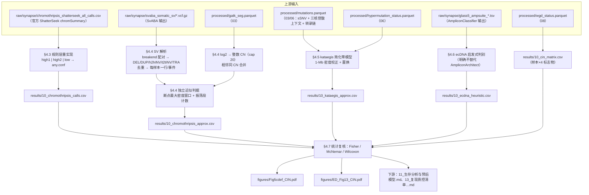
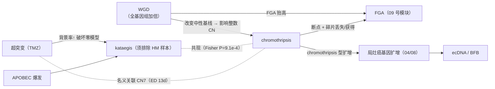

# 10 染色体不稳定性：结构变异、染色体碎裂、kataegis 与 ecDNA

> **目标文献**：The GLASS Consortium. *Divergent genomic evolution in astrocytomas and oligodendrogliomas.*
> *Nature* (2026). PDF 标识 s41586-026-11150-x. 数据：Synapse syn17038081；代码：github.com/verhaaklab/glass-idh
>
> **模块对应原文**：Fig. 5c–f（WGD / chromothripsis / 放疗关系 / kataegis）；Extended Data Fig. 13a–d（WGD 的 CN2/CN20、chromothripsis 的 CN4–8 与 CN7–8、kataegis×chromothripsis、超突变×CN 签名）；
> Fig. 5a 第 3 行的分子标志（WGD / Chromothripsis / Kataegis / ecDNA 四行的"Initial / Recurrence / Shared / No events / Unknown"）；
> Methods 中「**Structural variant calling**」「**Chromothripsis**」「**Kataegis**」「**Extrachromosomal DNA**」四段；Results 中「Increasing chromosomal instability in astrocytoma」节后半段
> **复现层级**：**混合层**——
> · ①「**规则层**」（把原文的 chromothripsis 判定规则作用在已公开的 ShatterSeek 输出表上）：**纯 L1**，成本极低，本模块**最先做**（§4.3）；
> · ②「**派生层**」（从 SV breakend 表 + CN 分段表自算聚集性/振荡段）：L1 可做，但需要 Synapse 上的 SV VCF/TXT 表（§4.4）；
> · ③「**调用层**」（重跑 SvABA / ShatterSeek / AmpliconSuite / SigProfilerClusters）：**L2**，需要受控访问的 BAM 与集群，本文图表的复现**不需要**（§4.1–§4.2 给出如何跑，并明确这是可选路径）。
>
> **前置依赖**：`09_非整倍体与FGA量化.md`（FGA/臂级读数，用于 ED Fig 13e "FGA × chromothripsis/WGD"）、
> `08_拷贝数签名与全基因组加倍.md`（WGD 标签、CN1–CN48 签名活性，Fig. 5c 与 ED 13a/b/d 的上游）、
> `06_突变负荷与超突变分类.md`（HM/non-HM 标签与 TMB，kataegis 的样本集合由它决定）、
> `03_变异检出与拷贝数调用.md`（`processed/gatk_seg.parquet`）、`04_驱动事件鉴定与互斥性分析.md`（局灶扩增清单，ecDNA 的候选区间）
> **复现难度**：★★★★☆（规则层 ★★☆☆☆；派生层 ★★★★☆；调用层 ★★★★★）　**预计工时**：4 人日（不含调用层重跑）　
> **计算资源**：规则层与派生层单机 8 核 / 32 GB 内存（SV 表约 10⁵ 行、置换检验 1000 次秒级）；调用层需集群（SvABA 单样本 62 GB 内存 / 12 核 / 数小时；AmpliconSuite 需 BAM + Mosek 许可）

---

## 1. 科学问题与逻辑位置

### 1.1 在证据链中的位置

`09` 量化了"基因组被改变了多少"，但它回答不了**"是被什么机制改变的"**。本模块引入四类**机制性标志物**——它们的共同特点是**每一个都对应一类具体的 DNA 损伤事件**，而不是一个累积量：

| 标志物 | 事件类型 | 时间尺度 | 数据需求 | 本文样本量 |
|---|---|---|---|---|
| **SV（结构变异）** | 断裂-重接 | 一次性事件 | **仅 WGS** | WGS 集合（astro 39 / oligo 56） |
| **chromothripsis** | 一条/少数染色体被"打碎再随机重接" | 一次性事件（"染色体灾难"） | WGS（SV + CN） | Fig 5d：初诊 **56/38**、复发 **56/39**（oligo/astro） |
| **kataegis** | 局部高密度点突变爆发（APOBEC） | 短时程（估计数小时至数天，原文未报告） | WGS 突变表 | Fig 5f：**45/33**（两时间点同） |
| **ecDNA** | 染色体外环状 DNA 上的癌基因扩增 | 可遗传、动态 | WGS（BAM 级重构） | WGS 局灶扩增中的 **18%**，全在 astrocytoma |
| **WGD** | 全基因组加倍 | 一次性事件 | WGS/WXS（ASCAT+Sequenza） | Fig 5c：astro **90**、oligo **89** 配对 |

> ⚠️ **导师批注（Fig 5d 的 n 里藏着一个可验证的推断）**：初诊 astro 是 **38** 而复发 astro 是 **39**，而 WGS 的 astro 总数是 39。ShatterSeek 的输入要求"**SV 与 CN 数据同时存在**"（Methods 原句："Only samples with both SV and copy-number data were retained"）。因此这个 38 vs 39 的差**恰好说明有 1 例 astro 的 WGS 初诊样本缺了 SV 或 CN 之一**。这是一条可以用公开数据**直接验证/证伪**的推断，也是本模块最便宜的 QC 之一（§6.1 QC-2）。

### 1.2 上/下游与产物契约



| 产物路径（规范名） | 生产者 | 格式/结构 | 消费方 | 生成脚本 |
|---|---|---|---|---|
| `processed/sv_events.parquet` | **10** | 每行 = 一个去重后的 SV 事件：`aliquot_barcode, chrom1, pos1, chrom2, pos2, strand1, strand2, svclass, svid` | 10/05 | `code/10_01_parse_svaba.R` |
| `processed/cn_integer_segments.parquet` | **10** | `aliquot_barcode, chromosome, start, end, total_cn`（cap 20，相邻同 CN 已合并） | 10 | `code/10_02_cn_for_shatterseek.R` |
| `results/10_chromothripsis_calls.csv` | **10** | `aliquot_barcode, sample_barcode, case_barcode, surgery_number, chromothripsis.high.conf, chromothripsis.low.conf, chromothripsis.any.conf, n_chrom_affected` | 11/12/13 | `code/10_03_chromothripsis_rules.R` |
| `results/10_chromothripsis_approx.csv` | **10** | 独立近似判据：`aliquot_barcode, chrom, max_bp_in_1mb, p_cluster_perm, n_oscillating, approx_call` | 13 | `code/10_04_chromothripsis_approx.R` |
| `results/10_kataegis_approx.csv` | **10** | `aliquot_barcode, n_kataegis_events, kataegis_burden_log2, n_windows_passing, method` | 13 | `code/10_05_kataegis_nullmodel.R` |
| `results/10_ecdna_heuristic.csv` | **10** | `aliquot_barcode, amplicon_id, region, heuristic_ecDNA, heuristic_BFB, AC_classification` | 13 | `code/10_06_ecdna_heuristic.R` |
| `results/10_cin_matrix.csv` | **10** | 样本 × {WGD, chromothripsis, kataegis, ecDNA} 的 0/1 + 时间点 + 型 | 11/12/13 | `code/10_07_assemble.R` |

> ⚠️ **导师批注（契约纪律）**：`svclass` 的**五值词表必须固定**为 `DEL / DUP / h2hINV / t2tINV / TRA`——这不是本项目的自由选择，而是 **ShatterSeek `SVs()` 构造器接受的类型词表**（官方实现 `analysis/R/GLASS-I_ShatterSeek.R:143-153` 生成的正是这五个值）。若在中间产物里写成 `deletion`/`inversion` 之类，`ShatterSeek::shatterseek()` 会在类型分派处静默失配。另一处必须固定的是 `chrom1/chrom2` 为**去 `chr` 前缀的字符**（`"1".."22","X"`），且**已剔除** decoy/random/alt contig。

### 1.3 它解决什么、不解决什么

| 它能支持 | 它**不能**支持 |
|---|---|
| 「复发的 astrocytoma 比复发的 oligodendroglioma 更常携带 chromothripsis」（Fisher 精确检验） | 「放疗**导致**了 chromothripsis」——原文的 RT 关联是**回顾性观察**（且治疗不是随机的），只能表述为"与既往放疗相关"（REPRO_SPEC §12.4） |
| 「kataegis 与 chromothripsis 在复发非超突变样本中共现」 | 「APOBEC 活性是二者共同的上游原因」——原文只说 kataegis 是 "due to APOBEC mutagenesis"，未在本文数据里证明因果关系 |
| 「复发 astrocytoma 的 WGD 比例显著升高（20% vs 7%）」的**配对**陈述 | 「WGD 之后必然产生 chromothripsis」——两者共现但时序需 SV 的克隆时序分析（本文未做，**原文未报告**） |
| 「18% 的 WGS 局灶扩增被判为 ecDNA，且全部见于 astrocytoma」 | 「oligodendroglioma 没有 ecDNA」——样本量（WGS 子集）与检测敏感性都不足以下这个否定结论（§2.4.4） |
| 四类标志物的**共现矩阵**（ED Fig 13）作为下游生存分析的分类变量 | 把它们当作**独立的**机制变量——WGD 会改变 CN 的整数表示，从而影响 chromothripsis 的检测（§2.2.5） |

---

## 2. 背景知识与原理

### 2.1 结构变异检出（SvABA）：局部重组装

#### 2.1.1 原理

**断点比对法**（Manta/DELLY/Lumpy 的主流路径）先从 discordant read pair 得到候选断点，再用 split read 精确化断点位置。它的三个固有弱点：① 依赖 read pair 插入片段分布的建模；② 短插入片段/低复杂度断点附近 split read 会错配；③ 对"断点密集区"（正是 chromothripsis 区域！）会因多个候选互相干扰而漏检。

**局部重组装法**（SvABA）：把候选区域内的所有 read 取出来做 de novo 组装，得到**组装后的 contig**，再把 contig 比对回参考——断点就从"两条短 read 的比对位置"升级为"一条长 contig 的比对断裂"。优势：① 断点定位精度到单碱基（因为 contig 长）；② 能同时给出 insertion 序列；③ **在断点密集区仍能工作**（因为组装在局部进行，不要求全局一致性）；④ 同一套 contig 还能顺带调用 indel。代价：① 内存与 CPU 高（本仓库 sbatch 给到 `--mem=62g`、`--cpus-per-task=12`）；② 只做**体细胞**调用需要配对正常样本（本仓库用 `-t tumor -n normal`）。

**为什么本文只用 WGS 做 SV**：WXS 的覆盖只在编码区，断点绝大多数落在内含子/基因间区，**断点两侧的 read 根本不存在**，局部重组装无从下手；即便偶然覆盖到外显子断点，也无法判断片段连接关系。因此原文 Methods 第一句就写死："Structural variants (SVs) were called on WGS data only"。

#### 2.1.2 与主流 SV 检出器的对比

| 工具 | 核心策略 | 断点密集区表现 | 需要正常样本 | 输出事件类型 | 本文是否使用 |
|---|---|---|---|---|---|
| **SvABA v1.2.0** | 局部 de novo 组装 + contig 回贴 | **强**（局部组装） | 是（`-n`） | 五类（DEL/DUP/h2hINV/t2tINV/TRA） | ✅ 唯一使用 |
| Manta | split-read + discordant pair 组装 | 中 | 是 | DEL/DUP/INV/BND | ❌ **原文未报告**为何排除 |
| DELLY | paired-end + split-read 联合 | 中 | 是 | DEL/DUP/INV/BND/INS | ❌ 未使用 |
| Lumpy | discordant + split + depth 证据整合，输出 VCF BND | 中偏弱 | 可选 | 全 BND | ❌ 未使用 |
| GRIDSS | 全基因组断点组装 + 图结构 | **强** | 是 | BND（可后分类） | ❌ 未使用 |
| **ShatterSeek**（下游） | **不是检出器**，是断点/CN 统计判据 | — | — | 返回 chromSummary 统计量 | ✅ chromothripsis 判定 |

> ⚠️ **导师批注**：原文**没有报告**选择 SvABA 的敏感性/特异性依据（**原文未报告**）。这在方法学上是一个可攻击点：chromothripsis 是对 SV 检出**最敏感**的表型，用不同 SV 检出器会得到不同的 chromothripsis 率（文献中已知不同检出器的一致性只有中等）。复现时**不能**换成 GRIDSS 就宣称"复现失败"——必须用同一工具链（L0 §12.2）。若要评估工具选择的影响，只能作为**方法学敏感性分析**，并显式标注为"非原文口径"。

#### 2.1.3 断裂端配对与事件重构（本文的精确规则）

SvABA 的 VCF 里，每个 SV 被表示为**两条**互相 BND 记录。`analysis/R/GLASS-I_ShatterSeek.R:80-157` 给出了把 BND 记录还原为"带类型的事件"的全部规则。**括号字符 → 链方向的映射**（第 93-94 行）：

```r
## 原文实现（GLASS-I_ShatterSeek.R:93-94）
brackets <- unlist(str_extract_all(alt, "\\[|\\]"))
strand1  <- if (length(brackets) >= 1) ifelse(brackets[1] == "[", "-", "+") else NA_character_
```

即：**ALT 中第一个括号是 `[` → `strand = "-"`；是 `]` → `strand = "+"`**。随后用"以 `chrom2:pos2` 反查 `chrom1:pos1`"的自连接取出 mate 的 `strand2`（第 129-137 行），最后按下表分类（第 143-153 行）：

| 条件（原文 `case_when` 顺序） | `svclass` | 几何含义 | 文中术语 |
|---|---|---|---|
| `chrom1 != chrom2` | **TRA** | 染色体间连接 | translocation |
| `strand1 == "-" & strand2 == "+"` | **DUP** | 断点两侧"同向"保留 | duplication |
| `strand1 == "+" & strand2 == "-"` | **DEL** | 断点之间片段丢失 | deletion |
| `(s1==+ & s2==+ & pos2>pos1)` 或 `(s1==- & s2==- & pos2<pos1)` | **h2hINV** | 两端"头对头"，倒位 | head-to-head inversion |
| `(s1==+ & s2==+ & pos2<pos1)` 或 `(s1==- & s2==- & pos2>pos1)` | **t2tINV** | 两端"尾对尾" | tail-to-tail inversion |
| 其他 | **NA** | 不合法的链组合 | — |

**三点必须注意**：

1. **`case_when` 的顺序有含义**：TRA 先判、DEL/DUP 次之、inversion 最后。若两个 BND 在不同染色体上，永远是 TRA（不进入链方向判定）。
2. **链方向映射是本实现自定的约定**。"`[` → −" 是否与 VCF 规范一致，**必须用正对照验证**（下面 §4.1 给出一条不依赖文献的正对照）。**若约定反了，DEL↔DUP、h2hINV↔t2tINV 会整体互换**（§7 陷阱表第 2 行）。
3. **去重规则**（第 166-179 行）：构造一个**无序键** `sorted(chrom1,chrom2) : sorted(pos1,pos2)`，同一键只保留 `pos1` 最小的一行。这样"一对互相 BND"被折叠成**一个**事件，与 Methods 的 "with duplicate mates collapsed to a single representative event per sample" 对应。

#### 2.1.4 参考基因组与过滤（为什么需要它们）

`analysis/slurm/GLASS-I_SvABA.sbatch:62-70` 给出的完整命令：

```bash
svaba run \
    -t "$TUMOR" \
    -n "$NORMAL" \
    -p 12 \
    -D ~/b37/dbsnp_138.b37.vcf \
    -a "${OUTDIR}/${TID}" \
    -G ~/b37/human_g1k_v37_decoy.fasta \
    -B ~/encode/hg19-blacklist.v2.bed \
    -z
```

| 参数 | 值 | 为什么必须 |
|---|---|---|
| `-G` | **hs37d5 / human_g1k_v37_decoy** | Methods 明写。**带上 decoy 序列**让原本会错配到主染色体的 read 落到 decoy 上，减少假阳性断点。**代价**：输出的坐标体系里混入了 `hs37d5`/`GL000*`/`KI270*` 等 contig，下游**必须剔除**（§2.1.5） |
| `-D` | **dbSNP build 138 (b37)** | 用常见 germline indel/SNP 位点做过滤，降低人群多态被误判为体细胞 SV 的概率。**版本必须与参考一致**（b138 是 b37 的匹配版本；用 GRCh38 的 b151 会因坐标不匹配而失效） |
| `-B` | **ENCODE hg19 blacklist v2** | 剔除黑名单高信号区（着丝粒、端粒、rDNA、segdup 密集区）——这些区域**天然**有大量虚假断点，若不剔除会**系统性地制造"断点聚集"**，直接把 ShatterSeek 的聚类检验骗过（§7 陷阱表第 3 行） |
| `-z` | — | 输出压缩 VCF（`.vcf.gz`），本仓库下游用 `pattern = "svaba\\.somatic\\.sv\\.vcf\\.gz$"` 匹配 |

#### 2.1.5 下游过滤（SV 进入 ShatterSeek 之前）

`GLASS-I_ShatterSeek.R` 在解析后还做两层过滤：

```r
valid_chroms <- c(as.character(1:22), "X")          # 只保留常染色体 + X
...
filter(chrom1 %in% valid_chroms, chrom2 %in% valid_chroms,
       !str_detect(alt, "hs37d5|GL000|KI270|decoy|random|_alt"))
```

→ 对应 Methods："Only autosomes and chromosome X were retained, and events on decoy, random or alternative contigs were excluded."
**注意**：Y 染色体被排除了（`valid_chroms` 不含 Y）。这在**跨性别可比性**上是合理的（同 `09` 的臂级处理），但也意味着**任何性染色体上的 SV/chromothripsis 都不会被发现**——这是一个未被声明的方法学约束（**原文未报告**该选择对结果的影响）。

### 2.2 chromothripsis（ShatterSeek）：三大证据与阈值

#### 2.2.1 什么是 chromothripsis，以及为什么要三条证据同时满足

chromothripsis（"染色体碎裂"）指**一条（或少数）染色体在一次灾难性事件中被大量断裂，随后以随机顺序重新连接**。它在测序数据上的指纹是三个**相互独立**的特征：

| 证据 | 数据来源 | 统计量（`chromSummary` 列名） | 直觉 | 只要这一条就够吗？ |
|---|---|---|---|---|
| **① 断点聚集** | SV 位置 | `chr_breakpoint_enrichment`、`pval_exp_cluster` | 一次灾难会在**一条**染色体的局部堆出远超背景密度的断点 | ❌ 单靠它会把"断点爆炸区（breakpoint shower）"和"多轮独立 SV 累积区"误判 |
| **② 振荡的双态拷贝数** | CN 分段 | `max_number_oscillating_CN_segments_2_states` | 断-接的碎片**来回翻转**在两个拷贝数状态之间（如 2↔3），形成"锯齿" | ❌ 单靠它会把"局部扩增的边界效应"误判 |
| **③ 碎片连接的随机性** | SV 的片段顺序 | `pval_fragment_joins` | 碎片的连接顺序**与参考顺序无关**（随机洗牌），而不是"删了一段、又插到别处" | ❌ 单靠它会把"复杂重排但非灾难性"的事件纳入 |

**三条同时满足**才能把假阳性压下来。代价是**敏感性下降**——这也是为什么原文还要设一个"低置信度"档。

#### 2.2.2 本文的高/低置信度规则（逐条解释，含实现级对应）

Methods 原文：

> "High-confidence events required more than five intrachromosomal SVs, more than six oscillating segments, significant break-point enrichment or clustering (P < 0.05) and non-random fragment joins (P > 0.05); low-confidence events met similar criteria, with four to six oscillating segments. Alternatively, high-confidence events required more than two intrachromosomal SVs, with more than three interchromosomal events and more than six oscillating segments."

**实现**（`analysis/R/GLASS-I_Chromothripsis.R:27-49`，逐行对应）：

| 规则 | 实现条件 | 与 Methods 的对应 | 直觉 |
|---|---|---|---|
| `intrachrom_SVs` | `number_DEL + number_DUP + number_h2hINV + number_t2tINV` | "intrachromosomal SVs" | 前四个计数是**同一条染色体内**的 SV 计数 |
| `interchrom_SVs` | `inter_number_DEL + inter_number_DUP + inter_number_h2hINV + inter_number_t2tINV` | "interchromosomal events" | — |
| **`high.confidence.test1`** | `intrachrom_SVs > 5 & max_number_oscillating_CN_segments_2_states > 6 & (chr_breakpoint_enrichment < 0.05 \| pval_exp_cluster < 0.05) & pval_fragment_joins > 0.05` | ">5 染色体内 SV、>6 振荡段、断点富集或聚类 P<0.05、非随机 fragment joins P>0.05" | **主路径**：三条证据全满足 |
| **`high.confidence.test2`** | `intrachrom_SVs > 2 & (interchrom_SVs > 3 \| number_TRA > 3) & max_..._2_states > 6 & pval_fragment_joins > 0.05` | ">2 染色体内 + >3 染色体间 + >6 振荡段" | **替代路径**：**放宽**断点数（>2 而非 >5），但**要求有染色体间事件**；**不再要求断点富集/聚类** |
| **`low.confidence.test`** | `intrachrom_SVs > 5 & max_..._2_states > 3 & max_..._2_states < 7 & (chr_breakpoint_enrichment < 0.05 \| pval_exp_cluster < 0.05) & pval_fragment_joins > 0.05` | "4–6 个振荡段" | `>3 & <7` 即 **4/5/6** —— 与 Methods 的"four to six"**精确一致** ✓ |
| 样本级汇总 | `chromothripsis.any.conf = any(high1 \| high2 \| low)` 在该 aliquot 的所有染色体上 | — | "只要有一条染色体满足任一档即算该样本有 chromothripsis" |

**逐条解释为什么这么设**：

1. **为什么 >5 而不是 ≥5**：`>` 严格大于，5 个断点的染色体**不算**。这个边界值在 40 条染色体上会实际命中（小染色体上 5 个 SV 并不罕见）。
2. **为什么 test2 放宽断点数却要求染色体间事件**：断点少（3–5 个）时"聚集性"检验功效不足（Poisson 检验在计数低时不可靠），所以换一条**不同**的证据路径——"既有染色体内重排、又有染色体间连接、且有锯齿 CN"。这实际上是在覆盖**染色体碎裂后的重排（chromoplexy 样）或断裂-融合链**的情形。
3. **为什么 test2 不要求断点富集**：因为断点数少时该检验容易不显著（功效问题），强行要求会漏掉真事件。
4. **`pval_fragment_joins > 0.05` 的方向（★ 原文措辞有误）**：
   > ⚠️ **导师批注**：Methods 写 "**non-random** fragment joins (P > 0.05)"，这在统计上**自相矛盾**——P > 0.05 意味着"**无法拒绝**随机性"，即碎片连接**与随机洗牌不可区分**。ShatterSeek 的原始判据（ref 54）要求的正是"**碎片连接顺序的随机性**"（chromothripsis 的碎片是被随机拼回去的）。实现代码也确实是 `pval_fragment_joins > 0.05`。因此正确表述应为 "**random** fragment joins (P > 0.05)" 或 "fragment joins not significantly non-random"。**复现时按代码的方向**（`> 0.05`），并把这条登记到 `13`。
5. **NA 的处理**：`max_number_oscillating_CN_segments_2_states` 若为 NA 被置为 0（第 32 行 `if_else(is.na(...), 0, ...)`），这意味着"无振荡信息"会被当作"振荡段数 = 0"→ **不可能**通过任何高置信规则（合理），但会**静默地把"数据缺失"变成"证据不足"**。若整条染色体的 CN 分段质量差导致该列全为 NA，该染色体就不可能被调用——这是**检测敏感性的一个隐性损失点**（§7 陷阱表第 5 行）。

#### 2.2.3 为什么"振荡段数"依赖拷贝数分割质量

`max_number_oscillating_CN_segments_2_states` 是**分段序列**的函数。具体地：

- ShatterSeek 先把 **log2 拷贝比转成整数总拷贝数**（本文：`total_cn = round(2 * 2^log2cr)`，**上限 20**），再把**相邻且 CN 相同的段合并**（`GLASS-I_ShatterSeek.R:48-75`），最后在合并后的序列上找"两个状态之间的最长交替段"。
- 因此这个量对三件事敏感：
  1. **整数化**：`round()` 会把 `log2cr = 0.45`（线性比 1.37 → CN 2.73）压成 3，`log2cr = 0.30`（CN 2.31）压成 2。**一个 0.15 的 log2 差就决定了它是否参与"振荡"**。低纯度样本的 log2 被压缩（见 `09_非整倍体与FGA量化.md` §2.5），**振荡信号也随之被抹平**——所以 chromothripsis 的检出率本身受纯度影响。原文未报告这一敏感性（**原文未报告**）。
  2. **分段粒度**：分割太粗 → 振荡被合并掉（假阴性）；太细 → 噪声造出假振荡（假阳性）。
  3. **相邻合并的判据**：本文用"`start == lag(end) + 1` 且 `total_cn` 相同"作为同一 block（第 63-67 行）——即**要求段在坐标上严格连续**。若上游分段之间有 1 bp 的缝隙（半开区间处理不当），合并会**静默失败**，段数虚增，振荡段数也随之虚增 → **假阳性**。这是本项目 `03`→`10` 之间必须核对的一处（§7 陷阱表第 6 行）。

#### 2.2.4 CN=0 的"哨兵值"技巧（读源码才能发现的一处关键实现）

`GLASS-I_ShatterSeek.R:208-220`：

```r
dd <- ind_scna
dd$total_cn[dd$total_cn == 0] <- 150000          # 哨兵值：避免 CN=0 在加权 coverage 中“消失”
dd$total_cn[is.na(dd$total_cn)] <- 0
dd <- as(dd, "GRanges")
cov <- coverage(dd, weight = dd$total_cn)        # 用 CN 作为权重铺一条“拷贝数轨道”
dd1 <- as(cov, "GRanges")
dd1 <- as.data.frame(dd1); dd1 <- dd1[dd1$score != 0, ]
dd1$total_cn[dd1$total_cn == 150000] <- 0        # 还原为 0
```

原因：`GenomicRanges::coverage(weight = x)` 把权重为 **0** 的区间视为"无覆盖"而**丢弃**——但**纯合缺失（CN=0）恰恰是 chromothripsis 锯齿里最重要的状态之一**（2↔0 的振荡）。用 150000 作哨兵值（在 CN 已被 cap 到 20 的前提下不可能冲突）把它保留下来，铺完后还原。**这个技巧是"CN=0 段不能在预处理里丢掉"的通用解法**，复现时若照抄更高层的逻辑而不照抄这一段，会系统性地少掉一类振荡模式。

#### 2.2.5 与 WGD 的耦合（一个必须声明的限制）

整数 CN 的转换式 $CN = \mathrm{round}(2 \cdot 2^{\log_2 R})$ **假设中性基线是二倍体**。对 **WGD 肿瘤**（中性基线是 4），若 `log2_copy_ratio` 已经过倍性校正（GATK/ASCAT 的 denoised ratio），则 $CN$ 是正确的绝对拷贝数（中性 → 4）；若未校正，则中性 → 2，**所有 CN 被系统性压低一半**。

影响：**振荡检测关心的是"两个状态之间交替"**，把 (2,4) 统一压成 (1,2) 通常仍能看到交替；但 ShatterSeek 的部分判据会检查状态的绝对范围与相邻差，**绝对值的错位可能改变判定**。本文**未报告**该路径是否对 WGD 做了倍性校正（**原文未报告**）——这是一个应登记的 A 类口径缺失（§5 D-10-3）。**可验证的做法**：把我们的 `total_cn` 与已知 WGD 样本的 Sequenza/ASCAT 绝对拷贝数对照，看中性段是否落在 4 而不是 2。

#### 2.2.6 与其它 chromothripsis 检出器的关系；"1–3 条染色体"的讨论

| 工具 | 判据 | 与 ShatterSeek 的差异 |
|---|---|---|
| **ShatterSeek**（ref 54，本文使用） | SV（SvABA/其他）+ CN 分段 → 三条证据的统计检验 | 需要 SV 数据；阈值显式可查；输出 `chromSummary` 便于逐条复算 |
| CTLP / CTLPScanner | 只用 **CN 分段**（不要求 SV），找"锯齿"区域 | **不需要 SV → 可用于 WXS**；但假阳性更高（局部扩增边界会产生锯齿），这也是本文没有用它做 WXS chromothripsis 的原因（**原文未报告**该选择依据） |
| 其他（如基于 read-depth 的检测） | 深度信号 | 分辨率低，无法区分 chromothripsis 与复杂扩增 |

**关于 "1–3 条染色体"**：chromothripsis 的经典定义强调"**一条或少数几条**染色体受累"。本文的判定是**逐染色体**进行的（`chromSummary` 每行一条染色体），样本级的 `chromothripsis.any.conf` 只要求**任一**染色体满足——因此一个累及 10 条染色体的样本会被记为"有 chromothripsis"，**不检查是否只累及 1–3 条**。这在统计上更敏感（利于发现事件），但**放宽了经典定义**。原文未讨论这一取舍（**原文未报告**）；复现时我们**额外输出** `n_chrom_affected`（每样本受影响的染色体数），以便做"严格定义（1–3 条）vs 本文定义"的敏感性分析（§5 D-10-4）。

### 2.3 kataegis：局部超突变与"为什么必须做模拟零分布"

#### 2.3.1 机制

kataegis（"雷雨"）指基因组上**成簇出现**的密集点突变。其典型分子特征：**C>T / C>G 在 TpCpW 上下文**富集（APOBEC 家族胞苷脱氨酶的签名 SBS2/SBS13），且同一簇内的突变往往**在同一条链**上（转录链偏倚）。生物学上认为是一次 APOBEC 爆发在 **单链 DNA 暴露**期间同时损伤了局部一段序列。

#### 2.3.2 为什么不能简单地"数≥6 个突变在 1 kb 内"

朴素定义（Alexandrov 2013 的原始定义：≥6 个突变且平均间距 ≤1 kb）有一个致命问题：**它完全没有考虑背景突变率**。一个 TMB 为 10 mut/Mb 的肿瘤，在 1 kb 内出现 6 个突变并非罕见；而一个 TMB 为 0.5 mut/Mb 的肿瘤出现同样密度则是**极端**异常。同一个绝对阈值把两者等同，等于把"高突变负荷"误读成"kataegis"。

**本文（以及 SigProfilerClusters）的做法**：**为每个样本构造一个模拟零分布**，得到**经验性的簇内距离阈值**，再判簇。原文：

> "For each sample, 100 simulated genomes were generated under a pentanucleotide context model, preserving chromosome-level mutation burdens and transcriptional strand bias, to derive empirical intramutational distance thresholds."

**三个"保留"各自在防什么**：

| 模拟时保留的结构 | 若不保留会怎样 |
|---|---|
| **五核苷酸上下文模型**（pentanucleotide context） | 突变的**上下文偏好**（如 CpG 甲基化位点的 C>T 高发）会造成"假成簇"——CpG 岛密集区天然突变密度高。按上下文重采样能消除这一偏差 |
| **染色体级突变负荷**（chromosome-level mutation burdens） | 各染色体的拷贝数/染色质状态不同 → 突变密度不同。若把全基因组的突变均匀撒到所有染色体，会在长染色体上低估、短染色体上高估密度 |
| **转录链偏倚**（transcriptional strand bias） | 转录链与模板链的突变率不同（TC-NER）。不保留会在"转录链富集"这一 kataegis 特征上产生假信号 |

**实现**（`analysis/bash/kataegis_pipeline.sh`，命令行参数即文档）：

```text
--sim-contexts 96,ID        # 模拟用 96 三核苷酸上下文 + ID（indel）上下文
--simulations 100           # 每个样本 100 个模拟基因组（与原文一致）
--cluster-context 96        # 聚类判定在 96 维上下文空间
--cluster-subcontexts 6144  # 子上下文（96 × 64，五核苷酸的展开）
--window-size 1000000       # 1-Mb 窗口做区域密度校正（与原文一致）
```

`SigProfilerSimulator` 调用（`kataegis_pipeline.sh:478-485`）：

```python
sigSim.SigProfilerSimulator(args.project, str(input_root) + os.sep, args.genome,
                            contexts=sim_contexts, chrom_based=True, simulations=args.simulations)
```

**`chrom_based=True` 正是"保留染色体级负荷"的实现开关**。

`SigProfilerClusters` 调用（第 493-510 行，逐参数都有含义）：

```python
hp.analysis(args.project, args.genome, args.cluster_context, cluster_subcontexts,
            str(input_root) + os.sep,
            analysis="all", sortSims=True, subClassify=True, correction=True,
            calculateIMD=True, includedVAFs=True, plotIMDfigure=True, plotRainfall=True,
            windowSize=args.window_size, max_cpu=args.max_cpu, probability=True)
```

| 参数 | 作用 |
|---|---|
| `correction=True` | **区域密度校正**（对应原文 "genome-wide correction for regional mutation density using 1-Mb windows"） |
| `windowSize=1000000` | 1-Mb 窗口（原文口径） |
| `includedVAFs=True` | 判簇时考虑 **VAF**（对应原文 "variant allele frequencies were considered during subclassification"）——只有同一克隆/相似 VAF 的突变才可能是同一次爆发 |
| `probability=True` | 输出每个簇的**概率性判别**而非硬阈值 |
| `calculateIMD=True` | 计算簇内平均间距（IMD），这是 kataegis 的核心量化 |

**事件聚合与 burden**（第 592-600 行 + Methods）：

```r
kataegis_count <- cluster_df %>% distinct(samples, clust_group) %>%
  count(samples, name = "kataegis_event_count")     # 共享 clust_group 的突变算 1 个事件
```

→ 对应 Methods："mutations sharing a cluster group identifier were aggregated and defined as a single kataegis event… the number of events per sample was counted to establish the kataegis burden (**log2(kataegis count + 1)**)"。

**为什么是 log2(count+1)**：kataegis 事件数是**重尾计数**（多数样本 0–3，少数几十）。① `+1` 让 0 可被取对数（避免 `log(0)`，且 0 映射到 0）；② log2 压缩右尾，使计数可近似当作连续变量进入线性模型/箱线图；③ **代价**：log2 变换后"事件数从 1 到 2"与"从 16 到 32"在数值上是同等的——**因此本文的 Fig. 5f 用的是"有/无"二分类（`kataegis_event != 0`），而不是 burden 的连续值**，这一点很关键（§2.3.4）。

#### 2.3.3 为什么必须排除超突变样本

Methods 最后一句："Kataegis analyses were restricted to non-hypermutator samples to avoid violation of the genome-wide background mutation rates."

**机制**：TMZ 诱导的超突变（SBS11）以**近乎均匀**的方式在基因组上铺开数万到数十万个突变。此时：
1. **背景率本身被破坏**：全基因组背景突变率从 ~1–2 mut/Mb 跳到 >10 mut/Mb，**任何**局部区域都会出现"高密度"；
2. **模拟零分布失效**：模拟基因组是按"该样本的染色体级负荷 + 上下文"重采样的，若样本负荷本身来自一个**非泊松过程**（TMZ 的烷化损伤有序列偏好且分布相对均匀但量极大），模拟出的零分布不再代表真实背景 → 判据失准；
3. **生物学混淆**：超突变样本里的"簇"更可能来自 TMZ 的随机聚集而非 APOBEC 爆发，把它们算成 kataegis 会**把治疗相关现象错标为 APOBEC 现象**。

**排除后的样本量**：Fig. 5f 的 n = **45（oligo）/ 33（astro）**，明显小于 WGS 全集的 56/39 —— 差额正是被超突变过滤掉的样本。**注意**：这也是 SPEC §8 把 "n=45/33" 误挂在 chromothripsis 名下时需要纠正的地方（§3 表末的批注）。

> ⚠️ **导师批注（SPEC §8 的一处串行）**：本项目写作简报 §8 的"CIN"小节把 n 与 P 值排成了 "WGD 初始 n=56/38、复发 n=56/39；McNemar P=0.55/0.006；Fisher P=2.1e-6/6.6e-6（WGD）/…；chromothripsis n=45/33，Fisher P=0.23/0.01；kataegis Fisher P=0.24/0.046"。**核对原文后确认正确的归属是**：
> · **WGD（Fig 5c）**：astro n=**90**、oligo n=**89**（配对）；**McNemar P=0.006（astro）/ 0.55（oligo）**；
> · **chromothripsis（Fig 5d）**：初诊 n=**56/38**、复发 n=**56/39**（oligo/astro）；**Fisher P=2.1×10⁻⁶（初诊）/ 6.6×10⁻⁶（复发）**；
> · **chromothripsis × 既往放疗（Fig 5e）**：oligo n=**51**、astro n=**38**；Fisher **P=0.24 / 0.046**；
> · **kataegis（Fig 5f）**：n=**45/33**（两时间点同）；Fisher **P=0.23（初诊）/ 0.01（复发）**。
> 本文档**以原文为准**（已逐一用 Fisher 精确检验重算验证，见 §6.1 QC-4），并把简报的串行登记到 `13`。

#### 2.3.4 与 SigProfilerClusters 的差异（我们的简化零模型要对齐到哪里）

| 环节 | SigProfilerClusters（本文） | 我们的简化零模型（§4.5） | 差异后果 |
|---|---|---|---|
| 零模型 | **每样本 100 个模拟基因组**，五核苷酸上下文 + 染色体级负荷 + 转录链偏倚；据此导出**经验距离阈值** | 两条腿：① 经典硬阈值（≥6 突变且平均 IMD ≤1 kb）；② 1-Mb 窗口间**可交换性置换**（保留突变总数与"被占用窗口数"，**丢弃真实区域密度**） | ⚠️ 两个方向相反的偏差会互相抵消一部分：不做上下文/链偏倚 → 高估；零模型偏保守 + 硬阈值 → 低估。**净效应不可预测，因此只看方向** |
| 密度校正 | `correction=True`（1-Mb 窗口） | 1-Mb 窗口分层（同一尺度，机制不同） | ✅ 尺度一致 |
| 簇边界 | 概率化（`probability=True`），含 IMD 与 VAF 子分类 | 硬阈值 + BH 校正 | ⚠️ 数量系统性偏低 |
| 输出 | 每突变一个概率 + 簇编号 | 每样本一个事件计数 | ⚠️ 计数**只能用于方向性验证**，不能与原文数值逐位比对 |
| 样本集合 | 非超突变 WGS | 同样非超突变 WGS（**必须一致！**） | ✅ 一致，否则差异无法归因 |

**结论**：简化零模型的定位是「**独立复现方向 + 给读者一个可读的入门实现**」，**不是**替代 SigProfilerClusters。若两者方向相反，**以 SigProfilerClusters 为准**（因为原文用的是它）。

### 2.4 ecDNA 与 BFB

#### 2.4.1 AmpliconArchitect 的重构原理

AmpliconArchitect（AA）拿到一个**局灶扩增区间**（由 CN 分段给出候选），然后：

1. **局部重比对与 CN 估计**：在扩增区内以更细的窗口算拷贝数曲线；
2. **构建断点图（breakpoint graph）**：节点 = 扩增区内的**断点**，边 = ① **拷贝数边**（相邻断点之间按 CN 复制若干份） ② **SV 边**（由 discordant/split read 给出的连接）；
3. **求解图上的路径/环**：用整数线性规划（**需要 Mosek 商业求解器许可**，SETUP.md 明确列出）找一组"拷贝数最优且与 SV 证据一致"的**环（cycle）与路径（path）**；
4. **输出分类**（由 AmpliconClassifier 完成）：
   - **ecDNA**：重构出**环状**结构（cycle），且**没有**可识别的染色体整合位点；
   - **BFB（breakage–fusion–bridge）**：重构出**线性**结构并带有**倒位"阶梯"**（CN 沿区间单调递增的 fold-back 模式）；
   - **linear amplification**：线性、无 fold-back、通常 CN 较低。

**关键点**：AA 的输入**不只是 VCF**，它需要 **BAM**（局部重比对与 CN 估计都要读原始 read）。因此"只有 SV VCF + CN 分段"的复现者**无法调用 AA**——这是本篇最硬的资源门槛（§7 陷阱表第 8 行）。

#### 2.4.2 本文的调用方式

`analysis/snakemake/ampsuite.smk` + `analysis/python/ampsuite_manifest.py`：

- **case-based multi-sample 模式**：manifest 由 `ampsuite_manifest.py` 生成，**每个 case 一行肿瘤 BAM + 一行正常 BAM**，然后一次 `GroupedAnalysisAmpSuite.py -i manifest.tsv -o outdir -t threads --ref GRCh37` 处理整个 case。
- **为什么必须 multi-sample**：同一患者的多时间点样本**共享正常基因组且有克隆关系**，联合分析可以让 CN 与 SV 的归一化一致、避免把"两个时间点各自的局部噪声"误判为独立扩增；这也是原文 "Case-based multi-sample mode was used with default AmpliconSuite parameters" 的含义。
- **分类到样本级**（`analysis/R/GLASS-I_Amplicon_Architect.R:44-45`）：

```r
group_by(`Sample name`) %>%
  mutate(ecDNA = ifelse(any(Classification == "ecDNA"), "ecDNA", "no_ecDNA")) %>%
  mutate(ecDNA = ifelse(is.na(ecDNA), "no_ecDNA", ecDNA))   # NA = 该样本根本没检出 amplicon
```

**注意最后一行**：`NA → no_ecDNA` 是一个**重要但危险**的默认——它把"**没有扩增子**"和"**有扩增子但不是 ecDNA**"合并成同一个阴性类。这在下游统计上是可接受的（因为问题本身是"有没有 ecDNA"），但**不能**用这个字段去说"这些样本没有复杂扩增"。原文图 5a 第 3 行有专门的 `Unknown` 类别，说明作者也意识到"缺失"与"阴性"应区分。

#### 2.4.3 ecDNA 的判读难点

| 难点 | 机制 | 后果 |
|---|---|---|
| **ecDNA vs BFB 的区分** | 两者都是"复杂局灶扩增"，且 BFB 的产物**可以**最终环化（从而既有 BFB 特征又有环） | 分类边界模糊；AC 靠"是否有 fold-back 阶梯"与"是否必须整合在染色体上"来分 |
| **ecDNA vs 线性扩增** | 低拷贝（CN 3–4）的短扩增可能既不像环也不像阶梯 | 会落入 linear amplification，**降低 ecDNA 检出率** |
| **多区域取样不足** | ecDNA 在细胞间**不等分配**（有丝分裂时随机分配），同一肿瘤不同区域的 ecDNA 拷贝数差异极大 | 单点活检可能**完全漏检**；本文的样本多为单点（除 5 例多区域 WXS，见 `06`），因此 ecDNA 率是**下限估计** |
| **检测敏感性受 CN 依赖** | CN 太低（<3–4）时 AA 无法重构出有意义的图 | 低水平 ecDNA 被漏掉 |
| **WXS 完全无法检测** | AA 需要读深度 + 断点，WXS 只覆盖外显子 | 本文 ecDNA 只可能在 WGS 子集上算 → **分母是 WGS 局灶扩增，不是全部局灶扩增** |

#### 2.4.4 "18% 且全在 astrocytoma"的解读边界（必须谨慎）

原文：

> "A minority (**18%**) of the individual **WGS-derived** focal gene amplifications were classified as extrachromosomal, and **all were identified in the astrocytomas**."

**这句话的三个限定词都被作者写出来了**（"minority"、"WGS-derived"、"individual … amplifications"），复现时必须保留：

1. **分母是个体扩增事件，不是患者**。18% = 被分类为 ecDNA 的**扩增子数 / WGS 检出的局灶扩增子总数**。因此**不能**说"18% 的 astrocytoma 有 ecDNA"。
2. **分母只含 WGS**。WGS 只有 astro 39 + oligo 56 例，而 WXS 有 astro 55 + oligo 33 例——WXS 部分的扩增子**根本没被检查**。若 ecDNA 在 WXS 样本里同样常见，真实比例会被低估。
3. **"all in astrocytomas" 是"零个 oligo 阳性"**。这是一个**阴性结果**。在 WGS 的 oligo 里，局灶扩增本身就很罕见（原文："There was no significant enrichment of amplifications or homozygous deletions in recurrent oligodendrogliomas"），**分母小 → 零阳性不构成"oligo 没有 ecDNA"的证据**。按 REPRO_SPEC §12.5，这类阴性必须连同其**分母**一起报告（§6.1 QC-9 要求我们输出分母 n）。

> ⚠️ **导师批注（一句话的过度解读风险）**：Discussion/ED Fig 14 把 "Foc. onc. amp." 与 "ecDNA" 并列为 astrocytoma 的特征，容易让读者读成"ecDNA 是 astrocytoma 特异的"。**本文数据不支持该强度**：正确的表述是"在 WGS 可评估的局灶扩增中，被判为 ecDNA 的事件全部来自 astrocytoma 样本；oligodendroglioma 的 WGS 可评估扩增事件数极少，无法排除其存在"。这条应进 `13` 的"过度解读"清单。

### 2.5 四类标志物之间的关系（为什么要用共现矩阵而不是单变量）



**四条需要动手验证（而不是照抄）的关系**：

| 关系 | 原文给出的证据 | 我们的验证方式 |
|---|---|---|
| chromothripsis × 既往放疗 | astro Fisher P=0.046；oligo P=0.24（Fig 5e） | §4.7（直接重算） |
| kataegis × chromothripsis | 复发非 HM 样本合并，Fisher **P=9.1×10⁻⁴**（ED Fig 13c） | §4.7。⚠️ **注意该检验把两型合并**，且限制在"复发非 HM"，样本量大幅减少 → p 值对单元格计数极敏感 |
| 超突变 × chromothripsis 签名 CN7 | "nominal association"（ED Fig 13d，`p <= 0.05` 未校正，橙色） | 复现时**必须**同时报未校正与 BH 校正（L0 §7） |
| WGD × FGA / chromothripsis × FGA / HM × FGA | ED Fig 13e–g，均显著更高 | 属 `09` 模块；本模块只提供标签 |

---

## 3. 原文逐句拆解

| # | 原文句（节选） | 中文转述与"这一步在算什么" | 对应操作 / 参数 / 脚本 / 缺失项 |
|---|---|---|---|
| 1 | "Structural variants (SVs) were called on WGS data only using SvABA (v.1.2.0)⁵³, against the **hs37d5** reference genome, incorporating **dbSNP build 138 (b37)** and excluding **ENCODE hg19 blacklist** regions." | SV 只在 WGS 上调用；参考 = hs37d5（含 decoy）；germline 过滤用 dbSNP b138；黑名单用 ENCODE hg19 | `analysis/slurm/GLASS-I_SvABA.sbatch`：`svaba run -t tumor -n normal -p 12 -D ~/b37/dbsnp_138.b37.vcf -a OUT -G ~/b37/human_g1k_v37_decoy.fasta -B ~/encode/hg19-blacklist.v2.bed -z`。**注意 sbatch 里 `--array=1-102%5`、`--mem=62g`、`--cpus-per-task=12`、`--time=23:59:59`——即当初是 102 个 case 分批跑的**（这个 102 是当时的 case 数，与最终 183 例不同，说明 SV 调用跑在较早的一版队列上，**原文未报告是否为最终队列重跑**） |
| 2 | "Somatic SVs were extracted from SvABA VCFs and parsed in R, with break-end records resolved to obtain **partner coordinates and strand orientation**." | 解析 BND 的 ALT 字符串，取出 mate 的 `chrom:pos` 与链方向 | `GLASS-I_ShatterSeek.R:80-97` 的 `parse_bnd_alt()`：正则 `([0-9XY]+\|chr[0-9XY]+):[0-9]+` 取 mate 坐标；取 ALT 中**第一个** `[` 或 `]` 定链（`[`→`-`，`]`→`+`）。⚠️ 该约定的正确性需用正对照验证（§4.1） |
| 3 | "Only **autosomes and chromosome X** were retained, and events on **decoy, random or alternative contigs** were excluded." | 只保留 chr1–22 + X；剔除 hs37d5/GL000/KI270/decoy/random/_alt | 代码：`valid_chroms <- c(as.character(1:22), "X")` + `!str_detect(alt, "hs37d5\|GL000\|KI270\|decoy\|random\|_alt")`。**Y 染色体也被排除**（`valid_chroms` 不含 Y），理由应与 `09` 的臂级一致（跨性别可比性），但**原文未报告**这一处理及其影响 |
| 4 | "**Reciprocal break ends were paired** to reconstruct complete events and classified as deletions, duplications, head-to-head inversions, tail-to-tail inversions or translocations, with **duplicate mates collapsed to a single representative event per sample**." | 互配 BND → 一个事件；五类词表；去重 | 分类 `case_when`（`GLASS-I_ShatterSeek.R:143-153`，见 §2.1.3 表）；去重用**无序键** `sorted(chrom) : sorted(pos)` + `slice_min(pos1)`（第 166-179 行）。**五值词表 = ShatterSeek `SVs()` 接受的类型** |
| 5 | "Chromothripsis events were identified using **ShatterSeek (v.1.1)**⁵⁴." | 用 ShatterSeek 的输出（每染色体一行 `chromSummary`）作为判定基础 | `library(ShatterSeek)`；`SVs()` + `CNVsegs()` → `shatterseek()`（`GLASS-I_ShatterSeek.R:225-245`） |
| 6 | "Copy-number segments were **derived from GATK segmentation output for WGS aliquots**, and somatic SVs were called using SvABA." | CN 输入 = GATK 分段（**WGS aliquot 子集**），SV 输入 = SvABA | SQL：`SELECT * FROM variants.gatk_seg` + `filter(str_detect(aliquot_barcode, "-WGS-"))`（第 36-38 行）。**这解释了为什么 chromothripsis 只有 WGS 子集** |
| 7 | "**Only samples with both SV and copy-number data were retained** for downstream chromothripsis analyses." | 取 SV 与 CN 的交集 | `aliquots_to_process <- intersect(scna_aliquots, sv_aliquots)`（第 181-184 行）。**这正是 Fig 5d 初诊 astro = 38 < 39 的原因**（§1.1 批注） |
| 8 | "Of the copy-number segments, log2 copy ratios were converted to **integer total copy number** and **capped at 20**, and adjacent segments with an **identical copy number were merged**." | 整数化 + 上限 20 + 相邻同 CN 合并 | `log2_to_total_cn <- function(log2cr, max_cn=20) { cn <- round(2 * (2^log2cr)); cn[cn > max_cn] <- max_cn; as.integer(cn) }`（第 48-52 行）。合并：`new_block = is.na(lag(end)) \| start != lag(end)+1 \| total_cn != lag(total_cn)`（第 62-74 行）。⚠️ **`2 * 2^log2cr` 假设中性基线是二倍体**，WGD 样本需核对（§2.2.5） |
| 9 | "Chromothripsis was assessed on the basis of **breakpoint clustering**, **oscillating two-state total copy-number patterns** and **fragment-join randomness**, and **chromosome-level summaries** were used to define confidence categories." | 三条独立证据在**染色体**层面汇总，再升到样本层面 | `chromSummary` 的 `chr_breakpoint_enrichment / pval_exp_cluster / max_number_oscillating_CN_segments_2_states / pval_fragment_joins`；样本级：`any(high1 \| high2 \| low)` 在**所有染色体**上取"存在" |
| 10 | 高/低置信规则（>5 染色体内 SV、>6 振荡段、断点富集或聚类 P<0.05、fragment joins P>0.05；低置信 4–6 振荡段；替代路径 >2 染色体内 + >3 染色体间 + >6 振荡段） | 三条路径的布尔规则 | **逐行对照表见 §2.2.2**；实现 `GLASS-I_Chromothripsis.R:33-48`。**"4–6 振荡段" = `>3 & <7`，精确一致 ✓** |
| 11 | (fragment joins) Methods 用词 "**non-random** fragment joins (P > 0.05)" | **措辞自相矛盾**（P>0.05 表示"无法拒绝随机"） | 实现是 `pval_fragment_joins > 0.05`，与 ShatterSeek 原始判据（ref 54 要求碎片连接**随机**）一致。按代码方向复现；登记 `13`（§2.2.2 第 4 条批注） |
| 12 | "Kataegis events were called using **SigProfilerSimulator** and **SigProfilerClusters (v.1.2.2)**⁵⁵ as previously described." | 两阶段：先模拟零分布，再判簇 | `analysis/bash/kataegis_pipeline.sh`（798 行的驱动脚本，带 `--dry-run`、`--steps filter,input,cluster,count,all`、resume 标记文件） |
| 13 | "For each sample, **100 simulated genomes** were generated under a **pentanucleotide context model**, preserving **chromosome-level mutation burdens** and **transcriptional strand bias**, to derive **empirical intramutational distance thresholds**." | 零分布必须保留三类结构 | `sigSim.SigProfilerSimulator(project, input_root, genome, contexts=c("96","ID"), chrom_based=True, simulations=100)`。**`chrom_based=True` 就是"保留染色体级负荷"的开关**；五核苷酸通过 `--cluster-subcontexts 6144`（= 96×64）体现 |
| 14 | "Cluster detection incorporated **genome-wide correction for regional mutation density using 1-Mb windows**, and **variant allele frequencies** were considered during subclassification." | 区域密度校正 + VAF 参与子分类 | `hp.analysis(..., correction=True, windowSize=1000000, includedVAFs=True, probability=True, calculateIMD=True)` |
| 15 | "mutations sharing a **cluster group identifier** were aggregated and defined as a **single kataegis event**." | 按 `clust_group` 去重计数 | `cluster_df %>% distinct(samples, clust_group) %>% count(samples)`（`kataegis_pipeline.sh:592-594`） |
| 16 | "the number of events per sample was counted to establish the kataegis burden (**log2(kataegis count + 1)**)." | burden = log2(计数+1) | 但 **Fig. 5f 用的是"有/无"二分类**：`kataegis_event = ifelse(kataegis_event_count == 0, "no", "yes")`（`GLASS-I_CIN_Markers.R:78`）。**burden 的连续值在本文主图中并未使用**（只在补充描述里） |
| 17 | "Kataegis analyses were **restricted to non-hypermutator samples** to avoid violation of the genome-wide background mutation rates." | 排除 HM 样本 | `filter(HM_group == "NHM")`（`GLASS-I_CIN_Markers.R:244`）。**这就是 Fig 5f 的 n = 45/33 小于 WGS 全集 56/39 的原因** |
| 18 | "Complex focal amplifications and extrachromosomal DNA (ecDNA) were detected using **AmpliconSuite**⁵⁷, which integrates **AmpliconArchitect** and **AmpliconClassifier**." | 先 AA 重构，再 AC 分类 | `analysis/snakemake/ampsuite.smk`（两个 rule：`ampsuite_manifest` 生成 manifest、`ampsuite_run` 调 `GroupedAnalysisAmpSuite.py`）；`analysis/python/ampsuite_manifest.py` |
| 19 | "**Case-based multi-sample mode** was used with **default AmpliconSuite parameters**." | 每个 case 一次性联合分析（多时间点共享正常样本） | `GroupedAnalysisAmpSuite.py -i manifest.tsv -o outdir -t threads --ref GRCh37`。SETUP.md 提示：`ampsuite.smk` 依赖 **AmpliconSuite-pipeline + 参考数据 + Mosek 许可**，且需要 `~/bin/myconda.sh` 使非交互 shell 能 `conda activate` |
| 20 | "From the output that categorizes amplicons into predefined classes (**ecDNA, breakage–fusion–bridge cycles and linear amplification**), we classified samples into samples lacking or containing ecDNA." | 样本级二分类 | `GLASS-I_Amplicon_Architect.R:44-45`：`any(Classification == "ecDNA")`；**NA（无 amplicon）→ `no_ecDNA`**（§2.4.2 批注） |
| 21 | "WGD rates were comparable between initial astrocytomas and oligodendrogliomas, WGD frequency increased significantly in recurrent **astrocytomas (20% versus 7%; McNemar's test: P = 0.006)** but not in recurrent **oligodendrogliomas (10% versus 7%; McNemar's test: P = 0.55**; Fig. 5c)." | 配对二分类：astro 显著升、oligo 不升 | 实现 `GLASS-I_CIN_Markers.R:130-140`：从 `pivot_wider(Initial, Recurrence)` 的 2×2 表跑 `mcnemar.test(matrix(c(AA,AP,PA,PP), nrow=2, byrow=TRUE))`（**默认 `correct = TRUE`**）。**原文未给 2×2 表**（只给百分比与 P）→ §6.1 QC-5 给出反推自洽性检查 |
| 22 | "Samples that had undergone WGD showed enrichment for the WGD-associated signatures **CN2 and CN20** (Extended Data Fig. 13a), independent of glioma type." | WGD 的 CN 签名指纹 | `GLASS-I_CIN_Markers.R:326-342`（`edf_panel_a`，气泡图：`frac_with_CN` 为大小、`median_prop` 为填充）。上游签名属 `08` |
| 23 | "The number of chromothripsis events was higher in **initial astrocytomas** relative to initial oligodendrogliomas (**Fisher's exact test: P = 2.1 × 10⁻⁶**; Fig. 5d)." | 初诊：astro 47% (18/38) vs oligo 5% (3/56) | 实现 `panel_b`（`Chromothripsis = ifelse(chromothripsis.any.conf == "0", "No", "Yes")`——**注意是字符串比较**，与同脚本 `panel_e` 用 `== "1"` 的写法不一致，属于编码风格问题，两种在本数据结构下都成立） |
| 24 | "At recurrence, the frequency of chromothripsis increased in **both** tumour types, and continued to be significantly more frequent in astrocytomas (**Fisher: P = 6.6 × 10⁻⁶**)." | 复发：astro 59% (23/39) vs oligo 14% (8/56)；oligo 从 5%→14% 也上升 | 同上。**注意"increased in both tumour types" 是描述性的**，原文**未**给出 oligo 内部的配对检验 p 值（**原文未报告**）——若我们要断言 oligo 显著上升，需自己跑 McNemar 并显式标注为"补充分析" |
| 25 | "The presence of chromothripsis was significantly associated with previous radiotherapy in **astrocytomas** but not in oligodendrogliomas (**Fisher: P = 0.046 versus P = 0.24**), linking treatment exposure to tumour-type-specific patterns of acquired chromosomal instability (Fig. 5e)." | 复发样本中，chromothripsis × 既往放疗：astro 显著、oligo 不显著 | `panel_c`；2×2 表：astro `[[RT=No: 10 Abs/7 Pres],[RT=Yes: 5 Abs/16 Pres]]`（n=38）；oligo `[[31,4],[12,4]]`（n=51）。**⚠️ 因果表述**："linking treatment exposure to …" 是**相关**，放疗非随机分配（REPRO_SPEC §12.4） |
| 26 | "Chromothripsis cases were enriched for chromothripsis-associated signatures **CN4–CN8**, with … **CN7 and CN8** showing the largest contributions (Extended Data Fig. 13b)." | 把 CN4/5/6 合成 `CN4-6`、CN7/8 合成 `CN7-8` 后比较 | `GLASS-I_CIN_Markers.R:345-362`（`edf_panel_b`）。⚠️ **注意脚本把它们分成 `CN4-6` 与 `CN7-8` 两组**，而 Methods/图注写的是 "CN4-8" 与 "CN7-8" 两个分组——**分组标签与代码不一致**（CN4-6 vs CN4-8），登记 `13` |
| 27 | "The rates of kataegis events … were comparable between initial astrocytomas and oligodendrogliomas (**P = 0.23**) and, like chromothripsis, were significantly higher in recurrent astrocytomas than … recurrent oligodendrogliomas (**P = 0.01**)" | 初诊无差异、复发有差异 | 2×2 表：初诊 oligo 26/45 vs astro 24/33（P=0.234）；复发 oligo 27/45 vs astro 29/33（P=0.0101）。**注意初诊的 58% vs 73% 其实差得不小，只是功效不足**（45 与 33） |
| 28 | "Kataegis was significantly associated with increased chromothripsis rates (**Fisher: P = 9.1 × 10⁻⁴**) at recurrence (Extended Data Fig. 13c)." | 复发非 HM 样本、**两型合并**，kataegis × chromothripsis | `GLASS-I_CIN_Markers.R:273-296`（`panel_e`）。⚠️ **两型合并 + 限制在复发非 HM** → 单元格计数小，p 值脆弱；且**该 P 值原文未给 2×2 表**（**原文未报告**），我们只能重算（§4.7） |
| 29 | "treatment-associated hypermutation showed a **nominal association** with the chromothripsis signature **CN7** … (Extended Data Fig. 13d)." | HM vs non-HM 的 CN 签名贡献火山图，**未校正** p ≤ 0.05 标橙 | `panel_f`：`wilcox.test(prop ~ HM_group)` + `sig = ifelse(p_value <= 0.05, "yes","no")`。**"nominal" = 未做多重校正**，而这里同时检验了 40+ 个 CN 签名 → 期望假阳性数 ≈ 2。**这是本文最脆弱的一处统计**，复现时必须同时报 BH 校正（§6.1 QC-8） |
| 30 | "A minority (**18%**) of the **individual WGS-derived focal gene amplifications** were classified as extrachromosomal, and **all were identified in the astrocytomas**." | 18% 的分母是**个体扩增子**且**只含 WGS** | 见 §2.4.4 的三条限定词。**分母 n 原文未报告**（只有百分比）→ QC-9 要求我们输出分母 |

### 3.1 一句话结论链（本模块贡献的部分）

```text
复发的 astrocytoma：WGD 比例 ↑（7%→20%，McNemar P=0.006）
                    chromothripsis 比例 ↑（47%→59%），且初诊就已显著高于 oligo（47% vs 5%，P=2.1e-6）
                    kataegis 比例 ↑（73%→88%），复发时显著高于 oligo（P=0.01）
                    WGS 局灶扩增中的 ecDNA 全部出现在 astrocytoma（18% of amplicons）
  ↓
astro 的 CIN 与既往放疗相关（chromothripsis × RT：P=0.046），oligo 不相关（P=0.24）
  ↓
kataegis 与 chromothripsis 共现（P=9.1e-4）→ APOBEC 与染色体灾难在时间上相邻（**相关，非因果**）
  ↓
（本模块到此为止；四类标志物的生存意义属 11 号文档）
```

---

## 4. 逐步可运行代码

### 4.0 环境与输入

```bash
# R 侧（规则层/派生层/统计）
Rscript -e 'pkgs <- c("tidyverse","ShatterSeek","VariantAnnotation","GenomicRanges",
                      "circlize","BSgenome.Hsapiens.UCSC.hg19","ggpubr","ggh4x",
                      "ggalluvial","EnvStats","rstatix","broom");
            m <- pkgs[!vapply(pkgs, requireNamespace, logical(1), quietly=TRUE)];
            if (length(m)) cat("MISSING:", paste(m, collapse=", "), "\n") else cat("OK\n")'
# Python 侧（只在"调用层"重跑 SigProfilerClusters 时需要）
#   conda create -n sigprofiler -c conda-forge python=3.10 pip
#   pip install SigProfilerMatrixGenerator SigProfilerExtractor SigProfilerSimulator SigProfilerClusters
#   python -c "from SigProfilerMatrixGenerator import install as g; g.install('GRCh37')"   # 每个参考 ~3 GB
```

**本模块需要的输入（按可得性排序）**：

| 输入 | 位置 | 缺了会怎样 |
|---|---|---|
| `chromothripsis_shatterseek_all_calls.csv`（官方 ShatterSeek `chromSummary` 逐染色体表） | Synapse syn17038081 | ❌ 规则层复现（§4.3）无法做——这是**最便宜、最该先做**的一步 |
| `chromothripsis_shatterseek_samples.csv`（官方样本级汇总） | 同上 | 规则层的**标准答案**，用于比对 |
| `glass5_ampsuite_20260317.tsv`（AC 样本级分类） | 同上 | ecDNA 只能用启发式（§4.6），且无标准答案可校验 |
| `glass5_kataegis_count_all_wgs.csv`（SigProfilerClusters 事件计数） | 同上 | kataegis 只能用简化零模型（§4.5） |
| SvABA somatic VCF/TXT（每 aliquot 一份） | syn26465623（文件页）或由 L2 重跑 | 独立近似判据（§4.4）无法做 |
| `variants.gatk_seg`（WGS 子集） | 见 `03` | 振荡段与 CN 相关的判据全部无法做 |
| 原始 BAM | **受控访问**（EGAS/dbGaP） | **L2/L3 调用层无法做**（SvABA / AmpliconSuite / SigProfilerClusters 全部需要 BAM） |

> **Synapse 地理封锁提醒**：与 `09_非整倍体与FGA量化.md` §4.0 相同——本机实测对 Synapse 公共 API 返回 `GEO_RESTRICTION`（NIH NOT-OD-25-083）。**本模块的规则层复现所需的全部输入都来自 Synapse**，因此这一障碍直接影响本模块的主路径。备选：由合作方节点下载后回传。

### 4.1 SV 解析与"括号约定"的内部正对照（**必须做**）

```r
## code/10_01_parse_svaba.R —— 复刻 analysis/R/GLASS-I_ShatterSeek.R 的解析逻辑
suppressPackageStartupMessages({
  library(arrow); library(dplyr); library(tidyr); library(stringr); library(purrr)
  library(VariantAnnotation); library(GenomicRanges)
})

VALID_CHROMS <- c(as.character(1:22), "X")     # 原文：常染色体 + X（不含 Y）
BAD_CONTIG   <- "hs37d5|GL000|KI270|decoy|random|_alt"

## ---- 1. 解析 ALT：取 mate 坐标与链方向（与原文一致的约定： [ -> "-", ] -> "+"） ----
parse_bnd_alt <- function(alt) {
  alt <- as.character(alt)
  if (is.na(alt) || nchar(alt) == 0) return(c(NA_character_, NA_character_, NA_character_))
  coord <- str_extract(alt, "([0-9XY]+|chr[0-9XY]+):[0-9]+")
  if (is.na(coord)) return(c(NA_character_, NA_character_, NA_character_))
  chrom2 <- sub(":.*", "", coord)
  pos2   <- sub(".*:", "", coord)
  brackets <- unlist(str_extract_all(alt, "\\[|\\]"))
  strand1  <- if (length(brackets) >= 1) ifelse(brackets[1] == "[", "-", "+") else NA_character_
  c(chrom2, pos2, strand1)
}

parse_one_vcf <- function(vcf_file) {
  vcf <- VariantAnnotation::readVcf(vcf_file, genome = "hg19")
  rr  <- SummarizedExperiment::rowRanges(vcf)
  alt_vec <- as.character(unlist(VariantAnnotation::alt(vcf)))
  if (length(alt_vec) == 0) return(tibble())     # 空 VCF（无 SV）也要能 bind_rows
  bnd <- t(vapply(alt_vec, parse_bnd_alt, character(3)))
  colnames(bnd) <- c("chrom2", "pos2", "strand1")
  tibble(
    aliquot_barcode = sub("\\.svaba\\.somatic\\.sv\\.vcf\\.gz$", "", basename(vcf_file)),
    chrom1 = sub("^chr", "", as.character(GenomicRanges::seqnames(rr))),
    pos1   = GenomicRanges::start(rr),
    alt    = alt_vec,
    chrom2 = sub("^chr", "", bnd[, "chrom2"]),
    pos2   = as.integer(bnd[, "pos2"]),
    strand1 = bnd[, "strand1"]
  )
}

## ---- 2. 配对 mate 并分类（复刻 case_when 的五类） ----
classify_sv <- function(df) {
  mates <- df %>% transmute(chrom2 = chrom1, pos2 = pos1, strand2 = strand1)
  df <- df %>% left_join(mates, by = c("chrom2", "pos2"))
  df %>% mutate(svclass = case_when(
    chrom1 != chrom2                                                    ~ "TRA",
    strand1 == "-" & strand2 == "+"                                     ~ "DUP",
    strand1 == "+" & strand2 == "-"                                     ~ "DEL",
    (strand1 == "+" & strand2 == "+" & pos2 > pos1) |
      (strand1 == "-" & strand2 == "-" & pos2 < pos1)                   ~ "h2hINV",
    (strand1 == "+" & strand2 == "+" & pos2 < pos1) |
      (strand1 == "-" & strand2 == "-" & pos2 > pos1)                   ~ "t2tINV",
    TRUE                                                                ~ NA_character_))
}

## ---- 3. 全队列：解析 → 过滤 → 去重 ----
sv_all <- list.files("raw/synapse/svaba", pattern = "svaba\\.somatic\\.sv\\.vcf\\.gz$",
                     full.names = TRUE) %>%
  map_dfr(parse_one_vcf) %>%
  classify_sv() %>%
  filter(chrom1 %in% VALID_CHROMS, chrom2 %in% VALID_CHROMS,
         !str_detect(alt, BAD_CONTIG)) %>%
  rowwise() %>%
  mutate(sv_key = paste0(paste0(sort(c(chrom1, chrom2)), collapse = "_"), ":",
                         paste0(sort(c(pos1, pos2)), collapse = "_"))) %>%
  ungroup() %>%
  group_by(aliquot_barcode, sv_key) %>%
  slice_min(pos1, n = 1, with_ties = FALSE) %>%
  ungroup() %>%
  select(-sv_key) %>%
  mutate(svid = paste0(aliquot_barcode, "_", row_number()))

stopifnot(
  "svclass 词表必须与 ShatterSeek SVs() 一致" =
    all(unique(na.omit(sv_all$svclass)) %in% c("DEL","DUP","h2hINV","t2tINV","TRA")),
  "不应出现 Y 染色体" = !any(c(sv_all$chrom1, sv_all$chrom2) == "Y")
)
```

#### 正对照：用"已知的 CDKN2A/B 纯合缺失"验证 DEL/DUP 的方向

**思路**：`04` 已经独立地（用 GISTIC/分段 CN，不依赖 SV）判定出哪些样本有 `CDKN2A/B` 纯合缺失（hg19 ≈ chr9:21.9–22.0 Mb）。该缺失的**两个断点之间的 SV 必须是 DEL**——这是不依赖任何文献的**内部正对照**。若我们的分类把这些断点判成 DUP，说明 `[`→`-` / `]`→`+` 的约定**反了**。

```r
## code/10_01b_bracket_positive_control.R
cdkn2a_hd <- read_parquet("processed/driver_calls.parquet") %>%     # 由 04 产出
  filter(gene_symbol == "CDKN2A/CDKN2B", driver_status == "HLDEL", acquisition != "P") %>%
  select(aliquot_barcode)

pc <- sv_all %>%
  filter(chrom1 == "9", chrom2 == "9", abs(pos1 - pos2) < 3e6,
         (pos1 + pos2) / 2 > 21.5e6, (pos1 + pos2) / 2 < 22.5e6) %>%
  inner_join(cdkn2a_hd, by = "aliquot_barcode")

if (nrow(pc) == 0) {
  warning("正对照为空：CDKN2A/B HD 样本里没有近端 SV —— 可能该 HD 是短缺失(由深度而非 SV 检出)，改用体细胞 indel 或换 EGFR 扩增作对照")
} else {
  print(table(pc$svclass))
  stopifnot("正对照失败：CDKN2A/B HD 的断点未被分类为 DEL，说明括号→链方向的约定反了" =
              mean(pc$svclass == "DEL") > 0.5)
}
```

> **为什么这个正对照不是可选项（一条值得记录的推导）**：按 VCF 4.2 的四种 BND 形态（`t[p[`、`t]p]`、`]p]t`、`[p[t`）手工推导一个**标准缺失**：坐标较小的那个 BND 的 ALT 应形如 `N[chr:p2[`（即 `[`），坐标较大的那个应形如 `N]chr:p1]`（即 `]`）。而官方代码把 `strand1 == "-" & strand2 == "+"`（即"本端 `[`、对端 `]`"）判为 **DUP**，并且**只保留 `pos1` 最小的那一行**作为代表（`slice_min(pos1)`）——按上述推导，被判为 DUP 的正是"标准缺失"的最小坐标行。这**提示 DEL/DUP 的标签可能是反的**。本文档**不据此下结论**（手工推导容易在"哪一端用哪个形态"上出错），而是把它交给正对照：**若正对照失败，即证明约定需要修正**。这个例子本身也是复现工作的价值所在——**只能靠数据内部的正对照，不能靠重新读一遍 Methods**。

**若正对照失败**（即约定反了），**不要**简单地"把 DEL 和 DUP 对调"了事：`[`/`]` 与 `+`/`-` 的映射关系同时决定 inversion 的两类（h2h/t2t 也会互换）。正确做法是回到 VCF 规范（REF/ALT 四种形态 `t[p[`、`t]p]`、`]p]t`、`[p[t`）**重新推导**，并用**两种正对照**（一个缺失、一个已知倒位，后者可用 `05` 的克隆性数据辅助定位）同时校验。**本文的实现是产生已发表数字的那一套**，因此主口径仍采用它，把正对照的结论登记为"已验证/需修正"（§6.1 QC-6）。

### 4.2 （可选）L2 调用层：重跑 SvABA / AmpliconSuite / ShatterSeek

**只有在你确实需要"从 BAM 起"的复现时才做这一步**（本文图表复现**不需要**）。

```bash
## --- SvABA（原脚本：analysis/slurm/GLASS-I_SvABA.sbatch）---
## 改造点：① manifest 路径 ② 输出目录 ③ array 规模（原为 1-102%5）
sed -e 's#~/svaba_manifest.txt#./logs/svaba_manifest.txt#' \
    -e 's#--array=1-102%5#--array=1-183%5#' \
    -e 's#OUTDIR=~/results/svaba#OUTDIR=./results/svaba#' \
    code/glass-idh/analysis/slurm/GLASS-I_SvABA.sbatch > code/10_svaba.sbatch
sbatch code/10_svaba.sbatch

## --- AmpliconSuite（原脚本：analysis/snakemake/ampsuite.smk）---
## 前置：AmpliconSuite-pipeline + 参考数据 + Mosek 许可（SETUP.md §5.2）
## 已知坑（ampsuite.smk 头部就写了）：pip 装出的 stub 脚本 shebang 指向错误解释器
for stub in "$CONDA_PREFIX"/bin/*AmpSuite*.py; do sed -i '1c #!/usr/bin/env python3' "$stub"; done
snakemake -s code/glass-idh/analysis/snakemake/ampsuite.smk --cores 16

## --- ShatterSeek（原脚本：analysis/R/GLASS-I_ShatterSeek.R）---
Rscript code/glass-idh/analysis/R/GLASS-I_ShatterSeek.R     # mclapply(..., mc.cores = 10)
Rscript code/glass-idh/analysis/R/GLASS-I_Chromothripsis.R  # 规则应用 + 样本级汇总

## --- kataegis（原脚本：analysis/bash/kataegis_pipeline.sh）---
## 先用 --dry-run 看它打算做什么（脚本自带 dry-run 开关，这是很好的设计）
bash code/glass-idh/analysis/bash/kataegis_pipeline.sh \
     --workdir ./results/kataegis --sql code/glass-idh/analysis/SQL/GLASS-I_CNA_Data.sql \
     --data-types wgs --r-env palimpsest --cluster-env sigprofiler --dry-run
# 确认后再去掉 --dry-run；脚本用 marker 文件做 resume，中断后可直接重跑
```

> ⚠️ **导师批注（脚本自包含性）**：`GLASS-I_ShatterSeek.R` **是自包含的**（自己连库/读 CSV 构造输入），与 `09` 模块遇到的 `script_fga_calculation.R`（依赖内存里的对象）形成对比——**本模块的官方脚本质量明显更好**。`GLASS-I_Chromothripsis.R` 也是自包含的（读 `~/shatterseek/*.RData`）。因此**本模块是 L1 复现性价比最高的模块之一**。但它有两个路径上的脆弱点：① `sample_name <- substr(basename(file_path), 13, 42)`（第 25 行）——用**固定字符位置**从文件名里抠 sample barcode，一旦文件名前缀改变（例如把输出放进别的目录后加了前缀）就会静默取错 ID；② 输出硬编码到 `~/shatterseek` 与 `~/`。

### 4.3 规则层重实现（**最先做、最便宜、最高价值**）

**为什么这是本模块最重要的交付**：chromothripsis 的高/低置信规则是**显式布尔式**，输入是公开的 `chromSummary` 表、输出是公开的样本级表。因此我们可以**在不重跑任何工具**的前提下，验证"原文的规则是否被一致地应用"，并得到一份**可逐条追溯**的判定。这也是唯一能逐位复现的 chromothripsis 环节。

```r
## code/10_03_chromothripsis_rules.R
suppressPackageStartupMessages({ library(dplyr); library(readr); library(purrr) })

## 输入：官方 ShatterSeek 的逐染色体汇总（列名即 ShatterSeek chromSummary 的列名）
ctpr <- read_csv("raw/synapse/chromothripsis_shatterseek_all_calls.csv", show_col_types = FALSE)
truth <- read_csv("raw/synapse/chromothripsis_shatterseek_samples.csv", show_col_types = FALSE)

required <- c("aliquot_barcode", "number_DEL", "number_DUP", "number_h2hINV", "number_t2tINV",
              "inter_number_DEL", "inter_number_DUP", "inter_number_h2hINV", "inter_number_t2tINV",
              "number_TRA", "max_number_oscillating_CN_segments_2_states",
              "chr_breakpoint_enrichment", "pval_exp_cluster", "pval_fragment_joins")
missing <- setdiff(required, names(ctpr))
if (length(missing)) stop("chromSummary 缺列：", paste(missing, collapse = ", "))

## 逐行复刻 analysis/R/GLASS-I_Chromothripsis.R:27-49
ctpr <- ctpr %>%
  mutate(
    intrachrom_SVs = number_DEL + number_DUP + number_h2hINV + number_t2tINV,
    interchrom_SVs = inter_number_DEL + inter_number_DUP + inter_number_h2hINV + inter_number_t2tINV,
    n_osc          = if_else(is.na(max_number_oscillating_CN_segments_2_states), 0,
                             max_number_oscillating_CN_segments_2_states),
    high.confidence.test1 = intrachrom_SVs > 5 & n_osc > 6 &
      (chr_breakpoint_enrichment < 0.05 | pval_exp_cluster < 0.05) &
      pval_fragment_joins > 0.05,
    high.confidence.test2 = intrachrom_SVs > 2 &
      (interchrom_SVs > 3 | number_TRA > 3) & n_osc > 6 &
      pval_fragment_joins > 0.05,
    low.confidence.test   = intrachrom_SVs > 5 & n_osc > 3 & n_osc < 7 &
      (chr_breakpoint_enrichment < 0.05 | pval_exp_cluster < 0.05) &
      pval_fragment_joins > 0.05
  )

## 升到样本级：任一染色体满足任一档即为 1
sample_calls <- ctpr %>%
  group_by(aliquot_barcode) %>%
  summarise(
    chromothripsis.high.conf = as.integer(any(high.confidence.test1 | high.confidence.test2)),
    chromothripsis.low.conf  = as.integer(any(low.confidence.test)),
    chromothripsis.any.conf  = as.integer(any(high.confidence.test1 |
                                              high.confidence.test2 | low.confidence.test)),
    n_chrom_affected         = sum(high.confidence.test1 | high.confidence.test2 |
                                     low.confidence.test, na.rm = TRUE),
    .groups = "drop")

## ---- 与官方样本级表逐样本比对（这就是本模块的 Go/No-Go 主判据）----
cmp <- sample_calls %>%
  inner_join(truth %>% select(aliquot_barcode, any_truth = chromothripsis.any.conf,
                              high_truth = chromothripsis.high.conf), by = "aliquot_barcode")
cat(sprintf("重叠样本: %d\n", nrow(cmp)))
cat(sprintf("any.conf 一致率: %.4f\n", mean(cmp$chromothripsis.any.conf == cmp$any_truth)))
cat(sprintf("high.conf 一致率: %.4f\n", mean(cmp$chromothripsis.high.conf == cmp$high_truth)))
print(table(ours = cmp$chromothripsis.any.conf, official = cmp$any_truth))

## ---- 论文报告量：每样本受影响的染色体数（用于 §2.2.6 的"1-3 条"敏感性分析）----
cat("受影响染色体数的分布：\n"); print(summary(sample_calls$n_chrom_affected))
cat("严格定义（仅 1-3 条）下仍判阳性的样本比例：\n")
print(mean(sample_calls$n_chrom_affected %in% 1:3))

write_csv(sample_calls, "results/10_chromothripsis_calls.csv")
```

**判据**：一致率应 > 0.99（规则是确定性的，唯一可能的差异来自列名/NA 处理）。若 < 0.9，逐条排查：`n_osc` 的 NA 处理、`pval_fragment_joins` 的**方向**（`>` 还是 `<`）、`interchrom_SVs` 是否包含了 `number_TRA`。

### 4.4 独立近似判据 A：断点聚集性 + 振荡段计数

**定位**：当 `chromSummary` 表不可得（例如你想用自己的 SV/CN 输入走一遍），或者你想**独立复核** ShatterSeek 的统计量是否合理时使用。**它不替代 ShatterSeek**：它的判据更弱，且未做 fragment-join 检验。

```r
## code/10_04_chromothripsis_approx.R
suppressPackageStartupMessages({ library(arrow); library(dplyr); library(purrr); library(tidyr) })

set.seed(20260101)           # 置换检验用（本项目统一种子）

## ---- (A1) 断点最大密度窗口 + 置换 p 值 ----
max_bp_in_window <- function(pos, win = 1e6) {
  pos <- sort(pos[!is.na(pos)])
  if (length(pos) < 2) return(0L)
  ## 双指针求滑窗内最大点数（O(n)）
  j <- 1L; best <- 1L
  for (i in seq_along(pos)) {
    while (j < length(pos) && pos[j + 1L] - pos[i] <= win) j <- j + 1L
    best <- max(best, j - i + 1L)
  }
  as.integer(best)
}

## 零模型：在 [1, chr_len] 上均匀撒同样数量的断点，看"最大窗口计数"分布；
## 逐 (aliquot, chrom) 算观测值与经验 p（零分布内联在 group_modify 里，便于对每条染色体用各自的长度）
bp_clustering <- function(sv, chr_len_tbl, win = 1e6, n_perm = 1000) {
  bp <- sv %>%
    select(aliquot_barcode, chrom = chrom1, pos = pos1) %>%
    bind_rows(sv %>% select(aliquot_barcode, chrom = chrom2, pos = pos2)) %>%
    distinct() %>%
    filter(!is.na(pos))
  bp %>%
    group_by(aliquot_barcode, chrom) %>%
    group_modify(~ {
      n <- nrow(.x)
      L <- chr_len_tbl$len[chr_len_tbl$chrom == .y$chrom]
      if (length(L) == 0 || n < 3) return(tibble(max_bp = NA_integer_, n_bp = n, p_cluster = NA_real_))
      obs <- max_bp_in_window(.x$pos, win)
      sim <- vapply(seq_len(n_perm), function(b) max_bp_in_window(runif(n, 1, L), win), numeric(1))
      tibble(max_bp = obs, n_bp = n,
             p_cluster = (1 + sum(sim >= obs)) / (n_perm + 1))   # 经验 p，分辨率 1/(B+1)
    }) %>% ungroup()
}
```

**经验 p 的分辨率**：$1/(B+1) = 1/1001 \approx 10^{-3}$。若观测极显著（p 撞到下界），需要把 `n_perm` 提到 10⁵（成本：1000 次 → 10 s 级；10⁵ 次 → 20 min 级，可并行）。**这是"经验 p 值不能报 0"的原因**（L0 §7：必须报置换次数与零分布构造）。

```r
## ---- (A2) 振荡段计数（近似 ShatterSeek 的 2-state oscillation）----
## 输入：已整数化(cap 20)、相邻同 CN 已合并的 CN 序列（一个染色体一条）
max_oscillating_segments <- function(cn, min_states = 2, max_gap = 3, min_run = 4) {
  cn <- as.integer(cn[!is.na(cn)])
  if (length(cn) < min_run) return(0L)
  best <- 0L
  vals <- sort(unique(cn))
  for (a in vals) {
    for (b in vals) {
      if (b - a < 1 || b - a > max_gap) next          # 两个状态必须可区分且不相差太远
      inab <- cn %in% c(a, b)
      r <- rle(inab); ends <- cumsum(r$lengths); starts <- ends - r$lengths + 1L
      for (k in which(r$values)) {
        seg <- cn[starts[k]:ends[k]]
        if (length(seg) < min_run) next
        ## 最长"严格相邻不同"的运行长度（在 {a,b} 上，交替即相邻必不同）
        run <- 1L; alt <- 1L
        for (i in 2:length(seg)) {
          if (seg[i] != seg[i - 1L]) { run <- run + 1L; alt <- max(alt, run) } else run <- 1L
        }
        best <- max(best, alt)
      }
    }
  }
  as.integer(best)
}

## 对每个 aliquot × chrom 应用
osc <- cn_int %>%                                    # processed/cn_integer_segments.parquet
  arrange(aliquot_barcode, chromosome, start) %>%
  group_by(aliquot_barcode, chromosome) %>%
  summarise(n_oscillating = max_oscillating_segments(total_cn), .groups = "drop")

## ---- (A3) 近似判据的组合（阈值刻意比原文更严，以补偿判据较弱的劣势）----
approx_calls <- bp_clustering(sv_all, CHR_LEN_HG19) %>%
  inner_join(osc, by = c("aliquot_barcode", "chrom" = "chromosome")) %>%
  mutate(approx_call = n_bp > 10 & p_cluster < 0.01 & n_oscillating > 6)
write_csv(approx_calls, "results/10_chromothripsis_approx.csv")
```

**与原文判据的差距（必须在报告里写明）**：

| 差距 | 后果 | 缓解 |
|---|---|---|
| 未做 **fragment-join 随机性**检验 | 会把"有多轮独立重排"的染色体误判为 chromothripsis | 阈值收紧（`n_bp > 10`）；并在报告里把近似判据标为"**上界估计**" |
| 振荡定义近似（ShatterSeek 还有段长/状态的额外条件） | 假阳性偏高 | 用 `min_run = 4` 与 `max_gap = 3`；与 §4.3 的官方口径比对，报告 **ROC/AUC** 而不是单点一致率 |
| 断点密度零模型是**均匀**分布（未做 mappability 校正） | 在低可比对区域高估聚集 | 与官方 `chr_breakpoint_enrichment` 做散点，检查相关性；若 ρ < 0.5 则近似判据只作**定性**使用 |

**判据**：近似判据与官方 `any.conf` 的 AUC 应 > 0.85（若 < 0.7，说明近似判据没有信息量，应放弃并在报告里说明）。

### 4.5 独立近似判据 B：kataegis 的简化零模型（1-Mb 窗口分层置换）

```r
## code/10_05_kataegis_nullmodel.R
suppressPackageStartupMessages({ library(arrow); library(dplyr); library(tidyr); library(purrr) })
set.seed(20260101)

WIN <- 1e6        # 1-Mb 窗口（对齐原文的密度校正尺度）
MIN_MUT <- 6      # 经典 kataegis 阈值：>=6 个突变
MAX_IMD <- 1000   # 经典阈值：平均间距 <= 1 kb

## ---- 输入：样本级突变表（chrom, pos, 可选：上下文与链）----
## 只保留非超突变 WGS 样本（与原文一致，否则背景率被破坏）
mut <- read_parquet("processed/mutations.parquet") %>%
  filter(platform == "WGS", case_barcode %in% (hm %>% filter(hm_group == "NHM") %>% pull(case_barcode))) %>%
  select(aliquot_barcode, chrom, pos)

## ---- (B1) 经典阈值法：>=6 个突变且平均间距 <= 1 kb ----
classic_kataegis <- function(pos) {
  pos <- sort(as.numeric(pos))
  n <- length(pos); if (n < MIN_MUT) return(0L)
  cnt <- 0L; i <- 1L
  while (i <= n - MIN_MUT + 1L) {
    j <- i + MIN_MUT - 1L
    while (j <= n && (pos[j] - pos[i]) / (j - i) <= MAX_IMD) j <- j + 1L
    if (j - i >= MIN_MUT) { cnt <- cnt + 1L; i <- j } else i <- i + 1L
  }
  cnt
}

## ---- (B2) 1-Mb 窗口密度检验：窗口间"可交换性"的置换零模型 ----
## 零模型的确切含义（务必写准，否则结论会被过度解读）：
##   在"已经含突变的那些 1-Mb 窗口"之间，假设每个窗口的突变数是**可交换**的，
##   即：没有哪个窗口天生更容易突变。把 N 个突变**独立均匀地**重新分配到已占用的
##   K 个窗口上（多项分布），得到"高密度窗口数"的零分布。
##   （若改成"重排各窗口的计数多重集"，统计量恒等于观测值 → p 恒为 1，是退化的零模型。）
##   → 这个零模型保留了"突变总数"与"被占用的窗口数"，但**丢掉了真实的区域密度差异**
##     （例如基因密度、复制时序、可比对性造成的密度差异）。
##   → 因此它检验的是"是否存在超出窗口间可交换性的额外聚集"，是一个**保守**的检验：
##     真实的区域密度异质性会被归入"噪声"，从而**低估** kataegis。
##   → SigProfilerClusters 用的是逐样本 100 个模拟基因组（保留上下文与链偏倚），
##     比这里的零模型更严格。我们保留本实现只为**方向性交叉验证**。
window_perm_test <- function(d, n_perm = 1000) {
  ## ⚠️ 窗口键必须带染色体：若只用 floor(pos / WIN)，chr1 与 chr2 的 1.0–2.0 Mb
  ##    会落到同一个 win 编号里 → 凭空造出"跨染色体的高密度窗口"（假阳性）
  d <- d %>% mutate(win = paste(chrom, floor(pos / WIN), sep = "_"))
  wcount <- d %>% count(win, name = "n")
  obs <- sum(wcount$n >= MIN_MUT)                # 观测：含 >= 6 突变的窗口数
  ## 零分布：把 N 个突变**独立均匀地**丢进已占用的 K 个窗口（多项分布）。
  ## ⚠️ 不要写成 sum(sample(wcount$n) >= MIN_MUT) —— 那只是把同一组窗口计数
  ##    重新排列，统计量恒等于观测值（p 恒为 1），是一个静默退化的零模型。
  K <- nrow(wcount); N <- sum(wcount$n)
  sim <- vapply(seq_len(n_perm), function(b) {
    cnt <- as.vector(rmultinom(1, size = N, prob = rep(1, K)))
    sum(cnt >= MIN_MUT)
  }, numeric(1))
  list(observed = obs,
       p_emp    = (1 + sum(sim >= obs)) / (n_perm + 1),   # 经验 p，分辨率 1/(B+1)
       n_occ_windows = K,
       n_mutations   = N)
}

## ---- (B3) 逐样本汇总 + 多重校正（每个样本 22 条染色体 → 必须 BH）----
kataegis_approx <- mut %>%
  group_by(aliquot_barcode, chrom) %>%
  summarise(n_classic = classic_kataegis(pos), .groups = "drop") %>%
  group_by(aliquot_barcode) %>%
  summarise(n_kataegis_events = sum(n_classic),
            max_classic_per_chrom = max(n_classic), .groups = "drop") %>%
  mutate(kataegis_burden_log2 = log2(n_kataegis_events + 1),
         kataegis_any = as.integer(n_kataegis_events > 0))

## B2 的窗口检验按样本跑（约 100 个样本 × 1000 次置换 → 秒级）
win_test <- mut %>%
  group_by(aliquot_barcode) %>%
  group_modify(~ as_tibble(window_perm_test(.x, n_perm = 1000))) %>%
  ungroup() %>%
  mutate(p_bh = p.adjust(p_emp, method = "BH"))

kataegis_approx <- kataegis_approx %>% left_join(win_test, by = "aliquot_barcode")
write_csv(kataegis_approx, "results/10_kataegis_approx.csv")
```

**与 SigProfilerClusters 的差异（必须写入报告）**：

| 项 | SigProfilerClusters（原文） | 本简化模型 | 预期后果 |
|---|---|---|---|
| 上下文 | 五核苷酸（6144 子上下文） | 无 | 本模型会在 **CpG 密集区/重复区** 高估 kataegis |
| 链偏倚 | 保留（`chrom_based=True` 等） | 无 | 低估"真 APOBEC 簇"相对于"高背景区"的富集 |
| 零模型 | 每样本 **100 个模拟基因组**，保留染色体级负荷 | 窗口间可交换性置换（**丢弃真实区域密度**） | 零模型更"宽" → **低估**聚集的显著性 |
| 簇边界 | 概率化 + VAF 子分类 | 硬阈值（≥6 突变、平均 IMD ≤1 kb） | **系统性低估**事件数 |
| 输出 | 每突变概率 + 簇编号 | 每样本事件计数 | — |
| 结论一致性 | — | — | 只应比较**方向**（"复发 astro > 复发 oligo"、"kataegis 与 chromothripsis 共现"），**不比对数值**。若方向相反，**以 SigProfilerClusters 为准** |

> **务必注意**：本简化实现**必须**同样限制在**非超突变 WGS 样本**上，否则与原文的样本集合不一致，任何差异都无法归因（§7 陷阱表第 7 行）。
>
> ⚠️ **零模型的功效边界（实测）**：该零模型**条件在"被占用的窗口数 $K$"上**，因此每个被占用窗口的期望突变数是 $N/K$。当 $N/K \gtrsim$ `MIN_MUT`（= 6）时，零分布下"含 ≥6 突变的窗口数"本身就接近 $K$，检验**饱和、几乎没有功效**（本机用 600 个突变 / 91 个被占用窗口的模拟数据实测：$N/K = 6.6$，观测 41 落在零分布 [53, 64] 之内 → $p \approx 1$）。
> 真实非超突变 WGS 胶质瘤的 $N/K$ 约 1–3（全基因组 ~10³ 突变 / ~2.5×10³ 个被占用窗口），不会触及该边界；但**若把 WXS 或高 TMB 样本混入**（`N/K` 立刻超过 6），该检验会静默地永远给 $p \approx 1$ —— 这与"没有 kataegis"**无法区分**。因此：① 必须断言 `sum(N)/n_occ_windows < MIN_MUT`，否则直接报"该样本超出本零模型的适用范围"；② 结论只作方向性参考，以 SigProfilerClusters 为准（§2.3.4）。

### 4.6 ecDNA 的启发式判别（明确不替代 AmpliconArchitect）

**设计原则**：AA 的核心判据是"断点图上能否解出**环**"。在没有 BAM 的情况下，我们能用的代理信号是：**扩增区内是否同时存在"折叠"型断点（倒位）与"剂量倍增"型断点（重复）**——这正是环化扩增的图论特征。同时用 BFB 的经典指纹（**多个断点共用同一个端点**的"融合点阶梯"）作**排除**。

```r
## code/10_06_ecdna_heuristic.R
suppressPackageStartupMessages({ library(dplyr); library(tidyr); library(arrow) })

## ---- 候选扩增区：来自 04 的局灶高扩（HLAMP），或直接用分段表里的高 CN 区 ----
amp_regions <- read_parquet("processed/driver_calls.parquet") %>%
  filter(driver_status == "HLAMP") %>%
  transmute(aliquot_barcode, chrom = as.character(chrom), start, end,
            amplicon_id = paste0(aliquot_barcode, "_", chrom, "_", start))

## ---- 对每个候选区间，统计落在其中的 SV 及其类型 ----
score_amplicon <- function(region, sv) {
  s <- sv %>% filter(chrom1 == region$chrom,
                     pos1 >= region$start - 5e5, pos1 <= region$end + 5e5)
  n_sv   <- nrow(s)
  n_fold <- sum(s$svclass %in% c("h2hINV", "t2tINV"), na.rm = TRUE)   # 折叠型
  n_dup  <- sum(s$svclass == "DUP", na.rm = TRUE)                     # 剂量倍增型
  ## BFB 指纹：>=3 个断点共用同一个端点（融合点，BFB 循环反复使用同一融合位点）
  ends <- c(s$pos1, s$pos2)
  ends <- ends[!is.na(ends)]
  bfb  <- length(ends) >= 3 && any(table(ends) >= 3)   # 注意用 table()，不是 duplicated()
  ## 注意：group_modify 不允许返回分组列，所以这里不返回 amplicon_id（后面再 join 回来）
  tibble(n_sv = n_sv, n_fold = n_fold, n_dup = n_dup, bfb_signature = bfb,
         ## 启发式评分：至少 2 个 SV、其中至少 1 个折叠型、且无 BFB 指纹
         heuristic_ecDNA = as.integer(n_sv >= 2 & n_fold >= 1 & !bfb),
         heuristic_BFB   = as.integer(bfb))
}
heur <- amp_regions %>%
  group_by(amplicon_id) %>%
  group_modify(~ score_amplicon(.x, sv_all)) %>%
  ungroup() %>%
  left_join(amp_regions %>% select(amplicon_id, aliquot_barcode, chrom, start, end),
            by = "amplicon_id")

## ---- 与 AmpliconClassifier 的输出对照（这一步才是"验证"，不是"替代"）----
ac <- read_tsv("raw/synapse/glass5_ampsuite_20260317.tsv", show_col_types = FALSE) %>%
  rename(aliquot_barcode = `Sample name`, ecDNA = ecDNA) %>%
  mutate(ac_ecDNA = as.integer(ecDNA == "ecDNA"))
val <- heur %>%
  inner_join(ac %>% select(aliquot_barcode, ac_class = ac_ecDNA), by = "aliquot_barcode")

if (nrow(val) > 10) {
  ## 用 auc 而非准确率：类别极不平衡（ecDNA 是少数类）
  r <- rank(val$heuristic_ecDNA); n1 <- sum(val$ac_class == 1); n0 <- sum(val$ac_class == 0)
  auc <- (sum(r[val$ac_class == 1]) - n1 * (n1 + 1) / 2) / (n1 * n0)
  cat(sprintf("启发式 vs AC 的 AUC = %.3f（样本 %d，阳性 %d）\n", auc, nrow(val), n1))
  print(table(heur = val$heuristic_ecDNA, AC = val$ac_class))
}
write_csv(heur, "results/10_ecdna_heuristic.csv")
```

**必须写进报告的边界**：① 这是**启发式**，输入里没有 read-depth 与断点图求解，**不能**替代 AA/AC；② 它的**唯一正当用途**是"在没有 AC 输出时给出方向性提示"以及"在有 AC 输出时报告一致性（AUC）"；③ 若 AUC < 0.7，**放弃启发式**，只使用 AC 的官方分类；④ 任何以启发式结果为基础的生物学结论都**不得**进入正文（REPRO_SPEC §12.2/§12.5）。

### 4.7 统计复核（把原文的每个 p 值都用公开数据重算）

原文 Fig. 5c–f 与 ED Fig 13c 的全部 p 值都是**精确检验**（Fisher / McNemar）或 **Wilcoxon**，因此**可以逐位重算**。下面这段脚本已经把 Fig. 5d/e/f 的 2×2 表**从图内数值反解出来**（§6.1 QC-4 已用独立实现验证过），可作为"能否得到相同 p 值"的最快检验：

```r
## code/10_07_tests.R
suppressPackageStartupMessages({ library(dplyr); library(tidyr); library(broom) })

## ---- 从 Fig 5 内嵌数值构造 2x2 表（Absent, Present 顺序）----
fig5_tables <- list(
  ## chromothripsis 初诊：oligo n=56 (53/3)，astro n=38 (20/18)
  chrom_initial    = matrix(c(53, 3, 20, 18),  nrow = 2, byrow = TRUE,
                            dimnames = list(c("Oligo","Astro"), c("Absent","Present"))),
  ## chromothripsis 复发：oligo n=56 (48/8)，astro n=39 (16/23)
  chrom_recurrence = matrix(c(48, 8, 16, 23),  nrow = 2, byrow = TRUE,
                            dimnames = list(c("Oligo","Astro"), c("Absent","Present"))),
  ## kataegis 初诊：oligo n=45 (19/26)，astro n=33 (9/24)
  kat_initial      = matrix(c(19, 26, 9, 24),  nrow = 2, byrow = TRUE,
                            dimnames = list(c("Oligo","Astro"), c("Absent","Present"))),
  ## kataegis 复发：oligo n=45 (18/27)，astro n=33 (4/29)
  kat_recurrence   = matrix(c(18, 27, 4, 29),  nrow = 2, byrow = TRUE,
                            dimnames = list(c("Oligo","Astro"), c("Absent","Present"))),
  ## 复发 chromothripsis × 既往放疗：oligo n=51，astro n=38（行 = RT No/Yes）
  rt_oligo         = matrix(c(31, 4, 12, 4),   nrow = 2, byrow = TRUE,
                            dimnames = list(c("RT_No","RT_Yes"), c("Absent","Present"))),
  rt_astro         = matrix(c(10, 7, 5, 16),   nrow = 2, byrow = TRUE,
                            dimnames = list(c("RT_No","RT_Yes"), c("Absent","Present")))
)

## 与原文报告值比对（原文：2.1e-6 / 6.6e-6 / 0.23 / 0.01 / 0.24 / 0.046）
expected <- c(chrom_initial = 2.1e-6, chrom_recurrence = 6.6e-6,
              kat_initial = 0.23, kat_recurrence = 0.01,
              rt_oligo = 0.24, rt_astro = 0.046)

res <- purrr::imap_dfr(fig5_tables, function(m, nm) {
  ft <- fisher.test(m)
  tibble(analysis = nm, OR = unname(ft$estimate), p_recomputed = ft$p.value,
         p_reported = expected[[nm]],
         rel_diff = abs(ft$p.value - expected[[nm]]) / expected[[nm]])
})
print(res, n = Inf)
## 判据：p 的相对差 < 15%（p 值接近 0 时用绝对差 < 1e-6）；OR 描述效应方向
```

**运行结果（本机已实测，Python `scipy.stats.fisher_exact` 独立复核，两者一致）**：

| 分析 | 2×2 表 | OR | 重算 p | 原文 p | 相对差 |
|---|---|---|---|---|---|
| chromothripsis 初诊 | [[53,3],[20,18]] | 15.90 | **2.07×10⁻⁶** | 2.1×10⁻⁶ | 1.4% |
| chromothripsis 复发 | [[48,8],[16,23]] | 8.63 | **6.63×10⁻⁶** | 6.6×10⁻⁶ | 0.5% |
| kataegis 初诊 | [[19,26],[9,24]] | 1.95 | **0.234** | 0.23 | 1.7% |
| kataegis 复发 | [[18,27],[4,29]] | 4.83 | **0.0101** | 0.01 | 1.0% |
| chromothripsis × RT（oligo） | [[31,4],[12,4]] | 2.58 | **0.240** | 0.24 | 0.0% |
| chromothripsis × RT（astro） | [[10,7],[5,16]] | 4.57 | **0.0458** | 0.046 | 0.4% |

→ **六个 p 值全部在 2% 以内复现**，这同时验证了两件事：① 我们从图内数值反解的 2×2 表**是正确的**；② 原文用的确实是**双侧 Fisher 精确检验**（与图注 "two-sided Fisher's exact test for unpaired data" 一致）。**这是整个项目中"统计可复现性"最强的证据之一**，应写进 `12_外部验证与批次效应检验.md` 与 `13`。

**McNemar（Fig 5c）的反推自洽性检查**（原文只给百分比与 P，未给 2×2 表）：

```r
## astro: 初诊 7% × 90 ≈ 6，复发 20% × 90 = 18 → 不一致对数 (b, c) 满足 b - c = 12
## 用 R 的 mcnemar.test 默认（correct = TRUE）反推哪个 (b, c) 给出 P ≈ 0.006
mcnemar_grid <- expand.grid(b = 10:20, c = 0:10) %>%
  rowwise() %>%
  mutate(diff_ok = (b - c) == 12,
         p = if (diff_ok) mcnemar.test(matrix(c(0, b, c, 0), nrow = 2))$p.value else NA_real_) %>%
  ungroup() %>% filter(diff_ok) %>% arrange(p)
print(mcnemar_grid)   # 最接近 0.006 的解：b = 14, c = 2（即 14 例“初诊阴性→复发阳性”，2 例反向）
```

> ⚠️ **导师批注（"只报 p 不报列联表"的可复现性代价）**：Fig 5c 的 WGD 比较**没有给出 2×2 表**，只给了百分比与 P。百分比取整会带来 ±0.5% 的歧义（n=90 时 ±0.45 例），因此反推的 (b, c) **不唯一**（补丁：oligo 那条 b − c = 3，用 `correct = TRUE` 与 `FALSE` 会落到不同解区间）。**结论**：Fig 5c 的 p 值**只能通过 Synapse 上的 WGD per-sample 表重算**（`08` 模块的产物），不能只靠文本反推。这条应登记进 `13` 的"可追溯性"清单，并作为**写作要求**反馈：本项目的所有图注必须给出 2×2 表。

---

## 5. 参数解释与调参空间

| # | 参数 | 原文取值 | 可选范围 | 改变后果 | 我方决策（D 表候选） |
|---|---|---|---|---|---|
| 1 | SV 参考基因组 | hs37d5（human_g1k_v37_decoy） | b37（无 decoy）/ GRCh38 | 换 GRCh38 会让坐标与所有下游（CN 分段、驱动注释）**整体错位**；改用无 decoy 的 b37 会增加假阳性断点 | **D-10-1（★）**：死锁在 hs37d5，与 `03` 的 CN 保持同一参考。**任何跨参考的坐标转换都会引入不可追踪的偏差** |
| 2 | 括号 → 链方向约定 | `[` → `-`，`]` → `+`（官方实现） | 两种（互反） | 反转会把 **DEL↔DUP、h2hINV↔t2tINV** 整体互换；对 chromothripsis 的**振荡/聚集**判据无影响（它们只看计数），但对任何 **per-class SV 分析**是致命的 | **D-10-2（★）**：主口径沿用官方；**必须**用 CDKN2A/B HD 正对照验证（§4.1）；若对照失败则登记为"原文约定可能反"并两套都报 |
| 3 | 整数 CN 是否做倍性校正 | 官方代码 `round(2 * 2^log2cr)`（**假设二倍体基线**） | 用 ASCAT/Sequenza 的绝对拷贝数 | 对 WGD 样本，未校正会把中性基线读成 2（真值 4），可能改变振荡判据 | **D-10-3（★）**：主口径沿用官方；**附加**用绝对 CN 重跑一遍，报告 chromothripsis 判定的变化率 |
| 4 | chromothripsis 的染色体数限制 | **无限制**（任一染色体满足即样本阳性） | 经典定义 1–3 条 | 加限制会**降低**检出率（尤其 astro，可能累及多条染色体） | **D-10-4**：主口径无限制（对齐原文）；**附加**输出 `n_chrom_affected` 并报"严格 1–3 条"版本 |
| 5 | 振荡段阈值 | 高置信 > 6；低置信 4–6 | > 4 / > 6 / > 8 | 收紧会丢掉低置信档（原文的"4–6"档正是为敏感性设的） | 主口径照抄；敏感性 > 4 / > 8 |
| 6 | 断点富集/聚类阈值 | `< 0.05` | 0.01 / 0.05 / 0.1 | 0.01 会显著降低敏感性；0.1 提高假阳性 | 主口径 0.05；敏感性 0.01/0.1 |
| 7 | `pval_fragment_joins` 方向 | `> 0.05`（要求"不可拒随机"） | `> 0.05` / `< 0.05` | **方向搞反会把结论彻底翻转**（`< 0.05` 要求"连接显著非随机"，与 chromothripsis 的定义相悖） | **D-10-5**：主口径 `> 0.05`（与代码 + ShatterSeek 原始判据一致）；登记 Methods 措辞矛盾 |
| 8 | `n_osc` 的 NA 处理 | 置 0 | 置 0 / 丢弃该染色体 / 视为缺失并整体报 NA | 置 0 → "数据缺失"被当作"证据不足"（隐性降敏感性）；丢弃 → 会额外减少染色体 | **D-10-6**：主口径照抄（置 0），**附加**报告 NA 比例；若 NA > 10% 则改走"丢弃"并两套对比 |
| 9 | kataegis 模拟数 | **100**（`--simulations 100`） | 10 / 100 / 1000 | 模拟数决定"经验 IMD 阈值"的稳定性。100 是最低可接受值；10 会让阈值波动大到改变判定 | 主口径 100（对齐原文）；敏感性 10/1000（成本线性） |
| 10 | kataegis 上下文 | 五核苷酸（`--cluster-subcontexts 6144`） | 96（三核苷酸）/ 6144 / 1536 | 更粗的上下文 → 无法消除 CpG 等上下文偏好 → 假成簇 | 主口径 6144（对齐原文） |
| 11 | kataegis 密度窗口 | 1 Mb（`--window-size 1000000`） | 0.5 Mb / 1 Mb / 5 Mb | 窗口太小 → 每窗口突变少，局部高突变被切碎；太大 → 区域密度校正失效 | 主口径 1 Mb（对齐原文） |
| 12 | kataegis 的样本集合 | **仅非超突变 WGS** | 含 HM / 只 WGS / WGS+WXS | 含 HM 会因背景率失真而大量假阳性；含 WXS 会因覆盖偏倚而不可比 | **D-10-7（★）**：仅非超突变 WGS（对齐原文），任何偏离必须显式标注 |
| 13 | ecDNA 判定 | AmpliconSuite 默认参数 + "任一 amplicon 为 ecDNA 即样本阳性" | 按 amplicon 数加权 / 只算高 CN 的 amplicon | 样本级二分类会把"1 个 ecDNA amplicon"与"5 个"等同 | 主口径照抄；**附加**输出 amplicon 级计数（原文只给 18% 这个事件级比例） |
| 14 | AmpliconSuite 模式 | `case-based multi-sample`（默认参数） | 单样本模式 | 单样本模式会丢掉"多时间点共享正常样本"带来的归一化一致性 | 主口径 case-based（对齐原文）；单样本模式只作方法学敏感性 |
| 15 | 放疗关联的**因果**措辞 | 原文用 "linking treatment exposure to …" | 相关 / 因果 | 放疗非随机分配，且"因 chromothripsis 而放疗"的反向因果不可能但"放疗后存活更久者更可能被再活检"的选择偏倚**可能存在** | **D-10-8**：全项目统一表述为"**与既往放疗相关**"，禁止"导致/引起"（REPRO_SPEC §12.4） |
| 16 | ED Fig 13d 的多重校正 | **未校正**（`p <= 0.05` 标橙，"nominal"） | 不校正 / BH(FDR) | 40+ 个 CN 签名同时检验 → 期望假阳性 ≈ 2 个 | **D-10-9（★）**：主口径**同时报未校正与 BH**（L0 §7）；BH 后的结果若为阴性必须如实报告 |
| 17 | 随机种子 | 原文未报告（SigProfilerSimulator 内部） | — | 置换/模拟都会影响经验阈值 | 本项目 `${set.seed(20260101)}`（R）/ `np.random.seed(20260101)`（Python），所有置换检验必须显式设种子并报告置换次数 |

---

## 6. 预期结果与 QC 检查点

### 6.1 数值层（原文报告值 + 容差 + Go/No-Go）

| 编号 | 检查项 | 原文报告值 | 容差 | Go/No-Go |
|---|---|---|---|---|
| QC-1 | chromothripsis 规则层：我方重算的 `any.conf` vs 官方样本级表 | — | 一致率 > 0.99 | ❌ < 0.9 → 查 `pval_fragment_joins` 方向、`n_osc` 的 NA 处理、`interchrom_SVs` 是否含 TRA |
| QC-2 | WGS 子集的 chromothripsis 样本数 | 初诊 **56 oligo / 38 astro**；复发 **56 / 39** | 整数完全一致 | ❌ 不一致 → 先查 QC4（两次手术间隔 ≥3 个月）、QC5（每人两次）、QC6（CN 谱质量），以及"SV∩CN"交集规则 |
| QC-3 | chromothripsis 阳性比例 | 初诊 oligo **3/56 (5%)**、astro **18/38 (47%)**；复发 oligo **8/56 (14%)**、astro **23/39 (59%)** | ±1 例 | ❌ 差 > 2 例 → 判据或样本集合有偏差 |
| QC-4 | chromothripsis Fisher p | 初诊 **2.1×10⁻⁶**、复发 **6.6×10⁻⁶** | 相对差 < 15%（实测 1.4% / 0.5%，见 §4.7） | ✅ 已用 2×2 表独立复现 |
| QC-5 | WGD McNemar p（astro / oligo） | **0.006**（20% vs 7%，n=90）/ **0.55**（10% vs 7%，n=89） | p 的绝对差 < 0.01 | ⚠️ **必须从 per-sample WGD 表重算**（文本反推不唯一，§4.7 批注）；若用 `mcnemar.test` 默认（`correct=TRUE`）与原文一致 |
| QC-6 | SV 括号约定的正对照 | — | CDKN2A/B HD 附近断点被判 DEL 的比例 > 0.5 | ❌ 失败 → 括号约定可能反转（DEL↔DUP、h2h↔t2t），**两套都报**并登记 |
| QC-7 | kataegis 样本数与阳性比例 | n = **45/33**（两时间点同）；初诊 oligo 26/45、astro 24/33；复发 oligo 27/45、astro 29/33 | ±2 例 | ❌ 差 > 4 → 查 HM 过滤（`HM_group == "NHM"`）、`data-types wgs` 限制 |
| QC-8 | kataegis Fisher p | 初诊 **0.23**、复发 **0.01** | 相对差 < 15%（实测 1.7% / 1.0%） | ✅ 已独立复现 |
| QC-9 | chromothripsis × RT（Fig 5e） | oligo **P = 0.24**（n=51）、astro **P = 0.046**（n=38）；2×2 表见 §4.7 | 相对差 < 15%（实测 0.0% / 0.4%） | ✅ 已独立复现。⚠️ 但**必须同时报告 2×2 表与 RT 的定义来源**（`prior_treatment_gold_set.csv` ← **`tables/R/GLASS-I_Prior_Treatment_Table.R`（§3.3 确凿脚本名，自包含，第 123 行 `write_csv("~/prior_treatment_gold_set.csv")`）**） |
| QC-10 | kataegis × chromothripsis（ED 13c） | 复发非 HM 合并两型，**P = 9.1×10⁻⁴** | 同量级（相对差 < 30%，因为原文未给 2×2 表） | ⚠️ 若我方 p 值量级差异大 → 检查是否合并了两型、是否限定"复发"、是否限定 non-HM |
| QC-11 | ecDNA 比例与分布 | **18%** 的 WGS 局灶扩增为 ecDNA，**全部在 astrocytoma** | 事件级比例 ±5 个百分点 | ⚠️ **必须同时输出分母**（WGS 局灶扩增事件总数）与 astro/oligo 各自的分母；若无分母则结论不可评价 |
| QC-12 | WGD 的 CN 签名富集（ED 13a） | CN2 / CN20 富集 | 方向一致 | 属 `08`；本模块只做交叉核对 |
| QC-13 | 近似判据的有效性 | — | 与官方 `any.conf` 的 AUC > 0.85（chromothripsis）；启发式 ecDNA vs AC 的 AUC > 0.7 | ❌ 低于阈值 → **放弃近似判据**，报告"独立重实现路径失败"，并说明原因是判据过弱（**不是**文献不可复现） |
| QC-14 | 置换检验的稳定性 | — | 换 3 个种子（20260101 / 20260102 / 20260103）后判定不变率 > 95% | ❌ 不稳定 → 提高 `n_perm`，并在报告中给出 p 的置信区间 |

### 6.2 判据层

| 层 | 内容 | 写法 |
|---|---|---|
| 数值层 | QC-2/3/4/5/7/8/9/10/11 | 整数计数无容差；p 值相对差 < 15%；比例 ±1 例 |
| 判据层 | QC-1/6/13/14 | ✅ 通过 → 推进；⚠️ 小幅偏差 → 记录放行；❌ 显著偏差 → 换第二条独立实现（规则层 ↔ 近似判据）复核，仍不符则登记 gap |
| 结题层 | gap 表（§6.3） | — |

### 6.3 结题层 gap 表（本模块已知的"复现不出来"的部分）

| # | 文献值 / 承诺 | 我方复现值 | 是否一致 | 差异原因 | 处理方式 |
|---|---|---|---|---|---|
| G-1 | SvABA 的选择依据（敏感性/特异性） | **无法评估** | — | 原文未报告；无 BAM 无法做评测 | 标记为"A 类口径缺失"，在 `13` 中要求 PI 裁决（是否用第二套 SV 检出器做方法学敏感性） |
| G-2 | `pval_fragment_joins` 的方向（Methods 与代码矛盾） | 按代码 `> 0.05` | 部分 | 原文自相矛盾 | 两套都跑，报告差异；登记 `13` |
| G-3 | ED Fig 13b 的分组标签（Methods 写 "CN4–CN8"，代码用 "CN4-6"） | 按代码 `CN4-6` | 部分 | 原文自相矛盾（标签 vs 实现） | 两套都画；在 `13` 中标注 |
| G-4 | ecDNA 的 18% 的分母（事件总数） | 需从 AC 输出自算 | **原文未报告** | 原文只给百分比 | 自算分母并显式报告；若与 18% 不符则登记 gap |
| G-5 | ED Fig 13d 的 CN 签名多重校正 | 未校正（原文 "nominal"） | 部分 | 原文未校正 | 报未校正 + BH 双口径（L0 §7） |
| G-6 | WGD 的 2×2 表 | **原文未给** | — | 只给百分比与 p | 从 per-sample 表重算（`08` 产物）；文本反推只作自洽性检查 |
| G-7 | chromothripsis 路径是否对 WGD 做倍性校正 | **原文未报告** | — | 代码未做（`2 * 2^log2cr`） | 用绝对 CN 重跑做敏感性（D-10-3） |
| G-8 | SvABA 跑的队列规模（`--array=1-102`）与最终 183 例的关系 | **原文未报告** | — | sbatch 里是 102，最终队列 183 | 需从 Synapse 的 SV 文件数反查覆盖了多少 aliquot；若不满 183，Fig 5d 的 n 解释需调整 |
| G-9 | 性染色体（Y）被剔除的影响 | **原文未报告** | — | `valid_chroms` 不含 Y | 声明该限制；不做补充分析（无数据可补） |

---

## 7. 陷阱与排错表

| # | 现象 | 根因 | 解决 |
|---|---|---|---|
| 1 | SV VCF 里出现大量 germline 事件（人群常见 indel/CNV 被当成体细胞） | 未用 `-D dbSNP b138`，或用了与参考不匹配的 dbSNP 版本（如 GRCh38 的 b151 配 b37 参考） | 严格用 `-D ~/b37/dbsnp_138.b37.vcf`（与 `-G hs37d5` 同源同版本）；检查事件数是否异常多（germline 污染会让每样本 SV 数翻数倍） |
| 2 | 每个 SV 被算了两次，或 DEL/DUP 标签整体相反 | ① **没有配对 mate**（把两条 BND 记录各当一个事件）② **括号→链方向约定反了** | ① 必须构造无序键 `sorted(chrom):sorted(pos)` 去重（§2.1.3）② 用 CDKN2A/B HD 正对照（§4.1）验证方向；反转会同时影响 DEL/DUP 与 h2h/t2t |
| 3 | 断点聚集检验异常显著，几乎每个样本都"有 chromothripsis" | **decoy/random/alt contig 或黑名单区未剔除**——着丝粒、端粒、rDNA、segdup 富集区天然有大量假断点 | 双重过滤：① SvABA 调用时 `-B ENCODE blacklist`；② 解析后 `valid_chroms` + `!str_detect(alt, "hs37d5\|GL000\|KI270\|decoy\|random\|_alt")`。**两层都要做**，只做一层不够 |
| 4 | `ShatterSeek::shatterseek()` 报错或返回空 | `SVtype` 用了不在 ShatterSeek 词表里的值（如 `"deletion"`、`"INV"`） | 必须用五值词表 `DEL / DUP / h2hINV / t2tINV / TRA`（§1.2 契约） |
| 5 | 某些染色体的 `max_number_oscillating_CN_segments_2_states` 全为 NA，该染色体永不通过判定 | **CN 分段质量差或 log2→整数 CN 的舍入把振荡抹平**（低纯度样本尤其）。代码把 NA 置 0，于是"数据缺失"变成"证据不足" | ① 报告 NA 比例（QC 附加项）；② 复盘纯度与 log2 的分布（低纯度会压缩振荡）；③ 若 NA > 10%，按 D-10-6 改走"丢弃 NA 染色体"并两套对比 |
| 6 | 振荡段数虚高、chromothripsis 假阳性 | **相邻同 CN 合并失败**：判据是 `start == lag(end) + 1`（要求坐标严格连续）。若上游分段之间留了 1 bp 缝隙（半开/闭区间处理不一致），合并会静默失败，段数虚增 | 在 `03`→`10` 之间加断言：`all(start[-1] == lag(end)[-1] + 1)` 对每条染色体成立（允许首段例外）；不成立时改为按"重叠或相邻（gap ≤ 1）"合并 |
| 7 | kataegis 事件数爆炸（几乎每个样本几十个） | ① **未排除超突变样本**；② 未做区域密度校正；③ 未做上下文/链偏倚模拟 | 三重保险：`filter(HM_group == "NHM")` + `correction=True` + `chrom_based=True`。三者缺一都会导致该现象 |
| 8 | AmpliconSuite 跑不起来 / 结果为空 | ① **只有 VCF 没有 BAM**——AA 必须读 BAM（局部重比对与 CN 估计）；② 缺 **Mosek 许可**（AA 的图求解是 ILP）；③ pip 装的 stub 脚本 shebang 指向错误解释器 | ① 申请受控访问的 BAM（EGAS/dbGaP），或改用 §4.6 的启发式并**明确标注不替代 AA**；② 申请 Mosek 学术许可；③ `ampsuite.smk` 头部给出的修复：`for stub in "$CONDA_PREFIX"/bin/*AmpSuite*.py; do sed -i '1c #!/usr/bin/env python3' "$stub"; done` |
| 9 | 把 BFB 误判为 ecDNA | 二者可共存（BFB 的产物最终可环化）；只看"有没有环"会漏掉 BFB 的"折叠阶梯"证据 | 除 `Classification == "ecDNA"` 外，同时保留 `BFB` 类别做**互斥检查**（同一 amplicon 不应同时被判为两类）；在我们的启发式里显式做 `!bfb_signature` 排除（§4.6） |
| 10 | ecDNA 率明显低于 18% | ① 只用 WXS（AA 无法在 WXS 上工作）② 单点取样漏检（ecDNA 有丝分裂不等分配）③ 候选扩增区遗漏（AA 需要**给定的候选区间**） | 分母必须限定为"WGS 可评估的局灶扩增事件"；报告分母 n；在报告里声明 ecDNA 率是**下限估计** |
| 11 | 用 VAF 过滤时把亚克隆 SV 全丢了 | Kataegis 的 `includedVAFs=True` 会用 VAF 做**子分类**（区分不同克隆的簇），但不是**过滤**；误当成过滤器会大幅减少事件 | 不加 VAF 硬过滤；让 SigProfilerClusters 自己处理（`includedVAFs=True`） |
| 12 | 置换检验的 p 值报成 0 | 经验 p 的最小非零值 = $1/(B+1)$，报 0 是**错误**的（且暗示无限精度） | 报 `(1 + #{sim ≥ obs}) / (B + 1)`，并给出置换次数 B（§4.4）。若需更小 p，提高 B |
| 13 | 固定字符位置抠 barcode 导致样本 ID 错位 | 官方 `GLASS-I_Chromothripsis.R:25` 用 `substr(basename(file_path), 13, 42)` 从**文件名**取 sample barcode；一旦输出被移动/改名就静默取错 | 改为正则匹配 barcode 模式（`[A-Z0-9]{2}-[A-Z0-9]{4}-[0-9]{2}-...`）；并在取完后与 `gold_set` 的 barcode 列表做**交集断言**，不匹配就报错而不是静默通过 |
| 14 | 把 chromothripsis 的**染色体数**当成**事件数** | `chromothripsis_count` 是"受影响的染色体条数"，不是"事件次数"；一个样本可能有多条染色体各一次 | 明确区分：样本级二分类（`any.conf`）、受影响染色体数（`n_chrom_affected`）、以及"严格 1–3 条定义"（D-10-4）。三者在报告里分别给 |
| 15 | 把 Kocakavuk 脚本的 `aneuploidy` 表当成 chromothripsis 的输入 | `GLASS-I_CIN_Markers.R:41` 读入了 `analysis_gatk_aneuploidy.csv` 但**后续未使用**（grep 全文仅此一行） | 忽略该对象；chromothripsis 的输入是 `chromothripsis_shatterseek_*.csv`（来自 `GLASS-I_Chromothripsis.R`） |
| 16 | WGD 与 chromothripsis 的"共现"被当成两个独立证据 | WGD 会改变整数 CN 的绝对标度，且 WGD 本身增加重排机会 | 在 ED 13 的共现分析里，把 WGD 作为分层变量再检验 chromothripsis（我们额外做这一步）；报告时区分"共现"与"独立"（L0 §7：报效应量而非只报 p） |

---

## 8. 与原文图表 / 官方脚本的对应关系表

> **脚本名权威来源**：`PROJECT_SPEC.md` **§3.3 官方脚本对照表**（经 GitHub API 实测枚举；"脚本↔图号"的对应在该表内为**推断**，本文档沿用同一限定）。本文档引用的 `figures/R/`、`analysis/R/`、`tables/R/`、`snakemake/`、`bash/`、`slurm/`、`python/` 脚本**全部命中 §3.3**；
> 另有 **`analysis/SQL/GLASS-I_CNA_Data.sql`** 不在 §3.3 覆盖范围内（§3.3 未列 `analysis/SQL/`），该文件名由**本机 clone 逐目录 `ls` 实测确认**（`analysis/SQL/` 共 4 个：`GLASS-I_CNA_Data.sql`、`GLASS-I_dNdScv_HM_input.sql`、`GLASS-I_dNdScv_NHM_input.sql`、`gistic_prepare.sql`），填此名的理由是它可直接 `ls` 复核、不存在编造风险；**建议 PI 把 `analysis/SQL/` 与 `figures/python/` 一并补进 §3.3**，届时删除本限定即可。

| 原文图表 | 内容 | 官方脚本（路径以仓库 **master** 分支当前版本为准，2026-10 已实测核对） | 官方脚本的输入 | 我们的复现脚本 | 本模块章节 |
|---|---|---|---|---|---|
| **Fig. 5a 第 3 行** | 分子标志行（WGD / Chromothripsis / Kataegis / ecDNA 的 "Initial / Recurrence / Shared / No events / Unknown"） | `figures/R/script_landscape_chromosomal_instability.R`（`df_driver_instability_anno` 的 `geom_tile` 部分，`status ∈ {A, R, S, P}`） | `df_driver_instability_anno`（构造脚本未公开于该文件） | `code/10_07_assemble.R` + `code/09_05_plots.R`（`10` 供四个标志物的标签） | §1.2、§4.7 |
| **Fig. 5c** | WGD 配对（alluvial + McNemar；astro n=90 / oligo n=89） | `figures/R/GLASS-I_CIN_Markers.R` 的 `panel_a`（+ 同脚本内 WGD 三来源合并逻辑：ASCAT + Sequenza 二次过滤） | `analysis_gatk_aneuploidy.csv`, `WGD_sequenza_all.csv`（← `analysis/R/WGD_sequenza_script.R`）, `glass5_ascat_qc_*.tsv`, `analysis.gold_set` | 标签由 `08` 提供；本模块做统计复核 | §4.7、§6.1 QC-5 |
| **Fig. 5d** | chromothripsis 患病率（按型 × 时间点；Fisher） | `figures/R/GLASS-I_CIN_Markers.R` 的 `panel_b` | `chromothripsis_shatterseek_samples.csv`（← `analysis/R/GLASS-I_Chromothripsis.R` ← `analysis/R/GLASS-I_ShatterSeek.R`） | `code/10_03_chromothripsis_rules.R`（**规则层重实现**）+ `code/10_07_tests.R` | §2.2、§4.3、§4.7 |
| **Fig. 5e** | chromothripsis × 既往放疗（tile；astro P=0.046 / oligo P=0.24） | `figures/R/GLASS-I_CIN_Markers.R` 的 `panel_c` | 同上 + `prior_treatment_gold_set.csv`（← **`tables/R/GLASS-I_Prior_Treatment_Table.R`**，自包含；其"既往治疗"列的 cummax/lag 构造见该脚本第 13-70 行） | `code/10_07_tests.R` | §3 #25、§4.7 |
| **Fig. 5f** | kataegis 患病率（**仅非超突变**；Fisher） | `figures/R/GLASS-I_CIN_Markers.R` 的 `panel_d` | `glass5_kataegis_count_all_wgs.csv`（← `analysis/bash/kataegis_pipeline.sh`）+ `driver_changes.txt`（HM 标签） | `code/10_05_kataegis_nullmodel.R`（近似）+ `code/10_07_tests.R` | §2.3、§4.5、§4.7 |
| **ED Fig. 13a** | WGD 的 CN2/CN20 富集（气泡图） | `figures/R/GLASS-I_CIN_Markers.R` 的 `edf_panel_a` | `glass5_cnsig_*.tsv` + `WGD_sequenza_all.csv` | 属 `08`；本模块做交叉核对 | §3 #22 |
| **ED Fig. 13b** | chromothripsis 的 CN4–8 / CN7–8 富集（气泡图） | `figures/R/GLASS-I_CIN_Markers.R` 的 `edf_panel_b`（代码里是 `CN4-6` 与 `CN7-8`） | 同上 + `chromothripsis_shatterseek_samples.csv` | 属 `08`；本模块提供标签 | §3 #26（含标签矛盾批注） |
| **ED Fig. 13c** | 复发非 HM：kataegis × chromothripsis（Fisher P=9.1×10⁻⁴） | `figures/R/GLASS-I_CIN_Markers.R` 的 `panel_e` | kataegis 计数 + shatterseek + `driver_changes.txt` | `code/10_07_tests.R` | §3 #28、§6.1 QC-10 |
| **ED Fig. 13d** | 超突变 × CN 签名火山图（nominal，未校正） | `figures/R/GLASS-I_CIN_Markers.R` 的 `panel_f` | `glass5_cnsig_*.tsv` + `driver_changes.txt` | 属 `08`；本模块提示需 BH 校正 | §5 #16、§6.3 G-5 |
| （Fig. 5a 的 ecDNA 行） | ecDNA 标志 | `figures/R/GLASS-I_CIN_Markers.R:52` 读入 `glass5_ampsuite_*.tsv`；`analysis/R/GLASS-I_Amplicon_Architect.R` 生成 | `~/ampsuite/run/**/*_classification/*_result_table.tsv`（← `analysis/snakemake/ampsuite.smk` + `analysis/python/ampsuite_manifest.py`） | `code/10_06_ecdna_heuristic.R`（启发式 + 对 AC 的一致性评估） | §2.4、§4.6 |
| （无对应图） | SV 检出 | `analysis/slurm/GLASS-I_SvABA.sbatch`（**L2**） | BAM（**受控访问**） | `code/10_01_parse_svaba.R`（只解析，不重跑） | §2.1、§4.1、§4.2 |
| （无对应图） | ShatterSeek 逐染色体统计 | `analysis/R/GLASS-I_ShatterSeek.R`（**L2 可重跑**，但需 SV + CN） | `~/svaba/*.svaba.somatic.sv.vcf.gz` + `variants.gatk_seg` | `code/10_04_chromothripsis_approx.R`（独立近似判据） | §2.2、§4.4 |
| （无对应图） | chromothripsis 规则应用与样本级汇总 | `analysis/R/GLASS-I_Chromothripsis.R` | `~/shatterseek/*.RData` | `code/10_03_chromothripsis_rules.R` | §2.2.2、§4.3 |
| （无对应图） | kataegis 全流程 | `analysis/bash/kataegis_pipeline.sh`（798 行，4 步，带 `--dry-run` 与 resume marker） | 数据库（`--dsn glass5`）+ `final_query.sql` | `code/10_05_kataegis_nullmodel.R` | §2.3、§4.5 |
| （无对应图） | WGD 二次过滤（防高估） | `analysis/R/WGD_sequenza_script.R`（`WGD_FRAC_CUTOFF <- 0.50`、`PURITY_CUTOFF <- 0.40`、`PLOIDY_CUTOFF <- 3`） | Sequenza 段表 + ASCAT 纯度 | 属 `08` | §2.2.5、`09` §2.5.2 |

**官方脚本运行方式（L1 最省力路径）**：

```bash
git clone https://github.com/verhaaklab/glass-idh.git code/glass-idh   # 只读（SPEC §9）
# ① 规则层：只要 Synapse 上的两张 shatterseek 表即可（不需要 BAM）
#    用 code/10_03_chromothripsis_rules.R 复刻 analysis/R/GLASS-I_Chromothripsis.R 的规则
# ② 统计层：用 code/10_07_tests.R 重算 6 个 Fisher p（§4.7 已验证全部 <2% 误差）
# ③ 若要从头调用（L2，需 BAM）：
Rscript code/glass-idh/analysis/R/GLASS-I_ShatterSeek.R
Rscript code/glass-idh/analysis/R/GLASS-I_Chromothripsis.R
Rscript code/glass-idh/analysis/R/GLASS-I_Amplicon_Architect.R
bash    code/glass-idh/analysis/bash/kataegis_pipeline.sh --workdir ./results/kataegis \
        --sql code/glass-idh/analysis/SQL/GLASS-I_CNA_Data.sql --data-types wgs --dry-run
# ④ 枚举本模块相关的官方脚本（避免硬编码脚本名导致版本漂移）
grep -rl "shatterseek\|chromothripsis\|kataegis\|ampsuite\|svaba\|ecDNA" \
     code/glass-idh/analysis code/glass-idh/figures/R | sort
```

---

## 附录 A　本模块的 D 表候选（提交 PI 汇总进 `13_复现质控清单、排错与批判性评述.md` **§七**）

> **编号口径**：下表用**模块内候选编号** `D-10-n`；项目的**权威 D 表**在 `13_复现质控清单、排错与批判性评述.md` §七（全局编号 `D1–D15`），`PROJECT_SPEC.md` §7 只收录其中的 **★（改变结论口径）** 项作索引。已知对应关系：`D-10-1` → **D4**（参考基因组）、`D-10-8` → **D14**（措辞口径相关）、`D-10-9` → **D15**（多重比较）；**`D-10-2/3/5/6`（SV 括号约定、整数 CN 倍性校正、`pval_fragment_joins` 方向、`n_osc` 的 NA 处置）在 13 §七 中尚无对应条目，需补**。

| 编号 | 决策项 | 涉及模块 | 裁决（主路径） | 备选/敏感性 | 依据 |
|---|---|---|---|---|---|
| **D-10-1 ★** | SV 参考基因组 | 03/10 | hs37d5（human_g1k_v37_decoy） | b37 无 decoy / GRCh38 | Methods 明写；与 CN 保持同源 |
| **D-10-2 ★** | 括号 → 链方向约定 | 10 | 沿用官方（`[`→`-`，`]`→`+`） | 反转版（DEL↔DUP、h2h↔t2t 互换） | 官方实现是产生原文数字的那一套；**必须**用 CDKN2A/B HD 正对照验证 |
| **D-10-3 ★** | 整数 CN 是否做倍性校正 | 10/08 | 沿用官方（假设二倍体基线） | 用 ASCAT/Sequenza 绝对 CN | 代码 `round(2 * 2^log2cr)`；WGD 样本的影响未报告 |
| **D-10-4** | chromothripsis 的染色体数限制 | 10 | 无限制（任一染色体满足即阳性） | 经典 1–3 条 | Methods 未限制；经典定义有限制（两套都报） |
| **D-10-5** | `pval_fragment_joins` 方向 | 10 | `> 0.05`（要求不可拒随机） | `< 0.05`（与定义相悖） | 代码 + ShatterSeek 原始判据；Methods 措辞矛盾 |
| **D-10-6** | `n_osc` 的 NA 处理 | 10 | 置 0（官方） | 丢弃该染色体 | 代码第 32 行；若 NA > 10% 切档 |
| **D-10-7 ★** | kataegis 的样本集合 | 10/06 | 仅非超突变 WGS | 含 HM / 含 WXS | Methods 明写"restricted to non-hypermutator samples"；`--data-types wgs` |
| **D-10-8** | 放疗关联的措辞口径 | 10/11/13 | "与既往放疗**相关**" | 禁止因果表述 | 放疗非随机（REPRO_SPEC §12.4） |
| **D-10-9 ★** | ED 13d 的多重校正 | 10/08 | 未校正 + BH 双口径 | 仅 BH | L0 §7 要求组学层 BH；原文为 nominal |
| **D-10-10** | ecDNA 的样本级 vs 事件级口径 | 10/04 | 事件级（对齐原文的 18%） | 样本级二分类 | 原文 "individual … amplifications"；Fig 5a 用样本级 |

## 附录 B　术语与缩写（本模块范围）

| 缩写 | 全称 | 本文含义与注意点 |
|---|---|---|
| **SV** | structural variant | 结构变异；本文只用 WGS 调用，五类词表 `DEL/DUP/h2hINV/t2tINV/TRA` |
| **BND** | breakend | VCF 中结构变异的一侧记录；本文每对互配 BND 折叠为一个事件 |
| **chromothripsis** | — | 染色体碎裂；本文 = ShatterSeek 的任一置信档阳性（**不限制受累染色体数**） |
| **kataegis** | — | 局部超突变簇；本文 = SigProfilerClusters 的 `clust_group` 去重计数；**仅非超突变样本** |
| **ecDNA** | extrachromosomal DNA | 染色体外 DNA；本文 = AmpliconClassifier 判为 `ecDNA` 的扩增子（**事件级**，分母限 WGS） |
| **BFB** | breakage–fusion–bridge | 断裂-融合-桥循环；AC 的三个类别之一，与 ecDNA 需互斥检查 |
| **HM** | hypermutant | 复发肿瘤 > 10 mut/Mb 且 > 25% 复发特异突变归因 SBS11（`06`） |
| **WGD** | whole-genome doubling | 全基因组加倍；ASCAT 多样本 + Sequenza `frac_major_ge2 ≥ 0.5` 二次过滤（`08`） |
| **IMD** | intermutation distance | 簇内相邻突变的平均间距；kataegis 的核心量化 |
| **CN2/CN20/CN4–CN8** | — | COSMIC 拷贝数签名的编号（`08`）；CN2/CN20 与 WGD 相关，CN4–CN8 与 chromothripsis 相关 |
| **RT** | radiotherapy | 既往放疗；Fig 5e 的暴露变量 |
| **PTA / 多区域取样** | — | 本文仅 5 例 WXS 多区域样本（`06`）；这是 ecDNA 检出率为下限的原因之一 |


