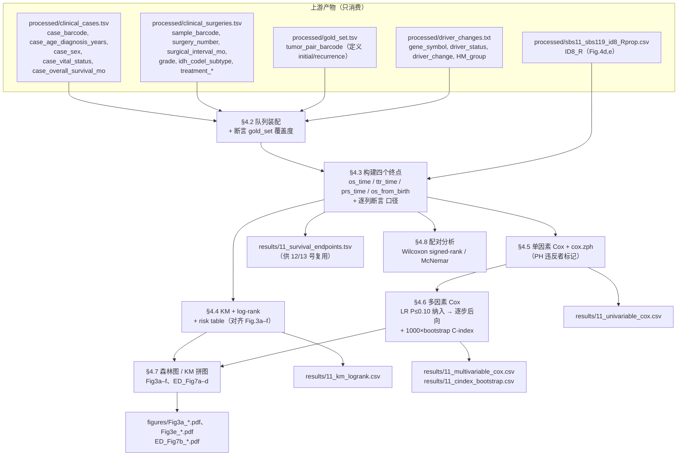

# 11 生存分析与预后模型

> **目标文献**：The GLASS Consortium. *Divergent genomic evolution in astrocytomas and oligodendrogliomas.*
> *Nature* (2026). PDF 标识 s41586-026-11150-x. 数据：Synapse syn17038081；代码：github.com/verhaaklab/glass-idh
>
> **模块对应原文**：Fig. 1c（swimmer's plot 与中位 OS）；**Fig. 3a–f**（全部 KM 面板）；Fig. 4d,e（ID8 与 PRS）；
> Extended Data Fig. 2b,c（GLASS vs TCGA 的 OS from diagnosis / from birth）；Extended Data Fig. 6a（IDH 突变型与 OS）；
> Extended Data Fig. 7a–d（非超突变 astrocytoma 的 CNA 与 PRS 分层）；
> Methods 中「**Survival analysis**」整段、「**Other statistical methods**」段、「Reporting summary → Reporting on sex and gender」；
> Results 中「**Prognostic relevance of driver events**」全节；Supplementary Tables 4、7a–e、8a,b、9a,b、10a–c
> **复现层级**：**L1 派生层**（主路径）。四个终点全部可由 Synapse `clinical.cases` + `clinical.surgeries` 的**公开派生列**重建；
> **不需要** BAM/FASTQ，**不需要**集群。L2/L3 与本模块无关 —— 生存终点不依赖任何比对或变异调用参数。
> 唯一触碰 L1 之外的地方是「driver 事件是否携带」这一**自变量**：它来自 `03`/`04` 号文档的变异与 CNA 产物，本模块**只消费、不生产**。
> **前置依赖**：`02_队列构建、临床注释与样本QC.md`（产物契约 `processed/clinical_cases.tsv`、`processed/clinical_surgeries.tsv`、`processed/gold_set.tsv`）、
> `04_驱动事件鉴定与互斥性分析.md`（产物契约 `processed/driver_changes.txt`）、
> `06_突变负荷与超突变分类.md`（产物契约 `processed/hm_group.tsv`，提供 `HM_group ∈ {HM, NHM}`）、
> `07_突变签名分析与治疗归因.md`（产物契约 `processed/sbs11_sbs119_id8_Rprop.csv`，供 Fig. 4d,e 使用）、
> `01_数据与代码可得性、环境与仓库结构.md`（`code/glass-idh/` clone 路径与 `SETUP.md` 环境契约）
> **复现难度**：★★★☆☆　**预计工时**：2.5 人日　**计算资源**：单机 4 核 CPU / 8 GB 内存。
> 临床层 n ≈ 231、分子层可用生存数据 n ≈ 181；4 个终点 × 4 个亚组 × 单/多因素合计约 120 次 `coxph` 拟合，
> 每次 < 0.1 s；1000 次 bootstrap 的 C-index 约 3–10 s（`concordance()` 为 C 实现）。**不需要 GPU。**

---

## 1. 科学问题与逻辑位置

### 1.1 本模块在证据链中的位置

前序模块（04–10）回答「**发生了什么**」：oligodendroglioma 复发时获得 PI3K/NOTCH1 的**克隆 sSNV**，astrocytoma 复发时获得**局灶癌基因扩增 + CDKN2A/B 纯合缺失**，两类肿瘤在克隆性、签名、CIN 上分道扬镳。

本模块回答「**所以呢**」：这些分子事件是否与**患者活得更短**挂钩？这是把「分子观察」升级为「临床可用预后标志物」的唯一通道，也是原文摘要最后一句

> "In both types of IDH-mutant glioma, we observed a convergence of acquired alterations, genome-wide changes and worse patient outcomes, suggesting that treatment-refractory clones were being selected."

中「worse patient outcomes」这半句的**全部证据来源**。



### 1.2 上游输入与下游输出（产物契约）

| 产物路径（规范名） | 生产者 | 格式/结构（列名·尺度·单位） | 消费方 | 生成脚本 |
|---|---|---|---|---|
| `processed/clinical_cases.tsv` | 02 | 患者级：`case_barcode`（主键）、`case_age_diagnosis_years`（float，年）、`case_sex`（`female`/`male`）、`case_vital_status`（`alive`/`dead`）、`case_overall_survival_mo`（float，**月，自初诊切除日**） | **11**/12 | `code/02_*.R` |
| `processed/clinical_surgeries.tsv` | 02 | 手术级：`case_barcode`、`sample_barcode`（barcode 第 14–15 位为 surgery 编码）、`surgery_number`（int，1 = 初诊）、`surgical_interval_mo`（float，**月，初诊手术→本次手术**）、`grade`（`II`/`III`/`IV`）、`idh_codel_subtype`（`IDHmut-codel`/`IDHmut-noncodel`/`IDHwt`）、`surgery_type`、`surgery_extent_of_resection`、`treatment_radiotherapy`（bool）、`treatment_alkylating_agent`（bool）、`treatment_concurrent_tmz`（bool） | **11**/12/13 | `code/02_*.R` |
| `processed/gold_set.tsv` | 02 | 配对级：`case_barcode`、`tumor_pair_barcode`（第 14–15 位 = primary 编码，第 20–21 位 = recurrent 编码） | **11**/12 | `code/02_*.R` |
| `processed/driver_changes.txt` | 04 | 患者 × 事件级：`case_barcode`、`gene_symbol`（含字面量 `"CDKN2A/CDKN2B"`、`"Any Amplification"`、`"PI3K"`）、`driver_status`（`mutant`/`HLDEL`/`HLAMP`/`wildtype`/`No_AMP/HD`）、`driver_change`（`P`=仅初诊 / `R`=仅复发 / `S`=共享）、`HM_group`（`HM`/`NHM`）、`idh_codel_subtype` | **11**/12 | `code/04_*.R` |
| `processed/hm_group.tsv` | 06 | 患者级：`case_barcode`、`HM_group`、`TMB_R`（mut/Mb） | **11**/12 | `code/06_*.R` |
| `processed/sbs11_sbs119_id8_Rprop.csv` | 07 | 患者级：`case_barcode`、`ID8_R`（float，0–1，**复发特异**比例） | **11**（仅 Fig. 4d,e） | `analysis/bash/mutational_signature_pipeline.sh` → `code/07_*.R` |
| `results/11_survival_endpoints.tsv` | **11** | 患者级长表：`case_barcode, glioma_type, age_at_diagnosis, grade, endpoint ∈ {OS, TTR, OS_from_birth, PRS}, time_years, status, subgroup` | 12/13 | `code/11_01_endpoints.R` |
| `results/11_km_logrank.csv` | **11** | `figure_panel, subset, group, n, n_event, median_years, median_lower, median_upper, logrank_p, script_src` | 13 | `code/11_02_km.R` |
| `results/11_univariable_cox.csv` | **11** | `endpoint, subset, variable, term, n, HR, ci_low, ci_high, p_wald, p_lrt, zph_p_global, ph_violated` | 13 | `code/11_03_cox_univariable.R` |
| `results/11_multivariable_cox.csv` | **11** | 同上 + `model ∈ {full, stepwise}` | 13 | `code/11_04_cox_multivariable.R` |
| `results/11_cindex_bootstrap.csv` | **11** | `endpoint, subset, model, c_index_apparent, c_index_corrected, optimism, ci_low, ci_high, n_boot` | 13 | `code/11_04_cox_multivariable.R` |
| `figures/Fig3a_*.pdf`+`.png`、`Fig3e_*.pdf`+`.png`、`ED_Fig7b_*.pdf`+`.png` | **11** | KM 曲线（含 risk table），dpi = 300 | 13 | `code/11_05_plots.R` |

> ⚠️ **导师批注（契约纪律）**：本表是**接口要求**，须逐条登记进 `PROJECT_SPEC.md` §4 契约表（L0 §4.1）。
> 其中唯一有争议的列是 `case_overall_survival_mo` 的**起点定义** —— 官方 Methods 写「the interval between the date of primary surgical resection and the date of death」，
> 而官方脚本把它直接当 `os_time` 使用，同时把 `surgical_interval_mo` 当作「初诊→本次手术」的间隔。二者必须**互相自洽**，
> 否则 §4.3 的 `prs_time` 会算错。§4.3 为此专门写了一个 `stopifnot()` 断言（见 4.3 第 ③ 步）。

### 1.3 它解决什么问题、不解决什么问题

| 它能支持 | 它**不能**支持 |
|---|---|
| 「在 GLASS 这个**多次手术队列**里，复发时携带 HD-CDKN2A/B 的 astrocytoma 患者，复发后中位生存 1.1 年 vs 3.2 年」这一**描述性关联** | 「CDKN2A/B 缺失**导致**患者死亡」——REPRO_SPEC §12.4：相关 ≠ 因果。原文措辞是 "associated with poor post-recurrence survival"，复现时必须保持同一动词 |
| 「该关联在 IDH 突变状态、分级、治疗、年龄调整后仍然显著」——**条件独立**陈述 | 「该标志物可以指导临床决策」——需要前瞻队列 + 校准 + 净获益，本文一个都没有（REPRO_SPEC §7「模型评价」条） |
| 「在 AACR GENIE 外部数据里方向一致」 | 「外部验证成功」——GENIE 用的是**分子替代**分型 + **panel** 数据 + **不同起点**的生存时间（详见 `12_外部验证与批次效应检验.md` §2.3） |
| 把 PRS / OS / TTR / OS-from-birth 四个终点**分开**报告，暴露各自口径 | 把任一终点的数值**跨终点搬运**（例如把 PRS 的 1.1 年当成 OS） |

---

## 2. 背景原理

### 2.1 四个终点：定义、公式与它们**为什么不能互换**

原文 Methods 一段话定义了四个终点：

> "Survival end points included overall survival from diagnosis and time to recurrence. Overall survival from diagnosis was defined as the interval between the date of primary surgical resection and the date of death or the date of last follow-up if censored. Time to recurrence was defined as the interval between the date of primary surgical resection and the date of first recurrence surgery. No censoring was required for time to recurrence because all patients had undergone a secondary surgery by study design. Overall survival from birth was calculated by adding age at diagnosis to OS from diagnosis. Post-recurrence survival was defined as the interval from the date of the QC-passed last recurrence surgery to death or censoring at last follow-up."

把它写成公式。设患者 $i$：

- $T_i^{\text{dx}}$：初诊手术日期；$T_i^{\text{last}}$：QC 通过的**末次**复发手术日期；$T_i^{D}$：死亡日期；$T_i^{F}$：末次随访日期。
- $A_i$：诊断年龄（年）。

$$\text{OS}_i^{\text{dx}} = \begin{cases} T_i^{D} - T_i^{\text{dx}} & \text{死亡} \\ T_i^{F} - T_i^{\text{dx}} & \text{删失} \end{cases}$$

$$\text{TTR}_i = T_i^{\text{R1}} - T_i^{\text{dx}} \quad(\text{无删失，status} \equiv 1)$$

$$\text{OS}_i^{\text{birth}} = A_i + \text{OS}_i^{\text{dx}}$$

$$\text{PRS}_i = \begin{cases} T_i^{D} - T_i^{\text{last}} & \text{死亡} \\ T_i^{F} - T_i^{\text{last}} & \text{删失} \end{cases}$$

官方脚本里这三行的**字面实现**（`tables/R/GLASS-I_Multivariable_PRS.R:87-89`、`_Multivariable_TTR.R:76-79`、`GLASS-I_TCGA_OS_Comparison.R:52-55`）：

```r
# PRS：注意它用的是减法，不是重新取日期
prs_time = ((case_overall_survival_mo)/12) - ((surgical_interval_mo)/12)
# TTR：status 恒为 1
ttr_status = 1
ttr_time   = if_else(surgery_number == 2 & surgical_interval_mo != 0, surgical_interval_mo/12, NA)
# OS from birth
os_from_birth = case_age_diagnosis_years + (case_overall_survival_mo/12)
```

**四个终点的差别（这张表是本模块的骨架）**

| 终点 | 起点 | 终点事件 | 删失 | 本模块用它回答 | 若误用的后果 |
|---|---|---|---|---|---|
| **OS from diagnosis** | 初诊手术 | 死亡 | 有（末次随访） | 全生命周期预后；TCGA 对比 | 与 PRS 混用会把「复发后生存」错当成「总生存」 |
| **TTR** | 初诊手术 | 第一次复发手术 | **无**（设计使然） | 肿瘤「多快回来」 | 用 KM 画 TTR 会得到一条**无删失阶梯**，与 KM 的删失假定冲突（见 2.2） |
| **OS from birth** | 出生 | 死亡 | 有 | 早发特征、life-years lost；GLASS vs TCGA | 忽略**左侧截断**会高估早发队列的生存 |
| **PRS** | **末次 QC 通过的复发手术** | 死亡 | 有 | Fig. 3a,b,c,e 与 ED Fig. 7 的全部结论 | **immortal time 偏倚**（见 2.3） |

### 2.2 为什么 TTR「无删失」，以及这意味着什么

GLASS 的**入组条件本身就是「至少两次手术」**（Methods QC5；`Extended Data Fig. 1a` 明确写 "the exclusion of patients with only one surgery remaining"）。因此对**进入分析集的每个人**，$T_i^{\text{R1}}$ 必然存在且必然 $< \infty$：**没有一个人会在「尚未复发」时被删失**。

这在统计上是**横断面（截面）数据而不是生存数据**：

- 全部个体都有观测到的完整事件时间 → $\text{status} \equiv 1$，KM 估计 $\hat S(t)$ 的每个阶梯末端的风险集都单调递减到 0，最终 $\hat S(\max t) = 0$。此时 **KM 与经验分布函数相同**，log-rank 检验退化为对两组 TTR 分布的位置检验（近似 Wilcoxon/Kruskal–Wallis），**没有额外信息**。
- 更关键的是：**这不是一个真实临床问题**。「肿瘤从初诊到第一次复发手术需要多久」在 GLASS 中的**可入组人群**是「至少活到第二次手术的人」——这不是所有 IDH 突变胶质瘤患者。所以 TTR 只能在**队列内部做配对/横断面比较**（例如「初诊时已有 HD-CDKN2A/B 的 TTR 是否更短」），**不能外推**为人群级的复发时间分布。
- 官方仓库的做法印证了这一点：`tables/R/GLASS-I_Multivariable_TTR.R` 里 **`ttr_status = 1` 是写死的字面量**，然后仍用 `coxph(Surv(ttr_time, ttr_status) ~ ...)` 拟合（`coxph` 在无删失时等价于对 log 时间的参数化位置模型），并在 `GLASS-I_Univariable_TTR_Clinical.R` 里用 `survfit` 输出分组统计；原文正文**没有**把 TTR 做成任何一张图。

> **口径小结（复现时的强制约定）**：TTR 只做 **Cox PH 的横断面回归**与**分组描述统计**，我们**不画 KM**；
> 若审稿人要求 KM，必须在图注写明「此队列无删失，KM 曲线等价于经验分布函数」。

### 2.3 PRS 的起点与 immortal time 偏倚

PRS 的起点是**末次**复发手术。这带来一个**结构性偏倚**，且它**不可通过统计方法完全消除**，只能通过设计与敏感性分析界定：

设患者的复发手术序列为 $R_1 < R_2 < \dots < R_k$。要「活到进入末次手术组」，患者必须活过 $R_1 \dots R_k$。于是：

$$\Pr(\text{进入 PRS 分析} \mid \text{患者}) = \Pr(T^D > R_k)$$

这就是 **immortal time bias / 不倒时间偏倚** 的**入组版本**：**在 $[T^{\text{dx}}, R_k]$ 这段时间里，患者按定义是"必活"的**，这段时间被从 PRS 的分子中**切掉**了，但携带某个分子事件的患者可能**系统地**有不同的 $R_k$。

具体到本文的机制：

- 如果「HD-CDKN2A/B」这个事件让肿瘤长得更快 → 患者**更早**发生末次手术 → $R_k$ 更小 → 被切掉的 immortal 时间更短 → **PRS 的起点更早**，而死亡时间不变 → **PRS 被"拉长"**。这会让 HD-CDKN2A/B 看起来**预后更好**，即偏倚方向与观察到的「预后更差」**相反**。
- 反之，如果 HD-CDKN2A/B 只出现在「已经进展得很快、不得不多次手术」的患者身上，则 $R_k$ 更靠后 → immortal 时间更长 → PRS 起点更晚 → **PRS 被"压缩"** → 偏倚方向与结论**相同**。

**这是本文生存结论最脆弱的环节**，原文 Discussion 只承认了「入组偏倚」（"an inherent selection bias of longitudinal, multi-resection cohorts"），**没有**单独讨论 PRS 起点带来的 immortal time。复现时必须做三件事（写在 §5 的敏感性分析里）：

1. **同时报告 OS from diagnosis 的对应分层**（起点固定 → 无 immortal time），看方向是否一致；
2. 把 $R_k - T^{\text{dx}}$（即被切掉的 interval）作为**协变量或分层变量**放进模型（`landmark` 思路）；
3. 用 **landmark 分析**：把「末次手术」固定为 landmark 时点 $\tau$（例如 3 年），只保留 $R_k \ge \tau$ 的患者，从 $\tau$ 开始计时。这**直接消掉**了 PRS 起点的个体差异。

### 2.4 OS from birth 与左侧截断

$$\text{OS}^{\text{birth}} = A + \text{OS}^{\text{dx}}$$

**它为什么要存在**：IDH 突变胶质瘤是「50 岁以下成人最常见的原发恶性脑肿瘤」（原文引言）。「谁在 40 岁前得病」这件事，只有把年龄加进去才看得见。原文用它的核心结论是（Results「Clinical characteristics and timelines」）：

> "overall survival from the time of birth was significantly shorter in the GLASS cohort for both patients with oligodendroglioma and those with astrocytoma (Extended Data Fig. 2b,c)"

即：**GLASS 的患者虽然从诊断起活得更久（因为选择偏倚），但从出生起活得更短**——这正是「早发」的量化表述。

**它的统计陷阱是左侧截断（left truncation）**。设 $b$ 为出生时间。患者能被**观察到**，需要他活到被诊断：$A \ge a_{\min}$。若忽略这一点，直接在 $\text{OS}^{\text{birth}}$ 上做 KM/log-rank：

- 风险集在 $t$ 时刻只应包含「已存活到 $t$」的人，而**早发队列在 $t$ 较小的时候，风险集被系统性地"少算"了**（因为晚发者的 $A$ 大，他们在 $t$ 小时根本不在风险集里，但他们也**不应该**在）。
- 严格的做法是把 $\text{OS}^{\text{birth}}$ 作为**左侧截断的生存时间**：$Y = \text{OS}^{\text{birth}}$，截断时间 $L = A$（患者从 $A$ 时刻才进入观察）。在 R 里写作

```r
Surv(time = os_from_birth, time2 = , event = os_status)   # 错误：这不是左侧截断
Surv(time = age_at_diagnosis, time2 = os_from_birth, event = os_status, type = "counting")  # 正确
```

（`survfit`/`coxph` 接受 `Surv(start, stop, event)` 的 counting-process 形式；`start = A`，`stop = A + OS^{\text{dx}}`。）

> ⚠️ **导师批注**：官方脚本 `figures/R/GLASS-I_TCGA_OS_Comparison.R:98-107` 用的是
> `survfit(Surv(os_from_diagnosis, os_status) ~ Cohort, ...)`，其中把 `os_from_diagnosis` **整体替换**成 `os_from_birth` 后直接调用 —— 这是**未做左侧截断**的 KM。
> 原文 Extended Data Fig. 2b 的下排面板因此**只是一个描述性可视化**，其 log-rank P 值不等价于「年龄校正后」的比较。
> 我们的复现路径：**主口径 = 官方口径（复现原图）+ 敏感性口径 = 左侧截断 counting-process**，两个都报，并在 13 号文档登记为 A 类口径分歧。

### 2.5 KM 与 log-rank

**KM 估计量**（乘积极限）：

$$\hat S(t) = \prod_{t_j \le t}\left(1 - \frac{d_j}{n_j}\right)$$

$d_j$ = 在 $t_j$ 时刻的**事件数**，$n_j$ = 在 $t_j$ 时刻的**风险集**（仍在随访且未发生事件者）。

**它成立依赖两条假设**：

1. **非信息性删失**：$(C \perp T) \mid Z$ —— 删失时间与生存时间在给定协变量后独立。GLASS 里的威胁是「转院失访」与「因疾病进展而放弃手术」，后者**不**独立于 $T$。
2. **事件时间不因入组而改变**：入组后不再受其他筛选。

**log-rank 检验**：在零假设「两组生存分布相同」下，第 $j$ 个事件时刻的期望事件数为 $e_j = d_j n_{1j}/n_j$，观测为 $d_{1j}$：

$$U = \sum_j (d_{1j} - e_j),\qquad V = \sum_j d_j \frac{n_{1j} n_{0j}(n_j - d_j)}{n_j^2 (n_j - 1)},\qquad \chi^2 = \frac{U^2}{V}\sim \chi^2_1$$

**它的局限（本文多处踩到）**：

- **小样本**：Fig. 3a 的 oligo HM = 14、non-HM = 24（原文图注 `Hypermutant (n = 14)` / `Non-hypermutant (n = 24)`）。$n$ 这一层时，$\chi^2_1$ 近似的 I 类错误率明显偏离名义值，$P$ 值只能当作「量级参考」。**必须同时给出 HR 与 95% CI**（REPRO_SPEC §7：「HR 必附 95% CI 与 n」）。
- **曲线交叉**：log-rank 给的是**整个随访期**的加权（权重 $\approx$ 风险集大小）；若两组曲线在早期交叉、后期分开，log-rank 可能给出不显著的 $P$，而**加权 log-rank（Fleming–Harrington）**才会显示差异。本文未见交叉曲线的报告，但复现时应输出 `survdiff(rho = 0/0.5/1)` 三档做敏感性。
- **>2 组**：Fig. 3f 与 ED Fig. 7b,c 是**三组**（Focal onc. amp. only / HD-CDKN2A/B only / Neither CNA），`survdiff` 给的是**整体** $\chi^2_2$；原文 README 面板写 `Log-rank P = 3.4 × 10⁻⁵`（GENIE astro），这是**整体检验**，不是任意两两比较。

### 2.6 Cox 比例风险模型

**模型**：$\lambda(t \mid Z) = \lambda_0(t)\exp(\beta^\top Z)$，$Z \in \mathbb{R}^p$ 为协变量。

**偏似然**（Cox 1972）：把 $\lambda_0(t)$ 作为非参数的 nuisance 剔除。在事件时刻 $t_j$，设 $\mathcal{R}_j$ 为风险集：

$$L(\beta) = \prod_{j} \frac{\exp(\beta^\top Z_{(j)})}{\sum_{i \in \mathcal{R}_j}\exp(\beta^\top Z_i)}$$

**直觉**：「在时刻 $t_j$，"谁先出事" 的概率等于其风险分数在风险集总风险分数中的占比」。$\lambda_0$ 被约掉，所以 §5 的基线风险形状**不进入估计**。

**HR 解释**：$\text{HR} = \exp(\beta_k)$ 是「$Z_k$ 每增加 1 个单位（或从 0 变 1）的**瞬时风险比**」。**它不等于中位生存比** ——
原文 Fig. 3 的「1.1 vs 3.2 年」是**中位生存期**，而正文引用的 P 值来自 log-rank，**两者来自不同检验**。

**PH 假设与 Schoenfeld 残差**：

$$\text{PH}: \ \frac{\lambda(t|Z_k=1)}{\lambda(t|Z_k=0)} = e^{\beta_k}\ \text{与 } t \text{ 无关}$$

Schoenfeld 残差 $r_{jk} = Z_{jk} - \frac{\sum_{i\in\mathcal{R}_j} Z_{ik}\exp(\beta^\top Z_i)}{\sum_{i\in\mathcal{R}_j}\exp(\beta^\top Z_i)}$ 是「观测的 $Z_k$ 减去风险集加权期望」。在 PH 成立时，$r_{jk}$ 与事件时间 $t_j$ **无趋势**。`cox.zph()` 对残差拟合一个平滑/回归并做检验，输出**每个变量**的 $P$ 与 **GLOBAL** $P$。

**违反时的处置（按优先级）**：

1. **分层 Cox**：把违反 PH 的**分类**变量放进 `strata()`（如 `strata(grade)`）—— 允许每组有自己的 $\lambda_0(t)$，不再估计其 HR。代价：**该变量的效应无法被量化**。
2. **时依系数**：$\beta_k(t) = \beta_k + \theta_k g(t)$，R 里用 `tt()` 函数，例如 `coxph(Surv(t, s) ~ x + tt(x), tt = function(x, t, ...) x * log(t))`。
3. **剔除**（原文选择的路）—— 代价是**丢失该变量的信息，并可能把其混杂效应推给相关变量**。

官方脚本把三个选择都碰到了：`GLASS-I_Univariable_PRS_Clinical.R` 里有三处行内注释 `## PH assumption violated`（oligo 的 `sex`、astro 的 `grade`、NHM astro 的 `grade`），但**最终多因素模型里 `grade` 仍然被放进去了**（`GLASS-I_Multivariable_PRS.R:137` 的 `step.coxph.oligo` 含 `grade`）。这与 Methods 的
> "Schoenfeld residuals were examined to verify the proportional hazards assumption; variables violating this assumption were excluded."

不完全一致 —— 见 §7 陷阱表第 6 行与 `13_复现质控清单、排错与批判性评述.md`。

### 2.7 「LR P ≤ 0.10 纳入」+「逐步后向消除」：为什么宽松、代价是什么

> "variables with likelihood ratio test P ≤ 0.10 were considered for inclusion in multivariable models ... Prognostic models were refined through stepwise backward elimination"

**宽松门槛（0.10 而非 0.05）的正当理由**：筛选阶段用保守门槛会漏掉**重要的混杂变量**，而混杂变量的漏掉会**放大暴露变量的偏倚**（Greenland 的"选变量应看混杂，不看显著性"）。用 0.10 或 0.20 是流行病学常规。

**代价（三条，都很硬）**：

1. **多重共线**：driver 事件之间高度相关（例如 HD-CDKN2A/B 与 grade 在 IDH 突变 astrocytoma 里**几乎是同一个变量的两种写法** —— 官方脚本的 `grade` 定义是 `CDKN2AB == "present" & noncodel → "4"`，见 §4.3）。把两者同时放进模型会产生**方差膨胀**，单个系数的 p 值失真。
2. **过度拟合**：本文 NHM astro 的 PRS 事件数很小。以 Fig. 3e 为例，该面板总共 n = 72（CNA+ n = 32 / neither n = 40），若事件数 $E$ 约 35–45，则 EPV（events per variable）下限要求 $p \le E/10 \approx 4$。本文的多因素模型多为 5–7 个变量，**已在边界上**。
3. **$P \le 0.10$ 是"筛选"，不是"检验"**：被筛选进来的变量的 p 值**不能按名义显著水平解读**（选择效应）。

**逐步后向消除的争议**（这是本模块最需要向读者讲透的一条）：

- **选择偏差**：`step()` 每一步都"看数据"选择删除哪个变量。被保留变量的 $\hat\beta$ 是**有偏的（magnitude 偏大）**，Wald p 值**偏小**。Harrell 等反复建议：**不要用 `step()` 的结果直接报 p 值**。
- **p 值不可信**：$P$ 值不再服从均匀分布。
- **路径依赖**：`step()` 的结果依赖进入顺序，`direction = "both"` 与 `"backward"` 在同一数据上可能给出**不同**的最终模型 —— 官方脚本里两个方向都用过（`_Multivariable_OS.R` 用 `"both"`，`_Multivariable_PRS.R` 用 `"backward"`），这本身就是结果不稳健的信号。
- **正确替代**：**bootstrap 校正的选择频率**（Harrell 的 `rms::validate()` / `boot` 包的自写循环）—— 在 B = 1000 次重抽样中记录「每个变量被选中多少次」，只把**选择频率 > 70%**（经验阈值，需在 D 表声明）的变量当作稳健。

**本文一个具体的不稳健实例（可复现）**：`tables/R/GLASS-I_Multivariable_PRS.R`
- 全模型（第 182 行）：`coxph(Surv(prs_time, prs_status) ~ radiotherapy + alkylating_chemotherapy + NOTCH1 + CDKN2AB + Any_Amplification, nhm.astros)`
- 逐步后向（第 188 行）留给下一段。

- 逐步后向（第 188 行）的结果是 `~ radiotherapy + alkylating_chemotherapy + Any_Amplification` —— **`CDKN2AB` 被剔除**。

而原文正文写的是：
> "Moreover, tumours with **only** CDKN2A/B homozygous deletion or **only** focal oncogene amplifications independently associated with worse patient outcomes (multivariable Cox proportional hazards model: CDKN2A/B homozygous deletions, P < 0.001; focal oncogene amplifications, P = 0.003; Extended Data Fig. 7b)."

$\Rightarrow$ 这两个 $P$ 值只能来自**全模型**（`CDKN2AB` 与 `Any_Amplification` 同时在场），**不能**来自逐步模型。复现时我们**两套都报**（`results/11_multivariable_cox.csv` 的 `model ∈ {full, stepwise}` 列控制），并显式声明主口径。

### 2.8 Harrell's C-index 与 1000 次 bootstrap

**C-index（一致性指数）**：在**所有可比对** $(i, j)$ 中，模型预测风险排序与实际生存时间排序一致的比例：

$$C = \frac{\#\{(i,j): \hat\eta_i > \hat\eta_j,\ T_i < T_j,\ \delta_i = 1\}}{\#\{(i,j): \hat\eta_i \ne \hat\eta_j,\ T_i < T_j,\ \delta_i = 1\}}$$

$\hat\eta_i = \hat\beta^\top Z_i$ 是线性预测子。$C = 0.5$ 相当于抛硬币，$C = 1$ 是完全排序正确。**注意**：$C$ 是**排序**度量，不是校准度量（L0 §7 明确「C-index 与 time-dependent AUC 不可混用」）。

**乐观偏差（optimism）**：在**同一批数据**上既拟合又评估，$C$ 会**系统性偏高**。校正方式：

1. **Harrell 的 bootstrap 校正**（本文 Methods 声称的做法）：
   - 对 $b = 1 \dots B$：有放回重抽样得 $\mathcal{D}_b$，在 $\mathcal{D}_b$ 上拟合得 $\hat\beta_b$，算 $C_b^{\text{boot}}$（在 $\mathcal{D}_b$ 上）；
   - 在**未抽中的样本（OOB）**上算 $C_b^{\text{oob}}$；
   - $\text{optimism} = \frac{1}{B}\sum_b (C_b^{\text{boot}} - C_b^{\text{oob}})$；
   - $C^{\text{corrected}} = C^{\text{apparent}} - \text{optimism}$。
2. **`rms::validate()`** 一行即可，且自动给 `Dxy`、`Intercept`、`Slope` 等校准项（**推荐**）。

> ⚠️ **导师批注（重要）**：原文 Methods 写
> "model performance was quantified using Harrell's concordance index with 1,000 bootstrap resamples"，
> 但官方仓库里**所有** `tables/R/GLASS-I_Multivariable_*.R` 脚本只调用了一次 `concordance(fit)$concordance`（第 134/140 行等），
> **没有任何 bootstrap 循环、没有 `rms::validate()`、没有 OOB**。
> 即：**原文声称的 1000 次 bootstrap 校正找不到对应代码**。这是一条必须在 13 号文档登记的「不可溯源项」。
> 我们的复现路径：**两条都跑** ——（a）官方口径 `concordance()` 的 apparent C；（b）我们自写的 1000 次 bootstrap 校正 C + `rms::validate()` 交叉验证。报告两个数并注明差异。

### 2.9 亚组分析与多重比较：本文在哪里用了 FDR、哪里没用

本文的生存分析**做了大量亚组**，把「P 值的分布」摊开来看：

| 亚组维度 | 具体分层 | 出处 |
|---|---|---|
| 组织学类型 | oligodendroglioma / astrocytoma | 全部面板 |
| 超突变 | HM / non-HM | Fig. 3a,b；ED Fig. 7a |
| 治疗 | 复发前是否接受烷化剂 | Fig. 3a,b（脚本用 `ALK_CHEMO == 1` 过滤） |
| CNA 类型 | 仅 focal amp / 仅 HD-CDKN2A/B / neither | Fig. 3f；ED Fig. 7b,c |
| 分级 | grade 2–3 / grade 4 | ED Fig. 7d |
| 签名 | ID8 high / low | Fig. 4d,e |
| 队列 | GLASS / GENIE | Fig. 3c vs 3d、3e vs 3f |

**FDR 的使用位置**（复现时必须一致）：

| 位置 | 校正方法 | 原文/代码证据 |
|---|---|---|
| 生存分析的 log-rank $P$ 值 | **未校正**（原始 P） | 全部 KM 图注写 "two-sided log-rank tests"，无 FDR 字样 |
| 多因素 Cox 的 $P$ 值 | **未校正** | Supplementary Tables 7–9 |
| 「driver 事件 × 治疗」的富集分析 | **FDR 校正** | 正文 "no significant differences across treatment groups **after false discovery rate (FDR) correction** (Supplementary Table 10a–c)" |
| dN/dS | **FDR 校正** | `figures/R/GLASS-I_dNdScv.R:66` 的 `labs(y="-log10(p), FDR-adjusted")` |
| 拷贝数 McNemar | **FDR 校正** | `tables/R/GLASS-I_McNemar_CNA.R` 内 12 处 `p.adjust(pvalue, method = "fdr")` |

**后果**：生存分析这一侧**没有**做多重校正。粗算一下 Fig. 3 的检验数量：a,b,c,e,f 各 1 次 log-rank，加上 ED Fig. 7a–d 四次，共 9 次；再算上单因素表里每个变量 × 3 个终点 × 3 个亚组，数量在**数十到上百**量级。在 $\alpha = 0.05$ 下，即使全部为零效应也可期望 3–5 个「显著」结果。

$\Rightarrow$ **复现时必须额外输出 BH-FDR 列**（`results/11_km_logrank.csv` 里加 `p_bh`），并**明确指出哪些结论在 FDR 后仍存活**。这是 REPRO_SPEC §7「组学层默认 BH(FDR)」与 §12「阴性结果必须出现在报告里」的双重要求。

---

## 3. 原文逐句拆解

### 3.1 Methods「Survival analysis」（第 2367–2387 行）

| # | 原文句 | 中文转述 | 对应操作 / 参数 | 原文是否给了参数 | 我们的复现决策 |
|---|---|---|---|---|---|
| 1 | "Survival end points included overall survival from diagnosis and time to recurrence." | 终点含 OS-from-diagnosis 与 TTR | 建 `os_time`、`ttr_time` | 是 | 按 §4.3 |
| 2 | "Overall survival from diagnosis was defined as the interval between the date of primary surgical resection and the date of death or the date of last follow-up if censored." | OS 从**初诊手术日**到死亡/末次随访 | `os_time = case_overall_survival_mo/12`；`os_status = (case_vital_status=="dead")` | 是 | 直接用派生列，并断言其单位为月 |
| 3 | "Time to recurrence was defined as the interval between the date of primary surgical resection and the date of first recurrence surgery." | TTR = 初诊→**首次**复发手术 | **注意官方脚本用 `surgery_number == 2` 取**（`_Multivariable_TTR.R:77`） | 部分 | 我们同时算「首次复发手术」（严格按 Methods）与「第 2 次手术」（按脚本），**比对差异**；若一致则记入 D 表 |
| 4 | "No censoring was required for time to recurrence because all patients had undergone a secondary surgery by study design." | TTR 无删失 | `ttr_status = 1` 字面量 | 是 | 断言 `all(ttr_status == 1)`，否则 `stop()` |
| 5 | "Overall survival from birth was calculated by adding age at diagnosis to OS from diagnosis." | OS-from-birth = 诊断年龄 + OS | `os_from_birth = case_age_diagnosis_years + case_overall_survival_mo/12` | 是 | 主口径按原文；**敏感性口径加左侧截断**（§2.4） |
| 6 | "Post-recurrence survival was defined as the interval from the date of the QC-passed last recurrence surgery to death or censoring at last follow-up." | PRS 从**末次 QC 通过的复发手术**起算 | `prs_time = os_time - surgical_interval_mo/12`（在 `timing.surgery == timing.recurrent` 的那一行上） | 是 | 按原文；`surgical_interval_mo` 必须已被 QC5 约束为「初诊→末次保留手术」 |
| 7 | "Kaplan–Meier survival curves were generated and compared using the log-rank test with the survival and survminer R packages." | KM + log-rank（`survival` + `survminer`） | `survfit()` + `ggsurvplot(pval = TRUE)` | 是 | 直接用；额外报 Fleming–Harrington 敏感性 |
| 8 | "Cox proportional hazards regression was used to estimate hazard ratios; variables with likelihood ratio test P ≤ 0.10 were considered for inclusion in multivariable models." | Cox 估 HR；LR $P \le 0.10$ 纳入多因素 | `coxph` + `anova(fit, test="LRT")` | 是（阈值明确） | 我们实现显式的 LR 筛选步；同时报 $P \le 0.05$ 口径 |
| 9 | "Schoenfeld residuals were examined to verify the proportional hazards assumption; variables violating this assumption were excluded." | Schoenfeld 残差验 PH，违反者剔除 | `cox.zph()` | 是 | 我们**不自动剔除**，而是输出 `ph_violated` 标记 + 分层 Cox 备选（§2.6 三档处置） |
| 10 | "Prognostic models were refined through stepwise backward elimination" | 逐步后向消除 | `step(fit, direction = "backward")` | 是 | 主口径 = 全模型 + bootstrap 校正；逐步模型仅作对照（§2.7） |
| 11 | "model performance was quantified using Harrell's concordance index with 1,000 bootstrap resamples" | Harrell C + 1000 bootstrap | 官方代码**只有** `concordance()` | 部分（数量给了） | 我们自写 1000 次 bootstrap + `rms::validate()`（§2.8 批注） |

### 3.2 Methods「Other statistical methods」（第 2388–2398 行）

| 原文句 | 中文转述 | 对应操作 |
|---|---|---|
| "All statistical analyses were performed using R (v.4.3.2) and Python (v3.10.13)." | R 4.3.2 / Python 3.10.13 | `SETUP.md` 写 "R ≥ 4.2 ... R 4.3 is what the code was last run under" → **版本钉死 R 4.3.x** |
| "unpaired categorical variables were assessed using Fisher's exact test or the χ2 test" | 非配对分类 → Fisher / χ² | `fisher.test()` / `chisq.test()` |
| "unpaired continuous variables using the Wilcoxon's rank-sum or Kruskal–Wallis' test" | 非配对连续 → Wilcoxon / KW | `wilcox.test()` / `kruskal.test()` |
| "paired categorical variables were compared using McNemar's test and paired continuous variables using the Wilcoxon's signed-rank test" | 配对 → McNemar / signed-rank | `mcnemar.test()` / `wilcox.test(paired = TRUE)` |
| "Statistical significance was defined as two-tailed P < 0.05 unless specified otherwise." | 双侧 $P < 0.05$ | 与 `06`/`07`/`08` 号文档的 FDR 约定并存（见 §2.9） |

> ⚠️ **导师批注**：Reporting summary 的 "Reporting on sex and gender" 写
> "Self-reported patient sex was accounted for in survival analyses because this is historically known to be a significant prognostic factor"，
> 但官方脚本里 `sex` **只出现在 `GLASS-I_Univariable_PRS_Clinical.R` / `_Univariable_TTR_Clinical.R` 的单因素模型中**，
> **没有进入任何多因素模型**（`_Multivariable_OS.R` / `_Multivariable_PRS.R` / `_Multivariable_TTR.R` 的 `coxph()` 里都没有 `sex`）。
> 「accounted for」这一表述与方法学实现不一致 → 登记到 13 号文档。

### 3.3 Results「Prognostic relevance of driver events」（第 613–658 行）

| 原文句 | 中文转述 | 对应面板 / 数值 | 对应脚本 |
|---|---|---|---|
| "The unfavourable prognostic effect of hypermutation at recurrence in IDH-mutant gliomas was confirmed in our cohort (Fig. 3a,b)." | 复发时超突变的预后更差 | Fig. 3a oligo：HM n=14 vs non-HM n=24，log-rank **P = 0.037**；Fig. 3b astro：HM n=20 vs non-HM n=30，**P = 0.00041**（均为复发前接受烷化剂者的 **PRS**） | `figures/R/GLASS-I_Univariable_KM_Hypermutation.R` |
| "PI3K and NOTCH1 mutations did not further stratify survival in non-hypermutant oligodendrogliomas in GLASS (Fig. 3c)." | GLASS NHM oligo 中 PI3K/NOTCH1 不进一步分层 | Fig. 3c：n = **69**（PI3K and/or NOTCH1 n = 30 / Neither n = 39），**P = 0.25** | `figures/R/GLASS-I_Univariable_KM_sSNV.R` |
| "However, PI3K- and NOTCH1-mutant oligodendrogliomas did associate with worse overall survival in the AACR GENIE validation set (Fig. 3d)." | GENIE 里同一事件显著 | Fig. 3d：n = **465**（PI3K/NOTCH1 n = 159 / Neither n = 306），**P = 0.03**（终点是 **OS 而非 PRS**） | `figures/R/GLASS-I_Univariable_KM_Drivers_GENIE.R:127` |
| "CDKN2A/B homozygous deletions were associated with poor post-recurrence survival (median: 1.1 years versus 3.2 years; log-rank test: P = 0.01)" | HD-CDKN2A/B → PRS 更差 | 中位 **1.1 vs 3.2 年**，**P = 0.01** | `figures/R/GLASS-I_Univariable_KM_CNA.R`（`p1` 面板，`facet.by = gene_symbol`） |
| "and this association was significant in both the hypermutant and the non-hypermutant subpopulation (log-rank test: P = 0.002 and P = 0.02, respectively; Extended Data Fig. 7a and Supplementary Table 4)" | HM 层 P = 0.002、non-HM 层 P = 0.02 | ED Fig. 7a | 同上（`facet.by = c("Grade", "gene_symbol")` 之外的分层） |
| "validating the WHO's 2021 classification of CDKN2A/B homozygous deletion as a grade-4 marker in recurrent astrocytomas" | 该结果支持 WHO 2021 的 grade-4 定义 | 说明性结论 | — |
| "Focal oncogene amplifications also indicated significantly shorter post-recurrence survival in patients with astrocytoma (median: 1.2 years versus 3.8 years; log-rank test: P = 0.001; Supplementary Table 4)." | 局灶扩增 → PRS 更差 | 中位 **1.2 vs 3.8 年**，**P = 0.001** | 同上 |
| "Combining CDKN2A/B homozygous deletions and/or focal oncogene amplifications associated with inferior patient outcome in non-hypermutant astrocytomas (median post-recurrence survival: 1.5 years versus 5.3 years; log-rank test: P < 0.001; Fig. 3e)." | 合并 → 1.5 vs 5.3 年，P < 0.001 | Fig. 3e：NHM astro n = **72**，CNA+ n = 32 / neither n = 40，**Log-rank P = 0.00046**（图内标注；正文写 "< 0.001"，一致） | `GLASS-I_Univariable_KM_CNA.R` 的 `p3` 对象 |
| "Moreover, tumours with only CDKN2A/B homozygous deletion or only focal oncogene amplifications independently associated with worse patient outcomes (multivariable Cox proportional hazards model: CDKN2A/B homozygous deletions, P < 0.001; focal oncogene amplifications, P = 0.003; Extended Data Fig. 7b)." | 多因素中两者独立显著 | **P < 0.001** 与 **P = 0.003** | `tables/R/GLASS-I_Multivariable_PRS.R:182`（**全模型**；逐步模型剔除了 CDKN2AB，见 §2.7） |
| "External validation with the AACR GENIE cohort confirmed the poor prognostic effect of these driver CNAs (Fig. 3f and Extended Data Fig. 7c)." | GENIE 复现方向 | Fig. 3f：n = **452**（Focal onc. amp. only n = 57 / HD-CDKN2A/B only n = 29 / Neither CNA n = 366），**Log-rank P = 3.4 × 10⁻⁵** | `GLASS-I_Univariable_KM_Drivers_GENIE.R:197` |
| "The adverse post-recurrence prognostic effect was significant in grade 2–3 GLASS tumours but not in grade 4 tumours (log-rank test: P = 0.032 and P = 0.41, respectively; Extended Data Fig. 7d)." | grade 2–3 **P = 0.032**；grade 4 **P = 0.41** | ED Fig. 7d | `GLASS-I_Univariable_KM_CNA.R` 的 `p2`（`facet.by = c("Grade", "gene_symbol")`） |
| "Multivariable analysis of all univariably significant clinical and molecular factors (Supplementary Tables 4–6) showed that the presence of focal oncogene amplifications was an independent poor prognostic marker in patients with astrocytoma irrespective of surgery timing (Supplementary Tables 7a–e, 8a,b and 9a,b)." | focal amp 是独立预后因素，与手术时机无关 | Supplementary Tables 7–9 | `tables/R/GLASS-I_Multivariable_{OS,PRS,TTR}.R` 三套 |
| "We evaluated the association between enriched recurrent driver alterations (that is, treatment with radiation therapy, alkylating chemotherapy or either treatment regimen) and observed no significant differences across treatment groups after false discovery rate (FDR) correction (Supplementary Table 10a–c)." | 治疗 × 驱动事件：FDR 后**无**显著 | Supplementary Table 10a–c | `tables/R/GLASS-I_Drivers_Prior_Treatment.R` |
| "In conclusion, oligodendroglioma-enriched driver sSNVs might have prognostic relevance, but further validation is needed, whereas astrocytoma-enriched driver CNAs consistently associate with poor survival." | 结论：oligo 的 sSNV 待验证；astro 的 CNA 一致 | — | — |

### 3.4 与生存直接相关的其它原文句

| 原文句（出处） | 数值 / 含义 |
|---|---|
| Fig. 1c：`Median OS = 7.8 years, 95% CI [6.8–10.2]`，`Patients with IDH-mutant astrocytoma (n = 119)` | **临床队列**（非 183 分子队列）的 astro 中位 OS |
| Fig. 1c：`Median OS = 21.4 years, 95% CI [16.8–not reached]`，`Patients with IDH-mutant oligodendroglioma (n = 112)` | oligo 中位 OS **未达**上界 → CI 上界为 "not reached" |
| Fig. 1c 图注："overall survival (OS) is shown for the clinical cohort (n = 231) of which **126 patients were still alive at last follow-up**" | 删失比例 ≈ 126/231 = 54.5% |
| Results："The median follow-up period for the GLASS cohort was **6.5 years** for patients with astrocytoma and **11.4 years** for patients with oligodendroglioma (Table 1), compared with **2.3 years and 1.9 years**, respectively, in TCGA (Wilcoxon test: **P < 0.001 for both**)." | 随访长度差异 |
| Results："Patients with oligodendroglioma in the GLASS cohort had a **longer** overall survival **from the time of diagnosis** than did those in TCGA, but overall survival **from the time of birth** was significantly **shorter** in the GLASS cohort for both patients with oligodendroglioma and those with astrocytoma" | **方向反转**：诊断起更长、出生起更短 → 早发 + 选择偏倚（详见 `12_外部验证与批次效应检验.md`） |
| Results："We did not observe significant differences in the distributions of focal oncogene amplifications, CDKN2A/B homozygous deletions or NOTCH1, PI3K or MSH6 mutations between IDH1 p.R132H and other IDH-mutant groups (Supplementary Table 3b–f). Furthermore, we observed **no significant associations between IDH mutation types and overall survival**, mutational signatures or fraction of genome altered (FGA), **potentially reflecting limited statistical power** (Extended Data Fig. 6a–c)." | ED Fig. 6a 是**阴性**的 KM；原文主动归因于功效 |
| Fig. 3a 图注："a,b, Post-recurrence survival of patients in the GLASS cohort who received **alkylating chemotherapy before recurrence** to treat oligodendrogliomas (a) and astrocytomas (b), stratified for hypermutation status." | `ALK_CHEMO == 1` 过滤（见 `GLASS-I_Univariable_KM_Hypermutation.R:50`） |
| Fig. 4d,e 图注："Post-recurrence survival of patients with non-hypermutant oligodendroglioma (d) or astrocytoma (e) by ID8 mutation frequency (cohort split by **mean ID8 for all recurrent gliomas**), compared using two-sided log-rank tests for unpaired data." | ID8 二分的**切点是全队列均值**（脚本：`sig_prop_id8 > mean(sig_prop_id8)`）—— 不是最优截断点，符合 L0 §7 |
| Discussion 局限："A limitation of this study is the inherent selection bias of longitudinal, multi-resection cohorts, because inclusion requires survival to at least a second surgery." | 原文自陈的入组偏倚 |
| ED Fig. 1a："181 patients with QC-passed sequencing data across at least two time points had accompanying clinical data suitable for survival analyses, and **144 included data from primary surgeries rather than non-primary initial surgeries**." | **生存分析分母**：n = 181（分子层）；其中 144 的「初诊」确实是原发手术 |

---

## 4. 逐步可运行代码（L1 主路径）

### 4.0 官方脚本 → 改造点 → 我们的复现版本

原文全部生存分析有官方脚本，**复现的第一动作是跑官方脚本**，第二动作才是重实现。对照关系如下：

| 官方脚本 | 它做什么 | 我们必须改的地方 | 我们的复现版本 |
|---|---|---|---|
| `tables/R/GLASS-I_Multivariable_OS.R` | OS 多因素 Cox（oligo 全模型/逐步 + astro 全模型/逐步） | ① `dbConnect(…service="glass5reader")` → 换成 `read_tsv()`；② `read.delim("~/driver_changes.txt")` 的 `~/` 绝对路径；③ `set.seed()` 缺失 | `code/11_04_cox_multivariable.R` |
| `tables/R/GLASS-I_Multivariable_PRS.R` | PRS 多因素（4 个亚组） | 同上 | 同上（参数 `endpoint = "PRS"`） |
| `tables/R/GLASS-I_Multivariable_TTR.R` | TTR 多因素（含 `ttr_status = 1`） | 同上 | 同上（参数 `endpoint = "TTR"`） |
| `tables/R/GLASS-I_Univariable_{OS,PRS,TTR}_{Clinical,Molecular}.R`（6 个） | 单因素 Cox + `cox.zph` 逐变量 | 同上 + 把 `conf.int=0.9` 统一为 **95%**（L0 §7 要求 95% CI） | `code/11_03_cox_univariable.R` |
| `figures/R/GLASS-I_Univariable_KM_Hypermutation.R` | Fig. 3a,b | 同上 + `xlim` 硬编码 | `code/11_02_km.R`（`panel = "Fig3ab"`） |
| `figures/R/GLASS-I_Univariable_KM_sSNV.R` | Fig. 3c | 同上 | 同上（`panel = "Fig3c"`） |
| `figures/R/GLASS-I_Univariable_KM_CNA.R` | Fig. 3e + ED Fig. 7a–d | 同上（4 个 `ggsurvplot` 对象 p1–p4） | 同上（`panel = "Fig3e"/"ED7"`） |
| `figures/R/GLASS-I_Univariable_KM_Drivers_GENIE.R` | Fig. 3d,f（GENIE） | 见 `12_外部验证与批次效应检验.md` | `code/12_*.R` |
| `figures/R/GLASS-I_Univariable_KM_ID8.R` | Fig. 4d,e | 读 `sbs11_sbs119_id8_Rprop.csv` | `code/11_05_plots.R`（`panel = "Fig4de"`） |
| `figures/R/GLASS-I_TCGA_OS_Comparison.R` | ED Fig. 2a–c | 见 `12_外部验证与批次效应检验.md` | `code/12_*.R` |
| `tables/R/GLASS-I_Baseline.R` | 中位 OS / 中位随访（Fig. 1c 数值） | 同上 | `code/11_01_endpoints.R` 的 §4.9 |

> **环境契约（`SETUP.md` 实测）**：R ≥ 4.2（原文用 4.3）；`tables/R/` 需要 `gt`、`gtsummary`、`survival`、`survminer`、`RPostgres`。
> 我们**不需要** `RPostgres`（改用 flat file），但**需要**补 `rms`（做 bootstrap 校正的 C-index）与 `broom`（把 `coxph` 结果整理成长表）。
> 版本钉死：`set.seed(20260101)`（本项目约定）。

### 4.1 起点：目录与下载

```bash
# 本项目目录约定（简报 §9）：不用 data/ 前缀
PROJ=/home/zhangxi/paper_read/20261016_GLASS_IDH_glioma_divergent_evolution
cd "$PROJ"

git clone https://github.com/verhaaklab/glass-idh.git code/glass-idh   # 不改动，只读
mkdir -p raw/synapse processed results figures logs

# Synapse：Tables 页 syn17038081。用 CLI 下载所需的 3 张表 + 1 个辅助表
# 需先 `pip install synapseclient` 并 `synapse login`（或 export SYNAPSE_AUTH_TOKEN）
python - <<'PY'
import synapseclient, os
syn = synapseclient.Synapse()
syn.login()                          # 交互式；CI 里用 SYNAPSE_AUTH_TOKEN
out = os.path.expandvars("$PROJ/raw/synapse")
# 表 ID 以 Synapse Tables 页当前显示为准（下表为入口项目下的三个 schema）
for table_id, name in [
    ("syn17038081", "project_entry"),   # 入口项目；具体 table synId 见 Tables 页
]:
    pass
PY
```

> ⚠️ **导师批注**：Synapse **Tables 页里每张表的 `synId` 会随数据发布版本变化**，简报只给了项目级 `syn17038081` 与文件页 `syn26465623`。
> 复现时**必须**在 `https://www.synapse.org/#!Synapse:syn17038081/tables/` 页面上逐一确认 `clinical.cases`、`clinical.surgeries`、`analysis.gold_set` 三张表的当前 `synId` 并记录到 `PROJECT_SPEC.md`。
> **本节代码不硬编码任何未核实的 `synId`**（L0 §8.3 红线 1：禁止编造 accession）。
> 替代路径：官方脚本读的是 PostgreSQL，`SETUP.md` §3 明确写「each `dbGetQuery()` can be replaced with a `read_csv()` of the corresponding download」——本模块走这条路。

### 4.2 队列装配（`code/11_01_endpoints.R`，第 1 段）

```r
# ---- code/11_01_endpoints.R : 构建四个生存终点 ----
# R >= 4.2 (原文 4.3.2)。输入：Synapse 导出表（TSV）。输出：results/11_survival_endpoints.tsv
suppressPackageStartupMessages({
  library(tidyverse); library(survival); library(survminer)
})
set.seed(20260101)                       # 本项目约定种子

PROJ <- "/home/zhangxi/paper_read/20261016_GLASS_IDH_glioma_divergent_evolution"
p <- function(...) file.path(PROJ, ...)

## --- 1) 读入 ---------------------------------------------------------------
cases <- read_tsv(p("raw/synapse/clinical_cases.tsv"),     show_col_types = FALSE)
surg  <- read_tsv(p("raw/synapse/clinical_surgeries.tsv"), show_col_types = FALSE)
gold  <- read_tsv(p("raw/synapse/analysis_gold_set.tsv"),  show_col_types = FALSE)
drv   <- read_tsv(p("processed/driver_changes.txt"),       show_col_types = FALSE)

## --- 2) 断言：列名存在（列名取自官方脚本 dbGetQuery 的使用方式） -----------
need_cases <- c("case_barcode", "case_age_diagnosis_years", "case_sex",
                "case_vital_status", "case_overall_survival_mo")
need_surg  <- c("case_barcode", "sample_barcode", "surgery_number",
                "surgical_interval_mo", "grade", "idh_codel_subtype",
                "treatment_radiotherapy", "treatment_alkylating_agent",
                "treatment_concurrent_tmz")
stopifnot(all(need_cases %in% names(cases)),
          all(need_surg  %in% names(surg)))

## --- 3) 单位断言：case_overall_survival_mo 必须是「月」 --------------------
# 依据：Fig.1c 报告 astro 中位 OS = 7.8 年。若该列是「年」，中位数会 ≈ 7.8；
# 若是「月」，中位数会 ≈ 93.6。用这个可观测的锚点自动判定单位。
med_raw <- median(cases$case_overall_survival_mo, na.rm = TRUE)
if (med_raw < 40) stop("case_overall_survival_mo 疑似已是「年」单位，med = ", med_raw)
stopifnot(med_raw > 40, med_raw < 400)   # 合理区间：40–400 月（3.3–33 年）
message(sprintf("[QC] median OS (all, months) = %.1f  => %.1f 年", med_raw, med_raw / 12))

## --- 4) 与 gold_set 对齐：只保留 QC 通过、有两个时间点的人 ----------------
# 官方 QC5：每人只保留「首次」与「末次」两次手术。gold_set 已是 QC 后的配对表。
surg <- surg %>%
  filter(idh_codel_subtype != "IDHwt") %>%          # 原文排除 IDH 野生型
  filter(!is.na(surgical_interval_mo))              # 官方脚本的过滤条件

gold <- gold %>%
  semi_join(surg, by = "case_barcode") %>%
  mutate(timing.recurrent = substr(tumor_pair_barcode, 20, 21),
         timing.primary   = substr(tumor_pair_barcode, 14, 15))

cases_qc <- cases %>%
  semi_join(gold, by = "case_barcode") %>%
  filter(!is.na(case_overall_survival_mo))
message(sprintf("[QC] 有生存数据且进入 gold_set 的患者 n = %d", nrow(cases_qc)))
# 期望：≈ 181（ED Fig.1a: 181 patients with QC-passed sequencing ... suitable for survival analyses）
```

### 4.3 构建四个终点（同文件，第 2 段）—— 本模块的**核心**

```r
# ---- 4.3 四个终点 ---------------------------------------------------------
ep <- cases_qc %>%
  select(case_barcode, case_age_diagnosis_years, case_sex,
         case_vital_status, case_overall_survival_mo) %>%
  left_join(surg, by = "case_barcode") %>%
  left_join(gold %>% select(case_barcode, timing.primary, timing.recurrent),
            by = "case_barcode") %>%
  group_by(case_barcode) %>%
  mutate(
    ## 组织学类型（官方命名：idh_codel_subtype == "IDHmut-codel" 为 oligodendroglioma）
    glioma_type = if_else(idh_codel_subtype != "IDHmut-codel",
                          "IDH-mutant Astrocytoma", "IDH-mutant Oligodendroglioma"),

    ## ① OS from diagnosis —— 与手术无关，患者级量，逐行复制即可
    os_time   = case_overall_survival_mo / 12,
    os_status = if_else(case_vital_status %in% c("dead", "Dead", "1"), 1, 0),

    ## ② OS from birth（原文：age at diagnosis + OS from diagnosis）
    os_from_birth = case_age_diagnosis_years + case_overall_survival_mo / 12,

    ## ③ TTR —— 只保留「第 2 次手术」那一行的 interval；status 恒为 1
    #  官方 _Multivariable_TTR.R:76-79 的字面实现
    ttr_status = 1,
    ttr_time   = if_else(surgery_number == 2 & surgical_interval_mo != 0,
                         surgical_interval_mo / 12, NA_real_),

    ## ④ PRS —— 只在「QC 通过的末次复发手术」那一行上有值
    #  官方 _Multivariable_PRS.R:84-89 的减法实现
    prs_status = if_else(timing.recurrent == substr(sample_barcode, 14, 15),
                         if_else(case_vital_status %in% c("dead", "Dead"), 1, 0),
                         NA_integer_),
    prs_time   = if_else(timing.recurrent == substr(sample_barcode, 14, 15),
                         (case_overall_survival_mo / 12) - (surgical_interval_mo / 12),
                         NA_real_)
  ) %>%
  ungroup()

## --- 关键断言 ①：PRS 必须 > 0 且 <= OS ---------------------------------
prs_rows <- ep %>% filter(!is.na(prs_time))
stopifnot(all(prs_rows$prs_time > 0),
          all(prs_rows$prs_time <= prs_rows$os_time + 1e-9))

## --- 关键断言 ②：TTR 无删失（原文 "No censoring was required ..."） -------
ttr_rows <- ep %>% filter(!is.na(ttr_time))
stopifnot(all(ttr_rows$ttr_status == 1))
message(sprintf("[QC] TTR n = %d，全部事件；中位 TTR = %.2f 年",
                nrow(ttr_rows), median(ttr_rows$ttr_time)))
```

**为什么断言①重要**：如果 Synapse 表里 `surgical_interval_mo` 的口径不是「初诊→**本次**手术」而是「初诊→**首次**复发手术」，那么对 `surgery_number >= 3` 的患者 `prs_time` 会被**高估**（少减了一次间隔）。下面的代码把这件事变成可视化的检查：

```r
# ---- 4.3 补充：口径自检 —— 间隔是否随手术序数单调递增 -------------------
surg %>%
  filter(!is.na(surgical_interval_mo)) %>%
  group_by(case_barcode) %>%
  arrange(surgery_number) %>%
  summarise(n_surg = n(),
            mono_ok = all(diff(surgical_interval_mo) >= 0), .groups = "drop") %>%
  count(n_surg, mono_ok) %>%
  print()      # 期望：所有 n_surg > 1 的组 mono_ok == TRUE
```

> 若 `mono_ok` 出现 `FALSE`，说明 `surgical_interval_mo` 不是「距初诊」而是「距上一次手术」，
> $\Rightarrow$ `prs_time` 必须改成 `os_time - sum(intervals)`，并把该口径写进 `PROJECT_SPEC.md` §10 偏离声明。

### 4.4 患者级汇总 + 派生协变量（同文件，第 3 段）

```r
# ---- 4.4 患者级表（官方脚本 patient.lvl.data 的等价物） -------------------
pt <- ep %>%
  group_by(case_barcode) %>%
  arrange(surgery_number) %>%
  summarise(
    glioma_type       = glioma_type[1],
    age_at_diagnosis  = case_age_diagnosis_years[1],
    sex               = if_else(case_sex[1] == "female", "Female", "Male"),

    ## 单因素：OS / TTR 取初诊手术的处理；PRS 取复发手术的处理（官方措辞不同）
    rt_primary  = first(treatment_radiotherapy[surgery_number == 1], default = NA),
    alk_primary = first(treatment_alkylating_agent[surgery_number == 1], default = NA),
    tmz_primary = first(treatment_concurrent_tmz[surgery_number == 1], default = NA),

    ## 三个终点的值（各只在其对应行上有非 NA）
    os_time = os_time[1], os_status = os_status[1],
    os_from_birth = os_from_birth[1],
    ttr_time = first(ttr_time[!is.na(ttr_time)], default = NA_real_),
    ttr_status = 1L,
    prs_time   = first(prs_time[!is.na(prs_time)],   default = NA_real_),
    prs_status = first(prs_status[!is.na(prs_status)], default = NA_integer_),
    .groups = "drop"
  ) %>%
  ## 治愈/治疗合并为二分类（官方 case_when 的四条分支，等价化简）
  mutate(
    radiotherapy = case_when(rt_primary %in% TRUE ~ "Treated",
                             rt_primary %in% FALSE ~ "Non-treated"),
    alkylating_chemotherapy = case_when(
      (alk_primary %in% TRUE) | (tmz_primary %in% TRUE) ~ "Treated",
      (alk_primary %in% FALSE) & !(tmz_primary %in% TRUE) ~ "Non-treated"),
    ## 年龄二分：官方阈值 > 40 岁
    age_group = if_else(age_at_diagnosis > 40, "40+", "40 or younger"),
    age_cont  = age_at_diagnosis                    # 我们额外保留连续版做敏感性
  )

## --- 派生「分子分级」：这不是病理分级！ ---------------------------------
drv_pt <- drv %>%
  group_by(case_barcode) %>%
  summarise(
    CDKN2AB_present = any(gene_symbol == "CDKN2A/CDKN2B" & driver_status == "HLDEL" &
                            driver_change %in% c("R", "S")),
    FocalAmp_present = any(gene_symbol == "Any Amplification" & driver_status == "HLAMP" &
                             driver_change %in% c("R", "S")),
    NOTCH1_present = any(gene_symbol == "NOTCH1" & driver_status == "mutant" &
                           driver_change %in% c("R", "S")),
    PI3K_present   = any(gene_symbol == "PI3K"   & driver_status == "mutant" &
                           driver_change %in% c("R", "S")),
    MSH6_present   = any(gene_symbol == "MSH6"   & driver_status == "mutant" &
                           driver_change %in% c("R", "S")),
    HM_group = first(HM_group),
    .groups = "drop"
  )

pt <- pt %>% left_join(drv_pt, by = "case_barcode") %>%
  mutate(
    CDKN2AB   = if_else(CDKN2AB_present,  "present", "absent"),
    FocalAmp  = if_else(FocalAmp_present, "present", "absent"),
    Hypermutant = if_else(HM_group == "HM", "present", "absent"),
    CNA_either  = case_when(CDKN2AB == "present" | FocalAmp == "present" ~ "CNA+",
                            TRUE ~ "CNA-"),
    ## 官方 grade 定义（_Multivariable_PRS.R:76-83）：astro + HD-CDKN2A/B => grade 4
    path_grade = first(grade[!is.na(grade)], default = NA_character_),
    grade = case_when(
      CDKN2AB == "present" & glioma_type == "IDH-mutant Astrocytoma" ~ "4",
      CDKN2AB == "absent"  & glioma_type == "IDH-mutant Astrocytoma" & path_grade == "II"  ~ "2",
      CDKN2AB == "absent"  & glioma_type == "IDH-mutant Astrocytoma" & path_grade == "III" ~ "3",
      CDKN2AB == "absent"  & glioma_type == "IDH-mutant Astrocytoma" & path_grade == "IV"  ~ "4",
      glioma_type == "IDH-mutant Oligodendroglioma" & path_grade == "II"  ~ "2",
      glioma_type == "IDH-mutant Oligodendroglioma" & path_grade == "III" ~ "3",
      TRUE ~ NA_character_)
  )

## --- 输出长表（供 12/13 号复用） ---------------------------------------
out_long <- pt %>%
  select(case_barcode, glioma_type, age_at_diagnosis, grade, HM_group,
         os_time, os_status, os_from_birth, ttr_time, ttr_status, prs_time, prs_status) %>%
  pivot_longer(cols = c(os_time, os_from_birth, ttr_time, prs_time),
               names_to = "endpoint_raw", values_to = "time_years") %>%
  mutate(endpoint = recode(endpoint_raw,
                           os_time = "OS", os_from_birth = "OS_from_birth",
                           ttr_time = "TTR", prs_time = "PRS"),
         status = case_when(endpoint %in% c("OS", "OS_from_birth") ~ os_status,
                            endpoint == "TTR" ~ ttr_status,
                            TRUE ~ prs_status)) %>%
  filter(!is.na(time_years), !is.na(status))

write_tsv(out_long, p("results/11_survival_endpoints.tsv"))
write_tsv(pt,       p("processed/11_patient_level.tsv"))
message("[out] results/11_survival_endpoints.tsv  rows = ", nrow(out_long))
```

> **口径提醒**：`grade` 在这里是**分子分级**（astro + CDKN2A/B HD ⇒ grade 4），与 `path_grade`（病理分级）**不是同一个变量**。
> 任何把两者混用的复现都会得到与原文不同的 HR。**两个都要保留在产物里**，见图 `ED_Fig7d`（grade 2–3 vs grade 4）。

<!--APPEND-->
