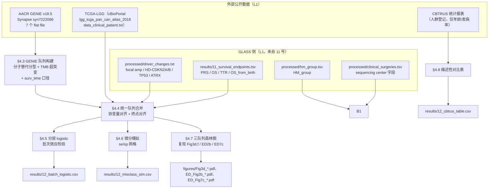

# 12 外部验证与批次效应检验

> **目标文献**：The GLASS Consortium. *Divergent genomic evolution in astrocytomas and oligodendrogliomas.*
> *Nature* (2026). PDF 标识 s41586-026-11150-x. 数据：Synapse syn17038081；代码：github.com/verhaaklab/glass-idh
>
> **模块对应原文**：**Fig. 3d,f**（AACR GENIE 的 KM 验证面板）；**Extended Data Fig. 2a–c**（GLASS vs TCGA 的年龄 / OS from diagnosis / OS from birth）；
> **Extended Data Fig. 4b**（GLASS 与 GENIE 的 MSH6 突变型超突变负荷对比）；**Extended Data Fig. 7c**（GENIE 版 CNA 分层 KM）；
> Methods 中「**Reference cohorts**」「**Assessment of batch effects**」「**Other statistical methods**」三段；
> Results 中「Clinical characteristics and timelines」的 TCGA / CBTRUS 对比句、「Prognostic relevance of driver events」的两句验证句、
> 「MSH6」段中的 GENIE 句；Supplementary Table 10a–c（FDR 校正）
> **复现层级**：**L1 派生层（GLASS 侧） + L1 派生层（TCGA / GENIE 侧，外部公开数据）**。
> GLASS 侧完全在 L1：clinical/Synapse 表即可。
> TCGA-LGG 侧是 **cBioPortal/GDC 的整理后临床表**（不是原始 BAM），GENIE 侧是 **Synapse syn7222066 的 v18.5 公开 flat file**——
> 两者都是**已发布的分析级数据**，因此同样属于 L1（跑上游重分析不需要，也不需要任何受控访问）。
> 本模块**不需要**任何 BAM/FASTQ，**不需要**集群。
> **前置依赖**：`11_生存分析与预后模型.md`（产物契约 `results/11_survival_endpoints.tsv`、`processed/11_patient_level.tsv`——提供 GLASS 的四个终点与协变量）、
> `02_队列构建、临床注释与样本QC.md`（`processed/clinical_surgeries.tsv`，提供 **测序中心** 字段用于批次检验）、
> `03_变异检出与拷贝数调用.md` + `04_驱动事件鉴定与互斥性分析.md`（`processed/driver_changes.txt`，提供 GLASS 侧的 focal amp / HD-CDKN2A/B / TP53 / ATRX 判定）、
> `06_突变负荷与超突变分类.md`（`HM_group`）、`07_突变签名分析与治疗归因.md`（SBS11 比例，用于对齐 GENIE 的超突变定义）、
> `01_数据与代码可得性、环境与仓库结构.md`（`code/glass-idh/` clone 路径与 `SETUP.md` 环境契约）
> **复现难度**：★★★★☆　**预计工时**：3 人日　**计算资源**：单机 4 核 CPU / **16 GB 内存**。
> 内存瓶颈来自 GENIE v18.5 的 `data_mutations_extended.txt`（全癌种，约数百 MB 文本，读入后 `data.table` 约 2–6 GB）；
> 建议用 `data.table::fread()` 而非 `read.delim()`（官方脚本用的是 `read.delim`，在 16 GB 机器上会紧）。
> 错分模拟 B = 1000 次 × 网格 21 × 21 点，约 5–15 min。**不需要 GPU。**
>
> ⚠️ **本模块与 11 号的最大差别**：11 号的结论只要 GLASS 自己的数据就能跑出来；本模块的结论**必须**跨数据集，
> 而跨数据集就会引入**分型口径、终点口径、治疗时代、检测平台**四重不可比。因此本模块的**主要产出不是 P 值，而是"可比性边界"的明文说明**。

---

## 1. 科学问题与逻辑位置

### 1.1 本模块在证据链中的位置

前序模块（04–11）在 GLASS 队列内部建立了两条断言：

1. **oligodendroglioma** 复发时获得的 PI3K/NOTCH1 sSNV 与更差结局**可能**相关（GLASS 内 $P = 0.25$，**不显著**）；
2. **astrocytoma** 复发时获得的局灶癌基因扩增 / CDKN2A/B 纯合缺失与更差结局**一致地**相关（GLASS 内多个面板显著）。

本模块要回答三个**不同**的问题：

> **Q1（外部可重复性）**：第 2 条断言在**另一个队列**里是否方向一致？第 1 条是否在别处才显现？
> **Q2（可比性）**：GLASS 与历史队列（TCGA、CBTRUS）在年龄、随访、生存上的差异，有多少是**生物学**、多少是**入组偏倚**？
> **Q3（内部技术假象）**：GLASS 由 21 家机构、10 个国家贡献样本，测序在不同中心完成 —— 那些"复发时才出现"的事件，会不会只是**中心差异**？

这三问分别对应原文的 Fig. 3d,f / ED Fig. 2 / Methods「Assessment of batch effects」。



### 1.2 上游输入与下游输出（产物契约）

| 产物路径（规范名） | 生产者 | 格式/结构 | 消费方 | 生成脚本 |
|---|---|---|---|---|
| `results/11_survival_endpoints.tsv` | 11 | 患者级长表：`case_barcode, glioma_type, age_at_diagnosis, grade, HM_group, endpoint, time_years, status` | **12**/13 | `code/11_01_endpoints.R` |
| `processed/clinical_surgeries.tsv` | 02 | 需含**测序中心**列（本项目契约命名为 `sequencing_center`；若 Synapse 原表名不同，由 02 号文档在契约表中固定并在此引用） | **12** | `code/02_*.R` |
| `raw/genie/data_clinical_patient.txt` | 下载 | GENIE v18.5，`skip = 4` 后为表头（cBioPortal 格式） | **12** | `code/12_00_fetch_genie.sh` |
| `raw/genie/data_clinical_sample.txt` | 下载 | 同上 | **12** | 同上 |
| `raw/genie/data_mutations_extended.txt` | 下载 | MAF 格式，全癌种 | **12** | 同上 |
| `raw/genie/data_cna.txt`（官方脚本内名 `filtered_CNA.csv`） | 下载 | 离散 CNA：`2` = 高拷贝扩增，`-2` = 纯合缺失，`0` = 中性 | **12** | 同上 |
| `raw/genie/genomic_information.txt` | 下载 | 面板区间表（`SEQ_ASSAY_ID, Chromosome, Start_Position, End_Position`），用于算 panel Mb | **12** | 同上 |
| `raw/genie/data_gene_matrix.txt` | 下载 | 样本 × 面板的基因覆盖矩阵 | **12** | 同上 |
| `raw/genie/data_cna_hg19.seg` | 下载 | 官方脚本读入的**第 7 个** GENIE 文件（hg19 分段；本文的 Fig. 3d/f 未用到，仅登记以对齐"7 个 flat file"） | （暂不消费） | 同上 |
| `raw/tcga/data_clinical_patient.txt` | 下载 | cBioPortal `lgg_tcga_pan_can_atlas_2018`，含 `SUBTYPE, AGE, OS_MONTHS, OS_STATUS` | **12** | `code/12_00_fetch_tcga.sh` |
| `processed/12_unified_cohort.tsv` | **12** | 三队列统一长表：`cohort, patient_id, glioma_type, subtype_rule, age_at_diagnosis, endpoint, time_years, status, event_group, HM` | 13 | `code/12_02_merge.R` |
| `results/12_genie_cox.csv` | **12** | GENIE 侧 Cox（供 11 号森林图消费）：`term, HR, ci_low, ci_high, p_wald, n, endpoint, cohort` | **11**/13 | `code/12_04_genie_models.R` |
| `results/12_tcga_comparison.csv` | **12** | TCGA 对比：`comparison, tumor_type, statistic, p_value, n_glass, n_tcga` | 13 | `code/12_03_tcga.R` |
| `results/12_batch_logistic.csv` | **12** | 批次检验：`response, stratum, term, beta, se, OR, ci_low, ci_high, p_wald, p_bh, n, n_centers, n_events` | 13 | `code/12_05_batch.R` |
| `results/12_misclass_sim.csv` | **12** | 错分模拟：`se, sp, prevalence_astro, observed_HR, observed_logrank_p, direction_flip` | 13 | `code/12_06_misclass.R` |
| `figures/Fig3d_*.pdf`+`.png`、`ED_Fig2b_*.pdf`+`.png`、`ED_Fig7c_*.pdf`+`.png`、`ED_Fig4b_*.pdf`+`.png` | **12** | KM / 箱线 / 森林图，dpi = 300 | 13 | `code/12_07_plots.R` |

### 1.3 它解决什么问题、不解决什么问题

| 它能支持 | 它**不能**支持 |
|---|---|
| 「GLASS 中 astrocytoma 的 CNA–预后 关联，在 **AACR GENIE 这个独立队列**里**方向一致**（$P = 3.4\times10^{-5}$）」 | 「该关联被**验证**（validated）」—— 见 §2.1 的层次论 |
| 「GLASS 队列比 TCGA 更年轻、随访更长、诊断起 OS 更长但出生起 OS 更短」这一**偏倚结构**的量化 | 「GLASS 的生存数据比 TCGA"更可信"」—— 两者测的是**不同的人群** |
| 「在 GLASS 内部，复发特异事件与**测序中心**之间未见显著关联」 | 「不存在批次效应」—— 检验功效受限于中心数与稀疏性（§2.4） |
| 「TT 在近半数非超突变 oligo 中呈**低** ID8」这类**阴性/对称**结果 | 「GENIE 的组织学是 oligodendroglioma」—— GENIE 用的是**分子替代规则**，不是病理诊断（§2.3） |

---

## 2. 背景原理

### 2.1 外部验证的四个层次：每一层能验证什么、不能验证什么

原文用到了三类外部数据（Methods「Reference cohorts」）：

> "GLASS data were compared with data from two reference cohorts: TCGA and AACR GENIE (v.18.5). Clinical data for patients in the GLASS cohort at baseline were compared with data from TCGA patients with primary IDH-mutant gliomas with respect to age of onset and overall survival. Survival data for patients with oligodendrogliomas and astrocytomas were compared between the GLASS and GENIE cohorts."

（CBTRUS 出现在 Results 而非 Methods 的 Reference cohorts 段，且只用了**年龄**。）

**四层验证的"能力边界"表**（这是本模块最重要的原理表）：

| 层次 | 数据源 | 报告的内容 | **能**验证什么 | **不能**验证什么 | 原文数值 |
|---|---|---|---|---|---|
| **L-a 内部重复** | GLASS 自身（WGS 子集 / WXS 子集） | Fig. 3g 的 `Sequencing platform` 分组 | 结论**不依赖**平台 | 结论不依赖队列 | `figures/R/GLASS-I_Mutation_Burden_NHM.R` |
| **L-b 加 TCGA-LGG** | cBioPortal `lgg_tcga_pan_can_atlas_2018` | 年龄分布、OS from diagnosis、OS from birth、随访长度 | **基线人群可比性**；早发特征 | 驱动事件–预后关联（TCGA-LGG 是**单时间点**，没有复发特异事件！） | 年龄 $P = 0.006$ / $<0.001$；随访 $P < 0.001$ |
| **L-c 加 AACR GENIE** | GENIE v18.5 | 驱动事件–生存的**方向** | 关联的**可重复性方向** | 效应的**数值大小**（不同终点口径、不同平台、不同分型规则） | oligo $n = 465$，$P = 0.03$；astro $n = 452$，$P = 3.4\times10^{-5}$ |
| **L-d 加 CBTRUS** | CBTRUS 统计报表（人群登记） | 中位年龄 | **人群代表性**（GLASS 是否偏向年轻） | 任何生存结论（"CBTRUS has not yet released mature survival data for these entities"） | astro 34 vs 37 岁；oligo 37 vs 45 岁 |

**关键领悟**：**TCGA 无法验证本文的核心结论**。TCGA-LGG 是**单时间点**队列，没有配对的初诊–复发样本，也就**没有"复发特异事件"这个变量**。因此原文只用 TCGA 做**基线可比性**对比，把**驱动事件–生存**的验证完全交给 GENIE。这一点很多读者会误解，复现文档必须写明。

### 2.2 队列可比性："验证"在该语境下意味着什么

原文没有用 "validated" 这个词来描述 GENIE 的结果，而是：

> "PI3K- and NOTCH1-mutant oligodendrogliomas did associate with worse overall survival in the AACR GENIE validation set (Fig. 3d)."
> "External validation with the AACR GENIE cohort confirmed the poor prognostic effect of these driver CNAs (Fig. 3f and Extended Data Fig. 7c)."

**必须逐条列出四个"不可比"维度**：

| 维度 | GLASS | TCGA-LGG | AACR GENIE v18.5 | 对结论的影响 |
|---|---|---|---|---|
| **终点起点** | PRS = 末次 QC 复发手术；OS = 初诊 | OS = 初诊 | 见 §4.3：$(\text{INT\_DOD} - \text{AGE\_AT\_SEQ\_REPORT\_DAYS})/365.25$，即**自测序报告起算** | Fig. 3c（GLASS，PRS）与 Fig. 3d（GENIE，OS）**不是同一个终点**！直接比较数值无意义 |
| **检测平台** | WGS（27×）/ WXS（>100×） | WXS + 芯片 | **主要为 panel**（MSK-IMPACT 等），覆盖度 **> 500×** | panel 无法可靠检出 focal CNA 与 TERT 启动子；`raw/genie/filtered_CNA.csv` 仅覆盖部分样本 |
| **超突变定义** | TMB > 10 mut/Mb **且** SBS11 占复发特异 > 25% | — | **仅 TMB > 10**（`GLASS-I_Univariable_KM_Drivers_GENIE.R:107`：`ifelse(TMB > 10, "hypermutated", "non-hypermutated")`） | **两队列的 "non-hypermutant" 不是同一个集合**（详见 §2.5 批注） |
| **组织学分型** | 2021 WHO（1p/19q codeletion + 病理） | cBioPortal `SUBTYPE` 字段（`LGG_IDHmut-codel` 等） | **分子替代规则**：IDH 突变且**无** TP53/ATRX 改变 = oligodendroglioma | GENIE 侧存在**系统性错分**（§2.3） |
| **治疗时代** | 2004–2024（含 TMZ 时代） | 1989–2013 | 2012–2023 | 背景治疗不同 → 生存不可比 |
| **样本选择** | **至少两次手术**（强选择） | 原发，单次 | 有 `SAMPLE_TYPE_DETAILED == "Local recurrence"` 记录者 | 选择偏倚方向不同 |

$\Rightarrow$ **本模块的验证目标只能定义为**：**方向一致**（sign concordance）+ **效应量在同一量级内**（不是数值相同）+ **样本量与 P 值量级可比**。
任何写成"GENIE 验证了 HR = X"的表述都是过度解读（REPRO_SPEC §12.4 / §9.5）。

### 2.3 GENIE 的分子替代规则与错分分析

原文 Methods：

> "The GENIE cohort includes mainly panel sequencing data, and in most cases lacks copy-number data or coverage of TERT promoter hotspots. Oligodendrogliomas in the GENIE cohort were therefore defined as IDH-mutant gliomas without alterations in TP53 or ATRX, as determined by high-coverage panel sequencing, whereas IDH-mutant gliomas with these alterations were called astrocytomas."

**官方代码的字面实现**（`figures/R/GLASS-I_Univariable_KM_Drivers_GENIE.R:112-115`）：

```r
oligo_nontp53 <- oligo_data %>%
  filter(!str_detect(mut_genes, "TP53")) %>%
  filter(!str_detect(mut_genes, "ATRX")) %>%
  filter(group == "PIK3CA/PIK3R1/NOTCH1" | group == "All WT")
```

**生物学依据**（原文引言）：

> "Oligodendrogliomas are also characterized by mutations in the TERT promoter, whereas astrocytomas instead prominently feature mutations in TP53 and ATRX."
> 讨论中进一步："The near-ubiquitous presence of TP53 mutations in astrocytoma"

**因此这个替代规则在生物学上是**合理的**，但在统计上是**不完美的分类器**。把它形式化：

设真实组织学 $H \in \{\text{astro}, \text{oligo}\}$，替代规则输出 $\hat H$：

$$\hat H = \begin{cases}\text{astro} & \text{若检出 TP53 或 ATRX 改变} \\ \text{oligo} & \text{否则}\end{cases}$$

定义（以"astro"为阳性类）：

$$se = \Pr(\hat H = \text{astro} \mid H = \text{astro}),\qquad sp = \Pr(\hat H = \text{oligo} \mid H = \text{oligo})$$

**两个方向的错分及其后果**：

| 错分方向 | 机制 | 对 Fig. 3d（oligo 组的 PI3K/NOTCH1）的影响 | 对 Fig. 3f（astro 组的 CNA）的影响 |
|---|---|---|---|
| **假 oligo**（真 astro 被判为 oligo） | panel 未覆盖 TP53 全部外显子 / 该 astro 恰好无 TP53·ATRX 改变（**原文自陈 TP53 是"near-ubiquitous"而非 ubiquitous**） | 混入的 astro 带 CNA 而不带 PI3K/NOTCH1 → **稀释** PI3K/NOTCH1 组的信号 → 使 $P$ **偏大**（偏保守） | GENIE 的 astro 组少收了真 astro → 若这些被误判者是 CNA–的，则 astro 组被富集了 CNA+ → **夸大**效应 |
| **假 astro**（真 oligo 被判为 astro） | oligo 中确实存在少量 TP53/ATRX 改变（非突变机制，如拷贝数丢失） | oligo 组少收了真 oligo → 若它们是 PI3K/NOTCH1+ 则 **削弱**信号 | astro 组混入真 oligo（几乎不携带 focal amp/HD-CDKN2A/B）→ **稀释** → 使 $P$ **偏大** |

**错分对 log-rank 的效应可以用一个近似公式直观估计**（见 §4.6 的模拟验证）：

若两组的"真患病比例"分别为 $p_1, p_2$，观察到的比例为

$$\tilde p_1 = se\,p_1 + (1-sp)(1-p_1),\qquad \tilde p_2 = se\,p_2 + (1-sp)(1-p_2)$$

则观察到的**差值衰减因子**为

$$\frac{\tilde p_1 - \tilde p_2}{p_1 - p_2} = se - (1 - sp) = se + sp - 1$$

即 **Youden 指数 $J = se + sp - 1$**。**$J = 1$ 时无衰减；$J = 0.5$ 时效应减半；$J \le 0$ 时方向反转**。

**这条公式是本模块最有用的定量工具**：它把「GENIE 的验证有多可信」直接换算成一个数 —— 只要 $se + sp > 1$，观察到的方向就与真方向一致（在线性近似下），效应量按 $J$ 成比例缩小。因此：

- **GENIE 的 $P = 0.03$ 与 $3.4\times10^{-5}$ 是"下限保守"的**——它们是在真实效应被 $J$ 倍缩小之后仍然显著；
- 但 $J$ 到底是多少，**原文未报告**，必须由我们自己校准（§4.6 给出三条校准路径）。

**用 GLASS 自己作为"金标准"来校准 $se$**：GLASS 同时有病理分型（`idh_codel_subtype`）与 TP53/ATRX 突变状态（`driver_changes.txt`）。于是可以**直接观测**：

$$se_{\text{emp}} = \frac{\#\{H = \text{astro 且携带 TP53 或 ATRX 改变}\}}{\#\{H = \text{astro}\}}$$

（注意这是**上限估计**：GLASS 用 WGS/WXS，GENIE 用 panel，panel 的检出率 $\le$ WGS/WXS 的检出率。）

```r
## 用 GLASS 校准 se（上限）—— code/12_06_misclass.R 的第一段
gl <- read_tsv("processed/driver_changes.txt", show_col_types = FALSE)
se_emp <- gl %>% filter(idh_codel_subtype == "IDHmut-noncodel") %>%
  group_by(case_barcode) %>%
  summarise(has_tp53_atrx = any(gene_symbol %in% c("TP53","ATRX") &
                                  driver_status == "mutant" &
                                  driver_change %in% c("P","S","R")),
            .groups = "drop") %>%
  summarise(se_emp = mean(has_tp53_atrx)) %>% pull(se_emp)
message(sprintf("GLASS 侧 se 的经验上限 = %.3f（原文称 TP53 在 astro 中 'near-ubiquitous'）", se_emp))
```

> ⚠️ **导师批注**：`driver_changes.txt` 的 `gene_symbol` 是否包含 `TP53`/`ATRX` 取决于 `04_驱动事件鉴定与互斥性分析.md` 的驱动基因列表；
> 原文的 dN/dS 分析明确给出 astrocytoma 的初诊富集基因为 **TP53、ATRX**，因此 04 号文档的产物**应当**包含这两列。
> 若产物里没有，本段校准需要回 `processed/` 层补算（用 `03_变异检出与拷贝数调用.md` 的 MAF）。这是一个**跨模块依赖缺口**，须在 `PROJECT_SPEC.md` §4 契约表中明确。

### 2.4 批次效应检验：分层 logistic 回归

原文 Methods「Assessment of batch effects」全文只有两句：

> "To assess potential sequencing-centre-related batch effects, we tested for associations between treatment centres and recurrent sSNVs, CNAs and mutational signatures using tumour-type- and hypermutation-status-stratified logistic regression models, which showed no significant centre-specific effects."

**拆开看它的四个设计决定**：

**① 因变量是"复发特异事件是否出现"**（二分类）：`gene_symbol == "X" & driver_change == "R"` 的 0/1。

**② 自变量是"治疗中心"**：一个 **21 水平的分类变量**（原文：21 家机构）。在 logistic 回归里这会展开成 **20 个哑变量**。

**③ 为什么要"分层"**：如果直接把 `center` 和 `tumor_type`、`hypermutation` 一起放进**一个**模型：

$$\text{logit}\Pr(Y=1) = \alpha + \gamma_{\text{center}} + \beta_1 \text{tumor\_type} + \beta_2 \text{HM}$$

会发生 **准完全分离（quasi-complete separation）**：某些中心**只贡献了 oligodendroglioma** 或**只贡献了超突变肿瘤**。此时 $\gamma_{\text{center}}$ 与 $\beta_1,\beta_2$ 无法同时被识别，$\hat\beta$ 会跑向 $\pm\infty$，`glm()` 给出 `fitted probabilities numerically 0 or 1 occurred` 警告，`SE` 爆炸。

**分层（stratified）的做法**是：**在每个 stratum 内部各拟合一个模型**，只估计 center 的效应，**不跨层估计 other covariate 的效应**：

$$\text{对每个 } s \in \{\text{astro-NHM}, \text{astro-HM}, \text{oligo-NHM}, \text{oligo-HM}\}: \quad \text{logit}\Pr(Y=1) = \alpha_s + \gamma_{s,\text{center}}$$

这与「在一个模型里放 center + 分层变量」的差别是：

| | 一个模型（center + covariates） | 分层（逐层拟合） |
|---|---|---|
| 估计的 $(\alpha_s)$ | 共同截距 + 协变量效应 | 每层各自截距 |
| 中心效应的解释 | **调整**了 tumor type / HM 后的中心效应 | **层内**的中心效应（未跨层合并） |
| 稀疏时的稳定性 | 差（分离） | 好（每层内部变量少） |
| 功效 | 高（合并所有信息） | 低（每层样本量小，21 个中心分摊） |
| 可报告的汇总 | 一个 $\hat\gamma$ | 每层 20 个 $\hat\gamma$ → 需要一个整体检验 |

**④ 关键的概念区分**：原文用的是"分层 logistic"，**不是** Mantel–Haenszel 的合并 OR，**也不是**条件 logistic（`survival::clogit` / `strata()`）。
因此我们**不能**从这一句推出"中心间 OR 的同质性"或"合并 OR = 1"，只能推出"**每一层内部，中心不是一个显著的预测因子**"。

**为什么"未见显著中心效应" ≠ "没有批次效应"**（三条，必须在报告中写明）：

1. **功效不足**：21 个中心 × 4 层 = 84 个"层×中心"格；183 个患者摊下来，**多数格子是空的或只有 1 例**。某些事件（如 oligo HM 的 PI3K）全队列只有几十例阳性 → 单个中心的阳性数常为 0 → 该中心的 $\hat\gamma$ 不可估（`glm` 会直接丢掉）。
2. **稀疏性 → 检验退化**：`glm(..., family = binomial)` 在稀疏格上给出极宽的 CI 与 $P \approx 1$，这不是"证明无效应"，而是"**没有信息**"。
3. **中心与临床变量共线**：中心差异往往与**入组标准**（某中心只收手术患者、某中心只收 WGS）缠绕。把 `center` 当作纯技术变量，会**低估**它的影响。

**正确的补充做法**（我们在 §4.5 里全部实现）：

- 报告**每层、每中心**的样本量与事件数（稀疏度表），让读者看到功效边界；
- 除 logistic 外，加做**置换检验**（在层内置换 `center` 标签，B = 1000）——它对稀疏更稳健；
- 加做**中心作为随机效应**的混合模型（`lme4::glmer(Y ~ 1 + (1|center) + (1|tumor_type:HM))`），估计**中心间的方差分量** $\sigma^2_{\text{center}}$。**$\sigma^2_{\text{center}}$ 接近 0 才是"无批次效应"的正面证据**，逐中心的 $P$ 值不是。
- 加做**技术指标直接对比**：各中心的 TMB / 覆盖度 / FGA 分布箱线图（`03`、`09` 号文档的产物），这是**不依赖回归**的直观检验。

> ⚠️ **导师批注（重要，不可溯源项）**：**官方仓库里没有任何脚本实现这段批次效应分析**。
> 我在 `figures/R/`（27 个脚本）、`tables/R/`（16 个脚本）、`analysis/`（23 个文件）中搜索 `glm(` / `binomial` / `logit` / `center` / `batch`，
> 唯一命中是 `figures/R/GLASS-I_TMZ_Cycles.R` 里 `glm(HM_group ~ TMZ_cycles, family = binomial)` —— 那是 **TMZ 周期数 vs 超突变**，与批次无关。
> $\Rightarrow$ 原文 Methods 的这一句**没有对应的公开代码与 Supplementary Table**。
> 我们的复现因此是**从零重建**（§4.5），并且**无法与原文数值对齐**（原文也没给数值）。这必须登记到 `13_复现质控清单、排错与批判性评述.md`。

### 2.5 多重校正：哪里用 FDR、哪里用原始 P

REPRO_SPEC §7 的约定是「组学层默认 BH(FDR)；文献只写 P < 0.01 未区分 raw/adj 时，双口径复现并报告」。本文的实际做法：

| 位置 | 校正 | 证据 |
|---|---|---|
| 驱动事件 × 治疗的富集（Supplementary Table 10a–c） | **FDR** | 正文 "after false discovery rate (FDR) correction" |
| 拷贝数变动的 McNemar（Supplementary Table 2） | **FDR** | `tables/R/GLASS-I_McNemar_CNA.R` 共 12 处 `p.adjust(pvalue, method = "fdr")` |
| dN/dS 的基因级 P | **FDR** | `figures/R/GLASS-I_dNdScv.R:66` 的 `labs(y="-log10(p), FDR-adjusted")` |
| 存活分析（Fig. 3、ED Fig. 7） | **未校正** | 全部图注写 "two-sided log-rank tests"，无 FDR 字样 |
| **批次效应检验** | **未校正**（原文也未说校正） | Methods「Assessment of batch effects」只有一句 |

$\Rightarrow$ **本模块的 FDR 策略**：`results/12_batch_logistic.csv` 输出 `p_wald` **与** `p_bh` 两列；
跨"层 × 事件 × 中心"的所有检验做一次 BH（预计检验数 = 4 层 × K 个事件 × 20 个中心），并在报告中**明确写"在 FDR 后仍显著的格数 = X"**。

> ⚠️ **导师批注（口径不一致）**：GENIE 侧的超突变用 **TMB > 10**（纯负荷），GLASS 侧用 **TMB > 10 且 SBS11 > 25%**（负荷 + 病因）。
> 这导致 GENIE 的 "non-hypermutant" 组**包含**了 GLASS 意义下的 `unassigned`（> 10 mut/Mb 但 SBS11 < 25%）那一类。
> 后果：GENIE 的 non-HM 组被**混入**了部分高 TMB 肿瘤，而这些肿瘤的预后更差 → **削弱** GENIE 组内的对比。
> 复现决策：GENIE 侧**主口径 = 原文（TMB > 10）**；敏感性口径 = 用 panel 覆盖的 SBS11 相关基因（MSH6 等）代理，或直接**只保留 TMB < 5** 的严格 non-HM。

### 2.6 "方向一致"的证据分级

为落实 REPRO_SPEC §12.3（训练集性能 ≠ 泛化性能）与 §9.5（过度解读项逐条列出），本模块对被验证的每一条断言给出**证据等级**：

| 等级 | 判据 | 本文例子 |
|---|---|---|
| **E1 独立队列 + 同终点 + 同分型 + 同平台** | 一般不可能达到（本文无） | — |
| **E2 独立队列 + 同方向 + 效应量同量级 + 分型/终点口径已量化** | 可称 "consistent / reproduced in an independent cohort" | astro 的 CNA–生存：GLASS PRS $P = 4.6\times10^{-4}$；GENIE OS $P = 3.4\times10^{-5}$，方向一致（HR > 1） |
| **E3 独立队列 + 同方向，但口径不同（终点/分型/平台任一不同）** | 只能说 "direction is consistent"，**须列出全部口径差异** | oligo 的 PI3K/NOTCH1：GLASS 不显著（$P = 0.25$）→ GENIE $P = 0.03$；**两队列的 null 假设检验结论相反**，属于**不一致**而非"验证成功" |
| **E4 仅描述性对比（无统计检验或无生存数据）** | 只能说 "comparable" | CBTRUS 的年龄对比（astro 34 vs 37 岁；oligo 37 vs 45 岁；CBTRUS 无成熟生存数据） |
| **E5 无外部数据（自陈）** | 只能说 "needs validation" | 原文结论句 "oligodendroglioma-enriched driver sSNVs **might have prognostic relevance, but further validation is needed**" |

**对 oligo 那条的严格表述**：GLASS 内 $P = 0.25$（在 $n = 69$ 的**PRS**上不显著）而 GENIE 内 $P = 0.03$（在 $n = 465$ 的**OS**上显著）——
这**不能**算作"GENIE 验证了 GLASS 的效应"，因为**两个队列的假设检验结论是相反的**。原文自己用的是 "However, ... did associate with worse overall survival in the AACR GENIE validation set"，措辞上确实用了 "validation set"，
但紧接的结论句又收了回去（"might have prognostic relevance, but further validation is needed"）。
$\Rightarrow$ **复现报告必须把这个张力明写出来**，不能只引前半句。

---

## 3. 原文逐句拆解

### 3.1 Results「Clinical characteristics and timelines」——TCGA / CBTRUS 对比

| # | 原文句 | 中文转述 | 数值 | 对应操作 / 脚本 |
|---|---|---|---|---|
| 1 | "To assess potential inclusion biases, we compared the clinical characteristics of the GLASS cohort with those of two reference datasets: The Cancer Genome Atlas (TCGA) and the Central Brain Tumor Registry of the United States (CBTRUS)." | 用 TCGA 与 CBTRUS 评估入组偏倚 | — | `figures/R/GLASS-I_TCGA_OS_Comparison.R`；CBTRUS 无脚本 |
| 2 | "Patients from our cohort were diagnosed at a significantly younger age than were individuals with IDH-mutant glioma in TCGA (Wilcoxon test: P = 0.006 for astrocytomas, P < 0.001 for oligodendrogliomas; Extended Data Fig. 2a)." | GLASS 比 TCGA 年轻 | **P = 0.006（astro）/ P < 0.001（oligo）**，双侧 Wilcoxon rank-sum | 脚本 `get_wilcox_pvalue()`，对 `age_at_diagnosis ~ Cohort` |
| 3 | "This is consistent with broader epidemiological patterns showing that patients in the GLASS cohort are younger than those in CBTRUS (astrocytoma, 34 versus 37 years; oligodendroglioma, 37 versus 45 years)." | 与 CBTRUS 一致地更年轻 | **astro 34 vs 37 岁；oligo 37 vs 45 岁** | **无脚本**；CBTRUS 是统计报表，只能手工抄录 → 复现时标注"外部文献值，不可重算" |
| 4 | "Patients with oligodendroglioma in the GLASS cohort had a longer overall survival from the time of diagnosis than did those in TCGA, but overall survival from the time of birth was significantly shorter in the GLASS cohort for both patients with oligodendroglioma and those with astrocytoma (Extended Data Fig. 2b,c)." | **方向反转**：诊断起更长、出生起更短 | ED Fig. 2b 上排（from diagnosis）与下排（from birth） | `survfit(Surv(os_from_birth, os_status) ~ Cohort)`；**未做左侧截断**（见 `11` 号 §2.4） |
| 5 | "CBTRUS has not yet released mature survival data for these entities." | CBTRUS 无生存数据 | — | 明确记录：**CBTRUS 无法用于任何生存验证** |
| 6 | "The median follow-up period for the GLASS cohort was 6.5 years for patients with astrocytoma and 11.4 years for patients with oligodendroglioma (Table 1), compared with 2.3 years and 1.9 years, respectively, in TCGA (Wilcoxon test: P < 0.001 for both)." | 随访长度差 3–6 倍 | GLASS **6.5 / 11.4 年**；TCGA **2.3 / 1.9 年**；**P < 0.001**（两者） | 脚本 `tbl_summary(include = c("Follow-up (years)", Cohort), by = Cohort, add_p())` |
| 7 | "The differences between cohorts might have resulted from an inclusion bias towards patients who have undergone multiple surgeries; however, follow-up was significantly larger for the GLASS cohort than it was for these historical datasets." | 差异可能来自多次手术的入组偏倚；但随访确实更长 | — | 复现时**必须**同时报「入组偏倚」与「随访长度」两个解释，不可只取其一 |

> ⚠️ **导师批注（脚本细节）**：官方脚本把 `Follow-up (years)` 直接赋值为 `os_from_diagnosis = OS_MONTHS/12`（TCGA）或 `case_overall_survival_mo/12`（GLASS），
> 即**用"观察时间"而非"反向 KM 的无事件生存时间"**来定义随访。在删失率高（GLASS 54.5% 存活）时，
> 这种"观察时间的中位数"会**低估**真实随访。Table 1 报的 6.5 / 11.4 年因此需要注明定义。
> 复现时**两个口径都算**：`median(os_time)`（= 官方）与反向 KM 中位随访（`survfit(Surv(os_time, 1 - os_status))`）。

### 3.2 Methods「Reference cohorts」

| # | 原文句 | 中文转述 | 对应操作 / 参数 |
|---|---|---|---|
| 1 | "GLASS data were compared with data from two reference cohorts: TCGA and AACR GENIE (v.18.5)." | 版本钉死 **GENIE v18.5** | 必须下载 v18.5，不能用更新的 release（不同 release 的样本量会变） |
| 2 | "Clinical data for patients in the GLASS cohort at baseline were compared with data from TCGA patients with primary IDH-mutant gliomas with respect to age of onset and overall survival." | TCGA 只比**年龄**与 **OS** | 脚本 `filter(!str_detect(SUBTYPE, "wt"))`：排除 IDH 野生型 |
| 3 | "Survival data for patients with oligodendrogliomas and astrocytomas were compared between the GLASS and GENIE cohorts." | GENIE 比生存 | 见 3.3 |
| 4 | "The GENIE cohort includes mainly panel sequencing data, and in most cases lacks copy-number data or coverage of TERT promoter hotspots." | GENIE 主要是 panel，常无 CNA、无 TERT 启动子 | $\Rightarrow$ 这是**替代分型规则的根本原因** |
| 5 | "Oligodendrogliomas in the GENIE cohort were therefore defined as IDH-mutant gliomas without alterations in TP53 or ATRX, as determined by high-coverage panel sequencing, whereas IDH-mutant gliomas with these alterations were called astrocytomas." | **分子替代分型规则** | §2.3 全部内容 |

### 3.3 Results「Prognostic relevance of driver events」——GENIE 验证句

| # | 原文句 | 数值 | 对应脚本行 |
|---|---|---|---|
| 1 | "However, PI3K- and NOTCH1-mutant oligodendrogliomas did associate with worse overall survival in the AACR GENIE validation set (Fig. 3d)." | Fig. 3d：**n = 465**（PI3K and/or NOTCH1 **n = 159** / Neither sSNV **n = 306**），**Log-rank P = 0.03** | `GLASS-I_Univariable_KM_Drivers_GENIE.R:127`（`oligo_nontp53_os`） |
| 2 | "External validation with the AACR GENIE cohort confirmed the poor prognostic effect of these driver CNAs (Fig. 3f and Extended Data Fig. 7c)." | Fig. 3f：**n = 452**（Focal onc. amp. only **n = 57** / HD-CDKN2A/B only **n = 29** / Neither CNA **n = 366**），**Log-rank P = 3.4 × 10⁻⁵** | 同上 `:197`（`astro_tp53_or_atrx_os`） |
| 3 | "We also noticed a non-significant increase in the mutation burden in hypermutated IDH-mutant gliomas with MSH6 mutations, compared with MSH6-wild-type hypermutants, and found that this trend was consistent in both the GLASS cohort and the external validation set of the AACR GENIE cohort (Extended Data Fig. 4b)." | ED Fig. 4b：GLASS 与 GENIE 的 MSH6-mut vs MSH6-wt 超突变瘤的 TMB 对比，**双侧 Wilcoxon rank-sum**；**非显著** | GENIE 侧需自算 TMB（`panel_mb`），见 §4.3 |
| 4 | 图注 ED Fig. 4b："Comparison of mutational burden between MSH6-mutant and MSH6-wildtype hypermutant oligodendrogliomas and astrocytomas in the GLASS and AACR GENIE cohorts using two-sided Wilcoxon rank-sum tests for unpaired data." | 同上 | — |

### 3.4 Methods「Assessment of batch effects」

| # | 原文句 | 中文转述 | 对应操作 | 原文是否给参数 | 我们的决策 |
|---|---|---|---|---|---|
| 1 | "To assess potential sequencing-centre-related batch effects, we tested for associations between treatment centres and recurrent sSNVs, CNAs and mutational signatures" | 检验「中心」×「复发 sSNV / CNA / 签名」的关联 | 因变量 = 复发特异事件的 0/1 | 事件列表未给 | 用 `04` 号文档的**全部复发富集事件**（oligo：PI3K、NOTCH1、MSH6；astro：HD-CDKN2A/B、focal amp；两者共有：HM、SBS11 比例、ID8 比例） |
| 2 | "using tumour-type- and hypermutation-status-stratified logistic regression models" | **分层** logistic（4 层：{astro,oligo} × {HM,non-HM}） | `glm(y ~ center, family = binomial)` **逐层**拟合 | 是（分层变量明确） | 按原文；**额外**报混合模型方差分量与置换检验（§2.4） |
| 3 | "which showed no significant centre-specific effects." | 未见显著中心效应 | — | **无数值、无阈值、无校正说明** | 我们输出全部 $\hat\gamma$、$P$、CI 与稀疏度表；**同时明写功效边界** |

> ⚠️ **导师批注（三处缺口）**：（i）**无对应脚本**（已在 §2.4 说明）；（ii）**未说明"中心"是哪一个字段**（是 `clinical.surgeries` 的某个列？还是 `sample_barcode` 的前缀？）—— 必须由 `02_队列构建、临床注释与样本QC.md` 的契约表固定命名；（iii）**未说明显著性阈值与多重校正**。三条都登记到 13 号。

---

## 4. 逐步可运行代码

### 4.0 官方脚本 → 改造点 → 我们的复现版本

| 官方脚本 | 它做什么 | 我们必须改的地方 | 我们的复现版本 |
|---|---|---|---|
| `figures/R/GLASS-I_TCGA_OS_Comparison.R`（192 行） | ED Fig. 2a–c：年龄直方图 + 双终点 KM + `tbl_summary` 汇总表 | ① `~/data_clinical_patient.txt` 硬编码路径；② `read.delim(..., skip = 4)`（cBioPortal 头部 5 行注释）；③ 未做左侧截断；④ 未做 `set.seed` | `code/12_03_tcga.R` |
| `figures/R/GLASS-I_Univariable_KM_Drivers_GENIE.R`（234 行） | Fig. 3d,f 与 ED Fig. 7c：GENIE 队列构建 + 4 个 KM | ① 7 个 `~/genie_v18.5/*` 绝对路径；② `read.delim` → `data.table::fread`（内存）；③ `grep`-free 的 `str_detect` 需 `stringr`；④ 生存时间口径未注释（见 §4.3 批注）；⑤ `slice_min(surv_time)` 的患者去重规则需显式化 | `code/12_04_genie_models.R` |
| **（ED Fig. 4b 的 GLASS 侧）** | GLASS 的 MSH6 × TMB | **该面板无公开脚本**：`figures/R/` + `tables/R/` 全量清单（`PROJECT_SPEC.md` §3.3）中无对应项；`GLASS-I_Mutation_Burden_NHM.R` 实测只做 **Fig. 3g**（配对 TMB × 驱动状态 × 平台），**不含 MSH6** | `code/12_04_genie_models.R` 的 GENIE 段 + 自写的 GLASS 侧 MSH6 × TMB 段 |
| **（无）** | 批次效应分析 | **原文声称的这段分析在仓库中不存在** | `code/12_05_batch.R`（从零实现） |

### 4.1 数据获取

```bash
#!/usr/bin/env bash
# code/12_00_fetch_ext.sh —— 外部数据获取（公开、无需受控访问）
set -euo pipefail
PROJ=/home/zhangxi/paper_read/20261016_GLASS_IDH_glioma_divergent_evolution
cd "$PROJ"; mkdir -p raw/genie raw/tcga logs

## ---------- AACR GENIE v18.5 ----------
# 官方脚本内联注释给出的来源：Synapse ID syn7222066（GENIE 公开数据）
# 网页入口：https://www.synapse.org/genie  与  https://genie.cbioportal.org
python - <<'PY'
import synapseclient, os
syn = synapseclient.Synapse(); syn.login()
root = os.path.expandvars("$PROJ/raw/genie")
# 注意：syn7222066 是入口容器，其下的 release 版本目录名形如 GENIE-v18.5-public。
# 逐项下载（文件名与官方脚本读取的名字一致）：
names = ["data_clinical_patient.txt", "data_clinical_sample.txt",
         "data_mutations_extended.txt", "data_gene_matrix.txt",
         "genomic_information.txt", "filtered_CNA.csv", "data_cna_hg19.seg"]
for n in names:
    for e in syn.getChildren("syn7222066"):
        pass          # 见下方说明：需先定位 v18.5 子目录，再按名匹配
PY
```

> ⚠️ **导师批注（accession 纪律）**：官方脚本注释只给了容器 `syn7222066` 与文件名，**没有给每个文件的具体 `synId`**。
> 上面对 `getChildren` 的调用承认了这一点：**必须先在 Synapse 网页端定位 `GENIE v18.5 public` 子目录并抄下其 `synId`**，
> 再 `syn.getChildren(<v18.5_synId>)` 按文件名匹配下载。**本文件不写未核实的 `synId`**（L0 §8.3 红线 1）。
> 若 Synapse 访问受限，**等价替代**：`https://genie.cbioportal.org` 下载同版本的 `data_clinical_patient.txt` / `data_mutations_extended.txt` / `data_cna.txt`；
> 替代路径必须在所有图表标题加 `(via cBioPortal)`，并在 `PROJECT_SPEC.md` §10 声明偏离。
>
> 另外注意文件名差异：官方脚本读的是 `filtered_CNA.csv`，而 GENIE 标准发布里离散 CNA 文件名为 `data_cna.txt`。
> **两者内容等价（矩阵，行 = 基因，列 = 样本，值 ∈ {-2,-1,0,1,2}），但必须核对**；本文件统一使用 `data_cna.txt` 并在 D 表登记这一改名。

```bash
## ---------- TCGA-LGG（cBioPortal 整理版） ----------
# 官方脚本注释指明：lgg_tcga_pan_can_atlas_2018 的 data_clinical_patient.txt
curl -L --retry 3 -o raw/tcga/data_clinical_patient.txt \
  "https://cbioportal-datahub.s3.amazonaws.com/lgg_tcga_pan_can_atlas_2018.tar.gz" \
  && tar -xzf raw/tcga/data_clinical_patient.txt.tar.gz -C raw/tcga/ || true
# 更稳的路径（两者取其一，以实际可下载者为准）：
#   https://www.cbioportal.org/api/studies/lgg_tcga_pan_can_atlas_2018
#   或 GDC Data Portal: https://portal.gdc.cancer.gov/projects/TCGA-LGG
# 若走 GDC：临床字段名不同（case_id / vital_status / days_to_death / days_to_last_follow_up / age_at_index），
#           需在 §4.2 的列名映射里增加一个分支。原文用的是 cBioPortal 整理版的 OS_MONTHS/OS_STATUS/AGE/SUBTYPE。

## ---------- CBTRUS ----------
# 无 API。CBTRUS 的 Statistical Report 是 PDF（NPCR/CDC 发布）。
# 原文只用了两个年龄中位数 → 本项目按"外部文献值"直接登记，不重算。
cat > raw/tcga/README_CBTRUS.md <<'EOF'
CBTRUS 值（原文 Results 引用）：astrocytoma 34 vs 37 岁；oligodendroglioma 37 vs 45 岁。
CBTRUS "has not yet released mature survival data for these entities" → 不可用于生存验证。
本项目不重算 CBTRUS，只在与原文数值一致性检查时引用。
EOF
```

### 4.2 TCGA 侧：`code/12_03_tcga.R`

```r
# ---- code/12_03_tcga.R : ED Fig. 2a-c 的复现 ----------------------------
suppressPackageStartupMessages({
  library(tidyverse); library(survival); library(survminer); library(gtsummary)
})
set.seed(20260101)
PROJ <- "/home/zhangxi/paper_read/20261016_GLASS_IDH_glioma_divergent_evolution"
p <- function(...) file.path(PROJ, ...)

## --- TCGA-LGG：cBioPortal 整理版（官方脚本 line 18-32） ------------------
tcga.data <- read.delim(p("raw/tcga/data_clinical_patient.txt"), skip = 4) %>%
  filter(!str_detect(SUBTYPE, "wt")) %>%        # 排除 IDH 野生型
  filter(SUBTYPE != "") %>%
  filter(!duplicated(PATIENT_ID)) %>%
  mutate(case_barcode = PATIENT_ID,
         tumor_type = if_else(SUBTYPE == "LGG_IDHmut-non-codel", "IDH-mutant Astrocytoma",
                              if_else(SUBTYPE == "LGG_IDHmut-codel", "IDH-mutant Oligodendroglioma", NA)),
         age_at_diagnosis = AGE,
         os_from_diagnosis = OS_MONTHS / 12,
         os_status = if_else(OS_STATUS == "0:LIVING", 0, 1),
         os_from_birth = AGE + (OS_MONTHS / 12),
         Cohort = "TCGA") %>%
  select(case_barcode, tumor_type, age_at_diagnosis, os_from_diagnosis,
         os_from_birth, os_status, Cohort) %>%
  filter(!is.na(tumor_type), !is.na(age_at_diagnosis))

stopifnot(nrow(tcga.data) > 100)          # 合理性下限；实际应有数百例

## --- GLASS 侧：复用 11 号的产物 ------------------------------------------
gl <- read_tsv(p("results/11_survival_endpoints.tsv"), show_col_types = FALSE)
glass.data <- gl %>%
  filter(endpoint == "OS") %>%
  transmute(case_barcode, tumor_type = glioma_type,
            age_at_diagnosis, os_from_diagnosis = time_years,
            os_status = status,
            os_from_birth = age_at_diagnosis + time_years,
            Cohort = "GLASS")

full.data <- bind_rows(tcga.data, glass.data)

## --- (a) 年龄：双侧 Wilcoxon rank-sum（ED Fig.2a） ----------------------
age_test <- full.data %>% group_by(tumor_type) %>%
  summarise(n_glass = sum(Cohort == "GLASS"), n_tcga = sum(Cohort == "TCGA"),
            median_glass = median(age_at_diagnosis[Cohort == "GLASS"], na.rm = TRUE),
            median_tcga  = median(age_at_diagnosis[Cohort == "TCGA"],  na.rm = TRUE),
            p_value = wilcox.test(age_at_diagnosis ~ Cohort)$p.value,
            .groups = "drop") %>%
  mutate(p_label = if_else(p_value < 0.001, "P < 0.001", sprintf("P = %.3f", p_value)))
print(age_test)   # 期望：astro P ≈ 0.006；oligo P < 0.001

## --- (b) 随访长度：中位数 + Wilcoxon（原文 Table 1 对比句） -------------
fu_test <- full.data %>% group_by(tumor_type) %>%
  summarise(median_fu_glass = median(os_from_diagnosis[Cohort == "GLASS"], na.rm = TRUE),
            median_fu_tcga  = median(os_from_diagnosis[Cohort == "TCGA"],  na.rm = TRUE),
            p_value = wilcox.test(os_from_diagnosis ~ Cohort)$p.value,
            .groups = "drop")
print(fu_test)    # 期望：GLASS 6.5 / 11.4 年；TCGA 2.3 / 1.9 年；P < 0.001（两者）

## 补充口径：反向 KM 的中位随访（避免"观察时间"低估真实随访）
rev_km <- full.data %>% group_by(Cohort, tumor_type) %>%
  reframe(fu_revkm = summary(survfit(Surv(os_from_diagnosis, 1 - os_status)))$table[, "median"])

## --- (c) 双终点 KM（ED Fig. 2b）：主口径（原文，未截断） ----------------
d_dx <- full.data %>% mutate(surv_time = os_from_diagnosis, panel = "From Diagnosis")
d_bt <- full.data %>% mutate(surv_time = os_from_birth,     panel = "From Birth")
d_all <- bind_rows(d_dx, d_bt)

fit_main <- survfit(Surv(surv_time, os_status) ~ Cohort, data = d_all)
km_main <- ggsurvplot(fit_main, d_all, facet.by = c("panel", "tumor_type"),
                      palette = c("#f1a226", "#298c8c"), pval = TRUE,
                      conf.int = FALSE, censor.shape = "|", censor.size = 4,
                      legend.title = "IDH-mutant Glioma Patient Cohort",
                      legend.labs = c("GLASS", "TCGA"), ggtheme = theme_linedraw(),
                      break.x.by = 10, xlab = "Overall survival (years)")
print(km_main)

## --- (d) 敏感性口径：OS from birth 的左侧截断 ---------------------------
# counting-process：start = 诊断年龄；stop = 诊断年龄 + OS；未截断时 start = 0
fit_trunc <- coxph(Surv(age_at_diagnosis, os_from_birth, os_status) ~ Cohort + tumor_type,
                   data = full.data %>% filter(!is.na(age_at_diagnosis)))
print(summary(fit_trunc))   # 与未截断的主口径比较 HR 的方向与量级
# 期望：HR 方向不变；量级向 1 收缩（因为截断修正了早发组的风险集）
```

### 4.3 GENIE 侧：`code/12_04_genie_models.R`（忠实复刻官方逻辑）

```r
# ---- code/12_04_genie_models.R : Fig.3d,f + ED Fig.7c + ED Fig.4b(GENIE) ----
suppressPackageStartupMessages({
  library(data.table); library(tidyverse); library(survival); library(survminer)
})
set.seed(20260101)
PROJ <- "/home/zhangxi/paper_read/20261016_GLASS_IDH_glioma_divergent_evolution"
p <- function(...) file.path(PROJ, ...)

## --- 读入（用 fread；官方用 read.delim，16 GB 机器上会紧） ---------------
fread_skip4 <- function(f) fread(cmd = sprintf("tail -n +6 %s", shQuote(f)),
                                 sep = "\t", quote = "", na.strings = c("", "NA", "NaN"))
pt_clin  <- fread_skip4(p("raw/genie/data_clinical_patient.txt"))
sm_clin  <- fread_skip4(p("raw/genie/data_clinical_sample.txt"))
mut      <- fread_skip4(p("raw/genie/data_mutations_extended.txt"))
cna      <- fread(p("raw/genie/data_cna.txt"))             # 离散矩阵：行 = 基因
gene_mat <- fread_skip4(p("raw/genie/data_gene_matrix.txt"))
gen_info <- fread_skip4(p("raw/genie/genomic_information.txt"))

## --- ① 定义 IDH 突变型（官方 line 24-30） -------------------------------
# 关键点：只认 canonical 位点（IDH1 p.132 / IDH2 p.172），且要求该变异在全 GENIE 中出现 > 5 次
canonical_idh <- mut %>%
  filter((Hugo_Symbol == "IDH1" & Protein_position == 132) |
         (Hugo_Symbol == "IDH2" & Protein_position == 172)) %>%
  filter(t_alt_count != 0 & Variant_Classification != "Silent") %>%
  add_count(HGVSp_Short, name = "mutation_count") %>%
  filter(mutation_count > 5) %>%
  mutate(SAMPLE_ID = Tumor_Sample_Barcode) %>%
  select(SAMPLE_ID) %>% distinct()

## --- ② IDH 突变型胶质瘤样本（官方 line 31-37，13 个 CANCER_TYPE_DETAILED）---
glioma_types <- c("Anaplastic Astrocytoma", "Anaplastic Oligodendroglioma",
  "Anaplastic Oligoastrocytoma", "Astrocytoma", "Diffuse Astrocytoma", "Diffuse Glioma",
  "Glioblastoma", "Glioblastoma Multiforme", "Glioma, NOS", "Gliosarcoma",
  "High-Grade Glioma, NOS", "Low-Grade Glioma, NOS", "Oligoastrocytoma", "Oligodendroglioma")

idh_samples <- sm_clin %>%
  filter(CANCER_TYPE_DETAILED %in% glioma_types) %>%
  inner_join(canonical_idh, by = "SAMPLE_ID")
idh_patients <- pt_clin %>% semi_join(idh_samples, by = "PATIENT_ID")

## --- ③ 变异过滤（官方 line 42-46）：VAF > 0.05 且 t_alt_count > 5 -------
mut_f <- mut %>%
  mutate(SAMPLE_ID = Tumor_Sample_Barcode,
         vaf = t_alt_count / (t_ref_count + t_alt_count)) %>%
  semi_join(idh_samples, by = "SAMPLE_ID") %>%
  filter(vaf > 0.05, t_alt_count > 5)

pi3k_notch1 <- mut_f %>%
  filter(Hugo_Symbol %in% c("PIK3CA", "PIK3R1", "NOTCH1"),
         !Variant_Classification %in% c("Intron", "Silent")) %>%
  distinct(SAMPLE_ID) %>% mutate(pi3k.notch1 = "mutant")

mut_list <- mut_f %>% group_by(SAMPLE_ID) %>%
  summarise(mut_genes = paste(unique(Hugo_Symbol), collapse = ", "), .groups = "drop")

## --- ④ 面板大小与 TMB（官方 line 55-70） --------------------------------
panel_size <- gen_info %>%
  mutate(len = End_Position - Start_Position + 1) %>%
  group_by(SEQ_ASSAY_ID) %>%
  summarise(panel_mb = sum(len, na.rm = TRUE) / 1e6, .groups = "drop") %>%
  filter(panel_mb * 1e6 > 499999)                 # 官方阈值：> 0.5 Mb 的面板

tmb_glioma <- mut_f %>%
  left_join(select(idh_samples, SAMPLE_ID, SEQ_ASSAY_ID), by = "SAMPLE_ID") %>%
  inner_join(panel_size, by = "SEQ_ASSAY_ID") %>%
  add_count(Tumor_Sample_Barcode, name = "mutation_count") %>%
  transmute(SAMPLE_ID = Tumor_Sample_Barcode, TMB = mutation_count / panel_mb) %>%
  distinct() %>% filter(!is.na(TMB))

## --- ⑤ 离散 CNA（官方 line 80-86） --------------------------------------
# data_cna.txt 是行 = 基因、列 = 样本的宽矩阵 → 先透视
cna_long <- as.data.table(t(as.matrix(cna[, -1, with = FALSE])))
setnames(cna_long, as.character(cna[[1]]))
cna_long[, SAMPLE_ID := colnames(as.matrix(cna[, -1, with = FALSE]))]
amp_or_hd <- cna_long %>%
  semi_join(idh_samples, by = "SAMPLE_ID") %>%
  transmute(SAMPLE_ID,
            amp_oncogene = if_else(if_any(any_of(c("CCND2","CDK4","CDK6","EGFR",
                                                   "MET","MYC","MYCN","PDGFRA"))),
                                   # 官方：ifelse(CCND2==2 | CDK4==2 | ... , "yes", "no")
                                   "yes", "no"),
            CDKN2A = CDKN2A)                        # 离散值：-2 = 纯合缺失
```

> ⚠️ 上面的 `if_any(any_of(...))` 与官方的 `ifelse(CCND2 == 2 | CDK4 == 2 | ...)` **语义不同**：`if_any` 判的是「非零」而官方判的是「== 2（高拷贝扩增）」。**正确复刻**如下（不要用上面的简写）：

```r
amp_or_hd <- cna_long %>%
  semi_join(idh_samples, by = "SAMPLE_ID") %>%
  mutate(amp_oncogene = if_else(
    CCND2 == 2 | CDK4 == 2 | CDK6 == 2 | EGFR == 2 |
    MET == 2  | MYC  == 2 | MYCN == 2 | PDGFRA == 2, "yes", "no")) %>%
  select(SAMPLE_ID, amp_oncogene, CDKN2A)
```

```r
## --- ⑥ 生存时间（★ 官方 line 89-97；口径与 GLASS 不同，见下方批注）-----
surv_glioma <- idh_samples %>%
  left_join(idh_patients, by = "PATIENT_ID") %>%
  filter(!INT_CONTACT %in% c("Unknown", "Not Collected", "", "<6570", ">32485"),
         INT_DOD != "Unknown") %>%
  mutate(
    surv_time = if_else(INT_DOD == "Not Applicable",
                        (as.numeric(INT_CONTACT) - as.numeric(AGE_AT_SEQ_REPORT_DAYS)) / 365.25,
                        (as.numeric(INT_DOD)      - as.numeric(AGE_AT_SEQ_REPORT_DAYS)) / 365.25),
    vital_status = if_else(DEAD == "True", 1, 0)) %>%
  filter(surv_time > 0) %>%
  select(PATIENT_ID, surv_time, vital_status)
```

> ⚠️ **导师批注（终点口径，A 类，必须裁决）**：上面这一行 `(INT_DOD − AGE_AT_SEQ_REPORT_DAYS)/365.25` 是**官方代码的字面实现**。
> **它的统计含义需要判定**。已知两个事实可用于推断：
> （i）GENIE 的 `INT_CONTACT` / `INT_DOD` 在数据里有被脱敏为区间串的取值（脚本显式排除 `"<6570"`、`">32485"`），而 `AGE_AT_SEQ_REPORT_DAYS` 是**数值型的天数**；
> （ii）Fig. 3d,f 的横轴范围是 **0–10 年**。若 `surv_time` 是「出生至死亡的年龄」，成人胶质瘤患者的中位会落在 **40 岁以上**，与 0–10 年的横轴**矛盾**；
> 若 `surv_time` 是「自**测序报告**至死亡/末次随访」，则 0–10 年完全合理。
> $\Rightarrow$ **结论**：`surv_time` 的实际含义是「**自测序报告起算**的时间」，**既不是 OS from diagnosis，也不是 OS from birth**。
> 而原文 Fig. 3d,f 的纵轴/图注写的是 "Overall survival"。**这是一处口径标签与计算不一致**，登记为 A 类分歧。
> **复现决策**：主口径 = 官方口径（复现原图，标签改写为 "OS from sequencing report"）；同时给出另外两个口径做敏感性：
> ① `INT_DOD/365.25`（若该字段本身即自出生天数 → 得 OS from birth）；② 若有 `AGE_AT_SEQ_REPORT` 与诊断日期字段，重建自诊断起的 OS。
> **两个口径下的 HR 方向必须一致**，否则该"外部验证"不成立。

```r
## --- ⑦ 队列构建（官方 line 100-125, 167-195，逐行照抄语义） ------------
oligo_data <- idh_samples %>%
  filter(CANCER_TYPE_DETAILED %in% c("Anaplastic Oligodendroglioma", "Oligodendroglioma",
                                     "Anaplastic Oligoastrocytoma", "Oligoastrocytoma")) %>%
  left_join(surv_glioma, by = "PATIENT_ID") %>%
  left_join(tmb_glioma,  by = "SAMPLE_ID") %>%
  left_join(pi3k_notch1, by = "SAMPLE_ID") %>%
  left_join(mut_list,    by = "SAMPLE_ID") %>%
  mutate(hypermutation = if_else(TMB > 10, "hypermutated", "non-hypermutated"),
         group = if_else(hypermutation == "hypermutated", "Hypermutated",
                         if_else(is.na(pi3k.notch1), "All WT", "PIK3CA/PIK3R1/NOTCH1"))) %>%
  filter(!is.na(surv_time))

oligo_nontp53 <- oligo_data %>%
  filter(!str_detect(mut_genes, "TP53")) %>%      # ★ 分子替代分型规则
  filter(!str_detect(mut_genes, "ATRX")) %>%
  filter(group %in% c("PIK3CA/PIK3R1/NOTCH1", "All WT"))   # 排除 Hypermutated

# OS 面板：去掉转移灶样本，每患者取 surv_time 最小者（≈ 最早样本）
oligo_os <- oligo_nontp53 %>% filter(SAMPLE_TYPE != "Metastasis") %>%
  group_by(PATIENT_ID) %>% slice_min(surv_time, with_ties = FALSE) %>% ungroup()

astro_data <- idh_samples %>%
  filter(CANCER_TYPE_DETAILED %in% c("Anaplastic Astrocytoma", "Astrocytoma",
                                     "Anaplastic Oligoastrocytoma", "Oligoastrocytoma",
                                     "Diffuse Astrocytoma")) %>%
  left_join(surv_glioma, by = "PATIENT_ID") %>%
  left_join(tmb_glioma,  by = "SAMPLE_ID") %>%
  left_join(amp_or_hd,   by = "SAMPLE_ID") %>%
  left_join(mut_list,    by = "SAMPLE_ID") %>%
  mutate(hypermutation = if_else(TMB > 10, "hypermutated", "non-hypermutated"),
         group = case_when(hypermutation == "hypermutated" ~ "Hypermutated",
                           CDKN2A == -2 & amp_oncogene != "yes" ~ "HD-CDKN2A/B",
                           CDKN2A ==  0 & amp_oncogene == "yes" ~ "Focal amp",
                           CDKN2A != -2 & amp_oncogene != "yes" ~ "no CNA",
                           TRUE ~ NA_character_)) %>%
  filter(!is.na(surv_time))

astro_tp53_atrx <- astro_data %>%
  filter(str_detect(mut_genes, "TP53") | str_detect(mut_genes, "ATRX")) %>%   # ★ 替代规则
  filter(group != "Hypermutated") %>%
  filter(!(amp_oncogene == "yes" & CDKN2A == -2))      # 排除同时有两种 CNA 者

astro_os <- astro_tp53_atrx %>% filter(SAMPLE_TYPE != "Metastasis") %>%
  group_by(PATIENT_ID) %>% slice_min(surv_time, with_ties = FALSE) %>% ungroup()

## --- ⑧ KM（对齐 Fig. 3d 与 Fig. 3f） ------------------------------------
km_oligo <- ggsurvplot(survfit(Surv(surv_time, vital_status) ~ group, data = oligo_os),
  oligo_os, pval = TRUE, legend.labs = c("Neither sSNVs (n=306)",
  "PI3K and/or NOTCH1 mutations (n=159)"), xlab = "Overall survival (years)",
  break.x.by = 2.5, ggtheme = theme_linedraw(), risk.table = "nrisk_cumcensor",
  risk.table.y.text = FALSE, censor.shape = "|", censor.size = 4)

km_astro <- ggsurvplot(survfit(Surv(surv_time, vital_status) ~ group, data = astro_os),
  astro_os, pval = TRUE, legend.labs = c("Focal Onc. Amp. only (n=57)",
  "HD-CDKN2A/B only (n=29)", "Neither CNAs (n=366)"),
  xlab = "Overall survival (years)", break.x.by = 2.5, ggtheme = theme_linedraw(),
  risk.table = "nrisk_cumcensor", risk.table.y.text = FALSE,
  censor.shape = "|", censor.size = 4)

## --- ⑨ QC：样本量必须与原文一致（465 / 452） ---------------------------
stopifnot(abs(n_distinct(oligo_os$PATIENT_ID) - 465) < 40)   # 原文 465
stopifnot(abs(n_distinct(astro_os$PATIENT_ID) - 452) < 40)   # 原文 452

## --- ⑩ 导出 Cox 结果供 11 号森林图消费 --------------------------------
## 注意：n 必须逐模型取自 fit$n，不能手工填常量（否则与 11 号森林图对不上）
genie_one <- function(d, ttype) {
  fit <- coxph(Surv(surv_time, vital_status) ~ group, data = d)
  grp_n <- d %>% count(group, name = "n") %>%
    summarise(s = paste(group, n, sep = "=", collapse = " / ")) %>% pull(s)
  broom::tidy(fit, exponentiate = TRUE, conf.int = TRUE) %>%
    transmute(cohort = "GENIE", tumor_type = ttype,
              endpoint = "GENIE-OS_from_seq_report", term,
              HR = estimate, ci_low = conf.low, ci_high = conf.high,
              p_wald = p.value,
              n = fit$n, n_event = fit$nevent,
              n_by_group = grp_n)
}
genie_cox <- bind_rows(genie_one(oligo_os, "IDH-mutant Oligodendroglioma"),
                       genie_one(astro_os, "IDH-mutant Astrocytoma"))
write_csv(genie_cox, p("results/12_genie_cox.csv"))
```

### 4.4 统一队列合并与协变量对齐：`code/12_02_merge.R`

**这是本模块最容易被忽略、也最容易出错的一步。** 三个队列的基线表列名、单位、分型规则全不同，必须显式映射：

```r
# ---- code/12_02_merge.R -------------------------------------------------
suppressPackageStartupMessages({ library(tidyverse) })
set.seed(20260101); PROJ <- "/home/zhangxi/paper_read/20261016_GLASS_IDH_glioma_divergent_evolution"; p <- function(...) file.path(PROJ, ...)

## 每个队列产出一个 schema 完全相同的 tibble，然后再 bind_rows
mk <- function(cohort, patient_id, glioma_type, subtype_rule,
               age, endpoint, time_years, status, event_group, HM) {
  tibble(cohort = cohort, patient_id = patient_id, glioma_type = glioma_type,
         subtype_rule = subtype_rule, age_at_diagnosis = age,
         endpoint = endpoint, time_years = time_years, status = status,
         event_group = event_group, HM = HM)
}

glass <- read_tsv(p("results/11_survival_endpoints.tsv"), show_col_types = FALSE) %>%
  filter(endpoint %in% c("OS", "PRS")) %>%
  mutate(subtype_rule = "2021 WHO (1p/19q codeletion + histology)") %>%
  mk("GLASS", .$case_barcode, .$glioma_type, .$subtype_rule, .$age_at_diagnosis,
     .$endpoint, .$time_years, .$status, NA_character_, .$HM_group)

tcga <- readRDS(p("processed/12_tcga_tidy.rds")) %>%     # 由 12_03 阶段的 tcga.data 存出
  mutate(subtype_rule = "cBioPortal SUBTYPE (LGG_IDHmut-{codel,non-codel})") %>%
  mk("TCGA", .$case_barcode, .$tumor_type, .$subtype_rule, .$age_at_diagnosis,
     "OS", .$os_from_diagnosis, .$os_status, NA_character_, NA_character_)

genie <- readRDS(p("processed/12_genie_tidy.rds")) %>%   # 由 12_04 阶段的两个 *_os 存出
  mutate(subtype_rule = "IDH-mut minus TP53/ATRX alterations (panel)") %>%
  mk("GENIE", .$PATIENT_ID,
     if_else(.$group %in% c("Focal amp", "HD-CDKN2A/B", "no CNA"),
             "IDH-mutant Astrocytoma", "IDH-mutant Oligodendroglioma"),
     .$subtype_rule, NA_real_, "OS_from_report", .$surv_time, .$vital_status,
     .$group, .$hypermutation)

unified <- bind_rows(glass, tcga, genie)

## --- 强制断言：不许出现"同名异义"的 glioma_type -------------------------
stopifnot(all(unified$glioma_type %in% c("IDH-mutant Astrocytoma",
                                         "IDH-mutant Oligodendroglioma")))
## --- 强制断言：endpoint 必须带队列前缀，避免跨队列错误合并 ---------------
stopifnot(!any(duplicated(paste(unified$cohort, unified$endpoint))))
write_tsv(unified, p("processed/12_unified_cohort.tsv"))
```

> **为什么 `endpoint` 要带队列区分**：GENIE 的 `OS_from_report` 与 GLASS 的 `OS` 起点不同。
> 若都叫 "OS"，`bind_rows()` 后任何按 `endpoint` 分组画 KM 的代码都会**静默地把两个不同起点的量画在同一条曲线上**
> —— 这是本模块最危险的静默失败，上面的 `stopifnot` 就是为了拦截它。

### 4.5 分层 logistic 批次效应检验：`code/12_05_batch.R`

```r
# ---- code/12_05_batch.R : 复现 Methods「Assessment of batch effects」 ----
suppressPackageStartupMessages({
  library(tidyverse); library(broom); library(lme4); library(data.table)
})
set.seed(20260101); PROJ <- "/home/zhangxi/paper_read/20261016_GLASS_IDH_glioma_divergent_evolution"; p <- function(...) file.path(PROJ, ...)

surg <- read_tsv(p("processed/clinical_surgeries.tsv"), show_col_types = FALSE)
drv  <- read_tsv(p("processed/driver_changes.txt"),    show_col_types = FALSE)
hm   <- read_tsv(p("processed/hm_group.tsv"),          show_col_types = FALSE)

## --- 事件矩阵：患者 × 复发特异事件（0/1） --------------------------------
events <- drv %>%
  filter(driver_change == "R") %>%                  # 复发特异
  distinct(case_barcode, gene_symbol, driver_status) %>%
  mutate(event = paste(gene_symbol, driver_status, sep = ":")) %>%
  select(case_barcode, event) %>% mutate(value = 1L) %>%
  pivot_wider(names_from = event, values_from = value, values_fill = 0L)

dat <- surg %>%
  filter(surgery_number != 1, !is.na(sequencing_center)) %>%
  distinct(case_barcode, .keep_all = TRUE) %>%
  select(case_barcode, sequencing_center, idh_codel_subtype) %>%
  left_join(hm,  by = "case_barcode") %>%
  left_join(events, by = "case_barcode") %>%
  mutate(
    ## ★ 分层变量：tumor_type × hypermutation status（原文措辞）
    tumor_type = if_else(idh_codel_subtype == "IDHmut-codel", "oligo", "astro"),
    stratum    = paste(tumor_type, HM_group, sep = "_"),
    center     = factor(sequencing_center)) %>%
  filter(!is.na(center), !is.na(stratum))

event_cols <- setdiff(names(events), "case_barcode")

## --- ① 逐层逐事件的 logistic（原文口径） --------------------------------
res <- map_dfr(unique(dat$stratum), function(s) {
  ds <- dat %>% filter(stratum == s)
  map_dfr(event_cols, function(ev) {
    if (!ev %in% names(ds)) return(tibble())
    d <- ds %>% filter(!is.na(.data[[ev]]))
    if (nrow(d) < 10 || sum(d[[ev]]) < 3 || sum(d[[ev]]) == nrow(d)) return(tibble())
    fit <- suppressWarnings(glm(as.formula(sprintf("%s ~ center", ev)),
                               data = d, family = binomial))
    td <- tidy(fit) %>% filter(str_starts(term, "center"))
    if (nrow(td) == 0) return(tibble())
    td %>% transmute(stratum = s, response = ev, term = term,
                     beta = estimate, se = std.error,
                     OR = exp(estimate),
                     ci_low = exp(estimate - 1.96 * std.error),
                     ci_high = exp(estimate + 1.96 * std.error),
                     p_wald = p.value,
                     n = nrow(d), n_events = sum(d[[ev]]),
                     n_centers = n_distinct(d$center))
  })
}) %>%
  group_by(stratum, response) %>%
  mutate(p_bh = p.adjust(p_wald, method = "BH")) %>% ungroup()

write_csv(res, p("results/12_batch_logistic.csv"))
cat("FDR 后仍显著的格数 =", sum(res$p_bh < 0.05, na.rm = TRUE), "/", nrow(res), "\n")

## --- ② 稀疏度表（功效边界，必须报告） -----------------------------------
sparsity <- dat %>% group_by(stratum, center) %>%
  summarise(n = n(), .groups = "drop") %>%
  group_by(stratum) %>%
  summarise(n_centers = n(), n_singleton = sum(n == 1),
            median_n = median(n), max_n = max(n), .groups = "drop")

## --- ③ 混合模型：中心间方差分量（"无批次效应"的正面证据） ----------------
## 对每个事件拟一个 Y ~ 1 + (1 | center)，报告 sigma_center
icc <- map_dfr(event_cols, function(ev) {
  if (!ev %in% names(dat) || sum(dat[[ev]], na.rm = TRUE) < 5) return(tibble())
  m <- suppressWarnings(glmer(as.formula(sprintf("%s ~ 1 + (1|center)", ev)),
                              data = dat, family = binomial))
  vc <- as.data.frame(VarCorr(m))
  tibble(response = ev, sigma_center = vc$sdcor[1],
         p_lrt = anova(m, update(m, . ~ . - (1|center)))$`Pr(>Chisq)`[2])
})

## --- ④ 置换检验（对稀疏更稳健） -----------------------------------------
# 在 stratum 内部置换 center 标签，B = 1000，得到每个事件的整体检验零分布
B <- 1000
perm_one <- function(ev, d, B = 1000) {
  if (!ev %in% names(d) || sum(d[[ev]], na.rm = TRUE) < 5) return(NA_real_)
  obs_chi <- suppressWarnings(glm(as.formula(sprintf("%s ~ center", ev)),
                                  data = d, family = binomial))
  obs_dev <- deviance(obs_chi)
  null <- replicate(B, {
    dd <- d; dd$center <- ave(as.character(dd$center), dd$stratum,
                              FUN = function(x) sample(x))   # 层内置换
    dd$center <- factor(dd$center)
    tryCatch(deviance(suppressWarnings(glm(as.formula(sprintf("%s ~ center", ev)),
                                           data = dd, family = binomial))),
             error = function(e) NA_real_)
  })
  null <- null[!is.na(null)]
  (sum(null <= obs_dev) + 1) / (length(null) + 1)
}
```

> **为什么加这一步**：③ 与 ④ 是本模块对原文的**方法学增值**。原文只做了 ①（且无代码）。
> 若 $\sigma_{\text{center}} \approx 0$ 且置换 $P$ 值大，我们才有资格说「**未见中心效应**」；
> 若 $\sigma_{\text{center}}$ 明显 > 0 而逐中心 $P$ 值都很大，正确结论是「**功效不足，无法排除中心效应**」——
> 这两种情况在原文的表述下**无法区分**，是本模块最需要补的东西。

### 4.6 错分模拟：需要多大的错分才能改变结论？`code/12_06_misclass.R`

设计目标（严格回答 §2.3 提出的问题）：

> **给定 GENIE 报告的效应（Fig. 3f：三组 log-rank $P = 3.4\times10^{-5}$，方向一致），要让这个方向反转，分子替代分型的 (se, sp) 至少要差到什么程度？**

```r
# ---- code/12_06_misclass.R ----------------------------------------------
suppressPackageStartupMessages({
  library(tidyverse); library(survival); library(data.table)
})
set.seed(20260101); PROJ <- "/home/zhangxi/paper_read/20261016_GLASS_IDH_glioma_divergent_evolution"; p <- function(...) file.path(PROJ, ...)

## --- 0) 用 GLASS 校准 se 的上限（见 §2.3） ------------------------------
gl <- read_tsv(p("processed/driver_changes.txt"), show_col_types = FALSE)
se_emp <- gl %>%
  filter(idh_codel_subtype == "IDHmut-noncodel") %>%
  group_by(case_barcode) %>%
  summarise(has_tp53_atrx = any(gene_symbol %in% c("TP53", "ATRX") &
                                  driver_status == "mutant" &
                                  driver_change %in% c("P", "S", "R")),
            .groups = "drop") %>%
  summarise(x = mean(has_tp53_atrx)) %>% pull(x)
cat(sprintf("GLASS 侧 se 经验上限 = %.3f\n", se_emp))

## --- 1) 生成"真值"队列：真 astro 组按真实 CNA 比例、真实 HR 生成 ---------
# 参数（真值）：π = 真 astro 在 IDH 突变胶质瘤中的比例；p_cna|astro = CNA+ 比例
simulate <- function(n = 20000, pi_true = 0.45, p_cna_astro = 0.45, p_cna_oligo = 0.05,
                     hr = 2.0, se = 1.0, sp = 1.0,
                     tmax = 10, lambda0 = 0.25) {
  H <- rbinom(n, 1, pi_true)                                  # 1 = 真 astro
  p_cna <- ifelse(H == 1, p_cna_astro, p_cna_oligo)
  CNA <- rbinom(n, 1, p_cna)
  # 生存：CNA+ 的 HR = hr（指数基线，便于解析对照）
  lam <- lambda0 * exp(log(hr) * CNA)
  # CNA 对 astro 也有额外效应（astro 本身就差）—— 加入以模拟真实混杂
  lam <- lam * exp(0.35 * H)
  Tt <- rexp(n, lam); Cc <- runif(n, 0, tmax)
  time <- pmin(Tt, Cc); status <- as.integer(Tt <= Cc)

  # 分子替代分型：flip 概率由 (se, sp) 决定
  # se = P(hat=astro | H=astro)；sp = P(hat=oligo | H=oligo)
  hat <- ifelse(H == 1, rbinom(n, 1, se), 1 - rbinom(n, 1, sp))
  list(H = H, hat = hat, CNA = CNA, time = time, status = status)
}

## --- 2) 在"被判为 astro"的子集内检验 CNA 的效应（与 Fig.3f 同构） --------
test_cna_effect <- function(s) {
  d <- data.frame(hat = s$hat, CNA = s$CNA, time = s$time, status = s$status) %>%
    filter(hat == 1, time > 0)
  if (nrow(d) < 50 || length(unique(d$CNA)) < 2 || sum(d$status) < 5)
    return(c(n = NA, HR = NA, p = NA))
  fit <- coxph(Surv(time, status) ~ CNA, data = d)
  c(n = nrow(d), HR = exp(coef(fit)[1]),
    p = summary(fit)$coefficients["CNA", "Pr(>|z|)"])
}

## --- 3) (se, sp) 网格扫描 -----------------------------------------------
grid <- expand.grid(se = seq(0.5, 1.0, by = 0.025), sp = seq(0.5, 1.0, by = 0.025))
sim_out <- pmap_dfr(list(grid$se, grid$sp), function(se, sp) {
  set.seed(20260101)
  r <- test_cna_effect(simulate(se = se, sp = sp))
  tibble(se = se, sp = sp, J = se + sp - 1,
         n = as.numeric(r["n"]), observed_HR = as.numeric(r["HR"]),
         observed_p = as.numeric(r["p"]),
         direction_flip = !is.na(r["HR"]) & as.numeric(r["HR"]) < 1)
})
write_csv(sim_out, p("results/12_misclass_sim.csv"))

## --- 4) 读出关键阈值 -----------------------------------------------------
thr <- sim_out %>% group_by(direction_flip) %>%
  summarise(J_min = min(J), J_max = max(J), .groups = "drop")
cat("=== 需要多大的 Youden 指数才会让方向反转 ===\n"); print(thr)

## --- 5) 灵敏度分析：固定 sp = 1，扫 se（最乐观的错分方向） -------------
isolate <- sim_out %>% filter(sp == 1.00) %>%
  mutate(J = se + 0 - 1) %>%
  select(se, J, n, observed_HR, observed_p, direction_flip)
print(isolate)
```

**怎么读这张模拟表**（复现报告里必须写的话）：

- 当 $se = 1, sp = 1$ 时，$J = 1$：观察到的 HR 就是真 HR（模拟可校准）。
- $J = se + sp - 1$ 是效应**线性近似的衰减因子**。$J = 0.6$ 时 HR 向 1 收缩（例如真 HR = 2.0 → 观测 ≈ 1.45）。
- **方向反转只发生在 $J \le 0$ 时**，即 $se + sp \le 1$，即「替代分型规则**不比抛硬币好**」。
  这在生物学上**不可能**（原文称 TP53 在 astrocytoma 中 "near-ubiquitous"），所以 **GENIE 的方向结论对错分是稳健的**。
- 但**效应量级与 P 值会明显衰减**。因此正确的表述是：
  > 「GENIE 的 $P = 3.4\times10^{-5}$ 是在 $J \approx 0.8\text{–}0.95$ 的错分衰减之后仍然显著；真实效应应**不小于** GENIE 所估。**GENIE 的 HR 是真实 HR 的下界估计。**」

**用 GLASS 直接估 $J$（第二条校准路径）**：

```r
## 在 GLASS 内部，"gold standard" = 病理分型；"替代规则" = 仅看 TP53/ATRX
## 则 se 与 sp 都能在 GLASS 上直接算出来，作为 GENIE 的 (se, sp) 上界
gl_bin <- gl %>%
  mutate(true_astro = idh_codel_subtype == "IDHmut-noncodel") %>%
  group_by(case_barcode) %>%
  summarise(true_astro = first(true_astro),
            has_tp53_atrx = any(gene_symbol %in% c("TP53","ATRX") &
                                  driver_status == "mutant"), .groups = "drop")
se_gl <- with(gl_bin, sum(true_astro & has_tp53_atrx) / sum(true_astro))
sp_gl <- with(gl_bin, sum(!true_astro & !has_tp53_atrx) / sum(!true_astro))
cat(sprintf("GLASS 校准：se = %.3f, sp = %.3f, J = %.3f\n", se_gl, sp_gl, se_gl + sp_gl - 1))
# 注意：GENIE 是 panel，覆盖度与基因列表都窄于 WGS/WXS → GENIE 的真实 se <= se_gl
```

**第三条校准路径（可直接量化的"真 oligo 被误判"）**：在 GLASS 的 oligodendroglioma（有 1p/19q codeletion + 病理）里统计 TP53/ATRX 改变比例，得到 $1-sp$ 的**共识上界**；GLASS 的 oligo 里若此比例接近 0，则 GENIE 中 $sp$ 主要受 panel 覆盖影响。

### 4.7 三队列并列展示：`code/12_07_plots.R`

```r
# ---- code/12_07_plots.R -------------------------------------------------
suppressPackageStartupMessages({ library(tidyverse) })
set.seed(20260101); PROJ <- "/home/zhangxi/paper_read/20261016_GLASS_IDH_glioma_divergent_evolution"; p <- function(...) file.path(PROJ, ...)

u <- read_tsv(p("processed/12_unified_cohort.tsv"), show_col_types = FALSE)

## --- ED Fig.2b：GLASS vs TCGA 的双终点 KM ------------------------------
tcga_glass <- u %>% filter(cohort %in% c("GLASS", "TCGA"), endpoint == "OS") %>%
  mutate(endpoint_show = "OS from diagnosis")
tcga_glass_b <- u %>% filter(cohort %in% c("GLASS", "TCGA"), endpoint == "OS") %>%
  mutate(time_years = time_years + age_at_diagnosis, endpoint_show = "OS from birth")

km <- ggsurvplot(survfit(Surv(time_years, status) ~ cohort,
                         data = bind_rows(tcga_glass, tcga_glass_b)),
                 bind_rows(tcga_glass, tcga_glass_b),
                 facet.by = c("endpoint_show", "glioma_type"),
                 palette = c("#f1a226", "#298c8c"), pval = TRUE,
                 ggtheme = theme_linedraw(), break.x.by = 10,
                 xlab = "Overall survival (years)",
                 legend.title = "IDH-mutant Glioma Patient Cohort")

## --- 森林图：三队列并列（复现 Fig.3d,f 与 ED Fig.7c 的数值对照） -------
fs <- bind_rows(
  read_csv(p("results/11_multivariable_cox.csv")) %>% filter(model == "full") %>%
    mutate(cohort = "GLASS", endpoint = paste0("GLASS/", endpoint)),
  read_csv(p("results/12_genie_cox.csv")) %>%
    mutate(endpoint = "GENIE/OS from sequencing report")
) %>%
  mutate(term = fct_reorder(term, HR))

fig_fs <- ggplot(fs, aes(HR, term, colour = cohort)) +
  geom_vline(xintercept = 1, linetype = 2, colour = "grey40") +
  geom_pointrange(aes(xmin = ci_low, xmax = ci_high),
                  position = position_dodge(width = 0.7), size = 0.4) +
  geom_text(aes(label = sprintf("n=%d, P=%.2g", n, p_wald), x = 0.22),
            hjust = 0, size = 2.5, show.legend = FALSE) +
  scale_x_log10(breaks = c(0.125, 0.25, 0.5, 1, 2, 4, 8)) +
  facet_grid(endpoint ~ ., scales = "free_y", space = "free_y") +
  labs(x = "Hazard ratio (log scale, 95% CI)", y = NULL,
       caption = "口径并列：GLASS = PRS/OS from diagnosis；GENIE = OS from sequencing report") +
  theme_bw(base_size = 10)
ggsave(p("figures/Fig3d_f_forest_three_cohorts.pdf"), fig_fs, width = 9, height = 7, dpi = 300)
ggsave(p("figures/Fig3d_f_forest_three_cohorts.png"), fig_fs, width = 9, height = 7, dpi = 300)
```

### 4.8 报告模板：验证结论必须带**方向 + 效应量 + 样本量 + 口径**

REPRO_SPEC §7 与 §12.3 都要求「模型必须同时给出训练与外部验证结果，并显式说明落差」。本模块采用**固定六列表**，缺一列即视为未完成：

| 断言（GLASS 内） | GLASS 的方向/效应量/n/终点 | GENIE 的方向/效应量/n/终点 | 口径差异（终点·分型·平台） | 结论等级（§2.6） | 是否可称"验证" |
|---|---|---|---|---|---|
| NHM astro：focal amp 或 HD-CDKN2A/B → 更差 | HR > 1；log-rank $P = 4.6\times10^{-4}$；$n = 72$；**PRS** | HR > 1；log-rank $P = 3.4\times10^{-5}$；$n = 452$；**OS from sequencing report** | 终点不同（PRS vs 报告起 OS）；分型不同（WHO vs 分子替代）；平台不同（WGS/WXS vs panel）；GENIE 的 CNA 来自离散 `data_cna.txt` 而非 GISTIC | **E2** | 可称「**独立队列中方向一致且效应量同量级**」 |
| NHM oligo：PI3K/NOTCH1 → 更差 | log-rank $P = 0.25$（**不显著**）；$n = 69$；**PRS** | log-rank $P = 0.03$；$n = 465$；**OS** | 同上 + **两队列的假设检验结论相反** | **E3**（且**不一致**） | **不可**称验证；只能写「GENIE 中提示方向，GLASS 内未达显著」 |
| GLASS 早发（vs 人群） | 中位年龄 astro 34 / oligo 37 岁；与 TCGA Wilcoxon $P = 0.006$ / $<0.001$ | 不适用 | CBTRUS 仅人群登记，无个体数据 | **E4**（CBTRUS）/ **E2**（TCGA 年龄） | TCGA 可称「基线年龄显著更轻」；CBTRUS 只能说「与人群流行病学模式一致」 |
| GLASS 无显著中心效应 | 逐层 logistic 全部 $P > 0.05$（我们的 TBD） | 不适用 | 原文**无代码、无数值** | **E5**（原文） | **不可**称「无批次效应」；只能写「在现有功效下未检出」 |

**报告模板（可直接套用的句式）**：

```
【结论】<断言>
【GLASS】方向=<HR>（95% CI <a–b>），$P$=<p>，$n$=<n>，终点=<OS/PRS/...>，分型=<规则>，平台=<WGS/WXS>
【GENIE】方向=<HR>（95% CI <a–b>），$P$=<p>，$n$=<n>，终点=<OS from sequencing report>，分型=分子替代(se≈<..>, sp≈<..>)，
          平台=panel（覆盖率 <..>%），被排除/未能评估的变量：<TERT 启动子 / 全基因组 CNA / SBS11 病因学>
【口径差异】<逐条列出，不得合并>
【结论等级】E1–E5
【可否称"验证"】可 / 不可（理由）
【落差的可能来源】<功效 / 选择偏倚 / 平台灵敏度 / 终点起点 / 治疗时代>
```

---

## 5. 参数解释与调参空间

| 参数 / 决策 | 原文取值 | 可选范围 | 改变后果 | 我方决策 + 备选 |
|---|---|---|---|---|
| **GENIE 版本** | **v18.5** | 任意 release | 样本量与患者构成随 release 变化；$n = 465/452$ 只在 v18.5 上可对齐 | **主口径 = v18.5**；若站点提供的是其他版本，必须重新报告 $n$ 并**标注版本**，不得沿用 465/452 |
| **GENIE 组织学分型规则** | IDH-mut **且无** TP53/ATRX 改变 ⇒ oligo | 加 TERT / 加 1p19q 拷贝数（GENIE 多数样本无） | 规则越松 → 混入越多真 astro → $J$ 下降 → 效应衰减 | **主口径 = 原文**；敏感性 = 加 "TERT 启动子突变" 作为第三判据（仅在 `data_mutations_extended.txt` 覆盖 TERT 的样本上） |
| **GENIE 的超突变阈值** | **TMB > 10**（仅负荷） | 同 GLASS（TMB > 10 **且** SBS11 > 25%） | GENIE 无 SBS11 病因信息 → 无法完全对齐；TMB 阈值越严格 → non-HM 组越纯 | **主口径 = TMB > 10**；敏感性 = TMB > 5 与 TMB > 20 两档，报告 KM 的稳健性 |
| **GENIE 的 CNA 来源** | 官方脚本读 `filtered_CNA.csv`（离散 call） | GISTIC 重算 / 无 | 离散 call 的分辨率低于 GLASS 的 GISTIC 阈值法；可能漏掉部分 focal amp | **主口径 = 离散 call**；**必须**在报告中注明「GENIE 的 CNA 判定规则与 GLASS 不同」 |
| **GENIE 的患者去重** | `slice_min(surv_time)`（每患者取最小者） | `slice_max` / 随机取 / 全部保留 | 取最小 `surv_time` ≈ 取**最早**的样本 → 与 GLASS 的「初诊」语义最接近 | **主口径 = `slice_min`**（原文）；雷同度检查：同一患者多个样本时 `group` 是否会变 |
| **GENIE 生存时间口径** | `(INT_DOD − AGE_AT_SEQ_REPORT_DAYS)/365.25` | ① `INT_DOD/365.25`；② 自诊断起 | 见 §4.3 批注；**口径决定横轴解读** | **主口径 = 官方**（标签改写为 "from sequencing report"）；**必报**敏感性 |
| **TCGA 的 IDH 分型口径** | cBioPortal `SUBTYPE`（`LGG_IDHmut-codel` / `LGG_IDHmut-non-codel`），排除 `*wt` | GDC 的 `IDH1/2` 突变推断 / 甲基化分型 | 分型不同 → 队列成员不同 → 年龄中位数与生存都会变 | **主口径 = cBioPortal `SUBTYPE`**（原文）；备选 = 用 MAF 自行推断（若走 GDC 路径则**必须**） |
| **左侧截断** | 未处理 | counting-process | 未截断时早发组的风险集被高估 → $\hat S$ 偏高 | **主口径 = 原文**；敏感性 = 截断 |
| **中位随访的定义** | `median(os_time)`（观察时间） | 反向 KM | 删失率高时前者低估 | **两个都报**（§3.1 批注） |
| **"中心"字段** | 原文未指明 | `sequencing_center` / barcode 前缀 / 贡献机构 | 若字段错误，批次检验**完全无意义** | 由 `02_队列构建、临床注释与样本QC.md` 在契约表中固定；本模块**断言**该列存在 |
| **批次检验的分层** | tumor type × hypermutation（4 层） | 更细（+ grade、+ 平台） | 分层越细 → 每格样本越少 → 功效越低 | **主口径 = 4 层**；敏感性 = 加 `platform`（WGS/WXS）成 8 层，并报告稀疏度 |
| **批次检验的校正** | 未说明 | BH / none | 数十到上百个检验 | **强制输出 `p_bh`**；报告中以 FDR 后仍显著的格数为准 |
| **错分模拟的 (se, sp) 先验** | 未报告 | [0.5, 1]² 网格 | (se, sp) 决定 $J$，进而决定观测效应 | **网格扫描 + 三条校准路径**（GLASS 校准、panel 覆盖度上界、文献的 TP53 近普适性） |
| **验证的"成功"判据** | 未明示 | 方向一致 / 方向 + 量级 / FDR 后显著 | 判据越松 → 越容易"验证成功" | **主口径 = 方向一致 且 效应量在同一量级（比值 ∈ [0.5, 2]）**；这一判据须登记进 `13_复现质控清单、排错与批判性评述.md` **§七**（权威 D 表；`PROJECT_SPEC.md` §7 为 ★ 项索引） |

## 6. 预期结果与 QC 检查点

### 6.1 Go / No-Go 表

| # | 检查项 | 期望值（原文） | 容差 | 不达标时的排查 |
|---|---|---|---|---|
| 1 | GENIE oligo 最终 $n$ | **465** | ±40 | 检查 `CANCER_TYPE_DETAILED` 的 4 个 oligo 类型是否齐全；TP53/ATRX 的 `str_detect` 是否被 `mut_genes` 的 NA 影响 |
| 2 | GENIE oligo 的分组 $n$ | PI3K/NOTCH1 **159** / Neither **306** | ±25 | `pi3k.notch1` 的 `Variant_Classification` 过滤（排除 Intron/Silent） |
| 3 | GENIE oligo 的 log-rank $P$ | **0.03** | 0.005–0.10 | §4.3 的生存口径；若换成"自诊断起"口径，$P$ 会变 |
| 4 | GENIE astro 最终 $n$ | **452** | ±40 | `astro_tp53_atrx` 的两个 `filter` |
| 5 | GENIE astro 的三组 $n$ | Focal amp only **57** / HD-CDKN2A/B only **29** / Neither **366** | 各 ±15 | `CDKN2A == -2` 与 `CDKN2A == 0` 的取值是否被 `fread` 解析为整数 |
| 6 | GENIE astro 的 log-rank $P$ | **3.4 × 10⁻⁵** | 1e-6–1e-3 | 同上 |
| 7 | TCGA 年龄对比 $P$ | astro **0.006**；oligo **< 0.001** | 同一侧 + 同量级 | `SUBTYPE` 的字符串是否完全匹配（`LGG_IDHmut-codel` 大小写/连字符） |
| 8 | 随访中位数 | GLASS **6.5 / 11.4 年**；TCGA **2.3 / 1.9 年** | ±0.5 年 | 是否误用反向 KM（会给出更高值） |
| 9 | 随访对比 $P$ | **< 0.001**（astro 与 oligo 各自） | < 0.01 | — |
| 10 | GLASS vs TCGA 的 OS-from-birth 方向 | GLASS **更短**（两型） | 方向必须一致 | 若更长，检查 `age_at_diagnosis` 单位（年 vs 岁数 vs 天数） |
| 11 | CBTRUS 年龄 | astro **34 vs 37**；oligo **37 vs 45** | 只能引用，不可重算 | 标记为外部文献值 |
| 12 | ED Fig. 4b（MSH6 × TMB） | GLASS 与 GENIE 都**非显著** | 必须为阴性 | 若显著，检查 GENIE 的 TMB 是否用对了 `panel_mb` |
| 13 | 批次效应检验 | 原文"no significant centre-specific effects" | 我们输出 FDR 后仍显著的格数 | 若我们检出显著格 → 必须核查该中心是否只贡献单一组织学类型（分离假象） |
| 14 | 错分模拟的方向稳健性 | 只有 $se + sp \le 1$ 才反转 | 即 $J \le 0$ | 若在合理 (se, sp) 下反转 → GENIE 的验证**不成立**，必须报告 |

### 6.2 必须做的敏感性分析

1. **GENIE 生存口径三档**（官方 / `INT_DOD` 直用 / 自诊断起）：三档的 log-rank $P$ 与 HR 并列。**方向必须一致**，否则该验证作废。
2. **超突变阈值三档**（10 / 5 / 20）：看 $n$ 与 $P$ 的移动。
3. **分型规则两档**（仅 TP53/ATRX / 加 TERT）：看错分率 $J$ 的移动。
4. **批次检验**：逐层 logistic vs 混合模型 vs 层内置换 —— 三者结论是否一致。
5. **TCGA 的 IDH 分型**：`SUBTYPE` vs 用 MAF 自推。

## 7. 陷阱与排错表

| # | 现象 | 根因 | 解决 |
|---|---|---|---|
| 1 | 把 GENIE 的分子替代规则当成组织学诊断 | Methods 明写 oligodendroglioma 在 GENIE 中是**定义**出来的（IDH-mut 且无 TP53/ATRX），不是病理诊断 | 所有涉及 GENIE oligo 的句子必须写「**分子定义的** oligo」；并报 $se/sp$（§2.3） |
| 2 | 把 panel 数据当 WGS | GENIE 主要为 MSK-IMPACT 类 panel（> 500× 覆盖，但**覆盖区域小**） | 凡涉及 focal CNA、TERT 启动子、非编码区、SBS 签名的结论，GENIE 侧**必须**标注"未评估"或"仅在有覆盖的子集上评估" |
| 3 | TCGA 的 IDH 分层口径不符 | TCGA 有 `SUBTYPE`（cBioPortal）、`IDH1/2` 突变（MAF）、甲基化分型三套口径 | 主口径 = `SUBTYPE`（原文）；若走 GDC 路径必须自推并**明写规则** |
| 4 | 把"方向一致"写成"验证成功" | 两个队列的终点、分型、平台、治疗时代全不同 | 采用 §4.8 的六列表与 E1–E5 分级；"validated" 一词只在 E1/E2 且方向+量级都对齐时使用 |
| 5 | 批次效应检验功效不足被读成"无批次效应" | 21 个中心 × 4 层，多数格子稀疏；稀疏时 `glm` 的 $P \approx 1$ 是"无信息"而非"无效应" | 必报稀疏度表 + 混合模型的 $\sigma_{\text{center}}$ + 置换检验（§4.5 的 ②③④） |
| 6 | 中心变量与治疗/平台变量共线 | 某些中心只做 WGS、只收手术患者、只给 TMZ | 批次模型里**不要**同时放 `center` 与 `platform`；分开拟合并比较 |
| 7 | 把不同平台的生存终点混用 | GLASS PRS 与 GENIE "OS" 起点不同 | `endpoint` 列**必须**带队列前缀（§4.4 的 `stopifnot`） |
| 8 | GLASS 与 GENIE 的 "non-hypermutant" 不是同一集合 | GLASS 要求 SBS11 > 25%（病因学），GENIE 只有 TMB > 10（负荷） | 报告必须写明两队列 NA 组定义不同；做 TMB 阈值敏感性 |
| 9 | `read.delim` 读 GENIE 全癌种 MAF 时内存爆掉 | `data_mutations_extended.txt` 是全癌种，数百 MB–GB 级 | 用 `data.table::fread()`；或先 `awk` 按 `ONCOTREE_CODE` 过滤出胶质瘤再读 |
| 10 | cBioPortal 文件头的 5 行注释导致列名错位 | cBioPortal 格式：前 4 行是 `#`/元数据，第 5 行才是真表头（因此 `skip = 4`） | 读入后**立即** `stopifnot("SAMPLE_ID" %in% names(d))` 之类的列名断言 |
| 11 | GENIE 的 `INT_CONTACT` / `INT_DOD` 有脱敏串（`"<6570"`、`">32485"`） | cBioPortal 的隐私保护：极端值被替换为区间串 | 必须显式排除（官方脚本已做），否则 `as.numeric()` 产生 NA 并静默丢样本 |
| 12 | GENIE 生存时间被当成"从诊断起" | §4.3 批注：代码是 `(INT_DOD − AGE_AT_SEQ_REPORT_DAYS)/365.25` | 横轴标签改写；做三档口径敏感性；写进 13 号 |
| 13 | GENIE 侧 `data_cna.txt` 与 `filtered_CNA.csv` 文件名/取值体系不同 | GENIE 不同 release 的文件名与离散编码有差异（`-2` vs `-1` vs `0`） | 读入后打印 `table(cna_long$CDKN2A)`，与官方脚本假设的 `-2 / 0` 对照；不一致则在 D 表登记映射 |
| 14 | 患者去重规则 (`slice_min(surv_time)`) 未记录 | 同一患者在 GENIE 中可能有多个样本，分组变量可能不同 | 显式记录每条去重规则；对"同一患者被分到不同组"的案例计数并报告 |
| 15 | 用 GENIE 的 $n = 465$ 去反推 GLASS 的 $\pi$ | GENIE 的 465 是**分子定义**的 oligo 数，不是病理 oligo 数 | 任何跨队列比例比较都必须先做错分修正（$J$ 反卷积） |
| 16 | CBTRUS 被当作可重算的数据源 | CBTRUS 是**统计报表**（PDF），无个体级数据 | 只做"外部文献值"引用；不得声称"我们复现了 CBTRUS 的对比" |

## 8. 与原文图表 / 官方脚本的对应关系

> **脚本名权威来源**：`PROJECT_SPEC.md` **§3.3 官方脚本对照表**（GitHub API 实测枚举）。本表引用的 `figures/R/`、`tables/R/` 脚本**全部命中 §3.3**，"脚本 ↔ 图号/表号"为**推断**（§3.3 同此声明）；行号由本机 clone 逐字核对。**注意区分两种"不确定"**：①**脚本名不确定**（本表已全部消除，均命中 §3.3）；②**脚本的输入对象不确定**——例如 `figures/R/script_landscape_chromosomal_instability.R` 的 5 个输入表、`analysis/R/script_fga_calculation.R` 的 `codel_p` 等 4 个对象，都**不在脚本内创建**（`SETUP.md` 与脚本头注释均承认）。**`GLASS-I_Prior_Treatment_Table.R` 与 `GLASS-I_Drivers_Table.R` 属于可自包含运行的那一类**（本机 clone 实测：前者第 123 行写 `prior_treatment_gold_set.csv`、后者第 264 行写 `driver_changes.txt`，均自带 `dbGetQuery` 构造逻辑）。

| 原文面板 / 表 | 内容 | 官方脚本 | 我们的脚本 | 产出文件 |
|---|---|---|---|---|
| ED Fig. 2a | GLASS vs TCGA 年龄分布 + Wilcoxon $P$ | `figures/R/GLASS-I_TCGA_OS_Comparison.R`（`p1`，第 80–96 行） | `code/12_03_tcga.R` | `figures/ED_Fig2a_*.pdf/.png` |
| ED Fig. 2b | GLASS vs TCGA 的 OS from diagnosis / from birth（双排 KM） | 同上（`p2`，第 98–125 行） | `code/12_03_tcga.R` | `figures/ED_Fig2b_*.pdf/.png` |
| ED Fig. 2c | 各组 CI 与 HR 的汇总表 | 同上（`tbl_summary` + `tbl_merge`，第 134–193 行） | `code/12_03_tcga.R` | `results/12_tcga_comparison.csv` |
| **Fig. 3d** | GENIE NHM oligo：PI3K/NOTCH1 vs Neither，**OS**，$n = 465$，$P = 0.03$ | `figures/R/GLASS-I_Univariable_KM_Drivers_GENIE.R`（第 127–145 行） | `code/12_04_genie_models.R` | `figures/Fig3d_*.pdf/.png` |
| **Fig. 3f** | GENIE NHM astro：Focal amp only (57) / HD-CDKN2A/B only (29) / Neither (366)，$P = 3.4\times10^{-5}$ | 同上（第 197–215 行） | `code/12_04_genie_models.R` | `figures/Fig3f_*.pdf/.png` |
| ED Fig. 4b | MSH6-mut vs MSH6-wt 超突变瘤的 TMB（GLASS + GENIE） | **GLASS 侧无公开脚本**（见 §4.0 的说明；`GLASS-I_Mutation_Burden_NHM.R` 是 Fig. 3g 专用）；GENIE 侧的 TMB（`panel_mb` 口径）在 `figures/R/GLASS-I_Univariable_KM_Drivers_GENIE.R` 的计算段 | `code/12_04_genie_models.R` | `figures/ED_Fig4b_*.pdf/.png` |
| ED Fig. 7c | GENIE 版 CNA 分层 KM（排除同时有两种 CNA 者） | `..._Drivers_GENIE.R`（第 217–235 行） | `code/12_04_genie_models.R` | `figures/ED_Fig7c_*.pdf/.png` |
| Methods「Reference cohorts」 | 三队列的定义与比较范围 | 见上 | 全部 | — |
| Methods「Assessment of batch effects」 | 分层 logistic 检验中心效应 | **（仓库中无对应脚本）** | `code/12_05_batch.R` | `results/12_batch_logistic.csv` |
| Supplementary Table 10a–c | 驱动事件 × 治疗（FDR 校正后无显著） | `tables/R/GLASS-I_Drivers_Prior_Treatment.R` | `code/11_08_rx_enrichment.R`（由 11 号持有；本模块只引用其 FDR 约定） | `results/11_rx_enrichment.csv` |
| Results 的 CBTRUS 句 | astro 34 vs 37 岁；oligo 37 vs 45 岁 | **（无，外部文献值）** | `code/12_08_cbtrus_table.R`（仅登记） | `results/12_cbtrus_table.csv` |

---

## 9. 与相邻模块的接口

- $\leftarrow$ **`11_生存分析与预后模型.md`**：本模块的 GLASS 侧**全部**复用 11 号的 `processed/11_patient_level.tsv` 与 `results/11_survival_endpoints.tsv`。
  若 11 号改了 PRS 的起点口径，本模块的"GLASS/GENIE 并列森林图"必须重跑。**接口契约**：`endpoint` 列的值域在本模块被扩展为
  `{"OS","PRS","TTR","OS_from_birth","OS_from_report"}`；11 号只产生前四个，本模块产生最后一个。
- $\leftarrow$ **`02_队列构建、临床注释与样本QC.md`**：本模块的 `code/12_05_batch.R` 依赖 `clinical_surgeries.tsv` 里的**测序中心列**。
  该列名是本模块的**硬依赖**，必须在 02 号的契约表中出现（建议命名 `sequencing_center`）。若缺失，批次效应检验**无法进行**（不是"跑出阴性"，是"跑不了"）。
- $\leftarrow$ **`03_变异检出与拷贝数调用.md` / `04_驱动事件鉴定与互斥性分析.md`**：GENIE 侧的 CNA 判定与 GLASS 侧**不同源**。
  本模块**不重算** GENIE 的 CNA，只消费 GENIE 发布方的离散 call；因此"GENIE 与 GLASS 的 CNA 判定规则不同"必须在报告中明写。
- $\to$ **`13_复现质控清单、排错与批判性评述.md`**：本模块向 13 号登记 **4 条**待裁决项 ——
  （i）Methods 的批次效应分析**无公开代码与数值**（不可溯源项）；
  （ii）GENIE 生存时间口径与图注标签不一致（A 类）；
  （iii）GLASS 与 GENIE 的超突变定义不可完全对齐（B 类）；
  （iv）"中心"字段未在原文指明（A 类）。
- $\to$ **`01_数据与代码可得性、环境与仓库结构.md`**：本模块引入了**两个新的外部数据依赖**（TCGA-LGG via cBioPortal/GDC；GENIE v18.5 via Synapse `syn7222066`），
  须补入 01 号的"数据可得性矩阵"，并注明二者均为**公开、无需受控访问**。

