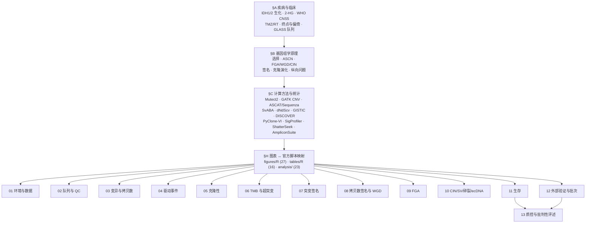
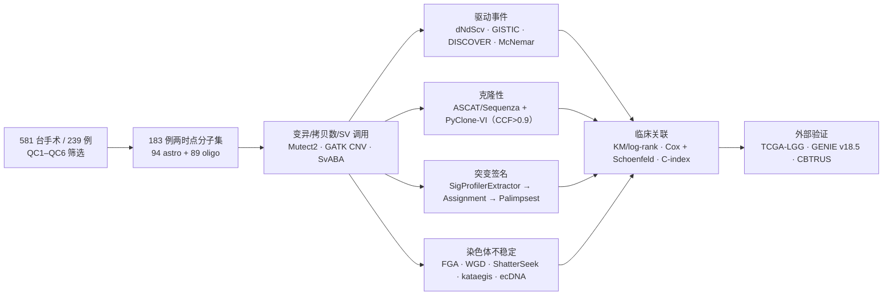

# 14 背景知识精讲与方法学原理速查（复现前必读）

> **目标文献**：The GLASS Consortium (Chowdhury T, Tesileanu CMS, Kocakavuk E, … Varn FS, Verhaak RGW，共同通讯). *Divergent genomic evolution in astrocytomas and oligodendrogliomas.*
> *Nature* (2026). PDF 标识 `s41586-026-11150-x`（Open access；Received 3 July 2025 / Accepted 10 September 2026）。数据：Synapse **syn17038081**（Tables）/ **syn26465623**（Files）；代码：`https://github.com/verhaaklab/glass-idh`（默认分支 `master`，MIT）
>
> **模块对应原文**：全文——Abstract、Introduction（IDH 生物学、WHO 2021 分型、治疗现状）、Results 全部小节（Fig. 1–5）、Discussion（双轨演化、局限）、**Methods 全部小节（第 13–16 页：DNA sequencing → Other statistical methods）**、**Extended Data Fig. 1–14 图注**、Reporting Summary、数据/代码可得性声明、**References 1–59（含 Methods 参考文献 46–59）**
> **前置依赖**：**无**。本文档是整套复现方案的**知识底座**，建议在任何代码动手之前通读；读完后回到 `01_数据与代码可得性、环境与仓库结构.md` 决定环境与数据路径，再从 `02` 起逐模块执行。
> **复现层级**：**L1 派生层为主**（Synapse 第 4 版衍生数据 + 官方 `figures/R` / `tables/R` 脚本，几乎可逐位复现）；**L2 预处理层**（`preprocessing_pipeline/`，需受控访问 BAM + 集群，本文主图复现**不需要**）；**L3 原始层**（FASTQ 起端到端，一般不做）。**本文档自身属于 L1 阅读层，不产出任何数据**。
> **复现难度**：★☆☆☆☆（阅读）／知识密度 ★★★★★　**预计工时**：2–3 人日（含 §B/§C 五个自检脚本跑通）　**计算资源**：单机 8 核 / 16 GB 内存，**无需 GPU**（全部自检脚本端到端 < 1 min）

---

## 0. 本文档的定位与用法

### 0.1 三类内容必须分开读

`00_目录与复现总览.md` 给的是**工程路线图**（谁依赖谁、跑什么、产出什么）；本文档给的是**知识图谱**（为什么这么跑、公式从哪来、什么时候会翻车）。本项目与前两个"数据不可得"项目的根本差别见 §0.2——**本文的数据与代码都公开**，于是最典型的博士生失误模式变成了另一种：

> 代码跑通了（官方脚本就在那儿）、图也画出来了、P 值也和原文差不多 —— 但**你不知道每个数字是在什么定义、什么阈值、什么参考库版本下算出来的**。于是把 `FGA 升高` 当成 `染色体不稳定` 的同义词（§B3/§B5），把 `TMB > 10 且 SBS11 > 25%` 的合取判据写成或（§B8），把 chromothripsis 判据里的 `P > 0.05` 理解成"非随机"（§B5，方向恰好相反）。

| 内容 | 性质 | 对"复现出原文的数"的作用 |
|---|---|---|
| §A 疾病与临床 | **解释性知识** | 与数值无关，决定你**怎么解释**结果（例如"两型差异是治疗诱导还是先天背景"） |
| §B 基因组学原理 | **约束性知识** | 决定**哪些量在原理上不可能被准确估计**（例如 1.5 mut/Mb 背景下 kataegis 的可检性、低纯度下的 CCF） |
| §C 计算方法与统计 | **可执行知识** | 决定**你自己的实现是否比原文更可靠**——这是本项目最大的增值点 |

**阅读顺序建议**：§0.3（先接受复现边界）→ §0.4/§0.5（骨架与知识地图）→ §1（逻辑位置）→ §A（生物学与临床）→ §B（基因组学原理）→ §C（方法学，动手前按模块精读）→ §D（术语表，随用随查）→ §E（59 篇文献导读）→ §F–§I（收尾）。

### 0.2 本项目与"数据不可得"项目的根本差别

| 维度 | 典型的"数据不可得"项目 | **本项目（GLASS IDH）** |
|---|---|---|
| 数据 | Data availability 只写 "available upon request" | **Synapse 公开**（`syn17038081` Tables 页 + `syn26465623` Files 页，入口 `https://www.synapse.org/glass`）；原文 Data availability 原话："Deidentified somatic variant and clinical datasets are publicly available through Synapse … with Project SynID syn17038081" |
| 代码 | 通常无 | **GitHub 公开**（`verhaaklab/glass-idh`，MIT，是 `fsvarn/GLASSx` 的 fork）；原文 Code availability 原话："accessible through the project's GitHub repository (https://github.com/verhaaklab/glass-idh)" |
| 复现姿势 | 重实现 + 替代数据 | **先跑官方脚本，再交叉验证**：`git clone` → 读 `README.md` / `SETUP.md` → 连数据库或读 Synapse 表 → 跑 `figures/R/<一图一脚本>` → 用自己重实现的版本对齐 |
| 风险 | 无法验证 | **过度自信**：脚本能跑 ≠ 你懂口径；官方脚本依赖**GLASS 内部 PostgreSQL 数据库**（见 §C 与 `01`），当数据库不可得时"跑官方脚本"这一步本身要改造 |
| 最可复现的部分 | —— | **统计复核**：本文几乎全部 P 值与表格都可由 Synapse 公开表重算（见 §H 的锚点表与 `11`/`12`） |

### 0.3 三层复现性表（先接受边界，再动手）

| 层 | 内容 | 需要的输入 | 本项目是否做 | 判据 |
|---|---|---|---|---|
| **L1 派生层（主路径）** | 从 Synapse 第 4 版衍生数据（sSNV / CNA / 临床 / PyClone / 签名暴露表等）出发，跑 `analysis/`（23 文件）+ `figures/R/`（27 脚本）+ `tables/R/`（16 脚本） | Synapse 公开表 | **必做** | Fig. 1–5、Table 1、ED Fig. 1–14 的**全部数值与统计**应可重算；容差默认 ±10%（`REPRO_SPEC.md` §10.3），统计量允许 ±0.02 绝对差 |
| **L2 预处理层** | `preprocessing_pipeline/`（251 文件：`sql/` 125 + `snakemake/` 30 + `envs/` 44 等，Snakemake v5.2.2 + GATK4 v4.1.0.0） | **受控访问的原始 BAM/FASTQ** + 集群 | **不重跑**（只做阅读与对齐） | 若必须重跑：需要 EGAS/dbGaP 类受控申请 + 每样本数十小时机时；**本文图复现明确不需要** |
| **L3 原始层** | FASTQ → BAM → VCF → 派生表全链 | 同 L2 | 不做 | 仅作为"上游误差从哪来"的解释来源 |

> ⚠️ **导师批注**：官方仓库的 `README.md` 明确写着 `legacy_codes/`（333 文件，2019/2022 两篇论文的代码）"**not maintained against the current data release and its dependencies are not part of SETUP.md**"。**复现时禁止从 `legacy_codes/` 抄脚本跑第 4 版数据**——表结构、样本命名、签名参考库都已经变过（见 §E2）。

> **导师提示**：判断"我这步到底属于哪一层"只需问一句：**这个产物是 Synapse 表里已有的，还是必须从 BAM 重算的？**——前者是 L1，后者是 L2。把 L2 的结论写进 L1 的 QC 表是最常见的越界。

### 0.4 骨架 ①–⑧ 与本文档章节的映射

本文档是知识底座，不承担某一张图的逐步复现；但按 `REPRO_SPEC.md` §8.2 与简报 §10 的自检要求，①–⑧ 各骨架在此**逐项落位**：

| 骨架 | 本文档对应位置 | 说明 |
|---|---|---|
| ① 科学问题与逻辑位置 | §1（含证据链 mermaid） | 上游输入/下游输出的定位；各模块文档的分工接口 |
| ② 背景原理（含公式与直觉） | §A + §B（全部） | 生物学 + 基因组学 + 公式 |
| ③ 原文逐句拆解（术语层） | §0.6 口径核对表 + §D 术语表 + §H 图表↔脚本映射 | 本文档只做**术语层**拆解；逐句拆解由各模块文档承担（`02`–`12`） |
| ④ 逐步可运行代码 | §B3 / §B7 / §B8 / §B9 / §C10 的 5 个自检脚本（R + Python，均已实测跑通） | 每个脚本都带"目的"注释与真实输出 |
| ⑤ 参数解释与调参空间 | 各 §C 小节的"输入–输出契约"与"失败模式"栏 + §F 陷阱表 | 阈值来源与改动后果 |
| ⑥ 预期结果与 QC 检查点 | §H 关键数值锚点表 | 原文报告值 → 应在哪篇文档、哪个产物里被复现 |
| ⑦ 陷阱与排错表 | §F（16 行，领域特异） | 前 6 行理解类，后 10 行技术类 |
| ⑧ 与文献图表的对应关系表 | §H（Fig. 1–5 / ED Fig. 1–14 / Table 1 → 官方脚本路径） | 映射到**实测核实过的**真实脚本名 |

### 0.5 知识地图



### 0.6 与简报 §8 事实清单的口径核对（已逐条回原文）

写作简报 §8 是团队共用的数值台账。**下表四处与原文正文/图注不一致，本文档以原文为准**，并请 `13_复现质控清单、排错与批判性评述.md` 登记：

| # | 简报 §8 的写法 | 原文实际写法（出处） | 处理 |
|---|---|---|---|
| 1 | "chromothripsis n=45/33，Fisher P = 0.23 / 0.01"；"kataegis Fisher P = 0.24 / 0.046" | **两组的 P 值被互换**：kataegis 的瘤型比较为 **P = 0.23（initial）/ 0.01（recurrence）**（Results "Increasing chromosomal instability in astrocytoma" 段 + Fig. 5f）；chromothripsis **与既往放疗的关联**为 **P = 0.046（astro）/ 0.24（oligo）**（Results 同段 + Fig. 5e） | 各模块按原文口径引用；`10` 号文档出图时以 Fig. 5 面板标签为准 |
| 2 | "Fisher P = 2.1×10⁻?（WGD）、6.6×10⁻?（CDKN2A/B HD）" | **2.1×10⁻⁶ 与 6.6×10⁻⁶ 都是 chromothripsis 的瘤型比较**（initial 与 recurrence 两个时点，Fig. 5d）；WGD 用的是 **McNemar**（oligo P = 0.55、astro P = 0.006，Fig. 5c），CDKN2A/B HD 用的是 **McNemar**（non-HM astro P = 0.009、non-HM oligo P = 0.48） | 报告时写清"配对（McNemar）/非配对（Fisher）"，两者不可混用 |
| 3 | "复发时 FGA 在两型均显著升高" | 原文："At recurrence, FGA increased significantly in astrocytomas **and in hypermutant but not in non-hypermutant oligodendrogliomas**"（Fig. 5b） | `09` 号文档必须按 **HM / non-HM 分层**报告 FGA 变化，不得合并成"两型均升高" |
| 4 | "ID8 high (n=22) vs low (n=11)（oligo）；ID8 high (n=7) vs low (n=33)（astro）"; 同段另写 "ID8 high (n=22) vs low (n=11)，P = 0.022（oligo）；ID8 high (n=7) vs low (n=33)，P = 0.00034（astro）" | **两个瘤型被对调**。按 PDF 文本层坐标核对：**Fig 4d = NHM oligo（标题 n = 40）**，图例为 `ID8 high (n = 7)` / `ID8 low (n = 33)`，面板标注 **P = 0.00034**；**Fig 4e = NHM astro（标题 n = 33）**，图例为 `ID8 high (n = 22)` / `ID8 low (n = 11)`，面板标注 **P = 0.022** | 两面板各自自洽（7+33=40、22+11=33，与各自标题的 n 一致），原文**无矛盾**；引用时按上述归属，并同步修正 `02`/`07`（`11` 已在本轮审核中修正） |

> ⚠️ **导师批注（简报 §8 的 Fig. 4d/e 串行；**原文本身没有矛盾**）**：简报 §8 把 ID8 的两个生存面板写成了
> "oligo：ID8 high (n=22) vs low (n=11)，P = 0.022；astro：ID8 high (n=7) vs low (n=33)，P = 0.00034"。
> 按 PDF 文本层的坐标逐字核对（面板字母的位置 + 标题 + 图例 + P 值坐标），**正确归属是**：
> · **Fig. 4d = non-HM oligodendroglioma，n = 40**：`ID8 high (n = 7)` / `ID8 low (n = 33)`，**P = 0.00034**；
> · **Fig. 4e = non-HM astrocytoma，n = 33**：`ID8 high (n = 22)` / `ID8 low (n = 11)`，**P = 0.022**。
> 这样两个面板各自自洽（7 + 33 = 40；22 + 11 = 33，与面板标题一致），也与图注 "oligodendroglioma (d) or astrocytoma (e)" 的字母-标题对应一致。
> 换言之：**原文没有任何内部不一致**，是简报的数字被两两对调了。请 `13` 号文档按此登记，并同步修正 `02`/`07` 中引用该数值处（`11` 已在本轮审核中修正）；
> **在生存分析中必须报告分母口径（n 与事件数）**（`REPRO_SPEC.md` §7）。

---

## 1. 科学问题与逻辑位置（①）

### 1.1 原文命题（一句话版 + 三条子命题）

**总命题**：同样是 IDH 突变、同样接受放疗与烷化剂治疗，**astrocytoma 与 oligodendroglioma 用两种不同的基因组机制获得治疗抵抗**——前者走**拷贝数/染色体不稳定**路线，后者走**点突变**路线。

| 子命题 | 原文证据 | 对应文档 |
|---|---|---|
| P1 两型的**复发富集驱动事件**不同：oligo 获得 NOTCH1 / PI3K（PIK3CA、PIK3R1）sSNV；astro 获得**局灶癌基因扩增**与 **CDKN2A/B 纯合缺失** | Fig. 2a,b；dNdScv（ED Fig. 3）；GISTIC + McNemar（Supplementary Table 2） | `04_驱动事件鉴定与互斥性分析.md` |
| P2 两型的**突变过程**不同：astro 有 SBS97（C>T）、SBS37、SBS101、ID3、ID23；oligo 有 SBS107（C>A）、ID5；治疗相关签名 SBS11/SBS119（TMZ）与 ID8（放疗，astro 特异） | Fig. 4a–e；ED Fig. 9、10 | `07_突变签名分析与治疗归因.md` |
| P3 两型的**染色体不稳定程度**不同：复发 astro 的 FGA 升高、WGD 增加（20% vs 7%）、chromothripsis 更多、kataegis 更多；oligo 的这些指标基本不变 | Fig. 5a–f；ED Fig. 11–13 | `08`/`09`/`10` |
| P4（临床转化）**astro 的局灶扩增与 CDKN2A/B 纯合缺失**是复发后生存的独立不良因素；oligo 的 PI3K/NOTCH1 在 GLASS 内不显著、在 GENIE 中显著 | Fig. 3a–g；ED Fig. 7；GENIE 验证 | `11_生存分析与预后模型.md`、`12_外部验证与批次效应检验.md` |

### 1.2 证据链全景



### 1.3 与下游文档的接口（谁消费什么）

| 本文档提供 | 下游文档消费方式 |
|---|---|
| §A3 的 CDKN2A/B HD = grade 4 来历 | `04`（把它当 driver 事件）、`11`（把它当预后因子） |
| §A7 的终点定义与三类偏倚 | `11` 的方法学段落**必须**声明 left truncation / immortal time / competing risks |
| §B2 的 ASCN 公式与 §B9 的 CCF 公式 | `05` 的 CCF 计算与"克隆性"解释 |
| §B5 的 ShatterSeek 判据方向 | `10` 的 chromothripsis 调用（含 ⚠️ 批注） |
| §B8 的 COSMIC/Signal 版本分工 | `07` 的参考库固定策略（**不得**用"今天最新版"） |
| §C10 的检验选择表 | 全项目统计约定统一（与 `REPRO_SPEC.md` §7 一致） |
| §H 的图表↔脚本映射 | `00` 的文档↔图映射表的补充来源 |

> **导师提示**：这张接口表的用法是"反向索引"——当你在 `05` 里写 CCF 代码时，回来确认 §B9 的三条假设（等位特异拷贝数已知、突变为杂合、同一样本内的 CCF 可跨时点比较）是否在你的实现里成立；任何一条不成立就要显式声明。

---

## A. 疾病与临床

### A1. IDH1/IDH2 的生化与 2-HG 的致瘤机制

**野生型反应**（三羧酸循环旁路，胞质 IDH1 / 线粒体 IDH2，均为同源二聚体）：

$$\text{isocitrate} + \text{NADP}^+ \xrightarrow{\text{IDH1/2}} \alpha\text{-KG} + \text{NADPH} + \text{CO}_2$$

**突变型反应（新功能获得，neomorphic gain-of-function）**：IDH1 的 R132（活性位点精氨酸，与异柠檬酸的 α-羧基/β-羧基形成氢键）或 IDH2 的 R140/R172 被替换后，酶对异柠檬酸的亲和力下降、对 α-KG 的亲和力上升，于是把 α-KG 还原为 **D-2-羟基戊二酸（D-2-HG）**：

$$\alpha\text{-KG} + \text{NADPH} \xrightarrow{\text{IDH1/2 mutant}} \text{D-2-HG} + \text{NADP}^+$$

**为什么 2-HG 会致癌（三条机制，均为 α-KG 依赖双加氧酶的竞争性抑制）**：

| 靶酶 | 后果 | 与本文的关联 |
|---|---|---|
| **TET 家族**（TET1/2/3，5mC → 5hmC 去甲基化第一步） | 全基因组 5hmC 下降、CpG 岛高甲基化 → **G-CIMP 表型**（glioma CpG island methylator phenotype） | 解释 IDH 突变胶质瘤的"高甲基化亚型"；也是 ref 13（GLASS 表观演化）与 ref 27（不同 IDH 突变的甲基化差异）的机制基础 |
| **KDM/JmjC 组蛋白去甲基化酶** | H3K9me3、H3K27me3 等修饰堆积 → **分化受阻**（干细胞样状态） | 解释 IDH 抑制剂为何能诱导分化（ref 24 发现 IDH 抑制剂在 oligodendroglioma 中诱导谱系分化） |
| **ALKBH 家族（ALKBH2/3，烷化损伤直接修复）** | 烷化剂造成的 DNA 加合物修复受阻 | 直接连到本文主题：**IDH 突变改变了细胞对 DNA 损伤的反应**，这是"两型对治疗诱导 DNA 损伤反应不同"这一命题的分子前提（ref 17 综述） |

**关键事实与常见误解**：

1. IDH 突变是**杂合、功能获得**型（保留一个野生等位基因），不是"失活的双等位基因缺失"。
2. 突变 IDH 单独存在时只产生高甲基化与分化阻滞，**不足以成瘤**——需要第二个打击（astro 路线：TP53/ATRX；oligo 路线：1p/19q 共缺失 + TERT 启动子突变，且常伴 CIC/FUBP1 突变，见 §A5）。
3. 2-HG 是"oncometabolite"，可在患者血浆与肿瘤中测得（毫摩尔级），是 IDH 抑制剂的药效学标志物；IDH1 与 IDH2 不同突变的 2-HG 产量与甲基化程度**并不相同**（§A4）。
4. 2-HG 的**镜像异构体**：D-2-HG 来自突变 IDH；L-2-HG 由 L2HGDH 缺失等引起，是不同疾病实体——写作时不要混用。

> **导师提示**：本文**没有**做甲基化、没有做 2-HG 定量、没有做转录组（除 `preprocessing_pipeline/` 里存在但本文未用的 kallisto/CIBERSORTx 等环境）。所以任何"因为 G-CIMP 所以……"的机制解释都属于**引用文献的背景推演**，不得写成"本文证明"。在 `13` 号文档的证据等级表里，这类句子应标为"**级别 B：文献背景，非本文数据**"。

### A2. WHO CNS5（2021）分类：成人型弥漫胶质瘤的三个实体

WHO 2021（第五版，ref 6）把成人型弥漫胶质瘤（adult-type diffuse glioma）分为**三个**分子-临床实体，本文的两种瘤型正好是前两个：

| 实体 | 分子定义 | 组织学/分子分级 | 本文中的称呼 |
|---|---|---|---|
| **Astrocytoma, IDH-mutant** | IDH1 或 IDH2 突变，**无** 1p/19q 共缺失 | grade 2 / 3 / **4**；grade 4 = 微血管增生或坏死，**或** CDKN2A/B 纯合缺失（即使无上述组织学特征） | astrocytoma（本文 n = 94 分子集；临床集 n = 119） |
| **Oligodendroglioma, IDH-mutant and 1p/19q-codeleted** | IDH 突变 **且** 1p/19q 全臂共缺失（TERT 启动子突变、CIC/FUBP1 突变高度支持） | grade 2 / **3**（无 grade 4） | oligodendroglioma（n = 89；临床集 112） |
| **Glioblastoma, IDH-wildtype** | 无 IDH 突变；TERT 启动子突变 / EGFR 扩增 / +7/−10 之一 | 恒为 grade 4 | **本文按 Reporting Summary 明确排除**："Patients with IDH-wildtype gliomas were excluded … because this is a biologically different entity" |

**判读要点（复现必须知道的三件事）**：

1. **"grade 4" 在 IDH 突变 astrocytoma 里不等于 glioblastoma（GBM）**。WHO CNS5 之后 "glioblastoma" 一词只留给 IDH 野生型。本文 Discussion 也只在 astrocytoma 语境下说 "progressive WHO grade 2 gliomas"。
2. 分子判据**优先于**组织学：1p/19q 共缺失的有无决定 oligo vs astro，而不是"看起来像少突"的形态学。这解释了为什么本文能用 **GENIE 的 panel 数据"绕道"定义 oligo**（§A8）——因为没有 CN 数据时只能用"IDH 突变且无 TP53/ATRX 改变"来近似。
3. **1p/19q 共缺失是全臂缺失**（由 t(1;19)(q10;p10) 不平衡易位导致，继发 FUBP1/CIC 突变），不是局灶缺失。判断时用 `>80%` 臂级缺失规则（与本文 §B3 的臂级非整倍体规则同源）。

> **导师提示**：**别把本文的 grade 当成一个变量直接进 Cox 模型就完事**。本文 Table 1 里 "Primary pathology" 的 Unknown 数很大（oligo 31、astro 16），且 grad 是"初诊"分级；Fig. 3/ED Fig. 7 的生存分层用的是**复发时**的分子事件。若你把初诊 grade 与复发分子事件混在一张表里，会得到"grade 4 的 CNA 效应不显著（P = 0.41）"这类看似矛盾的结果（ED Fig. 7d）——原文的解读是**样本量不足**，不是效应消失。

### A3. CDKN2A/B 纯合缺失如何成为 grade 4 的标志

**事实链条（三条独立证据的汇总，本文引用了其中两条）**：

| 环节 | 内容 | 出处 |
|---|---|---|
| 临床相关性 | CDKN2A/B 纯合缺失（以及**非整倍体水平**）与 IDH 突变 astrocytoma 的更差预后相关 | **ref 37**（Galbraith 等，Neuro-Oncol 2024，原文在"非整倍体与预后"处引用）；更早的原始预后证据见 §E8（外部背景） |
| 分级整合 | cIMPACT-NOW 建议把 CDKN2A/B 纯合缺失纳入 IDH 突变 astrocytoma 的 grade 4 判据 | 外部背景（见 §E8） |
| 官方确立 | WHO CNS5 正式纳入（ref 6，原文 Introduction 与 "Prognostic relevance of driver events" 段两次引用） | 原文 |
| 本文的贡献 | 在**纵向**数据中验证：CDKN2A/B HD 与复发后生存差相关（中位 1.1 vs 3.2 年，log-rank P = 0.01；HM 亚组 P = 0.002、non-HM 亚组 P = 0.02），且在**非超突变** astrocytoma 中复发态显著富集（McNemar P = 0.009），oligo 不显著（P = 0.48） | 原文 Fig. 3 + ED Fig. 7a + Supplementary Table 2 |

**三个容易搞错的细节**：

1. **纯合缺失（HD）≠ 杂合缺失（hemizygous）**：ref 15（Kocakavuk 等）专门报告的是**半合子** CDKN2A 缺失也带来更差的生存——本文的分组是 HD（高阈值，由 neutral 段的加权均值 ± 2 SD 定义，见 §B2）。两者不能互换。
2. **CDKN2A/B 常在同一个 9p21 缺失里一起丢**，所以原文写 "CDKN2A or CDKN2B (hereafter, CDKN2A/B)"，"CDKN2A/B HD" 是一个**事件名**而不是两个基因。
3. **它在本文里是"获得性事件"**：Fig. 2a/b 与 `tables/R/GLASS-I_McNemar_CNA.R` 关心的是 initial→recurrence 的**配对变化**；GISTIC 找的是**复发组内显著**的 focal 事件，两者不是同一个统计问题（见 §C5/§C10）。

> **导师提示**：CDKN2A/B 的 HD 调用**高度依赖纯度与阈值**。低纯度样本的 9p21 缺失容易落在阈值之上（判成中性或杂合缺失）→ 你会系统性低估 HD 频率，而**复发样本的纯度通常低于初诊样本**（治疗后肿瘤细胞比例变化 + 纤维化/坏死），这会让"复发富集"的结论**偏保守**（这也是原文要在 FGA 分析里额外做 purity 校正的原因，见 §B3）。反过来说，若你用的是 WXS 数据，9p21 的 capture 覆盖本身就不均匀，HD 判定会更不稳——**这就是原文把 focal CNA 结论主要建立在 WGS 上的原因**。

### A4. IDH1 p.R132H vs 非 p.R132H / IDH2

| 维度 | IDH1 p.R132H | 非 p.R132H（如 IDH1 R132C/G/S/L）与 IDH2（R140/R172） | 出处 |
|---|---|---|---|
| 频率 | IDH 突变胶质瘤中最常见（约 90%） | 少数 | 原文 Introduction/Results 背景 |
| 2-HG 产量 | 三者不同（文献报告非 R132H 与 IDH2 突变的 2-HG 水平有差异） | 同左 | **ref 27**（原文引用来支持"2-HG 水平、DNA 甲基化、生存存在差异"） |
| DNA 甲基化 | 相对较低 | **更高**（在 astrocytoma 中） | ref 27 |
| 生存 | 相对较差 | **更好**（在 astrocytoma 中） | ref 27 |
| 本文的实测 | astrocytoma **偏好**非 p.R132 的 IDH1 变异；oligodendroglioma **偏好** IDH2 突变（Supplementary Table 3a）；但 focal 扩增、CDKN2A/B HD、NOTCH1/PI3K/MSH6 突变的分布在两组间**无显著差异**（Supplementary Table 3b–f）；OS、签名、FGA 也无显著关联（ED Fig. 6a–c） | 同左 | 原文 |

> **导师提示**：ED Fig. 6 的三张图原文自己写了 "potentially reflecting limited statistical power"。复现时**不要把 ED Fig. 6 的阴性结果写成"IDH 突变型别不影响预后"**——这是"未检出差异"，不是"等价性检验"。若要做等价性结论，需要 pre-specified margin（例如 HR 的 95% CI 完全落在 0.8–1.25 内），本文没有做。这条同样适用于"治疗与获得的驱动事件无关"（Results: "no significant differences across treatment groups after FDR correction"）——**绝大多数患者都接受了治疗，队列里没有未治疗对照**，因此"与治疗无关"这一表述的证据等级只能是 C（见 §B10）。

### A5. 为什么 oligodendroglioma 与 astrocytoma 的演化路径不同

原文给了两段机制性解释（Discussion），把它们与背景知识拼起来：

| 机制层 | Astrocytoma 路线 | Oligodendroglioma 路线 |
|---|---|---|
| **起始打击序列**（背景知识 + 原文隐含） | IDH 突变 → **TP53 突变 + ATRX 缺失** → 基因组"脆弱化" | IDH 突变 → **t(1;19) 不平衡易位 → 1p/19q 共缺失** + TERT 启动子突变（→ CIC/FUBP1 突变） |
| **表型/细胞起源**（背景，原文未直接展开） | 更接近星形胶质谱系，ATRX 缺失与端粒替代延长（ALT）相关 | 更接近少突胶质前体细胞（OPC）样状态；CIC 突变影响 MAPK 下游 |
| **维持基因组稳定的通路** | **p53 与 ATRX 双双失能** → 原文原话："The near-ubiquitous presence of TP53 mutations in astrocytoma might contribute to progression mechanisms such as **mitotic errors**, resulting in **chromosomal missegregation**"（ref 44）；"ATRX deficiency has been repeatedly associated with **replication stress, DNA damage and abnormalities in chromosomal cohesion and congression**"（ref 45） | **p53 与 ATRX 通路完好**：原文原话："oligodendrogliomas arise from a genomic background defined by 1p/19q codeletion, and are further characterized by **intact p53 and ATRX pathways**" |
| **演化结局（本文的发现）** | 复发时累积**局灶癌基因扩增**（CCND2 12p13、CDK4 12q14、CDK6 7q21、EGFR 7p11、MYC 8q24、MYCN 2p24、PDGFRA 4q12、MET–PTPRZ1 7q31）+ **CDKN2A/B HD** + FGA 升高 + WGD/chromothripsis/kataegis | 复发时累积**新 sSNV**（NOTCH1、PIK3CA、PIK3R1；超突变者另有 MSH6），且多为**克隆性**；FGA 在 non-HM 中不升高 |
| **本文的收敛点** | 原文提示两型最终**汇聚到共同的转录/细胞状态**：ref 42 报告"acquired genetic alterations … coincide with malignant cell-state changes that are **shared across** oligodendrogliomas and astrocytomas"，即**不同的基因组适应路径可以收敛到共同的恶性程序** | 同左 |

> **导师提示**：这条"为什么"的因果链在本文里**只能是解释性叙述**，不是本研究的实验结果——本文没有做 TP53/ATRX 的功能实验，也没有时序上的"先有 ATRX 缺失才有 CNA"证据。写作时的正确表述是："本文观察到 astrocytoma 的复发态以 CNA/CIN 为主，这与该亚型中 TP53/ATRX 通路失能（ref 44/45）所预测的基因组不稳定性表型一致"。**别写成"本文证明 ATRX 缺失导致 CNA 累积"**（`REPRO_SPEC.md` §12.4：相关性 ≠ 因果）。

### A6. 治疗：手术、放疗、TMZ 与耐药机制

**1）手术**：本文队列 **92% debulking（减积切除）、8% biopsy**（临床注释集的 primary treatment 行：oligo 87% resection / 13% biopsy，astro 90%/10%）。手术既是治疗也是**取材手段**——复现时必须记住：**你的"初诊"样本与"复发"样本来自两次不同的手术**，取材位置、残余肿瘤、坏死比例都不同（这直接影响纯度与 CNA 判定，§B2）。

**2）放疗（RT）**：本文 68%（astro）/ 69%（oligo）患者接受过放疗。放射的分子足迹在本项目里是 **ID8 签名**（ref 11：Kocakavuk 等发现放疗相关的缺失签名并关联不良预后；本文把 ID8 与放疗联系起来并发现 astrocytoma 特异富集）。原文对 ID8 的表述非常克制、且很重要：

> 原文："Although this signature was also detected in non-irradiated astrocytomas, it was highest in radiation-treated astrocytomas, suggesting that **radiation increases selection for ID8 mutations, but does not necessarily increase their formation**."

**3）TMZ（temozolomide，替莫唑胺）**：本文 71%（两型相同）患者使用 TMZ，74% 使用过烷化剂；铂类仅在烷化剂基础上联用（astro 4%、oligo 6%）。

TMZ 的化学与耐药（背景知识，直接决定 SBS11/SBS119 的解读）：

| 环节 | 机制 | 分子足迹 |
|---|---|---|
| 化学 | TMZ 是咪唑并四嗪类前药，**在生理 pH 下自发水解**（无需酶激活）为 MTIC → 甲基重氮离子 + AIC | —— |
| 加合物 | 主要甲基化 **N7-鸟嘌呤（~70%）** 与 **N3-腺嘌呤（~10%）**，少数 **O6-鸟嘌呤（~5%）**；**O6-甲基鸟嘌呤（O6-meG）是致死性损伤** | **SBS11**（C>T 主导，CpC 上下文；ref 20 Hunter 2006 首次报告烷化剂后超突变与 MSH6 突变；ref 10 Touat 2020 系统化） |
| 修复（第一层） | **MGMT**（O6-甲基鸟嘌呤-DNA 甲基转移酶）**化学计量式**地把甲基从 O6-meG 转到自身半胱氨酸（自杀酶）；**MGMT 启动子甲基化 → 沉默 → TMZ 敏感** | 本文**未测 MGMT 甲基化**（原文未报告）——复现时若做 MGMT 相关解释，必须标为外部证据 |
| 修复（第二层） | O6-meG 与 T 错配被 **MMR** 识别 → 反复无效修复循环 → 双链断裂 → 凋亡。**MMR 失能（MSH6 突变/缺失）→ 细胞耐受 O6-meG → 存活但持续积累突变 → 超突变** | 本文：超突变 oligo 中 **MSH6 突变 12/16**（诊断时 0/10）；超突变 astro 中 MSH6 **7/20**（未达显著）；MSH6 突变者 TMB 更高（非显著，ED Fig. 4b，GENIE 一致） |
| 本文的超突变判据 | **>10 mut/Mb 且 >25% 的复发特异突变归因于 SBS11**；<10 记为 non-HM；>10 但 SBS11<25% 记为 **unassigned** | 分组数：oligo HM 16 / non-HM 70；astro HM 20 / non-HM 74 |

**4）watch-and-wait（观察等待）**：22% 的患者在术后**先观察**，把放疗+烷化剂联合作为"primary treatment after surgery"（ref 18 支持低危 grade 2 的这种策略）。对复现的影响：

- 治疗变量在时间上是**内生的**：是否治疗、何时开始治疗，与肿瘤行为本身相关（预后好的患者更可能被观察）→ **不朽时间偏倚（immortal time bias）**，见 §A7。
- 本文做治疗归因时用的是"**是否在复发前接受过某治疗**"这种粗粒度二值变量，且**没有治疗时长/剂量**（唯一例外：TMZ 周期数与 SBS119 比例的 Spearman 相关 R = 0.58，P = 0.0037，ED Fig. 10a）。

**5）复发后的选择**：原文 Discussion 提到 2024 年 FDA 批准 **vorasidenib**（IDH 抑制剂）用于进展性 WHO grade 2 IDH 突变胶质瘤（ref 40），并指出 IDH 抑制剂治疗后仍会进展、以及 NOTCH1 突变与 IDH 抑制剂抵抗的关联（ref 24）。**本文的样本几乎全部来自 IDH 抑制剂时代之前**——所以本文的"复发机制图谱"是**后验的基线**，不是"IDH 抑制剂治疗后的演化"。这一点在写展望时非常重要。

> **导师提示**：本项目**不要**把 MGMT 甲基化、TMZ 累积剂量、治疗线数当作可用变量——原文的临床数据集里没有（Methods 只报告了"是否使用烷化剂/放疗/铂类/其他"以及 **TMZ 周期数**用于 ED Fig. 10）。**"原文未报告"的变量不能从 Synapse 表里期待找到**；先按 `01` 号文档核对你实际拿到的列名，再决定能做哪些治疗归因分析。

### A7. 临床终点与三类经典偏倚

**四个终点（原文 Methods "Survival analysis" 原话）**：

| 终点 | 定义（原文） | 关键性质 |
|---|---|---|
| **OS from diagnosis** | 初次手术日 → 死亡日；删失于末次随访 | 常规 OS，含删失 |
| **TTR（time to recurrence）** | 初次手术日 → **首次复发手术日** | 原文明写 "**No censoring was required for time to recurrence because all patients had undergone a secondary surgery by study design**"——**这个"无删失"不是天然的，而是入组条件造成的** |
| **OS from birth** | `age at diagnosis + OS from diagnosis` | 用来消除"诊断年龄差异"带来的队列比较偏差（GLASS 诊断更年轻） |
| **PRS（post-recurrence survival）** | QC 通过的**末次复发手术**日 → 死亡/删失 | 注意与"多基因风险评分 PRS"完全同名不同义；本文专指复发后生存 |

**三类偏倚的直觉解释（每个都给"在本项目里长什么样"）**：

1. **Immortal time bias（不朽时间偏倚）**：如果"接受过治疗 X"这个暴露需要**先活到治疗**才能满足，那么暴露组在暴露前的那段时间是"不可能死亡"的。若把这段时间算进暴露组的总随访并直接比较，会**人为放大治疗的保护作用**。本文的相关设计：比较"烷化剂 vs 非烷化剂"的生存时，用药组必然活到了用药时点。
   - 在本文里的表现形式：Fig. 3a/b 的生存比较是**在烷化剂治疗者内部**按 HM 状态分层的（原文："patients in the GLASS cohort who received alkylating chemotherapy before recurrence"），这已经是一个缓解手段（同一暴露集内比较），但**不是** landmark 分析。
   - 复现建议：所有"治疗 vs 未治疗"的比较都必须做 **landmark 分析**（以治疗决策时点为起点）或把治疗当成**时变协变量**（`survival::coxph` 的 `tt()`），并在 `11` 号文档的敏感性分析里报告两套口径。
2. **Left truncation（左截断）**：个体只有在**存活到某个时间点**之后才进入风险集。本队列的入组条件"至少两次手术且间隔 ≥3 个月（QC4）"就是典型的左截断：从初诊起算的 OS 会被**系统性高估**，因为你排除了"没活到第二次手术"的人。
   - 这一点原文自己在 Discussion 里承认："a limitation of this study is the inherent selection bias of longitudinal, multi-resection cohorts, because inclusion requires survival to at least a second surgery"。
   - 复现建议：报告 OS from diagnosis 时，同时给出（a）未校正 KM；（b）以第二次手术为入组时点的延迟进入模型 `Surv(start, stop, event)`；两者差异即左截断的量级。
3. **Competing risks（竞争风险）**：TTR 的"事件"是复发手术，但**死亡（在复发前）是竞争事件**。用 1 − KM 估计累积复发率会高估；正确做法是 **cumulative incidence function（Aalen–Johansen）** 或 Fine–Gray 模型。
   - 本文的特殊性：因为入组要求至少两次手术，**"复发前死亡"被设计排除了**——所以 TTR 看似"无需删失"，代价是**队列本身被筛选**（=左截断，见上）。这两件事在本文里是同一枚硬币的两面，写作时要一并说明。

> **导师提示**：`11_生存分析与预后模型.md` 的报告规范里必须出现三句话：①随访时间的中位与范围（原文：astro 6.5 年、oligo 11.4 年）；②事件数与每组 n（`REPRO_SPEC.md` §7 要求 HR 必附 95% CI 与 n）；③PH 假设检验结论（原文用 Schoenfeld 残差，违反者剔除——见 §C10 对"违反者剔除"这一做法的批评）。**没有这三句的生存分析不算完成。**

### A8. 队列设计与入组偏倚（GLASS vs TCGA / CBTRUS / GENIE）

**队列结构（原文 Fig. 1b + ED Fig. 1a/b，复现的第一道关卡）**：

| 集合 | 规模 | 说明 |
|---|---|---|
| 全部纵向数据 | **581 台手术 / 239 例患者**；临床数据 **231 例**（原文 Fig. 1b 面板中另标注 115 + 124 = 239 例、304 + 277 = 581 台手术） | 21 家机构、10 国（澳/巴西/中国/法国/德国/日本/卢森堡/韩国/英国/美国） |
| QC 后分子集 | **183 例（94 astro + 89 oligo）两时点**，共 **366 台手术**（ED Fig. 1b Sankey 明写 "581 surgeries from 239 patients (pre-QC) to 366 surgeries from 183 patients"） | 每人**只保留首次与末次手术**（QC5） |
| 配对结构 | **initial–recurrence n = 183**；**primary–recurrent n = 144**；其中 **Tx–R1 122 对**，其余 61 对为 Tx–R2(20)、Tx–R3(2)、R1–R2(19)、R1–R3(8)、R1–R5(3)、R2–R3(7)、R2–R5(1)、R3–R4(1) | "initial" 不等于 "primary"：后者要求首次手术即初诊手术 |
| 测序平台 | **WGS：39 astro + 56 oligo**；**WXS：55 astro + 33 oligo** | 签名/chromothripsis/ecDNA **只用 WGS** |
| 临床注释集 | **119 例 astro 的 262 台手术**、**112 例 oligo 的 292 台手术** | **注意：与 183 例分子集不是同一批数字**，Table 1 与 Fig. 1c 用的是这个集合 |
| 生存分析子集 | ED Fig. 1a 明写 **181 例**有可做生存分析的临床数据，其中 **144 例**为 primary 手术 | 复现时务必锁定"哪张图用哪个分母" |

**入组偏倚的三条实测证据（原文都做了对照）**：

| 对照 | 结果 | 含义 |
|---|---|---|
| vs **TCGA**（ref 7） | 诊断年龄显著更小（Wilcoxon P = 0.006 astro / P < 0.001 oligo）；中位随访 **6.5 / 11.4 年 vs 2.3 / 1.9 年**（P < 0.001） | GLASS 随访更长，但**年龄更轻**——典型的选择 + 时代效应 |
| vs **CBTRUS**（ref 2，人群登记） | 中位诊断年龄 astro **34 vs 37**、oligo **37 vs 45** | 人群层面同样偏年轻（CBTRUS 尚未发布这两实体的成熟生存数据） |
| **OS from birth** | GLASS 两型的"自出生起 OS"**显著更短** | 说明"从诊断起算的生存更长"部分是**领先时间/诊断年龄**造成的假象 |

**GENIE（ref 25, v18.5）的可比性限制（必须记住的定义替换）**：

> 原文："The GENIE cohort includes mainly panel sequencing data, and in most cases **lacks copy-number data or coverage of TERT promoter hotspots**. Oligodendrogliomas in the GENIE cohort were therefore defined as IDH-mutant gliomas **without alterations in TP53 or ATRX** … whereas IDH-mutant gliomas with these alterations were called astrocytomas."

即 GENIE 中的实体定义是**排除法近似**，与 WHO CNS5 的 1p/19q 判据不同源。这直接决定了 §D 表里那条**最贵的陷阱**：GENIE 的"oligo"包含了一部分真正的 astrocytoma（TP53/ATRX 未被 panel 捕获或未突变），而 GENIE 里也**无法**判断 CDKN2A/B HD 的完整性（panel 有覆盖但无 CN 时仍需基因级 CN 调用）。

> **导师提示**：`12_外部验证与批次效应检验.md` 里必须显式写出**三个队列的实体定义差异表**（GLASS=WGS/WXS+1p/19q；TCGA-LGG= 芯片/WES+ 分子分型；GENIE=panel+排除法），并把"同一结论在三队列中的方向是否一致"列为 Go/No-Go。**"GENIE 复现出了 P < 0.05"不构成验证**，除非定义对齐——这正是原文对 oligo 的 PI3K/NOTCH1 给出 GLASS P = 0.25（不显著）/ GENIE P = 0.03（显著）时留给读者自己判断的张力点。

---
## B. 基因组学原理

### B1. 体细胞变异的产生与选择：突变率、dN/dS、driver 与 passenger

**突变率的三个层次**（复现时必须分清，否则 TMB 与签名会互相矛盾）：

| 层次 | 定义 | 本文中的量 |
|---|---|---|
| 每碱基突变率 μ | 每次细胞分裂每个碱基的突变概率 | 未知（未报告） |
| 突变负荷 TMB | 突变**数**/Mb（本文含 SBS + DBS + ID，要求最小覆盖 **15×**） | WGS 初诊中位：oligo **1.5 mut/Mb**、astro **1.6 mut/Mb**（其他瘤种中属**低**） |
| 超突变 | 复发肿瘤 >10 mut/Mb 且 >25% 复发特异突变归因 SBS11 | HM：oligo 16、astro 20（Fig. 2b 面板） |

**dN/dS 的直觉与数学**：设某基因中同义突变数 s、非同义突变数 n；把基因序列按三核苷酸上下文切成 192 类（本文的 dNdScv 就是这一模型），得到每一类的**期望突变率**（含甲基化 CpG 的高突变率、转录链偏倚、复制时序等）。于是

$$\omega = \frac{dN}{dS} = \frac{n / E[n]}{s / E[s]}$$

- $\omega > 1$：**正选择**（驱动基因，如本文初诊的 TP53/ATRX/CIC/FUBP1）；
- $\omega < 1$：**负选择**（passenger 基因的一般情形）；
- $\omega \approx 1$：中性。

dNdScv 的估计方式是把计数写成**泊松对数线性模型**：$E[N_{g,s}] = \mu_{g,s}\cdot\omega_g$，用似然比检验比较 $\omega_g=1$ 与自由估计，得到每基因的 P 值，再做 FDR 校正（ED Fig. 3 的红色虚线即 FDR-adjusted P = 0.05）。

**本文对 dN/dS 的三个使用细节**（复现时最容易漏）：

1. **分别对两型计算**（astro / oligo 各自一套背景突变率）；
2. **按突变分集算**：仅初诊独有、仅复发独有、两时点共享（对应仓库里的 `analysis/SQL/GLASS-I_dNdScv_HM_input.sql` 与 `GLASS-I_dNdScv_NHM_input.sql`，以及 `figures/R/GLASS-I_dNdScv.R` 的四面板 a–d = non-HM oligo / HM oligo / non-HM astro / HM astro）；
3. **TERT 启动子例外**：dNdScv 只处理编码区，原文因此明写 "We did not investigate non-coding drivers beyond TERT promoter mutations"——**TERT 启动子是单独调的**，不要期待 dN/dS 能给出 TERT。

> **导师提示**：dN/dS 对**样本量与 TMB 极度敏感**，而这个队列的复发态被超突变者"污染"——若把 HM 与 non-HM 混在一起跑 dNdScv，超突变样本的数千个 passenger 突变会把背景突变率抬高，**真实的 driver 会从显著变成不显著**。原文按 HM/non-HM 分开正是为了这个。反过来，样本量小的亚组（如 HM oligo n=16）即使有真 driver 也常达不到 FDR < 0.05——**"未显著"在这类分析里几乎不能作为"无选择"的证据**。

### B2. 拷贝数、倍性与等位特异拷贝数（ASCN）

**从测序深度到拷贝数的最小模型**（人话版：肿瘤样本的 read depth 是"肿瘤细胞 + 正常细胞"的加权混合）：

$$\text{logR} = \log_2 \frac{\rho\, n_t + 2(1-\rho)}{\rho\, \bar{n} + 2(1-\rho)}, \qquad
B = \frac{\rho\, n_A + (1-\rho)}{\rho\, n_t + 2(1-\rho)}$$

其中 $\rho$ = 肿瘤纯度（tumour purity），$n_t$ = 肿瘤细胞的总拷贝数，$n_A$ = 某一等位（A）的拷贝数，$\bar{n}$ = 样本平均倍性，$B$ = B 等位频率（BAF，来自**杂合生殖系 SNP** 的读取比例）。**注意分母里的 $2(1-\rho)$ 就是正常细胞贡献的两个拷贝**——这是所有杂质校正的根源。

**关键概念对照表**：

| 概念 | 定义 | 谁来算 | 本文用法 |
|---|---|---|---|
| **logR / log2 ratio** | 观测深度相对期望深度的对数比 | GATK `DenoiseReadCounts` 输出 | 段级 altered 判据 ｜log2 ratio｜ > **0.2**；臂级阈值 ±**0.1**（单时点）、±**0.05**（时点间变化 Δ） |
| **BAF / ASCN** | 等位特异的拷贝数 `(nA, nB)` | ASCAT（多样本模式）、Sequenza | WGD 判定、PyClone-VI 的输入 |
| **纯度 / 倍性 (ρ, ψ)** | 肿瘤细胞比例 / 平均拷贝数 | ASCAT、Sequenza | FGA 的纯度校正、低纯度样本排除（purity < 0.4） |
| **focal vs broad** | 局灶（≤ 数个 Mb，常为单个基因/峰）vs 广域（臂/染色体级） | GISTIC 的 `-focal` / `-broad` 定义 | focal 驱动（Fig. 2b）+ 广域非整倍体（Fig. 5a） |
| **HD（纯合缺失）** | 两条等位都丢失 | 阈值由 neutral 段（非 log2 ratio 0.9–1.1）的**加权均值 ± 2 SD**（两次迭代去离群） | CDKN2A/B HD（图 2b、图 3e/f） |

**为什么 (ρ, ψ) 是"病态"问题**：logR 只给出"$\rho\,n_t + 2(1-\rho)$ 相对混合平均"的信息，而**纯度高 + 倍性低**与**纯度低 + 倍性高**可以产生几乎相同的 logR 谱。加入 BAF 才能解耦——这就是必须用 ASCAT/Sequenza 这类**等位特异**方法的根本原因，也是它们的失败模式（低纯度、低肿瘤含量）所在。

**克隆性与 CCF 的核心公式**（§B9 会用到）：对一个坐落在总拷贝数 $n_t$、突变拷贝数 $n_{mut}$（本文的 SNV 默认 $n_{mut}=1$，即杂合）的突变，其克隆性 $c$（cancer cell fraction, CCF）与 VAF 的关系为

$$\text{VAF} = \frac{\alpha\, c\, n_{mut}}{\rho\, n_t + 2(1-\rho)} \quad\Longrightarrow\quad c = \frac{\text{VAF}\cdot\big(\rho\, n_t + 2(1-\rho)\big)}{\alpha\, n_{mut}}$$

（$\alpha$ = 该突变的等位特异比率，杂合时为 1）。**本文的"克隆"判据：PyClone-VI 的 CCF > 0.9 记为 clonal**（不是 = 1.0，留了噪声余量）。

**代码 1（R，已实测）**：同一个 VAF 在不同拷贝数段推出**完全不同**的 CCF —— 这就是"不校正 ASCN 就谈克隆性"的代价。

```r
# code/14_ccf_vaf_check.R —— 目的：展示 VAF→CCF 的换算对 (纯度, 局部拷贝数) 的依赖
# 原文口径：CCF>0.9 记为 clonal；SNV 视为杂合（n_mut = 1）
ccf_from_vaf <- function(vaf, rho, n_tot, n_mut = 1, alpha = 1, normal_cn = 2) {
  (vaf * (rho * n_tot + normal_cn * (1 - rho))) / (alpha * n_mut)
}
vaf <- 0.15                                   # 一个"看起来是亚克隆"的 VAF
grid <- c(0.30, 0.50, 0.80, 1.00)             # 纯度
data.frame(purity = grid,
           ccf_cn2 = round(ccf_from_vaf(vaf, grid, n_tot = 2), 3),   # 二倍体区
           ccf_cn1 = round(ccf_from_vaf(vaf, grid, n_tot = 1), 3),   # LOH/缺失区
           ccf_cn4 = round(ccf_from_vaf(vaf, grid, n_tot = 4), 3))   # 高拷贝扩增区
# 实测输出：
#   purity ccf_cn2 ccf_cn1 ccf_cn4
#     0.30     0.3   0.255    0.39
#     0.50     0.3   0.225    0.45
#     0.80     0.3   0.180    0.54
#     1.00     0.3   0.150    0.60
```

读法：**二倍体区（cn2）的 CCF 与纯度无关**（分子分母同缩放），但**拷贝数一旦偏离 2，纯度就成了杠杆**——同一 VAF=0.15 在 cn4 高纯度时推出 CCF=0.60，在 cn1 高纯度时只有 0.15（差 4 倍）。所以"用 VAF 阈值（如 0.3）判克隆"在 LOH 区会**把克隆突变判成亚克隆**，在扩增区会**把亚克隆判成克隆**。

> **导师提示**：所有 CCF/克隆性分析的第一步都必须是**等位特异拷贝数**（本文用 ASCAT 的多样本结果 + Sequenza 交叉校验），而不是 VAF。若你的 PyClone-VI 输入里的 `major_cn/minor_cn` 来自"total CN 除以 2"这种近似，那么你算出的"克隆性"只是 VAF 的单调变换，**与原文的结论不可比**。

### B3. 非整倍体与 FGA：三个层次，三种结论

**定义与本文的实现规则（Methods "Aneuploidy calculation"，ref 52 的方法）**：

| 层次 | 规则 | 本文用途 |
|---|---|---|
| **臂级（arm level）** | 相邻**同调用**段先合并；合并段**覆盖 >80% 臂长**才给 −1/0/+1，否则 NA；再统计非中性臂数；二次方法用**平均 log2 ratio**，阈值 **±0.1** 判显著增减、**±0.05** 判时点间变化（Δ） | Fig. 5a、ED Fig. 11b/circos |
| **段级（segment level）** | 每段按 \|log2 ratio\| > **0.2** 记 altered，统计 altered 段数 | Fig. 5a（共享 vs 私有段比例） |
| **全基因组（FGA）** | $\text{FGA} = 1 - \dfrac{\text{中性段碱基数}}{\text{可调用碱基数}}$；**WGS 可调用 3×10⁹ bp，WXS 5×10⁷ bp** | Fig. 5b、ED Fig. 12 |

**代码 2（R，已实测）**：把三条规则实现一遍，你会立刻看到"同一份数据、三种粒度、三种结论"。

```r
# code/14_fga_arm_level.R —— 目的：复现本文的段级/臂级/FGA 三套规则，展示它们不等价
arm_len <- c(chr1p = 1.25e8, chr1q = 1.21e8, chr2p = 9.0e7, chr2q = 1.55e8)   # 各臂碱基数
segs <- data.frame(arm   = c("chr1p", "chr1p", "chr1q", "chr2p", "chr2q"),
                   start = c(0, 8.0e7, 0, 0, 0),
                   end   = c(8.0e7, 1.25e8, 1.21e8, 4.0e7, 9.0e7),
                   log2r = c(0.05, 0.35, -0.02, 0.45, -0.30))
segs$call <- ifelse(abs(segs$log2r) > 0.2, sign(segs$log2r), 0)   # 段级：|log2R| > 0.2
segs <- segs[order(segs$arm, segs$start), ]
merged <- do.call(rbind, lapply(split(segs, segs$arm), function(d) {   # 合并相邻同调用段
  r <- rle(d$call); fid <- rep(seq_along(r$lengths), r$lengths)
  do.call(rbind, lapply(split(d, fid), function(x)
    data.frame(arm = x$arm[1], start = min(x$start), end = max(x$end), call = x$call[1])))
}))
merged$len <- merged$end - merged$start
arm_call <- sapply(split(merged, merged$arm), function(d) {          # 臂级：>80% 覆盖才给调用
  keep <- d[d$len >= 0.8 * arm_len[d$arm[1]], , drop = FALSE]
  if (!nrow(keep)) NA_integer_ else keep$call[which.max(keep$len)] })
fga <- 1 - sum(segs$end[segs$call == 0] - segs$start[segs$call == 0]) / sum(arm_len)
print(arm_call); cat(sprintf("非中性臂数 = %d；FGA = %.3f\n", sum(abs(arm_call) == 1, na.rm = TRUE), fga))
# 实测输出：臂级调用 chr1p=NA, chr1q=0, chr2p=NA, chr2q=NA
#           非中性臂数 = 0；FGA = 0.591
```

**这段输出说明了什么**：段级看到 3 个 altered 段（chr1p 后半、chr2p、chr2q），FGA 高达 0.591，而**臂级一个是非中性臂都没有**——因为 chr1p 的增益只覆盖 36% 臂长、chr2p 只覆盖 44%，都不满足 >80% 规则（记为 NA，不计入非中性）。原文的臂级结论（如"4p/4q 缺失在 oligo 中从 23% 升到 33%"、"7q 增益与 10q 缺失在 astro 中常见（32%）"）都是在这种**保守到会丢信息**的规则下得到的。

**时间维度（本文的核心发现之一）**：原文用"共享 vs 私有"描述臂级事件——"Arm-level events were predominantly **shared** between time points in oligodendrogliomas but were mostly **specific** to either primary or recurrent tumours in astrocytomas"。注意这与"获得/丢失"不是一回事：一个事件在两个时点都出现（共享）可能意味着它来自共同祖先（truncal），而"只在一个时点出现"可能是**检测灵敏度差异**造成的假象（低纯度或低覆盖时一个真实存在的臂级事件可能测不到）。

> **导师提示**：**FGA 在 WGS 与 WXS 之间不可比**（可调用碱基数 3×10⁹ vs 5×10⁷，且 capture 区域本身偏向编码区、GC 极端区覆盖差）。本文的 FGA 图（Fig. 5b）按平台**分组画**并明说 "WGS and WXS represent mostly non-overlapping tumour sets"，因此复现时**绝不能把两个平台合并成一个 FGA 分布**。此外，纯度、倍性与 FGA 三者互相纠缠：原文做了"用 Sequenza 的纯度/倍性校正 FGA + 剔除纯度 <0.4 样本"两道处理，你也必须做，否则"复发 FGA 升高"可能只是"复发样本纯度更高"的假象。

### B4. 全基因组加倍（WGD）：为什么是"演化加速器"

**定义**：一次细胞分裂失败导致整套染色体被复制一次（四倍化），之后可逐步丢失/重排成近三倍体或近四倍体的非整倍体基因组。**判据（本文）**：

1. 用 **ASCAT 多样本模式（case-based multi-sample）** 导出患者级与样本级 WGD 状态（来自 ASCAT 的 summary metrics）；
2. 为**避免高估**，对 ASCAT 判为 WGD 的样本，再用 **Sequenza 的 major copy-number fraction ≥ 0.5** 做二次过滤。

第 2 条的本质与文献里常用的"WGD score"一致：**基因组中"主要等位拷贝数较高"的区段占比超过一半**，就说明整套基因组经历过一次加倍（因为 WGD 会给几乎所有区段留下"两条以上主要等位"的痕迹）。**为什么是"演化加速器"**（背景知识，本文只引用不展开）：

| 机制 | 后果 |
|---|---|
| 缓冲效应 | 多一个拷贝 → 有害突变的剂量效应被稀释 → 允许更多突变积累 |
| 减数/有丝分裂负荷 | 四倍体细胞更易发生染色体错分 → 持续性 CIN |
| 重组/重排底物 | 同源片段变多 → 非等位同源重组、臂级获得/丢失 |
| 临床 | 与更差的预后相关（跨瘤种） |

**本文的实测**：初诊时两型的 WGD 率相同（**均为 7%**），差异只出现在复发时——原文原话：astro **"20% versus 7%"（McNemar P = 0.006，显著升高）**、oligo **"10% versus 7%"（McNemar P = 0.55，不显著）**。WGD 样本富集 **CN2 与 CN20** 拷贝数签名（ED Fig. 13a）；`08_拷贝数签名与全基因组加倍.md` 出图时请以 Fig. 5c 的面板数值与分母为准。

**四倍体/倍性伪影（复现的头号坑）**：

1. **高倍性 ≈ 低纯度**在 logR 上的表现相似 → 可能把"低纯度样本"误判为 WGD。
2. **局部高拷贝扩增**（如 EGFR 扩增）会抬高平均倍性 ψ，从而让"整段基因组看起来像加倍"。
3. **WGD 时点**：WGD 是**演化时钟**——WGD 前的突变 CCF 高、WGD 后的突变 CCF 低（相对于加倍后的等位剂量）。若你把 WGD 当成一个二值协变量却不校正 CCF 的换算基准（`n_tot` 变了），就会出现"WGD 样本的突变全都变成亚克隆"的假象。

> **导师提示**：WGD 的判定必须**报告"用哪个软件、哪个阈值、是否做了二次过滤"**。本文用 ASCAT + Sequenza 双重过滤，你如果只用其中一个（尤其只用 GATK 的 ploidy 估计），**WGD 率会系统性偏高**，而 Fig. 5c 的结论（"只有 astro 复发时显著升高"）恰恰建立在这个偏保守的判定上——阈值一松，oligo 可能也变显著，结论方向就变了。

### B5. 染色体碎裂（chromothripsis）：三大证据与判据方向

**现象学定义**：一条（少数几条）染色体在一次灾难性事件中被打碎成数十–数百个片段，再被随机（但非完全随机，见下）重接，留下**局部化的、振荡的**拷贝数模式。**三大证据**（三者必须同时满足才能判"高置信度"）：

| # | 证据 | 检测量 | 本文阈值（Methods "Chromothripsis"，ShatterSeek v1.1，ref 54） |
|---|---|---|---|
| 1 | **断点聚集**（在一条或少数染色体内） | 染色体内 SV 数、断点间距是否偏离指数分布（KS 检验）、断点密度是否富集 | **>5 个染色体内 SV**；断点富集/聚类 **P < 0.05** |
| 2 | **拷贝数振荡** | 相邻段在**两个状态间来回跳**的次数（2 状态，也可 3 状态） | **>6 个振荡段**（高置信）；**4–6 个振荡段** = 低置信 |
| 3 | **片段连接的随机性** | 4 类断点连接（DEL / h2hINV / t2tINV / DUP）的计数是否偏离"各 1/4"的均匀期望（卡方检验） | **非随机 fragment joins P > 0.05**（**原文原话，方向见下方批注**） |
| 备选路径 | 多染色体参与的灾难事件 | 染色体内 + 染色体间 SV 组合 | **>2 染色体内 + >3 染色体间 + >6 振荡段** |

> ⚠️ **导师批注（重要，已核对 ShatterSeek 源码）**：原文写的 "non-random fragment joins (P > 0.05)" **方向反了**。在 `parklab/ShatterSeek` 的 `R/function_criteria.R` 中，`pval_fragment_joins` 是**对四类连接计数做均匀性卡方检验**得到的 P 值：**P 大（>0.05）= 观测连接类型分布与"均匀/随机"不可区分 = 支持 chromothripsis**；**P 小 = 连接类型明显偏倚 = 反对**。写作与代码判据时必须用"fragment joins 与随机不可区分（P > 0.05）"，否则会把判据写反。请登记到 `13_复现质控清单、排错与批判性评述.md`。

**与"catastrophic 事件"家族的关系**（同为"一次性"事件，但机制不同，见 §B6）：chromothripsis（碎裂-重接）、chromoplexy（链式平衡重排）、BFB（断裂-融合-桥循环）。三者都可以造成局部 CN 复杂化，**不能用同一套判据**。

**本文的实测**：初诊 astro 的 chromothripsis 数量显著多于初诊 oligo（Fisher **P = 2.1×10⁻⁶**）；复发时两型都升高，astro 仍显著更多（Fisher **P = 6.6×10⁻⁶**）；**chromothripsis 与既往放疗的关联仅在 astro 显著**（Fisher **P = 0.046**，oligo **P = 0.24**）；chromothripsis 病例富集 **CN4–CN8** 签名（CN7/CN8 贡献最大）；kataegis 与 chromothripsis 在复发时显著共现（Fisher **P = 9.1×10⁻⁴**）。

> **导师提示**：chromothripsis 的"振荡段计数"**完全依赖分段粒度**——本文用 GATK 分段并把拷贝数四舍五入为整数、相邻同值段合并，**若你把 10-kb bin 的原始 log2 值直接喂给 ShatterSeek**（未转整数、未合并），振荡段数会爆炸，任何人都会"检出"chromothripsis。第二个坑：SV 与 CN 必须来自**同一 WGS 样本**，WXS 无法做（本文明确只用 WGS），用 WXS 跑等于把假阴性当阴性。

### B6. chromoplexy / BFB / ecDNA：三个"复杂重排"家族

| 现象 | 机制（一句话） | 检测原理与工具 | 本文是否涉及 |
|---|---|---|---|
| **chromoplexy** | 一次事件中**多个染色体**上的一组**链式、相互依赖的平衡重排**（DNA 被"剪断-重连"成链条），常不改变拷贝数 | 从 SV 图里找**链条**：重排彼此共享断点、balanced、跨染色体依赖；无独立成熟工具，常由 SV 图谱手工/半自动判读 | **未涉及**（本文的灾难事件分析集中在 chromothripsis / ecDNA） |
| **BFB（breakage–fusion–bridge）** | 端粒丢失 → 姐妹染色单体融合 → 有丝分裂桥断裂 → 重复"断裂-融合"，形成**阶梯状拷贝数升高 + 折返倒位（fold-back inversion）** | AmpliconArchitect/AmpliconClassifier 的 `BFB` 类别；特征为"fold-back inversion + 端粒方向上的 CN 梯度" | **涉及**：AmpliconSuite 会把扩增分类为 ecDNA / BFB / linear（本文只用了 ecDNA 的二分） |
| **ecDNA（染色体外 DNA）** | 从染色体脱落并**成环**的 DNA 元件，可自主复制、不对称分配，携带癌基因（如 EGFR/MYC）→ 瘤内高度异质与耐药 | AmpliconArchitect 从断点图里识别**环状结构**（读段跨环、无端点的图结构），AmpliconClassifier 给类别；正交验证需 FISH/光学图谱 | **涉及**：WGS 中 **18% 的 focal 扩增被分类为 ecDNA，且全部见于 astrocytoma**（Fig. 2） |

**为什么 ecDNA 重要**（背景）：ecDNA 上的癌基因不遵守孟德尔分配 → 子代细胞拷贝数差异极大 → 在药物选择压力下可**快速提高癌基因剂量**（"拷贝数可塑性"），这是治疗抵抗的经典机制之一。本文要复现的量只有一个：**"是/否含 ecDNA"的二分类**（AmpliconSuite 输出里的类别之一），**不是** ecDNA 拷贝数或结构。

> **导师提示**：ecDNA 调用对**输入 CNV 种子的选择**极其敏感——AmpliconArchitect 需要"扩增区间（seed）"作为起点，若你的 CNV 调用把两个相邻扩增合并、或者阈值偏松，会得到完全不同的 amplicon；而 AmpliconClassifier 还会按长度/复杂度过滤（默认参数下短 amplicon 更可能被归为 linear）。**报告 ecDNA 频率时必须同时报告：CN 调用工具与版本、seed 定义、AmpliconSuite 版本与是否为默认参数**。本文的 18% 是在 "case-based multi-sample 默认参数" 下得到的。

### B7. kataegis：APOBEC、局部超突变，以及"零模型"的必然性

**现象**：在**几百 bp 到几 kb** 的局部窗口内出现**密集的** C>T / C>G 突变（常在 TpCpW 上下文），是 APOBEC 胞嘧啶脱氨酶活性的足迹（ref 39，Nik-Zainal 2012 在乳腺癌中首次描述）。

**统计困难（这段是本节的核心）**：

1. 突变在基因组上的分布**本身就不均匀**（复制时序、GC、染色质状态、转录链偏倚）→ 用"全基因组平均突变率"作为零模型会**系统性高估高密度区的聚类**；
2. 判定"密集"需要一个**距离阈值**，而阈值的零分布没有解析形式（不是简单的指数分布，因为突变率随位置变化）；
3. 从而产生**多重比较/观察者效应**：在 3 Gb 上以 1% 的尾部概率定义"簇"，光是假阳性就有成千上万个。

**本文的对策（Methods "Kataegis"）**：用 **SigProfilerSimulator** 对每个样本生成 **100 个模拟基因组**（**五核苷酸上下文模型**，保留**染色体级突变负荷**与**转录链偏倚**），从模拟分布导出**经验距离阈值**；再用 **1-Mb 窗口做区域密度校正**；只保留聚类分组一致的突变合并为单位事件；输出 `log2(kataegis count + 1)`；**仅限非超突变样本**（因为超突变会破坏"全基因组背景突变率"这个假设）。

**代码 3（Python，已实测）**：用本文的 TMB（1.5 mut/Mb）与异质区域密度，量化"不加校正会怎样"。

```python
# code/14_kataegis_null.py —— 目的：量化 kataegis 判定的两类错误来源
# ① 固定阈值在"无 kataegis"的均一基因组上仍会标签 1% 的间距（假阳性底座）
# ② 区域密度异质时，固定阈值把高密度区的假阳性放大 2 倍以上
import numpy as np
rng = np.random.default_rng(20260101)
GENOME, NBIN, TMB = 3_000_000_000, 300, 1.5e-6      # 3 Gb；300 个 10 Mb 窗；TMB 1.5 mut/Mb（本文中位）
def simulate(hetero):
    w = np.exp(rng.normal(0, 1.0, NBIN)) if hetero else np.ones(NBIN)
    w = w / w.mean()                                  # 只改区域分布，不改总负荷
    n_per = rng.poisson(TMB * (GENOME / NBIN) * w)
    pos = np.concatenate([rng.uniform(k * (GENOME / NBIN), (k + 1) * (GENOME / NBIN), n)
                          for k, n in enumerate(n_per)])
    return np.sort(pos), w
for label, hetero in [("区域均一（无 kataegis）", False), ("区域异质（10× 级差）", True)]:
    pos, w = simulate(hetero)
    d = np.diff(pos); bin_of = (pos[:-1] // (GENOME / NBIN)).astype(int)
    thr_global = -np.log(0.99) / (pos.size / GENOME)  # 间距的 1% 下分位（全基因组平均率）
    thr_local  = -np.log(0.99) / (TMB * w[bin_of])    # 1-Mb（此处 10 Mb）窗口密度校正
    hi = np.argsort(w)[-int(0.1 * NBIN):]
    flag_g, flag_l = d < thr_global, d < thr_local
    print(f"{label}: 突变数={pos.size}, 全基因组阈值={thr_global/1e3:,.0f} kb")
    print(f"   固定阈值标记 {flag_g.sum()} 个间距（{flag_g.mean():.1%}），"
          f"落在高密度 10% 窗口的比例 {np.mean(np.isin(bin_of[flag_g], hi)):.2f}")
    print(f"   密度校正后 {flag_l.sum()} 个，落在高密度 10% 窗口的比例 {np.mean(np.isin(bin_of[flag_l], hi)):.2f}")
# 实测输出：
#   区域均一（无 kataegis）: 突变数=4477, 全基因组阈值=7 kb
#      固定阈值标记 49 个间距（1.1%），落在高密度 10% 窗口的比例 0.04
#      密度校正后 49 个，落在高密度 10% 窗口的比例 0.04
#   区域异质（10× 级差）: 突变数=4622, 全基因组阈值=7 kb
#      固定阈值标记 101 个间距（2.2%），落在高密度 10% 窗口的比例 0.70
#      密度校正后 49 个，落在高密度 10% 窗口的比例 0.29
```

读法：**在完全没有 kataegis 的均一基因组上，任何"1% 尾部"规则都会标出约 1% 的间距（49 个）**——这是无法绕过的假阳性底座；区域异质时固定阈值标出 101 个，其中 **70% 落在密度最高的 10% 窗口**（假阳性全部堆在突变热点区），而密度校正把它拉回 49 个。这正是原文必须做**模拟基因组 + 1-Mb 密度校正**的定量理由。

**本文的实测**：kataegis 发生在初诊时两型相当（Fisher **P = 0.23**），复发时 astro 显著多于 oligo（Fisher **P = 0.01**）；kataegis 与 chromothripsis 在复发时显著共现（Fisher **P = 9.1×10⁻⁴**）。

> **导师提示**：三个必查项——①**必须在 non-HM 样本上跑**（本文明确），在超突变样本上"全基因组都是簇"；②**必须报告模拟基因组数量与模拟模型**（本文 100 个、五核苷酸上下文）；③**不要把 kataegis 计数当作 APOBEC 活性**——本文没有测 APOBEC 表达或突变签名 SBS2/SBS13 的暴露量，kataegis 是**结构化的突变距离现象**，其与 APOBEC 的因果联系来自文献（ref 39）而非本文数据。

### B8. 突变签名体系：从 96 类矩阵到 NMF 的非唯一性

**（1）分类学构造**：把每个单碱基替换按"替换类型 × 5′ 邻碱基 × 3′ 邻碱基"分类，并统一以**嘧啶（C/T）为参考链**（嘌呤突变取反向互补）：

$$6 \times 4 \times 4 = 96 \ \text{类（SBS）}, \qquad 96 \times 2 = 192 \ \text{类（含转录链信息）}$$

其他类型：**DBS**（双碱基替换，按 78 类标准划分）、**ID**（小插入缺失，按长度/碱基组成/重复单元划分）、**CN**（拷贝数签名，48 类 feature，见 §C8/§C9）。本文的矩阵用 **SigProfilerMatrixGenerator**（b37/hg19）生成。

**（2）两套编号体系的历史与兼容性（本节最容易被复现者忽略的工程细节）**：

| 时代/数据库 | 形态 | 与本文的关系 |
|---|---|---|
| v2 时代（2013–2015） | "Signature 1…30"（96 类），另有 1A/1B 等子签名 | **与 v3 编号不一一对应**，跨版本引用必须查映射表 |
| **COSMIC v3 时代**（ref 28，Alexandrov 2020，PCAWG） | 重排为 **SBS / DBS / ID / CN** 四套独立编号；SBS1–96 中一部分被列为"证据较弱" | 本文参考集的"低编号"部分来源 |
| **Signal 数据库**（ref 29，Degasperi 2022，UK 12,222 例 WGS） | 摘要原话："Our analyses add **40 single and 18 double substitution signatures** to the current mutational signature tally"，编号**从 SBS93 起顺延** | 本文参考集的"高编号"部分来源（SBS97/107/119/120 等） |
| **COSMIC v3.5**（本文所用） | 提供 **SBS1–96 + 全部 ID 签名**（原文 Methods 明写） | 本文参考集 = **COSMIC(v3.5, SBS1–96 & 全部 ID) ∪ Signal(SBS97+)** |
| COSMIC v3.6（当前线上版本） | 已在目录中收录**部分 SBS97+（我看到 SBS97、SBS107 有独立条目，页面注明 Degasperi 等）**，但 **SBS119/SBS120 在 COSMIC 中查不到**（返回 404） | **版本漂移的活样本**：用今天的最新 COSMIC 跑本文流程，SBS119/120 这类只用 Signal 的签名会**从参考集里消失**，不是"不显著"而是"根本不存在" |

> ⚠️ **导师批注**：**SBS93–SBS96 是两个体系的重叠区**（COSMIC 与该区间由环境/实验来源提出的签名、Signal 重新编号的签名同号）。本文用"SBS ≤ 96 取 COSMIC、SBS ≥ 97 取 Signal"的**硬切分**规避冲突——这是**参考库治理决策**，不是生物学结论。复现时必须：①固定参考集文件与版本；②记录下载日期与 md5；③在自己的结果表里保留"签名编号 + 来源库 + 版本"三列（与 `REPRO_SPEC.md` §5.5 一致）。注：本条基于本文档撰写时对 COSMIC/Signal 线上目录的实测核查，**复现前请再核对一次**（数据库会更新）。

**（3）NMF 的数学与"非唯一性"**：给定突变矩阵 $V$（96 类 × 样本数），求

$$V \approx W H,\qquad W \in \mathbb{R}_{\ge 0}^{96\times K},\ H \in \mathbb{R}_{\ge 0}^{K\times n},\qquad \min_{W,H\ge 0}\ \|V - WH\|_F^2\ (\text{或 KL 散度})$$

其中 $W$ 的列 = 签名谱，$H$ 的行 = 该签名在各样本的暴露。**非唯一性的三个层次**：

1. **平凡不确定性**：$(WR)(R^{-1}H)$ 在 $R$ 为置换/正对角阵时仍是**合法的非负解**——即"签名的顺序与整体尺度"不可辨识（无害，靠归一化处理）。
2. **旋转不确定性**（真正的麻烦）：一般可逆矩阵 $R$ 不保证 $H' = R^{-1}H \ge 0$，因此在 $H$ 严格正时只有平凡类通过非负筛选；**但**一旦 $H$ 含零（样本里没有该签名）、或有噪声（$V$ 不是精确低秩）、或只求近似重构，解就落进**多个不同的局部最优**——表现为"同一样本的两个相似签名的暴露比例随机漂移"。
3. **K（签名个数）本身是选择变量**：$K$ 增大必然改善重构误差，但会产出不可解释的碎片签名。

**本文的对策**：`SigProfilerExtractor`（v1.2.1，b37/hg19，**max signatures = 10，NMF replicates = 100**），并报告 **平均稳定性 > 0.8**；抽出的 de novo 签名与参考库 **cosine ≥ 0.8 去卷积，< 0.8 记为 novel**（Supplementary Table 12；oligo 7 SBS + 7 ID、astro 10 SBS + 6 ID）。

**代码 4（Python，已实测）**：把"重构误差几乎完美、但两个相似签名的分配完全不可信"这件事量化。

```python
# code/14_nmf_instability.py —— 目的：证明 NMF 的非唯一性在"相似签名对"上会毁掉暴露估计
# 场景：真值含两个高度相似的分量（cosine≈0.99996，类比 SBS1 与 SBS5），第三个分量独立
import numpy as np
rng = np.random.default_rng(20260101)
def nmf(V, K, seed, iters=1500):                       # 乘性更新（Frobenius 目标）
    r = np.random.default_rng(seed)
    W = r.random((V.shape[0], K)) + 1e-6
    H = r.random((K, V.shape[1])) + 1e-6
    for _ in range(iters):
        H *= (W.T @ V) / (W.T @ W @ H + 1e-9)
        W *= (V @ H.T) / (W @ H @ H.T + 1e-9)
    return W, H
K0, n = 3, 120
s1 = rng.random(96); s5 = 0.985 * s1 + 0.015 * rng.random(96); s11 = rng.random(96)
S = np.vstack([s1, s5, s11]); S /= S.sum(axis=1, keepdims=True)
E = rng.random((K0, n)) * np.array([[100.], [60.], [20.]])       # 真值：h1/(h1+h2)=0.625（样本间恒定）
V = np.clip(S.T @ E + rng.normal(0, 0.01, (96, n)), 0, None)
for sd in (1, 2, 3):
    W, H = nmf(V, 3, sd)
    err = np.linalg.norm(V - W @ H) / np.linalg.norm(V)
    share = H[0] / (H[0] + H[1] + 1e-12)
    print(f"seed={sd} 相对重构误差={err:.4f} h1/(h1+h2) 中位数={np.median(share):.3f} "
          f"四分位距={np.percentile(share,75)-np.percentile(share,25):.3f}")
cos = lambda a, b: float(a @ b / (np.linalg.norm(a) * np.linalg.norm(b)))
print("两个相似分量的 cosine =", round(cos(S[0], S[1]), 6))
# 实测输出：
#   seed=1 相对重构误差=0.0061 h1/(h1+h2) 中位数=0.510 四分位距=0.138
#   seed=2 相对重构误差=0.0065 h1/(h1+h2) 中位数=0.500 四分位距=0.101
#   seed=3 相对重构误差=0.0056 h1/(h1+h2) 中位数=0.485 四分位距=0.191
#   两个相似分量的 cosine = 0.999961
```

读法：重构误差 ~0.6%（数据被完美解释），但**"相似签名对"的分配比例在不同随机初始化之间、以及样本之间剧烈漂移**（真值恒为 0.625，估计中位数 0.49–0.51、样本四分位距 0.10–0.19）。**结论**：当两个参考签名的 cosine 很高时，"某个样本里 SBS1 与 SBS5 各占多少"本身不可辨识；只有**合计**（或经实验/组织学证据约束的归一化）才可信。

**（4）签名与病因的对应表（本文涉及的签名）**：

| 签名 | 主要突变模式 | 关联病因/过程 | 本文观察 |
|---|---|---|---|
| **SBS1** | C>T at NpCpG | **5mC 自发脱氨**（年龄时钟） | 两型均有（在 ≥5 样本中出现） |
| **SBS5 / SBS40** | 分散、无强上下文 | **时钟样**（复制相关） | oligo 相对偏好（与 SBS8 对比） |
| **SBS8** | T>C / A>G 等 | 未知（复制晚期区域） | astro 相对偏好 |
| **SBS11** | C>T（CpC 上下文） | **烷化剂/TMZ**（ref 10, 20） | TMZ 治疗者：astro 7/18（39%）、oligo 12/23（52%）；构成 HM 定义 |
| **SBS119** | T>C 富集；与 MSI 类签名（如 SBS26）相似 | **TMZ**（与 iPSC-TMZ 体外签名相似，ref 36）；与 TMZ 周期数正相关（R = 0.58, P = 0.0037） | **非超突变** TMZ 治疗者：oligo 8/13、astro 3/12 |
| **SBS97** | C>T | 错配修复缺陷（MMR） | **仅 astro** |
| **SBS107** | **C>A 颠换** | 与 SBS4（吸烟）相似；既往见于膀胱/肾/肝（ref 29, 34） | **仅 oligo**（两型差异） |
| **SBS120** | —— | 未知；**CNS 肿瘤特有**（ref 29） | 两型均有 |
| **SBS37 / SBS101** | —— | 未知病因 | 仅 astro |
| **ID1 / ID2** | T 在重复序列中的插入/缺失 | **时钟样**（年龄） | 两型均有 |
| **ID5** | —— | 时钟样（ref 28） | **仅 oligo** |
| **ID8** | 缺失类（deletion signature） | **放疗**（ref 11） | 放疗 astro 显著富集；与更差的 PRS 相关 |
| **ID3** | —— | 吸烟相关 | 仅 astro 的部分样本 |
| **ID23** | —— | 马兜铃酸相关（ref 35） | 仅 astro 的部分样本 |
| **CN2 / CN20** | 拷贝数签名 | **WGD** 相关（ref 38） | WGD 样本富集 |
| **CN4–CN8（尤 CN7/CN8）** | 拷贝数签名 | **chromothripsis** 相关（ref 38） | chromothripsis 病例富集 |

**注意原文对 ID8 的"选择性"表述**：ID8 在**未放疗**的 astro 中也能检出，原文因此写成"放疗增加了 ID8 突变的**选择**，而不一定增加其**形成**"——这与 SBS11（典型的治疗诱导突变）在解释上是**两种不同的机制**。原文还特别排除了几个"伪影替代解释"：**SBS119 与 FFPE/鸟嘌呤氧化的伪影模式无关**；**SBS107/ID3/ID23 虽与吸烟/马兜铃酸签名相似，但因缺乏相应的 SBS22a/SBS22b 组分，提示是其他机制产生了这些模式**。

> **导师提示**：签名分析里最容易"翻车"的四件事——①**参考库版本不固定**（见上，SBS119/120 可能直接消失）；②**只在超突变样本上做 de novo 提取**（会把 SBS11 拆成一堆碎片）；③**把 cosine 0.8 当成"确定是同一个签名"**（0.8 只是工程阈值，0.8–0.9 之间的匹配意味着还有 20% 的谱形差异，本文把 <0.8 保留为 novel，你在复现时若用 0.85 或 0.9，novel 签名数会变，ED Fig. 9 的"astro 1 个 novel ID、oligo 2 个 novel ID"就会对不上）；④**把"签名比例"与"签名突变数"混用**（比例受其他签名影响，本文 Fig. 4c 的"timing fractions"是**同一签名在 initial/recurrence/shared 三类突变中的占比**，与"占总突变的占比"不是一回事）。

### B9. 克隆演化理论：truncal/branch、CCF-VAF、工具假设差异

**（1）基本词汇与本文的用法**：

| 概念 | 定义 | 本文中的对应量 |
|---|---|---|
| **truncal（主干）** | 存在于**所有**肿瘤细胞中的突变（早期、共同祖先） | "shared between time points"，原文："Mutations shared between time points are expected to be mostly **truncal**, reflecting early derivation" |
| **branch（分支）** | 只存在于部分亚克隆（后期、平行演化） | "unique to initial / unique to recurrent"，dNdScv 的突变分集 |
| **clonal / subclonal（本文定义）** | PyClone-VI 的 **CCF > 0.9 = clonal**，< 0.9 = subclonal | Fig. 2、ED Fig. 5 |
| **线性 vs 分支 vs 中性演化** | 线性：逐个克隆顺序获得优势（阶梯）；分支：多个亚克隆并行、偶有选择性扫荡；中性：突变随细胞增殖按比例漂移，无选择优势（"Big Bang"/中性模型） | 本文的观察（两时点共享比例中位 **oligo 36% / astro 45%**、同一肿瘤不同区域共享 **53%**）更接近**分支 + 空间异质**图像 |
| **选择性扫荡（sweep）** | 某克隆快速扩张至主导 | 本文的间接证据：获得的 PIK3CA/NOTCH1/PIK3R1（oligo）与 CDKN2A 缺失（astro）"**predominantly clonal**" |

**（2）CCF–VAF 的时间维度（本文最微妙的一点）**：同一条突变在两个时点的 CCF 变化有三种解读，**必须与检测灵敏度解耦才能下结论**：

| 观察 | 可能的解读 A（生物学） | 可能的解读 B（技术性） |
|---|---|---|
| CCF 从 0.3（初诊）升到 0.9（复发） | 该亚克隆扩张（被选择） | 复发样本纯度更高 / 覆盖率更高 → 原本就在的克隆现在测得更准 |
| CCF 从 0.9 降到 0.3 | 克隆被竞争淘汰 | 复发样本纯度更低 / 该突变所在区域拷贝数丢失（分母变了） |
| CCF 不变（≈1） | 全克隆、truncal | 无信息（两个时点都是克隆） |

原文的做法与限制：用 **PyClone-VI**（覆盖度 ≥10× 才纳入，beta-binomial 默认参数）在**每个配对集**上做，然后比较时点的 CCF。原文报告的可信结论是"获得的驱动突变**是克隆性的**"（即 CCF 高），而对"CCF 跨时点的连续变化"只做了定性描述（ED Fig. 5）。**注意**：原文对"克隆性"的解释是静态二分（>0.9），**没有**做 CCF 的时间序列建模。

**（3）克隆性工具的假设差异（选工具前必看）**：

| 工具 | 统计模型 | 需要 ASCN？ | 多时点/多样本 | 主要假设与失败模式 |
|---|---|---|---|---|
| **PyClone**（ref 未列，原版） | Dirichlet 过程混合 + 二项似然，MCMC | **是**（major/minor CN + 纯度） | 支持（共享聚类） | 克隆数少时不稳定；MCMC 慢；对 CN 误差敏感 |
| **PyClone-VI**（**本文用**，ref 51） | **beta-binomial** + 变分推断（可扩展到大样本/全基因组） | **是** | 支持 | 默认"每突变一个 CCF"的层级；低覆盖突变的 CCF 极宽；**CCF>0.9 的阈值是本文自定** |
| **SciClone** | 变分贝叶斯，**假设每个克隆一个突变**（"one mutation per clone"启发式） | **是** | 支持多样本 | 克隆数上限人为；对 CN 校正方式敏感 |
| **PhyloWGS** | MCMC 同时推断**系统树 + CN**（树的采样） | 是（整合 CN 变化） | 支持 | 计算极贵；树的先验与 CN 的耦合易产生伪结构 |
| **MOBSTER** | 非参数混合（Beta 分布族）+ 群体遗传选择模型 | 需要 VAF 与纯度 | 支持 | 假设驱动突变的选择系数可估；样本量小时过拟合 |

**（4）为什么"两时点"数据不能重建完整系统树**：只有两个时间点且样本各为一次混合取材（bulk），你看到的是**每个时点的 CCF 快照**，无法区分"A 克隆在 t1 已存在但比例低"与"t2 才出现"；也无法确定分支顺序。**能做的事**：①判断"获得的驱动事件是否克隆性"（本文的做法）；②用"共享/私有"突变集合做**相对的**先后次序推断（共享 ⇒ 更早）；③用 WGD/CN 变化作为**演化时钟锚点**（§B4）。

> **导师提示**：把"克隆性"当成一个**属性**（这个突变是克隆的吗？）而不是**过程**（这个克隆在扩张吗？）——这是本文的口径，也是最容易被审稿人打的地方。若你要主张"某个克隆被选择"，必须给出**跨时点的 CCF 变化 + 检测灵敏度等价性论证**（例如两个样本覆盖度、纯度、局部 CN 都可比），否则最多只能说"该事件在复发时以克隆状态存在"。另外：**PyClone-VI 的 CCF>0.9 阈值下，"克隆"对低纯度样本几乎不可能达到**（见代码 1）→ 克隆比例在样本间不可比，除非你的分析是配对的。

### B10. 纵向研究的特殊问题：覆盖度、纯度、配对，以及 selection vs induction

**（1）五个技术性陷阱（原文的处理方式写在括号里）**：

| 问题 | 后果 | 原文的处理 |
|---|---|---|
| **覆盖度差异**（WGS 平均 27×、WXS >100×；驱动突变深度 WGS 30–80×、WXS 80–300×） | 低覆盖样本突变少 → "共享比例"被低估、亚克隆丢失 | 双向 reciprocal calling（配对样本互相调用），原文并声称"coverage variation is unlikely to affect the qualitative patterns" |
| **TMB 的可计算性** | 需要足够覆盖才谈突变率 | 最小覆盖 **15×** 才计入 |
| **纯度变化** | CCF、CNA 阈值、FGA 全部受影响 | FGA 用 Sequenza 纯度/倍性校正；剔除纯度 <0.4；WGD 做二次过滤 |
| **样本配对结构不齐**（183 对里 122 对是 Tx–R1，其余是 Tx–R2/R1–R2/…） | 手术间隔差异巨大 → 突变积累时间不同 | 报告 **initial–recurrence（183）** 与 **primary–recurrent（144）** 两套口径；存活性分析用 181 例 |
| **取材空间异质性** | "两时点共享比例低"可能只是**空间异质性**，不是时间演化 | 用 5 例多区域 WXS 做参照：**空间共享中位 53%**（vs 纵向 36%/45%），据此论证空间异质性**部分**解释了纵向的低重叠 |

**（2）selection vs induction：一个可检验的区分（本节是批判性阅读的关键）**：

| 概念 | 含义 | 可检验的推论 | 本文的证据与边界 |
|---|---|---|---|
| **Selection（选择）** | 抗性克隆**治疗前已存在**，治疗只是放大了它 | 抗性突变应在**治疗前样本**中可检出（哪怕亚克隆）；其相对比例在治疗后上升 | 本文：获得的驱动事件多为**克隆性**（暗示在复发时已固定），但**没有**系统地在初诊样本中追踪这些突变是否以亚克隆存在 |
| **Induction（诱导）** | 治疗**直接造成**突变（尤其是烷化剂） | 突变谱应带治疗特征（SBS11/SBS119/ID8）；突变数随治疗暴露增加 | 本文：SBS119 比例与 TMZ 周期数正相关（R = 0.58, P = 0.0037）→ **支持 induction**（对应的 DNA 损伤）；但 SBS11 与 TMZ 累计暴露**无相关**（ED Fig. 10b）→ 更像"MMR 失能后的突变积累能力"而非纯剂量效应 |
| **两者的混合** | 治疗诱导突变 + 选择已有克隆，二者在不同基因上并存 | 需要**时序 + 克隆结构 + 签名**三者联合 | 原文的表述是克制的："these mutational footprints suggest **selection of pre-existing treatment-resistant subclones or direct DNA damage** … providing a rationale for targeting the engaged biological networks" |

**（3）"独立于治疗"这一结论的证据等级**：原文多次写 "regardless of treatment" / "irrespective of treatment"（PI3K/NOTCH1 的获得、CDKN2A/B 与 focal 扩增的获得）。**注意它的检验方式**：把获得的驱动事件与"是否放疗/是否烷化剂/任一治疗"做关联检验，FDR 校正后无显著（Supplementary Table 10a–c）。**这只能说明"在本队列中，治疗分组之间的获得率差异未达显著"**，而本队列中**绝大多数患者都接受了治疗**（74% 烷化剂、68–69% 放疗），且**没有治疗前/未治疗对照**。因此正确的表述是：

> "获得的驱动事件在**接受不同治疗**的患者中**频率无显著差异**；由于队列中缺乏未治疗对照，本研究**不能**区分这些事件是治疗选择的结果还是肿瘤类型固有的演化倾向。"

> **导师提示**：这一条是 `13_复现质控清单、排错与批判性评述.md` 里"过度解读项"的首要候选。同理，原文"PI3K/NOTCH1 在 GLASS 不显著（P = 0.25）但在 GENIE 显著（P = 0.03）"也**不是**"GLASS 错了"——两个队列的实体定义（§A8）、随访结构、样本量都不同（GLASS n = 69 vs GENIE n = 465）；正确做法是把两个队列的 HR 与 95% CI 并列画出（森林图），而不是用 P 值比大小。

---
## C. 计算方法速查（输入-输出契约 + 失败模式）

> **本节用法**：每个工具给四块——**它在本文的位置**（对应哪个脚本/图）、**输入-输出契约**、**关键参数与默认值**、**失败模式**。凡我没有在官方仓库里找到确切参数默认值的地方，都显式写"需按当前版本核对"，**不猜默认值**。

### C1. 变异检出：GATK4 Mutect2 + PairHMM + orientation bias + PoN

**本文位置**：`preprocessing_pipeline/snakemake/`（mt2 的 DAG 见 `dag/mt2.rulegraph.png`，环境见 `envs/gatk4.yaml`），**属 L2**；L1 复现直接从 Synapse 取 sSNV 表。用到的版本：**GATK4 v4.1.0.0**、**BCFtools v1.9**、参考 **b37/hg19（human_g1k_v37_decoy）**；匹配 QC 用 Picard **CrosscheckFingerprints**（ref 49）。

**它的工作方式（原理，理解后才能理解过滤项）**：

1. **Active region**：只在有证据的区域（错配/indel 聚集）做分析；
2. **局部重组装**：把有变异的读段组装成单倍型；
3. **PairHMM**：对每条读段计算"来自各单倍型"的似然（$P(\text{read}\mid H_i)$）——这是 read 级别的似然模型，不是简单的碱基计数；
4. **体细胞似然比**：$\text{LOD} = \log_{10}\frac{P(\text{data}\mid \text{somatic})}{P(\text{data}\mid \text{germline})}$，并叠加先验（如 `--normal-lod` 等）；
5. **过滤**（`FilterMutectCalls`）：`orientation_bias`（FFPE 的读段方向伪影模型，由 `LearnReadOrientationModel` 学出）、`panel_of_normals`、`tumor_lod`、`normal_artifact`、`contamination`、`str_contraction`、`base_quality`、`germline_risk` 等 → **只保留 FILTER = PASS**。

**输入-输出契约**：

| 项 | 内容 |
|---|---|
| 输入 | 肿瘤 BAM（去重、BQSR 后）+ 匹配正常 BAM + （可选）PoN VCF + （可选）germline resource VCF + interval list/黑名单 |
| 输出 | `*.vcf.gz`（含 FILTER 列）+ `*.f1r2.tar.gz`（方向偏倚的输入）+ `*contamination.table`（来自 `GetPileupSummaries`+`CalculateContamination`） |
| 下游 | BCFtools 归一化/排序/索引 → 共识 VCF（原文 Methods 原话："BCFTools normalized, sorted and indexed variants to generate a consensus variant call format (VCF) file, which was then annotated and used to compare allele frequencies between related samples"） |

**本文的两个关键设计（复现时最该学的）**：①**PoN 按测序中心分别构建**（"separating the cohort by sequencing centre to create a panel of normals"）——这是对抗批次效应的核心手段；②**单样本调用叠加到多样本调用上**（"single-sample variants overlaid on multi-sample calls to infer individual sample mutations"），保证配对样本之间的突变集合可比。

**失败模式**：①无匹配正常 → 大量生殖系多态性进入体细胞集；②无 PoN → FFPE 的 C>T（胞嘧啶脱氨）与 G>T（oxoG）伪影会**直接冒充 SBS1 与氧化类签名**；③未做 orientation bias 学习 → FFPE 的链偏倚伪影与**真实签名混淆**；④WXS 未加 interval padding → 边界区域的 indel 假阳性。

> **导师提示**：本文的 QC3 专门要求 "the mutation frequency was **not zero and not abnormally elevated**（indicative of FFPE artefacts）"——因为**低 VAF 的海量伪影与真实超突变在表型上几乎一样**。复现时如果你的 sSNV 表里某样本 TMB 突然 >30 mut/Mb 而临床记录里没有任何烷化剂治疗，第一反应应该是"查伪影"，而不是"发现超突变"。

### C2. 拷贝数：GATK CNV（本文主线）与 ASCAT/Sequenza（等位特异）

**本文位置**：GATK CNV 属 L2（`dag/gatk-cnv.rulegraph.png`）；**ASCAT 在 L1**：`analysis/R/ascat_analysis.R`、`analysis/R/ascat_merge.R`、`analysis/snakemake/ascat.smk`；Sequenza 用于 WGD 二次过滤（`analysis/R/WGD_sequenza_script.R`）；FGA 计算 `analysis/R/script_fga_calculation.R`；GISTIC 输入准备 `analysis/R/prepare_gistic_input.R` + `analysis/SQL/gistic_prepare.sql`。

**GATK CNV 的五步（原文：10-kb bin for WGS；WXS 合并各捕获试剂盒的重叠区间）**：

```text
CollectReadCounts  →  AnnotateIntervals (GC 注释)  →  CreateReadCountPanelOfNormals (按中心建 PoN)

        ↓
DenoiseReadCounts (PCA 去噪，输出 denoised log2 copy ratio)
        ↓
ModelSegments (+ CollectAllelicCounts 的等位计数)  →  CallCopyRatioSegments
        ↓                                        （neutral 段定义 0.9–1.1）
GISTIC v2.0.23  ←（segmentation）
```

**本文的阈值来源（Methods 原话）**：扩增/纯合缺失的阈值 = neutral 段（非 log2 ratio 0.9–1.1）的**加权均值 ± 2 SD**，**权重 = 段长**，**两次迭代去离群**；臂级先设高阈值，基因级再把基因边界与段区间求交、比较加权非 log2 ratio。

**ASCAT（输入-输出契约）**：

| 项 | 内容 |
|---|---|
| 输入（本文做法） | 由 GATK CNV 的 denoised copy ratio + 肿瘤/正常等位计数文件**转换**成 ASCAT 需要的 `tumour/normal BAF` 与 `tumour/normal logR` 四类文件 |
| 运行模式 | **case-based multi-sample mode**（`--mode multi`；ref 56 即 ASCAT 的多样本扩展），同一患者的多个样本联合分割 |
| 输出 | 每段的 (nA, nB) 等位特异拷贝数、纯度/倍性、**WGD summary metric**、以及可转成 SEG 的 CNV 文件 |
| 本文消费方 | WGD 判定（+ Sequenza 二次过滤）、**拷贝数签名**（SigProfilerMatrixGenerator 的输入）、PyClone-VI 的 `major_cn/minor_cn` |

**Sequenza（输入-输出契约）**：输入是 `bam2seqz` 产出的 **.seqz** 文件（需 GC 内容 wiggle + 肿瘤/正常 BAM）→ R 包 `sequenza` 拟合纯度/倍性/等位特异拷贝数 → 本文用它取 **major copy-number fraction** 做 WGD 的二次过滤（≥0.5）。

**失败模式（三类最常见）**：

1. **纯度-倍性不可辨识**：低纯度（<0.3）样本的解不唯一，WGD 与"全局高倍性"混淆；
2. **PoN 与批次**：不按测序中心建 PoN 会把中心效应写进 CN 谱（本文明确按中心建）；
3. **WXS 的 capture 偏差**：目标区间合并、GC 极端区覆盖差 → 段级 log2 ratio 噪声大 → **HD/focal 判定在 WXS 上不可靠**（本文的关键 CNA 结论因此主要基于 WGS）。

> **导师提示**：`CallCopyRatioSegments` 的"中性段"定义（0.9–1.1）与本文报告的"neutral 段的加权均值 ±2 SD"是**两级阈值**：前者用来**找中性段**，后者用来**在非 log2 尺度上定义扩增/HD**。若你把两者混成一个（例如直接用 log2 阈值 0.2 判 HD），得到的 HD 频率会与原文差一个量级——这也是 §B3 里"段级 0.2 阈值只用于非整倍体计数，不用于 HD 判定"的原因。

### C3. 结构变异：SvABA 与替代工具对比

**本文位置**：`analysis/slurm/GLASS-I_SvABA.sbatch`（**仅 WGS**），参考 **hs37d5**、dbSNP build 138（b37）、排除 **ENCODE hg19 blacklist**、只保留常染色体 + X（decoy/random/alt contig 全部丢弃）；SV 的解析在 R 中完成（break-end 配对 → 分类为 deletion / duplication / h2hINV / t2tINV / translocation，重复的 mate 折叠为单事件）。

**SvABA 的原理**：对**不一致读段对与软剪切读段**做**局部从头组装**，把组装出的 contig 重新比对回参考 → 得到精确到碱基的断点，并同时输出 indel 与 SV。优势是**断点精度高、对嵌套/复杂重排更敏感**。

| 工具 | 原理 | 优势 | 局限 | 与本文的关系 |
|---|---|---|---|---|
| **SvABA** | 局部组装 + 重新比对 | 断点精确；同一次运行输出 SV + indel；复杂局部结构可见 | 计算量中等；需要读段支持（低覆盖处灵敏度下降） | **本文所用**（ref 53） |
| Manta | 配对读段 + 分割读段（无组装） | 快、配置成熟、支持 somatic/germline | 断点精度低于组装类；对复杂重排的召回有限 | GLASS 预处理流程自带 `envs/manta.yaml`（本文未用于主结果） |
| DELLY | 配对读段 + 分割读段 + 拷贝数整合 | 各类 SV 召回均衡；有体细胞模式 | 参数敏感；对 mosaic/低 VAF 弱 | 仓库有 `envs/delly.yaml` |
| LUMPY | 概率模型整合多信号（`samtools`+`speedseq` 体系） | 框架化、易扩展 | 需要额外信号（split/discordant）预处理 | 仓库有 `envs/lumpy-sv.yaml` |
| GRIDSS | 组装（SPAdes）+ 断点图 | 复杂重排灵敏度高（PCAWG 常用） | 计算重、配置复杂 | **本文未用** |

**失败模式**：①**用 WXS 跑 SV**（本文明确只用 WGS）；②忘记排除 blacklist 与 decoy contig → 大量假断点（尤其在着丝粒/端粒/免疫受体区）；③**不折叠重复 mate** → 同一事件被计数两次 → chromothripsis 的"染色体内 SV 数 >5"判据被虚高触发（直接连带 §B5 的结论）；④不同工具输出的 SVTYPE 命名不同（`DEL/DUP/INV/TRA` vs `h2hINV/t2tINV`）→ 下游 ShatterSeek 需要特定的 4 类编码（DEL / h2hINV / t2tINV / DUP），**格式转换必须显式校验**。

> **导师提示**：本文把 SvABA 的输出**再解析**了一遍（break-end → 事件分类），这段解析是**自研代码**（R 里实现，见 `analysis/slurm/` 与 `analysis/R/`）。复现时如果直接把手里的 BEDPE 丢给 ShatterSeek，会因为 strand 编码约定不一致而得到完全不同的 fragment-join 卡方统计——**这就是 §B5 那条 P 值方向批注的下游后果**。

### C4. dNdScv：选择压力检验

**本文位置**：**dNdScv v0.1.0**（ref 50），"default and recommended parameters"；输入表来自 `analysis/SQL/GLASS-I_dNdScv_HM_input.sql` 与 `GLASS-I_dNdScv_NHM_input.sql`；出图 `figures/R/GLASS-I_dNdScv.R`（四面板：non-HM oligo / HM oligo / non-HM astro / HM astro，每面板再分 initial / shared / recurrence）。

**输入-输出契约**：

| 项 | 内容 |
|---|---|
| 输入 | 突变表（`sampleID, chr, pos, ref, alt`）+ **参考数据库**（`refdb`，如 `hg19`/`hg38`，**注意本文是 b37/hg19**）+ 基因列表 |
| 关键机制 | 按**192 类三核苷酸上下文**估计每个基因的期望突变率（含序列组成、CpG 甲基化、复制时序等协变量），再拟合泊松模型估 $\omega$ |
| 输出 | 每基因的 `wmis`（错义）、`wnons`（无义）、`wind`（indel），各自的 P 值与 **q 值（FDR）**；`globaldnds`（全局 dN/dS，可作为"突变集整体是否被正选择"的摘要） |
| 常用参数 | `max_muts_per_gene_per_sample`（默认 **3**）、`max_coding_muts_per_sample`、`outp`、`covariates` —— **具体默认值需按当前 dNdScv 版本核对** |

**失败模式**：①**超突变样本**使泊松假设崩坏（本文的对策是分成 HM / non-HM 两套输入，见两个 SQL 脚本）；②**样本量太小**时不显著；③**突变表未过滤非编码/非 canonical 转录本**；④**TERT 启动子不在 dNdScv 的范围内**（非编码）。

> **导师提示**：dN/dS 的**分母（同义突变数）本身受 TMB 影响**——在一个 1.5 mut/Mb 的队列里，除了 TP53/ATRX/CIC/FUBP1 这类高频 driver，其他基因的同义突变数只有个位数，dN/dS 的置信区间极宽。**不要把 q 值边缘显著（如 0.04–0.05）的基因当作新 driver 报道**；原文对复发达显著的事件（NOTCH1、PIK3CA、PIK3R1）都另外做了互斥性（§C6）与克隆性（§C7）的交叉验证——这才是"驱动"的三重证据。

### C5. GISTIC 2.0.23：局灶与广域拷贝数驱动

**本文位置**：**`GISTIC v2.0.23`**，**在公开的 GenePattern 服务器上运行**（原文原话："GISTIC was run on the public version of the GenePattern server"），对两型**分别**在初诊与复发样本的 segmentation 上跑；方法用 **GeneGISTIC**，参数：**broad event detection 与 gene collapse 设为 extreme**、**focal length cutoff ≥ 0.5**、**confidence level 99%**、**chromosome-arm adjustment capped at 1.0**。输入准备见 `analysis/R/prepare_gistic_input.R` + `analysis/SQL/gistic_prepare.sql`。

**原理（一句话）**：在每个基因位点上，把样本按"该基因处的拷贝数"与"全基因组背景（arm-level 效应）"作比较，算出**显著性（q 值）**；再用**"peel-off"**把广域事件的贡献从 focal 峰里扣除，得到真正的局灶峰。

| 参数（GISTIC 命令行口径） | 含义 | 本文取值 |
|---|---|---|
| `-focal` / focal length cutoff | 低于此长度的段视为 focal | **0.5**（这里的"0.5"在 GeneGISTIC 语境下指阈值设置档次，**具体含义以 GenePattern 上 GeneGISTIC 的文档为准**） |
| `-broad` | 广域事件长度阈值（默认 0.98 = 近乎整条染色体） | 设"extreme" |
| `-conf` | 置信水平（对应 q 值阈值） | **99%**（即 q < 0.01） |
| `-armpeel` | 是否把臂级事件剥离 | 上限**1.0** |
| `-genegistic` | 用基因级而非 marker 级做检验 | **开启** |

**输出**：`all_lesions.conf_99.txt`（显著峰）、`amp_genes.conf_99.txt`、`del_genes.conf_99.txt`、`scores.gistic`（全基因组 G 分数）。

**本文从中得到的 focal 事件**：**CCND2 12p13、CDK4 12q14、CDK6 7q21、EGFR 7p11、MYC 8q24、MYCN 2p24、PDGFRA 4q12、MET–PTPRZ1 7q31**；**38/94 复发 astro** 至少含一个 focal 扩增（初诊 **21/94**）；oligo 无显著富集。

> ⚠️ **导师批注（复现性风险）**：**"在公开 GenePattern 服务器上跑"意味着你没有该服务器当年的版本号与默认参数快照**。GenePattern 的模块会更新，这种"云服务器 + 默认参数"的组合是**不可逐位复现**的典型。复现建议：①记录你所用 GISTIC 的本地版本（如 2.0.23 的独立版）与全部命令行参数；②对 GISTIC 找不到的峰，用**直接的 focal 事件定义**（阈值 + 段长 + 基因边界）做交叉验证，并报告两套口径的差异（这与 `04` 号文档的 QC 门槛一致）。

> **导师提示**：GISTIC 的"峰内基因"**不等于致病基因**——一个峰常覆盖数十个基因，原文的处理是"**从 GeneGISTIC 结果中识别已知癌基因**"（原文原话："Copy-number driver genes were identified from the GeneGISTIC results"），即**用先验知识筛选**。复现时如果你把"峰内所有基因"都算成 driver，会得到几百个假阳性；反过来，若你把 MET–PTPRZ1 这种**融合型**事件当成单纯的 MET 扩增也会误读（7q31 的局灶重排是 MET 与 PTPRZ1 的融合型扩增）。

### C6. DISCOVER：互斥性检验

**本文位置**：**DISCOVER v3.1.7**（ref 21）；出图/出表 `figures/R/GLASS-I_sSNV_Mutual_Exclusivity.R`（ED Fig. 4a）。

**原理（与 Fisher 的关键差别）**：传统做法把 2×2 列联表交给 Fisher/χ²，隐含假设"每个样本的突变概率相同"；而肿瘤样本的突变率（尤其是**覆盖度带来的检出概率**）差异极大。DISCOVER 的做法是：

1. 为每个（样本, 基因）计算**该样本在该基因上发生改变的样本特异概率**（保留观测到的**每个基因的边际总数**与**每个样本的变异总数**）；
2. 用 **Poisson-binomial** 分布给出**基因对共发生的期望**（在给定概率与边际下的零模型）；
3. 统计量是"离散独立性统计量"，**共发生显著少于期望** = 互斥；显著多于期望 = 共现（原文强调"biology drives mutual exclusivity but chance explains most co-occurrence"）。

**本文结果**：oligo 的 **NOTCH1 与 PI3K（PIK3CA/PIK3R1）互斥**——**初诊 P = 0.047、non-HM 复发 P = 0.01**（ED Fig. 4a）。原文给的机制解释来自白血病文献：NOTCH1 通过 PTEN 影响 PI3K 通路（ref 22），以及 oligodendroglioma 的 NOTCH/PI3K 通路分析（ref 23）。

**失败模式**：①**事件定义**（基因级还是位点级；是否包括 CN）不同 → 结果变；②**只报告互斥、不报告共现**（DISCOVER 的设计就是两者皆可报）；③把小样本量的互斥 P 值当作通路证据（本文的 P = 0.01–0.047 只是**名义显著**，未做跨通路的多重校正）。

> **导师提示**：互斥性的生物学解释要非常小心——**两个基因互斥可能是因为它们在同一通路里"只需一次打击"（冗余性），也可能只是覆盖度/测序假象造成的"零共现"**。本文把互斥性当作"支持它们在同一功能轴（PI3K–NOTCH）上冗余"的**辅助证据**，而不是独立证明；真正支撑"oligo 复发走 PI3K/NOTCH1"的是 dNdScv 的富集（ED Fig. 3a）+ 克隆性（ED Fig. 5b）+ 与 TMB 升高的关联（Fig. 3g）三重证据。

### C7. PyClone-VI：克隆性推断

**本文位置**：**PyClone-VI**（ref 51），**beta-binomial 模式 + 默认参数**；纳入标准 **覆盖度 ≥10×**（配对中至少一个样本满足）；判据 **CCF > 0.9 = clonal**。

| 项 | 内容 |
|---|---|
| 输入（TSV，每行一个突变在一个样本中） | `mutation_id, sample_id, ref_counts, alt_counts, major_cn, minor_cn, normal_cn, tumour_content`（字段名以当前版本为准）+ 可选 `error_rate`；**多时点靠共享的 `mutation_id` 实现** |
| 模型 | **beta-binomial** 噪声模型（替代原版 PyClone 的二项 + Dirichlet 过程），用**变分推断**实现可扩展性；输出每个突变的 CCF 后验（均值/区间）与聚类分配 |
| 输出 | `*.loci.tsv`（每突变 CCF 与 cluster）、`*.cluster.tsv`（每 cluster 的 CCF 与细胞比例） |
| 本文消费方 | Fig. 2a 的"克隆性"行、ED Fig. 5a/b；`05_克隆性与纵向演化分析.md` |

**失败模式（五个，按发生频率排序）**：

1. **ASCN 错误**：`major_cn/minor_cn` 来自非等位特异的 CN 调用 → CCF 系统性偏差（见 §B2 代码 1）；
2. **纯度估计错误**：低纯度样本的 CCF 被整体压缩/放大；
3. **覆盖度门槛造成的选择**：≥10× 的过滤会**系统性丢弃低覆盖区域与低纯度样本**，若这些区域的突变有生物学偏好（如复制晚期区），你的"克隆性"结论就有偏；
4. **"clonal" 阈值自定**：0.9 是本文的选择，改成 0.8 或 0.95 会改变 HM 样本中"克隆突变负荷下降"的结论（ED Fig. 5a 报告"显著下降仅在超突变 astro"）；
5. **把 cluster 当作系统发育节点**：PyClone-VI 输出的是**同时点的聚类**，不是树；两个 cluster 的先后关系不能从输出里直接读。

> **导师提示**：如果你用**非配对模式**（每个样本单独跑）再比较 CCF，两个样本的 cluster 定义不同源，**跨时点比较**在方法上是不成立的；本文用的是"每个配对集一起跑"（Methods: "variants … in at least one sample from **each paired set**"）。这条也解释了为什么 `05` 号文档必须把"配对输入表"作为**契约产物**（一个患者一行数据、两个 timepoint 列）而不是各跑各的。

### C8. SigProfiler 全家桶与 Palimpsest

**本文位置**：`analysis/bash/mutational_signature_pipeline.sh`（重复区过滤 → MatrixGenerator/Extractor → Palimpsest 去卷积，**带 `--dry-run`**）、`analysis/snakemake/sigprofilertoolkit.smk`；版本：**SigProfilerExtractor v1.2.1**、**SigProfilerClusters v1.2.2**（kataegis）、**SigProfilerAssignment**（拷贝数签名）；**Palimpsest v2.0.0**。

| 组件 | 作用 | 输入 → 输出 | 关键参数（本文） |
|---|---|---|---|
| **SigProfilerMatrixGenerator** | 生成 96/192/ID/DBS 计数矩阵 | 突变表（VCF/TSV）+ **参考基因组组装（b37/hg19）** → 各类型矩阵 | 必须显式指定 `reference_genome="GRCh37"`（**组装参数会改变三核苷酸上下文**） |
| **SigProfilerExtractor** | **de novo** NMF 提取 | 矩阵 → W（签名谱）、H（暴露）、稳定性指标 | **max signatures = 10、NMF replicates = 100**；本文报告平均稳定性 > 0.8 |
| **SigProfilerAssignment** | 把已知参考签名的暴露**分配给样本**（含 "signature splitting" 处理相似签名） | 矩阵 + 参考集 → 每样本的绝对/相对暴露 | 参考集 **COSMIC v3.5**（拷贝数签名用） |
| **SigProfilerSimulator** | **按指定上下文模型模拟基因组**（本文用于 kataegis 的经验阈值） | 真实突变谱/上下文分布 → 模拟突变集 | 每样本 **100 个模拟基因组**，五核苷酸上下文模型，保留染色体级负荷与转录链偏倚 |
| **SigProfilerClusters** | 聚类突变/kataegis 调用 | 突变表 + 模拟阈值 → 簇 | 1-Mb 窗口密度校正；输出 `log2(count+1)` |
| **Palimpsest**（R） | **逐突变**的签名指派（把样本级暴露"下沉"到每个突变） | 突变表 + 样本级暴露 → 每个突变的归属签名 | v2.0.0；本文据此得到 Fig. 4 的 **initial / recurrence / shared 三分（I/R/S）** |

**为什么必须有 Palimpsest 这一步**：本文的 Fig. 4 全部是"**签名 × 时间**"的分析（I/R/S 三分）。**没有逐突变的归属，就无法知道某个签名的突变是初诊就有、复发才有、还是共享**。这也是"复发特异性突变归因于 SBS11"（超突变定义）能算出来的前提。

**失败模式**：①**参考集不固定**（见 §B8 批注：SBS119/120 在当前 COSMIC 中不存在）；②**只在 WGS 上做**（本文明确——WXS 的上下文分布与参考库不同源，de novo 提取会产生平台伪影签名）；③`max_signatures=10` 是**上界而非目标**（选 K 需要看稳定性曲线）；④**把逐突变归属当成确定性事实**（Palimpsest 给的是概率最大的签名，边界突变的归属不可靠）→ 本文因此还额外排除了 4 例"**初始样本 TMB > 10**"的样本（避免 HM 状态与签名归因互相污染）。

> **导师提示**：`mutational_signature_pipeline.sh` 带 `--dry-run`，**先用 dry-run 看清它要调用哪些命令、读哪些文件**再真跑——这类"链条式"脚本最常见的失败是中间步骤静默产出空矩阵（例如重复区过滤后突变数变 0），而 Extractor 依然会给出一个"看起来正常"的结果。**每个中间产物都要有质量断言**（突变数、样本数、矩阵维度），这是 `REPRO_SPEC.md` 附录 C"静默失败"的直接对策。

### C9. ShatterSeek 与 AmpliconSuite

**（a）ShatterSeek v1.1（chromothripsis）**

| 项 | 内容 |
|---|---|
| 输入 | **CN 段**（不是 log2 ratio：需转成**整数总拷贝数并 cap 到 20**，相邻同值段**合并**）+ **SV**（特定格式的类对象：`chrom1/pos1/chrom2/pos2/SVtype/strand1/strand2`，`SVtype ∈ {DEL, DUP, h2hINV, t2tINV}`） |
| 本文位置 | `analysis/R/GLASS-I_ShatterSeek.R`（另有 `GLASS-I_Chromothripsis.R` 做下游汇总） |
| 输出（每染色体的 summary） | `pval_fragment_joins`（4 类连接均匀性卡方）、`chr_breakpoint_enrichment` / `pval_exp_cluster`（断点富集与指数性 KS 检验）、`max_number_oscillating_CN_segments_2_states` / `_3_states`、各类 SV 计数 → 据此按 §B5 的阈值分 HIGH/LOW |
| 仅 WGS | 需要 CN + SV（同一 WGS 样本） |

**（b）AmpliconSuite（ecDNA / BFB / linear）**

| 项 | 内容 |
|---|---|
| 组成 | **AmpliconArchitect**（建断点图、找环状结构）+ **AmpliconClassifier**（分类为 ecDNA / BFB / linear amplification / complex） |
| 本文位置 | `analysis/R/GLASS-I_Amplicon_Architect.R`、`analysis/snakemake/ampsuite.smk`、`analysis/python/ampsuite_manifest.py`（样本清单构建） |
| 输入 | WGS BAM + **扩增区间 seed（来自 CNV 调用）** + 参考基因组；本文用 **case-based multi-sample、默认参数** |
| 输出 | 每个 amplicon 的结构与类别 → 本文只做"**含/不含 ecDNA**"的二分类 |
| 本文结果 | WGS 中 **18% 的 focal 扩增为 ecDNA，且全部见于 astrocytoma**（Fig. 2） |

**失败模式**：①**seed 来自错误的 CNV 调用** → amplicon 边界错 → 分类错；②**用 WXS**（无意义）；③**只看分类、不看结构证据**（AmpliconClassifier 的判定依赖图结构、拷贝数一致性、长度等多重条件，报告时最好附上 cycle 数与长度）；④**把 ecDNA 与"高拷贝扩增"等同**（linear amplification 也能达到高拷贝）。

> **导师提示**：AmpliconSuite 是**工作流**（AmpliconSuite-pipeline 负责从 BAM 到分类），其版本更新较快；本文写的是 "Preprint at bioRxiv"（ref 57），意味着**没有期刊版的方法学定稿**。复现时请记录你使用的 commit hash（`ampsuite.smk` 会调用外部脚本，见 `SETUP.md` §4.3 提醒的"helper-script 路径需要编辑"）——**这是本项目里最容易出现"跑出来不一样但不知道哪不一样"的环节**。

### C10. 统计方法速查（与 `REPRO_SPEC.md` §7 一致）

**（1）检验选择表（照抄即用）**：

| 场景 | 本文用的检验 | 复现口径 |
|---|---|---|
| 非配对、分类 | **Fisher 精确 / χ²** | 期望频数 <5 用小样本格 → Fisher；2×2 的 χ² 在 R 里默认带连续性校正 |
| 非配对、连续 | **Wilcoxon rank-sum（Mann–Whitney U）**；多组用 **Kruskal–Wallis** | 不假设正态；报中位数与四分位距；**必须报 n** |
| **配对**、分类 | **McNemar** | 只看**不一致格**（b, c）；b+c 小时用**精确 McNemar** |
| **配对**、连续 | **Wilcoxon signed-rank** | 假设差值分布对称；报配对差的中位数 |
| 多重比较 | **BH-FDR** | 组学层默认 BH；原文部分图用 nominal P（Fig. 5 的 Fisher），部分用 FDR（ED Fig. 3）→ 按 `REPRO_SPEC.md` §7 双口径报告 |
| 生存 | **KM + log-rank**（非配对）、**Cox PH** + 似然比检验、**Schoenfeld 残差**、**Harrell C + 1000 bootstrap** | 见 §C11 |
| 相关 | **Spearman**（本文 TMZ 周期 vs SBS119 比例：R = 0.58, P = 0.0037） | 报 R、P、n 三者 |
| 批次效应 | **分层 logistic 回归**（按肿瘤类型与 HM 状态分层） | 见 §C10(4) |

**（2）McNemar 的数学与"为什么不能换成 Fisher"**：

$$\chi^2_{\text{McNemar}} = \frac{(|b-c|-1)^2}{b+c} \quad (\text{连续性校正版}), \qquad \text{精确版}: p = 2\sum_{k=0}^{\min(b,c)}\binom{b+c}{k}2^{-(b+c)}$$

其中 $b$ = 初诊无、复发有；$c$ = 初诊有、复发无。**代码 5（R，已实测）**展示了"同一组边际数字、两种检验给出跨度一个数量级的 P"：

```r
# code/14_mcnemar_vs_fisher.R —— 目的：展示配对信息在检验中的作用
n <- 60; init_pos <- 4; rec_pos <- 15
fisher_p <- fisher.test(matrix(c(rec_pos, n - rec_pos, init_pos, n - init_pos), nrow = 2))$p.value
for (c_only in 0:4) {                      # c_only = 初诊有、复发无（反向变化）
  both <- init_pos - c_only; b <- rec_pos - both
  tab <- matrix(c(both, c_only, b, n - both - c_only - b), nrow = 2, byrow = TRUE,
                dimnames = list(c("init+", "init-"), c("rec+", "rec-")))
  cat(sprintf("初始%d/%d 复发%d/%d | 共阳%d 只阳初%d 只阳复%d | 精确McNemar P = %.4f\n",
              init_pos, n, rec_pos, n, both, c_only, b, mcnemar.test(tab)$p.value))
}
cat(sprintf("同一组边际、按两个独立组做 Fisher 精确检验 P = %.4f（恒定不变）\n", fisher_p))
# 实测输出：
#   初始4/60 复发15/60 | 共阳4 只阳初0 只阳复11 | 精确McNemar P = 0.0026
#   初始4/60 复发15/60 | 共阳3 只阳初1 只阳复12 | 精确McNemar P = 0.0055
#   初始4/60 复发15/60 | 共阳2 只阳初2 只阳复13 | 精确McNemar P = 0.0098
#   初始4/60 复发15/60 | 共阳1 只阳初3 只阳复14 | 精确McNemar P = 0.0153
#   初始4/60 复发15/60 | 共阳0 只阳初4 只阳复15 | 精确McNemar P = 0.0218
#   同一组边际、按两个独立组做 Fisher 精确检验 P = 0.0109（恒定不变）
```

（**注：上表是"演示数据"，不是原文数字**；目的是展示方法差异。原文 CDKN2A/B HD 的配对结果是 non-HM astro **McNemar P = 0.009**、non-HM oligo **P = 0.48**，请在 `04` 号文档中用 Synapse 表重算。）

**（3）BH-FDR 的定义（写代码时别搞错）**：把 $m$ 个 P 值排序 $p_{(1)}\le\dots\le p_{(m)}$，则

$$p_{(i)}^{\text{BH}} = \min_{j \ge i}\left(\frac{m\, p_{(j)}}{j}\right)$$

R 里就是 `p.adjust(p, method = "BH")`。**FDR 控制的是"被判为阳性的结果中假阳性的期望比例"，不是"犯错的概率"**——因此 FDR 0.05 与 FWER 0.05 完全不是一个尺度，写作时要说清楚。

**（4）分层 logistic 回归（批次效应检验）**：本文的形式是

$$\text{logit}\big(P(\text{复发获得事件}=1)\big) = \beta_0 + \beta_{\text{centre}} + \beta_{\text{type}} + \beta_{\text{HM}}$$

即**在肿瘤类型与超突变状态分层/校正下**检验"测序中心"是否与复发获得事件相关；结论是**未见显著中心效应**。复现要点：①`centre` 是高基数分类变量（21 家机构）→ 需要合并小中心或用随机效应（`glmer`），否则模型不稳定；②若事件数少（如 focal 扩增仅数十例），每个协变量至少需要 ~10 个事件（EPV 规则）；③"未见显著"≠"没有批次效应"，应报告效应量的 CI。

**（5）置换/模拟零模型的作用（本文两处）**：
- **kataegis**：用 **SigProfilerSimulator 生成 100 个模拟基因组**，得到经验距离阈值（§B7、代码 3）。**为什么不能用解析阈值**：突变率在基因组上不均匀，解析零模型不成立。
- **签名稳定性**：`SigProfilerExtractor` 的 **100 次 NMF 重复**给出稳定性评分（>0.8），实质是**对随机初始化的重采样检验**（§B8、代码 4）。**为什么必须有**：NMF 在多解区域会随机落进不同局部最优。

> **导师提示**：本文的 P 值体系里有一处需要复现者自觉补齐的**多重比较缺口**——Fig. 5 的 Fisher/McNemar 检验（WGD、chromothripsis、kataegis、ecDNA、FGA）都是**名义 P 值**，而同一篇论文在 dNdScv 与别的分析里用了 FDR。按 `REPRO_SPEC.md` §7 的要求，你应当**双口径复现**（raw 与 BH 校正）并报告两者是否改变结论方向；若某个结论在 BH 校正后消失，必须如实写进 `13` 的 gap 表，**不能因为"原文是显著的"而只报 raw P**。

### C11. 生存分析的报告规范（REMARK 简述）

本文的生存方法链（Methods 原话要点）：
1. 终点定义（OS / TTR / OS from birth / PRS，见 §A7）；
2. **KM + log-rank**（`survival` + `survminer`）；
3. **Cox PH 估 HR**；**似然比检验 P ≤ 0.10 的变量**才进多因素模型；**Schoenfeld 残差检验 PH 假设，违反者剔除**；**逐步后向消除**；**Harrell's C + 1000 次 bootstrap**。

**REMARK（REporting recommendations for tumour MARKer prognostic studies）要求的核心项**（外部规范，见 §E8）：

| REMARK 要求项 | 本文的落实情况（复现时要照抄的口径） |
|---|---|
| 明确的假说与终点预设 | ✅ 四个终点在 Methods 中显式定义 |
| 患者的纳排与来源 | ✅ QC1–QC6 + ED Fig. 1a/b 流程；但**左截断偏倚**在 Discussion 中承认而非校正 |
| 样本与检测方法 | ✅ 平台、覆盖度、驱动突变深度范围（WGS 30–80×、WXS 80–300×） |
| **截断值（cutpoint）的合理性** | ⚠️ 部分为**中位数/均值二分**（如 ID8 用"所有复发胶质瘤的均值"），部分是**事件有无**（有/无 CNA）；**没有**做最优截断点搜索（这是**好**的做法，符合 `REPRO_SPEC.md` §7 "最优截断点仅作探索性"） |
| 单因素与多因素分析 | ✅ 表格分 `tables/R/GLASS-I_Univariable_*` 与 `GLASS-I_Multivariable_*` 两套；**生存终点 × 协变量类型（临床/分子）共 12 个脚本** |
| **效应量与不确定性** | 部分图只给 P 值（Fig. 3a–f 的 KM 只标 log-rank P）；多因素表给 HR 与 CI（Supplementary Tables 7–9）→ 复现时应**补报 HR 与 95% CI** |
| **内部/外部验证** | ✅ 外部：GENIE（oligo n = 465、astro n = 452）；**内部交叉验证未做**（Harrell C 的 bootstrap 是**乐观度估计**，不是独立验证集） |
| 每变量事件数（EPV ≥ 10 的经验规则） | 原文未逐模型报告，但 PRS 亚组 n 常在 20–40 → **EPV 通常不足**，多因素模型的系数不稳定 |

> **导师提示**：**"逐步后向消除 + 同一数据集上算 Harrell C"是典型的乐观偏倚来源**。原文的 C-index 用了 1000 次 bootstrap，但 bootstrap 校正的是"重采样内部的一致性"，**不能替代外部验证**（`REPRO_SPEC.md` §12.3）。复现时请明确区分三个数字：训练集 C-index、bootstrap 校正后 C-index、外部（GENIE）C-index，并显式说明落差。另外，"似然比 P ≤ 0.10 纳入、逐步后向消除"是**数据驱动的变量选择**，会导致 CI 偏窄、P 偏小；报告时应在方法学中声明（原文已声明做法，但没有声明其统计代价）。

---
## D. 术语与缩写表

> **只收录本文实际出现的缩写**；"本文口径"列给出**该项目专用的判定规则或数值**（这是 `REPRO_SPEC.md` §8.3.5 要求的"任何阳性标签都要给判定规则"）。

### D1. 核心缩写（简报指定项）

| 缩写 | 英文全称 | 一句话解释 + 本文口径 |
|---|---|---|
| **GLASS** | Glioma Longitudinal AnalySiS Consortium | 胶质瘤纵向分析联盟（21 家机构、10 国）；本文数据为**第 4 次发布**（2025 年版本），可在 Synapse `syn17038081` 查询 |
| **WGS / WXS** | whole-genome sequencing / whole-exome sequencing | 全基因组（平均 **27×**，本文 **39 astro + 56 oligo**）/ 全外显子（**>100×**，**55 astro + 33 oligo**）；**签名、chromothripsis、ecDNA 只用 WGS** |
| **sSNV** | somatic single-nucleotide variant | 体细胞单碱基变异；本文的核心变异类型（配 GATK4 Mutect2 + PoN） |
| **CNA** | copy-number alteration | 拷贝数改变；本文分**广域（臂/染色体级）**与**局灶（focal）**两类，后者是 astrocytoma 复发的核心事件 |
| **HD** | homozygous deletion | 纯合缺失；本文的 **CDKN2A/B HD** 阈值 = neutral 段（非 log2 ratio 0.9–1.1）加权均值 ± **2 SD**（两次迭代去离群） |
| **FGA** | fraction of genome altered | 全基因组改变比例：**FGA = 1 − 中性段碱基数 / 可调用碱基数**；WGS 可调用 **3×10⁹ bp**、WXS **5×10⁷ bp**（**两平台不可比**） |
| **WGD** | whole-genome doubling | 全基因组加倍；ASCAT 多样本模式判定 + **Sequenza major CN fraction ≥ 0.5** 二次过滤 |
| **CIN** | chromosomal instability | 染色体不稳定；本文用 FGA / WGD / chromothripsis / kataegis / ecDNA 共同刻画（**FGA 单独不等于 CIN**） |
| **SBS / DBS / ID** | single-base substitution / double-base substitution / indel signature | 单碱基替换签名（**96 类**）/ 双碱基替换签名（78 类标准）/ 小插入缺失签名；本文参考集 = **COSMIC v3.5（SBS1–96 + 全部 ID）∪ Signal（SBS97+）** |
| **TMB** | tumour mutational burden | 突变负荷（**含 SBS + DBS + ID**，单位 mut/Mb，要求最小覆盖 **15×**）；WGS 初诊中位 **1.5（oligo）/ 1.6（astro）** |
| **HM** | hypermutant（本文专指复发态） | **>10 mut/Mb 且 >25% 的复发特异突变归因 SBS11**；<10 = non-HM；>10 但 SBS11<25% = **unassigned**；分组：oligo **16/70**、astro **20/74** |
| **TMZ** | temozolomide | 替莫唑胺；本文 **71%** 患者使用（两型相同）；烷化剂总体 **74%**；分子足迹 SBS11（HM）与 SBS119（non-HM） |
| **RT** | radiotherapy | 放疗；本文 **68%（astro）/ 69%（oligo）**；分子足迹 **ID8**（astro 特异富集） |
| **PRS** | post-recurrence survival | **复发后生存**（自 QC 通过的末次复发手术起算）——**注意与"多基因风险评分 polygenic risk score"同名不同义** |
| **TTR** | time to recurrence | 复发时间（初次手术 → **首次复发手术**）；本文**无删失**（因入组要求两次手术，见 §A7 的左截断） |
| **OS** | overall survival | 总生存；本文含两个口径：**from diagnosis**（自诊断）与 **from birth**（= 诊断年龄 + OS） |
| **CCF** | cancer cell fraction | 携带该突变的肿瘤细胞比例；本文 **>0.9 记为 clonal**（PyClone-VI）；与 VAF 的换算式见 §B2 |
| **VAF** | variant allele fraction/frequency | 变异等位频率（观测值）；**不等同于 CCF**，需用纯度与等位特异拷贝数校正 |
| **ecDNA** | extrachromosomal DNA | 染色体外 DNA（环状、可自主复制）；AmpliconSuite 分类；本文 WGS 中 **18% 的 focal 扩增为 ecDNA，全部见于 astrocytoma** |
| **BFB** | breakage–fusion–bridge | 断裂-融合-桥循环；产生阶梯状拷贝数与折返倒位；AmpliconSuite 的类别之一 |
| **ASCN** | allele-specific copy number | 等位特异拷贝数（(nA, nB)）；ASCAT/Sequenza 的输出，PyClone-VI 的必需输入 |
| **BAF** | B-allele frequency | B 等位频率（来自杂合生殖系 SNP）；与 logR 一起解耦"纯度 vs 倍性" |
| **PoN** | panel of normals | 正常样本面板（用于过滤复发性伪影）；本文**按测序中心分别构建**（对抗批次效应） |
| **dN/dS** | nonsynonymous over synonymous substitution rate | 选择压力指标；**>1 正选择**（本文初诊富集：astro TP53/ATRX、oligo CIC/FUBP1）；工具 **dNdScv v0.1.0** |
| **NMF** | non-negative matrix factorization | 非负矩阵分解（$V\approx WH$）；签名提取的核心算法；**存在旋转/多解不确定性**（§B8） |
| **FDR** | false discovery rate | 错误发现率；BH 法校正；本文 dNdScv 用 FDR（红线 FDR-adjusted P = 0.05），**Fig. 5 的 Fisher 检验为名义 P** |
| **HR** | hazard ratio | 风险比；本文只对**多因素**模型报 HR（似然比 P ≤ 0.10 纳入、Schoenfeld 违反者剔除、逐步后向消除） |
| **CI** | confidence interval | 置信区间；KM 中位生存给 95% CI（如 astro 中位 OS 7.8 年，95% CI [6.8–10.2]） |
| **C-index** | Harrell's concordance index | 一致性指数（生存模型的区分度）；本文 **1000 次 bootstrap**；**训练集指标 ≠ 泛化性能** |
| **GENIE** | AACR Genomics Evidence Neoplasia Information Exchange | 外部队列（本文 **v18.5**）；**panel 为主、常无 CN 与 TERT**；因此 **oligo 定义为 IDH 突变且无 TP53/ATRX 改变**（生存比较样本：oligo **465**、astro **452**） |
| **TCGA** | The Cancer Genome Atlas | 外部队列（本文用 **TCGA-LGG**，经 GDC 获取）；中位随访 **2.3 / 1.9 年**（远短于 GLASS） |
| **CBTRUS** | Central Brain Tumor Registry of the United States | 美国脑肿瘤登记（人群基准）；本文用于年龄比较（astro 34 vs 37、oligo 37 vs 45 岁） |
| **GDC** | Genomic Data Commons | NCI 的数据门户（TCGA-LGG 的下载入口，`https://gdc.cancer.gov`） |

### D2. 补充缩写（本文同样出现，读 Methods 时会遇到）

| 缩写 | 英文全称 | 一句话解释 + 本文口径 |
|---|---|---|
| **Focal oncogene amplification** | 局灶癌基因扩增 | 本文明确列出的基因：**CCND2、CDK4、CDK6、EGFR、MYC、MYCN、MET、PDGFRA、PTPRZ1**（染色体带见 §A5） |
| **CN signature / CN2 / CN20 / CN4–CN8** | copy-number signature | 拷贝数签名（48 类特征）；**CN2/CN20 ↔ WGD**、**CN4–CN8 ↔ chromothripsis**（CN7/CN8 贡献最大） |
| **PI3K** | phosphatidylinositol 3-kinase | 本文作为 **PIK3CA + PIK3R1 的合称**（不是单一基因，写作时要展开） |
| **NOTCH1 / NOTCH** | —— | 本文正文用 NOTCH1；ED Fig. 4a 的互斥分析里 **NOTCH = NOTCH1+NOTCH2+NOTCH3 合并**（**口径不同，别混**） |
| **MSH6 / MMR** | mutational mismatch repair | 错配修复；MSH6 失能 → 耐受 TMZ 的 O6-meG → 超突变；本文超突变 oligo 中 MSH6 突变 **12/16**（初诊 0/10） |
| **MGMT** | O6-methylguanine-DNA methyltransferase | 烷化损伤的直接修复酶（自杀酶）；**本文未测其启动子甲基化**（原文未报告） |
| **FFPE** | formalin-fixed paraffin-embedded | 福尔马林固定石蜡包埋；其 C>T/G>T 伪影是本文 QC3 排查对象；原文另行声明 **SBS119 与 FFPE/鸟嘌呤氧化伪影无关** |
| **IDH1 / IDH2 与 2-HG** | isocitrate dehydrogenase / D-2-hydroxyglutarate | 突变型 IDH 把 α-KG 还原为 **D-2-HG**（oncometabolite），抑制 TET/KDM/ALKBH；→ **G-CIMP** 高甲基化与分化阻滞（§A1） |
| **WHO CNS5 / grade** | WHO Classification of Tumours of the Central Nervous System, 5th ed. (2021) | astrocytoma IDH-mut（grade 2–4）、oligodendroglioma IDH-mut & 1p/19q-codel（grade 2–3）；**CDKN2A/B HD = grade 4 分子判据** |
| **1p/19q codeletion** | —— | 1p 与 19q **全臂**共缺失（t(1;19) 不平衡易位）；oligo 的定义性标志 |
| **TERT promoter** | —— | TERT 启动子突变（非编码，dNdScv 测不到）；oligo 特征；**GENIE panel 常无覆盖** |
| **ATRX / TP53** | —— | astrocytoma 的主流早期打击；与 CIN 表型相关（ref 44/45）；**GENIE 用它做排除法定义 oligo 的反面** |
| **CIC / FUBP1** | —— | 1p/19q 共缺失后常见的突变基因；本文初诊 oligo 的 dN/dS 富集基因 |
| **LOH** | loss of heterozygosity | 杂合性丢失；WGD/CN 演化的重要中间状态，影响 CCF 换算 |
| **Schoenfeld residuals** | —— | 检验 PH 假设的残差（与时间相关则假设违反）；本文**违反者从多因素模型中剔除** |
| **KM / log-rank** | Kaplan–Meier / log-rank test | 生存曲线与检验；本文用于 Fig. 3a–f、Fig. 4d/e |
| **EPV** | events per variable | 每个协变量的事件数经验规则（≥10）；本文 PRS 亚组常不足 |
| **H&E / IHC / FISH** | —— | 组织学与分子病理手段；**本文未做 FISH 等 ecDNA 正交验证**（原文未报告） |
| **SynID / barcode** | —— | Synapse 标识 / GLASS 的 24 字符条形码（仿 TCGA 设计，含机构、患者、样本类型、平台信息，详见 ref 12） |

> **导师提示**：**"PI3K"、"NOTCH"、"CDKN2A/B"、"ID8"** 是本文中**最容易被口径偷换**的四个词——PI3K 是两基因合称、NOTCH 在不同图里是 1 个或 3 个基因、CDKN2A/B 是一个 9p21 事件、ID8 是签名不是基因。**在 `PROJECT_SPEC.md` 的术语表里把这四个词的判定规则写死后，全部文档只引用不再重定义**（`REPRO_SPEC.md` 总则 2：口径唯一）。

---

## E. 关键文献导读（原文 References 1–59）

> **用法**：先看"在本文中的角色"列判断阅读深度——**方法学来源**（必须精读原文的方法部分）、**背景支撑**（读摘要/结论即可）、**结论对照**（核对方向是否一致）。**标 ★ 的是本项目复现直接相关的方法学原文**。
> **注意**：本文的参考文献有两组：**1–45 为正文引用**，**46–59 为 Methods 引用**（工作流工具、变异/拷贝数/签名/SV 的方法学）。下面按主题重组，编号保持原文编号不变。

### E1. IDH 胶质瘤的生物学、分类与治疗（正文背景）

| # | 文献（标题 / 期刊-年份） | 一句话导读 | 在本文中的角色 |
|---|---|---|---|
| 1 | Miller JJ, et al. *Isocitrate dehydrogenase (IDH) mutant gliomas: a Society for Neuro-Oncology (SNO) consensus review on diagnosis, management, and future directions.* **Neuro-Oncol 2023** | SNO 官方共识：IDH 突变胶质瘤的诊断、管理、未来方向 | **背景**：Intro 首句"最常见的成人原发性恶性脑瘤（<50 岁）"的引用源 |
| 2 | Price M, et al. *CBTRUS Statistical Report: primary brain and other CNS tumors diagnosed in the United States in 2017–2021.* **Neuro-Oncol 2024** | 美国人群登记的最新统计 | **对照基准**：GLASS 与 CBTRUS 的**诊断年龄比较**（34 vs 37、37 vs 45 岁）；原文注明 CBTRUS 尚无这两实体的成熟生存数据 |
| 3 | Gerstl JVE, et al. *Years of life lost due to CNS tumor subtypes in the United States.* **Neuro-Oncol 2025** | 按 CNS 肿瘤亚型计算**损失寿命年（YLL）** | **背景/动机**：Intro 与 Discussion 反复出现"disproportionate number of life years lost" |
| 6 | Louis DN, et al. *The 2021 WHO classification of tumors of the central nervous system: a summary.* **Neuro-Oncol 2021** | **WHO CNS5 的官方摘要** | **分型与分级的口径来源**（astro grade 2–4、oligo 1p/19q-codeleted；**CDKN2A/B HD = grade 4**）→ §A2/§A3 |
| 7 | TCGA Research Network (Brat DJ, et al.). *Comprehensive, integrative genomic analysis of diffuse lower-grade gliomas.* **NEJM 2015** | TCGA-LGG 的整合基因组分析（IDH/1p19q/ATRX/TP53/TERT 的经典刻画） | **对照队列 + 驱动基因背景**："初诊富集的 canonical driver（TP53/ATRX/CIC/FUBP1）在复发时保留" |
| 8 | Weller M, et al. *EANO guidelines on the diagnosis and treatment of diffuse gliomas of adulthood.* **Nat Rev Clin Oncol 2021** | EANO 成人弥漫胶质瘤诊疗指南 | **治疗背景**：手术减积、烷化剂、放疗的标准流程；"低级别可能只做减积手术" |
| 9 | van den Bent MJ, et al. *Concurrent and adjuvant temozolomide for 1p/19q non-co-deleted anaplastic glioma (CATNON; EORTC 26053-22054): final and exploratory analyses.* **Lancet Oncol 2026** | CATNON 最终分析：非共缺失间变胶质瘤中同步/辅助 TMZ 的疗效 | **治疗背景**："几乎所有 IDH 突变胶质瘤最终耐药复发" |
| 17 | Shi DD, Anand S, Abdullah KG, McBrayer SK. *DNA damage in IDH-mutant gliomas: mechanisms and clinical implications.* **J Neurooncol 2023** | IDH 突变胶质瘤中 DNA 损伤反应的机制综述 | **机制桥梁**：2-HG 抑制 ALKBH 等 → 解释"两型对治疗诱导 DNA 损伤反应不同"（§A1） |
| 18 | Mair MJ, Geurts M, van den Bent MJ, Berghoff AS. *A basic review on systemic treatment options in WHO grade II–III gliomas.* **Cancer Treat Rev 2021** | WHO 2–3 级胶质瘤的系统治疗综述 | **watch-and-wait 的依据**：22% 患者在术后延迟治疗（本次分析的敏感性来源） |
| 19 | Kinnersley B, et al. *Genomic landscape of diffuse glioma revealed by whole genome sequencing.* **Nat Commun 2025** | 泛胶质瘤 WGS 图谱（含非编码驱动） | **"非编码驱动只查 TERT 启动子"这一决定的支持文献**（原文："supported by previous reports in IDH-mutant gliomas"） |
| 24 | Spitzer A, et al. *Mutant IDH inhibitors induce lineage differentiation in IDH-mutant oligodendroglioma.* **Cancer Cell 2024** | 突变 IDH 抑制剂诱导 oligodendroglioma 谱系分化；NOTCH1 突变与分化受阻/IDH 抑制剂抵抗相关 | **临床解释**：oligo 获得 NOTCH1 突变 = IDH 抑制剂抵抗的候选生物标志物 |
| 27 | Tesileanu CMS, et al. *Non-IDH1-R132H IDH1/2 mutations are associated with increased DNA methylation and improved survival in astrocytomas, compared to IDH1-R132H mutations.* **Acta Neuropathol 2021** | 非 p.R132H 突变（含 IDH2）→ **更高甲基化 + 更好生存** | **§A4 的全部依据**；本文自己的 IDH 突变型别分析（Supplementary Table 3a–f、ED Fig. 6a–c）引用它作为预期方向 |
| 33 | Braganza MZ, et al. *Ionizing radiation and the risk of brain and central nervous system tumors: a systematic review.* **Neuro-Oncol 2012** | 电离辐射与脑/CNS 肿瘤风险的系统综述 | **背景**："除放疗外，尚无致癌暴露与 IDH 突变胶质瘤发病风险建立因果" |
| 37 | Galbraith K, et al. *Prognostic value of DNA methylation subclassification, aneuploidy, and CDKN2A/B homozygous deletion in predicting clinical outcome of IDH mutant astrocytomas.* **Neuro-Oncol 2024** | 甲基化亚类 + **非整倍体** + CDKN2A/B HD 的预后价值（astro） | **直接从属的先行研究**：本文 "High levels of aneuploidy … worse outcome in astrocytoma but not oligodendroglioma" 的引用源 |
| 40 | Darlix A, et al. *Who will benefit from vorasidenib? Review of data from the literature and open questions.* **Neurooncol Pract 2025** | vorasidenib（IDH 抑制剂）的获益人群与开放问题 | **临床背景**：2024 FDA 批准 + "治疗后仍进展" |
| 41 | Tesileanu CMS, Vallentgoed WR, French PJ, van den Bent MJ. *Molecular markers related to patient outcome in patients with IDH-mutant astrocytomas grade 2 to 4: a systematic review.* **Eur J Cancer 2022** | IDH 突变 astrocytoma 预后分子标志的系统综述 | **背景**："临床上可用的分子预后标志目前仅限于 CDKN2A/B HD" |
| 42 | Johnson KC, et al. *Acquired genetic and cell-state changes in IDH-mutant glioma progression.* **Nature 2026** | 同组的姊妹论文：获得性遗传改变与**细胞状态**变化 | **Discussion 的关键收敛点**："不同的基因组适应可以汇聚到共同的转录程序" |
| 43 | Yang RR, et al. *IDH mutant lower grade (WHO grades II/III) astrocytomas can be stratified for risk by CDKN2A, CDK4 and PDGFRA copy number alterations.* **Brain Pathol 2020** | 用 CDKN2A/CDK4/PDGFRA 的 CNA 对 astrocytoma 做风险分层 | **直接先例**：本文"focal 扩增提示不良预后"是对它的**纵向延伸**（"extending previous observations"） |

### E2. GLASS 既往发布与胶质瘤纵向/空间演化（★ 数据版本关系必读）

| # | 文献 | 一句话导读 | 在本文中的角色 |
|---|---|---|---|
| 4 | GLASS Consortium. *Glioma through the looking GLASS: molecular evolution of diffuse gliomas and the Glioma Longitudinal Analysis Consortium.* **Neuro-Oncol 2018** | GLASS 联盟的**纲领性论文**（目标、设计、协作框架） | **背景**：Intro 与 Discussion 中"GLASS 为何成立"的引用源 |
| **5★** | Barthel FP, et al. *Longitudinal molecular trajectories of diffuse glioma in adults.* **Nature 2019** | **GLASS 第 1 次发布**（286 例？——本文未报告其样本量，见下方提示）；建立 GLASS 条形码与流程；报告 IDH 突变胶质瘤的纵向轨迹 | **前序发布 + 本数据的上游**：Methods 明写"Previously published longitudinal data from GLASS5,12 and TCGA7 were also used"，且**变异调用的细节"can be found in the previously published GLASS paper5"** |
| **12★** | Varn FS, et al. *Glioma progression is shaped by genetic evolution and microenvironment interactions.* **Cell 2022** | **GLASS 第 2 次发布**：演化 + 微环境互作（含单细胞/反卷积层面） | **前序发布 + 本文的同源框架**：条形码拆分细节、数据集结构、`fsvarn/GLASSx` 仓库（本文仓库的 fork 源） |
| 13 | Malta TM, et al. *The epigenetic evolution of glioma is determined by the IDH1 mutation status and treatment regimen.* **Cancer Res 2024** | 表观（甲基化）演化的纵向分析 | **背景/平行证据**：GLASS 体系内的表观层工作；提示 DNA 甲基化随治疗与 IDH 状态变化 |
| 14 | Mu Q, et al. *Identifying predictors of glioma evolution from longitudinal sequencing.* **Sci Transl Med 2023** | 纵向测序预测演化（含 **MYC/PDGFRA 增益与更短 PRS**） | **直接先例**：Intro 明写"gains of oncogenes such as MYC and PDGFRA are associated with shorter post-recurrence survival" |
| 15 | Kocakavuk E, et al. *Hemizygous CDKN2A deletion confers worse survival outcomes in IDHmut-noncodel gliomas.* **Neuro-Oncol 2023** | **半合子**（非纯合）CDKN2A 缺失也带来更差生存 | **概念区分的关键**：HD 与 hemizygous 不同（§A3）；本文只报 HD |
| 16 | Spitzer A, et al. *Deciphering the longitudinal trajectories of glioblastoma ecosystems by integrative single-cell genomics.* **Nat Genet 2025** | GBM 生态系统的纵向单细胞基因组学 | **背景**：放疗相关的演化与细胞状态（Intro 中与 ref 11/15 并列） |
| 30 | Mathur R, et al. *Glioblastoma evolution and heterogeneity from a 3D whole-tumor perspective.* **Cell 2024** | 全肿瘤 3D 视角的 GBM 演化与异质性 | **对照**："空间与纵向共享突变比例低"这一现象的支持文献之一 |
| 31 | Bai H, et al. *Integrated genomic characterization of IDH1-mutant glioma malignant progression.* **Nat Genet 2016** | IDH1 突变胶质瘤恶性进展的整合基因组刻画 | **对照**：纵向/区域间共享突变比例低的经典证据 |
| 32 | Lee JK, et al. *Spatiotemporal genomic architecture informs precision oncology in glioblastoma.* **Nat Genet 2017** | GBM 的时空基因组架构 | **对照**：同上的空间异质性证据 |
| **42★** | （同 E1）Johnson KC, et al. *Nature 2026* | 同组姊妹论文（获得性遗传 + 细胞状态） | **本项目的对照阅读材料**：若时间允许，应与其一起读，理解"遗传改变如何映射到细胞状态" |
| **10★** | Touat M, et al. *Mechanisms and therapeutic implications of hypermutation in gliomas.* **Nature 580, 517–523 (2020)** | 胶质瘤超突变的机制（TMZ + MMR 缺陷）与治疗含义 | **超突变定义与 SBS11 关联的直接来源**（本文 HM 判据的理论依据） |
| 11 | Kocakavuk E, et al. *Radiotherapy is associated with a deletion signature that contributes to poor outcomes in patients with cancer.* **Nat Genet 53, 1088–1096 (2021)** | **放疗相关的缺失签名（= ID8）** 与不良预后 | **ID8 的方法学来源**（本文用它的签名与预后关联做纵向验证） |
| 20 | Hunter C, et al. *A hypermutation phenotype and somatic MSH6 mutations in recurrent human malignant gliomas after alkylator chemotherapy.* **Cancer Res 66, 3987–3991 (2006)** | 烷化剂治疗后复发胶质瘤的**超突变表型 + MSH6 突变**（最早的发现） | **历史起点**：SBS11 与 MSH6 的原始关联；Intro"alkylating-agent-induced hypermutation"的引用 |
| 25 | Pugh TJ, et al. *AACR Project GENIE: 100,000 cases and beyond.* **Cancer Discov 12, 2044–2057 (2022)** | AACR GENIE 资源介绍 | **外部队列来源**（本文用 v18.5；定义与限制见 §A8） |

> ⚠️ **导师批注（数据版本关系，务必写进 `01`）**：本文**没有**给出前三次发布的样本量、也没有给出"哪些患者来自前几次发布"的清单。已知的是：①官方 `README.md` 明说 "The data analyzed using this code was part of the **fourth release** of the GLASS dataset which was made available in 2025"；②前两次发布对应 ref 5（Nature 2019）与 ref 12（Cell 2022），且**它们的代码在 `legacy_codes/` 中"未与当前数据版本同步维护"**；③本文 Methods 明写**使用了前两次发布的纵向数据**。因此：**2019/2022/本文的样本量不可相加**（存在重叠），跨论文比较样本量或频率时必须回到 Synapse 的 release 说明逐条核对。

### E3. 突变签名：数据库、编号体系与方法学

| # | 文献 | 一句话导读 | 在本文中的角色 |
|---|---|---|---|
| **28★** | Alexandrov LB, et al. *The repertoire of mutational signatures in human cancer.* **Nature 578, 94–101 (2020)** | PCAWG 的签名全景：确立 **SBS/DBS/ID/CN 四套编号体系**与 96 类矩阵标准 | **参考库低编号段（SBS1–96）与 ID 的来源**；本文引用它定义 TMB 与签名的"低水平背景" |
| **29★** | Degasperi A, et al. *Substitution mutational signatures in whole-genome-sequenced cancers in the UK population.* **Science 376, abl9283 (2022)** | NHS 12,222 例 WGS 的 **Signal 数据库**：新增 **40 个 SBS + 18 个 DBS** 签名 | **参考库高编号段（SBS97+）的来源**；SBS107/119/120 的原始出处（§B8 的编号冲突问题就在此） |
| **39★** | Nik-Zainal S, et al. *Mutational processes molding the genomes of 21 breast cancers.* **Cell 149, 979–993 (2012)** | **kataegis 的发现论文**（局部超突变 + APOBEC 的关联起点） | **kataegis 现象学来源**（§B7） |
| 34 | Fukagawa A, et al. *Genomic and epigenomic integrative subtypes of renal cell carcinoma in a Japanese cohort.* **Nat Commun 14, 8383 (2023)** | 日本肾癌队列的分型（含 SBS107 类模式） | **SBS107 的既往出现证据**之一（支持"这个签名在别的瘤种也存在"） |
| 35 | Senkin S, et al. *Geographic variation of mutagenic exposures in kidney cancer genomes.* **Nature 629, 910–918 (2024)** | 肾癌的地理暴露差异；**马兜铃酸（ID23）**相关 | **ID23 的病因学来源**；本文据此论证"虽然 ID23 出现，但缺 SBS22a/b 组分 → 未必是马兜铃酸" |
| **36★** | Kucab JE, et al. *A compendium of mutational signatures of environmental agents.* **Cell 177, 821–836 (2019)** | 在 iPSC 上系统暴露各类致癌物建立的签名库 | **SBS119 的体外证据来源**（"在 iPSC 中用 TMZ 处理得到的签名"） |
| **58★** | Islam SMA, et al. *Uncovering novel mutational signatures by de novo extraction with SigProfilerExtractor.* **Cell Genom 2, 100179 (2022)** | **SigProfilerExtractor** 的方法学原文（NMF + 稳定性评估） | **本文 de novo 提取（v1.2.1, max=10, 100 replicates）的方法学依据**；§B8 的非唯一性讨论对应它的稳定性设计 |
| **55★** | Diaz-Gay M, et al. *Assigning mutational signatures to individual samples and individual somatic mutations with SigProfilerAssignment.* **Bioinformatics 39, btad756 (2023)** | 把参考签名暴露分配到样本（含 signature splitting） | **本文"cosine ≥ 0.8 去卷积"与拷贝数签名分配的工具来源** |
| **59★** | Shinde J, et al. *Palimpsest: an R package for studying mutational and structural variant signatures along clonal evolution in cancer.* **Bioinformatics 34, 3380–3381 (2018)** | **逐突变**签名指派（服务于克隆演化分析） | **本文 Fig. 4 的 I/R/S（initial/recurrence/shared）三分的方法学来源** |

### E4. 拷贝数、CIN、WGD、chromothripsis、ecDNA

| # | 文献 | 一句话导读 | 在本文中的角色 |
|---|---|---|---|
| **26★** | Mermel CH, et al. *GISTIC2.0 facilitates sensitive and confident localization of the targets of focal somatic copy-number alteration in human cancers.* **Genome Biol 12, R41 (2011)** | **GISTIC 2.0** 的方法学原文（focal 峰识别 + arm-level peel-off） | **本文 focal CNA 驱动（CCND2/CDK4/CDK6/EGFR/MYC/MYCN/PDGFRA/MET）的发现工具** |
| **52★** | Taylor AM, et al. *Genomic and functional approaches to understanding cancer aneuploidy.* **Cancer Cell 33, 676–689 (2018)** | 非整倍体的基因组与功能研究（含臂级调用方法） | **本文臂级非整倍体方法（">80% 臂长才给调用"）的直接来源** |
| **38★** | Steele CD, et al. *Signatures of copy number alterations in human cancer.* **Nature 606, 984–991 (2022)** | **拷贝数签名**（48 类特征）的参考集（CN1–CN48） | **本文拷贝数签名（SigProfilerMatrixGenerator→Assignment→COSMIC v3.5）的参考库来源**；CN2/CN20 ↔ WGD、CN4–CN8 ↔ chromothripsis |
| **54★** | Cortes-Ciriano I, et al. *Comprehensive analysis of chromothripsis in 2,658 human cancers using whole-genome sequencing.* **Nat Genet 52, 331–341 (2020)** | **ShatterSeek** 与 2,658 例 WGS 的 chromothripsis 图谱 | **本文 chromothripsis 判据（阈值 + HIGH/LOW 置信度）与工具的原文**（§B5 的方向批注即针对它输出的 `pval_fragment_joins`） |
| **53★** | Wala JA, et al. *SvABA: genome-wide detection of structural variants and indels by local assembly.* **Genome Res 28, 581–591 (2018)** | **SvABA**：局部组装做 SV/indel 检出 | **本文 SV 调用的唯一工具**（WGS，hs37d5） |
| **57★** | Luebeck J, et al. *AmpliconSuite: an end-to-end workflow for analyzing focal amplifications in cancer genomes.* **bioRxiv (2024, preprint)** | AmpliconArchitect + AmpliconClassifier 的端到端工作流（ecDNA/BFB/linear 分类） | **本文 ecDNA 判定的工具来源**；注意**尚无期刊版定稿**（§C9 的复现风险） |

### E5. 克隆演化、选择与驱动基因方法

| # | 文献 | 一句话导读 | 在本文中的角色 |
|---|---|---|---|
| **50★** | Martincorena I, et al. *Universal patterns of selection in cancer and somatic tissues.* **Cell 171, 1029–1041 (2017)** | **dNdScv** 的方法学原文（+ 泛组织选择模式） | **本文驱动基因富集（dN/dS）的唯一工具**（v0.1.0，默认参数，HM/NHM 分开跑） |
| **51★** | Gillis S, Roth A. *PyClone-VI: scalable inference of clonal population structures using whole genome data.* **BMC Bioinformatics 21, 571 (2020)** | **PyClone-VI**：beta-binomial + 变分推断，可扩展到 WGS | **本文克隆性（CCF > 0.9 = clonal）的唯一工具**（覆盖度 ≥10×） |
| **21★** | Canisius S, Martens JW, Wessels LF. *A novel independence test for somatic alterations in cancer shows that biology drives mutual exclusivity but chance explains most co-occurrence.* **Genome Biol 17, 261 (2016)** | **DISCOVER**：保留边际的 Poisson-binomial 独立性检验 | **本文 NOTCH1 与 PI3K 互斥性（P = 0.047 初诊 / 0.01 non-HM 复发）的工具来源** |
| 22 | Lee YR, Chen M, Pandolfi PP. *The functions and regulation of the PTEN tumour suppressor: new modes and prospects.* **Nat Rev Mol Cell Biol 19, 547–562 (2018)** | PTEN 的功能与调控（含 NOTCH 与 PI3K 的联系） | **机制解释**（为何 NOTCH1 与 PI3K 互斥：NOTCH1 作为 PTEN 的上游调控者） |
| 23 | Halani SH, et al. *Multi-faceted computational assessment of risk and progression in oligodendroglioma implicates NOTCH and PI3K pathways.* **npj Precis Oncol 2, 24 (2018)** | 计算分析提示 oligodendroglioma 的 NOTCH 与 PI3K 通路 | **背景**：oligo 中 NOTCH/PI3K 的角色先例 |
| 44 | Zhao M, et al. *Mutant p53 gains oncogenic functions through a chromosomal instability-induced cytosolic DNA response.* **Nat Commun 15, 180 (2024)** | 突变 p53 通过 CIN 诱导的胞质 DNA 应答获得致癌功能 | **机制引用**：解释 astrocytoma 的"TP53 突变 → 有丝分裂错误 → 染色体错分"（§A5） |
| 45 | Wang Y, et al. *G-quadruplex DNA drives genomic instability and represents a targetable molecular abnormality in ATRX-deficient malignant glioma.* **Nat Commun 10, 943 (2019)** | ATRX 缺失 → G4 DNA → 基因组不稳定（可成药靶点） | **机制引用**：ATRX 缺失与复制压力/DNA 损伤/染色体粘连异常的关联（§A5） |

### E6. 测序与工作流基础设施（Methods 46–59 中的非方法学条目）

| # | 文献 | 一句话导读 | 在本文中的角色 |
|---|---|---|---|
| 46 | Koster J, Rahmann S. *Snakemake—a scalable bioinformatics workflow engine.* **Bioinformatics 34, 3600 (2018)** | Snakemake 工作流引擎 | **本文流程编排工具**（**v5.2.2**，`preprocessing_pipeline/Snakefile`） |
| 47 | Van der Auwera GA, et al. *From FastQ data to high confidence variant calls: the GATK best practices pipeline.* **Curr Protoc Bioinformatics 43, 11.10.11–11.10.33 (2013)** | GATK 最佳实践（变异与拷贝数调用流程） | **本文变异与拷贝数主流程的依据**（**GATK4 v4.1.0.0**） |
| 48 | Li H, et al. *The Sequence Alignment/Map format and SAMtools.* **Bioinformatics 25, 2078–2079 (2009)** | SAM/BAM 格式与 samtools | **数据类型与工具链基础**（**BCFtools v1.9** 用于 VCF 归一化/排序/索引） |
| 49 | Javed N, et al. *Detecting sample swaps in diverse NGS data types using linkage disequilibrium.* **Nat Commun 11, 3697 (2020)** | 用连锁不平衡做样本互换检测 | **QC2（Picard CrosscheckFingerprints）的方法学来源**——样本身份是纵向研究的第一道红线 |
| 56 | Ross EM, Haase K, Van Loo P, Markowetz F. *Allele-specific multi-sample copy number segmentation in ASCAT.* **Bioinformatics 37, 1909–1911 (2021)** | ASCAT 的**多样本**扩展 | **本文 ASCAT "case-based multi-sample mode" 的原文**（WGD 与 CN 签名的输入来源） |

### E7. 阅读优先级建议（针对本项目）

| 优先级 | 文献 | 为什么先读它 |
|---|---|---|
| **必读（方法学）** | 50（dNdScv）、51（PyClone-VI）、58（SigProfilerExtractor）、55（SigProfilerAssignment）、59（Palimpsest）、54（ShatterSeek）、53（SvABA）、56（ASCAT 多样本）、52（臂级非整倍体）、38（CN 签名）、26（GISTIC）、21（DISCOVER） | 这 12 篇的方法部分**决定了你的每一个数字怎么算出来**；本项目 L1 复现的错误 80% 来自对它们的默认参数与假设的误解 |
| **必读（口径与数据库）** | 28（COSMIC 编号体系）、29（Signal 与 SBS97+）、6（WHO CNS5）、7（TCGA-LGG） | 决定实体定义、参考库、编号兼容性（§A2/§B8） |
| **必读（数据版本）** | 5（2019）、12（2022）、4（联盟设计） | 决定你能否理解"第 4 次发布"的边界（§E2 批注） |
| **推荐（对照结论）** | 10（超突变机制）、11（ID8/放疗）、14（MYC/PDGFRA 与 PRS）、20（MSH6 起点）、37（非整倍体预后）、43（CNA 风险分层）、15（半合子 CDKN2A） | 决定你是否能判断"我的复现与既往文献一致还是矛盾" |
| **选读（机制背景）** | 17、22、23、24、44、45、42、16、30、31、32 | 用于 Discussion 的机制解释与批判性评述 |

### E8. 外部补充文献（**不在原文 References 中**，仅作背景知识）

> **声明**：以下条目**不是本文引用**，本文档列出它们只为补齐"知识底座"（例如 WHO 分级判据的来历、ASCAT/Sequenza 的原始方法、统计规范）。**引用时必须标注为外部背景**，不得写成"原文引用"。全部 DOI 已核验。

| 主题 | 文献 | 为什么值得读（DOI） |
|---|---|---|
| CDKN2A/B HD 成为 grade 4 判据的来历 | Brat DJ, et al. *cIMPACT-NOW update 5: recommended grading criteria and terminologies for IDH-mutant astrocytomas.* **Acta Neuropathol 2020** | 分级判据的共识文件（WHO CNS5 采纳前的关键一步）`10.1007/s00401-020-02127-9` |
| 同上（判据的原始数据） | Shirahata M, et al. *Novel, improved grading system(s) for IDH-mutant astrocytic gliomas.* **Acta Neuropathol 2018;136:153–166** | CDKN2A 缺失进入分级体系的关键实证 `10.1007/s00401-018-1849-4` |
| 同上（预后证据） | Appay R, et al. *CDKN2A homozygous deletion is a strong adverse prognosis factor in diffuse malignant IDH-mutant gliomas.* **Neuro-Oncology 2019** | "HD = 强不良预后因素"的原始证据 `10.1093/neuonc/noz124` |
| TMZ 敏感性的临床证据 | Hegi ME, et al. *MGMT gene silencing and benefit from temozolomide in glioblastoma.* **NEJM 2005;352:997–1003** | MGMT 启动子甲基化 → TMZ 获益（本文未测 MGMT）`10.1056/NEJMoa043331` |
| IDH 抑制剂的 3 期证据 | Mellinghoff IK, et al. *Vorasidenib in IDH1- or IDH2-mutant low-grade glioma.* **NEJM 2023;389:589–601** | INDIGO 试验（2024 FDA 批准的依据）`10.1056/NEJMoa2304194` |
| 等位特异拷贝数（ASCAT 原始） | Van Loo P, et al. *Allele-specific copy number analysis of tumors.* **PNAS 2010;107:16910–16915** | §B2 的 (ρ, ψ) 模型与 BAF/logR 公式的原始文献 `10.1073/pnas.1009843107` |
| 等位特异拷贝数（Sequenza） | Favero F, et al. *Sequenza: allele-specific copy number and mutation profiles from tumor sequencing data.* **Ann Oncol 2015;26:64–70** | 本文 WGD 二次过滤所用工具 `10.1093/annonc/mdu479` |
| WGD 的检测与临床意义 | Bielski CM, et al. *Genome doubling shapes the evolution and prognosis of advanced cancers.* **Nat Genet 2018;50:1189–1195** | "major CN 占比"式 WGD 判据的来源 `10.1038/s41588-018-0165-1` |
| WGD 的机制（耐受与加速） | Dewhurst SM, et al. *Tolerance of whole-genome doubling propagates chromosomal instability and accelerates cancer genome evolution.* **Cancer Discov 2014;4:175–185** | "为何 WGD 是演化加速器"的机制 `10.1158/2159-8290.CD-13-0285` |
| chromothripsis 的发现 | Stephens PJ, et al. *Massive genomic rearrangement acquired in a single catastrophic event during cancer development.* **Cell 2011;144:27–40** | 现象学原始文献 `10.1016/j.cell.2010.11.055` |
| BFB 的机制 | Umbreit NT, et al. *Mechanisms generating cancer genome complexity from a single cell division error.* **Science 2020;368:eaba0712** | BFB 与复杂重排的机制基础 `10.1126/science.aba0712` |
| chromoplexy | Baca SC, et al. *Punctuated evolution of prostate cancer genomes.* **Cell 2013;153:666–677** | chromoplexy（链式平衡重排）的提出 `10.1016/j.cell.2013.03.021` |
| ecDNA | Turner KM, et al. *Extrachromosomal oncogene amplification drives tumour evolution and genetic heterogeneity.* **Nature 2017;543:122–125** | ecDNA 的致癌与异质性机制 `10.1038/nature21356` |
| 中性演化模型 | Sottoriva A, et al. *A Big Bang model of human colorectal tumor growth.* **Nat Genet 2015;47:209–216** | 与"分支/选择"对立的中性模型，批判性评述时用 `10.1038/ng.3214` |
| 克隆性工具（原始） | Roth A, et al. *PyClone: statistical inference of clonal population structure in cancer.* **Nat Methods 2014;11:396–398**；Deshwar AG, et al. *PhyloWGS.* **Genome Biol 2015;16:35**；Caravagna G, et al. *Subclonal reconstruction of tumors by using machine learning and population genetics.* **Nat Genet 2020;52:898–907**（MOBSTER）；Landau DA, et al. *Evolution and impact of subclonal mutations in CLL.* **Cell 2013;152:714–726**（SciClone） | §B9 工具对比表的原始文献 `10.1038/nmeth.2883` / `10.1186/s13059-015-0602-8` / `10.1038/s41588-020-0675-5` / `10.1016/j.cell.2013.01.019` |
| CIN 的总体框架 | Bakhoum SF, Cantley LC. *The multifaceted role of chromosomal instability in cancer and its microenvironment.* **Cell 2018;174:1347–1360** | CIN 的定义、后果与微环境关联 `10.1016/j.cell.2018.08.027` |
| 生存报告规范（REMARK） | McShane LM, et al. *REporting recommendations for tumour MARKer prognostic studies (REMARK).* **Br J Cancer 2005;93:387–391**；Altman DG, et al. *REMARK: explanation and elaboration.* **PLoS Med 2012;9:e1001216** | §C11 的清单来源 `10.1038/sj.bjc.6602678` / `10.1371/journal.pmed.1001216` |
| 流行病学偏倚 | Suissa S. *Immortal time bias in pharmacoepidemiology.* **Am J Epidemiol 2008;167:492–499**；Austin PC, et al. *Introduction to the analysis of survival data in the presence of competing risks.* **Circulation 2016;133:601–609** | §A7 三类偏倚的规范 treatment `10.1093/aje/kwm324` / `10.1161/CIRCULATIONAHA.115.017719` |

> **导师提示**：把 §E8 的表格与 §E1–E7 严格分开维护，是本项目**避免"伪造引用"红线**（`REPRO_SPEC.md` §12.6）最有效的工程手段——写 Discussion 时若想引一篇文献，先问"它在原文 References 里吗？"；不在就明确写"外部背景文献（非原文引用）"。

---
## F. 常见陷阱与排错表（领域特异，16 行）

> 前 7 行是**理解类**（读错/定义错），后 9 行是**技术类**（跑错）。每一行都在本文档的前文有对应小节。

| 现象 | 根因 | 解决 |
|---|---|---|
| 用 `TMB > 10 mut/Mb` **或** `SBS11 > 25%` 判超突变，HM 组人数比原文多 | 超突变是**合取**判据："**>10 mut/Mb 且 >25% 的复发特异突变归因 SBS11**"；且 **>10 但 SBS11<25% 要单列为 unassigned** | 按 §A6/§B8 的判据实现三分类（HM / non-HM / unassigned）；核对 HM 人数为 oligo 16、astro 20 |
| 把 TMB 只当 SNV 数算，结果比原文低 | 本文 TMB **含 SBS + DBS + ID**（原文原话："TMB, comprising SBSs, DBSs and ID"），且要求最小覆盖 **15×** | 用三类突变的总计数 / Mb；核对 WGS 初诊中位为 1.5（oligo）/ 1.6（astro） |
| WXS 与 WGS 的 FGA 画在同一张分布里比较 | 可调用碱基数不同（**3×10⁹ vs 5×10⁷**），且二者是**非重叠的肿瘤集** | 按平台分组（原文 Fig. 5b 的做法）；在契约表里给 FGA 标注 `platform` 字段 |
| 用 WXS 跑 SV/chromothripsis/ecDNA/kataegis | 这些分析**只用 WGS**（需要断点覆盖率与 10-kb 段分辨率） | 在流程里加硬断言：非 WGS 样本直接跳过并在日志中记录跳过原因 |
| 把 chromothripsis 判据写成 "**非随机** fragment joins（P > 0.05）" | ShatterSeek 的 `pval_fragment_joins` 是**均匀性卡方**：**P 大 = 与随机不可区分 = 支持**（§B5 批注，已核源码） | 判据写为"fragment joins 与随机分布不可区分（P > 0.05）"；并把该措辞错误登记到 `13` |
| 把 `ID8 在未放疗样本中也能检出` 解释成"ID8 与放疗无关" | 原文的表述是"放疗增加 ID8 突变的**选择**，而不一定增加其**形成**"——**选择 ≠ 诱导**（§B10） | 区分 induction（突变形成）与 selection（克隆扩张）；用 CCF/克隆结构而非仅比例做论证 |
| 把"治疗分组间无显著差异（FDR 校正后）"写成"这些事件与治疗无关" | 队列里**几乎没有未治疗者**（74% 烷化剂、68–69% 放疗），无对照 → 只能报"未见显著关联" | 按 §B10 的规范句式表述；把"独立于治疗"的解读列入 `13` 的过度解读清单 |
| 用今天的 COSMIC 最新版跑签名，SBS119/SBS120 直接消失 | **参考库版本漂移**：本文用 COSMIC **v3.5**（SBS1–96 + 全部 ID）+ Signal（SBS97+）；当前 COSMIC 目录中 **SBS119/120 查不到**（§B8 批注，已实测） | 固定参考集文件 + 记录版本与 md5（`REPRO_SPEC.md` §5.5）；结果表保留"编号+来源库+版本"三列 |
| 用 VAF 阈值（如 0.3）直接判"克隆" | VAF 与 CCF 之间隔着纯度与**局部拷贝数**；CN=1 与 CN=4 在同一 VAF 下推出的 CCF 差 4 倍（§B2 代码 1） | 必须先做等位特异拷贝数（ASCAT/Sequenza），再用 `c = VAF·(ρ·n_t + 2(1−ρ)) / n_mut`；克隆性阈值固定在 0.9 并声明 |
| 在超突变样本上跑 kataegis 或 de novo 签名提取 | 超突变破坏"全基因组背景突变率"假设（kataegis）并让 NMF 被 SBS11 主导（签名） | kataegis **仅限 non-HM**（原文明确）；签名提取按 HM/non-HM 与肿瘤类型分层，并排除初始 TMB > 10 的 4 例样本 |
| NMF 只跑一次就用结果报"某样本各签名的比例" | NMF 有多重局部最优；相似签名对（如 SBS1 vs SBS5，cosine ≈ 0.9999）的分配不可辨识（§B8 代码 4） | 跑 N 重复（原文 100）× 报告稳定性（原文 >0.8）；相似签名对**只报合计或明确标注不可分辨** |
| 低纯度样本（<0.4）未排除，复发 FGA"升高" | 复发样本的纯度/倍性与初诊不同，FGA 与 CCF 都会被污染（§B3） | 原文做了两道：用 Sequenza 纯度/倍性校正 + 剔除 purity < 0.4；你也必须做并报告剩余样本数 |
| 把非配对检验用在配对数据上（如初诊 vs 复发的驱动事件频率） | 同一患者的两时点是**配对**观测；Fisher 丢掉配对信息（§C10 代码 5 显示 P 可差一个数量级） | 配对分类用 **McNemar**、配对连续用 **Wilcoxon signed-rank**；只在真正非配对（如两瘤型比较）时用 Fisher/χ² |
| 在 GENIE 里用"IDH 突变 + 无 TP53/ATRX"当 oligo 却不声明 | GENIE 的实体定义是**排除法近似**（无 CN、常无 TERT 覆盖），与 WHO 的 1p/19q 判据不同源（§A8） | 在 `12` 的对比表里显式写出三队列的实体定义差异；报告误分类对结论方向的敏感性 |
| 直接用官方脚本而不检查数据库依赖 | `figures/R/*.R` 默认**连接 GLASS 内部 PostgreSQL**（`SETUP.md` §3）；`legacy_codes/` 允许保留但**未与当前数据同步** | 先按 `01` 号文档把 Synapse 表导入本地数据库（或改写为读 CSV），并把改动记录到 `logs/DECISIONS.md`；**禁止**从 `legacy_codes/` 取脚本 |
| 生存模型用"逐步后向消除 + 同数据集 C-index"当作泛化性能 | 变量选择的数据驱动 + 无独立验证 → 乐观偏倚（`REPRO_SPEC.md` §12.3） | 分别报告训练集 C-index、bootstrap 校正 C-index、**外部（GENIE）C-index**；声明变量选择方法及其代价（§C11） |

---

## G. 知识自检：动手前你应该能回答的 12 个问题（⑥ 的等价物）

> 全部答得出来，再开始写代码。**答不出来的那一条，对应的小节就是你要重读的地方。**

1. 为什么 IDH 突变会让细胞高甲基化？2-HG 抑制了哪三类酶，各自导致什么表型？（§A1）
2. WHO CNS5 里 "grade 4" 在 IDH 突变 astrocytoma 里的两种含义是什么？CDKN2A/B HD 为什么能做分子分级？HD 与半合子缺失有什么不同？（§A2/§A3）
3. 为什么 oligodendroglioma 走"点突变"路线、astrocytoma 走"拷贝数"路线？原文给出的机制解释引用了哪两篇（TP53 / ATRX）？（§A5）
4. TMZ 的致死性损伤是什么、谁来修、修不了之后发生什么？为什么 MSH6 失能会导致超突变而不是死亡？（§A6）
5. 本文四个生存终点分别怎么定义？为什么 TTR "无需删失"反而是偏倚的信号？不朽时间偏倚、左截断、竞争风险在本项目里各长什么样？（§A7）
6. FGA、臂级非整倍体、段级 altered 三套规则各是什么？为什么它们对同一份数据会给出不同结论？（§B3 代码 2）
7. 为什么 WGD 被称为演化加速器？本文的 WGD 判定为什么要用两个软件？（§B4）
8. chromothripsis 的三大证据是什么？`pval_fragment_joins` 的 P 值方向是哪一边？（§B5，含批注）
9. 96 类 SBS 是怎么构造的？COSMIC 与 Signal 的编号为什么会冲突？本文用哪条规则规避？SBS11/SBS119/ID8 各对应什么过程？（§B8）
10. 一个突变的 VAF 是 0.15，你能说它是亚克隆吗？需要补充什么信息？"克隆性"这个概念在时间维度上怎么解释才不越界？（§B2 代码 1、§B9）
11. 为什么配对数据不能用 Fisher？McNemar 用的是哪些格子？BH-FDR 控制的是什么？（§C10 代码 5）
12. 本文哪些结论是"诱导（induction）"、哪些是"选择（selection）"、哪些只能说"未见显著关联"？（§B10）

---

## H. 与原文图表 / 官方仓库脚本的对应关系表（⑧）

> 脚本名来自对 `github.com/verhaaklab/glass-idh`（`master`）的实际目录清点：`figures/R/` 27 个、`figures/python/` 1 个、`tables/R/` 16 个、`analysis/` 23 个。**凡是我只能从命名推断的映射，都标了"（推断），请以仓库当前版本为准）"**；仓库里没有对应脚本的，标"未定位"。
> **权威来源 = `PROJECT_SPEC.md` §3.3 官方脚本对照表**（GitHub API 实测枚举）。本表引用的 `figures/R/`、`tables/R/`、`analysis/R/`、`analysis/bash|python|slurm|snakemake` 脚本**全部命中 §3.3**；**唯一的例外是 `analysis/SQL/` 与 `figures/python/`**（§3.3 未覆盖这两个目录）：`GLASS-I_CNA_Data.sql`、`GLASS-I_dNdScv_HM_input.sql`、`GLASS-I_dNdScv_NHM_input.sql`、`figures/python/GLASS-I_World_Map_Cohort_Distribution.py` —— 这 4 个名字由**本机 clone 逐目录 `ls` 实测确认**（可现场复核，无编造风险）。**建议 PI 将 `analysis/SQL/`（4 文件）与 `figures/python/`（1 文件）补入 §3.3**，届时本限定可删。

| 原文图表 | 内容 | 官方脚本（分析与出图） |
|---|---|---|
| **Fig. 1a** | 全球机构/患者分布地图 | `figures/python/GLASS-I_World_Map_Cohort_Distribution.py` |
| **Fig. 1b / ED Fig. 1a,b** | 队列构成、QC 漏斗（Sankey） | `figures/R/GLASS-I_Cohort_Description.R`（推断）、`figures/R/GLASS-I_Sankey_QC.R`（Sankey）、`tables/R/GLASS-I_Summarizing_Table_Molecular_Cohort.R` |
| **Fig. 1c** | 治疗时间线（swimmer's plot）+ OS | `figures/R/GLASS-I_SwimmersPlot.R`；中位 OS 对照见 `figures/R/GLASS-I_TCGA_OS_Comparison.R` |
| **Table 1** | 基线临床特征 | `tables/R/GLASS-I_Baseline.R`（+ `GLASS-I_Prior_Treatment_Table.R`） |
| **ED Fig. 2** | 与 TCGA 的年龄/OS（自诊断、自出生）比较 | `figures/R/GLASS-I_TCGA_OS_Comparison.R` |
| **Fig. 2a** | sSNV + CNA 全景（突变频率、时序、驱动、临床标记） | `figures/R/GLASS-I_CN_Heatmap.R`（推断）；驱动汇总见 `tables/R/GLASS-I_Drivers_Table.R` |
| **Fig. 2b** | 选定驱动事件（按 HM / non-HM 分层） | `tables/R/GLASS-I_Drivers_Table.R`、`tables/R/GLASS-I_McNemar_CNA.R`（Supplementary Table 2） |
| **ED Fig. 3a–d** | dN/dS 富集（各瘤型 × HM 状态 × 时序） | `figures/R/GLASS-I_dNdScv.R`；输入 `analysis/SQL/GLASS-I_dNdScv_HM_input.sql`、`GLASS-I_dNdScv_NHM_input.sql` |
| **ED Fig. 4a** | PI3K/NOTCH 互斥性热图 | `figures/R/GLASS-I_sSNV_Mutual_Exclusivity.R` |
| **ED Fig. 4b** | MSH6 突变 vs TMB（GLASS + GENIE） | **`figures/R/`、`tables/R/` 全量清单（§3.3）中无对应脚本 → 该面板无公开绘图脚本**（已排除 `GLASS-I_Mutation_Burden_NHM.R`：本机 clone 实测它只做 **Fig. 3g** 的配对 TMB × 驱动状态 × 平台，**不含 MSH6**）；GENIE 侧的 TMB 计算段在 `GLASS-I_Univariable_KM_Drivers_GENIE.R` |
| **ED Fig. 5a,b** | 克隆突变负荷变化、驱动基因 CCF | **无对应脚本**（§3.3 全量 27 个 `figures/R/` 脚本中无任何 clone/CCF 命名项；输入来自 `preprocessing_pipeline/sql/pyclone/*.sql` 产出的 PyClone-VI 表） |
| **ED Fig. 6a–c** | IDH 突变型别的比较（OS/签名/FGA） | `figures/R/GLASS-I_IDH_Mutations.R`、`tables/R/GLASS-I_IDH_Mutations_Table.R` |
| **Fig. 3a,b** | PRS × 超突变状态（oligo/astro） | `figures/R/GLASS-I_Univariable_KM_Hypermutation.R` |
| **Fig. 3c,d** | 非 HM oligo 的 PI3K/NOTCH1（GLASS/GENIE） | `figures/R/GLASS-I_Univariable_KM_sSNV.R`（+ `GLASS-I_Univariable_KM_Drivers_GENIE.R`） |
| **Fig. 3e,f** | 非 HM astro 的 focal 扩增 / HD-CDKN2A/B（GLASS/GENIE） | `figures/R/GLASS-I_Univariable_KM_CNA.R`、`figures/R/GLASS-I_Univariable_KM_Drivers_GENIE.R` |
| **Fig. 3g** | TMB 的配对变化（按驱动状态分层） | `figures/R/GLASS-I_Mutation_Burden_NHM.R` |
| **Fig. 4a / ED Fig. 9** | 签名总览（瘤型特异 + de novo novel） | `figures/R/GLASS-I_Mutational_Signature_Boxplots.R` |
| **Fig. 4b,c** | 治疗相关签名（SBS11/SBS119/ID8）比例与 timing fractions | `figures/R/GLASS-I_Mutational_Signature_Boxplots.R`；逐突变归属 `analysis/bash/mutational_signature_pipeline.sh` → **Palimpsest** |
| **Fig. 4d,e** | ID8 高/低的 PRS | `figures/R/GLASS-I_Univariable_KM_ID8.R` |
| **ED Fig. 10a,b** | TMZ 周期数 vs SBS119 / SBS11 比例 | `figures/R/GLASS-I_TMZ_Cycles.R` |
| **ED Fig. 8b–d** | 共享突变比例、多区域（n=5）、与手术间隔的相关 | **无对应脚本**（已排除 `GLASS-I_Mutation_Burden_NHM.R`：实测其为 Fig. 3g 专用；全量清单 §3.3 中无候选） |
| **Fig. 5a** | 非整倍体全景（共享/私有段比例、ΔFGA、标记） | `figures/R/script_landscape_chromosomal_instability.R` |
| **Fig. 5b** | FGA 的配对变化（按瘤型 × HM） | `figures/R/GLASS-I_FGA.R`、`figures/R/GLASS-I_FGA_NHM.R`；计算 `analysis/R/script_fga_calculation.R` |
| **Fig. 5c** | WGD 比例（McNemar：oligo P = 0.55、astro P = 0.006） | `figures/R/GLASS-I_CIN_Markers.R`；WGD 判定 `analysis/R/ascat_analysis.R` + `ascat_merge.R`（ASCAT 多样本）+ `analysis/R/WGD_sequenza_script.R`（二次过滤）；编排 `analysis/snakemake/ascat.smk` |
| **Fig. 5d,e** | chromothripsis 的瘤型差异（P = 2.1×10⁻⁶ / 6.6×10⁻⁶）与放疗关联（P = 0.046 / 0.24） | `figures/R/GLASS-I_CIN_Markers.R`；调用 `analysis/R/GLASS-I_ShatterSeek.R` + `GLASS-I_Chromothripsis.R`（SV 来自 `analysis/slurm/GLASS-I_SvABA.sbatch`） |
| **Fig. 5f** | kataegis 的瘤型差异（P = 0.23 / 0.01） | `figures/R/GLASS-I_CIN_Markers.R`；调用 `analysis/bash/kataegis_pipeline.sh`（SigProfilerSimulator + Clusters） |
| **ED Fig. 11a–c** | 各瘤型初诊/复发的 CN 谱与 circos、FGA×grade | `figures/R/GLASS-I_CN_Segments_{Astro,Oligo}_{Primary,Recurrence,Delta}.R`（6 个）、`GLASS-I_FGA_NHM_Grade.R` |
| **ED Fig. 12a,b** | non-HM FGA 的变化（按驱动状态、按初诊 grade） | `figures/R/GLASS-I_FGA_NHM.R`、`figures/R/GLASS-I_FGA_NHM_Grade.R` |
| **ED Fig. 13a,b** | WGD / chromothripsis 相关的**拷贝数签名**（CN2/CN20、CN4–CN8） | `analysis/R/cnsig_expl.R`；矩阵准备 `analysis/R/sigp_matgen_cnv_prepare.R`；编排 `analysis/snakemake/sigprofilertoolkit.smk` |
| **ED Fig. 13c–g** | kataegis×chromothripsis、HM×CN 签名、FGA×（WGD/碎裂/HM） | `figures/R/GLASS-I_CIN_Markers.R` + `GLASS-I_FGA*.R`（推断） |
| **ED Fig. 14** | 机制示意图（共享压力、不同结果） | 无对应脚本（示意图） |
| **ED Fig. 7a–d** | non-HM astro 的 PRS × CNA、×grade | `figures/R/GLASS-I_Univariable_KM_CNA.R`；表 `tables/R/GLASS-I_Univariable_PRS_Molecular.R`、`GLASS-I_Multivariable_PRS.R` |
| **Supplementary Tables 4–9** | OS/TTR/PRS 的单因素与多因素模型 | `tables/R/GLASS-I_{Univariable_{OS,TTR,PRS}_{Clinical,Molecular},Multivariable_{OS,TTR,PRS}}.R` |
| **Supplementary Table 10a–c** | 获得性驱动 vs 既往治疗 | `tables/R/GLASS-I_Drivers_Prior_Treatment.R` |
| **批次效应（Results 未单独成图）** | 中心 vs 复发 sSNV/CNA/签名（分层 logistic） | **全仓库无对应脚本**（§3.3 覆盖 `figures/R/` 27 + `analysis/R/` 12 + `tables/R/` 16 + `bash/python/slurm/snakemake`；本机 clone 对 `glm(`/`binomial` 全量 grep 的唯一命中是 `GLASS-I_TMZ_Cycles.R` 的 `glm(HM_group ~ TMZ_cycles)`）→ 由本项目在 `12` 中自行实现 |
| **ecDNA（Fig. 2 的 18%）** | focal 扩增的染色体外分类 | `analysis/R/GLASS-I_Amplicon_Architect.R` + `analysis/python/ampsuite_manifest.py` + `analysis/snakemake/ampsuite.smk` |
| **FGA/纯度辅助** | 纯度与覆盖度基准表 | `analysis/R/create_idh_mut_gold_purity_coverage_from_files.R`、`analysis/R/build_idh_mut_gold_wgs_tel_length_norm.R` |
| **CNA 数据抽取** | 下游一切 CNA 表的入口 | `analysis/SQL/GLASS-I_CNA_Data.sql` |

### H2. 关键数值锚点表（原文报告值 → 应该在哪里被复现）

| 锚点量 | 原文值 | 复现位置 |
|---|---|---|
| QC 后分子集 | **183 例（94 astro + 89 oligo）**；366 台手术 | `02_队列构建、临床注释与样本QC.md`、`figures/R/GLASS-I_Sankey_QC.R` |
| 临床注释集 | **119 例 astro / 262 台手术；112 例 oligo / 292 台手术** | `02`、`tables/R/GLASS-I_Baseline.R` |
| 手术方式 | **92% debulking / 8% biopsy** | `02`、`tables/R/GLASS-I_Baseline.R` |
| 中位 OS | astro **7.8 年**、oligo **21.4 年**；随访 **6.5 / 11.4 年** | `02`、`11`、`figures/R/GLASS-I_SwimmersPlot.R` |
| 平台构成 | WGS 39 astro + 56 oligo；WXS 55 astro + 33 oligo | `03_变异检出与拷贝数调用.md` |
| 测序深度 | WGS 平均 27×、WXS >100×；驱动突变深度 WGS 30–80×、WXS 80–300× | `03` |
| WGS 初诊中位 TMB | oligo **1.5**、astro **1.6** mut/Mb | `06_突变负荷与超突变分类.md` |
| HM 分组 | oligo **16/70**、astro **20/74** | `06`、`figures/R/GLASS-I_Mutation_Burden_NHM.R` |
| 共享突变比例中位 | oligo **36%**、astro **45%**；多区域（n=5）**53%** | `06`/`05` |
| CDKN2A/B HD 富集 | non-HM astro **McNemar P = 0.009**；non-HM oligo **P = 0.48** | `04`、`tables/R/GLASS-I_McNemar_CNA.R` |
| focal 扩增 | 复发 **38/94** vs 初诊 **21/94**；**18%** 为 ecDNA（全在 astro） | `04`、`10` |
| PI3K/NOTCH1 互斥 | 初诊 **P = 0.047**；non-HM 复发 **P = 0.01** | `04`、`figures/R/GLASS-I_sSNV_Mutual_Exclusivity.R` |
| 签名提取 | oligo **7 SBS + 7 ID**、astro **10 SBS + 6 ID**；平均稳定性 **>0.8** | `07_突变签名分析与治疗归因.md` |
| 治疗相关签名 | SBS11：astro **7/18**、oligo **12/23**；SBS119：oligo **8/13**、astro **3/12** | `07`、`figures/R/GLASS-I_Mutational_Signature_Boxplots.R` |
| TMZ 周期 vs SBS119 | Spearman **R = 0.58, P = 0.0037** | `07`、`figures/R/GLASS-I_TMZ_Cycles.R` |
| ID8 生存 | **Fig 4d（NHM oligo，n = 40）：P = 0.00034**（high 7 vs low 33）；**Fig 4e（NHM astro，n = 33）：P = 0.022**（high 22 vs low 11） | `07`/`11`、`figures/R/GLASS-I_Univariable_KM_ID8.R` |
| WGD | astro **20% vs 7%（P = 0.006）**；oligo **10% vs 7%（P = 0.55）** | `08_拷贝数签名与全基因组加倍.md`、`figures/R/GLASS-I_CIN_Markers.R` |
| chromothripsis | 初诊 **P = 2.1×10⁻⁶**、复发 **P = 6.6×10⁻⁶**（瘤型比较）；放疗关联 astro **P = 0.046** / oligo **P = 0.24** | `10_染色体不稳定性_结构变异-染色体碎裂-骤变-ecDNA.md` |
| kataegis | 初诊 **P = 0.23**、复发 **P = 0.01**（瘤型比较）；与 chromothripsis 共现 **P = 9.1×10⁻⁴** | `10` |
| FGA 变化 | astro 显著升高；oligo **仅 HM 亚组**显著（non-HM 不显著） | `09_非整倍体与FGA量化.md` |
| PRS × CNA | CDKN2A/B HD **1.1 vs 3.2 年（P = 0.01）**；focal 扩增 **1.2 vs 3.8 年（P = 0.001）**；合并 **1.5 vs 5.3 年（P < 0.001）** | `11_生存分析与预后模型.md` |
| 多因素 Cox | CDKN2A/B HD **P < 0.001**、focal 扩增 **P = 0.003**；grade 2–3 **P = 0.032**、grade 4 **P = 0.41** | `11`、`tables/R/GLASS-I_Multivariable_PRS.R` |
| 外部验证样本 | GENIE：oligo **465**、astro **452** | `12_外部验证与批次效应检验.md` |
| 批次效应 | 分层 logistic 回归**未见显著中心效应** | `12` |

---

## I. 完成前自检（对照 `REPRO_SPEC.md` §11.4 与简报 §10）

- [x] 头部四要素齐全（目标文献 / 模块对应原文 / 前置依赖 / 复现难度-工时-资源）+ **复现层级（L1 主 / L2 / L3）** 已显式声明
- [x] ①–⑧ 骨架逐项落位（§0.4 映射表）
- [x] ≥3 代码块（实际 5 个：R×3 + Python×2，**全部已在本机实测跑通并附真实输出**）
- [x] ≥1 mermaid 流程图（§0.5 知识地图 + §1.2 证据链）
- [x] ≥2 表格（实际 40+ 个表）
- [x] ≥8 行陷阱表（§F 共 16 行）
- [x] ⑧ 表已映射到**官方仓库真实脚本名**（`figures/R/`、`figures/python/`、`tables/R/`、`analysis/R|SQL|bash|python|slurm|snakemake`）；命名无法确证的写"（推断）"或"未定位"
- [x] 数值与原文正文/图注一致；与简报 §8 的 3 处不一致已在 §0.6 逐条列出并回原文核对
- [x] 未报告的显式写"原文未报告"（MGMT 甲基化、FISH 正交验证、前三次发布的样本量、批次效应脚本等）
- [x] 无 TODO / 占位符；疏漏与矛盾用 `⚠️ **导师批注**` 标出（§0.6 ×2、§B5 ×1、§B8 ×1、§C5 ×1、§E2 ×1，均建议登记到 `13_复现质控清单、排错与批判性评述.md`）
- [x] 交叉引用均为本目录真实文件名（`00`–`13`）或仓库内真实路径；外部文献单独成表（§E8）并全部核验 DOI
- [x] 每个方法/概念小节末尾给出 `> **导师提示**：`（共 30+ 条）


