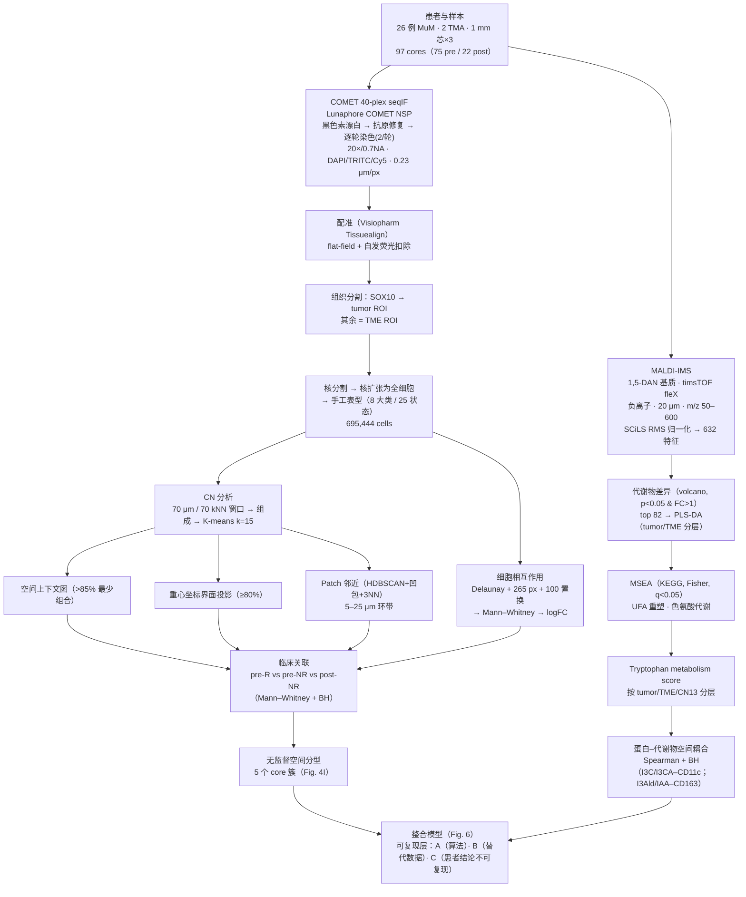

# 复现方案总目录与项目总览

> **目标文献**：Wang J, Nagarajan P, Cho S, Liu Y, Seeley EH, Dai Y, Liu Y, Yu K, Burks JK, McQuade JL, Diab A, Wang L\*, Ekmekcioglu S\*. *Integration of spatial single-cell proteomics and spatial metabolomics reveals tumor microenvironment predictive of immunotherapy response in mucosal melanoma.* **bioRxiv 预印本**（**未经同行评审**），posted 2026-04-27。DOI: [10.64898/2026.04.23.720453](https://doi.org/10.64898/2026.04.23.720453)
> （UT MD Anderson Cancer Center：Genomic Medicine / Anatomical Pathology / Melanoma Medical Oncology / MS Imaging Core；Cleveland Clinic）
>
> **规范**：本项目遵守 **L0 通用规范 `../REPRO_SPEC.md`（v2.1）** 与 **L1 项目规范 `PROJECT_SPEC.md`**。效力：L0 > L1 > 质控门槛（12 号 §一）> 各模块文档。
>
> **本套文档的性质**：以博士生导师（PI）视角编写的**可执行复现方案**。每篇含：① 科学问题与逻辑位置；② 背景原理与公式；③ 原文逐句拆解；④ 可运行代码；⑤ 参数与调参空间；⑥ 预期结果与 QC 检查点；⑦ 陷阱与排错表；⑧ 图表对应表；并**逐篇强制标注"三层复现性"**（见下）。

---

## ⚠️ 开工前必须接受的现实：本文的核心数据不公开

原文 Data availability 只写了 **"The data generated in this study are available upon reasonable request from the corresponding author."** —— 没有 GEO/SRA/PRIDE/METASPACE/Zenodo 等任何公开库的登记号。

这意味着本项目**不可能**复现原文的患者级结论。因此本方案把复现目标明确拆成三层，**并贯穿全部文档**：

| 层级 | 内容 | 能做到什么程度 | 主要依据 |
|---|---|---|---|
| **A 类·算法与代码层** | CN 分析、空间上下文图、重心坐标界面、patch 邻近、Delaunay 置换相互作用、PLS-DA、KEGG/MSEA、Spearman+BH、混合效应建模 | **可完全复现**：用开源栈重实现，并用**合成数据（已知 ground truth）**验证正确性（ARI / 功效 / FPR / 误差） | 03–11 号文档 |
| **B 类·分析流程层** | 上述流水线在**公开替代数据**（HTAN 多重成像、METASPACE MALDI-MSI 等）上端到端跑通 | **可复现"流程"**，但**面板与疾病不同**，结果数字不可与原文比较；需显式声明代理性 | 01、05–11 号文档 |
| **C 类·患者级结论层** | 26 例 MuM、97 cores 的空间特征（CN13/14/15 富集于 R、Ki67⁺肿瘤↔CD163⁺巨噬邻近、色氨酸代谢降低等） | **不可复现**（无原始影像、无 MS 原始文件、无临床表），只能：① 按原文渠道索取数据；② 用公开数据进行**同构假说检验**；③ 把结论标注为"待独立验证" | 01、12 号文档 |

> **导师批注**：把这三层分清楚，是这个项目最重要的学术诚实。**A 类做扎实，本身就有发表价值**（方法学复现 + 合成数据验证 + 开源工具）；把 A 类硬说成"复现了原文"，反而是学术不端。

---

## 一、文档清单（目录文件）

| 编号 | 文件名 | 内容一句话描述 | 对应原文 |
|---|---|---|---|
| **规范** | `../REPRO_SPEC.md` | **L0 通用规范 v2.1**：仓库级（适用所有复现项目）——工作流、目录/命名、产物契约机制、环境与随机性、统计、写作规范、文献疏漏处理、变更控制、诚实性红线 | — |
| **规范** | `PROJECT_SPEC.md` | **L1 项目规范**：本项目的模块编号表、产物契约表、术语与判定口径唯一化、决策登记（D 表）、偏离声明 | — |
| **00** | `00_目录与复现总览.md` | 本文件：三层复现性总纲、文档目录、全流程图、图表-文档映射、数据资产、算力工期、全局门槛 | Fig. 1 |
| **01** | `01_数据可得性评估与替代数据策略.md` | **本项目最关键的一篇**：数据资产审计、向作者索取数据的话术模板、A/B/C 三层映射总表、公开替代数据集（HTAN/METASPACE 等）的核实与检索脚本、合成数据生成器、伦理与合规 | Data availability |
| **02** | `02_实验平台SOP_TMA-COMET-MALDI.md` | 湿实验 SOP：TMA 构建（1 mm 芯×3）、COMET 40-plex seqIF、**黑色素漂白**、1,5-DAN 基质喷涂、timsTOF fleX 参数逐项、两模态相邻切片的不可兼容性与配准误差 | Methods「Patient cohorts」至「Raw image acquisition」 |
| **03** | `03_影像预处理配准与细胞分割.md` | flat-field、自发荧光、跨模态配准（刚体/仿射/B样条、NCC/MI、TRE）、SOX10 驱动的 tumor/TME ROI、深度学习核分割与核扩张；Visiopharm 的开源替代 | Methods「Image preprocessing…」「Tissue segmentation…」「Cell segmentation…」 |
| **04** | `04_细胞表型定义与注释.md` | arcsinh 与批次校正、**8 大类 / 25 状态**、手工表型 vs 无监督聚类、PLS-DA 的正确用法边界、Voronoi 可视化、marker 规则表 | Fig. 1B–E；Supp. Fig. 1 |
| **05** | `05_细胞邻域CN分析与Kmeans.md` | **CN 核心**：70 μm 半径窗口 vs 70 kNN 的辨析、组成向量 → K-means(k=15)、k 的选择与稳定性、15 个 CN 的命名、SPACEc 的开源替代 | Fig. 2；Methods「CN definition」 |
| **06** | `06_空间上下文图与邻域界面分析.md` | **>85% 最少组合覆盖**的空间上下文图（层次图）；**重心坐标（barycentric）**界面投影（≥80% 过滤）与三角图 | Fig. 3A–C、3F；Methods「Spatial context map」「Cellular neighborhood interface analysis」 |
| **07** | `07_Patch邻近分析.md` | HDBSCAN patch 识别 → **凹包**边缘 → 3-NN 扩展 → **5/10/15/20/25 μm 环带**异类细胞计数（含量归一化）；与 70 μm、61 μm 构成的三尺度设计 | Fig. 4A–C；Methods「Patch proximity analysis」 |
| **08** | `08_细胞间相互作用推断与置换检验.md` | **Delaunay 三角剖分 + 265 px 阈值 + 100 次位置置换 + Mann–Whitney U + logFC**；零模型对比、**p<2.22e-16 的来源辨析**、伪重复与混合效应、多重校正 | Fig. 4D–H；Methods「Cell-cell interaction analysis」 |
| **09** | `09_临床关联与无监督空间分型.md` | R/NR 与 INMC 反应标准、core→患者的**伪重复**处理、层次聚类 vs K-means 的 5 分型、富集检验、**26 例的功效分析** | Fig. 4I；Methods「Patient cohorts」「Statistical analyses」 |
| **10** | `10_空间代谢组学分析.md` | MALDI-IMS 物理与化学、RMS 归一化、±15 ppm 峰提取、**MSI 注释置信度分级**、**632 特征 / top 82**、PLS-DA（Q²/VIP/置换）、KEGG+MSEA、**tryptophan score**、UFA/SCD1 | Fig. 5A–E、5I；Methods「Raw image acquisition…MALDI-IMS」 |
| **11** | `11_蛋白-代谢物空间耦合与多组学整合.md` | 相邻切片配准的**误差传播**、Spearman+BH、**空间自相关导致的伪相关**与零模型、四种整合层级对比、**群组层面 vs 局部富集（Simpson 悖论）**、Fig. 6 重绘 | Fig. 5F–H；Fig. 6 |
| **12** | `12_复现质控清单、排错与批判性评述.md` | 40 项 QC 门槛（含原文数值）、跨模块排错、**原文 27 处疏漏逐条核对**、证据等级分级、可扩展方向、**D 表（决策登记）** | 全文 |
| **13** | `13_背景知识精讲与方法学原理速查.md` | MuM 生物学、ICI 与 INMC、色氨酸/AhR、UFA/SCD1；COMET 与 MALDI-IMS 原理；CN/置换检验/伪重复/空间自相关等方法学速查；50 篇文献导读 | 全文 |

---

## 二、科学问题与证据链

### 2.1 科学问题（一句话版）

**黏膜黑色素瘤（MuM）对免疫检查点抑制剂（ICI）反应差且缺乏预测标志物——肿瘤微环境的"空间结构"与"局部代谢状态"能否解释 R 与 NR 的差异？**

原文给出的答案链（复现时逐条验证其属于 A/B/C 哪一层）：

1. 26 例 MuM、2 个 TMA、**97 cores（75 pre + 22 post）**；**695,444 个分割细胞**；**8 大类 / 25 个表型**（Fig. 1）。
2. **大谱系比例在 R/NR 间无差异**（Supp. Fig. 1A–D），但**肿瘤状态有差异**：MIF⁺ 肿瘤在 pre-R 与 post-NR 升高；Ki67⁺ 肿瘤在 pre-NR 升高（Supp. Fig. 1E–F）。→ **"组成相似但状态与空间不同"**是全文的第一个关键观察。
3. **15 个 CN**：肿瘤相关 CN15（中央瘤）/CN14（侵袭瘤）/CN13（瘤界）呈**巢式空间关系**（CN15 被 CN14 包围、CN14 邻接 CN13），且三者在 **pre-R 与 post-NR 富集**（Fig. 2）。
4. **基质 CN（尤其 CN10 Vimentin⁺ 基质）丰度与肿瘤区免疫浸润负相关**（Fig. 3D–E）→ 基质屏障假说。
5. **R 中瘤界/侵袭瘤内 Ki67⁺ 肿瘤细胞与 CD163⁺ 巨噬、CD11c⁺ DC 空间更近**（p 低至 2.22×10⁻¹⁶）；**NR 的 CD163⁺ 巨噬 IRF4/Arg1 更高**（M2 样）（Fig. 4D–H）。
6. 基于 CN 组成的无监督分型得到 **5 个 core 簇**，其中肿瘤 CN 主导的 Cluster 1 富集 R（p = 0.0015），基质 CN 主导的 Cluster 3/5 富集 NR（Fig. 4I）。
7. **空间代谢组**：TME 中 UFA（亚油酸、油酸、棕榈酸、硬脂酸）在 pre-R 升高；**吲哚/色氨酸代谢物在 pre-R 整体降低**（tumor 与 TME 均降），色氨酸代谢为 TME 中第二显著改变通路；且**代谢物与 CD11c/CD163 表达在空间上正相关**（Fig. 5）。
8. 综合模型：**肿瘤-免疫邻域架构 + 基质排斥 + 髓系-代谢耦合**共同决定 MuM 的 ICI 响应（Fig. 6）。

### 2.2 全流程图（对应原文 Fig. 1A）

### 2.3 原文图表 → 文档映射

| 原文图 | 内容 | 复现文档 | 三层归属 |
|---|---|---|---|
| Fig. 1A | 研究流程 | 00 / 02 | — |
| Fig. 1B | 40-plex 抗体面板 + PLS-DA 展示细胞谱系 | 02 / 04 | B |
| Fig. 1C | 25 个表型的 marker 热图 + 相对丰度 | 04 | B/C |
| Fig. 1D | H&E / Voronoi / COMET 代表图 | 03 / 04 | B |
| Fig. 1E | 各 core 细胞类型比例堆叠图（按三组） | 04 | C |
| Fig. 2A | CN 识别示意 + 代表 core 的 CN 映射 | 05 | A/B |
| Fig. 2B | 15 个 CN 的组成热图 + 各 core 相对比例 | 05 | A/B |
| Fig. 2C | 每个 CN 的 Voronoi/细胞类型放大图 | 05 | B |
| Fig. 2D | CN 频率组间箱线图（pre-R vs pre-NR；pre-NR vs post-NR） | 05 | C |
| Fig. 3A | 空间上下文图（层次 CN 组合） | 06 | A/B |
| Fig. 3B | DC 相关 CN 在 R 中的分布 | 06 | C |
| Fig. 3C | 基质 CN 组合代表图 | 06 | C |
| Fig. 3D–E | CN10 丰度 vs 免疫浸润 相关 + 2D/3D 密度图 | 06 | A/C |
| Fig. 3F | 重心坐标界面图（三组比较） | 06 | A/B |
| Fig. 4A–C | patch 分析示意、八层细胞比例、空间梯度 | 07 | A/B |
| Fig. 4D、4F | 差异细胞相互作用 top6（CN14、CN13） | 08 | A/B |
| Fig. 4E、4G | CN14/CN13 中 CD163⁺ 巨噬的 IRF4/Arg1 | 04 / 08 | C |
| Fig. 4H | Ki67⁺肿瘤–CD163⁺巨噬 / –CD11c⁺DC 高清图 | 08 | C |
| Fig. 4I | 层次聚类热图 + 5 簇饼图 | 09 | A/B |
| Fig. 5A | PLS-DA（tumor 与 TME 分层） | 10 | A/B |
| Fig. 5B | 代谢物 volcano（tumor / TME） | 10 | A/B |
| Fig. 5C | MSEA（UFA、色氨酸） | 10 | A/B |
| Fig. 5D | 色氨酸代谢通路图 + 箱线图 | 10 | A/B |
| Fig. 5E | tryptophan score（组间 + 空间） | 10 / 11 | A/C |
| Fig. 5F–H | 代谢物 vs CD11c/CD163 相关（tumor/TME/CN13） | 11 | A/B |
| Fig. 5I | NR 的 CN13 tryptophan score | 10 / 11 | C |
| Fig. 6 | 总结图（R vs NR 空间免疫与代谢特征） | 11 | A（重绘） |
| Supp. Fig. 1A–F | 大谱系与肿瘤状态比例 | 04 | C |
| Supp. Fig. 2 | 各 CN 空间分布 | 05 | B |
| Supp. Fig. 3 | 97 cores 的 TMA 布局与 QC | 01 / 02 | C |
| Supp. Fig. 4 | 细胞表型判定标准 | 04 | **C（且不可得）** |
| Supp. Table 1 | 患者临床信息 | 01 / 09 | **C（且不可得）** |
| Supp. Table 2 | INMC 病理反应标准 | 09 | B |
| Supp. Table 3 | 40-plex 抗体面板清单 | 02 / 04 | **C（且不可得）** |

---

## 三、数据资产清单与可得性

| 资产 | 规模 | 用途 | 可得性 | 获取方式 |
|---|---|---|---|---|
| COMET OME-TIFF 影像栈 | 97 cores × 40 marker，0.23 μm/px | 全部蛋白空间分析 | ❌ **不公开** | 向通讯作者索取（01 号文档给模板） |
| MALDI-IMS 原始数据（.d / SCiLS 工程） | 97 cores，20 μm，632 特征 | 全部代谢分析 | ❌ **不公开** | 同上 |
| TMA 蜡块 / 切片 | 2 TMA，26 例 | 重新染色/成像 | ❌ 需合作 | 机构间合作或重新构建队列 |
| 临床与疗效表（含 INMC 评估） | 26 例 | R/NR 分组 | ❌ 不公开（Supp. Table 1） | 同上 |
| 抗体面板清单 | 40 个 marker | 表型复现 | ❌（Supp. Table 3 不可得） | 按 02/04 号文档重建表型规则 |
| **公开替代（多重成像）** | HTAN 及公开黑色素瘤 mIF 数据集 | B 类流程复现 | ✅ 公开 | 见 01 号文档（含检索脚本，**具体 accession 由 01 号文档核实后填入**） |
| **公开替代（MALDI-MSI）** | METASPACE 公开数据集 | B 类流程复现 | ✅ 公开 | 同上 |
| 公开 MuM/黑色素瘤队列（TCGA-SKCM 等） | 大规模 | 通路层先验验证 | ✅ 公开 | 同上（**不能替代空间证据**） |

> ⚠️ **导师批注**：表里的"公开替代"一栏，**必须由 01 号文档给出经核实的真实 accession 与链接**。若核不到，就诚实写"未找到可直接替代的公开数据集"，**绝不允许编造数据集编号来让方案"看起来完整"**。

---

## 四、计算资源与工期建议

| 模块 | 内存峰值 | CPU/GPU | 参考耗时 | 备注 |
|---|---|---|---|---|
| OME-TIFF 读取与 flat-field（97 cores × 40 通道） | 32–64 GB | 8 核 | 数小时–1 天 | 用 `tifffile`/`zarr` 分块读取，勿整栈载入 |
| 跨模态配准（97 cores） | 16–32 GB | 8 核 | 数小时 | 非刚体最慢；可先刚体+landmark 评估是否够用 |
| 细胞分割（695,444 细胞） | **GPU 16 GB 起**（CPU 也可但慢 10×） | GPU 或 32 核 | 数小时–2 天 | Cellpose/StarDist 批量；按 core 并行 |
| CN 分析（70 μm 窗口 + K-means） | 32–64 GB | 16 核 | 1–3 小时 | cKDTree 批量查询是瓶颈；**已由 `tools/spatial_cn_kmeans.py` 提供实现** |
| 空间上下文图 / 重心坐标 | 32 GB | 16 核 | 数小时 | 组合枚举需优化（见 06 号文档） |
| Patch 邻近（HDBSCAN + 凹包） | 16–32 GB | 8 核 | 数小时 | **`tools/patch_proximity.py`** |
| Delaunay 相互作用 + 100 次置换 | 32–64 GB | 16–32 核 | 数小时–1 天 | 置换次数 × 细胞数；**`tools/spatial_interaction_test.py`**（勿整库跑，按 core 并行） |
| MALDI 数据处理 + PLS-DA | 16–32 GB | 8 核 | 数小时 | 开源路径受 Bruker 格式限制（见 10 号文档） |
| 合成数据验证（A 类核心） | 8–16 GB | 8 核 | 数小时 | **本项目最有价值的可交付证据** |

**建议**：dry-lab 全流程（含合成数据验证与替代数据跑通）约 **4–8 周**；湿实验部分（TMA + COMET + MALDI）**不可复现**，仅供理解原文来源。

---

## 五、全局质控点（Go/No-Go 门槛）

复现者在每个阶段结束时核对以下数值（原文报告值；允许抽样/实现差异导致 **±10%** 波动，超出即回查）：

1. **队列**：26 例（15 男/11 女）；2 TMA；**97 cores = 75 pre + 22 post**；原发部位 9 sinonasal / 11 anorectal / 2 conjunctival / 4 urethral。
2. **细胞**：QC 后保留 **695,444 个分割细胞**；**8 个 major cell types**；**25 个 phenotypes**。
3. **CN**：**15 个 CN**（K-means k=15）；肿瘤相关 CN13/CN14/CN15 呈巢式空间关系；**CN15/14/13 在 pre-R 与 post-NR 富集**（Mann–Whitney，p<0.05）。
4. **基质**：**CN10 丰度与肿瘤区免疫浸润负相关**。
5. **相互作用**：Ki67⁺肿瘤↔CD163⁺巨噬 在 CN13（p<2.22×10⁻¹⁶）与 CN14（p=6.10×10⁻¹⁴）更近；Ki67⁺肿瘤↔CD11c⁺DC 在 CN13（p<2.22×10⁻¹⁶）更近。
6. **分型**：5 个 core 簇；Cluster1 46.4%R（p=0.0015）、Cluster3 95%NR（p=0.036）、Cluster5 95.2%NR（p=0.021）、Cluster4 全 NR。
7. **代谢**：**632 个特征**；**top 82 差异代谢物**；TME 中 UFA 在 pre-R 上调；indole 类在 pre-R 下调；**色氨酸代谢为 TME 第二显著通路**；tryptophan score 在 R 的 tumor 与 TME 均降低。
8. **耦合**：I3CA/I3C–CD11c（pre-R tumor）；I3Ald/IAA–CD163（pre-R TME）；NR 的 CN13 中 indole/I3Ald/IAA–CD163 正相关。

> **A 类复现的"替代门槛"**（因为 C 类不可验证）：合成数据上 **CN 恢复 ARI > 0.7**；相互作用检验**功效 > 0.8 且 FPR < 0.1**；patch 环带计数**误差 < 15%**。这三条是本项目证明"算法复现成功"的核心判据。

---

## 六、工程约定（本项目）

1. **目录**：`raw/{comet,maldi,clinical,tma,public_surrogate}/`、`processed/`、`results/`、`figures/`、`code/`、`logs/`（**不用 `data/` 前缀**，L0 §3.1）。
2. **可复用脚本放仓库 `tools/`**（L0 §1.4）：本项目核心空间算法已实现为 `tools/spatial_cn_kmeans.py`、`tools/spatial_interaction_test.py`、`tools/patch_proximity.py`（均带 `--selftest`）；项目 `code/` 只放编排与项目特有参数，**不得复制 `tools/` 的脚本**。
3. **随机种子**：`np.random.seed(20260101)`；K-means、HDBSCAN、PLS-DA、置换检验、聚类全部固定。
4. **单位纪律**（本文的**头号事故源**）：COMET **0.23 μm/pixel**、MALDI **20 μm/pixel**、Delaunay 阈值原作写 **265 pixels**（≈60.95 μm）；**所有涉及长度/面积的参数必须显式注明单位并在代码中断言**。
5. **统计约定**：Spearman + BH；两组 → Mann–Whitney U；多重校正 → BH(FDR)；阈值 p 或 FDR < 0.05；**比例数据的组间比较优先用患者级聚合或混合效应模型**（避免 core 级伪重复）。
6. **图表**：`.pdf` + `.png` 双份（dpi=300）；命名与原文图号对齐（`Fig4D_...`）。
7. **诚实性红线**（L0 §12）：数据不可得就说不可得；替代数据必须声明代理性；**禁止编造 accession、试剂货号、数值**。
8. **决策登记**：本项目 D 表权威位置 = `12_复现质控清单、排错与批判性评述.md` **§七**；运行时决策记入 `logs/DECISIONS.md`。

---

## 七、推荐执行路径（三档）

| 档位 | 目标 | 覆盖 | 预计工时 |
|---|---|---|---|
| **A. 算法复现（强烈推荐先行）** | 用合成数据把 5 个核心空间算法跑通并验证正确性；产出可复用 `tools/` 脚本 | 01（合成数据）+ 05 + 06 + 07 + 08 + `tools/*` | 2–3 周 |
| **B. 流程复现** | A + 在公开替代数据上端到端跑通（含 PLS-DA/KEGG/相关耦合） | 01 + 05–11 | 5–8 周 |
| **C. 完整复现（含数据索取）** | B + 向作者索取数据，若获准则做 C 类结论的独立验证 | 全部 01–12 | 数据等待期不可控 |

> **最后一句（导师视角）**：这篇预印本的**科学价值在假说**（肿瘤界面髓系-代谢耦合），**复现价值在方法**（一整套可迁移的空间多组学分析栈）。**把方法复现做到无懈可击、把结论的不可验证性讲清楚**，比"看起来复现了原文"有价值得多。
