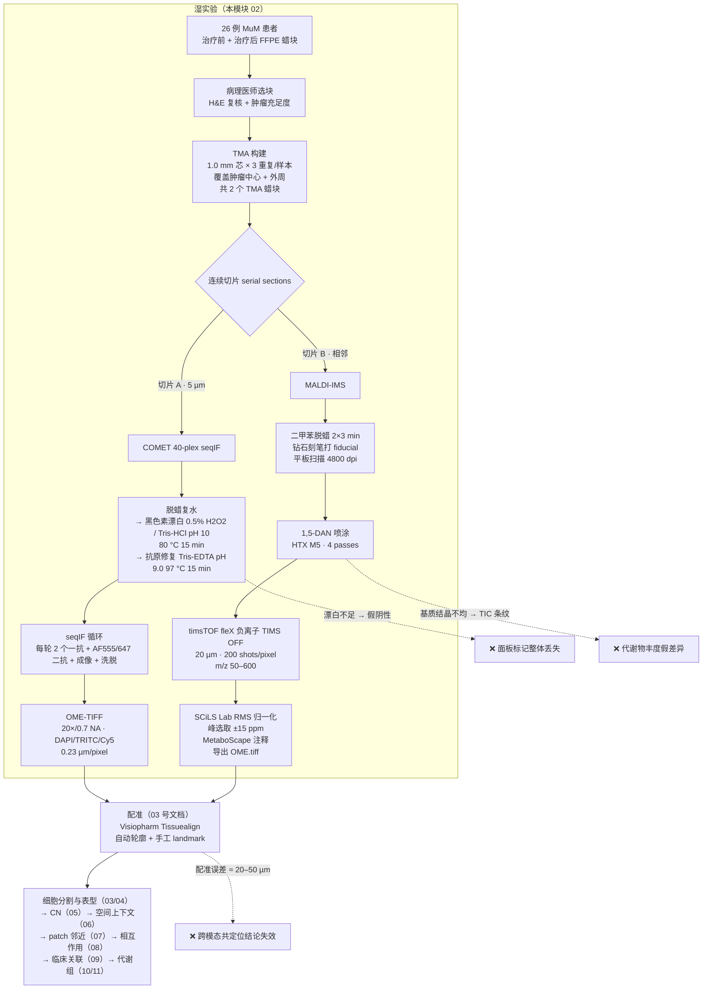
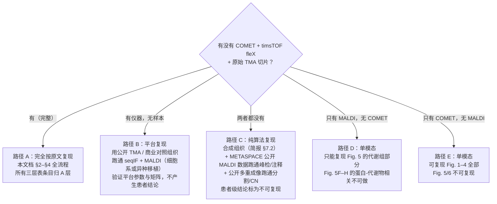

# 02 实验平台 SOP：TMA 构建 → COMET 40-plex seqIF → MALDI-IMS 采集

> **目标文献**：Wang J, Nagarajan P, et al. *Integration of spatial single-cell proteomics and spatial metabolomics
> reveals tumor microenvironment predictive of immunotherapy response in mucosal melanoma.* bioRxiv 2026.
> DOI: 10.64898/2026.04.23.720453（预印本，未经同行评审）
>
> **模块对应原文**：Fig. 1A–B（工作流与抗体面板）；Methods 中「Patient cohorts」「Raw image acquisition,
> image processing of MALDI-IMS data」「Sequential immunofluorescence using the COMET platform」
> 「Image preprocessing and alignment」「Tissue segmentation and ROI definition」全部段落；
> Supp. Fig. 3（97 个 core 构成）、Supp. Table 1（临床）、Supp. Table 2（INMC 疗效评估）、Supp. Table 3（40-plex 面板）
>
> **前置依赖**：无上游计算产物。本模块的**输入是实物**（FFPE 蜡块、载玻片、抗体、基质、仪器）；
> **输出是两个只读原始目录**：`raw/tma/`（蜡块与切片清单）、`raw/comet/`（OME-TIFF 影像栈）、
> `raw/maldi/`（`.imzML`/`.ibd` 或 SCiLS 工程目录）。消耗方见 §1.3 契约表。
>
> **复现难度**：★★★★★（唯一无法靠代码绕过的模块——**没有仪器和样本就没有这一步**）
> **预计工时**：45 人日（TMA 构建 8 + COMET 优化与上机 12 + MALDI 优化与上机 10 + 配准与 QC 15）
> **计算资源**：本模块本身**几乎不需要算力**（QC 脚本单机 32 GB 内存足够）；
> **真正的资源瓶颈是硬件**：Lunaphore COMET（或等效 seqIF 平台）×1、Bruker timsTOF fleX + FlexImaging ×1、
> HTX M5（或 TM-Sprayer）基质喷涂机器人 ×1、石蜡切片机、BioGenex EZ-Retriever、
> Epson Perfection V600（或等效 4800 dpi 平板扫描仪）、钻石刻笔、病理医师复核工时。

---

## 1. 科学问题与逻辑位置

### 1.1 这一步在整条复现链中承担什么

本文的所有下游计算（`03`→`11`）都建立在一个假设上：**两张相邻切片上采集的信号，可以被当作"同一张组织的两个面"来对齐**。
这个假设不是计算问题，是**实验设计问题**。本模块的任务就是把这件事做实，并把它的误差量化清楚。



### 1.2 本模块的边界：它**不**负责什么

| 归属 | 内容 | 去处 |
|---|---|---|
| **本模块（02）** | TMA 设计与构建、切片、染色/漂白/修复、seqIF 上机、MALDI 前处理与采集、原始文件落盘、**采集侧的 QC 与配准误差量化** | 本文档 |
| 下游 `03_影像预处理配准与细胞分割.md` | flat-field 校正、自发荧光扣除、跨模态配准的实际执行、核分割与细胞扩展、ROI（肿瘤/TME）划分 | 03 号文档 |
| 下游 `10_空间代谢组学分析.md` | 峰表构建、归一化、注释、差异丰度、PLS-DA、MSEA | 10 号文档 |
| 下游 `12_复现质控清单、排错与批判性评述.md` | 全项目 QC 门槛表、D 表、gap 表、文献疏漏逐条核对 | 12 号文档 |

> ⚠️ **导师批注（全项目最关键的边界声明）**：本文档的 §6/§7 只回答"**采集到的原始文件是否可信**"。
> 至于"从这些文件推出来的生物学结论是否成立"，属于 12 号文档的批判性评述范围。
> 两者不能混为一谈——**一个采集质量极高的数据集，完全可以支持一个错误的生物学结论**。

### 1.3 产物契约（本模块负责的部分）

| 产物路径 | 生产者（唯一） | 格式/结构（下游必须知道的） | 消费方 | 校验和 |
|---|---|---|---|---|
| `raw/tma/tma_manifest.csv` | 02 | 列：`tma_block_id, patient_id, core_id, core_position(row,col), region(center/periphery), timepoint(pre/post), replicate_index(1-3), usable(bool), notes`；**一个 core 一行** | 03、04、09、12 | `logs/00_checksums.md5` |
| `raw/tma/clinical_redcap.csv`（去标识化） | PI（不属本模块） | 列：`patient_id, sex, age_at_dx, primary_site, treatment_agent, line, best_response(R/NR per RECIST) , inmc_necrosis_pct, inmc_category` | 09、12 | 独立加密 |
| `raw/comet/<core_id>/<core_id>_cycle<NN>_<markerA>_<markerB>.ome.tiff` | 02 | OME-TIFF；通道序固定 `[DAPI, AF555, AF647]`；**单位：pixel**；`PhysicalSizeX/Y = 0.23 µm` 写入 OME 元数据 | 03 | 逐文件 md5 |
| `raw/comet/comet_runlog.csv` | 02 | 列：`core_id, cycle_index, marker_channel_555, marker_channel_647, exposure_ms, focus_offset_um, elution_index, operator, timestamp` | 03、12 | — |
| `raw/maldi/<tma_block_id>/` | 02 | SCiLS 工程目录或 `.imzML + .ibd`；**必须同时保留喷涂前 4800 dpi 光学图与 fiducial 坐标文件** | 03、10 | 逐文件 md5 |
| `raw/maldi/<tma_block_id>/fiducials_maldi.csv` | 02 | 列：`fiducial_id, px_x, px_y, um_x, um_y`（`um = px × 5.29167`，见 §4.3） | 03 | — |
| `results/02_maldi_tic_qc.csv` | 02 | 列：`tma_block_id, median_tic, cv_tic_within_core, cv_tic_between_cores, stripe_period_px, stripe_amplitude, pass(bool)` | 10、12 | — |
| `results/02_registration_tre.csv` | 02 | 列：`tma_block_id, core_id, n_fiducials, transform_type, rmse_um, tre_loo_um, tre_max_um` | 03、12 | — |

**坐标系统一（口径唯一，L0 §0.3）**：本项目**全部计算在 µm 中完成**。
- COMET 原始像素 → µm：`× 0.23`（`0.23 µm/pixel` 是原文报告值）；
- MALDI 原始像素（20 µm 网格）→ µm：`× 20.0`；
- 平板扫描仪像素（4800 dpi）→ µm：`× 5.29167`（= 25400 µm/inch ÷ 4800）；
- **禁止**在任何脚本里对"像素"做跨模态算术（详见 §2.8 与 `08` 号文档的 265-pixel 单位问题）。

---

## 2. 背景知识与原理

### 2.1 为什么必须是 TMA，而不是整张切片

原文用 **2 个 TMA、每样本 1.0 mm 芯 × 3 重复、覆盖肿瘤中心与外周**。这个设计不是"为了省事"，而是被两条硬约束逼出来的：

| 约束 | 后果 | TMA 如何解决 |
|---|---|---|
| **试剂成本与工时** | COMET 40-plex 意味着每张切片 ≥ 20 轮 seqIF 循环（每轮 2 个 marker）。若 97 个样本各做一张全切片，等于 97×20 = 1940 轮染色+成像 | 把所有样本压到 2 张切片上，一次运行完成全部样本 |
| **切片批次效应** | 染色日期、试剂批号、抗体批次都会引入系统性差异。97 张切片跨数月完成 → 批次效应与分组（R/NR）混杂 | **2 张切片 = 全部样本在同一批完成**，批次效应退化为一个可校正的常数 |
| **取材代表性** | MuM 瘤内异质性高，单点活检可能完全错过肿瘤 | 每样本 3 个 1.0 mm 芯（中心 + 外周）给出**瘤内变异的直接估计** |

**但 TMA 引入了新的、更隐蔽的问题——采样偏差**：

- 1.0 mm 芯的面积为 $\pi \times 0.5^2 = 0.785\ \text{mm}^2$。若肿瘤直径 10 mm，则单芯覆盖肿瘤横截面的 $0.785 / 78.5 = 1.0\%$。
- 三个芯合计约 **3%** 的肿瘤面积。**任何"CN 频率"的组间差异，本质上都是在 3% 的采样面积上测得的**。
- 原文 Limitations 主动承认了这一点："analyses were performed on FFPE tissue cores, which provide **limited spatial coverage** and may be sensitive to regional sampling and intratumoral heterogeneity"。这个自述是诚实的，复现时必须原样保留。

> ⚠️ **导师批注（采样偏差 vs 生物学差异的不可分性）**：原文报告 CN15/CN14/CN13 在 pre-R 中富集。
> 但"瘤芯（central tumor）"在 TMA 取样时，**病理医师是看着 H&E 主动挑"肿瘤中心"和"肿瘤外周"的**——
> 对 R 和 NR 的取材规则相同，所以组间可比；但对**单个 core 而言，"已经取到瘤芯"这件事本身就是被选择过的**。
> 复现时不能把"CN15 富集"读成"这个病人的肿瘤中心里发生了 X"，只能读成"**在能被取材到瘤芯的区域里**，R 更常见 X"。

### 2.2 连续切片（serial sections）与跨模态配准的物理下限

**为什么必须相邻切片、而不能用同一张**：两条路线的化学要求直接冲突。

| 步骤 | COMET 需要 | MALDI-IMS 需要 | 是否兼容 |
|---|---|---|---|
| 脱蜡 | 脱蜡复水 → **保持水性** | 脱蜡 → **保持干燥**（水的质子化会破坏负离子模式） | ❌ 相反 |
| 组织处理 | 抗原修复（97 °C，强碱性）+ 黑色素漂白（H₂O₂ 氧化） | **不做任何修复/氧化**（会降解小分子代谢物） | ❌ 完全冲突 |
| 表面处理 | 亲水缓冲液 MSB，覆盖抗体 | 疏水有机基质层（1,5-DAN / 50% ACN），**抽真空** | ❌ 完全冲突 |
| 成像/采集 | 荧光（需要抗淬灭、避光） | 激光解吸 + 真空 + 高压 | ❌ 完全冲突 |

结论：**同一张切片不可能既做 COMET 又做 MALDI-IMS**。必须是**相邻切片**。

**相邻切片带来什么误差**：两张切片在蜡块上相距约 5 µm（切片厚度），但——

1. **切片本身形变**：石蜡切片在温水展片（water bath）时会发生**各向异性拉伸**，两个切片之间不可能完全一致；
2. **组织塌缩（shrinkage）**：FFPE 处理使组织较新鲜组织塌缩约 20–30%，Moisture 和包埋应力在同一蜡块的不同切片间也有差异；
3. **z 方向的信息错位**：5 µm 的 z 偏移意味着一个直径 10 µm 的细胞，在两个切片上的**横截面积可能相差 2 倍以上**（切到赤道 vs 切到极区）；
4. **fiducial 定位误差**：钻石刻笔的刻痕本身有宽度，人工点击取心时会有偏差。

因此**配准误差不可避免**。它的量级必须被量化，而不是被当成"软件能修好"的问题。

**fiducial landmark 是唯一能纠正刚体/仿射分量的手段**：如果没有人工刻的 fiducial，就只能靠组织轮廓自动匹配（原文 Tissuealign 模块的第一步），而组织轮廓匹配无法分辨"轮廓内 30 µm 的整体平移"。钻石刻痕提供的是**独立于组织形态的几何锚点**——这是原文方法学里一个必须保留的细节。

> ⚠️ **导师批注（原文未报告的关键缺口）**：原文写 "Quality control was ensured through overlay visualization and **quantitative assessment of registration accuracy**"，
> 但**从未报告这个"定量评估"的数值**（TRE、RMSE、最大偏差，一律缺失）。
> 这是一个必须补做的测量。§4.3 给出可直接运行的实现；§6 给出我们建议的门槛。
> 登记到 `12_复现质控清单、排错与批判性评述.md` 的 D 表。

### 2.3 黑色素漂白：为什么对黑色素瘤是**强制**步骤

这是全文湿实验部分**最容易被非黑色素瘤背景的人做错的一步**，必须讲透。

**黑色素（melanin）对荧光成像做了三件坏事**：

1. **宽谱吸收（内滤效应，inner filter effect）**：真黑色素（eumelanin）的吸收在 200–800 nm 上单调下降，没有特征峰。它的吸收系数在 488 nm 处约为 200–500 cm⁻¹·(mg/mL)⁻¹ 量级，且随浓度非线性上升（散射 + 吸收叠加）。组织中致密的黑色素区可以吸收掉 **> 90% 的入射光**。
   后果：**AF555 通道的激发光到不了抗体处，发射光也出不来** → 该区域所有 marker 的荧光强度**整体压低** → 分割算法看不到核 → **细胞在黑色素区被系统性漏检**。
2. **自身荧光（autofluorescence）**：黑色素及其氧化/聚合产物的激发谱覆盖 350–500 nm，发射在 450–600 nm。**正好落在 TRITC（≈ AF555）通道内**。后果：**假阳性信号**，被当作抗体信号。
3. **光漂白产物**：长时间强光照射下黑色素会产生活性氧，进一步淬灭附近的荧光团。

**黑色素对本文的致命性**：MuM 的一个核心结论是 **CN15 = MIF⁺ 肿瘤 / CN13 = 边界 / CN14 = 侵袭性肿瘤**，以及 **Ki67⁺ 肿瘤细胞与 CD163⁺ 巨噬细胞的空间邻近**。
如果黑色素漂白不充分 → 肿瘤区（黑色素最富集的地方）细胞被漏检、marker 被压低 →
**"肿瘤区免疫细胞更少"这一结论会被人为制造出来**。这是一个**方向性偏差**，不是随机噪声。

**漂白的化学机制**（原文引用的 Chung et al., *Lab Invest* 2016，原文文献 48）：

$$\text{melanin} + \text{H}_2\text{O}_2 \xrightarrow{\ \text{pH 10,}\ 80\,^\circ\text{C}\ } \text{可溶性氧化碎片（无色）}$$

- **H₂O₂ 是氧化剂**，把黑色素的吲哚醌多聚体氧化成可溶于水的小分子碎片；
- **碱性条件是关键**：Tris-HCl（室温标定 pH 10，80 °C 时有效 pH ≈ 8.5，仍为碱性；见下条修正）既维持 H₂O₂ 的活性（酸性下 H₂O₂ 稳定但氧化能力弱，且酸性不利于黑色素溶解），又促进黑色素多聚体的解聚；
- **80 °C 是加速项**：常温下同样的漂白需要数小时到过夜，80 °C 15 min 把反应压到可接受时长；
- **Tris 的双重作用**：既是缓冲剂（pKa 8.06 @ 25 °C，其温度系数 $\mathrm{d}pK_a/\mathrm{d}T \approx -0.028\ \text{pH}/^\circ\text{C}$。
  ⚠️ **修正（原稿此处算错）**：按该温度系数，$25 \to 80\,^\circ\text{C}$ 使 $pK_a$ 下降 $0.028 \times 55 \approx 1.54$，
  即 **80 °C 时 $pK_a \approx 6.5$**（不是 8.5）。相应地，一个**在室温下标定到 pH 10** 的 Tris-HCl，
  在 80 °C 时实测约 **pH 8.5**（不是 9.5）——也就是说**实际漂白反应是在弱碱性（≈pH 8.5）而非 pH 10 下进行的**。
  这一点必须在复现时实测并在报告中写明（原文只写 "Tris-HCl buffer (pH 10)"，未说明标定温度）。
  选 Tris 而非磷酸盐的理由：磷酸盐缓冲液在高温碱性下与 H₂O₂ 相容性变差且易沉淀钙镁；
  同时 Tris 是**自由基清除剂**，抑制 H₂O₂ 对组织抗原的过度氧化。

**漂白与抗原保护的张力（这是本步骤最难的地方）**：

| 漂白强度 | 黑色素残留 | 抗原损伤 | 结果 |
|---|---|---|---|
| 不足（时间短/温度低/H₂O₂ 浓度低） | 高 | 低 | **肿瘤区 marker 假阴性**（方向性偏差，最危险） |
| 适度（原文条件） | 低 | 可接受 | ✅ |
| 过度（延长时间/提高浓度/反复处理） | 极低 | **高**（表位被氧化破坏，尤其含 Met/Cys/Trp 的表位） | **全线 marker 信号下降**，尤其 SOX10/MITF 这类转录因子 |

> ⚠️ **导师批注（原文未报告、必须我们自己定的东西）**：
> 原文给了漂白试剂与条件（0.5% H₂O₂ / Tris-HCl pH 10 / 80 °C / 15 min），但**没有报告**：
> ① 每个 core 的漂白充分性如何判定（用什么指标、阈值多少）；
> ② 是否存在"漂白后仍需二次漂白"的样本（MuM 黑色素量差异极大，从无色素型到重度色素型）；
> ③ 漂白对 40 个抗体的信号损失是否逐抗体评估过（相容性矩阵）。
> **我们的复现决策**：把漂白充分性作为**强制性 per-core QC 门**（§4.1 的实现 + §6 的门槛），
> 并**对无色素型 MuM 单设漂白阴性对照**（同条件但不加 H₂O₂），用来逐抗体估计漂白造成的信号损失。
> 备选方案：若某 core 二次漂白后仍不达标，**如实标记为 `bleach_fail` 并从黑色素富集区的 marker 定量中排除**，
> 而不是用"看起来还行"糊过去。

### 2.4 抗原修复与 seqIF 的化学逻辑

**抗原修复（HIER）**：FFPE 处理使蛋白通过甲醛交联形成亚甲基桥，遮蔽了表位。Tris-EDTA pH 9.0 在 97 °C 下通过**水解部分亚甲基交联**重新暴露表位。

原文条件：**Tris-EDTA pH 9.0（BioGenex HK549-XAK），97 °C 15 min，EZ-Retriever 系统（BioGenex MW014-MO）**。

| 参数 | 物理意义 | 偏离后果 |
|---|---|---|
| **pH 9.0（碱性）** | 碱性条件主要水解**甲醛-赖氨酸**交联，对多数细胞核/胞质蛋白表位最有效 | 换成 pH 6.0（柠檬酸）→ 部分膜蛋白/磷酸化表位信号更好，但核转录因子（SOX10/MITF/Ki67）会明显变差 |
| **97 °C** | 接近沸点，加速水解；EZ-Retriever 用**加压/密闭腔**使 97 °C 可稳定维持而不沸腾脱水 | 降到 90 °C → 修复不足；升到 100 °C 以上 → 组织从玻片脱落（TMA 芯尤其危险） |
| **15 min** | 时间-温度等价（Arrhenius）：约等于 121 °C 高压锅 3 min 或 100 °C 20 min | 时间不足 → 弱表达 marker 假阴性；过长 → 组织脱片 + 表位破坏 |

**MSB 缓冲液（Lunaphore BU06, 1:20）**：seqIF 的关键在于**每轮之间要保持切片的"可再染色性"**。
MSB 的作用是 ① 维持抗体稀释后的稳定构象（防止非特异吸附）；② 提供低背景的封闭环境（替代传统 BSA/血清封闭，因为血清蛋白会在洗脱时残留并累积）。
**1:20 稀释是原文给出的工作浓度**——注意这是**厂商浓缩液的工作稀释比**，不是"原液"。

**seqIF 循环的完整化学过程**（每轮）：

```
① 加入本轮的 2 个一抗（off-the-shelf，未偶联）→ 孵育
② 加入 AF555 / AF647 二抗（分别针对两种一抗的种属）→ 孵育
③ 成像（DAPI + TRITC + Cy5 三通道）
④ 洗脱（Lunaphore 专有试剂）→ 洗掉一抗 + 二抗，**保留组织形态与已暴露的表位**
⑤ 进入下一轮
```

**为什么 "每轮 2 个 marker" 且必须用 AF555/AF647**：
- 二抗的**种属交叉反应**决定了同一轮里两个一抗必须来自**不同种属**（或用直标抗体）；
- 两个荧光通道（AF555 ≈ TRITC 通道，AF647 ≈ Cy5 通道）+ DAPI = 3 通道/轮，**20 轮 × 2 = 40 个 marker**；
- 为什么不一次染 40 个：**光光谱重叠**。宽场荧光的光谱重叠使得 >5 色的同时成像需要极复杂的解混（unmixing），
  且解混误差会随光谱数指数累积。seqIF 用**时间维度换光谱维度**——这是一个在灵敏度和 plex 之间的工程折中。

### 2.5 洗脱（elution）：seqIF 最脆弱的一环

**现象**：如果第 $k$ 轮的二抗没有被完全洗掉，它会在第 $k+1$ 轮**再次被成像**，表现为**跨轮次串扰（bleed-through / carryover）**。

**串扰的识别特征**（这是 QC 里最容易漏掉的一项）：

假设第 3 轮用 AF647 检测了 marker X，第 7 轮用 AF647 检测了 marker Y。
如果第 3 轮的信号没洗净，那么在**第 7 轮的 AF647 图上**会出现 X 的"鬼影"。
后果：**X 和 Y 的相关系数被人为抬高**，下游任何基于共表达/共定位的分析全部污染。

**必须做的验证**：设置一个**洗脱对照轮**——在一轮正常染色成像之后，插入一个**只加二抗、不加一抗**的循环。
如果这一轮仍能检出前一轮 marker 的信号（> 背景 3 SD），说明洗脱不彻底。原文**未报告**是否做了这个对照。

> ⚠️ **导师批注**：原文说 "Antibodies were gently eluted between cycles using **proprietary** Lunaphore reagents"——
> 洗脱试剂是**专有配方**，无法知道其化学组成，也就**无法从原理上推断洗脱效率**。
> 这不是原文的过错（商业平台的常规做法），但意味着**洗脱质量的验证只能靠经验对照**，
> 且**这个对照必须在复现实验设计时就排进去**（不能事后补）。

### 2.6 40-plex 面板的设计原则

原文 Supp. Table 3 给出完整面板（**具体抗体克隆号与货号在本次可获得文本中未列出**，需从补充材料 PDF 核对）。
从 Fig. 1B 与 Results 的描述可以还原面板的**功能分层**：

| 功能层 | 标记（原文明确提到的） | 设计意图 | seqIF 相容性注意 |
|---|---|---|---|
| **肿瘤谱系** | **SOX10**、**MITF** | SOX10 是 MuM 的关键谱系标记；**原文用 SOX10 驱动 ML 组织分类定义 tumor ROI**（§2.7） | 两者均为核转录因子，需最强修复；**SOX10 与 MITF 高度共表达 → 不能用共表达推断"状态"** |
| **肿瘤功能态** | **Ki67**（增殖）、**MIF**（免疫调节性肿瘤态）、**HLA-DR**（抗原呈递） | 定义 CN6/CN15/CN14 的核心 | Ki67 核内且表达量跨度大（G1 vs S/G2），**曝光必须统一** |
| **T 细胞** | **CD3、CD4、CD8、FOXP3、GZMB（Granzyme B）、Ki67** | 区分 cytotoxic CD8⁺ / cycling CD8⁺ / regulatory CD4⁺（Fig. 4B） | CD3/CD4/CD8 是膜蛋白，与核标记的修复需求**冲突**（需折中）|
| **髓系** | **CD163、CD11c、CD68、IRF4、Arg1** | 区分 M2 样 TAM（CD163⁺IRF4⁺Arg1⁺）与 DC（CD11c⁺）（Fig. 4E/4G） | **IRF4 与 Arg1 都是胞内/胞质**，弱表达，需信号放大 |
| **NK / B** | NK 标记、**CD20 或 CD79a**（原文仅写 "B cells"，Fig. 2B 命名 CN4=B cells） | CN2（NK）、CN4（B）、CN5（B & CD4⁺ T） | — |
| **DC** | **CD11c**（+ 可能有 CD1c/CD141/LAMP3） | CN3（DC） | CD11c 也表达于巨噬细胞 → **CD11c⁺ 不等于 DC**，需与 CD163/CD68 联合 |
| **基质** | **Vimentin、SMA（ACTA2）** | CN1（Vimentin⁺SMA⁺ = myCAF）、CN10（Vimentin⁺ 基质） | SMA 是胞质纤维，与膜标记无冲突 |
| **免疫检查点/功能** | **HLA-DR**、原文提到 "inflammatory signaling" 类标记 | — | — |

**表位相容性（epitope compatibility）的三条规则**：

1. **同轮的两个一抗必须来自不同种属**（否则二抗交叉反应）。例如鼠抗 CD163 + 兔抗 Ki67 可以同轮；
   鼠抗 CD163 + 鼠抗 CD68 **不能**同轮（除非其中一个是直标）。
2. **洗脱耐受性（elution tolerance）由表位决定，不由抗体决定**：洗脱试剂在剥离抗体的同时会部分变性组织蛋白。
   因此**每一轮都会降低后轮的信号**。推论：**面板顺序不是中性的**——
   高丰度/强表位（Vimentin、SMA）即使受损也能检出，应排在**后轮**；
   低丰度/弱表位（IRF4、Arg1、FOXP3）必须排在**前轮**。
3. **核标记与膜标记的修复需求冲突**：SOX10/MITF/Ki67/FOXP3 需要强修复（pH 9 + 高温长时间），
   CD3/CD4/CD8/CD20 在强修复下容易丢失或出现非特异。用**同一套条件**同时满足两者，必然有一侧是折中的。

> ⚠️ **导师批注（面板顺序是本文最大的未报告变量）**：原文只写 "see Supp. Table 3"，**未在 Methods 中报告轮次顺序**。
> 而按 §2.6 规则 2，轮次顺序会**系统性地**影响各 marker 的检出强度，进而影响：
> ① "X⁺ 细胞"的阳性判定阈值；② 细胞表型的比例（Fig. 4B）；③ 所有 marker 间的相关性（Fig. 5F–H）。
> **复现决策**：从补充材料读出轮次顺序并**写进 `raw/comet/comet_runlog.csv`**；
> 若补充材料也没有，则**必须把"轮次顺序未知"作为一条 ★ 级限制写进所有涉及 marker 定量的结论里**。
> 登记到 12 号文档 D 表。

### 2.7 基于 SOX10 的肿瘤/TME ROI 划分

原文："Tumor ROIs were delineated based on **SOX10 expression** using Visiopharm's machine learning tissue classification module. The remaining ROIs within tissue cores were defined as **TME ROIs**."

**这个定义方式有一个必须讲清楚的后果**：肿瘤区 = SOX10 表达区，**TME 区 = 一切非 SOX10 区**。

- ✅ 优点：定义**完全机械化、可复现**，不依赖病理学家的主观边界；
- ❌ 缺点：**TME 是一个"排除法"的残余类别**。它同时包含了真基质、免疫浸润区、坏死区、血管、甚至**SOX10 阴性的肿瘤区**
  （MuM 中 SOX10 表达可以异质性丢失——部分 MuM 是 SOX10 弱阳性或斑块状阳性）。
- **对结论的影响**：所有"TME compartment"的代谢物结论（Fig. 5B 右、5C、5G）
  都是相对于**这个残余类别**而言的。复现时必须：① 用完全相同的 SOX10 阈值口径；
  ② 报告"SOX10 阴性但形态学上仍是肿瘤"的面积占比，作为该定义的敏感性分析。

> ⚠️ **导师批注**：原文说模型 "trained on representative pathologist-annotated images and subsequently **reviewed and confirmed by board-certified pathologists**"，
> 但**未报告**：① 训练/验证的 patch 数；② 分类器的性能（Dice / IoU / sensitivity / specificity，一律缺失）；
> ③ SOX10 阳性的判定阈值（是"任何阳性信号"还是"高于背景 N 倍"）。
> **这三项都必须补做并登记 D 表**——因为整个 Fig. 5 的分区基础就是它。

### 2.8 MALDI-IMS 与 1,5-DAN 负离子模式

**MALDI 的基本过程**：基质与样品共结晶 → 激光打上去 → 基质吸收 337 nm（N₂ 激光）或 355 nm（Nd:YAG）能量 → 基质气化并把能量传递给分析物 → 分析物被电离 → 进入质谱。

**为什么选 1,5-二氨基萘（1,5-DAN）**：

| 基质 | 极性 | 适用分析物 | 缺点 |
|---|---|---|---|
| CHCA | 正离子为主 | 肽、蛋白 | 小分子区（< m/z 500）基质峰密集 |
| DHB | 正离子为主 | 脂质、聚合物 | 同上 |
| 9-AA | **负离子** | 小分子代谢物 | 灵敏度低于 DAN，结晶较粗 |
| **1,5-DAN** | **负离子** | **小分子代谢物（有机酸、脂肪酸、吲哚类、核苷酸）** | 需注意其自身团簇峰 |

**1,5-DAN 在负离子模式下的三个优势**（原文用它的真正理由）：

1. **小分子区背景干净**：1,5-DAN 是一种"低背景"基质，其自身峰集中在特定位置（见 §4.4 的理论表），
   在 m/z 50–600 的**大部分窗口**上不产生强干扰峰。这直接决定了原文能否"manual peak picking"选出 632 个特征。
2. **对酸性/易去质子化合物（有机酸、脂肪酸、吲哚类）电离效率高**：
   本文关注的 **UFAs（油酸、亚油酸、棕榈酸、硬脂酸）与吲哚类（indole、IAA、I3C 等）在负离子模式下以 $[\mathrm{M-H}]^-$ 形式电离**，灵敏度远高于正离子模式。
3. **与 $[\mathrm{M+Cl}]^-$ 加成兼容**：1,5-DAN 体系中常见氯离子加成（原文明确考虑 $[\mathrm{M-H}]^-$、$[\mathrm{M}]^-$、$[\mathrm{M+Cl}]^-$），
   这对**不易去质子化的中性小分子**（如部分糖类、酰胺）是一个重要的补偿通道。

> ⚠️ **导师批注（原文的加合物列表本身可疑）**：原文写 "Negative mode ions of $[\\mathrm{M-H}]^-$, $[\\mathrm{M}]^-$, and $[\\mathrm{M+Cl}]^-$ were considered"。
> 其中 **$[\\mathrm{M}]^{-\\bullet}$（自由基阴离子）**在 MALDI 负离子小分子分析中是**罕见**的（多见于 ESI 或 APPI）。
> 更可能是原文的笔误或 MetaboScape 的默认加合物集未清理。
> **复现决策**：主分析只保留 $[\\mathrm{M-H}]^-$ 与 $[\\mathrm{M+Cl}]^-$；
> 若 MetaboScape 默认带 $[\\mathrm{M}]^-$，**记录该加合物贡献了多少条注释**，作为敏感性分析。
> 登记 12 号文档。

### 2.9 timsTOF fleX 参数逐项解释

原文完整参数：**负离子模式，TIMS OFF，20 µm 分辨率，200 shots/pixel，m/z 50–600；
Funnel 1 RF 150.0 Vpp、Funnel 2 RF 200.0 Vpp、Multipole RF 200.0 Vpp、
Collision Energy 10.0 eV、Collision RF 500.0 Vpp、Transfer Time 55.0 µs、PrePulse Storage 5.0 µs。**

| 参数 | 原文值 | 物理作用 | 为什么是这个值（解读） | 改动的后果 |
|---|---|---|---|---|
| **极性** | 负离子 | 检测去质子化离子 | 有机酸/脂肪酸/吲哚类首选 | 改正离子 → 本文的 UFA 与吲哚类灵敏度大跌，**整个 Fig. 5 无法复现** |
| **TIMS** | **OFF** | 关闭离子淌度分离 | **这是最关键的一项**。TIMS ON 会引入碰撞截面（CCS）维度，数据处理链完全不同（需要 CCS 校准、4D 数据）；且 **TIMS 的富集/释放周期会与"每像素 200 shots 累积"冲突**，导致像素间强度不可比 | TIMS ON → 可获得 CCS 用于同分异构体区分（如区分亚油酸/油酸的位置异构），但**需要重做整个工作流** |
| **空间分辨率** | **20 µm** | 像素步长（laser step size） | 与组织细胞尺度匹配（见 §2.10） | 10 µm → 采集时间 ×4、单像素信号 ÷4；50 µm → 跨模态配准误差相对变小但失去亚结构 |
| **每像素 200 shots** | 200 | 激光累积次数 | 信噪比 $\propto \sqrt{N_{\text{shots}}}$。200 shots 是 TIC 稳定性与采集时间的折中；**这是 20 µm 分辨率下仍能得到 632 个可用特征的前提** | 降到 50 shots → 弱峰（正是吲哚类）丢到噪声里 |
| **m/z 50–600** | 50–600 | 质量扫描范围 | **这个窗口本身就决定了"能看到什么"**：覆盖单糖（180）、氨基酸（75–200）、有机酸、核苷（>240）、游离脂肪酸（255–283）、单酰甘油、部分磷脂碎片与胆酸类；**不覆盖**二糖以上、完整磷脂（700–900）、多数肽 | 拓宽到 m/z 1000+ → 可看完整磷脂；但**本文的 632 个特征与全部结论都锁在 50–600 内** |
| **Funnel 1 / 2 RF** | 150.0 / 200.0 Vpp | 离子漏斗射频幅度，控制离子在漏斗中的径向聚焦与传输质量 | RF 越高，**低 m/z 离子**传输越好（$m/z$ 低 → 需要较低 RF 才不会在漏斗中被"打飞"，但过低则聚焦差）。150/200 Vpp 是针对 m/z 50–600 小分子优化的中等值 | RF 过高 → 低质量端歧视；RF 过低 → 传输效率整体下降 |
| **Multipole RF** | 200.0 Vpp | 四极杆/多极杆的射频幅度 | 同上，负责从漏斗到碰撞池的传输 | — |
| **Collision Energy** | **10.0 eV** | 碰撞池中的动能 | **10 eV 极低**。这说明**本次采集是单级 MS（MS1），不做碎裂**——碰撞池只起传输/冷却作用。若要做 MS/MS 结构鉴定，CE 通常需 20–60 eV | 提高到 40 eV → 出现碎片离子，可做 MS/MS 注释，但**同一像素的 MS1 信号下降，且与原文的 632 个特征不再可比** |
| **Collision RF** | 500.0 Vpp | 碰撞池射频 | 与 CE 配合做离子冷却/聚焦 | — |
| **Transfer Time** | 55.0 µs | 离子从碰撞池到 TOF 的传输时间 | 与 m/z 范围匹配：小分子需要较短传输时间以减少质量歧视 | 过大 → 高质量端灵敏度上升但低质量端串扰 |
| **PrePulse Storage** | 5.0 µs | 推斥前的离子储存时间 | 影响占空比（duty cycle）与灵敏度 | 增大 → 灵敏度上升但可能饱和/质量分辨下降 |

> ⚠️ **导师批注（原文最重要的元数据缺口）**：原文**没有报告**：
> ① 激光频率（Hz）与激光光斑直径（通常 fleX 为 10–20 µm 可选）；
> ② 是否做了**外标/内标质量校准**及其质量精度实测值（RMS ppm）；
> ③ 每个 TMA 切片上是否有**基质空白对照（matrix-only）**区域来构建基质峰排除表；
> ④ 96 孔的采集总时长（用于判断是否中途换靶/重启过）。
> **我们的复现决策**：这四项全部写入 `raw/maldi/maldi_acq_meta.json` 并落盘；
> **③ 是硬性要求**——没有基质空白就无法独立验证 632 个特征里有多少是基质来源（见 §4.4 / §7）。
> 若原文的补充材料中确实没有 ②，则"632 个代谢物特征"里每条注释的**质量误差分布无法审计**，
> 这是本文代谢组学层的一个 ★ 级限制。登记 12 号文档。

### 2.10 20 µm 像素 vs 细胞大小：为什么空间代谢组**不是**单细胞代谢组

这是整篇文档里最需要被读者带走的量化直觉。

**（a）几何估算**：MALDI 像素是 $20 \times 20 = 400\ \mu\text{m}^2$ 的正方形。
若细胞直径 $d$，则单细胞占据的组织面积（六方密排，填充率 $\sqrt{3}/2 = 0.866$）为 $0.866\,d^2$，
一个像素覆盖的细胞数：

$$N_{\text{cells/pixel}} \approx \frac{\Delta x \cdot \Delta y}{0.866\, d^2} = \frac{400}{0.866\, d^2}$$

| 细胞直径 $d$ | 单细胞面积 $0.866d^2$ | 20 µm 像素内细胞数 |
|---|---|---|
| 8 µm | 55.4 µm² | **7.2** |
| 10 µm | 86.6 µm² | **4.6** |
| 12 µm | 124.7 µm² | **3.2** |
| 15 µm | 194.9 µm² | **2.1** |
| 20 µm | 346.4 µm² | **1.2** |
| 25 µm | 541.3 µm² | **0.7** |

因此，**"一个 20 µm 像素覆盖约 1–4 个细胞"这一说法，对应的细胞直径是 12–20 µm**。
这是正确的量级陈述；但它是一个**依赖于细胞直径假设的区间**，而不是一个固定数字。

**（b）用原文自身的数据反推（更强的证据）**：原文报告 **97 个 core、695,444 个分割细胞**。

$$\text{细胞密度} = \frac{695{,}444}{97 \times 0.785\ \text{mm}^2} = 9{,}132\ \text{cells/mm}^2 \quad(\text{按名义芯面积})$$

$$\Rightarrow \text{单细胞面积} = \frac{10^6\ \mu\text{m}^2/\text{mm}^2}{9{,}132} = 109.5\ \mu\text{m}^2 \Rightarrow d_{\text{eq}} \approx 11.2\ \mu\text{m}\ (\text{六方密排},\ 0.866\,d^2 = 109.5)$$

$$\Rightarrow N_{\text{cells/pixel}} = \frac{400\ \mu\text{m}^2}{109.5\ \mu\text{m}^2} = 3.7$$

**若考虑 TMA 芯的实际组织覆盖率只有名义面积的 50–70%**（QC 后剩余的可用区域、core 边缘脱落、间质空隙）：

| 假设组织覆盖率 | 有效细胞密度 | 单细胞面积 | 20 µm 像素内细胞数 |
|---|---|---|---|
| 100%（名义上限） | 9,132 /mm² | 109.5 µm² | **3.7** |
| 70% | 13,046 /mm² | 76.7 µm² | **5.2** |
| 50% | 18,264 /mm² | 54.8 µm² | **7.3** |

**结论（必须写进所有下游文档）**：

> 按原文自身报告的细胞数反推，一个 20 µm 的 MALDI 像素覆盖 **约 3.7–7 个细胞**（中位估计 ≈ 5）。
> 因此 **MALDI-IMS 在本研究的分辨率下是"多细胞（multi-cellular）"技术，不是单细胞技术**。
> 任何形如"某代谢物存在于 X 型细胞中"的表述，在本数据上**不可能被直接支持**；
> 只能支持"某代谢物在**以 X 型细胞为主的组织区域**中丰度更高"。

**（c）这个区分为什么是决定性的**：本文的核心整合结论是 Fig. 5F–H——
"indole-3-carboxylic acid 与 **CD11c** 正相关"、"indole-3-acetaldehyde 与 **CD163** 正相关"。
这是**用 20 µm 的代谢物像素去关联 COMET 的细胞级表型**。如果相关是在**像素级**做的（10 号/11 号文档要确认），
那么一个像素内的 ~5 个细胞中只要有 1 个是 CD11c⁺，该像素就会被贴上"CD11c 高"的标签，
而代谢物信号是这个像素内所有成分的**加权平均**。这构成一个**空间聚合偏差（spatial aggregation bias）**——
相关方向可能正确，但**效应量被系统性地压缩**，且**无法归因到具体细胞类型**。

> ⚠️ **导师批注（跨文档的口径统一）**：`11_蛋白-代谢物空间耦合与多组学整合.md` 必须与本节的结论一致：
> ① 所有蛋白-代谢物相关的表述必须写成"**区域水平（compartment / neighborhood level）**关联"，
> **禁止**写成"细胞类型与代谢物的关系"；
> ② 必须报告**空间聚合的尺度**（多少个 COMET 细胞被聚合进一个 MALDI 像素）；
> ③ 必须做**敏感性分析**：把聚合尺度从 1×（20 µm）改成 3×（60 µm，近似 CN 尺度）后相关是否稳健。
> 登记 12 号文档。

### 2.11 跨模态配准误差的量化方法与经验值

**误差的四个来源**（按量级从大到小）：

| 来源 | 物理机制 | 量级（1.0 mm 芯） | 能否被校正 |
|---|---|---|---|
| **切片间组织形变** | 石蜡展片时的各向异性拉伸/压缩、包埋应力释放 | **20–50 µm**（相对形变 2–5%） | ⚠️ 只能被低阶多项式部分吸收；高阶形变无法用仿射校正 |
| **切片 z 偏移（5 µm）** | 同一细胞在两切片上的横截面积不同 | 对 10 µm 细胞，位置不确定度 ~**5–10 µm** | ❌ 不可校正（是真实的 z 方向采样差异） |
| **fiducial 定位误差** | 钻石刻痕宽度 + 人工点击 | **5–15 µm**（4800 dpi 下 1 px = 5.29 µm） | ✅ 可通过多点平均降低 |
| **仪器/显微镜标定误差** | 物镜刻度的 µm/pixel 标称值误差、扫描仪 dpi 实际偏差 | **1–3 µm** | ✅ 可用标尺校正 |

**总误差（TRE, Target Registration Error）的合成**：

$$\text{TRE} \approx \sqrt{\sigma_{\text{deform}}^2 + \sigma_{z}^2 + \frac{\sigma_{\text{fid}}^2}{n_{\text{fid}}} + \sigma_{\text{cal}}^2}$$

用上表的中心值：$\sqrt{35^2 + 7.5^2 + 10^2/6 + 2^2} = \sqrt{1225 + 56 + 17 + 4} = \sqrt{1302} \approx 36\ \mu\text{m}$。

**换算成实际含义**：
- $36\ \mu\text{m} / 20\ \mu\text{m-per-MALDI-pixel} = \mathbf{1.8}$ **个 MALDI 像素**；
- $36\ \mu\text{m} / 0.23\ \mu\text{m-per-COMET-pixel} = 157$ 个 COMET 像素；
- 相对 70 µm 的 CN 窗口半径：$36/70 = 51\%$。

> **这是本文方法学的硬边界**：
> **任何跨模态（COMET ↔ MALDI）的"共定位"结论，其空间不确定度下限是 ~1–2 个 MALDI 像素。**
> 因此不能用"某个 MALDI 像素里既有 X 代谢物又有 Y 细胞"来论证二者有直接相互作用。
> 原文图注中没有任何跨模态像素级共定位的声称（Fig. 5F–H 是**相关性**而非共定位图），
> 这在表述上是克制的、正确的——**复现时必须保持这种克制**。

---

## 3. 原文逐句拆解（Methods 段落 → 操作 → 参数）

标注规则：**原文给了参数** 用 ✅；**原文未报告、由我方决策** 用 ⚠️。

| # | 原文表述（English keyword 保留） | 中文转述 | 对应操作 | 参数来源 |
|---|---|---|---|---|
| 1 | "The melanoma databases were queried to identify patients with primary MuM that had undergone treatment with immunotherapy targeting the **PD1-PD-L1 axis or CTLA4**, specifically using **Pembrolizumab, Nivolumab and Ipilimumab** as combination or monotherapy." | 从黑色素瘤数据库筛原发 MuM 且接受过 PD-1/PD-L1 或 CTLA-4 抑制剂的患者 | 回溯性队列构建；纳排标准的完整表述**原文未报告**（既往治疗线数、是否允许 BRAF/MEK、SD/PD 如何界定） | ✅ 药物；⚠️ 排纳细则 |
| 2 | "The **H&E sections** of pre-treatment and post-treatment cases were evaluated and **paraffin blocks of melanoma before and after therapy with sufficient tissue** were selected." | 病理医师看 H&E 选块，要求治疗前后、组织量足够 | 蜡块选择；**"sufficient tissue" 的量化标准原文未报告** | ⚠️ 阈值 |
| 3 | "**Two tissue microarrays (TMA)** were generated using **triplicates of 1.0 mm cores**; of each sample, we tried to represent the **center and periphery of the tumor**, based on tissue availability." | 2 个 TMA；每样本 1.0 mm 芯 ×3；尽量覆盖肿瘤中心与外周 | TMA 构建（Beecher 或同等手动打孔器） | ✅ 芯径/重复数/取材部位 |
| 4 | "The TMAs contained **paired pre- and/or post-treatment** samples from **26 patients**. After quality control for **core integrity and tissue availability**, **97 cores** were available in TMAs, including **75 pre-treatment cores and 22 post-treatment cores**." | 26 例配对；QC 后 97 芯 = 75 治疗前 + 22 治疗后 | core 完整性 QC（脱芯、折叠、缺失）；**具体 QC 判据原文未报告** | ✅ 数字；⚠️ QC 判据 |
| 5 | "The cohort comprised of **15 male and 11 female** patients, with **9 sinonasal, 11 anorectal, 2 conjunctival and 4 female urethral** primary MuM." | 15 男 / 11 女；9 鼻腔鼻窦 + 11 肛门直肠 + 2 结膜 + 4 女性尿道 | 临床表（Supp. Table 1） | ✅ 全部 |
| 6 | "The post-treatment samples... were assessed using the **International Neoadjuvant Melanoma Consortium (INMC) criteria**." | 治疗后样本按 INMC 标准评估（Supp. Table 2） | 病理疗效评估（坏死率 + 存活肿瘤 %） | ✅ 标准；⚠️ **阈值未报告**（INMC 的 pCR/MPR 界值需从 Supp. Table 2 读） |
| 7 | "TMA sections were **dewaxed by submerging in fresh xylene for 2 x 3 minutes each**. After allowing to dry, **fiducial markers were placed on the slides using a diamond scribe** and digital images were acquired using an **Epson Perfection V600 flatbed document scanner at 4800 dpi**." | 二甲苯 2×3 min 脱蜡；干燥后用钻石刻笔打 fiducial；Epson V600 平板扫描 4800 dpi | ❗**顺序至关重要**：先脱蜡（避免石蜡影响刻痕）→ 干燥 → 打刻痕 → 扫描 | ✅ 全部 |
| 8 | "The sections were coated with **10 mg/mL 1,5-diaminonaphthalene matrix in 50% acetonitrile** using an **HTX M5 Robotic Reagent Sprayer over 4 passes**..." | 10 mg/mL 1,5-DAN / 50% ACN；HTX M5，4 passes | 基质喷涂 | ✅ 浓度/溶剂/仪器/passes |
| 9 | "...with the following parameters: a **flow rate of 100 µL/min**, a **track speed of 1200 mm/min**, a **track spacing of 3 mm**, a **CC track pattern**, a **nozzle temperature of 60 °C**, a **nozzle height of 40 mm**, and an **N2 pressure of 10 psi**." | 流速 100 µL/min；轨道速度 1200 mm/min；轨道间距 3 mm；CC 图案；喷嘴 60 °C；高度 40 mm；N₂ 10 psi | 喷涂参数 | ✅ 全部（**载物台/样品室温度原文未报告**——见 §5 的解读） |
| 10 | "Mass spectrometry images were acquired using **FlexImaging 7.0** on **Bruker timsTOF fleX QTOF** mass spectrometer in **negative ion mode with TIMS OFF at 20 µm resolution**. A total of **200 laser shots were summed per pixel**." | FlexImaging 7.0；timsTOF fleX QTOF；负离子；TIMS OFF；20 µm；200 shots/pixel | 上机采集 | ✅ 全部；⚠️ **激光频率、光斑直径、质量校准方式未报告** |
| 11 | "The following instrument parameters were used: an **m/z range of 50–600**, a **Funnel 1 RF of 150.0 Vpp**, a **Funnel 2 RF of 200.0 Vpp**, a **Multipole RF of 200.0 Vpp**, a **Collision Energy of 10.0 eV**, a **Collision RF of 500.0 Vpp**, a **Transfer Time of 55.0 µs**, and a **PrePulse Storage of 5.0 µs**." | m/z 50–600；漏斗/多极 RF 150/200/200 Vpp；CE 10 eV；Collision RF 500 Vpp；Transfer Time 55 µs；PrePulse Storage 5 µs | 仪器参数（逐项解读见 §2.9） | ✅ 全部 |
| 12 | "Data were imported into **SCiLS Lab 2025b** (Bruker) and **root mean square normalized**. Metabolite peaks were **manually chosen with an integration window of ±15 ppm**. Peaks corresponding to **MALDI matrix and non-monoisotopic peaks were avoided**." | SCiLS Lab 2025b；RMS 归一化；手工选峰 ±15 ppm；避开基质峰与非单同位素峰 | 峰表构建 | ✅ 软件/归一化/选峰窗口；⚠️ **基质峰如何识别、非单同位素如何判定：原文未报告** |
| 13 | "Putative metabolite IDs were assigned using the **MetaboScape** (Bruker) plugin for SCiLS lab, searching against the **HMDB and other vendor provided databases**, allowing an **m/z tolerance of 10 ppm**. **Negative mode ions of [M-H]-, [M]-, and [M+Cl]- were considered**." | MetaboScape 对 HMDB + 厂商库注释，10 ppm 容差；考虑 [M-H]⁻/[M]⁻/[M+Cl]⁻ | 注释 | ✅ 库/容差/加合物；⚠️ **HMDB 版本号未报告**（这是 ★ 级缺口，见 §5） |
| 14 | "Images of selected identified metabolites were exported to **OME.tiff files** for further analysis." | 选中代谢物的离子图导出为 OME.tiff | 导出 | ✅ 格式；⚠️ **导出的是归一化前还是 RMS 归一化后的强度，原文未报告** |
| 15 | "Formalin-fixed, paraffin-embedded tissue microarray sections (**5 µm**) were **baked overnight at 60 °C**. Slides were subsequently **dewaxed and rehydrated**, followed by **melanin bleaching using 0.5% hydrogen peroxide (H₂O₂) in Tris-HCl buffer (pH 10; Sigma-Aldrich, St. Louis, MO, USA) at 80 °C for 15 minutes**." | 5 µm 切片，60 °C 过夜烘烤；脱蜡复水；黑色素漂白 0.5% H₂O₂ / Tris-HCl pH 10 / 80 °C 15 min | 漂白（原理见 §2.3） | ✅ 全部；⚠️ **H₂O₂ 是终浓度还是工作液浓度、Tris 摩尔浓度未报告** |
| 16 | "Heat-induced antigen retrieval was then performed in **Tris-EDTA buffer (pH 9.0; BioGenex, HK549-XAK) at 97 °C for 15 minutes using the EZ-Retriever system (BioGenex, MW014-MO)**. After allowing the slides to cool to room temperature for **30 minutes**, they were washed **three times with Multi-staining Buffer (MSB, Lunaphore BU06; 1:20 in deionized water)** and **stored hydrated in MSB at room temperature** until processing." | Tris-EDTA pH 9.0，97 °C 15 min，EZ-Retriever；冷却 30 min；MSB（BU06 1:20）洗 3 次；MSB 中室温湿存 | HIER + 上机前保存 | ✅ 全部（含货号） |
| 17 | "Multiplex immunofluorescence staining was performed on the **Lunaphore COMET NSP system**, following the manufacturer's **sequential immunofluorescence (seqIF) protocol**. Staining was carried out in **automated cycles, each consisting of incubation with off-the-shelf primary antibodies (two markers per cycle; see Supp. Table 3), followed by Alexa Fluor™ 555 or 647-conjugated secondary antibodies**." | COMET NSP；seqIF；每轮 2 个一抗 + AF555/647 二抗 | seqIF 上机 | ✅ 平台/流程/每轮数；⚠️ **面板轮次顺序在正文未报告**（见 §2.6 批注） |
| 18 | "Imaging was performed **after each cycle** using the integrated widefield microscope (**20×/0.7 NA objective; DAPI, TRITC, Cy5 channels**). Antibodies were **gently eluted between cycles using proprietary Lunaphore reagents**." | 每轮后成像；20×/0.7 NA 宽场；DAPI/TRITC/Cy5；专有试剂洗脱 | 成像 + 洗脱 | ✅ 物镜/通道；⚠️ **相机、像素尺寸、曝光时间、洗脱循环数未报告** |
| 19 | "The resulting **OME-TIFF image stacks (0.23 µm/pixel resolution)** were processed with **flat-field correction and autofluorescence subtraction** to mitigate uneven illumination and background signals." | OME-TIFF 栈 0.23 µm/px；flat-field 校正 + 自发荧光扣除 | 预处理 | ✅ 分辨率/步骤；⚠️ **算法与参数在 03 号文档** |
| 20 | "Image alignment between the **MALDI-IMS and COMET datasets**, as well as tissue and cell segmentation followed by spatial analyses, were performed using **Visiopharm software (VIS, version 2024.07.1.16912; Visiopharm, Denmark)**." | 跨模态配准 + 组织/细胞分割在 Visiopharm 完成 | 配准（03 号文档） | ✅ 软件版本 |
| 21 | "Serial tissue sections were co-registered via the **Tissuealign module** employing **automated tissue outline matching**, further refined manually by **placement of landmarks on corresponding morphological features** as necessary. Quality control was ensured through **overlay visualization and quantitative assessment of registration accuracy**." | Tissuealign 自动轮廓匹配 + 手工 landmark；QC 用叠加图 + 定量评估 | 配准 | ✅ 流程；⚠️ **"定量评估"的数值完全未报告 → 必须补测（§4.3）** |
| 22 | "**Tumor ROIs were delineated based on SOX10 expression** using Visiopharm's **machine learning tissue classification module**. The remaining ROIs within tissue cores were defined as **TME ROIs**. Classification models were **trained on representative pathologist-annotated images** and subsequently **reviewed and confirmed by board-certified pathologists**." | SOX10 驱动 ML 分类定义 tumor ROI，其余为 TME ROI；模型在病理医师标注图上训练并经复核 | ROI 划分 | ✅ 方法；⚠️ **patch 数/性能指标/SOX10 阈值全部未报告**（见 §2.7 批注） |
| 23 | "Cell segmentation was conducted using Visiopharm's integrated **deep learning nuclei detection algorithm**. Nuclei were **expanded to approximate whole-cell segmentation** by integrating signals from **nuclear and cytoplasmic markers**. **Manual cell phenotyping** was performed post-segmentation according to marker criteria outlined in **Supp. Fig. 4**." | 深度学习核检测 → 结合核/胞质 marker 扩展为近似全细胞；按 Supp. Fig. 4 手工定表型 | 分割 + 表型（03/04 号文档） | ✅ 流程；⚠️ **分割网络架构、训练集、扩展半径、Supp. Fig. 4 的具体阈值在正文未报告** |

---

## 4. 逐步可运行代码

> 本模块的代码不产生"生物学结果"，只产生 **QC 证据**与 **误差预算**。
> 环境：Python 3.11；`numpy 1.26`、`scipy 1.11`、`scikit-image 0.22`、`tifffile 2024.5`、
> `pandas 2.2`、`matplotlib 3.8`、`pyimzml 1.5.5`（若读 `.imzML`）、`openpyxl`。
> 随机种子：`np.random.seed(20260101)`（项目全局常量，见 `REPRO_SPEC.md` §6 与简报 §9）。

### 4.0 目录初始化

```bash
# 在项目根目录执行；raw/ 只读，任何脚本不得写入
mkdir -p raw/{comet,maldi,clinical,tma,public_surrogate} \
         processed results figures code logs
touch logs/DECISIONS.md
# 落盘后立刻求校验和（REPRO_SPEC §6.4）
find raw -type f -print0 | sort -z | xargs -0 md5sum > logs/00_checksums.md5
```

### 4.1 黑色素漂白充分性 QC（per core）

**原理**：真黑色素在可见光区**单调吸收**（蓝 > 绿 > 红）。用**漂白前/漂白后同一张切片的明场图**计算光学密度
（OD），定义

$$\text{Melanin Index}\ \mathrm{MI} = \mathrm{OD}_{\text{blue}} - \mathrm{OD}_{\text{red}}$$

MI 显著为正 = 该像素有黑色素特征性吸收。漂白充分性 = **MI 阳性面积占比的下降率**。

```python
# code/02_01_melanin_bleach_qc.py
"""黑色素漂白充分性 QC：漂白前 vs 漂白后明场 OD 计算。
输入：raw/tma/bf_pre/<core_id>_bf.png, raw/tma/bf_post/<core_id>_bf.png（同一切片，同相机设置）
输出：results/02_melanin_bleach_qc.csv
"""
import numpy as np, pandas as pd
from pathlib import Path

np.random.seed(20260101)
PROJ = Path("/home/zhangxi/paper_read/20261016_mucosal_melanoma_spatial_multiomics_ICI")
BF_PRE  = PROJ / "raw/tma/bf_pre"
BF_POST = PROJ / "raw/tma/bf_post"
OUT = PROJ / "results/02_melanin_bleach_qc.csv"


def read_image(path: Path) -> np.ndarray:
    """按扩展名分派读取：PNG/JPG 用 scikit-image，TIFF 用 tifffile。
    ⚠️ 不要用 tifffile.imread 读 PNG —— tifffile 不支持 PNG，除非额外装了 imagecodecs，
    否则会在运行时报错（这是最容易在"看起来能跑"的脚本里踩到的坑）。"""
    suf = path.suffix.lower()
    if suf in (".tif", ".tiff"):
        import tifffile
        return tifffile.imread(path)
    from skimage.io import imread          # scikit-image 0.22（见 §4 环境）
    return imread(path)

# ---- 参数（可调，见 §5）----
OD_TO_BLANK = 0.03     # OD 低于此值视为背景（白场）
MI_POS_THR  = 0.15     # MI 高于此值判为"黑色素阳性像素"
BLANK_FRAC  = 0.40     # 用最亮的 40% 像素估计白场 I0
PASS_REDUCTION = 0.90  # 漂白通过门槛：MI 阳性面积下降 >= 90%


def optical_density(rgb: np.ndarray, blank_frac: float = BLANK_FRAC) -> np.ndarray:
    """rgb: (H,W,3) uint8 -> OD: (H,W,3) float。OD = -log10(I / I0)。
    白场 I0 用组织外/最亮像素的逐通道高分位数估计（每个 core 独立估计，避免相机漂移混入）。"""
    x = rgb.astype(np.float64) / 255.0
    i0 = np.stack([np.quantile(x[..., c], 1.0 - blank_frac) for c in range(3)])
    i0 = np.clip(i0, 0.05, 1.0)                      # 防止白场估计退化为 0
    od = -np.log10(np.clip(x, 1e-4, 1.0) / i0)
    return np.clip(od, 0.0, None)


def melanin_mask(rgb: np.ndarray) -> tuple[np.ndarray, np.ndarray]:
    od = optical_density(rgb)
    # sRGB 通道序为 R,G,B -> 索引 0=R, 1=G, 2=B
    mi = od[..., 2] - od[..., 0]                     # OD_blue - OD_red
    tissue = od.mean(axis=2) > OD_TO_BLANK           # 组织区域（排除载玻片空白）
    mask = tissue & (mi > MI_POS_THR)                # 黑色素阳性像素
    return mi, mask


rows = []
for core_id in sorted(p.stem.replace("_bf", "") for p in BF_PRE.glob("*_bf.png")):
    f_pre  = BF_PRE  / f"{core_id}_bf.png"
    f_post = BF_POST / f"{core_id}_bf.png"
    if not f_post.exists():
        rows.append(dict(core_id=core_id, status="MISSING_POST_BF"))
        continue
    pre  = read_image(f_pre)
    post = read_image(f_post)
    if pre.shape[:2] != post.shape[:2]:
        rows.append(dict(core_id=core_id, status="SHAPE_MISMATCH",
                         pre_shape=str(pre.shape), post_shape=str(post.shape)))
        continue
    _, m_pre  = melanin_mask(pre)
    _, m_post = melanin_mask(post)
    a_pre, a_post = m_pre.mean(), m_post.mean()
    reduction = 1.0 - (a_post / a_pre) if a_pre > 0 else np.nan
    rows.append(dict(
        core_id=core_id, status="OK",
        mel_area_pre_frac=round(float(a_pre), 5),
        mel_area_post_frac=round(float(a_post), 5),
        mel_reduction=round(float(reduction), 4) if np.isfinite(reduction) else np.nan,
        pass_=bool(np.isfinite(reduction) and reduction >= PASS_REDUCTION),
        # 供 §6 门限判定：漂白前 MI 阳性面积本身过低 → 该 core 本就是无色素型
        low_pigment=bool(a_pre < 0.01),
    ))

df = pd.DataFrame(rows)
OUT.parent.mkdir(parents=True, exist_ok=True)
df.to_csv(OUT, index=False)
print(df.to_string(index=False))
# 质量断言（REPRO_SPEC 附录 C "静默失败" 预防）
assert len(df) > 0, "未找到任何 *_bf.png：检查 raw/tma/bf_pre 路径与命名"
print(f"[OK] 写出 {OUT}，n_core={len(df)}，"
      f"通过漂白门槛 {int(df.get('pass_', pd.Series(dtype=bool)).sum())} 个")
```

**为什么用"漂白前/后同一切片的 OD 差"而不是直接看荧光背景**：明场 OD 是**直接测量黑色素分子本身**，
而荧光背景是可被多种因素影响的间接指标（自发荧光、抗体非特异、曝光）。用 OD 差可以把
"黑色素去掉了多少"与"抗体染色好不好"这两件事解耦。

> ⚠️ **导师批注（本 QC 的已知局限）**：若实验室没有在漂白前拍明场图（很多流程直接进染色仪），
> 本脚本无法运行。此时退化为**绝对标准**：要求漂白后 `mel_area_post_frac < 0.005`（组织面积的 0.5%）。
> 这个绝对阈值的缺点是无法区分"本来就没色素"和"漂白成功"——因此 `low_pigment` 字段必须记录，
> 且**无色素型 core 不能作为"漂白方法有效"的证据**（这是本 QC 的 ★ 级限制）。

### 4.2 MALDI 基质结晶均匀性与 TIC QC

**原理**：基质喷涂不均匀会直接造成**代谢物强度的伪空间结构**（条纹），而下游的空间聚类、CN 内含物、
甚至"某代谢物在 R 中升高"都可能被条纹与分组的不平衡混杂。
两项检查：

1. **TIC 的变异系数（CV）**：同一 core 内 TIC 的 CV 应 < 0.35；core 间 CV 反映基质厚度与组织差异。
2. **条纹周期性（FFT）**：HTX M5 的**轨道间距 3 mm** 在 20 µm 像素下 = **150 像素周期**。
   TIC 图在 FFT 上出现 150 px（或其谐波）的强峰 = 喷涂条纹的直接证据。

```python
# code/02_02_maldi_tic_qc.py
"""MALDI 相关 QC：逐 core 的 TIC 统计、core 内/间 CV、喷涂条纹周期检测。
输入：raw/maldi/<tma_block>/<core_id>.imzML（+ .ibd）；core 几何来自 tma_manifest.csv
输出：results/02_maldi_tic_qc.csv
依赖：pyimzml 1.5.5
"""
import numpy as np, pandas as pd
from pathlib import Path
from pyimzml.ImzMLParser import ImzMLParser

np.random.seed(20260101)
PROJ = Path("/home/zhangxi/paper_read/20261016_mucosal_melanoma_spatial_multiomics_ICI")
MALDI = PROJ / "raw/maldi"
MANIFEST = PROJ / "raw/tma/tma_manifest.csv"
OUT = PROJ / "results/02_maldi_tic_qc.csv"

PIXEL_UM = 20.0            # 原文报告的 MALDI 空间分辨率
TRACK_MM = 3.0             # 原文报告的 HTX M5 轨道间距
EXPECTED_PERIOD_PX = (TRACK_MM * 1000.0) / PIXEL_UM   # = 150.0
CV_MAX = 0.35              # core 内 TIC 的 CV 门槛（我方决策，见 §5）
STRIPE_Z_MIN = 6.0         # 条纹峰需达到的 z-score（相对非周期频率的稳健中位数/MAD）


def tic_map(imzml_path: Path):
    """读 imzML，返回 (tic: dict[(x,y)]->sum_intensity, shape)。"""
    p = ImzMLParser(str(imzml_path))
    tic = {}
    for idx, (x, y, _z) in enumerate(p.coordinates):
        _mz, inten = p.getspectrum(idx)
        tic[(x, y)] = float(np.asarray(inten).sum())
    nx = max(k[0] for k in tic) + 1
    ny = max(k[1] for k in tic) + 1
    return tic, (nx, ny)


def stripe_period(tic: dict, shape: tuple[int, int]) -> tuple[float, float]:
    """对 TIC 图做 2D FFT，找最强非零频点，返回 (周期_px, z_score)。"""
    nx, ny = shape
    img = np.full(shape, np.nan)
    for (x, y), v in tic.items():
        img[x, y] = v
    img = np.nan_to_num(img, nan=np.nanmedian(img))
    img = img - img.mean()
    # 窗函数抑制边界泄漏
    w = np.outer(np.hanning(nx), np.hanning(ny))
    F = np.abs(np.fft.fftshift(np.fft.fft2(img * w)))
    fy = np.fft.fftshift(np.fft.fftfreq(ny))
    fx = np.fft.fftshift(np.fft.fftfreq(nx))
    FX, FY = np.meshgrid(fx, fy, indexing="ij")
    radius = np.hypot(FX, FY)
    band = (radius > 2.0 / max(nx, ny))          # 排除低频/直流
    Fv = F[band]
    med = np.median(Fv)
    mad = 1.4826 * np.median(np.abs(Fv - med)) + 1e-12
    i = int(np.argmax(Fv))
    # 最强峰的位置 -> 周期
    Fi = np.where(band)
    kx, ky = Fi[0][i], Fi[1][i]
    freq = np.hypot(fx[kx], fy[ky])
    period = float(1.0 / freq) if freq > 0 else np.inf
    return period, float((Fv[i] - med) / mad)


rows = []
manifest = pd.read_csv(MANIFEST)
for tma_block in sorted(p.name for p in MALDI.iterdir() if p.is_dir()):
    for f in sorted((MALDI / tma_block).glob("*.imzML")):
        core_id = f.stem
        tic, shape = tic_map(f)
        vals = np.array(list(tic.values()))
        cv_within = float(vals.std(ddof=1) / vals.mean())
        period, z = stripe_period(tic, shape)
        t = np.array([v for v in tic.values()])
        # 相对 150 px 的周期偏离（以 1/H 分辨率下的最近可分辨频率计）
        rows.append(dict(
            tma_block_id=tma_block, core_id=core_id,
            n_pixel=len(tic), shape_x=shape[0], shape_y=shape[1],
            median_tic=float(np.median(t)), cv_tic_within_core=round(cv_within, 4),
            stripe_period_px=round(period, 2), stripe_z=round(z, 2),
            near_track_harmonic=bool(np.isfinite(period) and
                                     min(abs(period - EXPECTED_PERIOD_PX),
                                         abs(period - EXPECTED_PERIOD_PX / 2)) < 10),
            pass_=bool(cv_within < CV_MAX and z < STRIPE_Z_MIN),
        ))

df = pd.DataFrame(rows)
df["cv_tic_between_cores"] = round(float(df["median_tic"].std(ddof=1) /
                                         df["median_tic"].mean()), 4) if len(df) > 1 else np.nan
OUT.parent.mkdir(parents=True, exist_ok=True)
df.to_csv(OUT, index=False)
print(df.to_string(index=False))
assert df["median_tic"].min() > 0, "存在 TIC 全零的 core：采集或转换失败（静默失败检查）"
print(f"[OK] 写出 {OUT}，n_core={len(df)}；"
      f"通过 {int(df['pass_'].sum())}/{len(df)}；"
      f"3 mm 轨道对应周期 = {EXPECTED_PERIOD_PX:.0f} px")
```

**读这段输出时最容易忽略的一点**：`stripe_z` 高但 `stripe_period_px` 与 150 px **无关**时，
不要立即归因于喷涂——MALDI 的 TIC 条纹也可能来自**组织本身的周期性结构**（如肠道黏膜的绒毛/隐窝、
TMA 芯的边界）或 **scan line 的激光能量漂移**。必须**打开 TIC 图目视确认条纹方向**：
喷涂条纹**平行于轨道方向且贯穿整个芯与芯外区域**；组织来源的条纹**局限于组织内**。

### 4.3 fiducial 配准与 TRE 量化（实测 + 仿真）

**（a）实测 TRE**：用留一法（leave-one-out, LOO）。
给定 $n$ 个 fiducial 在 COMET 坐标系与 MALDI 坐标系中的配对坐标，
每次留 1 个点不参与拟合，用剩余 $n-1$ 个点估计仿射变换，再预测被留出的点，残差即 TRE。

**（b）仿真**：在真实测量无法充分覆盖的场景（不同芯径、不同 fiducial 数、不同形变量级）下，
用带**已知形变场**的模拟数据反推所需 fiducial 数。

```python
# code/02_03_registration_tre.py
"""跨模态配准精度量化：
(a) 实测 TRE（LOO）—— 输入 results/02_fiducial_pairs.csv
(b) 仿真 TRE 曲线 —— 扫描 n_fiducials × 形变幅度，输出所需 fiducial 数
输出：results/02_registration_tre.csv, figures/02_tre_simulation.pdf/png
"""
import numpy as np, pandas as pd, matplotlib
matplotlib.use("Agg")
import matplotlib.pyplot as plt
from pathlib import Path
from skimage.transform import estimate_transform

np.random.seed(20260101)
PROJ = Path("/home/zhangxi/paper_read/20261016_mucosal_melanoma_spatial_multiomics_ICI")
PAIRS = PROJ / "results/02_fiducial_pairs.csv"      # 列: core_id, fid_id, comet_um_x, comet_um_y, maldi_um_x, maldi_um_y
OUT_CSV = PROJ / "results/02_registration_tre.csv"
OUT_FIG = PROJ / "figures/02_tre_simulation"

SCAN_DPI = 4800
UM_PER_SCAN_PX = 25400.0 / SCAN_DPI                 # = 5.291666... µm/px
UM_PER_COMET_PX = 0.23                              # 原文报告
UM_PER_MALDI_PX = 20.0                              # 原文报告


def um_from_scan_px(px: float) -> float:
    return px * UM_PER_SCAN_PX


def loo_tre(src_um: np.ndarray, dst_um: np.ndarray) -> np.ndarray:
    """留一法 TRE：返回每个点的 LOO 残差（µm）。src/dst 均为 (n,2) µm。"""
    n = len(src_um)
    assert n >= 4, "仿射变换至少需要 4 个非共线 fiducial"
    errs = []
    for i in range(n):
        keep = np.arange(n) != i
        tform = estimate_transform("affine", src_um[keep], dst_um[keep])
        pred = tform(src_um[i:i + 1])
        errs.append(float(np.linalg.norm(pred[0] - dst_um[i])))
    return np.array(errs)


def deform_field(pts: np.ndarray, amp_um: float, wavelength_um: float) -> np.ndarray:
    """模拟切片间组织形变：一个平滑、低阶的正弦位移场（振幅 amp_um，波长 wavelength_um）。
    真实形变主要来自展片拉伸，尺度远大于 fiducial 间距，因此用长波长正弦是合理的低阶近似。"""
    k = 2 * np.pi / wavelength_um
    dx = amp_um * np.sin(k * pts[:, 1])
    dy = amp_um * np.sin(k * pts[:, 0] + 0.7)
    return pts + np.stack([dx, dy], axis=1)


# ---------- (a) 实测 ----------
rows = []
if PAIRS.exists():
    pr = pd.read_csv(PAIRS)
    for core_id, g in pr.groupby("core_id"):
        src = g[["comet_um_x", "comet_um_y"]].to_numpy(float)
        dst = g[["maldi_um_x", "maldi_um_y"]].to_numpy(float)
        if len(src) < 4:
            rows.append(dict(core_id=core_id, n_fiducials=len(src),
                             status="TOO_FEW_FIDUCIALS"))
            continue
        tre = loo_tre(src, dst)
        t_all = estimate_transform("affine", src, dst)
        fitted = t_all(src)
        rmse = float(np.sqrt(((fitted - dst) ** 2).sum(axis=1).mean()))
        rows.append(dict(core_id=core_id, n_fiducials=len(src), transform_type="affine",
                         rmse_um=round(rmse, 2),
                         tre_loo_um=round(float(tre.mean()), 2),
                         tre_max_um=round(float(tre.max()), 2),
                         tre_in_maldi_px=round(float(tre.mean()) / UM_PER_MALDI_PX, 2),
                         status="OK"))
else:
    print(f"[WARN] 未找到 {PAIRS}，跳过实测部分（仅跑仿真）")

# ---------- (b) 仿真 ----------
CORES = [0.5, 1.0, 1.5]          # TMA 芯半径 mm -> 直径 1.0/2.0/3.0 mm
N_FIDS = [3, 4, 5, 6, 8, 12, 20]
SIGMA_LOC_UM = 8.0               # fiducial 定位误差（刻痕宽度 + 人工点击）
SIGMA_CAL_UM = 2.0               # 仪器标定误差
AMP_DEFORM_UM = [0.0, 10.0, 25.0, 50.0]   # 组织形变振幅
N_REP = 500
WAVELENGTH_FACTOR = 2.0          # 形变波长 = 2×芯直径（低阶）

sim = []
for r_mm in CORES:
    d_um = r_mm * 2 * 1000.0
    for nf in N_FIDS:
        # fiducial 尽量分布在芯的外围（实际打刻痕时就在芯周围）
        ang = np.linspace(0, 2 * np.pi, nf, endpoint=False)
        rad = r_mm * 1000.0 * 0.95
        base = np.stack([rad * np.cos(ang), rad * np.sin(ang)], axis=1)
        for amp in AMP_DEFORM_UM:
            errs = []
            for _ in range(N_REP):
                src = base + np.random.normal(0, SIGMA_LOC_UM, base.shape)
                tgt = deform_field(base, amp, WAVELENGTH_FACTOR * d_um)
                tgt = tgt + np.random.normal(0, SIGMA_LOC_UM, base.shape)
                tgt = tgt + np.random.normal(0, SIGMA_CAL_UM, base.shape)
                # 用一个远离 fiducial 的"测试点"衡量 TRE
                test_src = np.array([[0.0, 0.0]])
                test_tgt = deform_field(test_src, amp, WAVELENGTH_FACTOR * d_um)[0]
                if nf >= 4:
                    tform = estimate_transform("affine", src, tgt)
                    errs.append(float(np.linalg.norm(tform(test_src)[0] - test_tgt)))
            sim.append(dict(core_diameter_mm=d_um / 1000.0, n_fiducials=nf,
                            deform_amp_um=amp,
                            tre_mean_um=round(float(np.mean(errs)), 2),
                            tre_sd_um=round(float(np.std(errs)), 2),
                            tre_in_maldi_px=round(float(np.mean(errs)) / UM_PER_MALDI_PX, 2)))
sim_df = pd.DataFrame(sim)

out = pd.concat([pd.DataFrame(rows), sim_df], ignore_index=True) if rows else sim_df
OUT_CSV.parent.mkdir(parents=True, exist_ok=True)
out.to_csv(OUT_CSV, index=False)

fig, ax = plt.subplots(figsize=(7, 4.5), dpi=300)
for (d_mm, amp), g in sim_df.groupby(["core_diameter_mm", "deform_amp_um"]):
    g = g.sort_values("n_fiducials")
    ax.errorbar(g["n_fiducials"], g["tre_mean_um"], yerr=g["tre_sd_um"],
                marker="o", capsize=3, lw=1.2,
                label=f"core {d_mm:.0f} mm, deform {amp:.0f} µm")
ax.axhline(UM_PER_MALDI_PX, ls="--", c="k", lw=1)
ax.text(3.1, UM_PER_MALDI_PX * 1.06, "1 MALDI pixel (20 µm)", fontsize=8)
ax.set_xlabel("number of fiducials"); ax.set_ylabel("TRE (µm)")
ax.set_title("Cross-modal registration error budget (simulation)")
ax.legend(fontsize=7, ncol=2); ax.grid(alpha=0.3)
fig.tight_layout()
fig.savefig(f"{OUT_FIG}.png"); fig.savefig(f"{OUT_FIG}.pdf")
print(sim_df.pivot_table(index="n_fiducials", columns=["core_diameter_mm", "deform_amp_um"],
                         values="tre_mean_um").to_string())
print(f"[OK] 写出 {OUT_CSV} 与 {OUT_FIG}.pdf/.png")
print(f"换算常数：扫描仪 {UM_PER_SCAN_PX:.5f} µm/px；COMET {UM_PER_COMET_PX} µm/px；"
      f"MALDI {UM_PER_MALDI_PX} µm/px")
```

**如何读这张仿真图（这是本节最重要的产出）**：

- 形变振幅为 0（理想同轴切片）时，TRE 主要由 fiducial 定位噪声决定，随 $n$ 下降如 $1/\sqrt{n}$；
- 一旦形变振幅 > 0，**TRE 出现下限（floor）**：仿射变换无法拟合非仿射形变，
  **增加 fiducial 数不再改善 TRE**。这正是 §2.11 中"形变是主导误差项"的数学表现；
- 因此**"多加 fiducial" 不是解法**，解法是 ① 用**高阶变换**（二次/薄板样条，但需要 ≥10 个点且有过拟合风险），
  或 ② 缩小分析单元（只在 1.0 mm 芯内部做局部配准），或 ③ **接受误差并如实报告**。

> ⚠️ **导师批注（本仿真的诚实边界）**：上面的形变模型（长波长正弦）是**我方构造的**，
> 不是原文数据。它的作用是给出"误差量级对形变振幅的敏感性"，**不能当作本文配准误差的实测值**。
> 真实的配准误差**必须用原文那批切片实测**（§4.3(a)），而这需要原始影像——见 §6 的三层表。

### 4.4 1,5-DAN 基质峰排除表（理论计算 + 经验验证）

**为什么必须显式计算**：原文"手工避开基质峰"且 m/z 窗口只有 50–600。
由 §2.5 与 §2.8，1,5-DAN 自身及其团簇/加合物会在这个窗口内产生一批可预测的 m/z。
把这些位置显式列出，才能在 SCiLS 选峰时**一致地**排除，而不是每个分析者凭记忆排除。

```python
# code/02_04_dan_matrix_peaks.py
"""1,5-DAN 负离子模式的基质相关理论 m/z 表 + 与目标代谢物的碰撞检查。
输出：results/02_dan_matrix_peaks.csv, results/02_dan_vs_analyte_collisions.csv
说明：理论值由元素单同位素质量计算，非"文献报告值"。必须用基质空白对照实测验证。
"""
import itertools, numpy as np, pandas as pd
from pathlib import Path

PROJ = Path("/home/zhangxi/paper_read/20261016_mucosal_melanoma_spatial_multiomics_ICI")
OUT_PEAKS = PROJ / "results/02_dan_matrix_peaks.csv"
OUT_COLL = PROJ / "results/02_dan_vs_analyte_collisions.csv"

# 元素单同位素质量（u）与电子质量
M = {"C": 12.0, "H": 1.00782503207, "N": 14.0030740048, "O": 15.9949146196,
     "S": 31.97207100, "Cl": 34.96885268, "Na": 22.9897692809}
M_E = 0.00054857990946

def monoisotopic(comp: dict) -> float:
    return sum(M[k] * v for k, v in comp.items())

def mz(comp: dict, adduct: str) -> float:
    """adduct ∈ {'[M-H]-', '[M+Cl]-', '[2M-H]-', '[M+Na-2H]-'}"""
    m = monoisotopic(comp)
    if adduct == "[M-H]-":      return m - M["H"] + M_E
    if adduct == "[M+Cl]-":     return m + M["Cl"] + M_E
    if adduct == "[2M-H]-":     return 2 * m - M["H"] + M_E
    if adduct == "[M+Na-2H]-":  return m + M["Na"] - 2 * M["H"] + M_E
    raise ValueError(adduct)

DAN = {"C": 10, "H": 10, "N": 2}          # 1,5-diaminonaphthalene, C10H10N2

# ---- 1) 基质相关离子 ----
matrix_rows = [
    ("DAN monomer",            DAN,                               "[M-H]-",     "主基质峰，必排除"),
    ("DAN monomer",            DAN,                               "[M+Cl]-",    "氯加成，必排除"),
    ("DAN dimer",              {"C": 20, "H": 20, "N": 4},        "[2M-H]-",    "团簇，必排除"),
    ("DAN + Cl dimer",         {"C": 20, "H": 20, "N": 4},        "[M+Cl]-",    "团簇+氯"),
    ("DAN oxidized (+O)",      {"C": 10, "H": 10, "N": 2, "O": 1}, "[M-H]-",     "氧化产物，常混在组织区"),
]
peaks = pd.DataFrame([dict(source=n, formula="".join(f"{k}{v}" for k, v in c.items()),
                           adduct=a, mz=round(mz(c, a), 4), note=nt)
                      for n, c, a, nt in matrix_rows])

# ---- 2) 目标代谢物（原文 Fig. 5 明确提到的）----
analytes = {
    "indole":                    {"C": 8,  "H": 7,  "N": 1},
    "indole-3-acetic acid":      {"C": 10, "H": 9,  "N": 1, "O": 2},
    "indole-3-carbinol":         {"C": 9,  "H": 9,  "N": 1, "O": 1},
    "indole-3-acetaldehyde":     {"C": 10, "H": 9,  "N": 1, "O": 1},
    "indole-3-carboxylic acid":  {"C": 9,  "H": 7,  "N": 1, "O": 2},
    "tryptophan":                {"C": 11, "H": 12, "N": 2, "O": 2},
    "linoleic acid (18:2)":      {"C": 18, "H": 32, "O": 2},
    "oleic acid (18:1)":         {"C": 18, "H": 34, "O": 2},
    "palmitic acid (16:0)":      {"C": 16, "H": 32, "O": 2},
    "stearic acid (18:0)":       {"C": 18, "H": 36, "O": 2},
    "lactate":                   {"C": 3,  "H": 6,  "O": 3},
}
an = pd.DataFrame([dict(analyte=n, adduct=a, mz=round(mz(c, a), 4))
                   for n, c in analytes.items() for a in ("[M-H]-", "[M+Cl]-")])

# ---- 3) 碰撞检查：原文积分窗口 ±15 ppm / 注释容差 10 ppm ----
TOL_PPM = 15.0
coll = []
for _, a_r in an.iterrows():
    for _, m_r in peaks.iterrows():
        d_ppm = abs(a_r["mz"] - m_r["mz"]) / a_r["mz"] * 1e6
        if d_ppm <= TOL_PPM:
            coll.append(dict(analyte=a_r["analyte"], analyte_adduct=a_r["adduct"],
                             analyte_mz=a_r["mz"], matrix_ion=f'{m_r["source"]} {m_r["adduct"]}',
                             matrix_mz=m_r["mz"], delta_mz=round(a_r["mz"] - m_r["mz"], 4),
                             delta_ppm=round(d_ppm, 2), verdict="COLLISION (<15 ppm)"))
coll_df = pd.DataFrame(coll)

OUT_PEAKS.parent.mkdir(parents=True, exist_ok=True)
peaks.to_csv(OUT_PEAKS, index=False)
coll_df.to_csv(OUT_COLL, index=False)
print("=== 1,5-DAN 相关理论 m/z（负离子模式）===")
print(peaks.to_string(index=False))
print("\n=== 目标代谢物理论 m/z ===")
print(an.to_string(index=False))
print(f"\n=== 与基质峰的碰撞检查（±{TOL_PPM:.0f} ppm）===")
print(coll_df.to_string(index=False) if len(coll_df) else "无 <15 ppm 碰撞（理论层面）")
assert peaks["mz"].between(50, 600).any(), "基质峰不在 m/z 50–600 内：检查公式与元素质量"
```

**这段输出应该读出的三件事**：

1. **1,5-DAN 的 $[\mathrm{M-H}]^-$（≈ m/z 157.08）与 $[\mathrm{M+Cl}]^-$（≈ m/z 193.05）都落在 m/z 50–600 内**——
   它们是必须排除的基质峰；其中 $[\mathrm{M-H}]^-$ 与**吲哚类的 m/z 146–176 区间紧邻**，是选峰时最容易出错的地方。
2. **全氟/氯加成会与脂肪酸区（m/z 255–283）争夺窗口**：$[\mathrm{M+Cl}]^-$ 加成的脂肪酸会把表观 m/z 抬高约 34 Da，
   若注释时只考虑 $[\mathrm{M-H}]^-$，会把同一个脂肪酸在两组号上各算一次。
3. **"理论无碰撞"不等于"实测无碰撞"**：理论表只包含 1,5-DAN 本身及其简单团簇。
   真实谱图里还有**基质-分析物加合物、基质碎片、溶剂/塑料容器污染物（如 m/z 255.23 = 棕榈酸既可能来自组织也可能来自污染）**，
   这些**只能靠基质空白对照实测**得到。**这是为什么 §2.9 的批注把"基质空白"列为硬性要求**。

---

## 5. 参数解释与调参空间

### 5.1 原文已给参数：允许的偏离范围

| 参数 | 原文值 | 允许范围 | 偏离后果 | 我方建议 |
|---|---|---|---|---|
| TMA 芯径 | 1.0 mm | **不可改** | 改芯径 = 改采样面积 = 改所有 CN 频率的可比性 | 保持 1.0 mm |
| 芯重复数 | 3 | ≥3 | 少于 3 则无法估计瘤内变异；多于 3 则蜡块打孔位置不足 | 3 |
| COMET 切片厚度 | 5 µm | 4–5 µm | 3 µm 易碎、脱片；>6 µm 抗原修复穿透不足（核标记尤其）且 40-plex 洗脱时易脱 | 5 µm |
| 烘烤 | 60 °C 过夜 | 56–60 °C ≥2 h | 不足 → 脱片；过高/过久 → 抗原受损 | 60 °C 过夜 |
| 漂白 H₂O₂ | 0.5% | 0.3–3% | 见 §2.3 的三段式（不足/适度/过度） | 0.5% 起，按 §4.1 QC 调 |
| 漂白温度/时间 | 80 °C / 15 min | 70–85 °C / 10–20 min | 同上 | 80 °C / 15 min |
| HIER | Tris-EDTA pH 9.0 / 97 °C / 15 min | pH 9.0 固定；95–98 °C；12–20 min | 见 §2.4 | 97 °C / 15 min |
| MSB 稀释 | 1:20 | 1:10–1:20 | 过浓 → 背景高；过稀 → 抗体不稳定 | 1:20 |
| 物镜 | 20×/0.7 NA | 20× 固定 | NA 越高 → 分辨率好但景深浅（5 µm 切片 + TMA 表面不平 → 边缘失焦） | 20×/0.7 NA |
| COMET 像素 | 0.23 µm | 由物镜+相机决定，**不可人为改** | 改它就改了后续所有 µm↔px 换算 | 0.23 µm 并写入 OME 元数据 |
| 切片脱蜡（MALDI） | 二甲苯 2×3 min | 2×3 min 或 2×5 min | 脱蜡不净 → 石蜡残留抑制电离，TIC 下降且空间不均 | 新鲜二甲苯，2×3 min，**每张都用新鲜液** |
| 扫描仪 dpi | 4800 | ≥2400 | <2400 → fiducial 定位精度不足（>10 µm/px） | 4800（5.29 µm/px） |
| 1,5-DAN 浓度 | 10 mg/mL in 50% ACN | 5–15 mg/mL；ACN 40–70% | 浓度↑ → 信号↑但结晶粗、空间分辨率实际变差；ACN 比例影响结晶形态与脂质提取效率 | 10 mg/mL / 50% ACN |
| 喷涂 passes | 4 | 2–8 | passes↓ → 基质薄，信号弱；passes↑ → 基质厚，小分子被基质峰压制 | 4，并用 §4.2 的 TIC CV 验证 |
| 流速 | 100 µL/min | 60–150 | 与 track speed 联动决定单位面积基质量 | 100 µL/min |
| Track speed | 1200 mm/min | 900–1400 | 见上 | 1200 mm/min |
| Track spacing | 3 mm | 1.5–3.5 | **间距过大 → 条纹周期变长，TIC 空间不均加剧**；间距过小 → 喷涂时间延长且可能过湿 | 3 mm（并在 §4.2 中查找 150 px 周期） |
| 喷嘴温度 | 60 °C | 50–90 | 过低 → 基质在喷嘴析出堵塞；过高 → 溶剂过快蒸发导致干喷、结晶粗糙 | 60 °C |
| 喷嘴高度 | 40 mm | 30–50 | 过低 → 局部过湿/液滴；过高 → 雾化损失 | 40 mm |
| N₂ 压力 | 10 psi | 8–15 | 过低 → 雾化差；过高 → 液滴飞溅到芯外 | 10 psi |
| MALDI 空间分辨率 | 20 µm | **不可改**（改了就与原文不可比） | 10 µm → 采集时间 ×4；50 µm → 跨模态配准更宽容但丢失亚结构 | 20 µm |
| Shots/pixel | 200 | ≥100 | 见 §2.9 | 200 |
| m/z range | 50–600 | 固定 | 见 §2.9 | 50–600 |
| TIMS | **OFF** | 固定 | 见 §2.9 | OFF |
| CE | 10.0 eV | 8–15（MS1 模式） | >20 eV 开始产生碎片 | 10.0 eV |
| RMS 归一化 | 是 | 固定（原文即此） | 换成 TIC/median 归一化 → 与原文不可比 | RMS |

### 5.2 原文**未报告**、必须由我方决策的参数（★ = 会改变结论口径）

| # | 缺失项 | 为什么关键 | 我方主路径决策 | 备选方案 | ★ |
|---|---|---|---|---|---|
| M1 | **40-plex 面板的轮次顺序**（Supp. Table 3 应在其中） | 决定各 marker 的洗脱后剩余信号强度 → 决定"X⁺"阳性率 → 决定 Fig. 4B 的亚群比例 | 从补充材料读取并落盘 `comet_runlog.csv`；若也缺失，则在所有 marker 定量结论中声明"轮次顺序未知" | 用"洗脱对照轮"实验独立估计每轮的累积损失，做校正 | ★ |
| M2 | **H₂O₂ 是终浓度还是原液浓度；Tris 摩尔浓度与配制方式** | 漂白效力对 H₂O₂ 浓度近似线性；1% vs 0.5% 会在 15 min 内造成表位损伤差异 | 按"**终浓度 0.5% (v/v)** 在工作液中"理解，Tris-HCl 用 **0.1 M、室温标定 pH 10**（⚠️ 按 Tris 的 $\mathrm{d}pK_a/\mathrm{d}T \approx -0.028\ \text{pH}/^\circ\text{C}$，**80 °C 时实测约 pH 8.5**；见 §2.3 的修正） | 若某抗体在 0.5% 下信号损失 >50%（用无色素对照评估），对该抗体单独降低至 0.3% | ★ |
| M3 | **SOX10 阳性判定阈值**（用于 tumor/TME ROI） | 整个 Fig. 5 的 compartment 划分基础 | 从 Supp. Fig. 4 的 marker 标准读；若缺，用 Otsu 阈值的 1.5× 作为初值，**并做 ±30% 阈值的敏感性分析** | 用两种阈值（严格/宽松）双跑 Fig. 5 全流程 | ★ |
| M4 | **INMC 疗效的 R/NR 切分阈值** | 所有临床关联的分组变量 | 从 Supp. Table 2 读（INMC 通常以存活肿瘤 % 分层） | 用 pCR/MPR（<10% 存活肿瘤）作为敏感性分析口径 | ★ |
| M5 | **MALDI 质量校准方式与实测质量精度** | 决定 10 ppm 注释的可信度；632 个特征里有多少是假阳性 | 每次采集前用**外标校准**并落盘质量精度；以 **RMS ≤ 5 ppm** 为门槛 | 若 >5 ppm，把注释容差从 10 ppm 收紧到 5 ppm 并重注释 | ★ |
| M6 | **是否存在基质空白对照（matrix-only）区域** | 唯一能独立识别基质来源峰的手段（§4.4） | 复现时**强制包含**：每张 TMA 上留 1–2 个空孔打基质；用其构建排除表 | 若无法加空白孔，用 METASPACE 公开的 DAN-负离子数据集交叉验证（见 `01_数据可得性评估与替代数据策略.md`） | ★ |
| M7 | **OME.tiff 导出的是归一化前还是 RMS 归一化后的强度** | 决定 10/11 号文档是否需要自己重做归一化 | 假设是**RMS 归一化后**（原文在导图前做了 RMS） | 若发现是原始强度，则 10 号文档必须自己实现 RMS 归一化并重跑全部下游 | ★ |
| M8 | **SCiLS 的"手工选峰"用了什么峰检参数与最小强度/出现率门槛** | 632 这个数字完全由它决定；门槛不同则特征集不同 | 记录复现时使用的门槛（`min_frac_of_pixels`、`snr_min`），并做 ±20% 敏感性分析 | 用 pyOpenMS / METASPACE 自动峰检做第二套实现，比较特征集的重叠率 | ★ |
| M9 | **HMDB 版本号** | 不同 HMDB 版本的条目数与化学式有差异 → 注释结果不可跨版本比较 | 在契约表记录版本与日期（L0 §5.5）；本项目锁定 **HMDB v4**（与 METASPACE 公开 DAN 数据集一致） | 双版本注释，报告重叠 | ★ |
| M10 | **跨模态配准的实际 TRE 数值** | 决定所有跨模态结论的空间不确定度 | 按 §4.3 实测并建立门槛（建议 TRE ≤ 2 个 MALDI 像素 = 40 µm） | 若实测 TRE > 40 µm，跨模态分析降级为"compartment 级"（不用像素级） | ★ |
| M11 | **激光频率与光斑直径** | 决定实际空间分辨率是否真为 20 µm（光斑大于步长会造成像素间信号重叠） | 记录仪器实际设置；若光斑直径 > 20 µm，则有效分辨率被平滑，需在 10 号文档声明 | 用组织边缘的 TIC 梯度宽度实测点扩散函数（PSF） | |
| M12 | **抗体克隆号与货号**（正文未列，需补 Supp. Table 3） | 克隆号不同的抗体，表位与洗脱耐受性可能完全不同 → 复现不能"用同名不同克隆"替代 | 从补充材料逐条抄录并建抗体台账（含批号、稀释比、孵育时间） | 若无补充材料，则本项目的 marker 定量**全部降级为 B 层**（见 §6） | ★ |

### 5.3 复现路径的三档选择



> **本项目实际走路径 C + 部分路径 B**（因为原文数据不公开，且我们无 Lunaphore COMET）。
> 因此本文档的价值不在于"照着做一遍"，而在于：**给出精确到货号与参数的采购/委托清单**，
> 使得任何一个有 COMET 平台的机构（例如原文的 MD Anderson MS Imaging Core，或国内有 Lunaphore 的病理科）
> **拿着这份文档就能在 4–6 周内产生与原文可比的原始数据**。

---

## 6. 预期结果与 QC 检查点

### 6.1 数值层检查点（对标原文报告值）

| # | 检查点 | 原文报告值 | 我方预期/门槛 | 允许波动 | Go/No-Go |
|---|---|---|---|---|---|
| Q1 | 患者数 | **26** | 26 | 0（不可变） | 无此数 → 无法对齐全部结论 |
| Q2 | 性别构成 | **15 男 / 11 女** | 15 / 11 | 0 | — |
| Q3 | 原发部位 | **9 sinonasal / 11 anorectal / 2 conjunctival / 4 female urethral**（合计 26）| 同 | 0 | 合计必须 = 26 |
| Q4 | TMA 数 | **2** | 2 | 0 | — |
| Q5 | 芯径 × 重复 | **1.0 mm × 3** | 同 | 0 | — |
| Q6 | QC 后 core 数 | **97（75 pre + 22 post）** | 同 | core 完整性 QC 判据不同会导致 ±5%；**必须逐 core 报告被剔除原因** | ⚠️ 若偏离 >10% → 复核 QC 判据 |
| Q7 | COMET 面板 | **40-plex** | 40 | 0 | — |
| Q8 | 每轮 marker 数 | **2** | 2 | 0 | — |
| Q9 | COMET 物镜/通道 | **20×/0.7 NA；DAPI/TRITC/Cy5** | 同 | 0 | — |
| Q10 | COMET 分辨率 | **0.23 µm/pixel** | 同 | ±5%（受相机 binning 影响） | ❌ 若 >0.28 µm → 细胞分割参数必须全部重调 |
| Q11 | COMET 切片厚度 | **5 µm** | 5 | 4–5 | — |
| Q12 | 漂白条件 | **0.5% H₂O₂ / Tris-HCl pH 10 / 80 °C / 15 min** | 同 | 温度 ±2 °C，时间 ±2 min | — |
| Q13 | HIER | **Tris-EDTA pH 9.0 / 97 °C / 15 min** | 同 | ±1 °C，±3 min | — |
| Q14 | 分割细胞总数 | **695,444** | 无法在无原始数据时对标；**在自有数据上按 per-core 细胞密度对齐**：`9,132 cells/mm²`（名义芯面积） | ±20%（分割器不同） | ⚠️ 若 per-core 密度偏离 >30% → 分割参数（核扩展半径）需重调 |
| Q15 | 细胞表型数 | **8 大类 → 25 表型** | 同 | 表型数为 0 或 ±2 | ⚠️ 不同聚类参数自然给出不同数，需说明 |
| Q16 | MALDI 分辨率 | **20 µm** | 同 | 0 | — |
| Q17 | MALDI m/z | **50–600** | 同 | 0 | — |
| Q18 | shots/pixel | **200** | 200 | ≥100 | — |
| Q19 | 基质浓度/溶剂 | **10 mg/mL 1,5-DAN in 50% ACN** | 同 | ±10% 质量浓度 | — |
| Q20 | 喷涂 passes | **4** | 4 | 2–8 | — |
| Q21 | 归一化 | **RMS** | RMS | 0（换方法即不可比） | — |
| Q22 | 峰积分窗口 | **±15 ppm** | 同 | 0 | — |
| Q23 | 注释容差 | **10 ppm** | 同 | 0 | — |
| Q24 | 代谢物特征数 | **632** | 依赖选峰门槛，**不强制对标** | ±20% | ⚠️ 偏离 >20% 时按 M8 做敏感性分析 |
| Q25 | 下游用到的差异代谢物数 | **top 82** | 同（按 p<0.05 且 FC>1 的火山图口径） | ±10 | — |
| Q26 | 扫描 dpi | **4800** | 4800 | ≥2400 | — |

### 6.2 判据层：采集质量 Go/No-Go

| # | 检查项 | 判据 | 实现 | 不通过时怎么办 |
|---|---|---|---|---|
| G1 | 漂白充分性 | MI 阳性面积下降 **≥90%**（漂白前 MI 阳性面积 ≥1% 的 core）；无色素型 core 记为 `low_pigment` 单独处理 | `code/02_01_melanin_bleach_qc.py` | 该 core 进入二次漂白；二次仍不过 → 标 `bleach_fail`，**该 core 的肿瘤区 marker 定量排除** |
| G2 | core 完整性 | 组织面积 ≥ 名义芯面积的 **70%**；无折叠、无脱芯 | 明场图组织掩膜面积 / 名义面积 | 该 core 剔除并记录原因 |
| G3 | COMET 每轮成像聚焦 | 每轮图像的**拉普拉斯方差** ≥ 该轮全切片中位数的 0.7× | 03 号文档实现 | 该 core 该轮重拍 |
| G4 | seqIF 洗脱效率 | 洗脱对照轮中，前一轮 marker 的残留信号 **< 背景 3 SD** | 需在实验设计中预留对照轮 | 增加洗脱循环数；若仍不过 → 该轮次前的 marker 全部降级 |
| G5 | DAPI 通道一致性 | 各轮 DAPI 图像互相之间的配准残差（刚体） **< 1 px（0.23 µm）** | 相位相关（03 号文档） | >1 px → 该轮成像漂移，回查载物台稳定性 |
| G6 | MALDI 质量精度 | 外标校准后 **RMS ≤ 5 ppm** | FlexImaging 校准报告 | >5 ppm → 重新校准；仍不过 → 注释容差收紧到 5 ppm |
| G7 | MALDI TIC 均匀性 | core 内 TIC 的 **CV < 0.35**；喷涂条纹 z-score **< 6**；若检出条纹，周期须**不等于**150 px（或其 1/2） | `code/02_02_maldi_tic_qc.py` | CV 超限 → 重新喷涂；条纹周期 =150 px → **喷涂不均匀，必须重做**（不是可接受的噪声） |
| G8 | 基质峰污染 | 基质空白对照中检出的峰，在组织谱中若被当作分析物 → **必须剔除**；剔除后剩余特征数须报告 | `code/02_04_dan_matrix_peaks.py` + 空白实测 | 无法剔干净 → 该 m/z 区间（通常 150–200）的下游结论标注不确定性 |
| G9 | fiducial 数量与分布 | 每个 TMA 切片 **≥6 个 fiducial**，分布在组织外周的四个以上象限（不在一条直线上） | 扫描图上人工核对 | <6 或共线 → 该切片配准精度不足以做细胞级分析 |
| G10 | 跨模态配准精度（TRE） | **TRE ≤ 40 µm（2 个 MALDI 像素）**；报告 LOO 均值与最大值 | `code/02_03_registration_tre.py` | TRE > 40 µm → **跨模态分析降级为 compartment 级**（禁止像素级共定位表述） |
| G11 | 两模态的组织对应性 | 在 COMET 与 MALDI 图上辨认同一**形态学 landmark**（如 TMA 芯边缘、血管腔、组织裂隙）至少 3 处，肉眼叠加确认无系统性平移 | 03 号文档的叠加图 | 有系统性平移 → 配准失败，回查 fiducial 配对 |
| G12 | 批次效应 | 所有样本必须在**同一 COMET 运行**与**同一 MALDI 采集批**内完成；若被迫分两批，必须有**桥接样本**（同一 core 在两批中都做） | 运行日志 | 无桥接 → 批次与分组可能混杂，标为 ★ 级限制 |

### 6.3 结题层：三层复现性表（本项目强制，见简报 §6）

> 这是本文档最重要的一张表。**它划定了"哪些能靠代码做、哪些必须花钱买、哪些永远做不到"。**

| 原文结论 / 产物 | 层次 | 复现办法（具体到产物名） | 代理性 / 不可复现的原因 |
|---|---|---|---|
| Fig. 1A 工作流（TMA → 相邻切片 → COMET + MALDI） | **C** | 无法复现为"同一批样本"。可用**公开 TMA**（HTAN 的多重成像 TMA、METASPACE 的组织切片）**分开**验证两个模态的流程 | 需要原始 TMA 蜡块与切片；工作流本身的**概念**可在路径 B 用商业对照组织（肝/脑/扁桃体）复现 |
| Fig. 1B 左 40-plex 面板 | **B** | 用**公开的多重成像面板**（CODEX/IMC/OpFlow 的 melanoma 或通用免疫面板，见 `01_数据可得性评估与替代数据策略.md` §5.1）作为**代理面板**，跑通 seqIF 类的"每轮 2 marker + 洗脱"逻辑 | 面板不同 → **不能逐 marker 对齐**；SOX10/MIF/CD163/IRF4/Arg1 未必同时可得 |
| Fig. 1B 右 / 1C 8 大类 → 25 表型 | **A**（算法）+ **B**（数据） | 聚类与注释流程完全可重实现（`04_细胞表型定义与注释.md`）；数据用公开多重成像 | 表型**编号与命名**必然不同（聚类结果依赖面板与数据） |
| Fig. 1D–E 细胞组成 stacked bar | **B** | 用公开多重成像数据出等价图 | 无 MuM、无 R/NR 分组 → 只有"图能画出来"的可复现性 |
| **695,444 个细胞** | **C** | 无法复现这个数字。可复现**量级判据**：per-core 细胞密度 ≈ 9,132 cells/mm²（由原文数字反推，§2.10） | 需要原始 OME-TIFF 与分割结果 |
| Supp. Fig. 1A–F 比例与肿瘤状态差异 | **C** | 需要原始分组与表型比例 | — |
| Fig. 2A–C 15 个 CN 的定义与空间分布 | **A**（算法全可复现）+ **C**（生物学命名） | `05_细胞邻域CN分析与Kmeans.md` 可在**合成组织**上恢复已知 CN 结构（ARI 验证）；可在公开多重成像上跑出 15 个 CN | **CN1–CN15 与生物学名称的对应关系不可复现**（依赖标记表达与聚类编号），只可复现"存在 15 个空间上内聚的邻域" |
| Fig. 2D CN15/CN14/CN13 在 pre-R 富集 | **C** | 完全不可复现（需要患者分组） | — |
| Fig. 3A 空间上下文图（层级 >85% 组合） | **A** | `06_空间上下文图与邻域界面分析.md` 可在合成数据上精确验证"最少 CN 组合覆盖 >85%"这一算法 | 图的**内容**依赖真实 CN 标签 |
| Fig. 3B–C 代表性空间图 | **B** | 用公开多重成像出等价图 | — |
| Fig. 3D–E CN10 丰度 vs 免疫浸润负相关 | **B**（算法）+ **C**（方向） | 相关性算法可复现；**"基质排除免疫"这一方向性结论**在公开数据上只能作为**先验检验**（若公开数据里方向相反，是一个有价值的阴性发现） | 需要真实 CN10 定义 |
| Fig. 3F barycentric 界面分析 | **A** | `06_空间上下文图与邻域界面分析.md`：可用合成数据精确验证重心坐标投影与 >80% 窗口过滤 | — |
| Fig. 4A–C patch 邻近分析（5–25 µm） | **A** | `07_Patch邻近分析.md`：HDBSCAN → concave hull → spanning points → 3-NN → 半径计数，全部可在合成数据上用**已知答案**验证 | 需要真实 CN13 patch |
| Fig. 4D/4F Delaunay 置换检验（265 px 阈值） | **A** | `08_细胞间相互作用推断与置换检验.md`：可在合成数据上验证 **FPR 与功效**，并确定 265 px 到底是多少 µm | **单位问题必须自己定**：0.23 µm/px → 61 µm |
| Fig. 4E/4G NR 的 CD163⁺ 巨噬 IRF4/Arg1 更高 | **B**（算法）+ **C**（分组） | 表达比较算法可复现；分组不可得 | 需要真实分组与真实 IRF4/Arg1 信号 |
| Fig. 4I 无监督空间分型（5 个 cluster） | **B**（算法）+ **C**（构成比） | 层次聚类流程可复现（并**必须**复现出原文 Methods 说 K-means / 图注说 hierarchical 的矛盾，两套都跑） | 5 个 cluster 的 R/NR 构成比不可复现 |
| Fig. 5A PLS-DA 分离 R/NR | **B** | 可在**公开 MALDI 数据**（如 METASPACE 的 DAN 负离子数据集）上跑通 PLS-DA 流程；但无 R/NR 标签 | 无分组标签 → 只能验证算法 |
| Fig. 5B 火山图（UFA 上调 / indole 下调） | **B**（算法）+ **C**（方向） | 火山图口径（p<0.05 且 FC>1）完全可复现 | 需要真实分组 |
| Fig. 5C MSEA/KEGG 通路富集 | **A**（算法）+ **B**（库） | Fisher's exact + FDR q<0.05 可复现；KEGG 需**通路映射表**（可自定义，注意 KEGG 使用许可） | 通路结果依赖注释质量与库版本 |
| Fig. 5D tryptophan 通路示意 | **A** | 可复现为图（已验证 m/z 理论值见 §4.4） | 丰度差异不可复现 |
| Fig. 5E tryptophan score | **B**（算法）+ **C**（数值） | 打分算法可复现（score = 通路内代谢物 z-score 均值等，**原文未报告具体定义 → D 表**） | 定义缺失本身是 ★ 级问题 |
| Fig. 5F–H 代谢物 vs 细胞标记相关（Spearman+BH） | **A**（算法）+ **C**（数值） | 相关分析完全可复现；**空间聚合偏差**必须量化（§2.10） | 需要同一区域的蛋白与代谢物数据 |
| Fig. 5I NR 的 CN13 tryptophan score 升高 | **C** | 不可复现 | — |
| Fig. 6 总结图 | **C** | 不可复现（是全部结论的汇总） | — |
| **跨模态配准本身** | **B**（若有两模态公开数据）+ **C**（本文数据） | 可在**商业对照组织**上完整复现配准流程并给出真实 TRE（路径 B） | 公开数据里**几乎没有**同时有 COMET 类多重成像 + MALDI-IMS 的配对切片 |

**表读法**：**A 层 = 能在没有原文数据的情况下做出"别人照抄就能跑出等价产物"的东西**（本文档中主要是 §4 的 QC 代码与下游 `05`–`08` 的算法）；
**B 层 = 能跑通流程但结论必须有代理性声明**；**C 层 = 必须拿到原始样本/原始文件，否则永久不可复现**。

---

## 7. 常见陷阱与排错表

| # | 现象 | 根因 | 解决 |
|---|---|---|---|
| 1 | 肿瘤区所有 marker 荧光强度整体偏低，而 TME 区正常；细胞在肿瘤区被漏检 | **黑色素漂白不充分**（时间不足 / H₂O₂ 失效 / Tris 缓冲在高温下 pH 漂移）。这是**方向性偏差**：人为制造出"肿瘤区免疫细胞少" | 按 §4.1 量化 MI 阳性面积；对色素重的 core 二次漂白；每次实验**现配** H₂O₂ 工作液（H₂O₂ 会自发分解，配好放置数小时即失效）；用 `low_pigment` core 作为"漂白不损伤"的对照 |
| 2 | 漂白"充分"了，但 SOX10/MITF/Ki67 信号也整体下降 | **漂白过度 / HIER 过度**：H₂O₂ 氧化破坏了含 Met/Cys/Trp 的表位；或 97 °C 时间过长导致组织脱片与表位变性 | 用**无色素对照 core** 做"同条件但不漂白"的平行实验，逐抗体估计漂白损失；若某抗体损失 >50% → 该抗体降级为"半定量"并在文档中声明；不要为了救一个抗体而整体降低漂白强度 |
| 3 | 某一轮的 marker 图在**其他轮的通道**里出现明显信号（鬼影） | **seqIF 洗脱不净（carryover）**：二抗残留，在下一轮同一荧光通道被再次成像 | 插入"只加二抗不加一抗"的洗脱对照轮量化残留（门槛：< 背景 3 SD，见 G4）；增加洗脱循环；检查洗脱试剂是否过期/稀释错误；注意**任何跨轮次的 marker 相关系数在洗脱不彻底时都不可信** |
| 4 | MALDI 的 TIC 图出现平行条纹，且条纹在芯外区域也可见 | **基质喷涂不均**（喷嘴部分堵塞、流速不稳、track spacing 过大）；条纹周期 ≈ 3 mm / 20 µm = **150 px** | 用 §4.2 的 FFT 检测 150 px 周期；清洗/更换喷嘴；降低 track spacing 到 1.5 mm；提高 passes；**重做**，不要用条纹数据下结论（条纹与分组不平衡时会制造伪差异） |
| 5 | TIC 正常但某类代谢物（尤其脂肪酸 m/z 255–283）在**所有** core 中都高，且无组间差异 | **外源污染**：手套增塑剂、塑料离心管、玻片封片胶、二甲苯残留。棕榈酸/硬脂酸是最常见的环境污染物 | 设基质空白 + 只处理不加组织的"试剂空白"；用新鲜二甲苯；避免一次性塑料接触有机溶剂；把污染峰写入排除表 |
| 6 | 注释出的代谢物在 m/z 上与 1,5-DAN 相关离子相差 <15 ppm | **基质峰污染**：1,5-DAN 的 [M-H]⁻ ≈ 157.08、[M+Cl]⁻ ≈ 193.05，落在吲哚类（146–176）与脂肪酸区的邻近位置 | 按 §4.4 生成理论排除表；**并用基质空白实测**确认；把排除窗口设为 ±15 ppm（与原文积分窗口一致），不要只排除理论单点 |
| 7 | 同一批样本中部分 core 的 m/z 整体偏移，质量精度 >10 ppm | **质量校准漂移**：timsTOF 长时间采集（一张 TMA 20 µm 分辨率可能需数小时至数十小时）后的漂移；或中途更换了靶/重启 | 采集前外标校准 + 采集中定期内标监测；门槛 RMS ≤ 5 ppm（G6）；若已发生漂移，用内标做**回顾性校正**并记录校正前后的 ppm 分布 |
| 8 | TIMS 被误开，或参数与原文不一致，导致 m/z 不稳定/强度不可比 | TIMS ON 会引入 CCS 维度与富集周期，"每像素 200 shots"的累积语义完全改变 | **明确写 TIMS OFF**；在方法学中记录；在数据说明中声明"若为 TIMS ON 则本流程不适用"；检查 `FlexImaging` 的方法文件与仪器日志，而不是相信操作者的记忆 |
| 9 | 两模态配准的叠加图看起来"整体还行"，但单个 core 的边界对不上 | **切片厚度不均 + 展片形变**：1.0 mm 芯在展片时的各向异性拉伸（2–5%）会在芯两端造成 20–50 µm 的位移，而中段看起来对得上 | 按 §4.3 实测 LOO TRE；若 TRE > 40 µm（2 个 MALDI 像素）→ **跨模态分析降级为 compartment 级**；不要用"目视差不多"替代定量 TRE |
| 10 | fiducial 打上了，但配准仍然差 | fiducial **共线（都在切片一条边上）**或数量 <4，仿射变换欠定；或 fiducial 用的是 MALDI 切片而配准目标是 COMET 切片，两者刻痕位置本身就差 5 µm 的 z | 每个 TMA 切片 ≥6 个 fiducial，分散在 ≥4 个象限（G9）；**两张相邻切片都要单独打 fiducial 并分别扫描**，不要只在其中一张上标记 |
| 11 | 用 4800 dpi 扫描图与 MALDI 坐标换算时，µm 数值差了 2–3 倍 | **把 dpi 当成每 µm 像素数**。4800 dpi = 25400/4800 = **5.29167 µm/px**，不是 4.8 或 0.48 | 统一使用 `UM_PER_SCAN_PX = 25400.0 / dpi`；**必须用扫描图上的已知标尺（如刻度尺或 TMA 芯间距）实测复核一次**，不要相信扫描仪标称 dpi（部分平板扫描仪实际 dpi 有 1–3% 偏差） |
| 12 | 计算相互作用距离时用原文的 **265 pixels**，得到的距离大得离谱（>1000 µm） | **坐标系统一失败**：265 px 只在 **COMET 的 0.23 µm/px** 坐标系下 = 61 µm 才有意义；在 MALDI 的 20 µm/px 坐标下 = 5300 µm；若 Visiopharm 导出的是 binning 后的 0.46 µm/px，则 = 122 µm | 在 `08_细胞间相互作用推断与置换检验.md` 中**显式声明使用哪一层坐标**；用 CN 窗口半径 70 µm = **304 px @0.23 µm/px** 作为内部一致性校验（265 px < 304 px，自洽） |
| 13 | 分割出的"细胞数"远少于预期，或细胞在组织外围被切成碎片 | 核扩展（nuclei → whole cell）的参数与切片厚度不匹配；或 TMA 芯边缘组织皱褶导致核检测失败 | 核对 5 µm 切片下核扩展半径（通常 3–5 µm）并做敏感性分析；TMA 芯边缘 50 µm 环带建议**排除出定量**并在契约中记录 |
| 14 | 批次效应与分组完全混杂（如所有 R 样本在一批、所有 NR 在另一批） | 实验排布未做随机化；或"先做治疗前、后做治疗后" | 实验设计阶段就**在同一张 TMA 上按患者随机排布芯**，使分组与 TMA 位置解耦；若已发生，必须设桥接样本并报告 |
| 15 | 治疗后样本只有 NR（原文 22 个 post-treatment core 全为 NR） | 这是**原文队列的固有限制**，不是操作失误 | **不要在复现中"补"出一个 post-R 组**。任何"治疗后"的结论只能说"治疗暴露后"，不能说"响应后的变化"（见简报 §8 第 6 条矛盾） |

---

## 8. 与原文图表的对应关系表

| 原文图/表 | 内容 | 本文档对应章节 | 本模块能产出什么 | 不能产出什么 |
|---|---|---|---|---|
| **Fig. 1A** | 整合工作流（相邻切片 → COMET + MALDI-IMS → 多组学整合） | §1.1（mermaid 流程图）、§2.2 | 可直接复用于实验排布与委托说明 | 不能产出 MuM 样本本身 |
| **Fig. 1B 左** | 40-plex 抗体面板 | §2.6（功能分层与相容性规则）、§5.2-M1/M12 | 面板设计原则 + 相容性检查清单 | 具体克隆号/货号需从 Supp. Table 3 抄录 |
| **Fig. 1B 右 / 1C** | 8 大类 → 25 细胞表型 | §2.6、§6.1-Q15 | 表型分层框架 | 具体表型定义在 `04_细胞表型定义与注释.md` |
| **Fig. 1D** | H&E / Voronoi / COMET 三视图 | §2.7（ROI 划分）、`03` | — | — |
| **Fig. 2A** | CN 识别示意 | §2.10（像素 vs 细胞尺度） | 尺度直觉 | 算法在 `05` |
| **Fig. 2C** | Voronoi 图按 CN/细胞类型着色 | §6.2-G7/G10 | 采集质量决定这些图能否可信 | — |
| **Fig. 3E** | 2D/3D 免疫细胞密度图（Spyrrow `plot_3d_density`） | §2.10、§6.3 | 几何尺度校验 | 代码在 `06`；工具在 `13` |
| **Fig. 4A** | 肿瘤 CN（CN13/14/15）+ 8 层 pie | §2.2（z 偏移）、§2.11（配准误差） | 说明 8 层窗口的物理不确定性 | — |
| **Fig. 4B** | patch 周围 5–25 µm 的免疫亚群比例 | §2.6（面板顺序影响阳性率）、§6.2-G1/G4 | 指出结论对漂白与洗脱的敏感性 | 算法在 `07` |
| **Fig. 4D/4F** | Delaunay 置换检验（**265 pixels**） | §7-12（单位陷阱）、§2.11 | 单位换算口径（¥ 61 µm @0.23 µm/px） | 算法在 `08` |
| **Fig. 4E/4G** | CD163⁺ 巨噬的 IRF4/Arg1 表达 | §2.6（弱表位需排在**前**轮） | 指出 IRF4/Arg1 的检测可靠性取决于轮次顺序 | — |
| **Fig. 4I** | 无监督空间分型（5 cluster） | §6.3 | 层次聚类/K-means 矛盾登记 | 算法在 `09` |
| **Fig. 5A–I** | MALDI-IMS 全部结果 | §2.8（1,5-DAN 负离子）、§2.9（仪器参数）、§2.10（多细胞分辨率）、§4.4（基质峰） | 采集参数逐项解读 + 基质峰排除表 + 尺度限制 | 峰表构建与统计在 `10`；蛋白-代谢物整合在 `11` |
| **Fig. 5B** | 火山图（UFA 上调 / indole 下调） | §2.9-m/z range、§4.4、**⚠️ 见下方批注** | 指出 UFA 表述的科学错误 | — |
| **Fig. 5C** | MSEA 通路富集 | §6.3 | 算法与库版本要求 | 在 `10` |
| **Fig. 5F–H** | 代谢物 vs CD11c/CD163 相关 | §2.10（空间聚合偏差） | 区域性关联的口径限制 | 在 `11` |
| **Fig. 6** | 总结图 | §6.3（全部为 C 层） | 明确不可复现 | — |
| **Supp. Fig. 3** | 97 core 构成（75 pre + 22 post） | §3-#4、§6.1-Q6 | core QC 与剔除记录规范 | — |
| **Supp. Fig. 4** | 细胞表型的 marker 判定标准 | §5.2-M3、`04` | 阈值必须抄录 | — |
| **Supp. Table 1** | 患者临床 | §6.1-Q1–Q3 | 队列构成核对 | — |
| **Supp. Table 2** | INMC 疗效评估 | §3-#6、§5.2-M4 | R/NR 阈值必须抄录 | — |
| **Supp. Table 3** | 40-plex 面板（含克隆号） | §2.6、§5.2-M12 | 抗体台账模板 | 必须从补充材料抄录 |
| **Methods「Patient cohorts」** | 队列构建 | §3-#1–#6、§2.1 | 采样偏差分析 | — |
| **Methods「Raw image acquisition, image processing of MALDI-IMS data」** | MALDI 全流程 | §3-#7–#14、§2.8–§2.9、§4.2、§4.4 | 唯一完整可执行的 MALDI SOP | — |
| **Methods「Sequential immunofluorescence using the COMET platform」** | COMET 全流程 | §3-#15–#18、§2.3–§2.6、§4.1 | 唯一完整可执行的 COMET SOP | — |
| **Methods「Image preprocessing and alignment」** | 配准 | §3-#19–#21、§2.2、§2.11、§4.3 | **原文缺失的定量配准评估，本节补上** | 实际执行在 `03` |
| **Methods「Tissue segmentation and ROI definition」** | SOX10 驱动的 tumor/TME 划分 | §2.7、§5.2-M3 | 定义方式的后果分析 | 在 `03`/`04` |
| **Data availability** | "available upon reasonable request" | 见 `01_数据可得性评估与替代数据策略.md` | 索取话术与清单 | — |

### 8.1 本文档发现的原文问题（登记到 12 号文档）

> ⚠️ **导师批注 1（Fig. 5B 的科学错误：把饱和脂肪酸称为 UFA）**
> 原文："multiple **unsaturated** fatty acids (UFAs)-related metabolites—including **linoleic acid, oleic acid, palmitate, and stearic acid**—were specifically upregulated in pre-treatment samples of R"
> 按化学定义：**linoleic acid（18:2）与 oleic acid（18:1）是不饱和脂肪酸（UFA）**；而 **palmitate（16:0）与 stearic acid（18:0）是饱和脂肪酸（SFA）**。
> 把它们并列称为 "UFAs" 是**明确的事实错误**。
> 更值得注意的是**方向性矛盾**：Discussion 用 **SCD1（硬脂酰-CoA 去饱和酶 1）** 解释脂质重塑——
> SCD1 的催化方向是把 **16:0 → 16:1** 和 **18:0 → 18:1**。
> 因此**如果 SCD1 活性升高，应当看到棕榈酸/硬脂酸（底物）下降、棕榈油酸/油酸（产物）上升**。
> 而原文观察到的是**底物（palmitate、stearic acid）在 R 中上升**，这与"SCD1 活性升高"的推论方向相反。
> 原文没有讨论这个矛盾（Discussion 只写 "our dataset does not directly establish tumor-intrinsic SCD1 activity as the driver"，
> 属于免责，而非解释）。
> **复现决策**：① Fig. 5B 的差异代谢物列表必须**按化学结构逐条分类为 SFA/MUFA/PUFA**，重画通路富集；
> ② 若"UFA biosynthesis remodeling"在正确分类后不再显著，**必须如实报告这个阴性结果**（L0 §12.5）；
> ③ 建议补充 SCD1 产物/底物比值（16:1/16:0、18:1/18:0）作为"SCD1 活性"的替代指标，并报告其组间方向。
>
> ⚠️ **导师批注 2（Discussion 中的基因名笔误）**
> Discussion 写 "motivates future studies integrating lipid-pathway activity readouts (e.g., **SDC1** expression/activity)"——
> 上下文讨论的是硬脂酰-CoA 去饱和酶，应为 **SCD1**；SDC1 是 syndecan-1，与脂质去饱和无关。属笔误，登记即可。
>
> ⚠️ **导师批注 3（加合物列表含罕见项）**
> "[M]⁻"（自由基阴离子）在 MALDI 负离子小分子分析中罕见（见 §2.8）。登记并做敏感性分析。
>
> ⚠️ **导师批注 4（"定量评估配准精度"无任何数值）**
> 见 §2.11 与 §5.2-M10。**这是本文最容易补齐、也最影响可信度的一个缺口**。
>
> ⚠️ **导师批注 5（20 µm 像素 vs 细胞尺度）**
> 由原文自身数值反推，一个 MALDI 像素覆盖约 **3.7–7 个细胞**（§2.10）。
> 原文未在 Limitations 中说明这一点，只写了"MALDI-IMS detects metabolite features with varying confidence of annotation"。
> **这个尺度限制比注释置信度更根本**：它决定了 Fig. 5F–H 的"代谢物-细胞标记相关"只能作为**区域级**关联。

---

## 附录 A　几何畸变校准实验设计（跨模态交叉验证）

**目标**：在下游 `03` 号文档动手做配准之前，先用一块**几何结构已知**的样品，
把两个模态的"几何畸变 + 像素标定误差"独立测出来，从而把 §4.3 的仿真参数换成**实测值**。

### A.1 样品选择

| 候选标准品 | 几何已知性 | 优点 | 缺点 | 适用性 |
|---|---|---|---|---|
| **小鼠肝**（连续切片） | 血管与肝小叶边界形态独特、易辨认 | 便宜、易得、形态均匀但有足够 landmark | 无人类病理结构；结构尺度偏小 | ✅ **首选**（形态 landmark 丰富） |
| **小鼠脑**（冠状面连续切片） | 解剖边界极其清晰（海马、胼胝体、脑室） | landmark 数量最多、可精确定位 | 切片时脑组织软，形变较大 | ✅ 次选 |
| **商业 TMA 对照组织块**（多器官） | 各孔组织类型已知 | 与真实 TMA 几何最接近（含 1.0 mm 芯） | 需购买 | ✅ **最适合校准 TMA 几何** |
| 单纯打印/光刻的校准靶（如 USAAF 1951 分辨率靶） | 完全已知 | 可精确测像素标定 | **不能测组织形变**（无组织） | ✅ 只用于仪器标定 |

**推荐组合**：以**商业多器官 TMA 对照块**为主（校准 TMA 几何与芯内形变），
以**光刻校准靶**为辅（校准仪器/扫描仪的 µm-per-pixel）。

### A.2 实验步骤

```
① 取对照 TMA 块，连续切 6 张（5 µm），编号 S1..S6
② S1 / S3 / S5 做 COMET（至少 3 轮，含 DAPI + 一个膜标记 + 一个核标记）
   S2 / S4 / S6 做 MALDI-IMS（与本文相同的 1,5-DAN 负离子条件）
③ 每张切片在脱蜡后、做各自处理前，用钻石刻笔打 ≥8 个 fiducial
   （四个象限各 ≥2 个，避免共线），并分别用 4800 dpi 扫描
④ 关键：S1 与 S2 是"直接相邻"的一对，S3/S4、S5/S6 同理 → 得到 3 组独立配对
⑤ 对每一对，在两模态影像上人工标出同一批形态 landmark（各 ≥15 个，覆盖芯的各象限与中心）
⑥ 计算：仿射与二次多项式两种模型的 LOO TRE；以及 landmark 残差的空间分布（是否随位置系统变化）
```

### A.3 能得到的三个数（这是本附录的全部价值）

| 输出量 | 定义 | 用途 |
|---|---|---|
| $\text{TRE}_{\text{affine}}$ | 仿射模型下的 LOO TRE（µm） | 直接替换 §4.3 仿真里的 `AMP_DEFORM_UM`，得到**本项目真实的配准误差预算** |
| $\Delta\text{TRE} = \text{TRE}_{\text{quad}} - \text{TRE}_{\text{affine}}$ | 二次多项式相对仿射的改善 | 若 $\Delta\text{TRE} < 5\ \mu m$，说明形变主要是刚体/仿射的 → 简单模型够用；若很大 → 形变是低阶非仿射的，必须用高阶模型 |
| 像素标定误差 $\epsilon_{\text{px}}$ | 用光刻靶测得的实际 µm/px 与标称值之差 | 修正 §4.3 的 `UM_PER_SCAN_PX` 与 COMET 的 0.23 µm/px |

> ⚠️ **导师批注（校准实验的诚实边界）**：用小鼠肝或对照 TMA 测出的 TRE **不能直接外推到 MuM 患者 TMA**——
> 组织的机械性质（脂肪含量、纤维化程度、坏死比例）会影响展片形变。它的作用是给出**误差量级下界与模型选择依据**，
> 而不是替代真实样本的实测。真实样本的 TRE **只能在拿到原始切片时测**（§6.3 的 C 层）。

### A.4 一个必须做的额外对照：切片厚度均匀性

**现象**：切片厚度不均（如标称 5 µm 实为 4–6 µm）会让"相邻切片"在不同位置相距 4–6 µm，
放大 §2.11 的 z 偏移误差项。

**做法**：用切片机测微计在切片过程中记录厚度读数（每 20 张记录一次），
或对同一 block 切 10 张，用干涉色（切片在载玻片上的颜色由厚度决定）间接估计。
把厚度记录写入 `raw/tma/sectioning_log.csv`（列：`block_id, section_index, nominal_um, measured_um, operator`）。

---

## 附录 B　采购 / 委托清单（供"拿着本文档就能开做"）

**已由原文明确给出货号或型号的（✅ = 原文报告）**

| 项目 | 厂商 / 型号 | 原文报告的标识 | 用途 |
|---|---|---|---|
| seqIF 平台 | Lunaphore **COMET NSP** ✅ | Methods | 40-plex 顺序免疫荧光 |
| 多重染色缓冲液 | Lunaphore **Multi-staining Buffer (MSB), BU06** ✅，1:20 稀释 | Methods | 抗体稀释与切片湿存 |
| 抗原修复液 | BioGenex **Tris-EDTA pH 9.0, HK549-XAK** ✅ | Methods | HIER |
| 抗原修复仪 | BioGenex **EZ-Retriever, MW014-MO** ✅ | Methods | 97 °C 15 min |
| 漂白试剂 | **H₂O₂**（Sigma-Aldrich, St. Louis, MO, USA）✅ + Tris-HCl pH 10 ✅ | Methods | 黑色素漂白 |
| MALDI 质谱 | Bruker **timsTOF fleX QTOF** ✅ + **FlexImaging 7.0** ✅ | Methods | 空间代谢组采集 |
| MALDI 处理 | Bruker **SCiLS Lab 2025b** ✅ + **MetaboScape** plugin ✅ | Methods | 归一化、选峰、注释 |
| 基质喷涂 | **HTX M5 Robotic Reagent Sprayer** ✅ | Methods | 1,5-DAN 喷涂 |
| 基质 | **1,5-diaminonaphthalene，10 mg/mL in 50% ACN** ✅ | Methods | 负离子小分子基质 |
| 平板扫描仪 | **Epson Perfection V600**，4800 dpi ✅ | Methods | 脱蜡后数字图 + fiducial 记录 |
| 配准/分割软件 | **Visiopharm VIS 2024.07.1.16912** ✅（含 Tissuealign 模块）| Methods | 配准、ROI 分类、核分割 |
| 可视化软件 | **Spyrrow** ✅ `https://github.com/liuyunho/Spyrrow`（Apache-2.0，13 stars，Python；**本次已核实仓库存在**） | Methods | `plot_3d_density`、`plot_cell_patch` |
| 数据管线 | **SPACEc** ✅（`https://github.com/nolanlab/SPACEc`；PyPI 包名 `spacec`，**本次核实 v0.1.2**） | 文献 50（Tan Y, et al. *Nat Commun* 2025;16(1):10652） | CN 分析管线管理 |

**原文未报告、需向厂商确认的（⚠️ 不得自行编造货号）**

| 项目 | 需要确认的内容 |
|---|---|
| COMET 二抗 | Alexa Fluor **555 / 647** 二抗的具体种属与厂商（原文只写 "Alexa Fluor™ 555 or 647-conjugated secondary antibodies"） |
| Lunaphore 洗脱试剂 | 专有试剂，需向 Lunaphore 索取 SDS 与批号 |
| **Supp. Table 3 的 40 个一抗** | 逐个抗体需记录：靶点、克隆号、厂商、货号、种属、稀释比、孵育时间、所属轮次 |
| 钻石刻笔 | 原文未给型号；建议使用病理用金刚石刻笔（如 Leica 或 EMS 通用型），并记录刻痕宽度 |
| INMC 评估所用抗体与判读标准 | 从 Supp. Table 2 读取 |

### B.1 委托实验时的最小信息包

若本项目需把湿实验委托给有 COMET 平台的机构，**必须随样本一起交付**：

1. 本文档的 §2.3（漂白）、§2.4（HIER）、§2.6（面板与相容性）三节，作为**不可协商的条件**；
2. §4.1 的 `02_01_melanin_bleach_qc.py` 与 §6.2 的 G1/G4 门槛，作为**交付验收标准**；
3. §5.2-M1（轮次顺序）与 M12（抗体台账）**必须随原始数据一起交付**，否则下游所有 marker 定量不可信；
4. §4.3 的 fiducial 配对文件 `results/02_fiducial_pairs.csv`（格式见 §1.3 契约表）。

---

## 附录 C　本模块的自检清单

- [ ] TMA 设计：芯径 1.0 mm、×3 重复、中心+外周、2 个 block —— 与原文一致（§6.1-Q4/Q5）
- [ ] 所有 dry-lab QC 脚本已跑通并落盘：`results/02_melanin_bleach_qc.csv`、`results/02_maldi_tic_qc.csv`、`results/02_registration_tre.csv`、`results/02_dan_matrix_peaks.csv`
- [ ] 每个 core 的漂白、完整性、分割质量三项 QC 状态已记录，**剔除原因逐条写明**（不得只写"剔除"）
- [ ] fiducial ≥6 个 / 切片，四象限分布（G9）
- [ ] 跨模态 TRE 已实测并报告 LOO 均值 + 最大值（G10），且已在所有跨模态结论中引用该误差
- [ ] 基质空白对照已做，基质峰排除表已用**实测**而非仅理论值确认（§4.4）
- [ ] 所有 SOX10/INMC/表型阈值均来自原文（Supp. Fig. 4 / Supp. Table 2 / Supp. Table 3），**缺失项已在 D 表登记**
- [ ] 三层复现性表（§6.3）已与 `01`、`03`、`10`、`11`、`12` 号文档口径一致
- [ ] 本文档发现的 5 条原文问题（§8.1）已登记到 `12_复现质控清单、排错与批判性评述.md`
- [ ] 所有"原文未报告"项已显式标注，**无 TODO / 占位符**

---

*文档版本 v1.0 ｜ 撰写日期 2026-10-16 ｜ 上游规范：`../REPRO_SPEC.md` v2.1*
