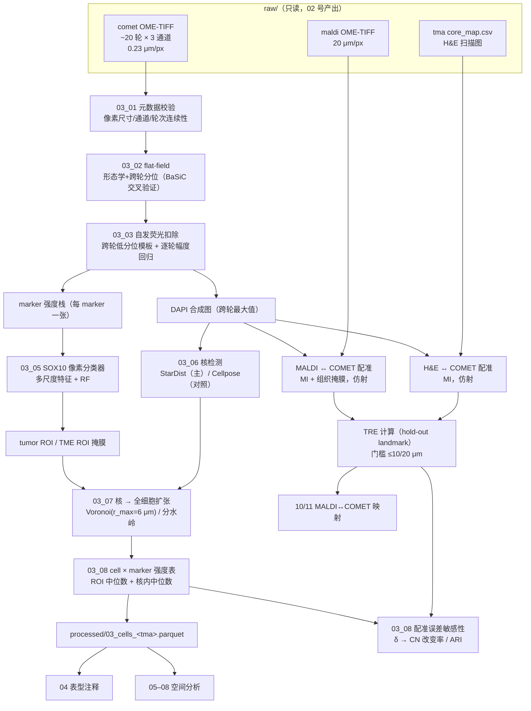

# 03 影像预处理、跨模态配准与细胞分割

> **目标文献**：Wang J, Nagarajan P, Cho S, Liu Y, Seeley EH, Dai Y, Liu Y, Yu K, Burks JK, McQuade JL, Diab A, Wang L\*, Ekmekcioglu S\*. *Integration of spatial single-cell proteomics and spatial metabolomics reveals tumor microenvironment predictive of immunotherapy response in mucosal melanoma.* bioRxiv 2026. DOI: 10.64898/2026.04.23.720453（**预印本，未经同行评审**）
>
> **模块对应原文**：Methods 中「Image preprocessing and alignment」整段、「Tissue segmentation and region of interest (ROI) definition」整段、「Cell segmentation and phenotyping」整段；Results 第一段「Spatial single-cell phenotyping of MuM using spatial proteomics」（695,444 cells 一句）；Fig. 1A（workflow）、Fig. 1D（H&E / Voronoi / COMET 三联图）、Fig. 2A（CN 叠加验证）
> **前置依赖**：`02_实验平台SOP_TMA-COMET-MALDI.md`（提供 `raw/comet/` 下的 OME-TIFF 与 `raw/tma/` 下的 TMA map；02 号负责切片制备、漂白、染色与成像，本模块**只读**其产物）。上游产物契约：`raw/comet/<slide_id>_cycle<NN>.ome.tif`、`raw/tma/<tma_id>_core_map.csv`、`raw/maldi/<slide_id>_maldi.ome.tif`
> **下游消费**：`04_细胞表型定义与注释.md`（消费 `processed/03_cells_<tma>.parquet`：细胞质心坐标 + 核掩膜面积 + 每 marker 强度）；`05_细胞邻域CN分析与Kmeans.md`、`06_空间上下文图与邻域界面分析.md`、`07_Patch邻近分析.md`、`08_细胞间相互作用推断与置换检验.md`（全部消费**同一套**细胞坐标）；`10_空间代谢组学分析.md`、`11_蛋白-代谢物空间耦合与多组学整合.md`（消费本模块输出的 MALDI↔COMET 变换矩阵）
> **复现难度**：★★★★☆　**预计工时**：4 人日　**计算资源**：GPU 16 GB（Cellpose/StarDist 分割，必需）＋ 32 核 CPU ＋ **96 GB 内存**（单张 TMA 全分辨率 40 轮浮点栈约 40–60 GB，必须分块；见 §4.1 内存预算）

---

## 1. 科学问题与逻辑位置

本模块是全文**误差的地基**。后面所有「空间」结论——CN13/14/15 富集于 R、Ki67⁺ 肿瘤 ↔ CD163⁺ 巨噬距离更近、CN10 与免疫浸润负相关——**都建立在本模块产出的那一套细胞坐标之上**。坐标错 20 μm、分割把两个核并成一个、ROI 把黏膜固有层判成肿瘤，后面再精细的统计也救不回来。

本模块解决四个工程问题：

```
raw/comet/*.ome.tif（40 轮 × 3 通道 × 0.23 μm/px）
        │
        ├─(1) 像素级校正：flat-field + 自发荧光扣除 → 每轮"干净"强度图
        │
        ├─(2) 配准：MALDI(20 μm/px) ↔ COMET(0.23 μm/px)、H&E ↔ COMET、切片 ↔ 切片
        │        → 全部统一到同一个组织坐标系（单位：μm）
        │
        ├─(3) 组织分割：SOX10 驱动的 ML 像素分类 → tumor ROI / TME ROI
        │
        └─(4) 细胞分割：深度网络核检测 → 核扩张为近似全细胞 → 每 cell × marker 强度矩阵
        │
        ▼
processed/03_cells_<tma>.parquet
   cell_id | core_id | x_um | y_um | area_um2 | <40 个 marker 强度> | roi
        │
        ├──► 04 表型注释（8 major types / 25 phenotypes）
        └──► 05 CN 分析（70 μm 半径窗口 + K-means k=15）
```

- **上游输入**：02 号产出的 OME-TIFF（**0.23 μm/pixel**，20×/0.7 NA 宽场，DAPI/TRITC/Cy5 三通道，每轮 2 个 marker 用 Alexa Fluor 555/647 二抗）、MALDI-IMS 的 OME-TIFF（**20 μm/px**）、TMA map（core_id ↔ 患者/时间点/响应标签）。



- **下游输出**（本项目产物契约，生产者唯一）：
  1. `processed/03_cells_<tma>.parquet` —— 细胞级主表（本模块**唯一**生产者；04/05/06/07/08 全部消费）；
  2. `processed/03_roi_mask_<core_id>.tif` —— tumor/TME/背景三类 ROI 掩膜（0.23 μm/px）；
  3. `results/03_registration_<pair>.tfm.json` —— MALDI↔COMET、切片↔切片的仿射矩阵与 TRE；
  4. `results/03_qc_segmentation.csv` —— 逐 core 的分割 QC 指标（核数、面积中位数、双核率、空核率、ROI 面积占比）；
  5. `processed/03_core_manifest.csv` —— **逐 core 清单**（**`05_细胞邻域CN分析与Kmeans.md` 显式依赖**）：`core_id, patient_id, tma_id, response_timepoint, n_cells, tissue_area_um2, tumor_frac, tre_um, melanin_ai_tritc, usable(bool), exclusion_reason`。**CN 分析必须 `groupby("core_id")` 逐芯建树**，本清单提供"哪些芯可用、面积多大、配准误差多少"；
  6. `figures/Fig1D_*.pdf/png`、`figures/Fig1A_workflow.pdf/png`。
- **本模块定义的坐标契约（全项目唯一口径）**：
  - 所有落盘坐标**一律用 μm**，列名 `x_um` / `y_um`（原点 = 该 TMA 全片扫描图的左上角；`x` 向右、`y` 向下，与图像行列一致）。**禁止**在产物中混用 pixel；pixel 只在中间计算与图像叠加时出现。
  - 换算因子：COMET `1 px = 0.23 μm`；MALDI `1 px = 20 μm`；两者相差 **86.96 倍**——这是本项目最容易犯的尺度错配。
  - 原文 Fig. 4D/4F 的相互作用阈值写作「265 pixels」。在 0.23 μm/px 下 $265 \\times 0.23 = 60.95\\ \\mu m$；在 20 μm/px 下等于 5,300 μm（不可能）。因此**该阈值只能来自 COMET 层**，约 **61 μm**。本模块负责把这条换算写死进契约表，供 `08_细胞间相互作用推断与置换检验.md` 显式引用。

---

## 2. 背景知识与原理

### 2.1 COMET seqIF 影像的物理特性（决定了后面每一步为什么这么做）

| 参数 | 数值 | 对预处理/分割的直接后果 |
|---|---|---|
| 平台 | Lunaphore COMET NSP，**seqIF** 顺序免疫荧光 | 每轮染 2 个 marker 后成像，再洗脱进入下一轮 → **轮次之间会有残留（memory effect）** |
| 面板 | **40-plex**（Supp. Table 3，**正文未给出完整名单**） | 40 个 marker 分散在 ~20 轮；每轮只有 2 个通道承载 marker |
| 二抗 | Alexa Fluor **555 / 647** | TRITC 通道 ↔ AF555，Cy5 通道 ↔ AF647；两者是**同一轮同时成像** → 存在**同轮光谱溢漏** |
| 物镜/成像 | **20×/0.7 NA** 宽场，DAPI/TRITC/Cy5 三通道 | 宽场无共聚焦截面 → 离焦光与组织散射都进相机 → **背景高、自发荧光显著** |
| 分辨率 | **0.23 μm/pixel** | 一个 1.0 mm 芯 = 4,348 px 直径 ≈ 14.9 M px；单核（直径 8 μm）≈ 35 px |
| 切片 | FFPE **5 μm** | 5 μm 切片里一个核可能被切断 → 「核面积偏小」是常态，不是分割错误 |
| 黑色素处理 | **0.5% H₂O₂ in Tris-HCl pH 10，80 °C 15 min 漂白** | 漂白是**前提**：残留黑色素会同时吸收激发光与发射光（见 §2.4） |

**宽场 + 黑色素瘤 = 全项目最难成像的组合**：黑色素是宽谱吸收体，而 COMET 的 DAPI(405 nm 激发) 与 AF555(555 nm 激发) 都落在黑色素吸收带内。这不是"调一下对比度"能解决的，而是**乘性衰减**，会在空间上产生与色素分布一致的假阴性。

### 2.2 Flat-field correction（照度不均匀校正）

**物理模型**：宽场系统的每个像素 $(x,y)$ 接收到两个乘性/加性成分——照度不均（光源角度、光纤、物镜晕影）与相机暗电流：

$$I_{raw}(x,y) = F(x,y)\,\big[\,AF(x,y) + S(x,y)\,\big] + D(x,y)$$

- $F(x,y)$：**平坦场**（flat field），光照响应的空间增益，理想情况下是平滑的、与样本无关的低频场；
- $D(x,y)$：暗场（dark field），相机偏置，通常近似空间常数；
- $AF$：自发荧光背景；$S$：我们要的标记信号。

校正即

$$I_{corr}(x,y) = \\frac{I_{raw}(x,y) - D(x,y)}{F(x,y)}$$

**为什么必须做**：$F$ 在 20× 宽场下典型有 10–30% 的空间起伏；如果一个 marker 在组织中央与边缘的真实表达相同，未校正时会被读成"中央高、边缘低"。在多轮比对的场景里，$F$ 相同 → 不会制造假差异；但**跨 TMA（两张玻片）比较**时，两次装配的光路不同 → $F$ 不同 → **假差异**。本项目包含 2 个 TMA，这一步是**跨批次比较的前置条件**。

**平坦场的四种估计方法**（原文只写 "processed with flat-field correction"，方法未报告 → 属 D 表 A 类缺失）：

| 方法 | 做法 | 优点 | 致命弱点 |
|---|---|---|---|
| **空场法**（empty-field） | 拍一张无样本的玻片（仅有封片剂/缓冲液）作为 $F$ | 最干净、无偏 | 需要额外玻片与**同一光路设置**；两次装配之间无法保证；无法处理载玻片本身的污染 |
| **多帧中值/分位数法** | 同一通道、同一设置下拍 $N \\ge 20$ 帧（本项目 40 轮天然给出），逐像素取中位数或低分位数 | 不需要空场；对离群（强信号）稳健 | 前提是"大多数帧在该像素处信号低"；若某 marker 大面积强表达则被污染 |
| **形态学法** | 先对每帧做大尺度**开运算**（结构元大于核直径）去掉细胞尺度细节，剩余即为照明场；再跨帧取分位数 | 计算快、可并行 | 结构元过大 → 与真实低频信号（如组织整体自发荧光梯度）混淆 |
| **低秩 + 平滑约束模型**（BaSiC, Peng 等, *Nat Commun* 2017；**卷期号请在正文引用前按 DOI 核实**） | 假设 $F$、$D$ 在帧间恒定、在空间上平滑，用低秩矩阵分解同时估计两者与每个样本的背景 | 无需空场、无需"多数帧为背景"，是当前主流 | 依赖 $λ$（平滑度）正则；对极少数帧的强信号不敏感但需要 ≥ 10 帧 |

> ⚠️ **导师批注**：**"用组织本身估计平坦场"是这一步最常犯的错误**。如果你把每帧的中位数滤波结果当作 $F$，那么组织密集区会被"削平"，反而制造出与组织密度相关的假梯度。判断方法很直接：**把估计出的 $F$ 画出来**——合法的 $F$ 应该是**平滑的、没有细胞轮廓、没有组织形态学特征**的场。我们的实现里强制加一条断言：$F$ 的高斯滤波前后相对差异必须 < 5%（说明 $F$ 已经是低频场）。

### 2.3 自发荧光（autofluorescence, AF）扣除

**FFPE + 黑色素瘤为什么特别严重**：自发荧光来源包括醛固定产生的席夫碱交联产物、脂褐素（lipofuscin）、弹性蛋白/胶原的交叉连接，以及**残留黑色素本身的荧光与吸收**。其中 5 μm FFPE 切片在 TRITC 通道（~580 nm 发射）的自发荧光强度常常与真实弱表达 marker 同量级。而黑色素瘤细胞内含大量**黑色素体**，是组织内最强的自发荧光源之一。

**线性解混模型**：把观测强度写成"真信号 + AF"的线性组合。对通道 $c$：

$$O_c(x,y) = \\alpha_c \\cdot A(x,y) + T_c(x,y)$$

$A$ 是**自发荧光模板**（与通道无关的空间分布，强度按通道比例缩放），$\\alpha_c$ 是该通道的 AF 系数，$T_c$ 是真信号。若能测得 $A$，则 $\\hat T_c = O_c - \\hat\\alpha_c A$，其中 $\\hat\\alpha_c$ 由 AF 高值区（组织空白区）的鲁棒线性回归给出。

**三种实现路径**：

| 路径 | 做法 | 取舍 |
|---|---|---|
| **空玻片法** | 用一张只经过脱蜡/修复/漂白但不加抗体的切片成像，作为 $A$ | 最准确；但需要额外切片与**完全一致**的染色轮次，本项目（40 轮）成本高 |
| **计算法（本模块主路径）** | 校正 flat-field 后，$C_i = AF + S_i$；逐像素在 $N$ 轮影像上取**低分位数**（如 10%）估计 AF 模板，因为"**多数轮次在多数像素处信号很低**" | 不需要额外样本；前提是 marker 稀疏；**AF 本身会随轮次光漂白**（见下） |
| **NMF / 无监督光谱分解** | 把 40 轮影像当矩阵做非负分解，取低秩平滑成分作 AF | 无需先验；但成分的生物学解释不稳定，容易把弱真信号分解进 AF |

**AF 的光漂白**：seqIF 的每一轮都有曝光，$AF$ 模板的**幅度** $a_i$ 随轮次衰减（典型 40 轮内单调下降，前 5 轮下降最快）。因此正确写法是把模板与幅度分离：

$$C_i(x,y) = a_i \\cdot A(x,y) + S_i(x,y),\\qquad \\hat S_i = C_i - \\hat a_i \\hat A$$

其中 $\\hat A$ 由跨轮分位数得到，$\\hat a_i$ 由"AF 高值像素集合"上的稳健回归（或用该集合的 10% 分位数之比）逐轮估计。**跳过 $a_i$ 校准的后果**：后期轮次的 marker 会被系统性高估（AF 已漂白，扣多了 → 假阴性）。

> ⚠️ **导师批注**：原文只写了 "autofluorescence subtraction to mitigate uneven illumination and background signals"，**没有说明用空玻片还是计算法，也没有报告是否做了逐轮幅度校准**。这是一个**会改变结论方向**的缺失（弱表达 marker 的阳性率直接依赖它）→ 登记为 D 表 ★ 项。我们的主路径是"跨轮低分位数模板 + 逐轮幅度回归"，备选是"空玻片模板"（若机构能提供备用切片）。

### 2.4 黑色素残留的物理后果：通道依赖衰减

黑色素是宽谱吸收体，吸收系数 $\\epsilon(\\lambda)$ 在紫外-可见区**随波长增大而单调下降**。按 Beer–Lambert 定律，激发光穿过厚度 $d$ 的色素层后：

$$I_{exc}^{\\text{eff}} = I_{exc}^{0}\\, e^{-\\epsilon(\\lambda_{ex})\\,c\\,d},\\qquad I_{em}^{\\text{obs}} = I_{em}\\cdot e^{-\\epsilon(\\lambda_{em})\\,c\\,d}$$

**两点后果**：

1. **通道依赖**：DAPI（405/461 nm）受抑最重，AF555（555/580 nm）次之，AF647（650/670 nm）最轻。于是在色素富集区，**同一个真实表达量的 marker，在 TRITC 通道看起来更低**——这直接制造"黑色素瘤区域某些 marker 阴性"的假象。漂白（02 号：0.5% H₂O₂, 80 °C, 15 min）是唯一能压住这个效应的手段；**没有漂白，40-plex 面板里一半 marker 的定量是不可信的**。
2. **散射导致模糊**：色素颗粒同时是散射体，使局部 PSF 变宽 → 色素区的核边界变糊 → 核分割漏检与相邻核粘连率升高。

**诊断指标（本模块 QC 必查）**：定义 channel-wise attenuation index

$$\\mathrm{AI}_c = \\frac{\\mathrm{median}(I_c \\mid \\text{色素高值区})}{\\mathrm{median}(I_c \\mid \\text{同 core 的非色素区})}$$

色素高值区由"漂白后仍有残留吸收"的区域定义：用 **DAPI 通道**在无核区（非细胞）的强度与周边组织的差异、或直接用一张**漂白前白场扫描图**（若 02 号保留）来标注。经验判据：$\\mathrm{AI}_{\\text{TRITC}} < 0.7$ 或 $\\mathrm{AI}_{\\text{DAPI}} < 0.6$ 的 core 标记为"色素残留"，其弱表达 marker 的定量结果**必须**在报告里打星号。

### 2.5 跨模态与跨切片配准

**问题形式化**：设有源图像 $M$（moving，如 MALDI 的全片扫描图）与目标图像 $F$（fixed，如 COMET 的 DAPI 参考），寻找变换 $T_\\theta$ 使 $F(x) \\approx M(T_\\theta(x))$。三类变换：

| 变换族 | 自由度 | 参数 | 适用 | 本项目 |
|---|---|---|---|---|
| **刚体**（rigid + 缩放） | 4（2D） | 旋转、平移、各向同性缩放 | 同一玻片上不同通道/轮次 | 轮次间、通道间（实际上 COMET 各轮由同一物镜、同一定位拍摄，通常是**零变换**，只需验证） |
| **仿射** | 6（2D） | ＋剪切、各向异性缩放 | **相邻切片之间**的形变（切片时被拉伸/压缩，两轴缩放通常不同）；不同模态扫描仪的像素纵横比差异 | **MALDI(20 μm) ↔ COMET(0.23 μm) 的主路径**；H&E ↔ COMET |
| **非刚体**（TPS / B 样条） | 数十~数千 | 局部形变场 | 明显的局部扭曲（褶皱、撕裂） | **仅在仿射残差 TRE > 20 μm 时启用**，且必须论证（见下） |

**相似度度量的适用性**（这一步选错，配准会愉快地收敛到错误解）：

| 度量 | 公式直觉 | 适用 | 不适用 |
|---|---|---|---|
| MSE / L2 | $\\sum (F-M)^2$ | 同一模态、强度线性对应 | **跨模态必败**（MALDI 代谢物强度与 DAPI 无任何强度对应） |
| **NCC（归一化互相关）** | 去均值后相关，对线性强度变换不变 | 同一模态、有线性增益差；组织轮廓明显的全片配准 | 跨模态（相关依赖联合强度的线性关系）；TMA 芯稀疏时背景主导 |
| **MI（互信息）** | 联合直方图的互信息，只依赖统计依赖 | **跨模态**（H&E↔荧光、MALDI↔荧光）；灰阶图像 | 需要足够重叠区域与足够 bin；小 TMA 芯易过拟合 |
| **landmark-based** | 直接最小化对应点距离（LSQ 求仿射/TPS） | **有可靠对应结构时最稳**：TMA 的**芯边界**、刻笔 fiducial、组织轮廓拐角 | 需要人工；landmark 分布不均 → 外推区误差爆炸 |

> 原文写："Serial tissue sections were co-registered via the **Tissuealign** module employing automated tissue outline matching, further refined manually by placement of landmarks on corresponding morphological features as necessary." 即**组织轮廓匹配（intensity/形状类）＋ 手工 landmark 精修**的组合，正是"仿射 + landmark 引导"。原文还写 "Quality control was ensured through overlay visualization and **quantitative assessment of registration accuracy**"——但**没有报告这个"定量评估"的指标与数值**（见 §5 决策项 D3-5）。

**误差度量：TRE 与 Dice**

- **TRE（Target Registration Error，目标配准误差）**：在 $n$ 个**未参与变换估计**的 landmark（或从估计集中留出的点）上，把 moving 点变换到 fixed 空间后与人工标定的对应点做欧氏距离：

$$\\mathrm{TRE}_i = \\bigl\\| T_\\theta(p_i^{M}) - p_i^{F} \\bigr\\|_2,\\qquad \\mathrm{TRE} = \\mathrm{median}_i(\\mathrm{TRE}_i)$$

  报告**中位数 + IQR + 最大值**（最大值比中位数重要：个别离群点会让局部结论全错）。
- **Dice（重叠系数）**：$\\mathrm{Dice} = \\frac{2|A \\cap B|}{|A|+|B|}$，用于**组织掩膜/ROI**（SOX10 肿瘤区）在两个模态间的重叠评估。注意 Dice 对配准误差不敏感（大面积 ROI 平移 20 μm 只掉几个百分点），**不能单独作为配准精度证据**。

**配准误差如何传播到下游（必须写进方法学）**

CN 分析（`05_细胞邻域CN分析与Kmeans.md`）用**以索引细胞为圆心、半径 70 μm** 的窗口统计邻居组成。若该细胞被平移了 $d$，窗口内容会发生什么？两个半径 $R=70\\ \\mu m$ 的圆盘相对位移 $d$ 时，未变化区域的面积占比为

$$f_{\\text{kept}}(d)=\\frac{A_{\\text{overlap}}}{\\pi R^2},\\qquad A_{\\text{overlap}} = 2R^2\\cos^{-1}\\!\\left(\\frac{d}{2R}\\right) - \\frac{d}{2}\\sqrt{4R^2-d^2}$$

| 位移 $d$ | overlap 占比 $f_{\\text{kept}}$ | 窗口内被替换的面积 | 已知最近邻间距 ≈ 11.2 μm 时的估算 |
|---|---|---|---|
| 5 μm | 95.5% | 4.5% | < 1 层邻居 |
| 10 μm | 90.9% | 9.1% | ~1 层邻居 |
| 15 μm | 86.4% | 13.6% | ~1 层邻居 |
| **20 μm** | **81.9%** | **18.1%** | **~2 层邻居** |
| 40 μm | 64.1% | 35.9% | ~4 层邻居 |

（由上式精确计算，$R=70\\ \\mu m$；可用 §4.8 的 `cn_composition` + 合成数据交叉验证这些数字。细胞尺度由 695,444 细胞 / 97 cores / 每 core 0.785 mm² 估算：密度 $0.00913$ cells/μm² 即**单细胞占有面积 109.5 μm²**。⚠️ **两个量必须区分，不要混用**：
**① 等效细胞直径（等面积圆）** $= \\sqrt{4 \\times 109.5/\\pi} = \\mathbf{11.8\\ \\mu m}$；**② 六方密排的最近邻间距** $= \\sqrt{109.5/0.866} = \\mathbf{11.2\\ \\mu m}$（$0.866 = \\sqrt{3}/2$）。
本表"层数"一列按**最近邻间距 11.2 μm** 估算（与 `02` 号文档 §2.10 的 11.2 μm 一致）；若按 11.8 μm 估算，层数会略小但量级不变。）


因此：**20 μm 的配准误差会替换约 18% 的窗口面积、约 2 层邻居**，足以让一个 CN 的组成向量（各细胞类型比例）漂移到另一个 CN。**这不是"小幅噪声"，而是能改变 CN 标签的效应**——所以本模块把配准误差做成显式的敏感性分析（§4.10）。

**我们的误差门槛（复现决策，D 表 ★）**：

| 下游用途 | TRE 门槛 | 理由 |
|---|---|---|
| 细胞级相互作用/距离（`08`） | **≤ 10 μm** | 近邻距离分布的中位数在 5–25 μm 量级，10 μm 已接近信号尺度 |
| CN / patch / 界面（`05`–`07`） | **≤ 20 μm** | 见上表：≈ 2 层邻居 |
| 蛋白↔代谢物空间耦合（`10`/`11`） | **≤ 20 μm（= 1 MALDI pixel）** | MALDI 空间分辨率本身就是 20 μm，再高无意义 |

### 2.6 细胞分割（一）：核检测

COMET 面板**没有泛膜标记**（正文未报告任何 pan-membrane 抗体），因此不能直接做"膜染色驱动的全细胞分割"。原文的路线是 **深度网络核检测 → 核扩张**（"Nuclei were expanded to approximate whole-cell segmentation by integrating signals from nuclear and cytoplasmic markers"），这与无膜标记的现实一致。

**StarDist（Schmidt et al., MICCAI 2018）**：把每个核表示为一个 **star-convex 多边形**——从核质心出发，在 $N$ 个固定方向上预测到边界的距离 $\\{r_1,\\dots,r_N\\}$，同时预测一个目标概率图。

- 输出：目标概率图 $\\hat p(x,y)$ + 径向距离图 $\\hat r_{k}(x,y)$（$k=1..N$，通常 $N=32$）。
- 解码：在概率图上做阈值 → 连通域 → 每个候选点在 $N$ 个方向上取距离 → 得到**多边形**；重叠候选由 **NMS（非极大值抑制）** 按概率与 IoU 抑制。
- 关键参数：`prob_thresh`（候选阈值）、`nms_thresh`（NMS 的 IoU 门槛）、`scale`。
- **对粘连核特别有效**：因为多边形边界由每个方向的距离独立预测，两个粘连核之间的凹口能被表达出来（这是它相对语义分割 + 分水岭的优势）。
- 弱点是**星凸假设**：极度不规则（如正在分裂、或 5 μm 切片切断的核）会被系统性低估面积。

**Cellpose（Stringer et al., Nat Methods 2021；v3 起为 "cyto3" 等，2025 年后的 v4 引入 SAM 主干模型如 `cpsam`）**：核心是**预测 flow field**。

- 网络对每个像素预测两个东西：cell probability $\\hat p$ 与 **flow vector** $\\mathbf{v}(x,y)$，后者指向该像素所属细胞的质心。
- 解码（推理）时对每像素做**欧拉积分**：$\\mathbf{p}_{t+1} = \\mathbf{p}_t + \\epsilon\\,\\mathbf{v}(\\mathbf{p}_t)$，迭代到收敛；收敛到同一质心的像素归为同一细胞，再做连通域与去重。
- 关键参数：
  - `diameter`：**最重要的参数**。图像会被缩放到"细胞直径 30 px"的标准尺度再推理；给错 2 倍，分割质量断崖式下降。COMET 核直径 ≈ 8 μm = **35 px**（0.23 μm/px）。
  - `flow_threshold`（默认 0.4）：把积分误差（Euler 积分后的位移残差）大于该阈值的掩膜**整体丢弃**，用于过滤"分裂/自交"的坏掩膜。**调高 → 更干净但漏检增加**。
  - `cellprob_threshold`（默认 0.0）：把细胞概率低于该值的像素排除。**调低 → 掩膜更大更多（含假阳），调高 → 更保守**。
  - `channels`：指定核通道与胞质通道。**有胞质染色时给 `[1,2]` 之类才能激活 cyto 模型的分支**；否则模型退化为核分割。
  - `normalize`：默认做 1–99 百分位归一化；对 AF 未扣净的图，**归一化会被背景主导** → 必须先做 §2.2/2.3。

**38–40-plex 影像的分割必须考虑"marker 溢漏"**：

1. **同轮光谱溢漏**：同一轮的 AF555 与 AF647 光谱**并非完全分离**，AF555 的发射尾部伸进 Cy5 通道（典型串扰 5–15%）。若某个 marker 极强（如 Vimentin 在基质），它在 Cy5 通道的溢漏会制造一个"假阳性膜/胞质信号"，被 cyto 模型当成细胞边界 → **分割形状被最亮的 marker 牵着走**。
2. **跨轮残留**：洗脱不彻底时，第 $i$ 轮的强信号会以数个百分点残留到第 $i+1$ 轮。若把这些轮影像叠成复合图喂给分割网络，残留会累积成"假的弥漫胞质染色"。
3. **对策（我们的实现）**：
   - 先用**单染对照玻片**（若 02 号制备了）估计各通道串扰系数 $\\beta$，做线性补偿 $C_{647}^{\\text{corr}} = C_{647} - \\beta\\,C_{555}$；
   - 分割只用 **(a) DAPI 合成图**（跨轮 DAPI 的逐像素**最大值**，因为 DAPI 每轮都拍、位置恒定，最大值能提升信噪比）与 **(b) 少数几个不含强结构信号的膜/胞质 marker**；
   - **禁止**把 40 个 marker 的均值图当作分割输入。

### 2.7 细胞分割（二）：核扩张为全细胞

分割网络给的是**核**。CN 分析、近邻计数、Voronoi 图、patch 分析全都需要在**细胞**尺度上做（原文 Fig. 1D 的 Voronoi tessellation 就是细胞尺度的划分）。两种扩张方式：

**（A）Voronoi 扩张（等价于"最近核分配"）**：把每个非核像素分配给**最近的核**，并设一个**最大半径** $r_{max}$，超过则归为背景。

$$\\mathcal{C}_j = \\{\\, \\mathbf{x} \\in \\Omega : \\; j = \\arg\\min_{k} \\|\\mathbf{x}-\\mathbf{c}_k\\|_2, \\; \\|\\mathbf{x}-\\mathbf{c}_j\\|_2 \\le r_{max} \\,\\}$$

- 优点：**无参数**（除了 $r_{max}$）、拓扑完整（无空缺）、实现简单、与原文 Fig. 1D 的 Voronoi 可视化天然一致。
- 缺点：在细胞稀疏区会**无限扩张**（没有 $r_{max}$ 时一个细胞占满大片空白），在细胞密集区会**过度切割**（把真实胞质切给邻居）。$r_{max}$ 是唯一也是关键的旋钮。
- 原文的 "integrating signals from nuclear and cytoplasmic markers" 说明作者用了**基于信号的**扩张（更接近 B），而不是纯几何扩张。我们两条都实现并给出差异（§4.8）。

**（B）基于胞质 marker 的分水岭**：以核掩膜为 marker（强种子），在**胞质/膜 marker 强度图的负梯度**上做 `skimage.segmentation.watershed`，并用组织掩膜裁剪。

- 优点：边界落在真实的信号谷（细胞间隙）→ 更接近真实细胞形状。
- 缺点：**依赖一个可靠的膜/胞质 marker**。本项目面板中没有泛膜标记 → 只能退而用"所有 marker 的最大值合成图"或 Vimentin/SMA（仅基质可靠）→ **在肿瘤区与免疫区效果不可控**。因此我们把它作为**对照实现**而非主路径。

**扩张半径的选择（可操作规则）**：$r_{max}$ 应满足

$$r_{max} \\approx 0.5 \\times \\mathrm{median}(d_{NN}),\\quad \\text{且} \\; r_{max} \\le 2 \\times r_{\\text{核,median}}$$

本项目实测 $\\mathrm{median}(d_{NN}) \\approx 11.2\\ \\mu m$（六方密排最近邻间距；由 695,444/97 cores/0.785 mm² 推算，见 §2.5）→ $r_{max} \\approx 6\\ \\mu m$，即 **约 26 px**。使用更大值（如 15 μm）时会开始出现"相邻细胞吞并"。

> ⚠️ **导师批注**：**核扩张半径是本文方法学里最被低估的参数**。它同时影响 (i) 表型注释的强度提取（从质心里取均值 vs 从全细胞 ROI 取均值，两者对 CD163 这种胞质 marker 差异极大），(ii) Voronoi 可视化，(iii) 近邻计数（扩张后细胞更"大"，但**质心不变**，所以 CN 分析其实不受扩张半径影响——除非下游用的是掩膜中心而非质心）。原文两者都没报告 → D 表 ★ 项。我们的规则：**CN/邻域一律用质心**（消去扩张半径的影响），**表型强度提取一律用"核 + 扩张环"的 ROI 内分位数（而非均值）**。

### 2.8 组织分割（ROI）：SOX10 驱动的肿瘤区

**为什么可以用 SOX10 作为肿瘤 ROI 的代理**：

- SOX10 是**神经嵴谱系 master transcription factor**，在黑色素细胞与黑色素瘤中**核内强阳性**且表达稳定；
- 它是**核标记**，与 DAPI 共定位 → 在"细胞分类"层面天然对应"肿瘤细胞核"，而不是间质/免疫细胞；
- 在黑色素瘤中，SOX10 的表达广度和强度远高于 HMB-45/Melan-A（后两者在去分化肿瘤中易丢失），因此是肿瘤区**面积**代理的常用选择。

**失效场景（必须在报告中显式排除）**：

1. **SOX10 阴性去分化黑色素瘤**（黑色素瘤的已知亚型）→ 肿瘤区被误判为 TME，肿瘤区面积近似归零；
2. **正常黏膜黑色素细胞**：黏膜基底层的黑色素细胞也是 SOX10⁺（正常黏膜含散在黑色素细胞），会被计入肿瘤区；
3. **施万细胞（Schwann cell）与神经束**：同为神经嵴来源、SOX10⁺，在黏膜（尤其鼻腔/肛管）标本中常见 → 神经束被误判为肿瘤；
4. **抗体残留/溢漏**：SOX10 那轮的残留（若 SOX10 与另一 marker 同轮）会在下一轮的通道里造成假阳性区。

**像素分类器原理**：原文用 **Visiopharm 的 machine learning tissue classification module**，且 "Classification models were trained on representative pathologist-annotated images and subsequently reviewed and confirmed by board-certified pathologists"。这是**监督式像素分类**：把病理医师标注的多边形区域展开为像素级标签，用像素邻域的多尺度特征训练分类器（Visiopharm 默认是随机森林类/或 CNN），再全片推理 → 后处理（形态学开闭、面积过滤、空洞填充）→ tumor ROI。**其余区域定义为 TME ROI**（原文："The remaining ROIs within tissue cores were defined as TME ROIs"）。

**为什么可以直接除以 marker 强度空间而非 RGB**：H&E 的颜色对肿瘤/间质的区分依赖染色批次；而 SOX10 强度是**同一模态内的物理量**，在 FFPE+seqIF 流程里比 H&E 更稳定。**但**如果用 H&E 训练的模型（RGB 特征）去分类荧光图，特征语义完全不匹配 → 必错。这是 §7 陷阱表里的高频项。

---

## 3. 原文逐句拆解

| # | 原文句（English keywords → 中文转述） | 对应操作 | 原文给的参数 | 复现决策（缺失项） |
|---|---|---|---|---|
| 1 | "The resulting OME-TIFF image stacks (**0.23 μm/pixel** resolution) were processed with **flat-field correction** and **autofluorescence subtraction** to mitigate uneven illumination and background signals." | 读 OME-TIFF → 估计平坦场 → 校正 → 估计 AF → 扣除 | 分辨率 0.23 μm/px；两个操作的名称 | **方法全部未报告**。主路径：40 轮多帧低分位数 + 形态学开运算估 $F$；AF 用跨轮低分位数模板 + 逐轮幅度回归。备选：BaSiCPy（低秩+平滑）/ 空玻片法。→ D3-1 ★ |
| 2 | "Image alignment between the **MALDI-IMS and COMET datasets**, as well as tissue and cell segmentation followed by spatial analyses, were performed using **Visiopharm software (VIS, version 2024.07.1.16912; Visiopharm, Denmark)**" | 全部在 Visiopharm 内完成 | 软件名与版本号（可精确引用） | 闭源商业软件。开源替代：SimpleITK/itk-elastix（配准）+ Cellpose/StarDist（分割）+ 自写 ROI 像素分类器；见 §4。**须声明替代引入的偏差** |
| 3 | "Serial tissue sections were **co-registered via the Tissuealign module** employing **automated tissue outline matching**, further refined manually by placement of **landmarks** on corresponding morphological features as necessary." | 组织轮廓（强度/形状）粗配准 → 手工 landmark 精修（仿射） | 无（无变换族、无 landmark 数量、无残差报告） | 主路径：相位相关给初值 → SimpleITK 多分辨率**仿射**（NCC/MI 双跑）→ 手工 landmark 最小二乘精修 → 计算 TRE。landmark 数量决策：**≥ 12 对**，且覆盖四角+中心（见 §5） |
| 4 | "Quality control was ensured through **overlay visualization** and **quantitative assessment of registration accuracy**." | 叠加图 + 定量精度 | **"定量"的指标与数值均未报告** | 我方定义 TRE（中位数/IQR/max）+ 组织掩膜 Dice + 逐 core 误差热图。门槛：细胞级 ≤10 μm、CN 级 ≤20 μm |
| 5 | "**Tumor ROIs** were delineated based on **SOX10 expression** using Visiopharm's **machine learning tissue classification module**. The **remaining ROIs within tissue cores were defined as TME ROIs**." | SOX10 像素分类 → tumor / TME 二分 | SOX10；其余未报告 | 分类器类型、特征、阈值、后处理参数**全部未报告**。主路径：多尺度特征 + 随机森林（§4.6），标注由一人做、另一人复核（模拟原文的 pathologist review）→ D3-2 |
| 6 | "Classification models were trained on representative **pathologist-annotated images** and subsequently **reviewed and confirmed by board-certified pathologists** to validate segmentation accuracy." | 训练标签来自病理医师；结果经病理复核 | 无（无标注面积、无人数、无一致性指标） | 我们无法获得病理标注 → **合成标注**（在 DAPI/Vimentin/SOX10 上人工画少量区域）+ 用公开替代数据验证流程；标注一致性用 Dice（双人重复标注） |
| 7 | "Cell segmentation was conducted using Visiopharm's integrated **deep learning nuclei detection** algorithm." | 核检测 | 网络结构、训练数据、推理参数**全部未报告** | 开源替代：**StarDist2D**（`2D_versatile_fluo`，核专用）+ **Cellpose**（`cyto3`/`cpsam`）。两者**都跑**，用 IoU 与细胞数做一致性比较（§4.7）→ D3-3 |
| 8 | "**Nuclei were expanded** to approximate whole-cell segmentation by **integrating signals from nuclear and cytoplasmic markers**." | 核 → 全细胞扩张，信号驱动 | 扩张半径/方法未报告 | 主路径：**带 $r_{max}$ 的 Voronoi 扩张**（§2.7A）；对照：胞质 marker 分水岭（§2.7B）。$r_{max}=6\\ \\mu m$（由 median NN 推得）→ D3-4 |
| 9 | "**Manual cell phenotyping** was performed post-segmentation according to marker criteria outlined in **Supp. Fig. 4**." | 手工表型（阈值在补充图里） | 正文无任何阈值 | **复现性最弱的一环**（详见 `04_细胞表型定义与注释.md`）。本模块只负责产出 cell × marker **强度矩阵**（分位数而非均值，见 §5）→ D3-5 |
| 10 | "we retained a total of **695,444 segmented single cells**"（Results） | QC 后细胞总数 | **695,444** | 我们的数值门槛：**695,444 × (1 ± 10%) = [625,900, 764,988]**。注意：该数依赖 QC 口径（原文未报告 QC 标准）→ D3-6 |
| 11 | "**97 tissue cores** … **75 pre-treatment** + **22 post-treatment**"（Methods） | 可用 core 数 | 97 / 75 / 22 | 每 core 平均 **7,170 细胞**（695,444/97）→ 用于逐 core 的异常检测（如某 core < 2,000 细胞 → 组织缺失/脱片） |
| 12 | "**Two tissue microarrays (TMA)** … triplicates of **1.0 mm cores**" | 2 张玻片 = 2 个技术批次 | TMA 数、芯径 | **批次效应检查**：R/NR 在两块 TMA 上的分布必须报告（若不平衡，MIF/Ki67 的组间差异可能是批次假象）→ 见 `04` §6 |

---

## 4. 逐步可运行代码

**环境**（版本以本仓库 `01_数据可得性评估与替代数据策略.md` 钉死；此处给出本模块直接依赖）：

```yaml
# code/envs/env_03.yml（节选；完整环境见 01 号文档）
python: 3.11
tifffile: 2024.8.30
ome-types: 0.5.1
numpy: 1.26.4
scipy: 1.13.1
scikit-image: 0.24.0
SimpleITK: 2.4.0
itk-elastix: 0.21.0          # 可选，B 样条非刚体
cellpose: 3.0.11 或 4.x      # v4 的模型与 API 有变，见 §4.7 版本分支
stardist: 0.9.1
tensorflow: 2.16.1           # stardist 后端
torch: 2.4.1                 # cellpose 后端
scikit-learn: 1.5.1
pandas: 2.2.2
pyarrow: 17.0.0
basicpy: 2.0.0               # 可选，低秩平坦场（⚠️ 已核对：PyPI 上 2.0 系列只有 2.0.0，早前写的 2.0.1 不存在）
matplotlib: 3.9.2
```

> **随机种子**：本项目统一 `SEED = 20260101`（见 `REPRO_SPEC.md` §6 与项目 `PROJECT_SPEC.md`）。本模块中影响结果的随机环节：SimpleITK 的度量采样（`SetMetricSamplingPercentage(..., seed)`）、Cellpose/StarDist 推理本身确定、K-means/TPS 精修（若有）。**注意**：`sklearn` 的 `RandomForestClassifier` 必须传 `random_state=SEED`。

### 4.1 OME-TIFF 元数据校验与内存预算

```python
# code/03_01_ome_meta.py
"""校验 COMET OME-TIFF 的元数据：像素尺寸、通道、轮次编号。
落盘：logs/03_ome_meta.json
必须先跑通这一步再动任何像素——元数据错（如通道顺序）会让后面全部作废。"""
from __future__ import annotations
import json, re, sys
from pathlib import Path
import numpy as np
import tifffile
import ome_types

SEED = 20260101
RAW = Path("raw/comet")
OUT = Path("logs/03_ome_meta.json")

EXPECTED_UM_PER_PX = 0.23          # 原文：0.23 μm/pixel（20x/0.7 NA 宽场）
CHANNEL_WAVELENGTHS = {"DAPI": 461, "TRITC": 580, "Cy5": 670}  # 仅作 sanity check


def parse_cycle_index(path: Path) -> int:
    """从文件名解析轮次。⚠️ 必须显式解析，不要依赖 ls 的字典序：
    'cycle10' 会排在 'cycle2' 前面（字符串排序陷阱）。"""
    m = re.search(r"cycle[_-]?(\d+)", path.stem, flags=re.IGNORECASE)
    if not m:
        raise ValueError(f"文件名缺少 cycle 编号: {path.name}")
    return int(m.group(1))


def read_ome_header(path: Path) -> dict:
    with tifffile.TiffFile(path, is_ome=True) as tf:
        xml = tf.ome_metadata
        if xml is None:
            raise RuntimeError(f"{path.name} 不含 OME-XML，无法取得像素尺寸")
        ome = ome_types.from_xml(xml)
    img = ome.images[0]
    px = img.pixels
    um_per_px = None
    if px.physical_size_x is not None:
        # physical_size_x 的单位由 physical_size_x_unit 给出（通常是 µm）
        unit = str(px.physical_size_x_unit).lower() if px.physical_size_x_unit else "µm"
        assert "micro" in unit or unit in ("µm", "um"), f"像素单位异常: {unit}"
        um_per_px = float(px.physical_size_x)
    return {
        "file": path.name,
        "size_x": int(px.size_x), "size_y": int(px.size_y),
        "size_c": int(px.size_c or 1), "size_z": int(px.size_z or 1),
        "size_t": int(px.size_t or 1),
        "um_per_px": um_per_px,
        "dtype": str(px.type),
        "channel_names": [c.name for c in (px.channels or [])],
        "cycle": parse_cycle_index(path),
    }


def main() -> int:
    files = sorted(RAW.glob("*.ome.tif"), key=parse_cycle_index)
    if not files:
        print(f"[FATAL] {RAW} 下没有 *.ome.tif；请先完成 02 号模块的采集", file=sys.stderr)
        return 2
    records, problems = [], []
    for f in files:
        r = read_ome_header(f)
        records.append(r)
        if r["um_per_px"] is None:
            problems.append(f"{f.name}: 缺 physical_size_x")
        elif abs(r["um_per_px"] - EXPECTED_UM_PER_PX) > 1e-3:
            problems.append(f"{f.name}: um_per_px={r['um_per_px']} != {EXPECTED_UM_PER_PX}")
        if r["size_c"] != 3:
            problems.append(f"{f.name}: size_c={r['size_c']} != 3（DAPI/TRITC/Cy5）")
    cycles = [r["cycle"] for r in records]
    if len(set(cycles)) != len(cycles):
        problems.append(f"轮次编号重复: {sorted(cycles)}")
    if cycles and (min(cycles), max(cycles), len(cycles)) != (min(cycles), max(cycles), max(cycles) - min(cycles) + 1):
        problems.append(f"轮次编号不连续: {sorted(cycles)}")
    OUT.parent.mkdir(parents=True, exist_ok=True)
    OUT.write_text(json.dumps({"records": records, "problems": problems}, indent=2, ensure_ascii=False))
    print(f"已写入 {OUT}；{len(records)} 个文件，{len(problems)} 个问题")
    for p in problems:
        print("  [!]", p)
    return 1 if problems else 0


if __name__ == "__main__":
    raise SystemExit(main())
```

**单张 TMA 的内存预算（决定后面所有代码的分块策略）**：

| 对象 | 尺寸 | dtype | 内存 |
|---|---|---|---|
| 单个 cycle 单通道（一张 1.0 mm 芯） | 4348 × 4348 | uint16 | 37.8 MB |
| 全片扫描图（TMA 需覆盖 ~2 张 24×60 mm 区域，粗算 26,000 × 26,000） | 26000² | uint16 | **1.35 GB / 通道** |
| 单轮 3 通道全片 | — | uint16 | 4.06 GB |
| **40 轮 × 3 通道全片** | — | uint16 | **162 GB**（**不可能整载**） |
| 40 轮 × 3 通道，float32 + 分块 | — | float32 | 需**按 core 裁剪**：单 core 40 轮 × 3 通道 float32 = 40×3×37.8×2 = 9.1 GB（可载） |

> **结论（硬性工程约定）**：**一律先按 core 裁剪再处理**。用 `raw/tma/<tma_id>_core_map.csv` 里的 core 边界（%坐标或像素坐标）把每张芯裁成独立的小图块，所有后续步骤（flat-field、AF、分割、配准）**逐 core 或逐 tile 进行**。禁止先读全片再切片——162 GB 会直接把机器打死，或静默 swap 到假死。平坦场估计例外：为了估计全片的光照场，可以**在 8× 下采样**的全片上做（26000/8 = 3250²，uint16 仅 21 MB/轮）。

### 4.2 Flat-field correction（自实现 + BaSiC 备选）

```python
# code/03_02_flatfield.py
"""平坦场估计与校正。核心思想：照明场在帧间恒定、在空间上平滑；细胞尺度细节可用开运算去除。
严禁用"每帧中值滤波结果"当平坦场（会把组织削平，制造与密度相关的假梯度）。"""
from __future__ import annotations
import numpy as np
from skimage.filters import gaussian, threshold_otsu
from skimage.morphology import disk, opening
from skimage.transform import resize

SEED = 20260101


def _opening_downsampled(img: np.ndarray, se_radius_px: float, down: int) -> np.ndarray:
    """在 down 倍下采样图上去细胞细节，再上采样回原尺寸（省内存与时间）。"""
    if down > 1:
        small = resize(img, (img.shape[0] // down, img.shape[1] // down),
                       order=1, preserve_range=True, anti_aliasing=True)
    else:
        small = img
    r = max(2, int(round(se_radius_px / down)))
    opened = opening(small.astype(np.float32), disk(r))
    if down > 1:
        opened = resize(opened, img.shape, order=1, preserve_range=True, anti_aliasing=False)
    return opened.astype(np.float32)


def estimate_flatfield(stack: np.ndarray, *,
                       se_radius_px: float | None = None,
                       quantile: float = 20.0,
                       smooth_sigma_px: float = 32.0,
                       down: int = 4,
                       max_rel_dev_after_smooth: float = 0.05) -> np.ndarray:
    """估计乘性平坦场 F(x, y)，归一化到 median(F) = 1。

    stack: (N, H, W) float32；同一通道、同一成像设置下的 N 轮影像（N >= 10）
    se_radius_px: 开运算结构元半径（像素）。默认取"最大核半径的 3 倍"。
                  核直径 ~8 μm = 35 px → 半径 17.5 px → se_radius ≈ 53 px。
    quantile: 逐像素分位数。用低分位数而非中位数，避免强 marker 大面积表达时污染 F。
    """
    if stack.ndim != 3:
        raise ValueError("stack 必须是 (N, H, W)")
    N, H, W = stack.shape
    if se_radius_px is None:
        se_radius_px = 53.0
    if N < 10:
        raise ValueError(f"帧数 N={N} 太少，平坦场估计不可靠（建议 >= 10，最好 20+）")

    opened = np.empty_like(stack, dtype=np.float32)
    for i in range(N):
        opened[i] = _opening_downsampled(stack[i], se_radius_px, down)

    F = np.percentile(opened, quantile, axis=0).astype(np.float32)

    # 去掉极低的离群像素（可能是载玻片划痕/无信号区），再做低频平滑
    lo = np.percentile(F, 1.0)
    F = np.clip(F, lo, None)
    F_s = gaussian(F, sigma=smooth_sigma_px, preserve_range=True).astype(np.float32)

    # ---- 质量断言：平滑后不应有大幅变化，否则说明 F 里还残留组织结构 ----
    rel = np.abs(F_s - F) / np.maximum(F, 1e-6)
    if float(np.median(rel)) > max_rel_dev_after_smooth:
        raise AssertionError(
            f"平坦场不平滑（median rel dev = {np.median(rel):.3f}）。"
            f"多半是 se_radius 太小把细胞结构留进了 F，或 quantile 太低混入零像素。"
        )
    F_s = F_s / float(np.median(F_s))
    return F_s


def apply_flatfield(img: np.ndarray, F: np.ndarray, dark: float | np.ndarray = 0.0) -> np.ndarray:
    """I_corr = (I_raw - D) / F，截断到非负。"""
    out = (img.astype(np.float32) - dark) / np.maximum(F, 1e-6)
    return np.clip(out, 0.0, None)


def estimate_darkfield(stack: np.ndarray) -> np.ndarray:
    """暗场：用相机"无光"帧（镜头盖/关闭光源）的平均图；没有则用 0。
    绝不能用样本图的最小值——那会是"最暗的组织"，不是暗电流。"""
    raise NotImplementedError(
        "需要 02 号模块提供 raw/comet/<slide_id>_dark.ome.tif（关光源、盖镜头，与成像同曝光）。"
        "若确实没有：把 dark 固定为 0 并在 logs/DECISIONS.md 记录；对 uint16 数据影响通常 < 1%。"
    )


def check_flatfield(F: np.ndarray, *, save_png: str | None = None) -> dict:
    """把 F 画出来看：合法的 F 应该平滑、无细胞轮廓。返回统计用于 QC。"""
    import matplotlib
    matplotlib.use("Agg")
    import matplotlib.pyplot as plt
    stats = {"min": float(F.min()), "max": float(F.max()),
             "p05": float(np.percentile(F, 5)), "p95": float(np.percentile(F, 95)),
             "p95_over_p05": float(np.percentile(F, 95) / max(np.percentile(F, 5), 1e-6))}
    if save_png:
        fig, ax = plt.subplots(1, 2, figsize=(11, 4.5))
        im = ax[0].imshow(F, cmap="viridis"); ax[0].set_title("flat field F (median-normalized)")
        plt.colorbar(im, ax=ax[0], fraction=0.046)
        ax[1].hist(F.ravel(), bins=200); ax[1].set_xlabel("F"); ax[1].set_yscale("log")
        ax[1].set_title(f"p95/p05 = {stats['p95_over_p05']:.3f}")
        fig.tight_layout(); fig.savefig(save_png, dpi=300); plt.close(fig)
    return stats
```

**BaSiC 备选路径**（低秩 + 平滑，无需"多数帧为背景"的假设）：

```python
# code/03_02b_flatfield_basic.py
"""BaSiCPy 路径（推荐作为主路径的交叉验证实现）。
⚠️ 需按当前 basicpy 版本核对构造参数名：v2.0 起为 PyTorch 后端，
   参数包括 get_darkfield / smoothness_flatfield / smoothness_darkfield /
   sparse_cost_darkfield / fitting_mode 等；不同 minor 版本参数名有变。"""
from __future__ import annotations
import numpy as np
from basicpy import BaSiC  # pip install basicpy


def flatfield_basic(stack: np.ndarray, *, get_darkfield: bool = True,
                    smoothness_flatfield: float = 1.0, **kwargs) -> tuple[np.ndarray, np.ndarray | None, np.ndarray]:
    """返回 (corrected_stack, darkfield, flatfield)。BaSiC 同时估 F 与 D。
    注意：BaSiC 要求输入为 float 且帧数足够（官方建议 >= 10，越多越好，本项目 40 轮满足）。"""
    basic = BaSiC(get_darkfield=get_darkfield,
                  smoothness_flatfield=smoothness_flatfield, **kwargs)
    basic.fit(stack.astype(np.float32))
    corrected = basic.transform(stack.astype(np.float32))
    F = getattr(basic, "flatfield", None)
    D = getattr(basic, "darkfield", None)
    if F is None:
        raise RuntimeError("当前 basicpy 版本未暴露 .flatfield 属性，请核对版本或在文档中记录")
    return corrected, D, F


def compare_two_flatfields(F_a: np.ndarray, F_b: np.ndarray, name_a="self", name_b="BaSiC") -> dict:
    """两种实现的 F 应高度一致；不一致说明估计出了问题（而不是"数据不好"）。"""
    a = F_a / np.median(F_a); b = F_b / np.median(F_b)
    ratio = a / np.maximum(b, 1e-6)
    return {"name_a": name_a, "name_b": name_b,
            "pearson_r": float(np.corrcoef(a.ravel(), b.ravel())[0, 1]),
            "ratio_p05": float(np.percentile(ratio, 5)),
            "ratio_p95": float(np.percentile(ratio, 95)),
            "verdict": "OK" if np.percentile(np.abs(ratio - 1), 95) < 0.10 else "INSPECT"}
```

### 4.3 自发荧光扣除（跨轮模板 + 逐轮幅度回归）

```python
# code/03_03_af_subtract.py
"""自发荧光（AF）扣除。
模型：flat-field 校正后 C_i = a_i * A + S_i
  - A  : AF 空间模板（跨轮恒定，只随轮次幅度变化）
  - a_i: 第 i 轮 AF 幅度（随轮次光漂白而下降）
  - S_i: 真信号
估计：A 用跨轮低分位数；a_i 用"AF 高值像素集"上的稳健比例估计。"""
from __future__ import annotations
import numpy as np
from sklearn.linear_model import HuberRegressor

SEED = 20260101


def estimate_af_template(stack: np.ndarray, *, quantile: float = 10.0,
                         smooth_sigma_px: float = 3.0) -> np.ndarray:
    """跨轮低分位数估计 AF 模板 A（未归一化）。stack: (N,H,W) 已做 flat-field。"""
    if stack.ndim != 3 or stack.shape[0] < 10:
        raise ValueError("需要 (N>=10, H, W) 的 flat-field 校正后影像栈")
    A = np.percentile(stack, quantile, axis=0).astype(np.float32)
    from skimage.filters import gaussian
    A = gaussian(A, sigma=smooth_sigma_px, preserve_range=True).astype(np.float32)
    return np.clip(A, 0, None)


def af_high_pixels(A: np.ndarray, frac: float = 0.05) -> np.ndarray:
    """AF 高值像素掩膜（用于估计逐轮幅度 a_i 时最可靠的一批像素）。"""
    thr = np.quantile(A, 1.0 - frac)
    return A >= thr


def estimate_cycle_amplitudes(stack: np.ndarray, A: np.ndarray,
                              *, frac: float = 0.05, robust: bool = True) -> np.ndarray:
    """逐轮估计 a_i。用 AF 高值像素上的稳健回归（带截距，吸收残留暗场/偏移）。"""
    mask = af_high_pixels(A, frac)
    a = np.empty(stack.shape[0], dtype=np.float64)
    x = A[mask].reshape(-1, 1)
    for i in range(stack.shape[0]):
        # 先用中位数比值做初值（对离群稳健），再用 HuberRegressor 精修
        y = stack[i][mask]
        a0 = float(np.median(y) / max(np.median(x), 1e-6))
        if robust:
            m = HuberRegressor(epsilon=1.35, alpha=1e-6, max_iter=200)
            m.fit(x, y.reshape(-1, 1).ravel())
            ai = float(m.coef_[0])
            if not np.isfinite(ai) or ai <= 0:
                ai = a0
        else:
            ai = a0
        a[i] = ai
    # 单调漂白是常态，但不强制；只做离群保护：a_i 不应超过其初始值的 3 倍
    a = np.clip(a, 0, 3.0 * max(a[0], 1e-6))
    return a


def subtract_af(stack: np.ndarray, A: np.ndarray, a: np.ndarray,
                *, keep_positive_only: bool = True) -> np.ndarray:
    """S_i = C_i - a_i * A。负值截断为 0（注意：截断会引入正偏，弱阳性判定的阈值必须在同一口径下定）。"""
    out = stack.astype(np.float32) - (a[:, None, None].astype(np.float32) * A[None, :, :])
    return np.clip(out, 0.0, None) if keep_positive_only else out


def af_qc_report(stack, A, a) -> dict:
    """AF QC：残差里不应再有与 A 同构的空间结构（若还有 → 幅度估计没收敛）。"""
    from scipy.stats import spearmanr
    resid_med = np.median([np.median(s) for s in stack], axis=0)
    rho, p = spearmanr(resid_med.ravel()[::37], A.ravel()[::37])
    return {"a_first": float(a[0]), "a_last": float(a[-1]),
            "a_last_over_first": float(a[-1] / max(a[0], 1e-6)),
            "resid_vs_A_spearman_rho": float(rho), "p": float(p),
            "verdict": "OK" if abs(rho) < 0.3 else "INSPECT: 残差仍与 AF 模板相关"}
```

> ⚠️ **导师批注**：`np.percentile(C_i)` 类操作在**分块处理**时必须用**同一套模板 $A$ 与幅度 $a_i$**，否则相邻 tile 的 AF 水平不一致，会在 tile 边界留下可见的方块接缝，并被下游分割误判成细胞边界。工程上：**先在（下采样）全片上估计 $A$ 与 $a_i$，再逐 tile 应用**。

### 4.4 配准：相位相关初值 → 多分辨率仿射 → landmark 精修 → TRE

```python
# code/03_04_register.py
"""MALDI ↔ COMET、H&E ↔ COMET、切片 ↔ 切片的配准。
主路径：仿射（6 DOF）。非刚体仅在仿射残差 TRE > 20 μm 时启用并单独记录。

坐标约定（全项目唯一）：
  - SimpleITK 的 (x, y) 与 numpy 数组的 (row, col) 相反；
    sitk.GetImageFromArray(arr2d) 会把 arr2d[y, x] 映射为物理点 (x*spacing, y*spacing)，
    因此 arr 的第一维 = y，第二维 = x。本模块所有函数都显式遵守这一点。
  - 最终落盘的 x_um/y_um 是"目标图像（fixed）坐标系"下的 μm。
"""
from __future__ import annotations
from pathlib import Path
import json
import numpy as np
import SimpleITK as sitk
from skimage.registration import phase_cross_correlation

SEED = 20260101
UM_PER_PX_COMET = 0.23
UM_PER_PX_MALDI = 20.0


# ---------------------------------------------------------------- 1) 初值
def phase_correlation_shift(fixed_img: np.ndarray, moving_img: np.ndarray,
                            upsample_factor: int = 20) -> np.ndarray:
    """亚像素刚体初值。返回 shift ∈ R^2，语义：moving 需平移 shift 才与 fixed 对齐
    （注意 skimage 的约定：shift 是"把 moving 移动多少使其匹配 reference"，
     即 moving 相对于 reference 的位移的相反数；务必用合成位移做单元测试验证方向！）。"""
    shift, error, _ = phase_cross_correlation(
        fixed_img.astype(np.float32), moving_img.astype(np.float32),
        upsample_factor=upsample_factor, normalization=None)
    return shift  # (dy, dx)


def _test_phase_direction():
    """自检：把 moving 人为平移 (0, 10) 像素后，应能恢复。"""
    rng = np.random.default_rng(SEED)
    ref = rng.normal(size=(256, 256)).astype(np.float32)
    mov = np.roll(ref, shift=(0, 10), axis=(0, 1))
    s = phase_correlation_shift(ref, mov)
    assert abs(s[1] - (-10)) < 0.1, f"phase_cross_correlation 方向约定与预期不符: {s}"
    return True


# ---------------------------------------------------------------- 2) 多分辨率仿射
def register_affine(fixed_arr: np.ndarray, moving_arr: np.ndarray, *,
                    um_per_px_fixed: float, um_per_px_moving: float,
                    metric: str = "MI", n_bins: int = 48, sampling: float = 0.2,
                    learning_rate: float = 2.0, n_iter: int = 300,
                    shrink_factors=(4, 2, 1), sigmas=(2.0, 1.0, 0.0),
                    fixed_mask: np.ndarray | None = None,
                    moving_mask: np.ndarray | None = None):
    """多分辨率仿射配准。返回 (sitk_transform, sitk_registration_method)。

    um_per_px_fixed / um_per_px_moving 是**必填**参数：不传会静默退化成"像素空间"配准，
    使 SetOptimizerScalesFromPhysicalShift 与 SetSmoothingSigmas*InPhysicalUnits 全部失真。
    典型取值：COMET 0.23，MALDI 20.0，H&E 扫描图 ~0.5（以扫描 dpi 换算）。

    metric: 'MI'（跨模态首选）或 'NCC'（同模态首选）。二者都跑并比较 TRE。
    空间上：使用物理位移尺度（SetOptimizerScalesFromPhysicalShift），
    因此 fixed/moving 的 spacing 必须被正确设置（见 make_sitk_image）。"""
    fixed = make_sitk_image(fixed_arr, um_per_px=um_per_px_fixed)
    moving = make_sitk_image(moving_arr, um_per_px=um_per_px_moving)

    init = sitk.CenteredTransformInitializer(
        fixed, moving, sitk.AffineTransform(2),
        sitk.CenteredTransformInitializerFilter.GEOMETRY)

    R = sitk.ImageRegistrationMethod()
    if metric.upper() == "MI":
        R.SetMetricAsMattesMutualInformation(numberOfHistogramBins=n_bins)
    elif metric.upper() == "NCC":
        R.SetMetricAsCorrelation()
    else:
        raise ValueError("metric 只支持 'MI' 或 'NCC'")
    R.SetMetricSamplingStrategy(R.RANDOM)
    R.SetMetricSamplingPercentage(sampling, SEED)     # 第二个参数是采样种子（SimpleITK>=1.2）
    R.SetInterpolator(sitk.sitkLinear)
    if fixed_mask is not None:
        m = sitk.Cast(make_sitk_image(fixed_mask.astype(np.uint8), um_per_px=um_per_px_fixed),
                      sitk.sitkUInt8)
        R.SetMetricFixedMask(m)
    if moving_mask is not None:
        m = sitk.Cast(make_sitk_image(moving_mask.astype(np.uint8), um_per_px=um_per_px_moving),
                      sitk.sitkUInt8)
        R.SetMetricMovingMask(m)
    R.SetOptimizerAsRegularStepGradientDescent(
        learningRate=learning_rate, minStep=1e-5, numberOfIterations=n_iter,
        gradientMagnitudeTolerance=1e-8, relaxationFactor=0.5)
    R.SetOptimizerScalesFromPhysicalShift()
    R.SetShrinkFactorsPerLevel(list(shrink_factors))
    R.SetSmoothingSigmasPerLevel(list(sigmas))
    R.SmoothingSigmasAreSpecifiedInPhysicalUnitsOn()
    R.SetInitialTransform(init, inPlace=False)
    tx = R.Execute(fixed, moving)
    return tx, R


def make_sitk_image(arr: np.ndarray, *, um_per_px: float) -> sitk.Image:
    """numpy (H, W) → sitk 图像，spacing = (um_per_px, um_per_px)。
    numpy 第 0 维 = y、第 1 维 = x，与 sitk 的 (x, y) 顺序相反但 spacing 相同，
    所以这里不需要转置；但**如果你要访问 GetPixel(x, y)，必须记得 arr[y, x]**。"""
    if not np.isfinite(um_per_px) or um_per_px <= 0:
        raise ValueError(f"um_per_px 非法: {um_per_px}")
    img = sitk.GetImageFromArray(np.ascontiguousarray(arr.astype(np.float32)))
    img.SetSpacing((float(um_per_px), float(um_per_px)))
    return img


# ---------------------------------------------------------------- 3) landmark 精修
def affine_from_landmarks(moving_pts: np.ndarray, fixed_pts: np.ndarray) -> np.ndarray:
    """最小二乘求 2D 仿射 A(2x3)：使 A @ [x, y, 1] ≈ fixed。
    moving_pts / fixed_pts: (n, 2)，单位 μm，同一坐标系（图像坐标系，y 向下）。
    为什么自己写而不用 SimpleITK：完全可控、可复现、可对 (n, 2) 做奇异值诊断。
    ⚠️ 需要 n >= 3，且点不能共线；推荐 n >= 12 且覆盖全片。"""
    if moving_pts.shape[0] < 3:
        raise ValueError("landmark 少于 3 对，无法求仿射")
    S = np.hstack([moving_pts, np.ones((moving_pts.shape[0], 1))])
    sol, residuals, rank, sv = np.linalg.lstsq(S, fixed_pts, rcond=None)
    if rank < 3:
        raise ValueError(f"landmark 退化（rank={rank}）：点共线或重复")
    if sv[-1] / sv[0] < 1e-3:
        raise ValueError("landmark 分布病态（接近共线/单侧聚集），仿射不稳定")
    return sol.T                                        # (2, 3)


def apply_affine_np(pts: np.ndarray, A: np.ndarray) -> np.ndarray:
    """批量变换点（比逐点调用 sitk.TransformPoint 快 3–4 个数量级；
    695,444 个细胞必须走这条路）。pts: (n, 2) → (n, 2)"""
    return np.hstack([pts, np.ones((pts.shape[0], 1))]) @ A.T


def sitk_affine_to_np(tx: sitk.Transform) -> np.ndarray:
    """把 SimpleITK 的 AffineTransform 转成 (2,3) numpy 矩阵。
    GetMatrix()/GetTranslation() 已把 center 折算进去，得到的是完整仿射。"""
    A22 = np.array(tx.GetMatrix()).reshape(2, 2)
    t = np.array(tx.GetTranslation())
    return np.hstack([A22, t.reshape(2, 1)])


# ---------------------------------------------------------------- 4) 误差评估
def compute_tre(A: np.ndarray, moving_lm: np.ndarray, fixed_lm: np.ndarray) -> dict:
    """TRE 必须用**未参与拟合**的 landmark（hold-out）计算，否则必然偏乐观。"""
    pred = apply_affine_np(moving_lm, A)
    d = np.linalg.norm(pred - fixed_lm, axis=1)
    return {"n": int(len(d)), "median_um": float(np.median(d)),
            "iqr_um": float(np.percentile(d, 75) - np.percentile(d, 25)),
            "p90_um": float(np.percentile(d, 90)), "max_um": float(d.max()),
            "per_landmark_um": d.tolist()}


def dice_overlap(mask_a: np.ndarray, mask_b: np.ndarray) -> float:
    inter = np.logical_and(mask_a, mask_b).sum()
    return float(2.0 * inter / max(mask_a.sum() + mask_b.sum(), 1))


def split_landmarks(n: int, *, ratio: float = 0.5, seed: int = SEED) -> tuple[np.ndarray, np.ndarray]:
    """把 landmark 随机分成"拟合集"与"评估集"。要求 >= 12 对（每边 >= 6）。"""
    if n < 12:
        raise ValueError(f"landmark 只有 {n} 对，建议 >= 12（拟合/评估各 6）")
    rng = np.random.default_rng(seed)
    idx = rng.permutation(n)
    k = int(round(n * ratio))
    return idx[:k], idx[k:]


# ---------------------------------------------------------------- 5) 非刚体（备选）
def register_bspline(fixed_arr, moving_arr, *, mesh=(8, 8), metric="MI",
                     n_iter: int = 300, um_per_px: float = 1.0):
    """B 样条非刚体（SimpleITK 实现；itk-elastix 版本见下方注释）。
    ⚠️ 只有在仿射残差 TRE > 20 μm 时才允许使用，并且必须：
       (1) 记录形变场幅度的最大值（> 50 μm 的局部形变应视为可疑，通常来自伪影）；
       (2) 用 hold-out landmark 报告非刚体后的 TRE（很容易"降 TRE 但学错形变"）。"""
    fixed = make_sitk_image(fixed_arr, um_per_px=um_per_px)
    moving = make_sitk_image(moving_arr, um_per_px=um_per_px)
    init = sitk.BSplineTransformInitializer(fixed, list(mesh), order=3)
    R = sitk.ImageRegistrationMethod()
    if metric.upper() == "MI":
        R.SetMetricAsMattesMutualInformation(numberOfHistogramBins=48)
    else:
        R.SetMetricAsCorrelation()
    R.SetMetricSamplingStrategy(R.RANDOM)
    R.SetMetricSamplingPercentage(0.1, SEED)
    R.SetInterpolator(sitk.sitkLinear)
    R.SetOptimizerAsLBFGSB(gradientConvergenceTolerance=1e-5, numberOfIterations=n_iter)
    R.SetShrinkFactorsPerLevel([4, 2, 1])
    R.SetSmoothingSigmasPerLevel([2, 1, 0])
    R.SmoothingSigmasAreSpecifiedInPhysicalUnitsOn()
    R.SetInitialTransform(init, inPlace=False)
    tx = R.Execute(fixed, moving)
    disp = sitk.GetArrayFromImage(
        sitk.TransformToDisplacementField(tx, sitk.sitkVectorFloat64,
                                          fixed.GetSize(), fixed.GetOrigin(),
                                          fixed.GetSpacing(), fixed.GetDirection()))
    mag = np.linalg.norm(disp, axis=-1)
    return tx, {"disp_max_um": float(mag.max()), "disp_median_um": float(np.median(mag))}


# itk-elastix 等价实现（若机构已安装 itk-elastix；见 01 号文档的依赖清单）：
#   import itk
#   parameter_object = itk.ParameterObject.New()
#   parameter_object.AddParameterMap(parameter_object.GetDefaultParameterMap("bspline"))
#   # 设置多分辨率与度量：parameter_object.SetParameter("Metric", "AdvancedMattesMutualInformation")
#   result_image, result_transform_params = itk.elastix_registration_method(
#       fixed_image, moving_image, parameter_object=parameter_object, log_to_console=False)
#   # 变换任意点集（把 COMET 坐标映射到 MALDI 空间）：
#   warped = itk.transformix_filter(point_set, transform_parameter_object=result_transform_params)
# ⚠️ itk-elastix 的默认参数图（rigid/affine/bspline）在 0.19–0.22 之间有过键名调整，
#    请按当前版本核对 ParameterObject.SetParameter 的键名（如 "NumberOfResolutions"）。


# ---------------------------------------------------------------- 6) 落盘契约
def save_transform(path: str | Path, A: np.ndarray, meta: dict) -> None:
    """变换矩阵的唯一落盘格式（供 07/08/10/11 消费）。"""
    payload = {"matrix_2x3": A.tolist(),
               "convention": "p_moving_um -> p_fixed_um; p_fixed = A @ [x_moving, y_moving, 1]",
               "meta": meta}
    Path(path).write_text(json.dumps(payload, indent=2, ensure_ascii=False))


def load_transform(path: str | Path) -> np.ndarray:
    return np.array(json.loads(Path(path).read_text())["matrix_2x3"], dtype=float)
```

**配准多模态对之间的注意事项**：

| 配准对 | 输入图 | 度量 | 陷阱 |
|---|---|---|---|
| COMET 轮次 ↔ 轮次（同片） | DAPI（各轮） | NCC（近乎恒等变换） | 若某轮 DAPI 被洗脱过度 → 参考图缺失。**改用第 1 轮 DAPI 作为公共参考**，并逐轮验证 TRE |
| H&E ↔ COMET（相邻切片） | 灰度化的 H&E ↔ DAPI | MI | 相邻切片间的形变**是仿射**（切片被拉伸）→ 不要用刚体 |
| MALDI ↔ COMET（相邻切片） | MALDI 总离子图 (TIC) ↔ DAPI 或组织掩膜 | MI + 组织掩膜约束 | MALDI 的 20 μm 像素 + 低 TIC 区噪声大 → 必须加组织掩膜；两个模态的**切片顺序**（谁在前）需由实验记录确认，不能猜 |
| COMET(core) ↔ TMA map 坐标 | 芯边界/边缘 | landmark（芯四角 + 中心） | TMA 芯用打孔器制成，**芯本身可能缺失/折叠** → 先做芯检出再配准 |

### 4.5 组织分割（SOX10 驱动的像素分类器）

```python
# code/03_05_roi_classifier.py
"""SOX10 驱动的 tumor / TME ROI 像素分类。
路线：人工标注（模仿 pathologist annotation）→ 多尺度特征 → 随机森林 → 后处理 → 掩膜。
开源替代 Visiopharm 的 ML tissue classification module；
若机构有 QuPath/ilastik/paquo，可换用其像素分类器（见下文 CLI 示例），特征与标签完全兼容。"""
from __future__ import annotations
from pathlib import Path
import numpy as np
from skimage.feature import multiscale_basic_features
from skimage.morphology import remove_small_objects, remove_small_holes, binary_closing, disk
from skimage.measure import label
from sklearn.ensemble import RandomForestClassifier

SEED = 20260101


def build_pixel_features(marker_stack: np.ndarray, *, sigma_min=0.5, sigma_max=16.0,
                         num_sigma=10) -> np.ndarray:
    """marker_stack: (H, W, K) float32。K = 用于分类的 marker 数（推荐 3–5 个）。
    返回特征图 (H, W, F)。

    ⚠️ 版本注意：scikit-image >= 0.20 用 channel_axis=-1；
       < 0.20 用 multichannel=True（二者不可同时传）。本项目钉 0.24，用 channel_axis。"""
    feats = multiscale_basic_features(
        marker_stack.astype(np.float32),
        intensity=True, edges=True, texture=True,
        sigma_min=sigma_min, sigma_max=sigma_max, num_sigma=num_sigma,
        channel_axis=-1, num_workers=-1)
    return feats


def train_pixel_classifier(marker_stack: np.ndarray,
                           labels: np.ndarray,          # {0: 背景, 1: tumor, 2: TME 类组织}
                           *, n_estimators: int = 300, max_depth: int | None = None,
                           max_samples: float = 0.2) -> RandomForestClassifier:
    """labels 是稀疏的人工标注图（大部分为 -1/未标注）。只用在已标注像素上训练。"""
    feats = build_pixel_features(marker_stack)
    mask = labels >= 0
    if mask.sum() < 5000:
        raise ValueError(f"已标注像素只有 {mask.sum()} 个，至少需要 5000 才能训练")
    X = feats[mask]; y = labels[mask]
    clf = RandomForestClassifier(n_estimators=n_estimators, max_depth=max_depth,
                                 max_samples=max_samples, n_jobs=-1,
                                 class_weight="balanced", random_state=SEED)
    clf.fit(X, y)
    return clf


def predict_roi(marker_stack: np.ndarray, clf: RandomForestClassifier, *,
                target_class: int = 1, min_size_um2: float = 2000.0,
                close_radius_um: float = 10.0, um_per_px: float = 0.23,
                tissue_mask: np.ndarray | None = None) -> np.ndarray:
    """全片推理 + 后处理 → 目标类（肿瘤区）布尔掩膜。
    后处理顺序很重要：先闭运算连接碎块 → 再填洞 → 再按面积过滤。
    面积用 μm² 而不是 px²，避免 downsample 换算出错。"""
    feats = build_pixel_features(marker_stack)
    prob = clf.predict_proba(feats.reshape(-1, feats.shape[-1]))
    cls = clf.classes_
    if target_class not in cls:
        raise ValueError(f"分类器没有类别 {target_class}（classes={cls}）")
    p = prob[:, np.where(cls == target_class)[0][0]].reshape(marker_stack.shape[:2])

    m = p >= 0.5
    r = max(1, int(round(close_radius_um / um_per_px)))
    m = binary_closing(m, disk(r))
    m = remove_small_holes(m, area_threshold=int(round(min_size_um2 / (um_per_px ** 2))))
    m = remove_small_objects(m, min_size=int(round(min_size_um2 / (um_per_px ** 2))))
    if tissue_mask is not None:
        m &= tissue_mask
    return m


def sox10_sanity_check(sox10: np.ndarray, tumor_mask: np.ndarray,
                       tissue_mask: np.ndarray) -> dict:
    """SOX10 代理的失效诊断（必须报告的三个数）：
       tumor_frac   : 肿瘤区占组织面积比（异常低 → 疑似去分化/SOX10 阴性）
       enrich       : 肿瘤区内 SOX10 均值 / 组织内 SOX10 均值（应显著 > 1）
       neg_but_high : 肿瘤区外高 SOX10 像素比例（正常黏膜黑色素细胞/施万细胞污染）"""
    t = tissue_mask.sum()
    if t == 0:
        raise ValueError("组织掩膜为空")
    tumor_frac = float(tumor_mask.sum() / t)
    s_in = float(sox10[tumor_mask].mean()) if tumor_mask.any() else float("nan")
    s_all = float(sox10[tissue_mask].mean())
    thr_out = np.quantile(sox10[tissue_mask], 0.9)
    neg_but_high = float(((sox10 > thr_out) & (~tumor_mask) & tissue_mask).sum() / t)
    return {"tumor_frac": tumor_frac, "sox10_enrichment": s_in / max(s_all, 1e-6),
            "sox10_high_outside_tumor_frac": neg_but_high,
            "verdict": ("OK" if (0.05 <= tumor_frac <= 0.9 and s_in / max(s_all, 1e-6) >= 1.5)
                        else "INSPECT: 检查去分化/正常黑色素细胞/神经束污染")}
```

**若用现成工具（三选一，效果等价、实现不同）**：

```bash
# (a) ilastik headless：用 GUI 里训练好的像素分类器 .ilp 批量推理
#     注意 --export_source 的字符串必须与 .ilp 中该 classifier 的名字完全一致
ilastik --headless \
        --project=raw/tma/roi_classifier_sox10.ilp \
        --readonly=1 \
        --output_format=tiff \
        --export_source="Simple Segmentation" \
        --output_filename_format=processed/03_ilastik_roi_{nickname}.tif \
        raw/comet/<core_id>_markers.tif

# (b) QuPath：用 Groovy 脚本跑像素分类（需在 QuPath 中先训练并保存 classifier.json）
#     File > Run script... 或命令行：
#     QuPath script --image raw/comet/<core_id>.ome.tif --args "classifier.json" code/03_qupath_roi.groovy
```

```groovy
// code/03_qupath_roi.groovy —— QuPath 0.5.x
// 输入：一张（或一批）core 的多通道合成图；输出：像素分类导出的 GeoJSON/tif
// 说明：QuPath 的 "Pixel classifier" 用其内置的 SLIC/多尺度特征，与 Visiopharm 的
//       tissue classification 属同一类监督像素分类，可作开源替代。
def classifierPath = args[0]                       // e.g. "classifiers/roi_sox10.json"
def imageData = getCurrentImageData()
def op = PixelClassifierTools.loadPixelClassifier(classifierPath)  // 需按 QuPath 版本核对 API 名
def server = PixelClassifierTools.createPixelClassificationServer(imageData, op)
// 导出为掩膜（tumor=1, TME=2, other=0），路径用项目契约名
def outputPath = buildFilePath(PROJECT_BASE_DIR as String, "processed")
writeImage(server, buildFilePath(outputPath, getCurrentImageData().getServer().getMetadata().getName() + "_roi.tif"))
println "done: ${imageData.getServer().getMetadata().getName()}"
```

> ⚠️ **导师批注**：QuPath 的 `PixelClassifierTools` API 在 0.4 → 0.5 期间有重命名（部分方法迁到 `PixelClassifierTools`/`PathClassifierTools`），上面脚本**必须按你安装的 QuPath 版本核对**；若不确定，用 QuPath 的 GUI 批量处理（Run for project）更稳。若机构有 `paquo`（Python 的 QuPath 绑定），可用它读写 `.geojson` 标注而完全不碰 Groovy——但 `paquo` 的 API 与 QuPath 版本强耦合，需一并钉死版本。

### 4.6 核检测：StarDist 与 Cellpose 双实现

```python
# code/03_06_segment_nuclei.py
"""深度学习核检测。两条独立实现，互为交叉验证。
输入：DAPI 合成图（跨轮 DAPI 的逐像素最大值，信噪比最好）＋ 可选胞质/膜 marker。
输出：核标签图（int32，0=背景）与每核元数据。"""
from __future__ import annotations
from pathlib import Path
import numpy as np

SEED = 20260101
UM_PER_PX = 0.23
NUCLEUS_DIAM_UM = 8.0                       # MuM 肿瘤核直径经验值；免疫细胞核更小（5–6 μm）
DIAM_PX = NUCLEUS_DIAM_UM / UM_PER_PX       # ≈ 34.8 px


def make_dapi_composite(dapi_cycles: np.ndarray) -> np.ndarray:
    """dapi_cycles: (n_cycles, H, W) → 逐像素最大值。
    为什么用最大值而不是均值：DAPI 每轮都拍、几何位置恒定，最大值提升信噪比；
    均值会把各轮的背景/串扰平均进来。"""
    return np.max(dapi_cycles.astype(np.float32), axis=0)


def normalize_uint8(img: np.ndarray, lo: float = 1.0, hi: float = 99.0) -> np.ndarray:
    """百分位归一化到 0–255（Cellpose/StarDist 的推荐输入）。
    ⚠️ 必须先完成 flat-field 与 AF 扣除；否则这里的百分位会被背景梯度主导。"""
    a, b = np.percentile(img, [lo, hi])
    if b <= a:
        raise ValueError("百分位归一化失败：图像基本常数（可能全零/未读入）")
    return np.clip((img - a) / (b - a), 0, 1).astype(np.float32) * 255.0


# ------------------------------------------------------------------ StarDist
def segment_stardist(img_2d: np.ndarray, *, prob_thresh: float = 0.5,
                     nms_thresh: float = 0.4, scale: float = 1.0,
                     model_name: str = "2D_versatile_fluo"):
    """StarDist2D 官方预训练模型。'2D_versatile_fluo' 训练于荧光核图像，适合 DAPI。
    prob_thresh 低 → 召回高、假阳多；nms_thresh 高 → 粘连核更容易被分开（但可能过分割）。
    返回 (labels, details)。"""
    from stardist.models import StarDist2D
    model = StarDist2D.from_pretrained(model_name)
    labels, details = model.predict_instances(
        img_2d, prob_thresh=prob_thresh, nms_thresh=nms_thresh,
        scale=scale, axes="YX")
    return labels.astype(np.int32), details


# ------------------------------------------------------------------ Cellpose
def segment_cellpose(img, *, model_type: str = "cyto3", pretrained: str | None = None,
                     diameter_px: float = DIAM_PX, channels: list[int] | None = None,
                     flow_threshold: float = 0.4, cellprob_threshold: float = 0.0,
                     normalize: bool = True, gpu: bool = True):
    """Cellpose 推理。

    ⚠️⚠️ 版本分支（必须显式记录实际使用的版本）：
      * Cellpose 2.x/3.x：`models.Cellpose(gpu=..., model_type='cyto3'|'nuclei')`，
        其 `eval()` 返回 **4 元组** (masks, flows, styles, diams)。
      * Cellpose 4.x（2025-04 之后）：破坏性变更——`models.Cellpose` 包装类被移除，
        改用 `models.CellposeModel(pretrained_model='cpsam'|'cpdino'|...)`，
        `eval()` 返回 **3 元组** (masks, flows, styles)，且 SAM 主干模型的 tile 固定为
        256×256（`bsize` 不可改）。旧的 'cyto3'/'nuclei' 权重是否仍可用取决于版本，
        **必须实测确认**（本函数下面的 try/except 会打印实际走的分支）。
      本函数把两条路径都封装，并对返回值长度做自适应。
    """
    from cellpose import models  # 延迟导入，避免无 GPU 环境 import 失败

    branch = None
    if pretrained is not None:
        try:
            model = models.CellposeModel(gpu=gpu, pretrained_model=pretrained)
            branch = f"CellposeModel(pretrained_model={pretrained})"
        except Exception as e:                        # noqa: BLE001
            raise RuntimeError(f"CellposeModel 构造失败：{e}。请核对 cellpose 版本与权重名") from e
    else:
        try:
            model = models.Cellpose(gpu=gpu, model_type=model_type)   # v2/v3
            branch = f"Cellpose(model_type={model_type})"
        except AttributeError:
            model = models.CellposeModel(gpu=gpu, pretrained_model="cpsam")  # v4 fallback
            branch = "CellposeModel(pretrained_model=cpsam) [v4 fallback]"

    kwargs = dict(diameter=diameter_px, flow_threshold=flow_threshold,
                  cellprob_threshold=cellprob_threshold, normalize=normalize)
    if channels is not None:
        kwargs["channels"] = channels                 # ⚠️ v4 的 CellposeModel.eval 可能不接受该参数
    try:
        out = model.eval(img, **kwargs)
    except TypeError as e:
        if "channels" in kwargs:
            kwargs.pop("channels")
            print(f"[warn] 当前 Cellpose 不接受 channels（{e}）；已去掉该参数重试")
            out = model.eval(img, **kwargs)
        else:
            raise
    masks = out[0]
    flows = out[1] if len(out) > 1 else None
    diams = out[3] if len(out) > 3 else None
    print(f"[cellpose] branch={branch} n_objects={int(np.max(masks))}")
    return masks.astype(np.int32), flows, diams


# ------------------------------------------------------------------ 交叉验证
def compare_segmentations(lab_a: np.ndarray, lab_b: np.ndarray,
                          *, um_per_px: float = UM_PER_PX) -> dict:
    """两套分割的一致性：细胞数差异、面积分布、以及基于质心匹配的 IoU。
    判据：细胞数相对差异 < 20%；匹配上（IoU>0.5）的细胞占比 > 80%。
    若不一致 → 不要"选一个好看的"，而要报告两者并做下游敏感性分析。"""
    from skimage.measure import regionprops
    from scipy.spatial import cKDTree

    ra = regionprops(lab_a); rb = regionprops(lab_b)
    ca = np.array([p.centroid for p in ra])          # (y, x)
    cb = np.array([p.centroid for p in rb])
    if len(ca) == 0 or len(cb) == 0:
        raise ValueError("至少一套分割为空")
    tree = cKDTree(cb)
    d, idx = tree.query(ca, k=1, distance_upper_bound=1.5 * 8.0 / um_per_px)  # 1.5 倍核直径内匹配
    matched = np.isfinite(d)
    ious = []
    for i in np.where(matched)[0]:
        j = idx[i]
        inter = np.logical_and(lab_a == ra[i].label, lab_b == rb[j].label).sum()
        union = np.logical_or(lab_a == ra[i].label, lab_b == rb[j].label).sum()
        ious.append(inter / union)
    ious = np.array(ious) if ious else np.array([0.0])
    area_a = np.array([p.area for p in ra]) * um_per_px ** 2
    area_b = np.array([p.area for p in rb]) * um_per_px ** 2
    return {"n_a": len(ra), "n_b": len(rb),
            "count_rel_diff": abs(len(ra) - len(rb)) / max(len(ra), len(rb)),
            "matched_frac": float(matched.mean()),
            "iou_median": float(np.median(ious)),
            "area_median_um2_a": float(np.median(area_a)),
            "area_median_um2_b": float(np.median(area_b))}


# ------------------------------------------------------------------ 批量调度
def segment_core(dapi_cycles: np.ndarray, *, tile_px: int = 2048, overlap_px: int = 256,
                 method: str = "stardist", **kw) -> np.ndarray:
    """分块推理 + 跨块合并。tile 越大越省显存但越慢；overlap 必须 >= 核直径的 2 倍，
    否则边缘核被切断。合并策略：标注编号就地偏移 + 边界区域按 IoU 去重。
    ⚠️ 全片一次推理在 16 GB 显存上会 OOM（26000² 图像），必须走这里。"""
    assert overlap_px >= 2 * DIAM_PX, "overlap 太小，tile 边界的核会被切成两半"
    H, W = dapi_cycles.shape[1], dapi_cycles.shape[2]
    dapi = make_dapi_composite(dapi_cycles)
    labels = np.zeros((H, W), dtype=np.int32)
    offset = 0
    for y0 in range(0, H, tile_px - overlap_px):
        for x0 in range(0, W, tile_px - overlap_px):
            y1, x1 = min(y0 + tile_px, H), min(x0 + tile_px, W)
            tile = normalize_uint8(dapi[y0:y1, x0:x1])
            if method == "stardist":
                lab, _ = segment_stardist(tile, **kw)
            elif method == "cellpose":
                lab, _, _ = segment_cellpose(tile, **kw)
            else:
                raise ValueError("method 只支持 'stardist' 或 'cellpose'")
            if lab.max() == 0:
                continue
            # 只在"非重叠区"写入，重叠区留给先写入的 tile（避免同一核被写成两个 ID）；
            # 严格做法：在重叠区用 IoU 匹配合并（见 compare_segmentations），
            # 这里给出保守版：重叠区只在标签为空时写入。
            sub = labels[y0:y1, x0:x1]
            empty = sub == 0
            newlab = np.where(lab > 0, lab + offset, 0)
            sub[empty & (newlab > 0)] = newlab[empty & (newlab > 0)]
            labels[y0:y1, x0:x1] = sub
            offset = int(labels.max())
    return labels
```

**调参表（核检测）**：

| 参数 | 默认 | 调低/调高的后果 | 本项目的取值与理由 |
|---|---|---|---|
| `diameter`（Cellpose） | `DIAM_PX ≈ 34.8` | 给错 2× → 掩膜系统性过分割/欠分割 | 用 DAPI 核面积中位数的等效直径标定（首次运行后回填实测值） |
| `flow_threshold`（Cellpose） | 0.4 | ↑ 更干净但漏检↑；↓ 保留更多坏掩膜 | 0.4；输出 `flows` 的误差分布应做直方图 |
| `cellprob_threshold`（Cellpose） | 0.0 | ↓ 掩膜更大更多（含假阳）；↑ 保守 | 0.0；漂白残留区可局部提高到 0.3 |
| `prob_thresh`（StarDist） | 0.5 | ↑ 精却漏；↓ 召回但假阳 | 0.5，与 Cellpose 结果比对后微调 |
| `nms_thresh`（StarDist） | 0.4 | ↑ 粘连核拆得更开（也可能过分割） | 0.4；MuM 核大小异质性大，不要 > 0.6 |
| `normalize` 范围 | 1–99 百分位 | 若图像有强残留色素，百分位会被色素区主导 | 分位归一化**逐 tile** 做，但 tile 内必须包含足够的组织 |

### 4.7 核扩张为全细胞：Voronoi（主）与分水岭（对照）

```python
# code/03_07_expand_cells.py
"""核 → 全细胞扩张。
主路径（Voronoi + 半径上限）：几何、无参数（除 r_max）、拓扑完整、与原文 Voronoi 可视化一致。
对照（分水岭）：依赖胞质 marker 信号质量，本项目面板无泛膜标记 → 只作对照。
关键：CN/邻域分析**一律用质心**，因此 r_max 只影响强度提取与可视化，不影响 CN。"""
from __future__ import annotations
import numpy as np
from scipy import ndimage as ndi
from scipy.spatial import cKDTree
from skimage.segmentation import watershed

UM_PER_PX = 0.23


def expand_voronoi(nuc_labels: np.ndarray, *, r_max_um: float = 6.0,
                   tissue_mask: np.ndarray | None = None,
                   um_per_px: float = UM_PER_PX) -> np.ndarray:
    """把核标签扩张到 r_max_um 半径内的全部组织像素（最近核优先）。
    实现：对"核质心"建 KDTree，对非核组织像素查最近核，距离 <= r_max 则赋该核 ID。
    等价于"带距离截断的 Voronoi"，比逐多边形裁剪快得多，且天然无空洞。
    分块查询以控制内存（整图 14.9 M 像素会一次性生成 14.9 M × 2 float32 = 119 MB，可接受）。"""
    nuc = nuc_labels.astype(np.int32)
    if tissue_mask is None:
        tissue_mask = nuc > 0
    r_max_px = r_max_um / um_per_px

    idx = np.arange(1, nuc.max() + 1)
    coms = np.array(ndi.center_of_mass(nuc > 0, nuc, idx))      # (n, 2) 顺序为 (y, x)
    if coms.size == 0:
        raise ValueError("核标签图为空")
    tree = cKDTree(coms)

    cells = nuc.copy()
    ys, xs = np.nonzero(tissue_mask & (nuc == 0))
    if ys.size:
        pts = np.column_stack([ys, xs]).astype(np.float32)
        d, j = tree.query(pts, k=1, distance_upper_bound=r_max_px)
        ok = np.isfinite(d)
        cells[ys[ok], xs[ok]] = idx[j[ok]]
    return cells


def expand_watershed(nuc_labels: np.ndarray, cyto_img: np.ndarray, *,
                     tissue_mask: np.ndarray | None = None,
                     um_per_px: float = UM_PER_PX) -> np.ndarray:
    """分水岭扩张：以核为种子，在 cyto_img 的负强度上"泛洪"。
    cyto_img 建议用"少数几个非结构 marker 的强度最大值合成图"，
    **不要**用 Vimentin/SMA（基质过强会把肿瘤区切碎）。"""
    if tissue_mask is None:
        tissue_mask = nuc_labels > 0
    cyto = np.asarray(cyto_img, dtype=np.float32)
    # 抑制核内的强度起伏，只保留核间的"谷"
    cyto_s = ndi.gaussian_filter(cyto, sigma=2.0)
    return watershed(-cyto_s, markers=nuc_labels.astype(np.int32), mask=tissue_mask)


def cell_table(cells: np.ndarray, marker_stack: np.ndarray, *,
               quantile: float = 0.5, um_per_px: float = UM_PER_PX) -> "np.ndarray":
    """从细胞标签图与 (H, W, K) marker 栈生成 cell × marker 强度表。
    强度提取口径（契约，D 表 ★）：**细胞 ROI 内的 quantile 分位数**（默认中位数）。
    为什么不用均值：胞质标记（CD163、CD11c、Vimentin）在 ROI 内含大量低信号背景像素，
    均值会被稀释；为什么不用最大值：最大值对单个亮斑极敏感（串扰、色素颗粒）。
    中位数兼顾稳健与可比。核内信号（SOX10、Ki67、FOXP4 等核标记）另存一列 `nuc_` 前缀版本。"""
    n = int(cells.max())
    K = marker_stack.shape[-1]
    out = np.zeros((n, K), dtype=np.float32)
    flat_cells = cells.ravel()
    order = np.argsort(flat_cells, kind="stable")
    sorted_cells = flat_cells[order]
    starts = np.searchsorted(sorted_cells, np.arange(1, n + 1), side="left")
    ends = np.searchsorted(sorted_cells, np.arange(1, n + 1), side="right")
    marker_flat = marker_stack.reshape(-1, K)
    for i in range(n):
        sel = order[starts[i]:ends[i]]
        if sel.size == 0:
            out[i] = np.nan
            continue
        out[i] = np.quantile(marker_flat[sel], quantile, axis=0)
    return out


def voronoi_finite_polygons_2d(vor, radius: float | None = None):
    """把 2D Voronoi 图中的**无穷区域**重建为有限多边形。
    这是 SciPy Cookbook 的标准算法（BSD 许可，作者 Pauli Virtanen / Arnfred）：
    对每条延伸到无穷的 ridge，沿"远离全体质心"的方向在 far point 处补一个顶点，
    再按极角排序得到闭合多边形。
    输入 vor: scipy.spatial.Voronoi 对象。
    返回 (new_regions: list[list[int]], new_vertices: (m, 2) ndarray)。"""
    if vor.points.shape[1] != 2:
        raise ValueError("仅支持 2D 输入")
    new_regions, new_vertices = [], vor.vertices.tolist()
    center = vor.points.mean(axis=0)
    if radius is None:
        radius = float(np.ptp(vor.points, axis=0).max()) * 2.0

    # 建立 "点 -> 与它相邻的点及其 ridge 顶点" 的索引
    all_ridges: dict[int, list[tuple[int, int, int]]] = {}
    for (p1, p2), (v1, v2) in zip(vor.ridge_points, vor.ridge_vertices):
        all_ridges.setdefault(p1, []).append((p2, v1, v2))
        all_ridges.setdefault(p2, []).append((p1, v1, v2))

    for p1, region_idx in enumerate(vor.point_region):
        vertices = vor.regions[region_idx]
        if all(v >= 0 for v in vertices):          # 有限区域，直接使用
            new_regions.append(list(vertices))
            continue
        ridges = all_ridges[p1]
        new_region = [v for v in vertices if v >= 0]
        for p2, v1, v2 in ridges:
            if v2 < 0:
                v1, v2 = v2, v1
            if v1 >= 0:
                continue                            # 该 ridge 是有限边，跳过
            t = vor.points[p2] - vor.points[p1]
            t = t / np.linalg.norm(t)
            n = np.array([-t[1], t[0]])
            midpoint = vor.points[[p1, p2]].mean(axis=0)
            direction = np.sign(np.dot(midpoint - center, n)) * n
            far_point = vor.vertices[v2] + direction * radius
            new_vertices.append(far_point.tolist())
            new_region.append(len(new_vertices) - 1)
        vs = np.asarray([new_vertices[v] for v in new_region])
        c = vs.mean(axis=0)
        angles = np.arctan2(vs[:, 1] - c[1], vs[:, 0] - c[0])
        new_regions.append(list(np.array(new_region)[np.argsort(angles)]))
    return new_regions, np.asarray(new_vertices)


def voronoi_polygons_for_plot(points_xy: np.ndarray, *, max_radius: float | None = None,
                              clip_radius: float | None = None):
    """构造 Voronoi 多边形（供 Fig. 1D/Fig. 2C 风格的 tessellation 图）。
    points_xy: (n, 2)，单位 μm。
    max_radius : 传给 voronoi_finite_polygons_2d 的补点距离（None → 自动 = 2×包围盒尺度）。
    clip_radius: 非 None 时把每个多边形裁剪到"以该细胞为中心、半径 clip_radius 的圆"内
                 （与 §4.7 的 r_max 扩张语义一致；需要 shapely）。
    返回 list[(n_i, 2) ndarray]。"""
    from scipy.spatial import Voronoi
    vor = Voronoi(points_xy)
    regions, vertices = voronoi_finite_polygons_2d(vor, radius=max_radius)

    polys = []
    if clip_radius is None:
        for region in regions:
            poly = vertices[region]
            if len(poly) >= 3:
                polys.append(poly)
        return polys

    from shapely.geometry import Point, Polygon           # pip install shapely
    for region, pt in zip(regions, points_xy):
        poly = vertices[region]
        if len(poly) < 3:
            continue
        clipped = Polygon(poly).intersection(Point(pt).buffer(clip_radius))
        if clipped.is_empty:
            continue
        if clipped.geom_type == "Polygon":
            polys.append(np.asarray(clipped.exterior.coords))
        else:                                             # MultiPolygon：取面积最大的那块
            parts = sorted(clipped.geoms, key=lambda g: g.area, reverse=True)
            polys.append(np.asarray(parts[0].exterior.coords))
    return polys
```

> ⚠️ **导师批注（出图与数据的自洽性）**：`voronoi_polygons_for_plot` 画出的多边形是**几何 Voronoi**，而下游数据用的是 §4.7 `expand_voronoi` 的**带 $r_{max}$ 截断的像素级 Voronoi**。两者在细胞密集区几乎一致，在稀疏区差异明显（几何多边形会伸得老长）。因此：**(a)** 若 Fig. 1D 只是配色展示，用像素标签图上色即可（推荐，零不一致风险）；**(b)** 若必须画多边形，请传 `clip_radius ≈ r_max_um`，使图与数据同一口径；**(c)** 出图后**必须目视检查**——所有多边形应无缝铺满、无"张开的扇形"（出现扇形 = 无穷区域补点失败，通常是 `radius` 取得太小）。

### 4.8 分割 QC 与"配准误差 → 下游 CN"敏感性分析

```python
# code/03_08_qc_and_sensitivity.py
"""两件事：
  (1) 分割 QC 指标（逐 core）→ results/03_qc_segmentation.csv
  (2) 配准误差的传播敏感性分析：把细胞坐标人为平移 δ，重算 70 μm 窗口组成 →
      用参考 K-means 中心重新分配 CN → 统计 CN 改变比例与 ARI。
      这段代码是"TRE 门槛为什么是 10/20 μm"的定量依据。"""
from __future__ import annotations
import numpy as np
import pandas as pd
from scipy.spatial import cKDTree
from skimage.measure import regionprops
from sklearn.cluster import KMeans
from sklearn.metrics import adjusted_rand_score

SEED = 20260101
CELL_DIAM_UM = 11.8          # 等效细胞直径（等面积圆）：sqrt(4*109.5/pi)=11.81
# ⚠️ 最近邻间距（六方密排）= sqrt(109.5/0.866) = 11.2 μm，比等效直径小 ~5%。
#    本脚本用 CELL_DIAM_UM 仅作"细胞尺度"的近似放置参数；如需严格的最邻近距离
#    （如 §2.5 的窗口重叠层数估算、§2.7 的 r_max 规则），请改用 11.2 μm。
CELL_NN_SPACING_UM = 11.2
WINDOW_RADIUS_UM = 70.0      # 原文：CN 窗口半径 70 μm


# ---------------------------------------------------------------- (1) QC
def segmentation_qc(nuc_labels: np.ndarray, cells: np.ndarray, core_id: str, *,
                    um_per_px: float = 0.23) -> dict:
    """逐 core 的分割质量指标。
    - n_nuclei / n_cells
    - area_median_um2 / area_p05 / area_p95：核面积分布（异常窄/宽 → 分割尺度错）
    - doublet_rate：Solidity < 0.9 或 aspect_ratio > 3 的核占比（欠分割/碎片）
    - empty_rate：ROI 内 marker 强度全为 0 或 NaN 的细胞占比（分割到了空白/伪影）
    - expansion_ratio：中位细胞面积 / 中位核面积（扩张是否过度）"""
    rp = list(regionprops(nuc_labels))
    if not rp:
        return {"core_id": core_id, "n_nuclei": 0, "n_cells": 0,
                "area_median_um2": np.nan, "doublet_rate": np.nan,
                "empty_rate": np.nan, "expansion_ratio": np.nan, "verdict": "FAIL: 无核"}
    areas = np.array([p.area for p in rp], dtype=float) * um_per_px ** 2
    solidity = np.array([p.solidity for p in rp], dtype=float)
    ar = np.array([p.axis_major_length / max(p.axis_minor_length, 1e-6) for p in rp], dtype=float)
    doublet_rate = float(np.mean((solidity < 0.90) | (ar > 3.0)))

    nuc_idx = np.arange(1, nuc_labels.max() + 1)
    nuc_px = np.array([p.area for p in rp], dtype=float)
    cell_idx, cell_px = np.unique(cells[cells > 0], return_counts=True)
    expansion_ratio = float(np.median(cell_px) / np.median(nuc_px)) if nuc_px.size else np.nan

    qc = {"core_id": core_id, "n_nuclei": int(len(rp)), "n_cells": int(len(cell_idx)),
          "area_median_um2": float(np.median(areas)),
          "area_p05_um2": float(np.percentile(areas, 5)),
          "area_p95_um2": float(np.percentile(areas, 95)),
          "doublet_rate": doublet_rate,
          "expansion_ratio": expansion_ratio,
          "n_unmatched": int(len(set(nuc_idx.tolist()) - set(cell_idx.tolist())))}
    flags = []
    if not (15.0 <= qc["area_median_um2"] <= 90.0):
        flags.append("核面积中位数超出 15–90 μm²（预期 ~40 μm²；过小=欠分割/切片切断，过大=粘连）")
    if qc["doublet_rate"] > 0.15:
        flags.append("双核/碎片率 > 15%")
    if not (1.2 <= (qc["expansion_ratio"] or 0) <= 4.0):
        flags.append("扩张比超出 1.2–4.0（r_max 需要重设）")
    qc["verdict"] = "OK" if not flags else "INSPECT: " + "; ".join(flags)
    return qc


# ---------------------------------------------------------------- (1b) 逐 core 清单（契约产物）
def build_core_manifest(qc_rows: list[dict], meta: pd.DataFrame) -> pd.DataFrame:
    """把 segmentation_qc 的逐 core 结果与 TMA map 元数据（patient/tma/时间点/响应）
    以及在 §4.5/§4.8 得到的 tre_um、melanin_ai_tritc 合成
    `processed/03_core_manifest.csv`（05 号逐芯建树与 09 号临床关联的必需输入）。
    usable 的判据（Go/No-Go，必须逐条可追溯）：
      n_cells >= 2000 且 tissue_area_um2 >= 1.5e5（≈0.15 mm²，即 1.0 mm 芯的 19%）
      且 tre_um <= 20 且 qc["verdict"] == "OK"。
    被剔除的 core 必须写明 exclusion_reason，**不允许静默丢弃**。"""
    man = pd.DataFrame(qc_rows)
    need = ["core_id", "patient_id", "tma_id", "response_timepoint"]
    missing = [c for c in need if c not in man.columns and c not in meta.columns]
    if missing:
        raise KeyError(f"缺少构建 manifest 所需的列: {missing}")
    man = man.merge(meta, on="core_id", how="left", suffixes=("", "_meta"))
    man["usable"] = (man["n_cells"] >= 2000) & (man["tissue_area_um2"] >= 1.5e5) \
        & (man["tre_um"] <= 20) & (man["verdict"] == "OK")
    reasons = []
    for _, r in man.iterrows():
        rs = []
        if r["n_cells"] < 2000:
            rs.append("细胞数 < 2000（组织不足/脱片）")
        if r["tissue_area_um2"] < 1.5e5:
            rs.append("组织面积 < 0.15 mm²")
        if r["tre_um"] > 20:
            rs.append(f"TRE {r['tre_um']:.1f} μm > 20 μm")
        if r["verdict"] != "OK":
            rs.append(r["verdict"])
        reasons.append("; ".join(rs))
    man["exclusion_reason"] = reasons
    return man


# ---------------------------------------------------------------- (2) 敏感性分析
def cn_composition(coords_um: np.ndarray, celltype: np.ndarray, *,
                   radius_um: float = WINDOW_RADIUS_UM,
                   min_cells: int = 5) -> tuple[np.ndarray, np.ndarray]:
    """对每个细胞计算其窗口内的细胞类型比例向量（原文口径：半径窗口）。
    返回 (composition (n, n_types), valid_mask)。"""
    types, inv = np.unique(celltype, return_inverse=True)
    K = len(types)
    tree = cKDTree(coords_um)
    neigh = tree.query_ball_point(coords_um, r=radius_um)
    comp = np.zeros((len(coords_um), K), dtype=np.float32)
    valid = np.zeros(len(coords_um), dtype=bool)
    for i, idx in enumerate(neigh):
        if len(idx) < min_cells:
            continue
        counts = np.bincount(inv[idx], minlength=K).astype(np.float32)
        comp[i] = counts / counts.sum()          # 原文："transformed into a proportion"
        valid[i] = True
    return comp, valid


def simulate_shift(coords_um: np.ndarray, delta_um: float, *,
                   rng: np.random.Generator) -> np.ndarray:
    """给每个细胞加一个随机方向的位移（模拟配准误差）。
    这是**最保守**的假设：真实配准误差在空间上是平滑的（局部同向偏移），
    随机方向相当于"最坏情况"的上界。若要更真实，改为按低频随机场采样位移。"""
    theta = rng.uniform(0, 2 * np.pi, size=len(coords_um))
    return coords_um + delta_um * np.column_stack([np.cos(theta), np.sin(theta)])


def sensitivity_registration_to_cn(cells: pd.DataFrame, *,
                                   deltas_um=(0.0, 5.0, 10.0, 20.0, 40.0),
                                   k_cn: int = 15, seed: int = SEED) -> pd.DataFrame:
    """输入 cells: 含 x_um, y_um, celltype 列。
    流程：原始坐标 → 窗口组成 → K-means(k=15) 得参考 CN 标签；
          对每个 δ：加位移 → 重算窗口组成 → 用**参考 K-means 中心**重新分配 CN
          （不再重训 K-means：模拟"模型已固定，只是输入坐标错了"这一真实情形）
          → 统计 CN 改变比例、ARI、以及"细胞类型组成向量"的 L1 漂移。"""
    rng = np.random.default_rng(seed)
    coords0 = cells[["x_um", "y_um"]].to_numpy(float)
    ct = cells["celltype"].to_numpy()

    comp0, valid0 = cn_composition(coords0, ct)
    km = KMeans(n_clusters=k_cn, n_init=10, random_state=seed)
    cn0 = km.fit_predict(comp0[valid0])

    rows = []
    for d in deltas_um:
        c = simulate_shift(coords0, d, rng=rng) if d > 0 else coords0
        comp1, valid1 = cn_composition(c, ct)
        both = valid0 & valid1
        cn1 = km.predict(comp1[both])
        cn0b = cn0[valid0][valid1[valid0]]
        rows.append({
            "delta_um": d,
            "frac_cells_cn_changed": float(np.mean(cn1 != cn0b)),
            "ARI_vs_original": float(adjusted_rand_score(cn0b, cn1)),
            "median_L1_comp_drift": float(np.median(np.abs(comp1[both] - comp0[both]).sum(axis=1))),
            "frac_valid_windows": float(valid1.mean()),
        })
    return pd.DataFrame(rows)


def make_synthetic_tissue(n_cells: int = 20000, seed: int = SEED) -> pd.DataFrame:
    """合成组织：三个同心区域（central tumor / invasive tumor / boundary），
    每区有已知的细胞类型比例。用于验证：在 δ=0 时 CN 应几乎完美恢复（ARI ≈ 1），
    并给出"δ 增大 → CN 退化"的定量曲线。这是数据不可得时最有说服力的正确性证据。"""
    rng = np.random.default_rng(seed)
    x = rng.uniform(0, 1000, n_cells); y = rng.uniform(0, 1000, n_cells)
    r = np.hypot(x - 500, y - 500)
    ct = np.empty(n_cells, dtype=object)
    # 区域 1（r<150）：MIF+ 肿瘤为主；区域 2（150–300）：Ki67+ 肿瘤 + 巨噬；区域 3（>300）：基质
    p = np.where(r < 150, 0, np.where(r < 300, 1, 2))
    for zone, probs in {0: [0.8, 0.05, 0.1, 0.05],
                        1: [0.45, 0.25, 0.2, 0.10],
                        2: [0.05, 0.05, 0.15, 0.75]}.items():
        m = p == zone
        ct[m] = rng.choice(["MIFpos_tumor", "Ki67pos_tumor", "CD163_mac", "Vimentin_stroma"],
                           size=int(m.sum()), p=probs)
    return pd.DataFrame({"x_um": x, "y_um": y, "celltype": ct})
```

**这段代码给出的判据**（落到 `results/03_registration_sensitivity.csv`）：

| δ | 预期 `frac_cells_cn_changed` | 允许的结论 |
|---|---|---|
| 0 | 0.000（ARI = 1.0，自检） | 实现正确 |
| 5 μm | < 0.05 | 可忽略 |
| 10 μm | < 0.10 | 细胞级分析的**上限** |
| **20 μm** | **0.10–0.25** | 只能用于 CN/patch 级结论，且必须在方法学中声明 |
| 40 μm | > 0.25 | **不可接受**，结论应作废 |

> ⚠️ **导师批注**：把 δ 做成"随机方向"是保守的（真实误差是局部同向的平滑场 → 平均效应更小但局部更差）。如果实际配准残差图显示**某个 core 系统性偏移**（例如整块芯偏了 30 μm），那么对这个 core 的 CN 结论必须单独打星号——这正是 `results/03_registration_<pair>.tfm.json` 要逐 core 记录 TRE 的原因。

---

## 5. 参数解释与调参空间

| 参数 | 原文报告 | 可选范围 | 改变的后果 | 我方决策 |
|---|---|---|---|---|
| flat-field 估计方法 | 仅写"flat-field correction" | 空场 / 多帧中分位 / 形态学 / BaSiC 低秩 | 影响跨 TMA 可比性；估计错误会制造与组织密度相关的假梯度 | **形态学 + 跨轮 20% 分位 + 高斯平滑（主）**；BaSiC 交叉验证；两者 F 的 p95 相对差须 < 10% → **D3-1 ★** |
| AF 扣除方法 | 仅写"autofluorescence subtraction" | 空玻片 / 跨轮低分位模板 / NMF | 直接决定弱表达 marker 的阳性率（CD11c、IRF4、Arg1 都是弱-中等表达） | **跨轮 10% 分位模板 + 逐轮 Huber 回归幅度（主）** → **D3-2 ★** |
| AF 分位数值 | 未报告 | 1–25% | 分位越低 → 扣得越狠 → 假阴性↑；分位越高 → 扣得不干净 → 假阳性↑ | 10%（用"AF 模板是否仍与残差空间相关"ρ<0.3 作验收） |
| 配准变换族 | 未报告（描述为组织轮廓 + landmark） | 刚体 / 仿射 / 非刚体 | 非刚体会掩盖真实形变并过拟合噪声 | **仿射**；非刚体仅在仿射 TRE > 20 μm 时启用并单独记录形变幅度 → **D3-3** |
| 相似度度量 | 未报告 | NCC / MI | 跨模态用 NCC 会错误收敛 | **MALDI↔COMET 用 MI；H&E↔COMET 用 MI；同模态用 NCC**，两者都跑并比较 TRE |
| landmark 数量与分布 | 未报告 | ≥ 3（数学下限）；实践 ≥ 12 | 少于 6 对 → 仿射不稳定；单侧聚集 → 外推区误差爆炸 | **≥ 12 对，四角 + 中心 + 2 个内部解剖标志；50% 拟合 / 50% 评估 TRE** |
| TRE 门槛 | 仅写"定量评估" | 5–50 μm | 见 §4.8 表 | **细胞级 ≤ 10 μm；CN 级 ≤ 20 μm；蛋白-代谢物 ≤ 20 μm** → **D3-4 ★** |
| 核分割网络 | "integrated deep learning nuclei detection"（未报告网络） | StarDist / Cellpose / Mesmer | 不同网络对粘连核与碎片核的处理差异显著 | **StarDist2D 为主、Cellpose 为对照（两者都跑，报告一致性）** → **D3-5** |
| 核直径先验 | 未报告 | 5–10 μm | 直接决定 Cellpose 的缩放与 StarDist 的后处理 | 肿瘤核 8 μm、免疫核 6 μm（分区域各自估计，回填实测中位数） |
| 扩张方法 | 未报告（"integrating signals"） | Voronoi / 分水岭 / 固定膨胀 | 影响强度提取（ROI 大小）与可视化；**不影响质心 → 不影响 CN** | **Voronoi + r_max = 6 μm（主）**；分水岭作对照 → **D3-6** |
| marker 强度提取口径 | 未报告 | 均值 / 中位数 / 高分位 / 最大值 | 均值对胞质标记稀释严重；最大值对单亮斑敏感 | **ROI 内中位数（主）+ 核内中位数（`nuc_` 前缀列，核标记用）** → **D3-7 ★** |
| QC 后细胞数 | **695,444** | 门槛 ±10% | 低于下限 → 大概率分割漏检或 QC 过严 | **[625,900, 764,988]**，超出即 No-Go 并排查 |
| 分割 QC 阈值 | 未报告 | 见 §4.8 | — | 核面积中位数 15–90 μm²（中心 ~40 μm²）、双核率 < 15%、扩张比 1.2–4.0 |

**如果机构有 Visiopharm 授权**：优先用原软件（Tissuealign + 深度学习核检测 + ML tissue classification）跑一遍，把其输出与我们的开源实现做**同一 core 的逐细胞匹配对比**（细胞数、质心距离分布、ROI Dice）。**这是最有价值的复现证据**：它把"开源替代引入的偏差"量化成数字，而不是一句声明。

---

## 6. 预期结果与 QC 检查点

### 6.1 数值层（逐项 Go/No-Go）

| # | 指标 | 原文值 | 允许波动 | Go/No-Go 判据 | 检查脚本产物 |
|---|---|---|---|---|---|
| 1 | 可用 core 数 | **97**（75 pre + 22 post） | 0（这是队列定义） | 必须严格等于 97；缺 core 需在 `logs/DECISIONS.md` 说明 | `results/03_qc_segmentation.csv` |
| 2 | QC 后分割细胞总数 | **695,444** | **±10%** → [625,900, 764,988] | 超出即 No-Go（先查分割参数，再查 QC 口径） | 同上 |
| 3 | 每 core 平均细胞数 | 未报告（推算 **7,170**） | ±50% | < 2,000 的 core 标记"组织不足"，单独列出 | 同上 |
| 4 | 核面积中位数 | 未报告 | — | **15–90 μm²**（中心约 40 μm² = 直径 7.1 μm） | 同上 |
| 5 | 双核/碎片率 | 未报告 | — | **< 15%** | 同上 |
| 6 | 分割网络间一致性 | 未报告 | — | 细胞数相对差 **< 20%**、匹配率 **> 80%**、匹配 IoU 中位数 **> 0.5** | `results/03_seg_agreement.csv` |
| 7 | 配准 TRE（细胞级） | 未报告（仅"定量评估"） | — | **中位数 ≤ 10 μm，最大值 ≤ 20 μm** | `results/03_registration_*.json` |
| 8 | 配准 TRE（CN 级） | 未报告 | — | **中位数 ≤ 20 μm** | 同上 |
| 9 | 组织掩膜 Dice（跨模态） | 未报告 | — | **> 0.90**（低于 0.80 说明配准失败） | 同上 |
| 10 | tumor ROI 面积占比 | 未报告 | — | 逐 core 报告；中位数应在 **10–70%**（超出 → 查 SOX10 分类器） | `results/03_roi_area.csv` |
| 11 | SOX10 富集度 | 未报告 | — | 肿瘤区内 SOX10 均值 / 组织均值 **≥ 1.5** | 同上 |
| 12 | 色素残留（channel AI） | 未报告（仅报告了漂白 SOP） | — | TRITC 通道 $\\mathrm{AI} < 0.7$ 的 core **必须**打标记 | `results/03_melanin_ai.csv` |
| 13 | 敏感性分析（δ=20 μm） | 未报告 | — | CN 改变比例 **< 0.25**；ARI **> 0.75** | `results/03_registration_sensitivity.csv` |
| 14 | 合成数据自检（δ=0） | — | — | ARI **= 1.000**（实现正确性的硬断言） | 同上 |

### 6.2 三层复现性表（本项目强制）

| 层 | 内容 | 本模块的具体条目 | 证据形式 |
|---|---|---|---|
| **A 可完全复现**（算法/代码/参数） | 与原始数据无关的**全部算法环节** | ① flat-field（形态学/多帧分位，含 BaSiC 交叉验证）；② AF 模板 + 逐轮幅度回归；③ 相位相关 + 多分辨率仿射 + landmark 最小二乘精修；④ TRE/Dice 计算；⑤ 像素分类器（多尺度特征 + RF）；⑥ StarDist/Cellpose 核检测与分块合并；⑦ Voronoi/分水岭扩张；⑧ 分割 QC 指标；⑨ 配准误差→CN 敏感性分析；⑩ **合成组织验证（ARI = 1.0）** | 代码 + 合成数据上的**已知 ground truth** 结果（这是数据不可得时最强的正确性证据） |
| **B 需替代数据**（公开数据跑通，声明代理性） | 需要**真实多重成像数据**才能验证的部分 | ① 在公开多重成像数据（见 `01_数据可得性评估与替代数据策略.md` 的候选清单：HTAN Data Portal `https://data.humantumoratlas.org/`、HuBMAP `https://portal.hubmapconsortium.org/`、BioImage Archive `https://www.ebi.ac.uk/biostudies/bioimages/studies`、IDR `https://idr.openmicroscopy.org/`）上跑通全流程，**验证"算法在真实数据上不崩"**；② 分割网络在真实 DAPI 上的行为（粘连核、碎片核）；③ 像素分类器在真实 SOX10 表达异质性下的表现。**⚠️ 具体 accession 号必须由复现者自行核验后填入，本文不提供未核实的编号** | 替代数据上的端到端结果 + **显式的"代理性声明"**（面板不同、组织类型不同、扫描仪不同 → 绝对数值不可迁移，只有流程正确性可迁移） |
| **C 不可复现**（需原始样本/TMA/原始文件） | 与**原始数据强绑定**的一切 | ① **695,444 这个确切的细胞数**（取决于原作者的 QC 口径、Visiopharm 网络、漂白程度）；② 逐 core 的 TRE 与 ROI 面积；③ SOX10 分类器的训练标签（病理医师标注图）；④ 原作者的核扩张半径与强度提取口径；⑤ 黑色素漂白后的实际残留水平；⑥ 22 个 post-treatment core 的配对关系 | 只能**报告 gap**：文献值 vs 我方（在替代数据上的）复现值 vs 差异原因。**禁止**为了凑 695,444 而反复调分割参数（`REPRO_SPEC.md` §12 红线 1） |

---

## 7. 常见陷阱与排错表

| 现象 | 根因 | 解决 |
|---|---|---|
| **DAPI 通道在部分区域"缺核"**，核数比其他 core 少一半 | 黑色素未漂净 → 黑色素在 405 nm 强吸收，核信号被乘性衰减 | 查 02 号的漂白记录；计算该 core 的 $\\mathrm{AI}_{DAPI}$；对该区域局部降低 `prob_thresh`/`cellprob_threshold`，并把该 core 的弱表达 marker 定量结果打星号 |
| 核检测在**肿瘤区正常、在免疫密集区崩掉** | 免疫细胞核小（5–6 μm）且密集 → 单一 `diameter` 不适用，核被合并 | ① 用 DAPI 核面积**分布的双峰**做两套尺度分别分割再合并；② Cellpose 传 `diameter` 列表逐块推理；③ 提高 StarDist 的 `nms_thresh` 到 0.5–0.6 |
| **同一轮的 AF555 阳性的 marker 在 Cy5 也"阳性"**（假双阳） | AF555 发射尾部溢漏进 Cy5 通道（同轮串扰 5–15%） | 用单染对照估计串扰系数做线性补偿；报告"补偿前/后"的阳性率差异；把补偿作为契约参数写入 |
| **某一轮之后的所有轮次信号整体偏低** | 洗脱（elution）不彻底或抗体过度洗脱 → 该轮标记量异常 | 逐轮计算阳性率与背景中位数的时间序列，画出"轮次 vs 中位强度"曲线；异常轮标记为低质量并在表型注释时降权/弃用 |
| **细胞核被切成两半**（同一核两个 ID） | 分块推理时 tile 边界切断核，且 overlap 太小或合并策略不对 | `overlap_px >= 2 × 核直径`（本模块强制 ≥ 70 px）；合并时在重叠区用 IoU 匹配去重（见 `compare_segmentations`） |
| **相邻细胞互相吞并**（一个"细胞"覆盖两个核） | 核扩张 $r_{max}$ 过大（如 15 μm） | 用 `expansion_ratio` 监控（应 1.2–4.0）；$r_{max} \\le 0.5 \\times \\mathrm{median}(d_{NN})$；**CN 分析改用质心以彻底解耦** |
| **稀疏区的细胞多边形无限扩张**，占满大片空白 | 纯 Voronoi 无距离上限 | 强制 $r_{max}$（本模块 6 μm）+ 组织掩膜裁剪；超出上限的像素归背景，不分配给任何细胞 |
| **坐标/距离整体差约 87 倍** | COMET (0.23 μm/px) 与 MALDI (20 μm/px) 混用像素坐标 | 全项目**只用 μm**；契约表写死两个换算因子；在读取每个产物时**断言**列名与量纲（`x_um` 必须以 `_um` 结尾） |
| **输出图与下游数据不自洽**（图上细胞 A 是红色，数据表里是蓝色） | 出图用多边形 Voronoi，分析用像素级扩张标签，两者边界不同 | **统一用同一份 `cells` 标签图画所有图**；若必须画多边形，先在图上叠加少量细胞 ID 做人工抽查 |
| **平坦场把组织"削平"**（组织密集区被整片压低） | 用每帧的中值滤波结果当 $F$，$F$ 里混进了组织信号 | 用开运算（去细胞尺度）＋ 跨轮低分位；**强制断言**：高斯平滑前后 $F$ 的相对变化中位数 < 5%；把 $F$ 画出来目视检查无细胞轮廓 |
| **AF 扣除后所有弱表达 marker 都变阴性** | 扣得过头（把真信号当 AF，或用组织高值区估计了 AF 模板） | 用跨轮**低**分位（10%）而不是中位数；只在 AF 高值像素上拟合幅度；检查残差与 AF 模板的 Spearman ρ（应 < 0.3） |
| **ROI 分类器把黏膜固有层判成肿瘤** | 分类器在 H&E 的 RGB 空间训练，或训练样本不含该形态类别 | 在 **marker 强度空间**训练；训练集必须显式包含"正常黏膜/固有层/肌层/神经束"这些负类；把 SOX10 富集度 < 1.5 的 core 全列出来复核 |
| **组织轮廓配准"收敛了但配错了"**（90° 旋转/镜像） | TMA 芯近似轴对称，强度度量存在多解 | 用 TMA map 的**芯编号顺序**做约束；先用 4 个 landmark 做粗配准再放开；把初值打印出来（角度必须接近 0°） |
| **不同 core 之间的细胞密度差异巨大（> 5 倍）** | 部分 core 脱片、折叠、或组织类型不同（黏膜 vs 肌层） | 逐 core 报告细胞密度（细胞/mm²）；密度 < 500 /mm² 的 core 标记为"组织不足"并从组间比较中剔除（并在报告中写明剔除规则） |

---

## 8. 与原文图表的对应关系

| 原文图/表 | 图注要点 | 本模块的产出 | 复现程度 |
|---|---|---|---|
| **Fig. 1A** | 研究 workflow：连续切片 → COMET 40-plex + MALDI-IMS → 多组学整合 → 区域注释 → 下游空间分析 | `figures/Fig1A_workflow.pdf/png`（用 mermaid/Graphviz 重绘） | **A**（纯示意图） |
| **Fig. 1B（左）** | 40-antibody COMET panel 列表 | **无法复现**：面板全名单在 Supp. Table 3，**正文未给出** | **C**（只能用替代面板，见 `04`） |
| **Fig. 1B（右）、Fig. 1C** | 单细胞 PLS-DA 与 25 表型热图 | 本模块提供**输入矩阵**；出图见 `04_细胞表型定义与注释.md` | **B/C** |
| **Fig. 1D** | H&E（左）＋ Voronoi（中）＋ COMET 多通道（右）三联图 | `figures/Fig1D_<core_id>_tripanel.pdf/png`（H&E 来自 02；Voronoi 用 §4.7；marker 叠加用 §4.2/4.3 校正后强度） | **B**（需要真实数据） |
| **Fig. 1E** | 各 core 的细胞类型比例堆叠条形图 | 比例计算见 `04`；本模块提供准确的细胞与 ROI 表 | **B/C** |
| **Fig. 2A（右）** | CN 叠加在代表性 core 上（含 H&E/荧光验证） | 本模块的配准与 ROI 掩膜是其前提 | **B** |
| — | Methods「Image preprocessing and alignment」 | §2.2/2.3/2.5 + §4.2–4.5 | **A**（算法）＋ **C**（参数） |
| — | Methods「Tissue segmentation and ROI definition」 | §2.8 + §4.5 | **A**（算法）＋ **C**（病理标注） |
| — | Methods「Cell segmentation and phenotyping」 | §2.6/2.7 + §4.6/4.7；表型部分见 `04` | **A**（算法）＋ **C**（网络与阈值） |
| — | Results：**695,444** cells | §6.1 第 2 行门槛 | **C**（不可复现的确切数） |

---

## 9. 与其他模块的接口（契约摘要）

| 产物 | 格式 | 生产者 | 消费方 | 关键词义 |
|---|---|---|---|---|
| `processed/03_cells_<tma>.parquet` | Parquet | **03（唯一）** | 04/05/06/07/08 | 列：`cell_id, core_id, patient_id, x_um, y_um, area_um2, nucleus_area_um2, roi, <marker>_med, <marker>_p90, nuc_<marker>_med`。**坐标为 fixed（TMA 参考）坐标系、单位 μm** |
| `processed/03_roi_mask_<core_id>.tif` | uint8 TIFF（0=背景,1=tumor,2=TME） | **03** | 10/11（区域级代谢物聚合） | 与 cells 表同坐标系 |
| `processed/03_core_manifest.csv` | CSV | **03（唯一）** | **05（逐芯建树必需）**、09、12 | 列：`core_id, patient_id, tma_id, response_timepoint, n_cells, tissue_area_um2, tumor_frac, tre_um, melanin_ai_tritc, usable, exclusion_reason`。消费方**必须**用 `usable` 过滤并按其 `tissue_area_um2` 计算密度 |
| `results/03_registration_<pair>.tfm.json` | JSON | **03** | 10/11（MALDI↔COMET 映射） | `matrix_2x3`：$p_{fixed} = A\\,[x_{moving}, y_{moving}, 1]^T$，单位 μm |
| `results/03_qc_segmentation.csv` | CSV | **03** | 12（质控清单） | 逐 core 的分割 QC |
| `results/03_registration_sensitivity.csv` | CSV | **03** | 12、05（TRE 门槛论证） | δ → CN 改变比例 / ARI |

> ⚠️ **导师批注（跨模块一致性）**：`05_细胞邻域CN分析与Kmeans.md` 用 **70 μm 半径窗口**，而 `06_空间上下文图与邻域界面分析.md` 用 **70 个最近邻**——这是原文自相矛盾的两处定义（Methods 的 CN 定义 vs Spatial context map 的方法）。本模块**不做裁决**，但必须保证两处消费的是同一份 `03_cells_*.parquet`，且**两套窗口定义都能在 μm 坐标下重算**（半径窗口需要 μm，kNN 窗口需要点数——两者都要求坐标无尺度错误）。若坐标错 87 倍，kNN 窗口会"看起来照常工作"但语义完全错，这是最隐蔽的失败模式。

> **本模块登记的待裁决项（交 `12_复现质控清单、排错与批判性评述.md` 汇总）**：D3-1 flat-field/AF 方法（★）、D3-2 AF 分位数值（★）、D3-3 配准变换族与度量、D3-4 TRE 门槛（★）、D3-5 核分割网络、D3-6 核扩张方法与 $r_{max}$、D3-7 marker 强度提取口径（★）、D3-8 QC 后细胞数口径（★）。背景知识（黑色素吸收光谱、Voronoi/分水岭、star-convex 与 flow field 的数学）另见 `13_背景知识精讲与方法学原理速查.md`。

