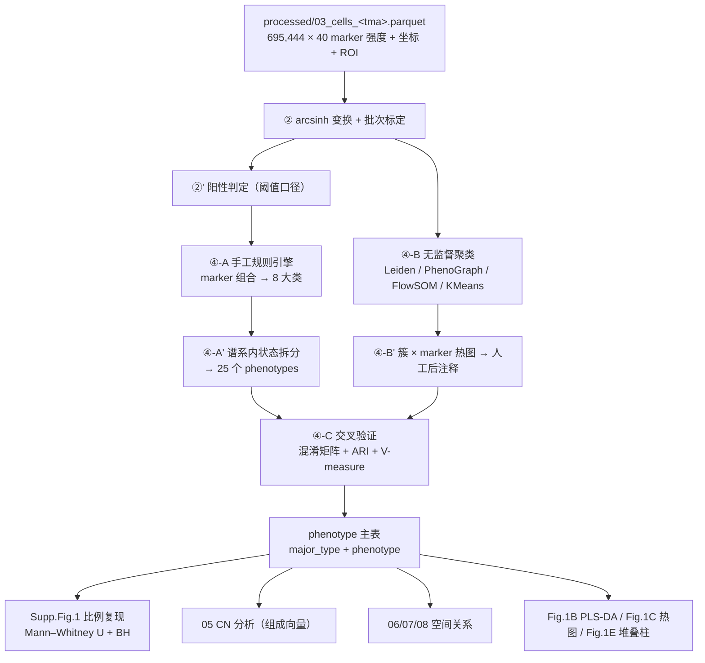

# 04 细胞表型定义与注释（8 major cell types / 25 cellular phenotypes）

> **目标文献**：Wang J, Nagarajan P, Cho S, Liu Y, Seeley EH, Dai Y, Liu Y, Yu K, Burks JK, McQuade JL, Diab A, Wang L\*, Ekmekcioglu S\*. *Integration of spatial single-cell proteomics and spatial metabolomics reveals tumor microenvironment predictive of immunotherapy response in mucosal melanoma.* bioRxiv 2026. DOI: 10.64898/2026.04.23.720453（**预印本，未经同行评审**）
>
> **模块对应原文**：Methods 中「Cell segmentation and phenotyping」段的 **"Manual cell phenotyping was performed post-segmentation according to marker criteria outlined in Supp. Fig. 4"** 一句；Results 第一段（"Unsupervised clustering and marker-based annotation identified **8 major cell types** … further resolved into **25 cellular phenotypes**"）；Supp. Fig. 1A–F（谱系比例与肿瘤状态比例）；Fig. 1B 右（PLS-DA，单细胞按谱系着色）、Fig. 1C（25 表型 × marker 热图）、Fig. 1E（各 core 细胞类型比例堆叠柱）
> **前置依赖**：`03_影像预处理配准与细胞分割.md`（**唯一**上游产物 `processed/03_cells_<tma>.parquet`：`cell_id, core_id, patient_id, x_um, y_um, area_um2, roi, <marker>_med, <marker>_p90, nuc_<marker>_med`）；`01_数据可得性评估与替代数据策略.md`（替代面板与公开数据的获取）；`02_实验平台SOP_TMA-COMET-MALDI.md`（抗体验证与对照布置，决定阈值是否可信）
> **下游消费**：`05_细胞邻域CN分析与Kmeans.md`（消费 `phenotype` 与 `major_type` 两列作为 CN 组成向量）、`06`、`07`、`08`（相邻/界面/相互作用分析全部以本模块的表型标签为原子单位）、`09_临床关联与无监督空间分型.md`、`11_蛋白-代谢物空间耦合与多组学整合.md`（CD163/CD11c 等 marker 表达与代谢物相关）
> **复现难度**：★★★☆☆　**预计工时**：2 人日　**计算资源**：16 核 CPU / 64 GB 内存（695k 细胞 × 40 维，PhenoGraph/UMAP 为主要耗时项；无 GPU 亦可，UMAP 可用 `cuml` 加速）

---

## 1. 科学问题与逻辑位置

本模块是**语义层**：把 03 号产出的「每细胞 × 40 个 marker 的强度矩阵」翻译成**可以被空间分析使用的细胞标签**。它在证据链中的位置如下：



- **上游输入**：03 号的细胞级强度矩阵（**唯一生产者**）、面板定义文件 `raw/comet/panel.csv`（marker 名、通道、轮次、抗体来源——但见 §2.1 的现实困难）。
- **下游输出**：`processed/04_cells_phenotyped.parquet`（在 03 的表上**新增**列：`major_type`、`phenotype`、每个 marker 的 `pos_<marker>` 布尔列、`arcsinh` 后的矩阵另存 `processed/04_arcsinh_matrix.npy`）；`results/04_phenotype_fractions.csv`（逐 core × 表型比例）；`results/04_cluster_vs_manual_ari.csv`；`results/04_suppfig1_tests.csv`；`figures/Fig1B_*.pdf`、`figures/Fig1C_*.pdf`、`figures/Fig1E_*.pdf`。
- **它解决什么问题**：CN 分析（05）把「细胞类型比例向量」当作特征做 K-means；如果表型定义不稳定，CN 就是"噪声的聚类"。**因此本模块的输出不是一张图，而是一套标签的语义契约**：任何"阳性（X⁺）"都必须有可查的判定规则（`REPRO_SPEC.md` §8.3.5 硬性要求）。
- **本项目最大的复现障碍（先说清楚）**：
  1. 原文的 **40-plex 完整面板在 Supp. Table 3**，**正文未给出**。正文与图注中**能确证出现的 marker 只有 14 个**：SOX10、MIF、Ki67、HLA-DR、CD163、CD11c、Arg1、IRF4、CD4、CD8、Granzyme B、FOXP3、Vimentin、SMA（＋DAPI，通常不计入 40-plex）。
  2. 原文的 **25 个表型的具体名单与阈值在 Fig. 1C 与 Supp. Fig. 4**，**正文未给出**。正文可点名的表型约 15 个（见 §3 表）。
  3. 因此本模块的绝大部分内容属于 **"我方复现决策"**，而非"照抄原文"。本文档对每一处都**显式标注来源**（🟩 = 原文确证；🟨 = 我方决策；🟥 = 原文未报告且无法推断）。

---

## 2. 背景知识与原理

### 2.1 数据形态：高重成像的强度矩阵有什么性质

comet/multiplex IF 的每细胞强度是**光子计数经增益与背景后的连续值**（不是质谱的离散离子计数），因此：

| 性质 | 表现 | 对分析的后果 |
|---|---|---|
| **强右偏长尾** | 少数细胞（如 Vimentin⁺ 基质）强度可达中位数的 10–100 倍 | 直接做 PCA/K-means 会被高表达 marker 与离群细胞主导 → 必须变换 |
| **通道间动态范围不同** | 强表达 marker（Vimentin、SMA）与弱表达 marker（IRF4、Arg1、CD11c）可差 1–2 个数量级 | 未标准化时，弱 marker 对聚类**几乎无贡献** → 稀有表型（如 Treg）会被吞并 |
| **批次漂移** | 每条染色轮次、每张 TMA、每次曝光都会整体平移强度 | 跨 TMA 比较（本项目 R/NR 分属不同芯但可能跨 TMA）会产生**假差异** |
| **溢漏与残留** | 同轮 AF555/AF647 光谱串扰、跨轮洗脱残留 | 制造**假共表达**（如 CD163 与 CD68 同轮时互相"渗"） |
| **背景非零且空间不等** | 组织自发荧光、玻璃反光、色素吸收残留 | 同一 marker 的组织内不同区域基线不同 → 全局阈值失真 |

### 2.2 变换：为什么是 $\operatorname{arcsinh}(x/c)$

**定义与性质**。对强度 $x \ge 0$ 与共因子（cofactor）$c>0$：

$$\operatorname{arcsinh}\!\left(\frac{x}{c}\right) = \ln\!\left(\frac{x}{c} + \sqrt{\left(\frac{x}{c}\right)^2 + 1}\right)$$

三个关键性质（这就是它比 $\\log$ 好的原因）：

1. **过零点连续、对小 $x$ 线性**：$x \\ll c$ 时 $\\operatorname{arcsinh}(x/c) \\approx x/c$，因此它能处理**背景减去后出现的零值**（$\\log(0)$ 会爆炸），也不会像 $\\log(x+1)$ 那样在低值区制造伪结构。
2. **对大 $x$ 近似对数**：$x \\gg c$ 时 $\\operatorname{arcsinh}(x/c) \\approx \\ln(2x/c)$，因此保留对数压缩把长尾拉回可比尺度。
3. **保序**：单调、平滑、可逆。**这保证了变换不改变"谁是阳性"的判定顺序**，只改变"多大差异算差异"。

**共因子 $c$ 的物理含义与取值**：$c$ 是"线性区与对数区的转折点"，**应取在噪声/背景的水平附近**。

| $c$ 的常见取值 | 出处/习惯 | 效果 | 风险 |
|---|---|---|---|
| **1** | IMC/CyTOF 的常用默认（离子计数尺度） | 几乎全程对数 → 放大低值区的差异 | 若背景远大于 1，会把背景噪声也放大 → 聚类被噪声主导 |
| **5** | CyTOF 社区经验值（`arcsinh(x/5)`） | 低值区保留部分线性 | 对荧光成像（背景更高）可能偏小 |
| **150** | 部分 IF/流式荧光面板使用 | 近全程线性 → 不做压缩 | 长尾不被压制，聚类被强 marker 主导 |
| **$c = \\mathrm{median}(I_{bg}) + 3\\,\\mathrm{MAD}(I_{bg})$**（本方推荐） | 由**背景像素/非组织细胞**实测 | 与数据实际噪声水平挂钩，**跨批次可比** | 需要可靠的背景估计；若各 core 分别估计，$c$ 会随 core 变化 → 必须统一在同一 TMA 层估计 |

> ⚠️ **导师批注（本模块最容易悄悄改变结论的一步）**：$c$ 的选择**会改变聚类结构**，进而改变 CN 组成、进而改变 Fig. 2D 的 CN 富集结论。原文**完全未报告 $c$ 或任何变换参数**。因此：**(1)** $c$ 必须写进项目术语表与 D 表；**(2)** 必须做**敏感性分析**（$c \\in \\{1, 5, 150\\}$ 三档，各自跑一遍聚类，报告 ARI 矩阵）——如果三档的 ARI < 0.6，说明"表型定义对变换参数不稳健"，任何基于它的空间结论都必须降级表述。这是本文档 §4.2 最后一段代码在做的事。

### 2.3 批次效应与标准化

**批次来源**（本项目具体化）：

| 批次来源 | 在本项目的表现 | 是否可校正 |
|---|---|---|
| **TMA 批次（2 张玻片）** | 染色/曝光/漂白处理时间不同 → 整体强度平移 | 可（panel-wise z-score 或 ComBat），**但必须检查 R/NR 是否在两块 TMA 上均衡** |
| **染色轮次（~20 轮）** | 每轮抗体浓度、孵育时间、洗脱效率不同 | 可（按轮次 z-score，或 CytoNorm 用每轮的控制样本） |
| **漂白程度差异** | 色素残留导致**通道依赖**衰减（见 `03` §2.4） | **不可完全校正**，只能标记为协变量 |
| **组织构成差异** | 某些 core 以基质为主，某些以肿瘤为主 → 群落组成不同会被误读为批次 | **不应校正**（那是生物学信号） |

**校正策略对比**：

| 方法 | 作用层次 | 原理 | 适用 | 风险 |
|---|---|---|---|---|
| **panel-wise z-score**（逐 marker 独立 z 标准化） | 细胞层，逐 marker | $z = (v-\\mu)/\\sigma$，$\\mu,\\sigma$ 取自同一批次 | 简单、无参数、可解释 | 会把"真实的比例差异"一起抹平（若某 marker 只在一个组表达，z 化后变成"处处相同"） |
| **分位数标定（quantile normalization）** | 细胞层 | 强制各批次的强度分布相同 | 分布形状相似的批次 | 假设过强；对"某批次真的整体高表达"会制造假阴性 |
| **CytoNorm**（Van Gassen et al., *Cytometry A* 2020，R 包） | 细胞层 | 用**每批次都有的控制样本（control/bead/统一阳性对照）**在同一 marker 空间对齐分布 | **有控制样本时最优**（本项目若 02 号每张玻片都放了对照芯，就可用） | 无控制样本时退化为分位数标定；会改变共表达结构 |
| **ComBat / Harmony** | 细胞层（批次作为协变量） | 线性模型（ComBat）或迭代聚类对齐（Harmony） | 批次与生物学**不共线**时有效 | ⚠️ **在细胞层做 ComBat/Harmony 有争议**：若 R 与 NR 恰好分布在两块 TMA 上（不均衡），ComBat 会把**真实的组间差异当成批次效应移除** → 结论直接消失 |
| **不做校正，把批次作为下游协变量** | 统计层 | 在检验模型里加入 `tma_id`、`cycle_id` 协变量 | **本项目推荐的主路径**（当下游是比例检验时） | 需要统计模型支持（本项目以非参数检验为主 → 至少要做分层/敏感性分析） |

> ⚠️ **导师批注（★ 级决策）**：本项目只有 26 例、97 cores、2 个 TMA，**样本量不允许"先校正批次再看差异"**——这类操作极易把 26 例的真实差异抹掉。**我们的主路径是"不改变强度分布的批次校正"**：只做 per-marker 的 **arcsinh + 全局 z-score**（全项目统一 $\\mu,\\sigma$），并把 `tma_id` 与 `cycle_id` 作为**下游检验的分层变量**；把 ComBat/Harmony 作为**敏感性分析**（跑完后报告"校正前/后结论是否一致"）。**任何"校正后才显著、不校正不显著"的结果，必须如实标注为批次敏感**（`REPRO_SPEC.md` §12 红线 5）。

### 2.4 注释范式的两条路线（原文选了第一条的最保守版本）

| 维度 | **marker-based gating（手工表型）** | **无监督聚类 + 后注释** |
|---|---|---|
| 原文用法 | ✅ **本文采用**（"Manual cell phenotyping … according to criteria in Supp. Fig. 4"） | 原文结果段写了一句 "Unsupervised clustering and marker-based annotation identified 8 major cell types" —— **两句表述并不完全一致**（见 §3 批注） |
| 哲学 | 先验知识驱动：marker 组合 = 生物学定义 | 数据驱动：簇结构先出现，再由人贴标签 |
| 优点 | 可解释、稳定、可直接对齐临床共识 | 能发现未预期的状态；不受"我没想到"限制 |
| 缺点 | **阈值不可复现**（没有 Supp. Fig. 4 就没有数字）；对稀有表型不敏感；定义边界任意 | 簇的生物学含义仍需人工裁定（"循环论证"风险）；结果随算法/参数变动 |
| 复现性 | 取决于**阈值是否被记录** → 本文未记录 → **C 层** | 取决于**数据与代码是否公开** → 本文未公开 → **C 层**，但**算法本身可复现（A 层）** |

**这就是本文档的核心判断**：原文的注释环节**在算法上完全可复现（A 层）**，但**在语义上不可复现（C 层）**——我们知道它用了"marker 组合"，但不知道它的组合与阈值。因此我们的策略是：

1. **把规则写成可执行代码**（§4.4 的规则引擎），并把每一条规则的来源标注清楚；
2. **同时跑无监督路线**（§4.5），用 ARI 与混淆矩阵量化"我们的规则"与"数据自身的簇结构"的距离；
3. **报告三条曲线**：不同 $c$、不同聚类算法、规则 vs 聚类的 ARI —— 用它们来界定"表型标签的可信区间"。

### 2.5 无监督方法在高维 arcsinh 空间的行为差异

| 方法 | 数学机制 | 关键参数 | 高维行为 | 本项目适用性 |
|---|---|---|---|---|
| **K-means** | 最小化簇内平方和（等价于假设各类为等方差球状高斯） | $k$、初始化、`n_init` | 对尺度敏感（**必须先标准化**）；簇大小趋于均匀；对密度不均的簇（稀有 Treg vs 大量肿瘤）**会强行切分** | 用作**快速基线**与 05 号 CN 分析的同一算法（保持全项目一致） |
| **Leiden（/Louvain）** | 在 kNN 图上最大化模块度（分辨率参数 $\\gamma$ 控制簇数） | `n_neighbors`、`resolution`、`random_state` | 能处理非凸簇；结果依赖 kNN 图（$k$ 与度量） | **主路径**（社区标准；可复现性最好） |
| **PhenoGraph** | 先 kNN（Jaccard 相似度）建图，再 Louvain 社群检测 | `k`（默认 30）、`primary_metric` | 与 Leiden 类似但图的构造不同（Jaccard 会更强调局部密度） | 作为**第二独立实现**（与 Leiden 比较 ARI，做"实现正确性"的双路验证） |
| **FlowSOM** | 自组织映射（SOM）把细胞映射到 $\\sqrt{n}\\times\\sqrt{n}$ 网格，再对网格做**元聚类** | `xdim/ydim`、`nMetaclust` | 逐批可扩展；对噪声稳健 | 作为**第三实现**（R 端 `FlowSOM`），也是流式/IMC 社区的惯例 |
| **层次聚类** | 距离矩阵 + 联结规则 | 联结方式、距离 | $O(n^2)$ 内存 → 695k 细胞**不可行**（须先下采样或先聚到 ~1 万簇） | 用于 **core 级** 分型（Fig. 4I），不用于细胞级 |

> ⚠️ **导师批注**：`05_细胞邻域CN分析与Kmeans.md` 与 `09_临床关联与无监督空间分型.md` 分别用 K-means 与层次聚类，且原文 Methods 与 Fig. 4I 图注对 CN 聚类方法的表述不一致（K-means vs hierarchical）。本模块**不裁决**，但要求：**细胞级标签（本模块）只产出一次**，聚类算法的差异只允许出现在**下游**（CN、分型），否则同一批细胞会有两套标签，全项目口径即失效（`REPRO_SPEC.md` §0.3 口径唯一）。

### 2.6 UMAP 与 PLS-DA：展示与推断的边界

**UMAP 只作可视化**。原因（必须能向审稿人复述）：

- UMAP 优化的是**模糊拓扑表示**：它尽力保留 $k$ 近邻图的连通性，**不保距、不保密度**。两个簇在 UMAP 图上的距离与真实高维距离**没有单调关系**；簇内点间距与簇间点间距**不可比**。
- 参数（`n_neighbors`、`min_dist`）会显著改变外观；同一数据在不同参数下可以"看起来更分开"或"更连成一片"。
- **因此**：禁止在任何图注或正文里写"UMAP 显示 A 与 B 距离更近"。要比较空间/表型距离，必须回到**原始（arcsinh + z-score 后）的欧氏距离**或**表型的比例向量**上做统计。
- 可复现性：`random_state` 必须固定（本模块用 `SEED = 20260101`），并报告 UMAP 版本（`umap-learn` 的版本变更会改变默认行为）。

**PLS-DA（偏最小二乘判别分析）在图 1B 中的角色**：图注写 "Partial Least Squares Discriminant Analysis (PLS-DA) of a representative subset of single cells, colored by **major cell lineages defined by marker expression profiles**"。

- 数学上：PLS-DA 是有**监督**的降维——把类别 $Y$（one-hot 的 8 个谱系）与特征 $X$（40 个 marker）联合分解，寻找最大化 $\\operatorname{cov}(X,Y)$ 的成分。因此它**天然会把类别分开**（这是它的目标函数，不是发现）。
- **正确用途（本文用法）**：把已经定义好的谱系标签**投影**到二维，作为**展示**——"这些标签在 marker 空间里确实分得开"。
- **误用风险（必须在方法学中排除）**：
  1. **循环论证**：用 PLS-DA 的分离来"证明"细胞类型可区分——但标签本来就是用同一批 marker 定义的，分离是必然的（信息泄漏）。
  2. **无验证的分离**：不报告交叉验证的平衡错误率（BER）就说"分得开"。
  3. **过拟合**：单细胞数 695k、特征 40 个，成分数一多必然完美分离训练集 → 必须报告**留出/交叉验证**的性能，并做**标签置换检验**（打乱 $Y$ 重跑，看真实分离是否显著优于置换）。
- 本模块的实现（§4.6）**强制**输出：交叉验证 BER、置换检验的 $p$、以及成分数的选择依据。

### 2.7 阳性判定规则的四种口径

「阳性」必须有规则（`REPRO_SPEC.md` §8.3.5）。四种可选口径：

| 口径 | 定义 | 优点 | 缺点/风险 |
|---|---|---|---|
| **分位数阈值** | 细胞在该 marker 上排名前 $q$%（如 20%）为阳性 | 简单、无条件分布假设；**每个 core 的阳性率恒定** | 会把"全阴 core"强行判出 20% 阳性 → **在组间比较中制造假阴性**（因为阳性率被强行拉平） |
| **GMM 双组分** | 对 arcsinh 强度拟合两个高斯，取交点 | 数据驱动、能自适应双峰分布 | 单峰时不稳定（两个组分退化为"高半边/低半边"）→ 必须加**单峰检测回退**（我们的实现用 **1 组分 vs 2 组分的 BIC 比较**，见 §4.3；注意"均值差小"这类判据对纯单峰数据无效） |
| **Otsu** | 最大化类间方差的阈值 | 无需参数 | 强制二分，对多峰/单峰均不理想 |
| **背景法（本方主路径）** | $T = \\mu_{bg} + k\\,\\sigma_{bg}$（$k=3$），$\\mu_{bg},\\sigma_{bg}$ 由**非组织区/同型对照**估计 | 与"信号是否高于噪声"的物理定义一致；**跨 core 绝对可比** | 需要可靠背景；若背景估计过高 → 阳性率骤降 |

**我们的选择（★ 决策）**：**背景法为主 + GMM 交叉验证 + 分位数仅作 QC 描述**。理由：本项目**唯一**的组间比较是"R vs NR 的阳性细胞比例"，若用分位数阈值，阳性率被人为拉平，**恰好会掩盖我们要找的差异**（如 MIF⁺ 肿瘤在 pre-R 升高）。这条推理必须写进方法学。

**必须同时报告的诊断**：每个 marker 的阳性率分布（跨 core）、阈值与背景水平、以及"阈值上下 ±20% 波动时阳性率的变化"（阈值稳健性）。

### 2.8 8 大类 → 25 个状态的层级设计

原文结构是**两层**：8 major cell types（谱系）→ 25 cellular phenotypes（谱系内的状态/亚型）。我们的设计原则：

1. **第一层互斥**（每个细胞恰好一个 `major_type`）——因为下游 CN 的组成向量要求各类互斥（否则比例之和 ≠ 1）。
2. **第二层覆盖全部**：为每个谱系补一个 `<Lineage>_other` 状态，保证 25 个状态**穷尽**（无未分配细胞）。原文显然也是穷尽的（Fig. 1C 用热图展示全部表型）。
3. **状态的定义域限制在谱系内**（如 `Tumor_Ki67` 必须先满足 `SOX10⁺`），避免"一个细胞既在肿瘤谱系又在巨噬谱系"的矛盾。
4. **双重阳性的裁决规则**：同一谱系内多个状态标记同时阳性时（如肿瘤细胞既 MIF⁺ 又 Ki67⁺，原文 CN14 正是"Ki67⁺/MIF⁺/HLA-DR⁺ 混合"），用**定义 marker 的 z-score 最大值**裁决（确定性规则，可复现）。

---

## 3. 原文逐句拆解

| # | 原文句（English → 中文转述） | 写了什么 | **没写什么（= 我们的复现空间）** | 来源标注 |
|---|---|---|---|---|
| 1 | "**Unsupervised clustering and marker-based annotation** identified **8 major cell types** (Fig. 1B, right), which were further resolved into **25 cellular phenotypes** (Fig. 1C)."（Results） | 产出 8 大类 + 25 表型 | **8 大类的名单**（在 Fig. 1B 左）、**25 表型的名单与阈值**（在 Fig. 1C / Supp. Fig. 4）、**聚类算法与参数**、**注释规则** | 🟥 全部未报告（只能从 Results 各处反推，见 #2–#12） |
| 2 | "a **40-antibody COMET panel** (Fig. 1B, left), enabling multiplexed detection of a wide range of features, including **MuM tumor markers**, markers of major immune subsets (e.g., **CD4⁺ and CD8⁺ T cells, NK cells, macrophages, B cells, and dendritic cells**), and **stromal compartments**" | 面板含肿瘤/免疫/基质三类 | **面板的完整名单**（Supp. Table 3）、**NK/B 细胞用哪个 marker** | 🟥 面板名单不可得；**谱系类别可由该句 + 图注反推**（肿瘤 + 6 类免疫 + 基质 = 8） |
| 3 | "This panel also included markers reporting **functional states, including proliferation, antigen presentation, and inflammatory signaling** (Fig. 1B, left)" | 含功能状态 marker | 具体是哪些 | 🟨 由 #4–#12 确证的功能 marker：Ki67（增殖）、HLA-DR（抗原呈递）、Granzyme B（细胞毒）、FOXP3（调节）、Arg1/IRF4（巨噬极化）、MIF（炎症/免疫调节） |
| 4 | "**MIF⁺ tumor cells** were significantly more abundant in pre-treatment R cores and in post-treatment NR cores compared with pre-treatment NR cores (Supp. Fig. 1E)" | 存在 `MIF⁺ tumor` 表型；组间差异方向 | 阈值 | 🟩 表型名确证；阈值 🟥 |
| 5 | "**Ki67⁺ tumor cells** were significantly higher in NR pre-treatment cores than in NR post-treatment cores, and were also elevated in NR relative to R in the pre-treatment group (Supp. Fig. 1E and 1F)" | 存在 `Ki67⁺ tumor`；组间差异 | 统计量、n、是否 BJ 校正 | 🟩 表型名确证；统计细节 🟥（我们按 `REPRO_SPEC` §7 用 Mann–Whitney U + BH 并双口径报告） |
| 6 | "CN14 (invasive tumor) comprised a mixture of tumor cell states (**Ki67⁺, MIF⁺, and HLA-DR⁺**)" | 存在 `HLA-DR⁺ tumor` 状态 | 阈值 | 🟩 表型名确证 |
| 7 | "**macrophages** were more frequently of the **CD163⁺ subtype** and were more abundant than in NR cores"（Fig. 4B 中部） | 存在 `CD163⁺ macrophage` 亚型 | "subtype" 的完整定义 | 🟩 表型名确证 |
| 8 | "**CD163⁺ macrophages** in NR cores expressed higher levels of **IRF4 and Arg1** (Fig. 4E and 4G), consistent with increased **M2 polarization**" | Arg1/IRF4 是巨噬的功能状态 marker，且**按表达水平**比较（不是阳性/阴性二分） | 是"阳性比例"还是"平均强度"？ | 🟩 marker 确证；**比较口径未报告** 🟥（我方决策：**同时报告阳性率与中位强度**两种口径，见 §5） |
| 9 | "higher abundance of **cycling CD8⁺ T (Ki67⁺)** cells and **cytotoxic CD8⁺ T (Granzyme B⁺)** cells, whereas **regulatory CD4⁺ T (FOXP3⁺)** cells were less frequent"（Fig. 4B 下） | 存在 3 个 T 细胞状态：cycling CD8、cytotoxic CD8、Treg | 阈值；CD8 的共门控规则 | 🟩 表型名确证 |
| 10 | "**CN3 (DC)** was enriched for dendritic cells"；"between Ki67⁺ tumor cells and **CD11c⁺ DCs** (p < 2.22 × 10⁻¹⁶) within the CN13" | 存在 DC 谱系，用 **CD11c** 标识 | DC 的完整门控（是否需 HLA-DR⁺？CD11c 是否也用于单核/巨噬？） | 🟩 CD11c⁺ DC 确证；🟨 门控细节为我方决策 |
| 11 | "**CN2 (NK cells)** was enriched for **natural killer cells**"；"**CN4 (B cells)** … **CN5 (B & CD4⁺ T)**" | 存在 NK、B、CD4 T 谱系 | **NK 与 B 用哪个 marker**（正文从未出现 CD56/CD57/NKp46/CD20/CD19） | 🟥 marker 未报告 → 🟨 我方必须自定（见 §4.4 表） |
| 12 | "**CN10 (Vimentin+ stroma)** was enriched for vimentin+ stromal cells … **CN1 (Vimentin+SMA+ stroma)** was enriched for SMA⁺ stromal cells consistent with a **myofibroblastic cancer-associated fibroblast (myCAF)** context" | 存在 `Vimentin⁺ stromal` 与 `SMA⁺ myCAF` 两个基质表型 | 内皮/其他基质是否单列 | 🟩 两个基质表型确证；🟨 内皮等为我方决策 |
| 13 | "**Manual cell phenotyping** was performed post-segmentation according to **marker criteria outlined in Supp. Fig. 4**."（Methods） | **手工（阈值）表型**，规则在补充图 | **全部阈值** | 🟥👉 这是**本文复现性最弱的一环**，登记为 D4-1 ★ |
| 14 | "PLS-DA of a **representative subset of single cells**, colored by **major cell lineages defined by marker expression profiles**"（Fig. 1B 图注） | PLS-DA 用于**展示**已定义谱系 | 子集大小、"representative" 的抽样规则、成分数、是否交叉验证 | 🟥 全部未报告（我方决策见 §4.6） |
| 15 | "**Voronoi tessellation plots** from representative specimens, including pre- and post-treatment cores from a NR and a pre-treatment core from a R"（Fig. 1D） | 用 Voronoi 图可视化表型分配 | 多边形构造方式（几何 Voronoi 还是像素标签） | 🟨 我方用**像素级 Voronoi 标签**（与 `03` §4.7 同一口径，保证图数一致） |
| 16 | "Overall, we observed marked differences in the composition of **immune and stromal phenotypes** and their spatial arrangement across these groups (Fig. 1E)" | 组成差异存在 | 检验方法与数值（在 Supp. Fig. 1 中） | 🟥 数值未报告 → 我们复现 Supp. Fig. 1 的检验并报告 |

> ⚠️ **导师批注（原文自相矛盾之处）**：Results 写 "**Unsupervised clustering and marker-based annotation**"，Methods 写 "**Manual cell phenotyping**"。这两句描述的是**两种不同的注释范式**（前者数据驱动 + 后注释，后者先验规则 + 手工阈值）。第 13 句更具体（"according to marker criteria outlined in Supp. Fig. 4"），因此**主口径取"手工规则 + 补充图阈值"**。但注意：如果作者实际是先跑无监督聚类、再用 Supp. Fig. 4 的规则去命名簇，那么"25 个表型"就是**簇的命名结果**而非"逐细胞规则匹配结果"——这两者在边缘细胞的归属上会不同。**我们两种都做（§4.4 规则式 + §4.5 聚类式），并报告二者的 ARI 与混淆矩阵**，让读者自己判断。此项登记到 12 号文档。

---

## 4. 逐步可运行代码

```yaml
# code/envs/env_04.yml（节选）
python: 3.11
numpy: 1.26.4
pandas: 2.2.2
scipy: 1.13.1
scikit-learn: 1.5.1
scanpy: 1.10.3          # 提供 Leiden（需 igraph + leidenalg）
igraph: 0.11.6
leidenalg: 0.10.2
phenograph: 1.5.7
umap-learn: 0.5.6
statsmodels: 0.14.2     # multipletests（BH）
matplotlib: 3.9.2
pyarrow: 17.0.0
```

> **随机种子**：`SEED = 20260101`（全项目统一）。必须固定的环节：Leiden/Louvain、K-means（`n_init=10, random_state`）、PhenoGraph（`seed`）、UMAP（`random_state`）、PLS-DA 的交叉验证折划分、置换检验、下采样。

### 4.1 读入契约产物与面板表

```python
# code/04_01_load.py
"""读入 03 号的细胞表；校验契约列名与量纲；组装 marker 矩阵与元数据。"""
from __future__ import annotations
from pathlib import Path
import numpy as np
import pandas as pd

SEED = 20260101
PROC = Path("processed"); RES = Path("results")

# 面板契约：marker 名 -> 该 marker 来源批次（TMA 编号）
# ⚠️ 现实约束：原文 40-plex 的完整名单在 Supp. Table 3，正文未给出。
#    本文件用 raw/comet/panel.csv 描述"我们实际使用的面板"（见 §4.4 的规则表）。
PANEL_CSV = Path("raw/comet/panel.csv")
REQUIRED_META = ["cell_id", "core_id", "patient_id", "x_um", "y_um", "area_um2", "roi"]


def load_cells(tma_id: str, *, quantile: str = "med") -> tuple[pd.DataFrame, list[str]]:
    """返回 (cells_df, marker_list)。
    强度列的两套口径（由 03 号定义）：
      <marker>_med : 全细胞 ROI 内的中位数（胞质 marker 用这一套）
      nuc_<marker>_med : 核内中位数（核 marker 如 SOX10/Ki67/FOXP3 用这一套）
    quantile='p90' 时为 90 分位版本（用于敏感性分析）。"""
    p = PROC / f"03_cells_{tma_id}.parquet"
    if not p.exists():
        raise FileNotFoundError(f"缺少上游产物 {p}；请先完成 03 号模块")
    df = pd.read_parquet(p)
    missing = [c for c in REQUIRED_META if c not in df.columns]
    if missing:
        raise KeyError(f"{p.name} 缺少契约列 {missing}（03 号产物格式不符）")
    if not df["x_um"].between(-1e6, 1e6).all():
        raise ValueError("x_um 取值异常：疑似像素坐标未换算为 μm（03 号契约要求 μm）")

    suf = f"_{quantile}"
    markers = sorted({c[: -len(suf)] for c in df.columns
                      if c.endswith(suf) and not c.startswith("nuc_")})
    if not markers:
        raise ValueError(f"未找到以 {suf} 结尾的 marker 强度列")
    return df, markers


def load_panel() -> pd.DataFrame:
    """面板表：marker, channel(AF555/AF647), cycle, antibody, purpose(nuclear/cytoplasmic),
    is_control(bool)。**必须**由实验记录生成，不允许凭记忆填写。"""
    panel = pd.read_csv(PANEL_CSV)
    need = {"marker", "channel", "cycle", "purpose"}
    if not need.issubset(panel.columns):
        raise KeyError(f"panel.csv 缺少列 {need - set(panel.columns)}")
    return panel


def build_matrix(df: pd.DataFrame, markers: list[str], *,
                 use_nuclear_for: set[str] | None = None) -> np.ndarray:
    """组装 (n_cells, n_markers) 的原始强度矩阵。
    核 marker 优先取 nuc_ 前缀列（核内中位数），其余取全细胞 ROI 中位数。
    use_nuclear_for 给出"应当用核内信号"的 marker 名单（SOX10/Ki67/FOXP3/IRF4/TTF1 等）。"""
    use_nuclear_for = use_nuclear_for or set()
    X = np.empty((len(df), len(markers)), dtype=np.float32)
    for j, m in enumerate(markers):
        nuc_col, cyto_col = f"nuc_{m}_med", f"{m}_med"
        if m in use_nuclear_for and nuc_col in df.columns:
            X[:, j] = df[nuc_col].to_numpy(np.float32)
        elif cyto_col in df.columns:
            X[:, j] = df[cyto_col].to_numpy(np.float32)
        else:
            raise KeyError(f"marker {m} 缺少强度列（nuc_/全细胞两套都不存在）")
    if not np.isfinite(X).all():
        n_bad = int((~np.isfinite(X)).sum())
        print(f"[warn] 强度矩阵有 {n_bad} 个非有限值（{n_bad / X.size:.2%}），将以 0 填充")
        X = np.nan_to_num(X, nan=0.0, posinf=0.0, neginf=0.0)
    return X
```

### 4.2 arcsinh 变换、标准化与 $c$ 的敏感性分析

```python
# code/04_02_transform.py
"""arcsinh 变换 + 标准化 + c 的敏感性分析。
顺序很重要：先 arcsinh（压长尾）→ 再 z-score（统一尺度）。
反过来（先 z 再 arcsinh）会把负值送进 arcsinh 的对数支，产生非预期结果。"""
from __future__ import annotations
import numpy as np
import pandas as pd

SEED = 20260101


def arcsinh_transform(X: np.ndarray, *, cofactor: float) -> np.ndarray:
    """arcsinh(X / c)。要求 X >= 0（03 号产出的强度已截断非负）。
    保序、小值近线性、大值近对数——这是它优于 log1p 的核心。"""
    if cofactor <= 0:
        raise ValueError("cofactor 必须 > 0")
    if (X < 0).any():
        raise ValueError("存在负强度：请在 03 号修正（截断）后再传入")
    return np.arcsinh(X / float(cofactor))


def estimate_cofactor_from_background(bg_values: np.ndarray, *, k: float = 3.0) -> float:
    """由背景强度（非组织区像素/同型对照细胞的强度）估计 c：
       c = median(bg) + k * MAD(bg)
    MAD = median(|x - median(x)|)，再乘 1.4826 使其在正态下等价于 SD。"""
    bg = np.asarray(bg_values, dtype=np.float64).ravel()
    if bg.size < 100:
        raise ValueError(f"背景样本只有 {bg.size} 个，不足以稳健估计（需 >= 100）")
    med = float(np.median(bg))
    mad = float(np.median(np.abs(bg - med)) * 1.4826)
    c = med + k * mad
    if c <= 0:
        raise ValueError(f"估计出的 cofactor={c} 非正：检查背景是否全零（可能选错了区域）")
    return c


def zscore(X: np.ndarray, *, mu: np.ndarray | None = None,
           sigma: np.ndarray | None = None, eps: float = 1e-6):
    """逐 marker z 标准化。**必须全项目共用同一组 (mu, sigma)**，
    否则不同模块的"高/低"口径不一致（REPRO_SPEC §0.3 口径唯一）。
    建议：在**全 TMA 合并的细胞矩阵**上估计一次，落盘 results/04_zscore_params.npz。"""
    if mu is None:
        mu = X.mean(axis=0)
    if sigma is None:
        sigma = X.std(axis=0)
    Z = (X - mu) / np.maximum(sigma, eps)
    return Z, mu, sigma


def cofactor_sensitivity(X_raw: np.ndarray, *, cofactors=(1.0, 5.0, 150.0),
                         k_clusters: int = 30, seed: int = SEED) -> pd.DataFrame:
    """c 的敏感性分析：不同 c 下，同一批细胞的无监督聚类结构有多一致。
    判据：c=1 与 c=150 之间的 ARI < 0.6 → 表型定义对变换参数不稳健，
         所有基于表型的空间结论必须降级表述（写入 12 号文档的 gap 表）。"""
    from sklearn.cluster import MiniBatchKMeans
    from sklearn.metrics import adjusted_rand_score
    labels = {}
    for c in cofactors:
        Z, *_ = zscore(arcsinh_transform(X_raw, cofactor=c))
        km = MiniBatchKMeans(n_clusters=k_clusters, n_init=10, random_state=seed,
                             batch_size=4096)
        labels[c] = km.fit_predict(Z)
    cs = list(cofactors)
    rows = []
    for i in range(len(cs)):
        for j in range(i + 1, len(cs)):
            rows.append({"c_a": cs[i], "c_b": cs[j],
                         "ARI": float(adjusted_rand_score(labels[cs[i]], labels[cs[j]]))})
    return pd.DataFrame(rows)


def batch_check(df: pd.DataFrame, group_col: str = "response_timepoint",
                batch_col: str = "tma_id") -> pd.DataFrame:
    """批次-分组列联表 + 卡方检验。
    ⚠️ 若 R 与 NR 在两块 TMA 上分布显著不均衡（p < 0.05），
    所有跨 TMA 的组间差异都必须做"分 TMA 分层"的敏感性分析。"""
    from scipy.stats import chi2_contingency
    tab = pd.crosstab(df[batch_col].astype(str), df[group_col].astype(str))
    if tab.shape[0] < 2 or tab.shape[1] < 2:
        return tab.assign(note="批次或分组只有 1 类，无法检验")
    chi2, p, dof, _ = chi2_contingency(tab)
    out = tab.copy()
    out.attrs["chi2"] = float(chi2); out.attrs["p"] = float(p); out.attrs["dof"] = int(dof)
    print(f"[batch_check] chi2={chi2:.3f}, dof={dof}, p={p:.4g}")
    if p < 0.05:
        print("[batch_check][WARN] 批次与分组显著不均衡 → 必须做分层敏感性分析")
    return out
```

### 4.3 阳性判定（背景法为主 + GMM 交叉验证）

```python
# code/04_03_positivity.py
"""阳性（marker⁺）判定。主路径：背景法 T = mu_bg + k*sigma_bg（在 arcsinh 空间）。
交叉验证：GMM 双组分交点；描述性 QC：分位数阈值下的阳性率。"""
from __future__ import annotations
import numpy as np
from sklearn.mixture import GaussianMixture

SEED = 20260101


def threshold_background(bg_arcsinh: np.ndarray, *, k: float = 3.0) -> float:
    """背景法阈值：T = median + k * 1.4826 * MAD（在 arcsinh 空间里算，与判定空间一致）。"""
    bg = np.asarray(bg_arcsinh, dtype=np.float64).ravel()
    med = float(np.median(bg))
    mad = float(np.median(np.abs(bg - med)) * 1.4826)
    return med + k * mad


def threshold_gmm(x: np.ndarray, *, seed: int = SEED) -> tuple[float, dict]:
    """GMM 双组分阈值：取两个组分的交叉点。

    ⚠️ **单峰检测必须用 BIC 比较，不能用"两组分均值差"**：
    任何单峰分布强制拟合 2 个高斯时，都会得到两个相距约 1.5 SD 的组分，
    因此"均值差 < 0.5 SD"这类判据对纯单峰数据**完全失效**（实测：normal(0,1) 的
    n=10,000 样本会给出 sep≈1.6，误判为双峰）。正确做法是比较 1 组分与 2 组分的 BIC。
    （实测：n=40,000 的高斯混合，冠状隔 1 SD 时 BIC 仍偏好 1 组分 → 保守地回退到分位数，
      这正是我们想要的：重叠严重的 marker 不应被硬切阈值。）"""
    v = np.asarray(x, dtype=np.float64).reshape(-1, 1)
    sd_all = float(v.std())
    gm1 = GaussianMixture(n_components=1, random_state=seed).fit(v)
    gm2 = GaussianMixture(n_components=2, covariance_type="full", n_init=5,
                          random_state=seed).fit(v)
    if gm1.bic(v) <= gm2.bic(v):
        return float(np.quantile(v, 0.8)), {
            "separation_sd": float("nan"), "mode": "fallback_quantile",
            "bic_1comp": float(gm1.bic(v)), "bic_2comp": float(gm2.bic(v)),
            "note": "BIC 判定为单峰，GMM 双组分不可分"}
    gm = gm2
    mu = gm.means_.ravel(); sd = np.sqrt(gm.covariances_.reshape(-1)); w = gm.weights_
    order = np.argsort(mu); mu, sd, w = mu[order], sd[order], w[order]
    separation = (mu[1] - mu[0]) / max(sd_all, 1e-9)
    # 两条加权高斯曲线的交点：解
    #   a1*(x-mu1)^2 - a2*(x-mu2)^2 = -2*ln( (w1/sd1) / (w2/sd2) ),   a_i = 1/sd_i^2
    # 整理为 A x^2 + B x + C = 0。
    # ⚠️ 这里的对数项方向极易写反（写反后判别式仍可能为正，只是解出错误的交点——
    #    典型的静默失败）。写完请用两条已知高斯做单元测试（见下方 _self_test_gmm_crossing）。
    a1, a2 = 1.0 / sd[0] ** 2, 1.0 / sd[1] ** 2
    A = a1 - a2
    B = -2.0 * (a1 * mu[0] - a2 * mu[1])
    C = (a1 * mu[0] ** 2 - a2 * mu[1] ** 2
         - 2.0 * np.log(max(w[0] * sd[1], 1e-12) / max(w[1] * sd[0], 1e-12)))
    if abs(A) < 1e-12:                      # 等方差：退化为一元一次方程
        thr = float((C / B) * -1.0) if abs(B) > 1e-12 else 0.5 * (mu[0] + mu[1])
    else:
        disc = B ** 2 - 4 * A * C
        if disc < 0:
            thr = 0.5 * (mu[0] + mu[1])
        else:
            roots = np.sort([(-B + np.sqrt(disc)) / (2 * A), (-B - np.sqrt(disc)) / (2 * A)])
            mid = 0.5 * (mu[0] + mu[1])
            thr = float(roots[np.argmin(np.abs(roots - mid))])
            # 合理性检查：交点必须落在两个均值之间（否则说明公式或拟合有问题）
            if not (mu[0] - 0.5 * sd_all <= thr <= mu[1] + 0.5 * sd_all):
                return float(mid), {"separation_sd": separation, "mode": "fallback_midpoint",
                                    "note": f"交点 {thr:.3f} 落在均值区间外，已回退为均值中点"}
    return float(thr), {"separation_sd": separation, "mode": "gmm_crossing",
                        "mu": mu.tolist(), "sd": sd.tolist(), "w": w.tolist()}


def _self_test_gmm_crossing() -> None:
    """单元测试：构造已知的两条高斯，验证交点公式解析解与数值解一致。
    例：mu=(0, 2.5), sd=(0.8, 1.3), w=(0.7, 0.3) → 解析交点 = 1.455679；
        在该点两条密度曲线应相等（相对误差 < 1e-6）。"""
    mu = np.array([0.0, 2.5]); sd = np.array([0.8, 1.3]); w = np.array([0.7, 0.3])
    a1, a2 = 1.0 / sd[0] ** 2, 1.0 / sd[1] ** 2
    A = a1 - a2
    B = -2.0 * (a1 * mu[0] - a2 * mu[1])
    C = (a1 * mu[0] ** 2 - a2 * mu[1] ** 2
         - 2.0 * np.log(max(w[0] * sd[1], 1e-12) / max(w[1] * sd[0], 1e-12)))
    roots = np.sort([(-B + np.sqrt(B ** 2 - 4 * A * C)) / (2 * A),
                     (-B - np.sqrt(B ** 2 - 4 * A * C)) / (2 * A)])
    x = roots[np.argmin(np.abs(roots - 0.5 * (mu[0] + mu[1])))]
    d1 = w[0] / sd[0] * np.exp(-(x - mu[0]) ** 2 / (2 * sd[0] ** 2))
    d2 = w[1] / sd[1] * np.exp(-(x - mu[1]) ** 2 / (2 * sd[1] ** 2))
    assert abs(x - 1.455679) < 1e-5, f"交点解析解错误: {x:.6f}（期望 1.455679）"
    assert abs(d1 - d2) / max(d1, d2) < 1e-6, f"交点处两密度不相等: {d1:.6g} vs {d2:.6g}"


def call_positivity(Z_arcsinh: np.ndarray, markers: list[str], *,
                    bg: dict[str, np.ndarray], k: float = 3.0,
                    use_gmm_check: bool = True) -> tuple[pd.DataFrame, pd.DataFrame]:
    """对每个 marker 调阳性判定，返回 (布尔表, 阈值诊断表)。
    bg: {marker: 背景强度数组}，由 03 号的非组织像素/同型对照给出（arcsinh 空间）。"""
    pos = {}; diag = []
    for j, m in enumerate(markers):
        x = Z_arcsinh[:, j]
        if m not in bg:
            raise KeyError(f"marker {m} 缺少背景样本（必须有非组织像素或同型对照）")
        t_bg = threshold_background(bg[m], k=k)
        rec = {"marker": m, "thr_background": t_bg,
               "positive_rate_background": float((x > t_bg).mean()),
               "positive_rate_q80": float((x > np.quantile(x, 0.8)).mean())}
        if use_gmm_check:
            t_g, info = threshold_gmm(x)
            rec.update({"thr_gmm": t_g, "gmm_mode": info["mode"],
                        "gmm_separation_sd": info["separation_sd"],
                        "positive_rate_gmm": float((x > t_g).mean())})
            rec["thr_disagreement"] = abs(rec["positive_rate_background"] - rec["positive_rate_gmm"])
        diag.append(rec)
        pos[m] = x > t_bg
    return pd.DataFrame(pos), pd.DataFrame(diag)


def threshold_robustness(x: np.ndarray, t: float, *, rel: float = 0.2) -> dict:
    """阈值稳健性：阈值上下浮动 ±rel 时阳性率的变化。变化 > 30% 的 marker 需在报告中注明。"""
    r_lo = float((x > t * (1 - rel)).mean()); r_hi = float((x > t * (1 + rel)).mean())
    r0 = float((x > t).mean())
    return {"rate_at_t": r0, "rate_at_-20%": r_lo, "rate_at_+20%": r_hi,
            "rel_span": (r_hi - r_lo) / max(r0, 1e-9),
            "verdict": "OK" if (r_hi - r_lo) / max(r0, 1e-9) < 0.30 else "SENSITIVE"}
```

### 4.4 表型规则表与规则引擎（8 大类 + 25 状态）

**先给出规则表（这是本模块的核心交付物）**。来源标注：🟩 = 原文正文/图注确证；🟨 = 我方复现决策（原文未报告或不可推断）；🟥 = 原文未报告。

| 层级 | 表型名（我方命名） | 判定规则（marker 组合） | marker 来源 | 备注/风险 |
|---|---|---|---|---|
| **谱系** | `Tumor` | SOX10⁺（核） | 🟩 SOX10（用于 tumor ROI 定义） | 失效：去分化 SOX10⁻ 肿瘤会被整体漏掉 |
| 状态 | `Tumor_MIF` | Tumor 且 MIF⁺ | 🟩 MIF | 与 `Tumor_Ki67` 双重阳性时按 z-score 裁决 |
| 状态 | `Tumor_Ki67` | Tumor 且 Ki67⁺ | 🟩 Ki67 | 原文明示 NR 组升高 |
| 状态 | `Tumor_HLADR` | Tumor 且 HLA-DR⁺ | 🟩 HLA-DR | 原文明示 CN14 含此状态 |
| 状态 | `Tumor_other` | Tumor 且三者皆阴性 | 🟨 | 保证穷尽 |
| **谱系** | `Macrophage` | CD163⁺ 且 SOX10⁻ | 🟩 CD163 | CD68 **未在正文出现** → 不用于主规则（🟨 可作敏感性分析） |
| 状态 | `Mac_CD163_IRF4hi` | Macrophage 且 IRF4 高于其组内中位数 | 🟩 IRF4（Fig. 4E/G） | ⚠️ 原文是**连续强度比较**而非阳性二分 → 🟨 我方另设"IRF4 阳性率"口径并双报 |
| 状态 | `Mac_CD163_Arg1hi` | Macrophage 且 Arg1 高于其组内中位数 | 🟩 Arg1（Fig. 4E/G） | 同上 |
| 状态 | `Mac_other` | Macrophage 且上述皆不满足 | 🟨 | 穷尽性 |
| **谱系** | `DC` | CD11c⁺ 且 CD163⁻ 且 SOX10⁻ | 🟩 CD11c | ⚠️ CD11c 也表达于部分巨噬/单核 → 用 CD163⁻ 排除；🟨 若面板另有 CD141/CD1c 应优先（🟥 未报告） |
| 状态 | `DC_HLADR` | DC 且 HLA-DR⁺ | 🟩 HLA-DR（在面板中） | 🟨 逻辑推导 |
| 状态 | `DC_other` | DC 且 HLA-DR⁻ | 🟨 | 穷尽性 |
| **谱系** | `T_cell` | CD4⁺ 或 CD8⁺ 且 CD163⁻ 且 SOX10⁻ | 🟩 CD4/CD8 | 🟥 CD3 未在正文出现 → 不强制要求（🟨 若面板有 CD3，应加为必要条件） |
| 状态 | `T_CD4` | T_cell 且 CD4⁺ 且 CD8⁻ 且 FOXP3⁻ | 🟩 CD4 | — |
| 状态 | `T_Treg` | T_cell 且 CD4⁺ 且 FOXP3⁺ | 🟩 FOXP3 | 原文明示 R 组 Treg 更少 |
| 状态 | `T_CD8` | T_cell 且 CD8⁺ 且 Ki67⁻ 且 GZMB⁻ | 🟩 CD8 | — |
| 状态 | `T_CD8_cycling` | T_cell 且 CD8⁺ 且 Ki67⁺ | 🟩 Ki67 | 原文明示 R 组更多 |
| 状态 | `T_CD8_cytotoxic` | T_cell 且 CD8⁺ 且 GZMB⁺ 且 Ki67⁻ | 🟩 Granzyme B | 原文明示 R 组更多 |
| 状态 | `T_other` | T_cell 且以上皆不满足（如 CD4⁺CD8⁺ 双阳、CD4⁻CD8⁻） | 🟨 | 穷尽性 + 异常细胞收纳 |
| **谱系** | `NK` | CD56⁺ 或 NKp46⁺，且 CD3⁻（若面板有 CD3）、CD163⁻、SOX10⁻ | 🟥 **marker 未报告** | 🟨 我方决策；若面板无 NK marker → 该谱系不可复现（见 §5 决策 D4-3） |
| **谱系** | `B_cell` | CD20⁺ 或 CD79a⁺，且 SOX10⁻、CD163⁻ | 🟥 **marker 未报告** | 🟨 我方决策；同上 |
| **谱系** | `Stroma` | Vimentin⁺ 且 SOX10⁻ 且 CD163⁻ | 🟩 Vimentin | — |
| 状态 | `Stroma_myCAF` | Stroma 且 SMA⁺ | 🟩 SMA（CN1 = Vimentin⁺SMA⁺，myCAF） | 原文明示 |
| 状态 | `Stroma_other` | Stroma 且 SMA⁻ | 🟨 | 穷尽性；可能包含周细胞/平滑肌（🟥 未报告如何区分） |
| **谱系** | `Endothelial` | CD31⁺（或 CD34/Podoplanin），且 Vimentin 弱、SOX10⁻ | 🟥 **marker 未报告** | 🟨 我方决策；原文只写 "stromal compartments"，是否把内皮单列**未报告** |
| 状态 | `Unassigned` | 以上谱系规则全不满足 | 🟨 | **必须报告其占比**；> 5% 说明面板或阈值有问题 |

**8 大类 = Tumor / Macrophage / DC / T_cell / NK / B_cell / Stroma / Endothelial**。其中 **Tumor / Macrophage / DC / T_cell / Stroma 的 marker 有原文确证（🟩）**；**NK / B_cell / Endothelial 的 marker 在正文中未报告（🟥→🟨）**。原文 Results 明确列出 "CD4⁺ and CD8⁺ T cells, NK cells, macrophages, B cells, and dendritic cells"＋"stromal compartments"＝6 免疫 + 1 基质 + 1 肿瘤 = 8，**与我们的 8 类完全吻合**——这是我们对 8 大类名单的最佳反推（**注意：原文未逐一点名 8 类，此反推必须标注为推断**）。

**25 个状态**：上表给出 **23 个**（含 `Unassigned`）。剩余 2 个在原文的 Fig. 1C 里，正文无从推断（🟥）。我们的处理：**不硬凑到 25**（禁止编造），而是把 23 个状态作为主路径，并在 §6 的 gap 表中明确写出"与原文 25 的差 2 个不可复现"。若必须对齐数量，可在 D 表登记一个"扩展方案"：把 `T_other` 拆为 `T_CD4CD8_double_pos` 与 `T_CD4negCD8neg`、把 `Stroma_other` 拆为 `Stroma_pericyte`（若面板有 PDGFRβ/α-SMA 层次），但**这属于我方定义，不得声称与原文一致**。

```python
# code/04_04_phenotype_rules.py
"""规则引擎：marker 阳性布尔表 → 8 major types → 23–25 phenotypes。
设计原则（§2.8）：
  (1) 谱系互斥（按优先级依次匹配，命中即停）；
  (2) 状态定义域限定在谱系内；
  (3) 同谱系多状态同时命中时，用"定义 marker 的 z-score 最大者"裁决（确定性）；
  (4) 兜底状态保证穷尽（Tumor_other / Mac_other / ... / Unassigned）。"""
from __future__ import annotations
from dataclasses import dataclass, field
import numpy as np
import pandas as pd

SEED = 20260101


@dataclass
class Rule:
    name: str
    require: dict[str, bool] = field(default_factory=dict)   # marker -> 期望的阳性布尔
    tie_markers: tuple[str, ...] = ()                        # 用于 z-score 裁决的 marker


# ---------------- 谱系规则（按列表顺序匹配，命中即停 → 互斥） ----------------
LINEAGE_RULES: list[Rule] = [
    Rule("Tumor",      {"SOX10": True}),
    Rule("Macrophage", {"SOX10": False, "CD163": True}),
    Rule("DC",         {"SOX10": False, "CD163": False, "CD11c": True}),
    Rule("T_cell",     {"SOX10": False, "CD163": False, "CD4": True}),
    Rule("T_cell",     {"SOX10": False, "CD163": False, "CD8": True}),
    Rule("NK",         {"SOX10": False, "CD163": False, "CD56": True}),
    Rule("B_cell",     {"SOX10": False, "CD163": False, "CD20": True}),
    Rule("Stroma",     {"SOX10": False, "CD163": False, "Vimentin": True}),
    Rule("Endothelial",{"SOX10": False, "CD163": False, "CD31": True}),
]

# ---------------- 状态规则（谱系内，顺序匹配 + z 裁决） ----------------
STATE_RULES: dict[str, list[Rule]] = {
    "Tumor": [
        Rule("Tumor_MIF",   {"MIF": True},     tie_markers=("MIF", "Ki67", "HLA-DR")),
        Rule("Tumor_Ki67",  {"Ki67": True},    tie_markers=("Ki67", "MIF", "HLA-DR")),
        Rule("Tumor_HLADR", {"HLA-DR": True},  tie_markers=("HLA-DR", "MIF", "Ki67")),
        Rule("Tumor_other"),
    ],
    "Macrophage": [
        Rule("Mac_CD163_IRF4hi", {"IRF4": True},  tie_markers=("IRF4", "Arg1")),
        Rule("Mac_CD163_Arg1hi", {"Arg1": True},  tie_markers=("Arg1", "IRF4")),
        Rule("Mac_other"),
    ],
    "DC": [
        Rule("DC_HLADR", {"HLA-DR": True}),
        Rule("DC_other"),
    ],
    "T_cell": [
        Rule("T_CD8_cycling",   {"CD8": True, "Ki67": True}),
        Rule("T_CD8_cytotoxic", {"CD8": True, "GZMB": True}),
        Rule("T_Treg",          {"CD4": True, "FOXP3": True}),
        Rule("T_CD8",           {"CD8": True}),
        Rule("T_CD4",           {"CD4": True}),
        Rule("T_other"),
    ],
    "NK":  [Rule("NK", {"CD56": True}), Rule("NK_other")],
    "B_cell": [Rule("B_cell", {"CD20": True}), Rule("B_other")],
    "Stroma": [
        Rule("Stroma_myCAF", {"SMA": True}),
        Rule("Stroma_other"),
    ],
    "Endothelial": [Rule("Endothelial", {"CD31": True})],
}


def assign_lineage(pos: pd.DataFrame, *, strict: bool = True) -> pd.Series:
    """第一层：谱系互斥分配。strict=True 时，若某规则要求的 marker 不在 pos 中则报错
    （避免"少了一个 marker → 静默把所有细胞判成 Stroma"这类最危险的静默失败）。"""
    out = pd.Series(["Unassigned"] * len(pos), index=pos.index, dtype=object)
    assigned = np.zeros(len(pos), dtype=bool)
    for rule in LINEAGE_RULES:
        missing = [m for m in rule.require if m not in pos.columns]
        if missing:
            if strict:
                raise KeyError(f"谱系规则 {rule.name} 需要 marker {missing}，但面板中不存在。"
                               f"若确认面板无该 marker，请显式从规则表中移除并登记 D 表")
            continue
        m = np.ones(len(pos), dtype=bool)
        for mk, want in rule.require.items():
            m &= (pos[mk].to_numpy(bool) == want)
        hit = m & (~assigned)
        out.iloc[np.where(hit)[0]] = rule.name
        assigned |= hit
    print(f"[lineage] Unassigned 占比 = {(~assigned).mean():.3%}")
    return out


def assign_state(pos: pd.DataFrame, Z: np.ndarray, markers: list[str],
                 lineage: pd.Series, *, verbose: bool = True) -> pd.Series:
    """第二层：谱系内部状态。同一谱系内多条规则命中时，用 tie_markers 的 z-score 最大值裁决：
    例如肿瘤细胞同时 MIF⁺ 与 Ki67⁺ → 谁的 z 更高就归谁（确定性、可复现）。
    ⚠️ 这个裁决规则是我方决策（原文未报告如何处理双重阳性）；必须写入 D 表。"""
    midx = {m: i for i, m in enumerate(markers)}
    out = pd.Series(["Unassigned"] * len(pos), index=pos.index, dtype=object)
    for lin, rules in STATE_RULES.items():
        sel = (lineage == lin).to_numpy()
        if not sel.any():
            continue
        sub_pos = pos.loc[sel]
        sub_Z = Z[sel]
        remaining = np.ones(sel.sum(), dtype=bool)
        # 先处理带 tie_markers 的规则：按"满足要求且 tie 分数最大"裁决
        scored = [r for r in rules if r.tie_markers and r.name != f"{lin}_other"]
        if len(scored) > 1:
            score_mat = np.full((sel.sum(), len(scored)), -np.inf)
            ok_mat = np.zeros((sel.sum(), len(scored)), dtype=bool)
            for k, r in enumerate(scored):
                ok = np.ones(sel.sum(), dtype=bool)
                for mk, want in r.require.items():
                    ok &= (sub_pos[mk].to_numpy(bool) == want)
                ok_mat[:, k] = ok
                for mk in r.tie_markers:
                    if mk in midx:
                        score_mat[:, k] = np.maximum(score_mat[:, k], sub_Z[:, midx[mk]])
            any_ok = ok_mat.any(axis=1)
            score_mat[~ok_mat] = -np.inf
            best = np.argmax(score_mat, axis=1)
            labels = np.array(["Unassigned"] * sel.sum(), dtype=object)
            labels[any_ok] = [scored[b].name for b in best[any_ok]]
        else:
            labels = np.array(["Unassigned"] * sel.sum(), dtype=object)
            for r in rules:
                ok = np.ones(sel.sum(), dtype=bool)
                for mk, want in r.require.items():
                    if mk not in sub_pos.columns:
                        raise KeyError(f"状态规则 {r.name} 需要 marker {mk}")
                    ok &= (sub_pos[mk].to_numpy(bool) == want)
                todo = ok & (labels == "Unassigned")
                labels[todo] = r.name
        out.iloc[np.where(sel)[0]] = labels
    if verbose:
        n_un = int((out == "Unassigned").sum())
        print(f"[state] Unassigned 细胞数 = {n_un}（应仅出现在无状态规则的谱系中）")
    return out


def validate_phenotypes(df: pd.DataFrame, *, max_unassigned: float = 0.05) -> dict:
    """标签体系的一致性断言（防止"标签错配"这一高发失败模式）。"""
    checks = {}
    checks["n_major_types"] = int(df["major_type"].nunique())
    checks["n_phenotypes"] = int(df["phenotype"].nunique())
    checks["unassigned_frac"] = float((df["major_type"] == "Unassigned").mean()
                                      if (df["major_type"] == "Unassigned").any()
                                      else (df["phenotype"] == "Unassigned").mean())
    checks["lineage_of_phenotype_unique"] = bool(
        df.groupby("phenotype")["major_type"].nunique().max() == 1)
    checks["fraction_sum_per_core"] = float(
        df.groupby(["core_id", "major_type"]).size().groupby("core_id").apply(
            lambda s: s.sum()).mean())  # 每 core 各谱系计数之和应等于该 core 细胞数
    problems = []
    if checks["unassigned_frac"] > max_unassigned:
        problems.append(f"未分配比例 {checks['unassigned_frac']:.2%} > {max_unassigned:.0%}")
    if not checks["lineage_of_phenotype_unique"]:
        problems.append("同一 phenotype 标签跨多个谱系（层级关系被破坏）")
    if checks["n_major_types"] > 9:
        problems.append(f"谱系数为 {checks['n_major_types']}，超过 8（可能含 Unassigned，需确认）")
    checks["problems"] = problems
    checks["verdict"] = "OK" if not problems else "INSPECT: " + "; ".join(problems)
    return checks
```

### 4.5 无监督聚类（三条独立实现）与规则式注释的交叉验证

```python
# code/04_05_unsupervised.py
"""无监督聚类 + 与手工规则的交叉验证。
三条独立实现（Leiden / PhenoGraph / MiniBatchKMeans）+ 一条 R 端实现（FlowSOM，见下）。
目的不是"选最好的"，而是量化"标签对算法的敏感性"：
若三种算法之间 ARI 都 < 0.6，则"25 个表型"这个粒度的划分本身就不稳健。"""
from __future__ import annotations
import numpy as np
import pandas as pd

SEED = 20260101


def leiden_cluster(Z: np.ndarray, *, n_neighbors: int = 15, resolution: float = 1.0,
                   n_pcs: int = 30, seed: int = SEED) -> np.ndarray:
    """scanpy 的 Leiden。⚠️ 版本注意：scanpy >= 1.10 中 `flavor="igraph"` 为推荐路径
    （需 igraph + leidenalg），`flavor="leidenalg"` 为旧的 python-igraph 实现；
    两者结果不同。本函数走 igraph 路径并显式断言依赖存在。"""
    import scanpy as sc
    import anndata as ad
    try:
        import igraph  # noqa: F401
        import leidenalg  # noqa: F401
    except ImportError as e:   # pragma: no cover
        raise ImportError("Leiden 需要 igraph 与 leidenalg：pip install igraph leidenalg") from e
    a = ad.AnnData(Z.astype(np.float32))
    sc.pp.pca(a, n_comps=n_pcs, svd_solver="arpack", random_state=seed)
    sc.pp.neighbors(a, n_neighbors=n_neighbors, use_rep="X_pca", random_state=seed)
    sc.tl.leiden(a, resolution=resolution, key_added="leiden", flavor="igraph",
                 n_iterations=2, directed=False, random_state=seed)
    return a.obs["leiden"].to_numpy().astype(int)


def phenograph_cluster(Z: np.ndarray, *, k: int = 30, seed: int = SEED,
                       n_jobs: int = -1) -> np.ndarray:
    """PhenoGraph（第二独立实现）。⚠️ phenograph >= 1.5.7 的参数名为 primary_metric；
    更早版本用 metric。若报 TypeError，请核对版本。"""
    import phenograph
    communities, graph, Q = phenograph.cluster(
        Z.astype(np.float64), k=k, primary_metric="euclidean",
        seed=seed, n_jobs=n_jobs)
    print(f"[phenograph] n_clusters={len(set(communities))}, modularity Q={Q:.4f}")
    return np.asarray(communities).astype(int)


def kmeans_cluster(Z: np.ndarray, *, k: int = 25, seed: int = SEED) -> np.ndarray:
    """MiniBatchKMeans（快，用于敏感性与基线）。"""
    from sklearn.cluster import MiniBatchKMeans
    km = MiniBatchKMeans(n_clusters=k, n_init=10, random_state=seed, batch_size=4096)
    return km.fit_predict(Z)


def cross_validate_labels(manual: np.ndarray, clusters: np.ndarray,
                          *, name: str = "cluster") -> dict:
    """规则式标签 vs 无监督聚类的交叉验证。
    输出：ARI、NMI、V-measure（homogeneity/completeness）、以及规则标签的"纯度"。
    判据（我方）：ARI >= 0.5 视为"规则与数据一致"；ARI < 0.3 说明规则基本没有被数据支持
    → 必须在报告中说明并检查是否是"面板缺 marker"导致的。"""
    from sklearn.metrics import (adjusted_rand_score, normalized_mutual_info_score,
                                 homogeneity_completeness_v_measure, confusion_matrix)
    hm, cm, vm = homogeneity_completeness_v_measure(manual, clusters)
    cmat = confusion_matrix(manual, clusters)
    row = cmat / np.maximum(cmat.sum(axis=1, keepdims=True), 1)
    purity = float(row.max(axis=1).mean())         # 加权前：各类的平均最大占比
    return {"comparison": name, "ARI": float(adjusted_rand_score(manual, clusters)),
            "NMI": float(normalized_mutual_info_score(manual, clusters)),
            "homogeneity": float(hm), "completeness": float(cm),
            "v_measure": float(vm), "mean_purity": purity}


def cluster_to_phenotype(clusters: np.ndarray, Z: np.ndarray, markers: list[str],
                         *, z_top: float = 1.0, top_n: int = 5) -> pd.DataFrame:
    """后注释辅助表：每个簇的"特征 marker"（该簇内 z 均值最高的 top_n 个）。
    人工据此给簇命名（这一步**必须由人来做并记录理由**，不能自动命名）。"""
    rows = []
    for c in sorted(set(clusters)):
        sel = clusters == c
        mz = Z[sel].mean(axis=0)
        order = np.argsort(-mz)[:top_n]
        rows.append({"cluster": int(c), "n_cells": int(sel.sum()),
                     "frac": float(sel.mean()),
                     "top_markers": ", ".join(
                         f"{markers[i]}({mz[i]:+.2f})" for i in order if mz[i] > z_top)})
    return pd.DataFrame(rows).sort_values("n_cells", ascending=False)
```

**R 端 FlowSOM（第三独立实现）**：

```r
# code/04_05b_flowsom.R —— 需 R >= 4.3，FlowSOM 2.x
# 说明：FlowSOM 先做 SOM（自组织映射），再对 SOM 节点做元聚类。
#       与 Leiden/PhenoGraph 的图方法机制不同，因此是有效的"独立实现"。
suppressPackageStartupMessages({library(FlowSOM); library(data.table)})
set.seed(20260101)

Z <- as.matrix(fread("processed/04_arcsinh_zscore.csv"))   # cells x markers
fsom <- FlowSOM(Z,
                colsToUse = seq_len(ncol(Z)),
                xdim = 20, ydim = 20,          # ~400 个 SOM 节点
                nClus = 25,                    # 对齐原文的 25 个表型粒度
                seed = 20260101)
codes <- fsom$map$mapping[, 1]
meta  <- fsom$metaclustering[codes]
fwrite(data.table(cell_id = rownames(Z), flowsom_cluster = meta),
       "results/04_flowsom_clusters.csv")
# 每个元簇的 marker 均值（供人工后注释）
agg <- aggregate(Z, by = list(cluster = meta), FUN = mean)
fwrite(as.data.table(agg), "results/04_flowsom_cluster_marker_means.csv")
```

### 4.6 UMAP 可视化与 PLS-DA（含交叉验证与置换检验）

```python
# code/04_06_umap_plsda.py
"""UMAP（仅可视化）与 PLS-DA（有监督展示 + 交叉验证）。
PLS-DA 的核心纪律：**必须报告交叉验证的平衡错误率（BER）与置换检验 p 值**，
否则"分得开"毫无信息量（标签本来就用同一批 marker 定义 → 必然分得开）。"""
from __future__ import annotations
import numpy as np
import pandas as pd

SEED = 20260101


def umap_embedding(Z: np.ndarray, *, n_neighbors: int = 30, min_dist: float = 0.3,
                   n_pcs: int = 30, max_cells: int = 200_000, seed: int = SEED):
    """UMAP 仅用于可视化。**禁止**用 UMAP 坐标做任何定量统计。
    695k 细胞直接跑 UMAP 很慢且内存高 → 默认先做分层下采样到 20 万（stratify=表型），
    并在图注中写明"下采样后的可视化"。"""
    import scanpy as sc, anndata as ad
    rng = np.random.default_rng(seed)
    if len(Z) > max_cells:
        idx = rng.choice(len(Z), size=max_cells, replace=False)
    else:
        idx = np.arange(len(Z))
    a = ad.AnnData(Z[idx].astype(np.float32))
    sc.pp.pca(a, n_comps=n_pcs, svd_solver="arpack", random_state=seed)
    sc.pp.neighbors(a, n_neighbors=n_neighbors, use_rep="X_pca", random_state=seed)
    sc.tl.umap(a, min_dist=min_dist, random_state=seed)
    return a.obsm["X_umap"], idx, a


def plsda_fit(Z: np.ndarray, labels: np.ndarray, *, n_components: int = 3):
    """PLS-DA = 对 one-hot 的 Y 做 PLS 回归。返回 (model, X_scores, Y, classes)。"""
    from sklearn.cross_decomposition import PLSRegression
    classes = np.array(sorted(set(labels)))
    Y = np.zeros((len(labels), len(classes)), dtype=float)
    for k, c in enumerate(classes):
        Y[labels == c, k] = 1.0
    pls = PLSRegression(n_components=n_components, scale=False)   # Z 已标准化，无需再 scale
    pls.fit(Z, Y)
    return pls, pls.x_scores_, Y, classes


def plsda_cv_balanced_error(Z: np.ndarray, labels: np.ndarray, *,
                            n_components: int = 3, n_splits: int = 5,
                            seed: int = SEED) -> dict:
    """交叉验证的平衡错误率（BER）。BER = (1 - 平均每类召回率)，对类别不均衡稳健。
    ⚠️ 必须用 StratifiedKFold 且**不能**在折外做特征选择（本项目无特征选择环节）。"""
    from sklearn.model_selection import StratifiedKFold
    from sklearn.cross_decomposition import PLSRegression
    skf = StratifiedKFold(n_splits=n_splits, shuffle=True, random_state=seed)
    classes = np.array(sorted(set(labels)))
    recalls = []
    for tr, te in skf.split(Z, labels):
        Ytr = np.zeros((len(tr), len(classes)))
        for k, c in enumerate(classes):
            Ytr[labels[tr] == c, k] = 1.0
        pls = PLSRegression(n_components=n_components, scale=False).fit(Z[tr], Ytr)
        pred = classes[np.argmax(pls.predict(Z[te]), axis=1)]
        # 逐类召回
        for c in classes:
            m = labels[te] == c
            if m.any():
                recalls.append({"class": c, "recall": float((pred[m] == c).mean())})
    df = pd.DataFrame(recalls).groupby("class")["recall"].mean().reset_index()
    return {"BER": float(1.0 - df["recall"].mean()),
            "per_class_recall": df.set_index("class")["recall"].to_dict()}


def plsda_permutation_test(Z: np.ndarray, labels: np.ndarray, *,
                           n_components: int = 3, n_perm: int = 100,
                           n_splits: int = 5, seed: int = SEED) -> dict:
    """置换检验：打乱标签后重跑交叉验证，比较真实 BER 与置换分布的差距。
    ⚠️ 这是 PLS-DA 唯一的"统计显著性"来源。若 p >= 0.05，禁止写"能分开 R/NR"。"""
    rng = np.random.default_rng(seed)
    obs = plsda_cv_balanced_error(Z, labels, n_components=n_components,
                                  n_splits=n_splits, seed=seed)["BER"]
    null = np.empty(n_perm)
    for i in range(n_perm):
        perm = rng.permutation(labels)
        null[i] = plsda_cv_balanced_error(Z, perm, n_components=n_components,
                                          n_splits=n_splits, seed=seed)["BER"]
    p = float((np.sum(null <= obs) + 1) / (n_perm + 1))   # 单侧：BER 越小越好
    return {"observed_BER": obs, "null_mean_BER": float(null.mean()),
            "null_p05_BER": float(np.percentile(null, 5)), "p_value": p,
            "n_perm": n_perm}
```

> ⚠️ **导师批注（PLS-DA 的两个必查项）**：(1) 若 `observed_BER` 与 `null_mean_BER` 接近（如 0.05 vs 0.15），说明"分离"很弱，**图上的好看分离主要来自两三个主成分对高表达 marker 的投影**；(2) 图 1B 的图注写的是"a **representative subset** of single cells"——抽样规则未报告。**我们的决策**：按 `major_type` 分层随机下采样（每类最多 3,000 个细胞），并报告抽样前后各 marker 的分布 KS 检验（确保子集有代表性）。**禁止**用"随机抽 5,000 个"这种无法复现的写法。

### 4.7 空间可视化（Voronoi 与空间散点）

```python
# code/04_07_spatial_plots.py
"""Fig. 1D / Fig. 1E / Fig. 2A 风格的表型空间可视化。
统一口径：所有图都用 03 号的**像素级 Voronoi 标签图**上色，不重画几何多边形，
从而保证"图上看到的"与"下游统计用的"是同一份细胞归属（见 03 号 §4.7 批注）。"""
from __future__ import annotations
from pathlib import Path
import numpy as np
import pandas as pd

SEED = 20260101
FIG = Path("figures")


def plot_phenotype_map(cells_of_core: pd.DataFrame, label_col: str, *,
                       out_path: Path, palette: dict | None = None,
                       point_size_um2: float | None = None, title: str = "",
                       dpi: int = 300) -> None:
    """散点式细胞图。点的面积按细胞面积（area_um2）线性映射 → 视觉上等价于 Voronoi 图，
    且不需要构造多边形。y 轴翻转以匹配图像坐标（原点在左上）。"""
    import matplotlib
    matplotlib.use("Agg")
    import matplotlib.pyplot as plt
    from matplotlib.lines import Line2D

    labels = cells_of_core[label_col].astype(str)
    cats = sorted(labels.unique())
    if palette is None:
        cmap = plt.get_cmap("tab20")
        palette = {c: cmap(i % 20) for i, c in enumerate(cats)}
    size = (cells_of_core["area_um2"] if point_size_um2 is None
            else pd.Series(point_size_um2, index=cells_of_core.index))
    size = size.fillna(0).clip(lower=1.0)
    fig, ax = plt.subplots(figsize=(7, 7))
    for c in cats:
        m = (labels == c).to_numpy()
        ax.scatter(cells_of_core.loc[m, "x_um"], cells_of_core.loc[m, "y_um"],
                   s=size[m] * 0.6, c=[palette[c]], linewidths=0, alpha=0.9, label=c)
    ax.set_aspect("equal"); ax.invert_yaxis()
    ax.set_xlabel("x (μm)"); ax.set_ylabel("y (μm)"); ax.set_title(title)
    ax.legend(markerscale=1.0, fontsize=6, ncol=2, frameon=False, loc="center left",
              bbox_to_anchor=(1.01, 0.5))
    fig.tight_layout()
    fig.savefig(out_path.with_suffix(".pdf"))
    fig.savefig(out_path.with_suffix(".png"), dpi=dpi)
    plt.close(fig)


def plot_marker_heatmap(mean_z_by_phenotype: pd.DataFrame, *, out_path: Path,
                        dpi: int = 300, annotate_categories: dict | None = None) -> None:
    """Fig. 1C 风格：行 = 表型（按谱系分组排序）、列 = marker、值 = 平均 z-score。
    类目条（side colorbar）用于标注每个表型所属谱系。"""
    import matplotlib
    matplotlib.use("Agg")
    import matplotlib.pyplot as plt
    from matplotlib.colors import TwoSlopeNorm

    M = mean_z_by_phenotype
    if annotate_categories:
        order = sorted(M.index, key=lambda p: (annotate_categories.get(p, "zz"), p))
        M = M.loc[order]
    vmax = float(np.nanpercentile(np.abs(M.to_numpy()), 98))
    norm = TwoSlopeNorm(vmin=-vmax, vcenter=0.0, vmax=vmax)
    fig, ax = plt.subplots(figsize=(max(8, 0.28 * M.shape[1]), max(5, 0.24 * M.shape[0])))
    im = ax.imshow(M.to_numpy(), aspect="auto", cmap="RdBu_r", norm=norm)
    ax.set_xticks(range(M.shape[1])); ax.set_xticklabels(M.columns, rotation=90, fontsize=7)
    ax.set_yticks(range(M.shape[0])); ax.set_yticklabels(M.index, fontsize=7)
    plt.colorbar(im, ax=ax, fraction=0.02, label="mean z-score (arcsinh)")
    ax.set_title("Marker expression across phenotypes (Fig. 1C style)")
    fig.tight_layout(); fig.savefig(out_path.with_suffix(".pdf"))
    fig.savefig(out_path.with_suffix(".png"), dpi=dpi); plt.close(fig)


def plot_stacked_composition(fractions: pd.DataFrame, *, out_path: Path,
                             group_col: str = "response_timepoint", dpi: int = 300) -> None:
    """Fig. 1E 风格：每个 core 的细胞类型比例堆叠柱，按组排序。"""
    import matplotlib
    matplotlib.use("Agg")
    import matplotlib.pyplot as plt
    piv = fractions.pivot_table(index="core_id", columns="major_type",
                                values="fraction", aggfunc="sum").fillna(0.0)
    grp = fractions.groupby("core_id")[group_col].first().reindex(piv.index)
    piv = piv.loc[grp.sort_values().index]
    fig, ax = plt.subplots(figsize=(12, 4.5))
    bottom = np.zeros(len(piv))
    for c in piv.columns:
        ax.bar(range(len(piv)), piv[c].to_numpy(), bottom=bottom, width=1.0, label=c)
        bottom += piv[c].to_numpy()
    ax.set_xticks(range(len(piv)))
    ax.set_xticklabels([f"{c}" for c in piv.index], rotation=90, fontsize=5)
    ax.set_ylabel("fraction of cells"); ax.set_ylim(0, 1)
    ax.legend(fontsize=7, ncol=2, frameon=False, loc="center left", bbox_to_anchor=(1.01, 0.5))
    fig.tight_layout(); fig.savefig(out_path.with_suffix(".pdf"))
    fig.savefig(out_path.with_suffix(".png"), dpi=dpi); plt.close(fig)
```

### 4.8 比例统计：Supp. Fig. 1A–F 的复现检查（含伪重复敏感性分析）

```python
# code/04_08_fractions_stats.py
"""细胞类型/表型比例的组间比较。
原文：Mann–Whitney U + Benjamini–Hochberg（Methods「Statistical analyses」段）。
本模块实现**三层口径**并同时报告：
  (L1) 细胞级（原文未明确，但 p 值量级暗示是细胞级）→ 有伪重复风险
  (L2) core 级（以 core 为观测单位，比例为因变量）→ 推荐主口径
  (L3) 患者级（把同一患者的多个 core 先取均值）→ 最保守
⚠️ 三层结论不一致时，以 L3 为主并如实报告 L1/L2 的差异（REPRO_SPEC §12 红线 5）。"""
from __future__ import annotations
from itertools import combinations
import numpy as np
import pandas as pd
from scipy.stats import mannwhitneyu, chi2_contingency

SEED = 20260101
GROUPS = ("pre_R", "pre_NR", "post_NR")     # 原文只有这三组（无 post_R）


def fractions_per_core(df: pd.DataFrame, level_col: str = "major_type") -> pd.DataFrame:
    """逐 core 的比例表。分母 = 该 core 的**全部已注释细胞**（含 Unassigned）。
    是否把 Unassigned 计入分母是一个口径选择 → 必须固定（我们计入，并单列其比例）。"""
    n = df.groupby(["core_id", "patient_id", "tma_id", "response_timepoint"]).size()
    k = df.groupby(["core_id", "patient_id", "tma_id", "response_timepoint", level_col]).size()
    out = (k / n).rename("fraction").reset_index()
    return out.rename(columns={level_col: "label"})


def compare_proportions(fr: pd.DataFrame, *, test_level: str = "core_id",
                        group_col: str = "response_timepoint",
                        group_pairs=(("pre_R", "pre_NR"), ("pre_NR", "post_NR"))) -> pd.DataFrame:
    """对每个 label × 每个组对 做 Mann–Whitney U，再做 BH 校正（对全部检验一起校正）。
    ⚠️ BH 的校正范围必须在方法学中写清（我们：同一 level_col 的全部 label × 全部组对）。"""
    from statsmodels.stats.multitest import multipletests
    rows = []
    for g1, g2 in group_pairs:
        a_all = fr[fr[group_col] == g1]; b_all = fr[fr[group_col] == g2]
        for lab in sorted(fr["label"].unique()):
            a = a_all.loc[a_all["label"] == lab, "fraction"].to_numpy()
            b = b_all.loc[b_all["label"] == lab, "fraction"].to_numpy()
            if len(a) < 3 or len(b) < 3:
                rows.append({"group_a": g1, "group_b": g2, "label": lab,
                             "n_a": len(a), "n_b": len(b), "U": np.nan, "p": np.nan,
                             "median_a": np.nan, "median_b": np.nan,
                             "cliffs_delta": np.nan, "note": "样本量不足，未检验"})
                continue
            U, p = mannwhitneyu(a, b, alternative="two-sided")
            # Cliff's delta（效应量）：U / (n_a*n_b) 映射到 [-1, 1]
            delta = 2.0 * U / (len(a) * len(b)) - 1.0
            rows.append({"group_a": g1, "group_b": g2, "label": lab,
                         "n_a": len(a), "n_b": len(b), "U": float(U), "p": float(p),
                         "median_a": float(np.median(a)), "median_b": float(np.median(b)),
                         "cliffs_delta": float(delta), "note": ""})
    res = pd.DataFrame(rows)
    mask = res["p"].notna()
    if mask.any():
        _, q, _, _ = multipletests(res.loc[mask, "p"].to_numpy(), method="fdr_bh")
        res.loc[mask, "q_BH"] = q
    res["significant_q05"] = res.get("q_BH", pd.Series(np.nan, index=res.index)) < 0.05
    res["test_level"] = test_level
    return res


def patient_level(fr: pd.DataFrame) -> pd.DataFrame:
    """患者级口径：同一患者的多个 core 先取均值 → 每患者每 label 一个值。"""
    return (fr.groupby(["patient_id", "response_timepoint", "label"])["fraction"]
              .mean().reset_index())


def pseudoreplication_report(df: pd.DataFrame, label: str, *, group_a="pre_R",
                            group_b="pre_NR", seed: int = SEED) -> pd.DataFrame:
    """同一比较在三个层级上的结果并列，量化伪重复的效应。
    预期现象：n 从 695k（细胞）→ 97（core）→ 26（患者）递减，**效应量基本不变但 p 值迅速变大**。
    做法：细胞级用 bootstrap（对 core 做整群重抽样，保持簇内相关）估计 p 的分布，
          避免直接对 69 万细胞做 MWU（那会给出 p < 1e-16 的假精确）。"""
    rng = np.random.default_rng(seed)
    recs = []
    # 细胞级（整群 bootstrap，B 次）
    cores = df["core_id"].unique()
    ps = []
    for _ in range(200):
        samp = rng.choice(cores, size=len(cores), replace=True)
        sub = pd.concat([df[df["core_id"] == c] for c in samp], ignore_index=True)
        fr = fractions_per_core(sub)
        a = fr.loc[(fr["response_timepoint"] == group_a) & (fr["label"] == label), "fraction"]
        b = fr.loc[(fr["response_timepoint"] == group_b) & (fr["label"] == label), "fraction"]
        if len(a) >= 3 and len(b) >= 3:
            ps.append(mannwhitneyu(a, b, alternative="two-sided").pvalue)
    if ps:
        recs.append({"level": "cell->core cluster-bootstrap",
                     "median_p": float(np.median(ps)),
                     "p05": float(np.percentile(ps, 5)),
                     "p95": float(np.percentile(ps, 95))})
    # core 级与患者级
    fr = fractions_per_core(df)
    for lvl, frame in (("core", fr), ("patient", patient_level(fr))):
        a = frame.loc[(frame["response_timepoint"] == group_a) & (frame["label"] == label), "fraction"]
        b = frame.loc[(frame["response_timepoint"] == group_b) & (frame["label"] == label), "fraction"]
        if len(a) >= 3 and len(b) >= 3:
            U, p = mannwhitneyu(a, b, alternative="two-sided")
            recs.append({"level": lvl, "n_a": int(len(a)), "n_b": int(len(b)),
                         "median_p": float(p),
                         "median_a": float(a.median()), "median_b": float(b.median()),
                         "cliffs_delta": float(2.0 * U / (len(a) * len(b)) - 1.0)})
    return pd.DataFrame(recs)


def reproduce_suppfig1(cells: pd.DataFrame) -> dict[str, pd.DataFrame]:
    """供给 12 号文档的 Supp. Fig. 1 复现包：
      A/B：pre_R vs pre_NR 的 major lineage 比例（原文：**无显著差异**）
      C/D：pre_NR vs post_NR 的 major lineage 比例（原文：**无显著差异**）
      E  ：肿瘤状态（MIF⁺/Ki67⁺）在三组间的差异
      F  ：pre 组内 Ki67⁺ 肿瘤的 R vs NR 差异
    断言（No-Go 判据）：若 A/B 或 C/D 出现大量显著项（q < 0.05 的比例 > 30%），
    说明我们的批次/阈值口径与原文不一致，必须回到 §4.2/4.3 排查，而不是继续往下做。"""
    out = {}
    for lvl_col, tag in (("major_type", "lineage"), ("phenotype", "phenotype")):
        fr = fractions_per_core(cells, lvl_col)
        out[f"{tag}_AB"] = compare_proportions(fr, group_pairs=(("pre_R", "pre_NR"),))
        out[f"{tag}_CD"] = compare_proportions(fr, group_pairs=(("pre_NR", "post_NR"),))
    tumor = cells[cells["major_type"] == "Tumor"]
    fr_t = fractions_per_core(tumor, "phenotype")
    out["tumor_state_E"] = compare_proportions(
        fr_t, group_pairs=(("pre_R", "pre_NR"), ("pre_NR", "post_NR"), ("pre_R", "post_NR")))
    fr_pre = fr_t[fr_t["response_timepoint"].isin(["pre_R", "pre_NR"])]
    out["tumor_state_F"] = compare_proportions(
        fr_pre, group_pairs=(("pre_R", "pre_NR"),))
    sig = out["lineage_AB"].get("significant_q05", pd.Series(dtype=bool))
    if len(sig) and sig.mean() > 0.30:
        print("[No-Go] lineage 比例在 pre_R vs pre_NR 有 >30% 的显著项，"
              "与原文'无显著差异'矛盾 → 排查批次与阈值")
    return out
```

**预期结果对照（原文报告值）**：

| 原文结论 | 原文数值 | 我们的复现检查 | 允许偏差 |
|---|---|---|---|
| major lineage 比例在 pre-R vs pre-NR **无显著差异**（Supp. Fig. 1A–B） | 未报告具体 p 值 | `lineage_AB` 中 `q_BH < 0.05` 的比例应 **低**（< 30%） | 若大量显著 → No-Go，查批次/阈值 |
| major lineage 比例在 pre-NR vs post-NR **无显著差异**（Supp. Fig. 1C–D） | 未报告 | 同上 | 同上 |
| **MIF⁺ 肿瘤**在 pre-R 与 post-NR **高于** pre-NR（Supp. Fig. 1E） | 未报告效应量/具体 p | `tumor_state_E` 中 `Tumor_MIF` 的方向必须为 **pre_R > pre_NR 且 post_NR > pre_NR** | **方向必须一致**；效应量可不同（阈值口径不同） |
| **Ki67⁺ 肿瘤**在 pre-NR **高于** post-NR，且 pre 组内 NR > R（Supp. Fig. 1E–F） | 未报告 | `Tumor_Ki67` 的方向必须为 **pre_NR > post_NR 且 pre_NR > pre_R** | 方向必须一致 |
| 全部统计在 Python 中完成 | Methods 明写 | 我们亦用 Python（R 仅用于 FlowSOM 对照实现） | — |

---

## 5. 参数解释与调参空间

| # | 参数 | 原文报告 | 可选范围 | 改变的后果 | 我方决策 |
|---|---|---|---|---|---|
| D4-1 | **表型判定阈值** | 🟥 未报告（在 Supp. Fig. 4） | 分位数 / GMM / Otsu / 背景法 | **直接改变阳性率 → 改变 Supp. Fig. 1E/F 的方向与显著性** | **背景法 $T=\\mu_{bg}+3\\sigma_{bg}$（主）+ GMM 交叉验证**；分位数仅作描述 → ★ |
| D4-2 | **arcsinh 共因子 $c$** | 🟥 未报告 | 1 / 5 / 150 / 由背景实测 | 改变低值区差异的权重 → 改变簇结构（§4.2 敏感性分析：若 ARI < 0.6 则结论降级） | **实测 $c=\\mathrm{med}_{bg}+3\\mathrm{MAD}_{bg}$（主）**，并报告 $c\\in\\{1,5,150\\}$ 的 ARI 矩阵 → ★ |
| D4-3 | **NK / B / 内皮谱系的 marker** | 🟥 正文完全未出现 | CD56/NKp46/CD57；CD20/CD19/CD79a；CD31/CD34 | 若选错 → 该谱系细胞数严重错误；若面板确实无对应 marker → 该谱系**不可复现** | 先用 `raw/comet/panel.csv` 实数决定；**若面板无 NK marker，则把 CN2 的"NK"作为不可复现项登记**（不猜测） → ★ |
| D4-4 | **Zn / 标准化范围** | 🟥 未报告 | 逐 marker 全局 / 逐 TMA / 逐轮次 | 全球 z-score 保留组间差异（推荐）；逐 TMA z-score 会抹平 TMA 间真实差异 | **全 TMA 合并的全局 z-score**，`(mu, sigma)` 落盘 `results/04_zscore_params.npz` → ★ |
| D4-5 | **批次校正策略** | 🟥 未报告 | 不校正 / panel-wise z / CytoNorm / ComBat / Harmony | **若 R/NR 在 2 个 TMA 上不均衡，ComBat 会把真实差异当批次移除** | **不校正强度分布；把 `tma_id`、`cycle_id` 作为分层变量**；ComBat/Harmony 仅作敏感性分析 → ★ |
| D4-6 | **聚类算法与粒度** | ⚠️ Results 写 "unsupervised clustering"，Methods 写 "manual … Supp. Fig. 4" | Leiden / PhenoGraph / FlowSOM / KMeans；$k=25$ | 算法不同 → 簇结构不同（报告三者 ARI） | **规则式为主（§4.4），三种无监督全部跑作对照（§4.5）** → ★ |
| D4-7 | **Leiden 的 `resolution` / kNN 的 $k$** | 🟥 未报告 | `resolution` 0.3–2.0；`n_neighbors` 10–50 | 直接决定簇数（要凑 25 簇往往需要调 `resolution`） | `n_neighbors=15`、`resolution` 调到 **恰好产出 25 个簇**（记录实际值），并报告 ARI 对该参数的稳定性 |
| D4-8 | **双重阳性细胞的裁决** | 🟥 未报告 | 优先级（先 MIF 后 Ki67）/ z-score argmax / 单列"混合"状态 | 影响 CN14（原文明确是"Ki67⁺/MIF⁺/HLA-DR⁺ 混合"）的组成 | **定义 marker 的 z-score argmax**（确定性）；同时输出 `is_double_pos` 布尔列供敏感性分析 → ★ |
| D4-9 | **IRF4/Arg1 的比较口径** | 🟥 "expressed higher levels"（未说阳性率还是强度） | 阳性率 / 中位强度 / 阳性细胞内的平均强度 | 三种口径给出不同的组间差异 | **双口径并报**：`IRF4_pos_rate` 与 `IRF4_median_in_CD163pos`（对应原文 Fig. 4E/4G 的"表达水平"更可能是后者） → ★ |
| D4-10 | **marker 强度提取口径** | 🟥 未报告 | 全细胞 ROI 均值 / 中位数 / 核内 | 胞质 marker 用均值会被稀释 → 阳性率虚低 | 03 号已定：**ROI 中位数 + 核内中位数**；本模块只消费，不再改 |
| D4-11 | **PLS-DA 成分数与验证** | 🟥 未报告（图注只说"representative subset"） | 2–5 个成分；是否 CV/置换 | 不报告 CV → "分得开"无信息量 | **3 个成分 + 5 折分层 CV 报告 BER + 100 次置换检验** |
| D4-12 | **下采样策略（UMAP / PLS-DA）** | 🟥 "representative subset" 未定义 | 随机 / 分层 / 全量 | 随机下采样可能丢掉稀有表型（Treg） | **按 `major_type` 分层下采样**（每类 ≤ 3,000），并做抽样前后分布 KS 检验 |
| D4-13 | **比例检验的观测单位** | 🟥 原文既未报告比例检验的 $n$ 与效应量，也未说明观测单位；而 Fig. 4D/4F 的相互作用检验给出 $p<2.22\\times10^{-16}$ 这一量级，说明作者至少在那一处用的是**细胞级**观测 | 细胞级 / core 级 / 患者级 | **细胞级存在严重伪重复**：同一患者多个 core、同一 core 内数千细胞高度相关；26 例的患者级结论与 $10^{-16}$ 的细胞级 p 值严重不匹配 | **core 级为主口径**，同时报告患者级与整群 bootstrap 结果 → ★（登记到 12 号文档） |
| D4-14 | **多重校正范围** | Methods 只说用 BH | 按 marker 分别 / 按组对分别 / 全部检验一起 | BH 范围越大越保守 | 同一分层（lineage / phenotype）+ 全部组对**一起校正**，并写进方法学 |

> ⚠️ **导师批注（"25"这个数字的诱惑）**：最容易发生的错误是**反复调 `resolution` 直到跑出 25 个簇，然后宣称"复现了原文的 25 个表型"**。这违反 `REPRO_SPEC.md` §12 红线 1（禁止反向调参凑数）。**正确做法**：(1) 规则式注释给出 23 个状态（§4.4），如实标注"与原文的 25 差 2，原因不可知"；(2) 无监督聚类报告**簇数对参数的曲线**（`resolution` vs 簇数），而不是只报一个数；(3) 在 12 号文档的 gap 表中写清"数量巧合不等于表型一致"——**同样的 25，可能是完全不同的 25**。

---

## 6. 预期结果与 QC 检查点

### 6.1 数值层（逐项 Go/No-Go）

| # | 指标 | 原文值 | 允许波动 | 判据 | 产物 |
|---|---|---|---|---|---|
| 1 | major cell types 数 | **8** | 0 | 必须**恰好 8**（`Unassigned` 不计入）；多于 8 说明谱系规则重叠 | `results/04_phenotype_validate.csv` |
| 2 | cellular phenotypes 数 | **25** | — | 我方规则式给出 **23**（含兜底）；**如实标注差 2**，禁止通过拆分类别凑数 | 同上 |
| 3 | 未分配（Unassigned）比例 | 未报告 | — | **< 5%**；> 5% 说明面板缺 marker 或阈值过严 | 同上 |
| 4 | 同一表型跨谱系 | — | 0 | 必须为 0（层级关系一致性断言） | 同上 |
| 5 | 逐 core 比例之和 | — | 1.000 ± 1e-6 | 浮点断言，防止 groupby 漏掉标签 | 同上 |
| 6 | 细胞总数（进入注释） | **695,444** | ±10% | 与 03 号一致（同一数，不允许在本模块再过滤） | `results/04_phenotype_fractions.csv` |
| 7 | 规则式 vs Leiden 的 ARI | 未报告 | — | **≥ 0.5** 视为规则被数据支持；< 0.3 必须解释 | `results/04_cluster_vs_manual_ari.csv` |
| 8 | Leiden vs PhenoGraph 的 ARI | 未报告 | — | **≥ 0.6**（两个独立实现的互证）；< 0.5 → 簇结构不稳健 | 同上 |
| 9 | $c$ 的敏感性（1 vs 150） | 未报告 | — | **ARI ≥ 0.6** 视为稳健；否则所有表型结论降级 | `results/04_cofactor_sensitivity.csv` |
| 10 | 批次-分组列联表 | 未报告 | — | 报告 $\\chi^2$ 与 $p$；**$p<0.05$ 时必须做分层敏感性分析** | `results/04_batch_check.csv` |
| 11 | PLS-DA 的 CV BER | 未报告 | — | 必须报告；且置换检验 $p<0.05$ 才可写"谱系可分" | `results/04_plsda_cv.csv` |
| 12 | 阈值稳健性（±20%） | 未报告 | — | 阳性率相对变化 **< 30%**；超出的 marker 需注明 | `results/04_threshold_robustness.csv` |
| 13 | Marker 阳性率合理性 | 未报告 | — | 每个 marker 的阳性率应在 **1%–90%**；< 1% 或 > 90% 需核查（前者多为阈值过严/AF 扣除过度，后者多为串扰/阈值过松） | 同 12 |
| 14 | 主要谱系比例 | 未报告 | — | Tumor 与免疫/基质谱系存在（非 0）；**若 Tumor < 1% → 立即核查 SOX10 分割与阈值** | `results/04_phenotype_fractions.csv` |

### 6.2 三层复现性表（本项目强制）

| 层 | 内容 | 本模块的具体条目 | 证据形式 |
|---|---|---|---|
| **A 可完全复现**（算法/代码/参数） | 与原始数据无关的**全部算法环节** | ① arcsinh 变换（含 $c$ 的物理估计与敏感性分析）；② z-score 与参数落盘；③ 四种阳性判定口径（背景法/GMM/Otsu/分位数）及其诊断（sep in SD、阈值稳健性）；④ **可执行的表型规则引擎**（§4.4：谱系互斥 + 谱系内状态 + 双重阳性裁决 + 穷尽兜底）；⑤ 三类无监督聚类（Leiden/PhenoGraph/FlowSOM/KMeans）+ ARI/NMI/V-measure/混淆矩阵交叉验证；⑥ UMAP 可视化与"仅可视化"的纪律；⑦ PLS-DA + 分层 CV + BER + 置换检验；⑧ Voronoi/空间散点/热图/堆叠柱的**统一口径出图**；⑨ 比例统计（三层观测单位 + BH + Cliff's delta + 整群 bootstrap）；⑩ 合法性断言（谱系数、未分配率、比例和为 1、标签跨谱系检查） | 代码 + **合成/替代数据上的端到端结果**。其中 ⑨ 的"伪重复演示"可以在**合成数据**上做：构造"5 个患者 × 6 个 core × 2,000 细胞、真实效应为 0"的数据，细胞级 MWU 会给出 $p<0.001$ 而患者级 $p>0.05$ —— 用这条**已知 ground truth** 证明我们的三层口径实现正确 |
| **B 需替代数据**（公开数据跑通，声明代理性） | 需要**真实多重成像细胞表**才能验证的部分 | ① 在公开多重成像数据（HTAN Data Portal `https://data.humantumoratlas.org/`、HuBMAP `https://portal.hubmapconsortium.org/`、BioImage Archive `https://www.ebi.ac.uk/biostudies/bioimages/studies`、IDR `https://idr.openmicroscopy.org/`）提供的**细胞级表达表**上跑通"变换 → 阈值 → 聚类 → 交叉验证"全流程；② 验证"背景法阈值"在真实数据上的阳性率合理性（1%–90%）；③ 验证 Leiden/PhenoGraph 在 40 维 arcsinh 空间的行为（簇数-参数曲线）。**⚠️ 具体 accession 号必须由复现者自行核验后填入，本文不提供未核实的编号**（见 `01_数据可得性评估与替代数据策略.md`） | 替代数据上的端到端结果 + **显式代理性声明**：替代面板的 marker 组合与 40-plex 不同 → **8 大类/25 状态的语义不可迁移**，可迁移的只有"流程正确性"与"参数敏感性行为" |
| **C 不可复现**（需原始样本/面板/补充图） | 与原文**独有信息**绑定的一切 | ① **Supp. Table 3 的 40-plex 完整面板**（决定 NK/B/内皮/其他状态是否可能定义）；② **Supp. Fig. 4 的 marker 阈值**；③ **Fig. 1C 的 25 个表型名单**（我方最多反推出 15 个表型名、23 个状态）；④ 695,444 细胞上的**实际比例数值**；⑤ 抑制性 marker（PD-1/PD-L1/LAG-3/TIM-3 等）是否在面板内及其阈值；⑥ 每个表型在原文中的精确层级归属 | 只能填 gap 表："文献值（多为未报告）/ 我方复现值 / 是否一致 / 差异原因"。**特别地：《8 major cell types》与《25 phenotypes》的名单这一项，文献未报告，我方为推断，性质属于"不可复现"而非"已复现"** |

> ⚠️ **诚实性提示（必须写进 12 号文档）**：本模块的产出**在语义上与原文不等价**。我们可以复现"一套自洽的、可执行的、与原文方向一致的表型体系"，但**不能声称复现了原文的 25 个表型**——因为那需要 Supp. Fig. 4。任何"我们的 X 表型对应原文的 Y 表型"的陈述，都必须标注为**基于 marker 组合的推断**。

---

## 7. 常见陷阱与排错表

| 现象 | 根因 | 解决 |
|---|---|---|
| **换一个 $c$ 就得到完全不同的簇** | arcsinh 共因子选错（如 $c=150$ 近线性 → 强 marker 主导；$c=1$ → 背景噪声被放大） | 用背景实测定 $c$；跑 §4.2 `cofactor_sensitivity`，报告 $c\\in\\{1,5,150\\}$ 的 ARI 矩阵；若 ARI < 0.6，所有表型结论降级并在图注注明 |
| **两块 TMA 的细胞在 UMAP 上分成两坨** | TMA 批次效应（染色/曝光/漂白差异） | 先做 `batch_check` 列联表；**不要立刻上 ComBat**——先看 R/NR 在两块 TMA 上是否均衡；若严重不均衡，ComBat 会移除真实差异；改用"分 TMA 分层 + 报告一致性" |
| **CD163 与 CD68（或 CD163 与 CD11c）总是共表达** | 同轮光谱溢漏（AF555↔AF647 串扰）或洗脱残留 | 用单染对照估计串扰系数做补偿；检查这两个 marker 的**跨细胞相关**（若相关系数 > 0.7 而生物学上不应如此 → 溢漏）；在面板设计上**不要把两个会互相渗漏的谱系 marker 放在同一轮** |
| **稀有表型（Treg、cycling CD8）几乎消失** | 聚类/标准化被高表达 marker 主导；或阈值过严；或稀有细胞在 CN 中被"吞并" | ① 标准化必须做（否则弱 marker 无贡献）；② 用**规则式**（有先验阈值的规则不受簇大小影响）；③ 报告稀有表型的绝对数与占比（原文 Treg 在 R 组更少，若我们算出 0.01% 且不可测则是失败） |
| **把 UMAP 图上"两类离得远"当成生物学距离** | UMAP 不保距、不保密度 | 禁止用 UMAP 距离做定量结论；要比较距离必须回到 arcsinh+z 空间或空间坐标（μm） |
| **用 PLS-DA 的分离"证明"细胞类型可区分** | PLS-DA 是有监督方法，标签由同一批 marker 定义 → 循环论证 | 必须报告 CV BER + 置换检验 $p$；图注必须写"有监督展示，非发现性证据" |
| **手工阈值不可复现**（同一批数据两次注释结果不同） | 手工 gating 依赖人的主观判断；原文的 Supp. Fig. 4 也没给出可执行规则 | **把规则写成代码**（§4.4），输出规则表 + 阈值 + 阳性率；任何人工调整都要落 `logs/DECISIONS.md` |
| **8 大类与 25 状态的层级混乱**（同一细胞既有 `Tumor_Ki67` 又有 `Macrophage`） | 谱系规则不互斥 / 状态规则未限定在谱系内 | 用 §4.4 的 `assign_lineage`（顺序匹配、命中即停）与 `assign_state`（限域）；用 `validate_phenotypes` 断言"同一 phenotype 只属于一个谱系" |
| **`Unassigned` 比例过高（> 5%）** | 面板缺关键 marker；或 SOX10/CD163 阈值过严；或分割把细胞切碎导致 ROI 强度被稀释 | 逐条打印哪几条规则贡献了最多的未分配细胞；检查是"信号弱"还是"marker 缺失"；**禁止**为了降低未分配率而放宽阈值（那会污染所有下游） |
| **阳性率跨 core 差异巨大（同一 marker 从 5% 到 80%）** | 阈值用了分位数（强行拉平）或批次漂移未处理 | 改用背景法阈值；逐 core 画阳性率箱线图；把 core 级阳性率作为协变量在下游检验中分层 |
| **MIF⁺/Ki67⁺ 肿瘤的比例在两组间呈"显著"差异，但一换观测单位就消失** | **伪重复**：细胞级检验把 core/患者内的相关当独立观测 | 用 §4.8 的三层口径并报；以 core 级/患者级为主；整群 bootstrap 给出 p 的区间 |
| **图 1C 风格热图看起来"每个表型都有几个高 marker"** | 热图用的是 z-score，任何分组后取均值都会显得对比明显 | 热图必须同时给出每列 maker 的阳性率；对"表型没有明确 marker 定义"的行要标灰（否则视觉上一片红蓝会误导） |

---

## 8. 与原文图表的对应关系

| 原文图/表 | 图注要点 | 本模块的产出 | 复现程度 |
|---|---|---|---|
| **Fig. 1B（左）** | 40-antibody COMET panel 列表 | **不可复现**：完整名单在 Supp. Table 3，正文未给出。我们只能用 `raw/comet/panel.csv`（实际使用的面板） | **C**（面板语义不可复现）；替代面板可跑通流程 → **B** |
| **Fig. 1B（右）** | PLS-DA of a representative subset of single cells，按 8 个 major lineages 着色 | `figures/Fig1B_plsda.pdf/png` + `results/04_plsda_cv.csv`（BER + 置换 $p$） | **A**（算法）＋ **C**（面板与谱系名单） |
| **Fig. 1C** | 25 个表型的 normalized mean marker expression 热图 + 相对丰度柱 | `figures/Fig1C_heatmap.pdf/png`（我方 **23** 个状态）＋ `results/04_phenotype_fractions.csv` | **A**（出图）＋ **C**（25 的名单与阈值） |
| **Fig. 1D** | 代表性 core 的 H&E / Voronoi（按细胞类型）/ COMET 图 | 03 号负责图像，本模块负责 `phenotype` 上色（§4.7，用同一份标签图） | **B** |
| **Fig. 1E** | 各 core 细胞类型比例堆叠柱，按 pre-R / pre-NR / post-NR 分层 | `figures/Fig1E_stacked.pdf/png`（§4.7 `plot_stacked_composition`） | **B**（需要真实数据；**没有任何 post-R 组**，三组口径与原文一致） |
| **Supp. Fig. 1A–D** | major lineage 比例在 pre-R vs pre-NR、pre-NR vs post-NR **均无显著差异** | `results/04_suppfig1_lineage_AB.csv` / `_CD.csv`（Mann–Whitney U + BH + Cliff's delta） | **A**（检验实现）＋ **C**（数值） |
| **Supp. Fig. 1E** | **MIF⁺ 肿瘤**在 pre-R 与 post-NR 高于 pre-NR | `results/04_suppfig1_tumor_state_E.csv`（**方向必须一致**） | **A/C**（同上） |
| **Supp. Fig. 1F** | **Ki67⁺ 肿瘤**在 pre-NR 高于 post-NR；pre 组内 NR > R | `results/04_suppfig1_tumor_state_F.csv` | **A/C** |
| **Supp. Fig. 4** | 细胞表型的 marker 判定标准（**本文档最关键的缺失项**） | **无法获取** → 我们用 §4.4 的规则表替代，并标注每条的来源（🟩/🟨/🟥） | **C** |
| **Supp. Table 3** | 40-plex 抗体面板 | **无法获取** → 只能用正文中出现过的 14 个 marker + 自定扩展 | **C** |
| — | Methods「Cell segmentation and phenotyping」末句 | §2.4/2.7/2.8 + §4.3/4.4 | **A**（算法）＋ **C**（阈值） |
| — | Methods「Statistical analyses」（Mann–Whitney U + BH） | §4.8（三层观测单位 + BH + 效应量） | **A** |

---

## 9. 交付物清单与接口契约

| 产物 | 格式 | 生产者 | 消费方 | 关键词义 |
|---|---|---|---|---|
| `processed/04_cells_phenotyped.parquet` | Parquet | **04（唯一）** | 05/06/07/08/09/11 | 在 03 的表上**新增**列：`major_type`（8 类 + `Unassigned`）、`phenotype`（23 状态）、`pos_<marker>`（布尔）、`is_double_pos`（布尔）、`arcsinh_c<value>` 的 marker 矩阵（**列名带 $c$ 值**，防止不同 $c$ 的矩阵被混用） |
| `processed/04_arcsinh_matrix.npy` | ndarray (n, K) float32 | **04** | 05/06（若需要连续强度） | 与 `markers.json` 配套；**必须在文件名或伴随 json 中记录 $c$** |
| `processed/04_arcsinh_zscore.csv` | CSV（行名 = `cell_id`） | **04** | R 端互操作（FlowSOM 对照实现，§4.5） | `arcsinh + 全局 z-score` 后的矩阵；**仅供 R 读取**，Python 侧一律用 `.npy` 以免浮点精度不可控 |
| `results/04_zscore_params.npz` | npz | **04** | 所有消费方 | `mu`, `sigma`（逐 marker），全项目唯一口径 |
| `results/04_phenotype_fractions.csv` | CSV | **04** | 05/09/12 | 列：`core_id, patient_id, tma_id, response_timepoint, label, fraction`（分母含 `Unassigned`） |
| `results/04_cluster_vs_manual_ari.csv` | CSV | **04** | 12 | 规则式 vs 三种聚类的 ARI/NMI/V-measure/纯度 |
| `results/04_suppfig1_*.csv` | CSV | **04** | 12 | Supp. Fig. 1A–F 的检验结果（含效应量与三层观测单位） |
| `results/04_threshold_robustness.csv` | CSV | **04** | 12 | 阈值 ±20% 的阳性率变化 |

> ⚠️ **导师批注（与 05 号的接口纪律）**：`05_细胞邻域CN分析与Kmeans.md` 的 CN 组成向量**必须**基于本模块的 `phenotype`（25 状态粒度）或 `major_type`（8 类粒度）之一，**且只能选一个**并在两个文档中写一致。原文 Fig. 2B 的 CN 组成热图与 Fig. 4I 的 "cell-phenotype–based CN compositions" 提示作者用的是**表型粒度（25 状态）**；但 Fig. 2B 的 CN 生物学命名（"proliferative tumor"、"NK cells"…）又接近谱系粒度。**我们的决策：主路径用 `phenotype`（23 状态）构建 CN（与 Fig. 4I 图注一致），并把 `major_type` 版本作为敏感性分析**——两套 CN 都要落盘，且论文正文只引用主路径。

> **本模块登记的待裁决项（交 `12_复现质控清单、排错与批判性评述.md` 汇总）**：D4-1 表型阈值口径（★）、D4-2 arcsinh 共因子 $c$（★）、D4-3 NK/B/内皮谱系 marker（★，可能落入不可复现层）、D4-4 标准化范围（★）、D4-5 批次校正策略（★）、D4-6 注释范式（规则式 vs 聚类式）（★）、D4-7 聚类粒度参数、D4-8 双重阳性裁决（★）、D4-9 IRF4/Arg1 比较口径（★）、D4-11 PLS-DA 验证、D4-12 下采样策略、D4-13 比例检验的观测单位（★，伪重复风险）、D4-14 BH 校正范围。**其中 D4-1、D4-2、D4-3、D4-13 会改变结论方向，必须在论文方法学中显式声明。** 变换与聚类的数学背景另见 `13_背景知识精讲与方法学原理速查.md`。

