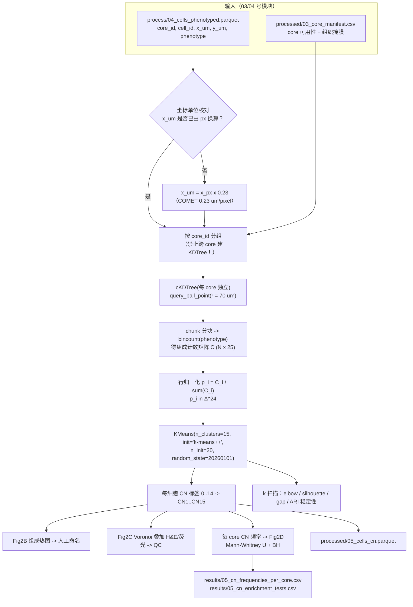

# 05 细胞邻域（CN）分析与 K-means

> **目标文献**：Wang J, Nagarajan P, et al. *Integration of spatial single-cell proteomics and spatial metabolomics
> reveals tumor microenvironment predictive of immunotherapy response in mucosal melanoma.* bioRxiv 2026.
> DOI: 10.64898/2026.04.23.720453（预印本，未经同行评审）
>
> **模块对应原文**：Fig. 2A–D、Supp. Fig. 2；Methods 中「CN definition」段（原文 1023 行版第 584–590 行）；Results 中「Distinct spatial cellular neighborhoods in MuM」整节
> **前置依赖**：`03_影像预处理配准与细胞分割.md`（产出细胞级坐标表）、`04_细胞表型定义与注释.md`（产出细胞表型标签）。本模块需要的两个契约：`processed/04_cells_phenotyped.parquet`（细胞级表：`core_id / cell_id / x_um / y_um / area_um2 / major_type / phenotype`）与 `processed/03_core_manifest.csv`（每个 core 的可用性与组织掩膜）。**若 03/04 号文档最终产物名不同，以 `PROJECT_SPEC.md` §4 契约表为准**（见 §2.6 的 ⚠️ 批注）。
> **复现难度**：★★★☆☆　**预计工时**：3 人日　**计算资源**：32 核 CPU / 64–128 GB 内存（邻域搜索峰值内存 ~8 GB）；**不需要 GPU**

---

## 1. 科学问题与逻辑位置

**一句话**：细胞类型比例告诉你「组织里有什么细胞」，细胞邻域（CN）告诉你「每种细胞待在什么样的邻居环境里」。

本模块是全文空间叙事的**第一块基石**：后续的空间上下文图（`06_空间上下文图与邻域界面分析.md`）、patch 邻近分析（`07_Patch邻近分析.md`）、Delaunay 相互作用检验（`08_细胞间相互作用推断与置换检验.md`）、无监督空间分型（`09_临床关联与无监督空间分型.md`）以及蛋白–代谢物空间耦合（`10_空间代谢组学分析.md`、`11_蛋白-代谢物空间耦合与多组学整合.md`）**全部消费本模块产出的 CN 标签**。CN 一旦错，下游全错。

```
03/04 号模块：695,444 个细胞（coords + phenotype 状态标签；原文 25 个 / 我方 04 号文档 23 个，见 §1.1）
                    │
                    ▼
     本模块(05)：CN = 局部组成的无监督离散化
     ├─ 每细胞 70 μm 窗口内的 25 维组成向量 p_i ∈ Δ²⁴
     ├─ K-means(k=15) → 15 个 CN 标签（CN1–CN15）
     ├─ 生物学命名（composition heatmap + 与原文 15 个 CN 逐一对齐）
     └─ 每 core 的 CN 频率表 → pre-R / pre-NR / post-NR 组间比较（Fig. 2D）
                    │
        ┌───────────┼───────────────┬──────────────────┐
        ▼           ▼               ▼                  ▼
   06 空间上下文  07 patch 邻近   08 Delaunay 互作   09 无监督分型
   （CN–CN 邻接） （CN13 周边）    （CN 内细胞对）    （CN 组成聚类）
```

**上游输入**：细胞级表（坐标单位必须明确是 μm 还是 px —— 见 §2.4）；**下游输出**：`processed/05_cells_cn.parquet`（细胞 × CN 标签，主产物）＋ 同内容的 **`processed/05_cells_cn.h5ad` 格式镜像**（供 `08`/`09`/`11` 等 AnnData 消费者；`obs["cn"]` 为**顺序固定**的分类 `CN1`…`CN15`，另存 `cn_int` 与 `cn_name`）、`results/05_cn_frequencies_per_core.csv`（core × 15 个 CN 频率）。

### 1.1 与 `04_细胞表型定义与注释.md` 的接口口径（已对齐，务必遵守）

| 项 | 规范值（以 04 号文档的契约为准） | 本文件的处理 |
|---|---|---|
| 状态粒度表型列 | **`phenotype`** | CN 组成向量**主路径**用它（见 §5.4 D05-2） |
| 谱系粒度列 | **`major_type`**（8 类 + `Unassigned`） | 敏感性分析用（§4.4d） |
| 分组列 | **`response_timepoint`**（取值 `pre_R` / `pre_NR` / `post_NR`；**没有 post_R**） | 所有组间比较都用它（本文件**不使用** `group` 这个名字，避免与 04 号文档的列名混用） |
| 其他列 | `core_id`、`patient_id`、`tma_id`、`cell_id`、`pos_<marker>`（布尔） | 逐芯建树的键 = `core_id` |
| 下游期望的容器 | `08_细胞间相互作用推断与置换检验.md` 明确消费 **`processed/05_cells_cn.h5ad`** 且 `obs["cn"]` 为顺序固定的分类 | 本模块**同时**产出 parquet（主）与 h5ad（镜像），内容等价；两者都由 05 生成，**不构成第二个生产者**（L0 §4.2） |

> ⚠️ **导师批注（表型数量差异，必须写进方法学与 gap 表）**：原文报告 **25 个 cellular phenotypes**；`04_细胞表型定义与注释.md` 的规则式注释给出的是 **23 个状态**（少 2 个，原因不可知，04 号文档已如实登记，**并明确禁止为凑数而拆分类别**）。因此**本模块实际的 $K = 23$**，代码一律用 `K = len(phenos)` 从数据动态确定，**绝不写死 25**。本文件中凡出现"25 个 phenotype"均指**原文层级**；我们的主路径 = **23 个状态粒度 phenotype** + **8 个 `major_type`（敏感性）**。
>
> 由此产生一个**功能性判据**：原文 CN6/CN15/CN14 的语义（增殖型/中央型/侵袭型肿瘤）依赖"肿瘤的三种状态"（Ki67⁺ / MIF⁺ / HLA-DR⁺）。只要 04 号文档保留这三种状态，CN 的语义就能重建；若 04 号只给出一个"Tumor"标签，则 Fig. 2B 的 4 个肿瘤相关 CN **无法区分** —— 这时必须先回到 04 号文档补状态拆分（见 §6.2 QC #9）。

**它为什么是"算法复现优先"的典型**：CN = 「窗口 → 组成向量 → K-means」三步，全部可用 `scipy` + `scikit-learn` 重实现，**不依赖任何商业软件**。原文唯一的工具依赖是 SPACEc 管线（文献 50），而 SPACEc 只是**流程管理封装**，不是算法本体（见 §2.5）。



---

## 2. 背景知识与原理

### 2.1 CN 概念的学术谱系：从 Schürch 2020 到 MuM

| 年份 | 工作 | 核心贡献 | 与本文的关系 |
|---|---|---|---|
| 2020 | **Schürch et al., *Cell* 183:838**（原文引用 **17**，题为 *Coordinated Cellular Neighborhoods Orchestrate Antitumoral Immunity at the Colorectal Cancer Invasive Front*） | 用 CODEX 在 CRC 侵袭前沿定义 **10 个 CN**（每个 CN 由 9 类细胞的局部比例向量经 K-means 得到），证明"细胞邻域"比"细胞比例"更能解释抗肿瘤免疫协调性；提出「CN 是**局部组成**而非细胞类型」的范式 | **CN 方法论的原始出处**；原文 Introduction 引 17 支撑"TME 的空间结构影响免疫控制与治疗反应" |
| 2021 | Schürch 的后续（淋巴结、乳腺癌等） | 把 CN 与临床终点、CN 间的"邻接偏好"结合 | 空间上下文图（本文 Fig. 3A）的雏形 |
| 2025 | **Liu et al., *Cancer Cell* 43:905**（原文引用 **31**） | 在单细胞空间多组学中定义 CAF 的保守空间亚型与 CN，给出 CN 分析方法学细节 | **原文 Methods「CN definition」直接引用的方法来源**：「a window was defined according to the index cell and its surrounding cells within a radius of **70 μm** (31)」 |
| 2025 | **Tan et al., *Nat Commun* 16:10652 — SPACEc**（原文引用 **50**） | 面向多重成像的可交互 Python 流程（预处理、表型、CN、可视化的一体化封装） | **原文实际使用的管线框架**：「The comprehensive spatial analysis of cellular neighborhoods were further managed using the SPACEc pipeline (50)」 |
| 2026 | **本文（MuM）** | 把 CN 与空间代谢组耦合，并把 CN 用于 ICI 响应分层 | 本模块 |

> ⚠️ **导师批注**：原文 Methods 对 CN 方法学**只有 7 行**（70 μm 窗口 → 计数 → 转比例 → K-means k=15 → H&E 叠加验证 → SPACEc 管理），**没有报告**：K 的选择依据、是否标准化、K-means 的初始化与随机种子、窗口是否包含索引细胞、用的是 25 个 phenotype 还是 8 个 major cell type、距离计算是否含跨 core 邻居。这 6 项全部是本模块的 D 表裁决项（§5.4）。方法学正文引的是文献 31 而非 17 —— 复现时**两篇都要读**：Schürch 2020 提供概念与直觉，Liu 2025 提供参数（70 μm）。

### 2.2 CN 与「细胞类型比例」的本质区别

这是初学者最容易混淆的一点，必须用数学说清。

- **细胞类型比例**（composition）：$q_k = n_k / N$，一个**全局**的、**K 维**（K = 细胞类型数）的向量，所有细胞（或所有 core）共享同一个尺度。
- **CN 组成向量**（neighborhood composition）：对**细胞 $i$**，$p_i \in \Delta^{K-1}$，$\Delta^{K-1} = \{p \in \mathbb{R}^K_{\ge 0} : \sum_k p_k = 1\}$ 是 **K−1 维单纯形**。它描述的是**细胞 $i$ 周围局部**（半径 70 μm 内）的组成。

| 维度 | 细胞类型比例 | CN |
|---|---|---|
| 定义域 | 1 个向量（全体细胞） | N 个向量（每个细胞一个） |
| 信息量 | K 个数 | N × K 个数 |
| 空间性 | **无**（打乱坐标不变） | **有**（取决于 $x,y$） |
| 对同一比例的不同空间配置 | 无法区分 | 可区分 |
| 与下游统计的关系 | 一个 core 一个点 | 一个 core 一个 CN 频率分布 |

**一个必须记住的反例**：假设某 core 有 30% 肿瘤细胞、30% CD8⁺ T、30% CD163⁺ 巨噬、10% 其他。

- 若三种细胞**均匀混在一起**：几乎每个细胞的 70 μm 窗口都是「肿瘤 + CD8 + 巨噬 + 其他」的均匀混合 → 全部细胞落到**同一个**（混合型）CN。
- 若三种细胞**各自成岛（隔 200 μm 以上）**：窗口内几乎只有单一类型 → 细胞分别落到「肿瘤 CN / CD8 CN / 巨噬 CN」三个**不同的** CN。

两种情况**细胞类型比例完全相同**（30/30/30/10），但 CN 频率完全不同。**原文的核心论点「CN15、CN14、CN13 在 pre-R 富集」之所以比「major lineage 比例无差异」（Supp. Fig. 1A–B）更有信息量，正是因为 CN 捕捉到了比例之外的空间配置。**

> ⚠️ **导师批注**：原文 Supp. Fig. 1A–B 报告"major TME lineage 比例在 pre-R vs pre-NR 无显著差异"，而 Fig. 2D 报告 CN15/14/13 有差异 —— 这两个结论**不矛盾**，恰恰是 CN 分析的增值所在。写作时不要把前者当作"阴性结果"丢弃（L0 §12.5）。

### 2.3 窗口法 vs kNN 法：原文的两处定义必须辨析

**原文在同一篇论文里给了两个不同的"窗口"定义**：

| 出处 | 原文句 | 窗口定义 |
|---|---|---|
| Methods「CN definition」 | "a window was defined according to the index cell and its surrounding cells within a **radius of 70 μm** (31)" | **固定半径 70 μm**（geometric，几何窗口） |
| Methods「Spatial context map」 | "First, a **window size of 70 nearest neighbors** was used to create the composition vectors"　→「Cellular neighborhood interface analysis」同 | **固定近邻数 70**（ordinal，序数窗口） |

> ⚠️ **导师批注（原文第 3 号矛盾，须登记到 `12_复现质控清单、排错与批判性评述.md`）**：**70 μm 半径窗口 ≠ 70 近邻窗口**。这不是笔误级别的差异，而是两种性质完全不同的算子。复现时的裁决：**主路径用半径 70 μm（因为它是「CN definition」段的定义，且引了文献 31 的方法学）**；同时把「70 近邻」作为敏感性分析整体重跑一遍（本模块 §4.6 给出完整实现），并把两者的 CN 频率差异报告出来。原文 Fig. 3A/3F 的上下文图与重心坐标既然用的是 70 近邻，下游 `06_空间上下文图与邻域界面分析.md` 就以 70 近邻为主路径 —— **两套窗口在项目内必须各有唯一名号，不得混称"窗口"**。

**两种算子的数学性质对比**：

| 性质 | 固定半径 r（70 μm） | 固定近邻数 k（70 NN） |
|---|---|---|
| 定义 | $\mathcal{W}_i = \{j : \lVert x_j - x_i \rVert \le r\}$ | $\mathcal{W}_i$ = 距 $i$ 最近的 70 个细胞 |
| 窗口内细胞数 | **可变**（$n_i = |\mathcal{W}_i|$） | **恒定**（= 70） |
| 物理尺度 | **恒定**（r 就是物理尺度） | **可变**（密度高时半径小） |
| 组织边缘行为 | 边界处窗口被截断 → $n_i$ 偏小 → 组成向量噪声大 | 边缘处窗口自动"向内拉"→ 不缺样本，但**尺度失真** |
| 密度异质性 | 稀疏区窗口内细胞少 → 组成估计方差大 | 稀疏区窗口物理跨度大 → 可能跨越多个结构 |
| 组成向量方差 | 大（$n_i$ 小时二项/多项噪声大） | 小（恒定 n=70） |
| 与"生物尺度"的对应 | **严格**（70 μm 就是 70 μm） | 需换算才可解释 |
| 对 CN 语义的影响 | "在 70 μm 邻域内谁占主导" | "在最近的 70 个邻居里谁占主导" —— 高密度区等价于很小的物理半径，CN 会变得更"局部" |

**本队列的定量换算**（帮助读者建立直觉；**这是我们的估算，原文未报告细胞密度**）：

- 组织面积估计：97 个 core × π × (500 μm)² = 7.62 × 10⁷ μm²（若芯内组织占满圆面积的 100%）。
- 细胞密度下界：695,444 / 7.62 × 10⁷ = **9.13 × 10⁻³ cells/μm²**；若组织占芯面积 70%（TMA 常见），密度 ≈ 1.31 × 10⁻² cells/μm²。
- **半径 70 μm 窗口内的平均细胞数** = ρ × π r² = 9.13×10⁻³ × 15,394 ≈ **141 个**（若 ρ 高则 ≈ 201 个）。
- **70 近邻对应的等效半径**：$\pi \rho r_{70}^2 = 70 \Rightarrow r_{70} = \sqrt{70/(\pi\rho)} \approx$ **49 μm**（ρ 低时）～ **41 μm**（ρ 高时）。

**结论**：在本数据中「70 近邻」≈「41–50 μm 半径」，**比 70 μm 半径窗口小约 30–40%**。两个定义给出的 CN 必然不同 —— 这不是可以"忽略"的差异，而是本模块最重要的敏感性分析来源。该换算必须写进我们的 QC 报告（把 `results/05_window_equiv_radius.csv` 记录下来）。

**第三种选择（本项目补充）**：**自适应半径**（$r_i$ 取使窗口内恰好 ~140 个细胞的半径）在方法学上介于两者之间，本模块仅作为探索性分析，不进入主结论。

### 2.4 坐标单位：0.23 μm/pixel 是所有空间分析的地基

原文 Methods：「The resulting OME-TIFF image stacks (**0.23 μm/pixel** resolution) were processed with flat-field correction and autofluorescence subtraction」。因此：

$$r_{px} = \frac{r_{\mu m}}{0.23} = \frac{70}{0.23} \approx 304.3\ \text{px}$$

| 量 | μm | px（@0.23 μm/px） |
|---|---|---|
| CN 窗口半径 | **70** | **304.3** |
| patch 邻近半径 | 5 / 10 / 15 / 20 / 25 | 21.7 / 43.5 / 65.2 / 87.0 / 108.7 |
| Delaunay 互作阈值 | **60.95**(≈61，由 265 px 反推) | **265**（原文写法） |
| TMA 芯直径 | 1000 | 4348 |

> ⚠️ **导师批注（本模块第一号陷阱）**：如果把 70 当成**像素**传给 `query_ball_point`，窗口半径变成 70 × 0.23 = 16.1 μm（相当于只覆盖 1–2 个细胞直径、平均 ~5 个细胞），组成向量几乎退化为独热向量（one-hot）→ K-means 会把 CN 拆成"细胞类型"→ **CN 完全失去意义，但代码不报错**（L0 附录 C 的"静默失败"典型）。防御：在脚本里加断言 `assert 50 <= radius_um <= 200`，并把 `um_per_px` 作为**显式参数**（默认 0.23）写入 `logs/05_params.json`。

### 2.5 SPACEc 管线的定位与开源替代取舍

原文 CN 分析由 **SPACEc**（文献 50，*Nat Commun* 2025）管理。SPACEc 的定位是**流程编排与交互式可视化**（多重成像的 IMC/CODEX/Vectra 数据读入、表型注释、CN 计算、空间图渲染），**不是新算法** —— 它的 CN 实现内核同样是「局部组成 → K-means」。

**三种开源路径的取舍表**（本项目选择 **C：自定义实现 + squidpy 做 QC 与邻接**）：

| 路径 | 代表 | 优点 | 缺点 | 本项目取舍 |
|---|---|---|---|---|
| **A. SPACEc** | `pip install spacec`；API 与模块名随版本变动较大 | 与原文同源，端到端；含交互式可视化 | 依赖较重；版本迭代快；CN 内部参数（半径/标准化/种子）**可能被封装而不可见** → 不利于复现透明度；若其实现有偏，"照抄"会继承偏差 | 不作主路径；在 §4.7 给出等价调用骨架并标注「需按当前版本核对」 |
| **B. scimap** | `sm.tl.spatial_aggregate(method="radius", radius=70, ...)` | 一行完成"半径内表型计数"；与 scimap 的邻域富集/可视化生态集成 | 半径单位随 `x_coordinate` 单位变化（无内部换算）；输出为概率矩阵需自行接 K-means；文档 API 更新频繁 | 作为**交叉验证路径**：用 scimap 结果与自实现比对（`results/05_crosscheck_scimap_vs_custom.csv`） |
| **C. 自定义（推荐）** | `scipy.spatial.cKDTree` + `sklearn.cluster.KMeans` + `squidpy` 做邻接/共现 | **每一步都可见、可断言、可固定种子**；内存与耗时可控；产物格式完全由契约表定义；可移植到 `tools/` | 需自己写窗口查询与 QC 图 | **主路径**：`tools/spatial_cn_kmeans.py`（仓库级可复用脚本，见 L0 §1.4） |
| **D. squidpy**（补充生态） | `sq.gr.spatial_neighbors`、`sq.gr.co_occurrence`、`sq.gr.nhood_enrichment` | 成熟、文档好、内置置换检验与可视化 | **没有 CN（K-means 组成聚类）功能** → 不能替我们做 CN；只能做「CN 标签的空间邻接/共现」等 QC | 用于 §4.5 的邻接 QC 与 `08` 号文档的下游 |

> ⚠️ **导师批注**：原文引 SPACEc（文献 50）发生在「CN definition」段的最后一句（"The comprehensive spatial analysis of cellular neighborhoods were further **managed** using the SPACEc pipeline"）。"managed"一词说明 SPACEc 是**管理/编排**层。复现方案里必须显式声明："我们以自实现替换 SPACEc 的编排层，算法（窗口组成 + K-means）与参数（r = 70 μm、k = 15）保持一致"；不要写成"复现了 SPACEc"。

### 2.6 组成向量、单纯形与 K-means 的目标函数

**（a）组成向量的构造。**

对细胞 $i$，设窗口内表型计数为 $c_{ik}$（$k = 1..K$），则

$$p_{ik} = \frac{c_{ik}}{n_i},\qquad n_i = \sum_{k=1}^{K} c_{ik},\qquad \sum_k p_{ik} = 1,\ p_{ik}\ge 0$$

其中 $n_i = |\mathcal{W}_i|$（半径法下可变；kNN 法下恒为 70 或 71，取决于是否计入索引细胞）。

**（b）为什么可以在欧氏空间做 K-means（不必显式投影到单纯形）。**

K-means 的聚类中心 $\mu_c$ 是一簇内样本的**算术平均**：

$$\mu_c = \frac{1}{|S_c|}\sum_{i \in S_c} p_i$$

因为 $\sum_k p_{ik} = 1$ 对每个 $i$ 成立，所以

$$\sum_k \mu_{ck} = \frac{1}{|S_c|}\sum_{i \in S_c}\sum_k p_{ik} = 1$$

**即：单纯形在算术平均下封闭 —— 凸集的中点仍在凸集内。** 所以 K-means 的中心天然满足 $\mu_c \in \Delta^{K-1}$，**不需要任何投影步骤**（这一点在归一化/标准化之后再聚类就不成立了，见 §5.2）。

**（c）K-means 目标函数（原文未写，这是标准形式）。**

$$J = \sum_{c=1}^{k}\sum_{i \in S_c} \lVert p_i - \mu_c \rVert_2^2,\qquad
\mu_c = \frac{1}{|S_c|}\sum_{i\in S_c} p_i,\qquad
c(i) = \arg\min_{c'} \lVert p_i - \mu_{c'} \rVert_2^2$$

**Lloyd 迭代**：① 初始化 $k$ 个中心 → ② 分配（assignment，上式 $c(i)$）→ ③ 更新（update，上式 $\mu_c$）→ 重复 ②③ 直到分配不再变化（或达到 `tol`/`max_iter`）。**Lloyd 迭代对 $J$ 单调不增且有下界 → 必然收敛，但只收敛到局部最优**（这是重点）。

**（d）为什么 k-means++ 初始化在本问题上格外重要。**

- 组成向量位于 **25 维空间的低维流形（24 维单纯形 $\Delta^{24}$）**上，且真实数据**高度集中在少数区域**：绝大多数细胞的窗口是"某种主导类型 + 少量杂细胞"，即**靠近单纯形顶点**。数据在单纯形上不是均匀的，而是**顶点附近极密、中心极稀**（"沙漏形"分布）。
- 若用随机初始化（`init='random'`），多个初始中心可能同时落在同一个顶点邻域 → 某几个中心"浪费"在同一簇 → 出现**空簇**（sklearn 会重新播种，但不保证解决）或把一个大簇硬切成两半 → **不同 `random_state` 给出差异巨大的 CN 划分**，不可复现。
- **k-means++** 按 $D^2$ 采样（新中心被选中的概率正比于其到已有中心最近距离的平方）→ 强制初始中心**彼此远离**→ 在顶点密、中心稀的分布上显著更稳。原文未报告初始化方式；**我们的决策：`init="k-means++"`、`n_init=20`（20 组独立初始化取最优 $J$）、`random_state=20260101`**。
- **验证初始化影响**：跑 `n_init=1` + 20 个不同 `random_state`，比较 20 次运行之间的 **ARI 中位数**。若 ARI < 0.9，说明 K=15 的划分**不稳定**，此时任何下游的"CN 富集"结论都不可信。

**（e）欧氏距离 vs Aitchison 距离（组成数据的"正确"度量）。**

严格说，组成数据（compositional data）的**自然度量**是 Aitchison 几何：先做中心对数比变换（CLR）

$$\mathrm{clr}(p)_k = \log p_k - \frac{1}{K}\sum_{k'}\log p_{k'}$$

再在 $\mathbb{R}^{K}$ 的零和子空间上用欧氏距离。因为组成数据的**有效维度是 $K-1$**（和约束），欧氏距离会引入"伪相关"。

但在**本问题上**，我们**主路径仍用欧氏距离**，理由是：

1. 原文明确写 "transformed into a **proportion** for further K-means clustering" —— 没有任何变换；
2. 欧氏 K-means 的中心保持在单纯形内（上面 (b)），CLR 空间则不是；
3. 两种度量在**顶点附近高度一致**（$\lVert \cdot \rVert_2 \le \lVert\cdot\rVert_1 \le \sqrt{K}\lVert\cdot\rVert_2$ 给出等价的球拓扑；组成差异大时两种度量都大），差异主要体现在**稀有类型的权重**：CLR 放大稀有类型的相对差异。
4. **零值问题**：CLR 需要对 $p_{ik}=0$ 做伪计数（pseudocount，如 0.5/N），引入额外主观参数。

→ **我们的决策**：主路径欧氏；把 CLR + 伪计数作为**敏感性分析**（§4.4），并报告两套 CN 划分的 **ARI**。这个分析本身就是有价值的复现证据：如果两套划分 ARI 高，说明"用不要 Aitchison 变换"这个选择不改变结论。

**（f）k = 15 的选择。**

原文直接写 "K-means clustering with **k = 15** and allocated to each CN"，**未报告任何 K 的选择依据**（无肘部图、无 silhouette、无 gap statistic、无稳定性分析）。15 与 Schürch 2020 的 10 个 CN 也不同（不同肿瘤、不同标记面板，不能直接类比）。

**我们的复现决策**：**k = 15 为主（对齐原文）**，并**必须**附一套 K 扫描敏感性分析：
- **肘部法**（inertia / WCSS）：$J(k)$ 随 $k$ 单调下降，找拐点；
- **silhouette**（轮廓系数，对 $k$ 敏感但要慎用：组成数据在单纯形上，轮廓系数系统性偏低）；
- **gap statistic**（Tibshirani 2001，需要参考零分布 —— 对组成数据建议用**单纯形的均匀 Dirichlet** 采样，而非高斯）；
- **稳定性（本项目最看重）**：对每个 $k$，做 $B=50$ 次 **80% 细胞下采样**，计算各次划分之间的 mean pairwise **ARI**（consensus stability）；稳定平台对应的 $k$ 才可信；
- **生物学可解释性**：$k$ 越大越容易出现"同一生物学 CN 被拆成两个只有微小差异的 CN"（下游命名会暴露这一点）。

把全部结果写进 `results/05_kmeans_k_selection.csv` 与 `figures/FigS2B_k_selection.pdf|png`。

### 2.7 内存、时间复杂度与分块策略

设细胞数 $N = 695{,}444$，表型数 $K$（原文 25，我方 23；下面的量级估算按 $K = 25$ 计，对内存/复杂度的差异 < 10%），窗口平均邻居数 $\bar n \approx 141$。

| 步骤 | 朴素做法 | 复杂度/内存 | 我们采用的策略 |
|---|---|---|---|
| 邻域搜索（半径法） | $N \times N$ 距离矩阵 | $4.8 \times 10^{11}$ 个 float64 ≈ **3.9 TB** → 不可能 | `scipy.spatial.cKDTree`（每 core 一棵树）+ `query_ball_point`，复杂度 ~$O(N \log N + \text{结果数})$ |
| 邻域搜索（kNN 法） | `query(k=70)` 一次性 | 索引 int64 + 距离 float64：695,444 × 70 × 16 B ≈ **780 MB**（尚可，但会与 K-means 抢内存） | **分块**（chunk = 20,000）：每块 20,000 × 70 × 16 B ≈ 22 MB |
| 组成向量 | 稀疏矩阵存储 pair 列表 | nnz ≈ 695,444 × 141 ≈ **9.8 × 10⁷** → 稀疏 int32 indices + float32 data ≈ 780 MB | **不存 pair 列表**：每个 chunk 内 `np.bincount(labels[idx], minlength=K)` 直接得 `(chunk, K)` 计数 → 峰值内存 20,000 × 25 × 4 B = 2 MB |
| 组成矩阵 | 稠密 float32 | 695,444 × 25 × 4 B ≈ **69.5 MB** | 直接落盘 `parquet`/`npz` |
| K-means | `sklearn.KMeans` | $O(NKk\,t)$，$t$ = 迭代数；每次迭代 ≈ 695,444 × 25 × 15 ≈ 2.6 × 10⁸ flops | 单机 32 核 `n_jobs` 自动（sklearn ≥1.3 用 OpenMP）；`n_init=20` → 预计 3–10 min |
| K 扫描（k = 8..30 + 稳定性） | 21 个 k × (1 + 50 次 bootstrap) | 约 21 × 51 = 1071 次 K-means | **必须并行 + 用 `MiniBatchKMeans` 做初筛**；完整稳定性分析放到夜间批处理 |

**关键实现要点**：

1. **按 core 分组建树**。TMA 上 97 个 core 排布在同一张玻片上，core 之间的物理间距只有几百 μm —— 若建**一棵全局 KDTree**，70 μm 窗口会**跨芯取邻居**（TMA 相邻芯中心距常 1.5–2 mm，一般不会命中；但边缘芯、碎裂芯、以及"同一芯内被组织缝隙分开的两块组织"会）。**必须 `groupby("core_id")` 逐芯建树**，这是本模块与 GBM 项目（每切片一棵树）的最大实现差异。
2. **chunk 大小**：由"分块 × 平均邻居数 × 8 B"决定，控制在 < 500 MB。20,000 是安全默认值。
3. **`query_ball_point(..., return_sorted=False, return_length=False, workers=-1)`**（`workers` 需 SciPy ≥ 1.6；`return_sorted=False` 在大量查询时显著更快，因为我们只要计数不要排序）。**需按当前 SciPy 版本核对参数名**。
4. **不要把 `idx` 列表转成 Python list of lists**（9.8 × 10⁷ 个 Python int 会吃掉 ~4 GB）。
5. 落盘中间产物用 `float32`（组成向量 ∈ [0,1]，float32 精度绰绰有余，省一半内存）。

---

## 3. 原文逐句拆解

| # | 原文句（English 原词保留） | 中文转述 | 对应操作 | 原文是否给参数 | 缺失项 → 我方复现决策 |
|---|---|---|---|---|---|
| 1 | "To identify CNs, a window was defined according to the **index cell and its surrounding cells within a radius of 70 μm** (31)." | 以索引细胞为中心、半径 70 μm 的窗口 | 每芯 `cKDTree.query_ball_point(cells, r=70 μm→304.3 px, **含索引细胞本身**)` | ✅ 半径 70 μm；引用文献 31 | **索引细胞是否计入**：原文写 "the index cell **and** its surrounding cells" → **计入**（`query_ball_point` 会返回自己，无需剔除）；kNN 版本则需 `k=70` **包含**自身（即 query 70 个最近点含自身）还是 70 个邻居？→ 见 #7 |
| 2 | "The index cell and its surrounding cells in a window were **counted and annotated** and further **transformed into a proportion** for further K-means clustering" | 窗口内细胞按注释（表型）计数 → 转比例 | `bincount(phenotype_code[idx], minlength=K)` → 行归一化 | ❌ 未说明"annotated"是 25 个 phenotype 还是 8 个 major type | **主路径用状态粒度 phenotype（原文 25 / 我方 23，见 §1.1）**（与 Fig. 4I 图注 "cell **phenotype**-defined CNs" 一致）；**备选 8 个 major cell type** 作敏感性分析。两者 CN 语义差别很大：8 类会让"Ki67⁺ 肿瘤"与"MIF⁺ 肿瘤"落进同一个 CN，而原文的 CN6/CN15/CN14 恰恰要靠肿瘤**状态**区分 → 支持 25 类 |
| 3 | "**K-means clustering with k = 15** and allocated to each CN" | K-means，k = 15，每个细胞分配一个 CN | `KMeans(n_clusters=15, init="k-means++", n_init=20, random_state=20260101)` | ✅ k = 15；❌ 初始化/种子/是否标准化 | 初始化与种子→§2.6(d)；标准化→§5.2（主路径**不标准化**）；**所有 695,444 个细胞一起聚类**（不是逐芯聚类，也不是逐患者）→ 这点原文未写但由图 2B "relative proportions of each CN across all tissue cores" 推断 |
| 4 | "To validate the CN assignment, these allocations were **overlaid on the original tissue H&E-stained and fluorescent images**." | 把 CN 分配叠加到 H&E 与荧光图上做验证 | `matplotlib` 散点（按 CN 着色）+ 底图 H&E/COMET 叠加；逐 CN 目视 | ✅ 方法；❌ 验证判据 | 我们的 QC 判据（§6.2）：① 每个 CN 在空间上**连通成片**而非散点；② CN 边界与 H&E 形态学边界（瘤巢/间质/免疫聚集）大致吻合；③ CN15 位于瘤芯、CN14 环绕、CN13 在瘤-髓界面（原文 Fig. 2C 的空间关系） |
| 5 | "This approach identified **15 distinct CNs**, which were characterized by their cellular **composition (heatmap; Fig. 2B, left)**, their **relative abundance across samples (Fig. 2B, right)**, and their **spatial distribution within tissues (Supp. Fig. 2)**." | 15 个 CN，用组成热图、样本间相对丰度、组织内空间分布三种方式刻画 | 组成热图（15 × 25，行=CN，列=phenotype，值=该 CN 内该 phenotype 的平均比例或 z-score）；每芯 CN 频率箱线图；逐芯空间图 | ✅ 三种表征；❌ 热图的标准化方式 | 热图主图用**行归一化的平均组成**（每行和为 1）+ 抑制色标；附表另给 z-score 版（便于看小型群体） |
| 6 | "**CN6 (proliferative tumor)** was enriched for Ki67⁺ tumor cells…**CN15 (central tumor)** …enriched for MIF⁺ tumor cells…predominantly localized to tumor cores…**CN14 (invasive tumor)** comprised a mixture of tumor cell states (Ki67⁺, MIF⁺, and HLA-DR⁺)…**CN13 (tumor boundary)** contained tumor cells together with infiltrating macrophages" | 4 个肿瘤相关 CN 的生物学命名与判据 | 命名规则：CN6 = argmax(P(Ki67⁺ tumor))；CN15 = argmax(P(MIF⁺ tumor))；CN14 = 肿瘤状态混合（三种肿瘤状态的份额均 > 阈值且无单一状态极强）；CN13 = 肿瘤 + CD163⁺ 巨噬共主导 | ✅ 定性判据；❌ 定量阈值 | 我们给**可执行的命名规则表**（§4.5 表 + 代码），阈值写入 `logs/05_naming_rules.json`，保证命名可复现而非"看图起名" |
| 7 | "Of note, the central tumor CN (**CN15**) was **surrounded by** the invasive tumor CN (**CN14**). In turn, **CN14 was bordered by** the tumor boundary CN (**CN13**)." | CN15 ⊂ CN14 ⊂ CN13 的嵌套空间关系 | 用 **CN–CN 邻接矩阵**（kNN 邻接图上 CN 对共现计数）量化"环绕" | ✅ 定性结论；❌ 邻接定义、显著性检验 | 我们的量化：对每个细胞取最近 6 个邻居（等效 20–30 μm），统计 (CN_i, CN_j) 共现 → 归一化为邻接偏好矩阵（observed/expected），并检验 CN15–CN14 与 CN14–CN13 是否排在前列。这正是 `06_空间上下文图与邻域界面分析.md` 的输入 |
| 8 | "**CN10 (Vimentin+ stroma)** …**CN1 (Vimentin+SMA+ stroma)** … a myofibroblastic CAF context…**CN9 (tumor-infiltrated stroma)** and **CN12 (immune-infiltrated stroma)** …mixed stromal–tumor or stromal–immune populations" | 4 个基质相关 CN | 命名规则：CN10 = argmax(P(Vimentin⁺ stroma))；CN1 = argmax(P(Vimentin⁺SMA⁺ stroma))；CN9 = 基质 + 肿瘤混合；CN12 = 基质 + 免疫混合 | ✅ 定性 | 同上，量化规则 |
| 9 | "**CN3 (DC)** …enriched for dendritic cells, **CN2 (NK cells)** …natural killer cells. **CN4 (B cells)** and **CN5 (B & CD4⁺ T)** …**CN7 (CD8⁺ T)** …**CN11 (immune-enriched)** …heterogeneous immune population…**CN8 (mixed cells)** displayed a diverse cellular composition **without dominance of a single lineage**" | 7 个免疫/混合 CN | CN3 = argmax(P(DC))；CN2 = argmax(P(NK))；CN4 = argmax(P(B))；CN5 = B 与 CD4⁺ T 共主导；CN7 = argmax(P(CD8⁺ T))；CN11 = 多个免疫类型同时升高（免疫类型总份额高但无单一主导）；CN8 = **组成熵最大**且无谱系主导 | ✅ 定性；❌ "without dominance"的判据 | CN8 的量化：用 **Shannon 熵** $H_i = -\sum_k p_{ik}\ln p_{ik}$（或归一化熵 $H_i/\ln K$）在全部 CN 中心上取最大者；"主导"阈值取 $p_{\max} \le 0.25$ |
| 10 | "Comparative analysis of CN frequencies further revealed that **CN15, CN14, and CN13 were significantly enriched in pre-treatment R cores and in post-treatment NR cores (Fig. 2D)**" | CN15/14/13 在 pre-R 与 post-NR 富集 | 每芯 CN 频率（该芯内 CN 细胞数 / 该芯总细胞数）→ Mann–Whitney U（pre-R vs pre-NR；pre-NR vs post-NR）→ BH 校正 | ✅ 检验方法与 CN（Fig. 2D 图注 "Mann–Whitney U test"，星号 *p<0.05, **p<0.01, ***p<0.001）；❌ 效应量、是否 BH 校正、n（每组 core 数） | 我们**必须加效应量**（median 差 + Cliff's delta）与 BH 校正后的 q；并补**患者层聚合**的敏感性分析（同一患者 3 个芯不独立 → 见 §7 陷阱 6） |
| 11 | "The comprehensive spatial analysis of cellular neighborhoods were further **managed using the SPACEc pipeline (50)**" | 全流程由 SPACEc 管理 | 我们以自实现替换其编排层（§2.5） | ✅ 工具 | 明示"算法等价、编排替换"，不声称复现 SPACEc 本身 |
| 12 | Results「Distinct spatial cellular neighborhoods in MuM」标题句："we performed cellular neighborhood (CN) analysis, which **quantifies local cellular composition using a window-based spatial model across the tissue**" | CN 量化的是局部组成 | 与 §2.2 的概念辨析一致 | — | 写作时强调"local composition"是 CN 的定义性特征 |

---

## 4. 逐步可运行代码

> 环境：Python 3.11；`numpy` 1.26、`pandas` 2.2、`scipy` 1.13、`scikit-learn` 1.5、`pyarrow` 16（parquet）、`matplotlib` 3.9、`seaborn` 0.13、`squidpy` 1.6（可选，QC）、`scimap` 1.4（可选，交叉验证）、`tqdm` 4.66。
> 随机种子：`SEED = 20260101`（L0 §6.1，写在各脚本首行）。
> **生产实现**：本模块的核心算法已上移到仓库级可复用脚本 **`tools/spatial_cn_kmeans.py`**（L0 §1.4）。项目内 `code/05_*.py` 只放**编排与项目特有参数**（0.23 μm/px、分组口径、图形规格）。
> 运行生产脚本：
> ```bash
> # 入参/出参以脚本 --help 为准（tools/ 脚本接口属 L0 契约，变更需走 §11.1 流程）
> python tools/spatial_cn_kmeans.py --selftest     # 合成数据自检（`00_目录与复现总览.md` §工程约定 要求）
> python tools/spatial_cn_kmeans.py --help
> python tools/spatial_cn_kmeans.py \
>     --cells   processed/04_cells_phenotyped.parquet \
>     --core-col core_id --x-col x_um --y-col y_um --label-col phenotype \
>     --mode radius --radius-um 70 --k 15 --seed 20260101 \
>     --out-cells processed/05_cells_cn.parquet \
>     --out-composition processed/05_cn_composition.parquet \
>     --out-frequencies results/05_cn_frequencies_per_core.csv \
>     --log logs/05_cn_run.log
> ```
> 下面的代码块给出**该脚本的最小自实现版本**（保证在 `tools/` 不可用时仍能独立跑通，也便于逐行核对算法）。

### 4.1 构造组成向量（半径 70 μm，逐芯分块）

```python
# code/05_01_build_composition.py
"""半径 70 μm 窗口 → 组成向量。逐芯建 KDTree，分块查询，不落地 pair 列表。"""
import json, numpy as np, pandas as pd
from scipy.spatial import cKDTree
from tqdm import tqdm

SEED, UM_PER_PX = 20260101, 0.23          # COMET OME-TIFF 分辨率（原文 Methods）
RADIUS_UM, CHUNK = 70.0, 20_000
cells = pd.read_parquet("processed/04_cells_phenotyped.parquet")
# cells 列（契约）：core_id, patient_id, response_timepoint, cell_id, x_um, y_um, area_um2,
#                  major_type, phenotype

# --- 断言 1：坐标必须是 μm；若疑似 px 则立即换算并告警 ---
span = cells.groupby("core_id")["x_um"].agg(lambda s: s.max() - s.min()).median()
assert 200 < span < 1200, (
    f"core 内 x 跨度中位数 = {span:.1f}，不像 1.0 mm TMA 芯的 μm 尺度；"
    "请确认 x_um 是否已由 px 换算（1 px = 0.23 μm）")
# --- 断言 2：半径不能写成 px ---
assert 50 <= RADIUS_UM <= 200, "半径疑似用了像素值（应为 μm）"

phenos = sorted(cells["phenotype"].unique())            # 原文 25 / 我方 23 个状态（动态取 K）
K = len(phenos); pcode = {p: i for i, p in enumerate(phenos)}
print(f"K = {K} phenotypes, N = {len(cells):,} cells")

comp = np.zeros((len(cells), K), dtype=np.float32)
nwin = np.zeros(len(cells), dtype=np.int32)             # 每细胞窗口内细胞数

for core, idx in tqdm(cells.groupby("core_id").indices.items(), desc="cores"):
    sub = cells.iloc[idx]
    xy = np.c_[sub["x_um"].to_numpy(), sub["y_um"].to_numpy()].astype(np.float64)
    lab = sub["phenotype"].map(pcode).to_numpy(np.int32)
    tree = cKDTree(xy)                                   # ← 每芯一棵树，禁止全局树
    # 用 70 μm 的等效像素半径做一次自检（见 §6.2 QC）
    for s in range(0, len(sub), CHUNK):
        e = min(s + CHUNK, len(sub))
        nb = tree.query_ball_point(xy[s:e], r=RADIUS_UM, workers=-1,
                                   return_sorted=False)   # 含索引细胞自身
        cnt = np.zeros((e - s, K), dtype=np.int32)
        for j, lst in enumerate(nb):
            if lst:                                       # scipy>=1.6 返回 object array of lists
                cnt[j] = np.bincount(lab[lst], minlength=K)
        nwin[idx[s:e]] = cnt.sum(1)
        with np.errstate(invalid="ignore", divide="ignore"):
            comp[idx[s:e]] = (cnt / cnt.sum(1, keepdims=True)).astype(np.float32)

# 保存：组成矩阵单独落盘（float32，69.5 MB），窗口细胞数一并保存
np.savez_compressed("processed/05_cn_composition.npz",
                    comp=comp, nwin=nwin, cell_id=cells["cell_id"].to_numpy(),
                    phenotypes=np.array(phenos))
json.dump({"um_per_px": UM_PER_PX, "radius_um": RADIUS_UM, "radius_px": RADIUS_UM/UM_PER_PX,
           "k": 15, "K_phenotypes": K, "seed": SEED, "window_contains_index_cell": True,
           "n_cells": int(len(cells)), "median_window_n": float(np.median(nwin))},
          open("logs/05_params.json", "w"), indent=2, ensure_ascii=False)

# --- 质量断言（L0 附录 C：防静默失败）---
assert np.allclose(comp.sum(1), 1.0, atol=1e-5), "存在未归一化的组成行"
assert comp.shape[1] == K and not np.isnan(comp).any()
print("窗口内细胞数分位数:", np.percentile(nwin, [1, 5, 50, 95, 99]).round(1))
```

**预期输出（自检）**：`median_window_n` 落在 **100–220**（由 §2.3 的密度估算推出；若落在 3–10，说明半径被当成像素传了；若 > 600，说明坐标是 px 但被当 μm 用了 —— 即 `x_um` 里装的其实是 px，半径实际放大了 4.3 倍）。

### 4.2 K-means 聚类（k = 15）

```python
# code/05_02_kmeans_cn.py
import json, numpy as np, pandas as pd
from sklearn.cluster import KMeans
from sklearn.metrics import adjusted_rand_score, silhouette_score
from sklearn.utils import check_random_state

SEED, K_CN = 20260101, 15
z = np.load("processed/05_cn_composition.npz", allow_pickle=True)
comp, phenos = z["comp"], list(z["phenotypes"])
cells = pd.read_parquet("processed/04_cells_phenotyped.parquet")

# ---------------- 主路径：不做任何变换，欧氏 K-means ----------------
km = KMeans(n_clusters=K_CN, init="k-means++", n_init=20, max_iter=300,
            tol=1e-6, random_state=SEED)
lab0 = km.fit_predict(comp)                     # 0..14
cn = (lab0 + 1).astype(np.int16)                # 对齐原文命名：CN1..CN15
cells["cn"] = cn
cells["window_n"] = z["nwin"]
cells.to_parquet("processed/05_cells_cn.parquet", index=False)

# ---------------- 同内容的 h5ad 镜像（供 08/09/11 的 AnnData 消费者使用）----------------
# 契约说明（L0 §4.2）：生产者仍是 05，两个文件内容等价，h5ad 只是**格式镜像**，不是第二个生产者。
# 08 号文档的契约是 processed/05_cells_cn.h5ad 且 obs["cn"] 为**顺序固定的分类** CN1..CN15。
import anndata as ad                              # anndata >= 0.10
A = ad.AnnData(X=None, obs=cells.set_index("cell_id").copy())
A.obs["cn"] = pd.Categorical(A.obs["cn"].map(lambda i: f"CN{int(i)}"),
                             categories=[f"CN{i}" for i in range(1, K_CN + 1)], ordered=True)
A.obs["cn_int"] = cells["cn"].to_numpy().astype("int16")     # 整数口径，便于与前缀操作对齐
A.obsm["spatial_um"] = cells[["x_um", "y_um"]].to_numpy(np.float32)
assert list(A.obs["cn"].cat.categories) == [f"CN{i}" for i in range(1, K_CN + 1)]
assert A.obs["cn"].notna().all()
A.write_h5ad("processed/05_cells_cn.h5ad", compression="gzip")

# ---------------- QC-1：初始化稳定性（n_init=1 跑 20 个种子）----------------
aris = []
for s in range(20):
    l = KMeans(n_clusters=K_CN, init="k-means++", n_init=1,
               random_state=s, max_iter=300).fit_predict(comp)
    aris.append(adjusted_rand_score(lab0, l))
print(f"初始化稳定性 ARI: 中位 {np.median(aris):.3f}, 最小 {np.min(aris):.3f}")
# 判据：中位 ARI ≥ 0.90 且最小 ≥ 0.80 才算"划分稳定"（§6.2）

# ---------------- QC-2：轮廓系数（cap 到 50k 子样本，全量太慢）----------------
rng = check_random_state(SEED)
idx = rng.choice(len(comp), size=50_000, replace=False)
sil = silhouette_score(comp[idx], lab0[idx], metric="euclidean")
print(f"silhouette(k=15) = {sil:.3f}")           # 组成数据通常 0.05–0.30，偏低属正常

# ---------------- 每芯 CN 频率表（Fig. 2D 的输入）----------------
freq = (pd.crosstab(cells["core_id"], cells["cn"], normalize="index")
          .reindex(columns=range(1, K_CN + 1), fill_value=0.0))
freq.columns = [f"CN{c}" for c in freq.columns]      # 列名统一为字符串 CN1..CN15（与命名表索引一致）
meta = cells.groupby("core_id")[["patient_id", "response_timepoint"]].first()
freq = freq.join(meta)
freq.to_csv("results/05_cn_frequencies_per_core.csv")
# 断言：每行频率和 = 1（防止某 core 的 CN 取值超出 1..15 而被 reindex 丢成 0）
assert np.allclose(freq[[f"CN{c}" for c in range(1, K_CN + 1)]].sum(1), 1.0, atol=1e-6)

# ---------------- 组成热图的数据（Fig. 2B left）----------------
prof = pd.DataFrame(
    {f"CN{c}": comp[lab0 == c - 1].mean(0) for c in range(1, K_CN + 1)},
    index=phenos).T
prof.to_csv("results/05_cn_composition_profile.csv")          # 行和 = 1
zprof = ((prof - prof.mean(0)) / prof.std(0).replace(0, np.nan)).fillna(0.0)
zprof.to_csv("results/05_cn_composition_profile_zscore.csv")  # 供小型群体可视化

json.dump({"k": K_CN, "inertia": float(km.inertia_), "silhouette": float(sil),
           "init_ari_median": float(np.median(aris)), "init_ari_min": float(np.min(aris))},
          open("logs/05_kmeans_qc.json", "w"), indent=2)
```

### 4.3 K 的选择：肘部 / silhouette / gap statistic / ARI 稳定性

```python
# code/05_03_k_selection.py
"""原文直接取 k=15 且未报告依据。本脚本提供完整的 K 选择证据链。"""
import numpy as np, pandas as pd
from sklearn.cluster import KMeans
from sklearn.metrics import silhouette_score, adjusted_rand_score
from sklearn.utils import check_random_state
from joblib import Parallel, delayed

SEED = 20260101
z = np.load("processed/05_cn_composition.npz", allow_pickle=True)
comp = z["comp"]
rng = check_random_state(SEED)

def stability(comp, k, B=50, frac=0.8, seed=SEED):
    """共识稳定性：**同一个** 80% 子样本上跑 B 次不同初始化，两两比较 ARI。

    正确的做法必须固定子样本：若每次 b 抽取不同子集，两次运行的标签向量覆盖不同细胞，
    ARI 无从计算（这是本文件初稿的一个真实 bug，务必按此版实现）。
    子样本固定后，ARI 反映的是"初始化 + 局部最优"带来的不稳定，而非抽样波动。
    若要同时反映抽样波动，需另做"不同子样本 × 映射到全量的 co-assignment 矩阵"分析。
    """
    rng = check_random_state(seed)
    sub = rng.choice(len(comp), size=int(frac * len(comp)), replace=False)
    X = np.ascontiguousarray(comp[sub])
    labs = [KMeans(k, init="k-means++", n_init=1, random_state=seed + b).fit_predict(X)
            for b in range(B)]
    aris = []
    for a in range(B):
        for b in range(a + 1, B):
            aris.append(adjusted_rand_score(labs[a], labs[b]))   # 同一批细胞的两次划分 → 可比
    return float(np.median(aris))

def gap_statistic(comp, k, n_ref=10, n_sub=50_000, seed=SEED):
    """参考分布：在单纯形上均匀采样（Dirichlet(1,...,1)），与组成数据同支撑集。

    注意两点：(1) 组成数据的零分布不能用高斯（支撑集不同）；
    (2) gap 统计量要求观测与参考在**相同 N** 下计算 → 观测集下采样到 n_sub（在 §5.3 声明该近似）。
    下采样同时把单次 Dirichlet 采样的内存从 695,444x25x4B = 69.5 MB 降到 50,000x25x4B = 5 MB。
    """
    rng = check_random_state(seed)
    K = comp.shape[1]
    idx = rng.choice(len(comp), size=min(n_sub, len(comp)), replace=False)
    X = np.ascontiguousarray(comp[idx])
    W_obs = np.log(KMeans(k, init="k-means++", n_init=5,
                          random_state=seed).fit(X).inertia_)
    logW_ref = []
    for r in range(n_ref):
        ref = rng.dirichlet(np.ones(K), size=len(X)).astype(np.float32)   # 与 X 同 N、同支撑集
        logW_ref.append(np.log(KMeans(k, init="k-means++", n_init=5,
                                      random_state=seed + 1000 + r).fit(ref).inertia_))
    gap = float(np.mean(logW_ref) - W_obs)
    s = float(np.std(logW_ref, ddof=1) * np.sqrt(1.0 + 1.0 / n_ref))       # Tibshirani 2001 的 s_k
    return gap, s

rows = []
for k in range(8, 31):
    km = KMeans(k, init="k-means++", n_init=10, random_state=SEED).fit(comp)
    sub = rng.choice(len(comp), size=50_000, replace=False)
    g, gs = gap_statistic(comp, k, n_ref=10, n_sub=50_000, seed=SEED)
    rows.append(dict(k=k, inertia=km.inertia_,
                     silhouette=silhouette_score(comp[sub], km.labels_[sub]),
                     gap=g, gap_sd=gs,
                     stability_ari_median=stability(comp, k, B=20)))
tab = pd.DataFrame(rows)
tab.to_csv("results/05_kmeans_k_selection.csv", index=False)
print(tab.round(4).to_string(index=False))
# 判据（§6.2）：k=15 应位于 (a) stability_ari_median 的平台区，
#              (b) inertia 曲线的拐点邻域，(c) silhouette 的局部极大或平原。
```

> ⚠️ **导师批注（性能与数学提醒）**：上面 `gap_statistic` 把观测集与参考集**同时下采样到 n_sub = 50,000**，这不是"为了省内存"的技巧，而是 gap statistic 的**定义要求** —— $E[\log W_k]$ 依赖 $N$，观测与参考必须在同一 $N$ 下比较。若不降采样，单次 `rng.dirichlet(..., size=695444)` 分配 695,444 × 25 × 4 B = **69.5 MB**（单次可行），但 10 个参考集 × 21 个 k 的反复分配 + 21 次全量 K-means 会让这一步成为整个 K 扫描的瓶颈。**若不接受该近似**，则应以"稳定性 ARI 平台 + 肘部拐点 + 生物学可解释性"三者作为 K 的依据，并在文档中说明放弃 gap statistic 的理由。无论哪种做法都要在 §6.3 声明。此函数在本模块的**主结论中不承担权重**（原文固定 k = 15），它只回答"数据本身是否支持 15"。

### 4.4 敏感性分析：CLR 变换、z-score 标准化、8 类 vs 25 类

```python
# code/05_04_sensitivity.py
import numpy as np, pandas as pd
from sklearn.cluster import KMeans
from sklearn.metrics import adjusted_rand_score

SEED, K_CN = 20260101, 15
z = np.load("processed/05_cn_composition.npz", allow_pickle=True)
comp = z["comp"]
cells = pd.read_parquet("processed/04_cells_phenotyped.parquet")

def km_labels(X, k=K_CN, seed=SEED):
    return KMeans(k, init="k-means++", n_init=20, random_state=seed).fit_predict(X)

base = km_labels(comp)

# (a) z-score 标准化（按 phenotype 列）：破坏单纯形约束 → 中心不再在单纯形内
Zs = (comp - comp.mean(0)) / comp.std(0).replace(0, np.nan)
Zs = np.nan_to_num(Zs)

# (b) 平方根变换：压缩极值（等价于 Hellinger 距离下的欧氏聚类）
Sq = np.sqrt(comp)

# (c) CLR + 伪计数（Aitchison 几何）
pseudo = 0.5 / np.maximum(z["nwin"], 1)[:, None]
Clr = np.log(comp + pseudo)
Clr = Clr - Clr.mean(1, keepdims=True)

variants = {"main_euclidean": base, "zscore": km_labels(Zs),
            "sqrt": km_labels(Sq), "clr": km_labels(Clr)}

# (d) 用 8 个 major_type 而不是状态粒度 phenotype 重建组成向量
# phenotype -> major 必须是函数（每个 phenotype 只映射到一个 major），先做一致性断言
n_major_per_pheno = cells.groupby("phenotype")["major_type"].nunique()
assert n_major_per_pheno.max() == 1, \
    f"以下 phenotype 映射到多个 major 类型，需先补齐映射表：{n_major_per_pheno[n_major_per_pheno > 1].index.tolist()}"
pheno2major = cells.drop_duplicates("phenotype").set_index("phenotype")["major_type"].to_dict()
# 聚合是线性的（窗内计数相加 = 组成比相加），所以这一步在数学上是精确而非近似
M = np.zeros((len(comp), cells["major_type"].nunique()), dtype=np.float32)
for p, m in pheno2major.items():
    M[:, sorted(cells["major_type"].unique()).index(m)] += comp[:, list(z["phenotypes"]).index(p)]

rows = [dict(variant=v, ari_vs_main=adjusted_rand_score(base, l)) for v, l in variants.items()]
rows.append(dict(variant="major8_approx", ari_vs_main=adjusted_rand_score(base, km_labels(M))))
pd.DataFrame(rows).to_csv("results/05_cn_sensitivity_ari.csv", index=False)
print(pd.DataFrame(rows).round(3).to_string(index=False))
# 解读：ARI ≥ 0.8 → 该选择不改变 CN 结构；ARI < 0.5 → 必须作为独立口径在正文声明
```

> ⚠️ **导师批注**：`major8_approx` 是**近似**（在细胞层的组成向量上做线性聚合，与"直接在窗口计数上按 major 聚合"在数学上等价，因为聚合是线性的：$p^{\text{major}}_{i,m} = \sum_{k \in m} p_{ik}$ —— 所以这里其实是**精确**的，前提是 `pheno2major` 映射唯一，代码已用 `drop_duplicates` 强制唯一并在映射冲突时抛错）。**若某 phenotype 可属于多个 major 类型，必须先补齐映射表**（`04_细胞表型定义与注释.md` 的产物）。

### 4.5 CN 命名流程（组成热图 → 规则化命名 → 与原文 15 个 CN 对齐）

```python
# code/05_05_naming.py
"""把聚类编号（0..14）映射到原文的 CN 名称。规则化、可复现，不做"看图起名"。"""
import json, numpy as np, pandas as pd

prof = pd.read_csv("results/05_cn_composition_profile.csv", index_col=0)  # 行=CN1..CN15
rules = json.load(open("logs/05_naming_rules.json"))        # 见下表，逐条可执行

def score(row, phenotype):
    return float(row.get(phenotype, 0.0))

def entropy(row):
    p = row.to_numpy(dtype=float); p = p[p > 0]
    return float(-(p * np.log(p)).sum())

recs = []
for cn, row in prof.iterrows():
    recs.append(dict(cn=cn, ent=entropy(row), pmax=row.max(),
                     ki67_tumor=score(row, "Ki67+ tumor"),
                     mif_tumor=score(row, "MIF+ tumor"),
                     hladr_tumor=score(row, "HLA-DR+ tumor"),
                     cd163_mac=score(row, "CD163+ macrophage"),
                     vim_stroma=score(row, "Vimentin+ stroma"),
                     vimsma_stroma=score(row, "Vimentin+SMA+ stroma"),
                     dc=score(row, "CD11c+ DC"), nk=score(row, "NK cell"),
                     bcell=score(row, "B cell"), cd4=score(row, "CD4+ T"),
                     cd8=score(row, "CD8+ T")))
T = pd.DataFrame(recs).set_index("cn")

# ---- 规则化命名（按原文 Fig.2B 的定性描述转成可执行判据；阈值见 logs/05_naming_rules.json）----
name = {}
name[T["ki67_tumor"].idxmax()] = "CN6_proliferative_tumor"
name[T["mif_tumor"].idxmax()] = "CN15_central_tumor"
name[T["vim_stroma"].idxmax()] = "CN10_vimentin_stroma"
name[T["vimsma_stroma"].idxmax()] = "CN1_vimentin_sma_stroma_myCAF"
name[T["dc"].idxmax()] = "CN3_DC"
name[T["nk"].idxmax()] = "CN2_NK"
name[T["bcell"].idxmax()] = "CN4_B_cells"
name[T["cd8"].idxmax()] = "CN7_CD8_T"

# 组合型 CN：需要"共主导"判据
rest = [c for c in T.index if c not in name]
T["tumor_sum"] = T[["ki67_tumor", "mif_tumor", "hladr_tumor"]].sum(1)
T["stroma_sum"] = T[["vim_stroma", "vimsma_stroma"]].sum(1)
T["immune_sum"] = T[["dc", "nk", "bcell", "cd4", "cd8"]].sum(1)

# CN13 tumor boundary = 肿瘤 + CD163+ 巨噬共主导（两者都 > 0.15）
cand13 = T.loc[rest].assign(b=lambda d: np.minimum(d["tumor_sum"], d["cd163_mac"]))
name[cand13["b"].idxmax()] = "CN13_tumor_boundary"
rest = [c for c in rest if c not in name]
# CN14 invasive tumor = 三种肿瘤状态混合（tumor_sum 高 且 单一状态不极端 且 肿瘤类型多样性高）
cand14 = T.loc[rest].assign(d=lambda d: d["tumor_sum"] - d[["ki67_tumor", "mif_tumor"]].max(1))
name[cand14["d"].idxmax()] = "CN14_invasive_tumor"
rest = [c for c in rest if c not in name]
# CN12 immune-infiltrated stroma / CN9 tumor-infiltrated stroma
cand_str = T.loc[rest].assign(s=lambda d: np.minimum(d["stroma_sum"], d["immune_sum"]))
name[cand_str["s"].idxmax()] = "CN12_immune_infiltrated_stroma"
rest = [c for c in rest if c not in name]
cand_str9 = T.loc[rest].assign(s=lambda d: np.minimum(d["stroma_sum"], d["tumor_sum"]))
name[cand_str9["s"].idxmax()] = "CN9_tumor_infiltrated_stroma"
rest = [c for c in rest if c not in name]
# CN5 B & CD4 T（共主导）
cand5 = T.loc[rest].assign(s=lambda d: np.minimum(d["bcell"], d["cd4"]))
name[cand5["s"].idxmax()] = "CN5_B_and_CD4_T"
rest = [c for c in rest if c not in name]
# CN11 immune-enriched（免疫总量高但无单一主导）
cand11 = T.loc[rest].assign(s=lambda d: d["immune_sum"] - 2 * d["pmax"])
name[cand11["s"].idxmax()] = "CN11_immune_enriched"
rest = [c for c in rest if c not in name]
# CN8 mixed cells（组成熵最大）
name[max(rest, key=lambda c: T.loc[c, "ent"])] = "CN8_mixed_cells"

assert len(name) == 15, f"命名未覆盖全部 15 个 CN：{sorted(set(T.index)-set(name))}"
pd.DataFrame(sorted(name.items()), columns=["cluster", "cn_name"]) \
  .to_csv("results/05_cn_naming_table.csv", index=False)
# 名称写回细胞表（保留两列：cn 整数编号 + cn_name），供下游 06–11 号文档消费
cells = pd.read_parquet("processed/05_cells_cn.parquet")
cells["cn_name"] = cells["cn"].map(lambda x: name[f"CN{int(x)}"])   # 注意键是字符串 "CN1".."CN15"
assert cells["cn_name"].notna().all(), "命名映射出现 NaN —— 检查 cn 取值范围与 name 的键类型"
cells.to_parquet("processed/05_cells_cn.parquet", index=False)
```

**命名规则表**（`logs/05_naming_rules.json` 的可读版；阈值前缀为我们的决策，原文未报告）：

| 原文 CN | 原文判据（定性） | 我们的可执行判据 | 阈值 |
|---|---|---|---|
| **CN6** proliferative tumor | "enriched for **Ki67⁺ tumor cells**" | $\arg\max_c \bar p(\text{Ki67⁺ tumor})$ 且该值 ≥ 0.25 | 0.25 |
| **CN15** central tumor | "enriched for **MIF⁺ tumor cells**" | $\arg\max_c \bar p(\text{MIF⁺ tumor})$ 且 ≥ 0.25 | 0.25 |
| **CN14** invasive tumor | "**a mixture** of tumor cell states (Ki67⁺, MIF⁺, HLA-DR⁺)" | 肿瘤总份额高（≥0.35）且**单一最强肿瘤状态不强**（$\bar p_{\text{tumor,max}} \le 0.25$），取 $\bar p_{\text{tumor,sum}} - \bar p_{\text{tumor,max}}$ 最大者 | 0.35 / 0.25 |
| **CN13** tumor boundary | "tumor cells together with **infiltrating macrophages**" | $\min(\bar p_{\text{tumor,sum}}, \bar p_{\text{CD163⁺ mac}})$ 最大且两者均 ≥ 0.15 | 0.15 |
| **CN10** Vimentin⁺ stroma | "enriched for vimentin⁺ stromal cells" | $\arg\max \bar p(\text{Vimentin⁺ stroma})$ | — |
| **CN1** Vimentin⁺SMA⁺ stroma | "enriched for SMA⁺ stromal cells …myCAF" | $\arg\max \bar p(\text{Vimentin⁺SMA⁺ stroma})$ | — |
| **CN9** tumor-infiltrated stroma | "mixed **stromal–tumor** populations" | $\min(\bar p_{\text{stroma,sum}}, \bar p_{\text{tumor,sum}})$ 最大 | — |
| **CN12** immune-infiltrated stroma | "mixed **stromal–immune** populations" | $\min(\bar p_{\text{stroma,sum}}, \bar p_{\text{immune,sum}})$ 最大 | — |
| **CN3** DC | "enriched for dendritic cells" | $\arg\max \bar p(\text{CD11c⁺ DC})$ | — |
| **CN2** NK cells | "enriched for natural killer cells" | $\arg\max \bar p(\text{NK})$ | — |
| **CN4** B cells | "B cell–dominant" | $\arg\max \bar p(\text{B cell})$ | — |
| **CN5** B & CD4⁺ T | "mixed B–CD4⁺ T cells" | $\min(\bar p_B, \bar p_{CD4})$ 最大（去除已命名者后） | — |
| **CN7** CD8⁺ T | "CD8⁺ T cell enrichment" | $\arg\max \bar p(\text{CD8⁺ T})$ | — |
| **CN11** immune-enriched | "heterogeneous **immune** population" | $\bar p_{\text{immune,sum}} - 2\bar p_{\max}$ 最大 | — |
| **CN8** mixed cells | "diverse composition **without dominance of a single lineage**" | 剩余 CN 中**组成熵最大**者 | — |

> ⚠️ **导师批注（命名与编号的关系，必须写清楚）**：原文的 CN 编号（CN1–CN15）是**原文自己聚类后的编号**，与我们的 K-means 输出编号**没有任何对应关系**（K-means 的簇编号是任意的、随机的 —— 这是"标签切换/label switching"问题）。我们的 `results/05_cn_naming_table.csv` 建立的映射是**基于组成判据的语义对齐**，不是编号对齐。**所有产物、图表、正文里都必须用 `cn_name`（如 `CN15_central_tumor`），只有在与原文对照的表格里才写原文编号。** 评审若把我们的"cluster 7"直接当成原文"CN7"会得出完全错误的结论。

### 4.6 kNN 版本（70 近邻）—— 敏感性分析用的对照实现

```python
# code/05_06_knnalt.py
"""70 近邻窗口版本（用于辨析原文 Methods 的两处矛盾定义）。"""
import numpy as np, pandas as pd
from scipy.spatial import cKDTree
from sklearn.cluster import KMeans
from sklearn.metrics import adjusted_rand_score
from tqdm import tqdm

SEED, K_NEIGH, K_CN, CHUNK = 20260101, 70, 15, 20_000
cells = pd.read_parquet("processed/04_cells_phenotyped.parquet")
phenos = sorted(cells["phenotype"].unique()); K = len(phenos)
pcode = {p: i for i, p in enumerate(phenos)}
comp_kn = np.zeros((len(cells), K), dtype=np.float32)

for core, idx in tqdm(cells.groupby("core_id").indices.items(), desc="cores-knn"):
    sub = cells.iloc[idx]
    xy = np.c_[sub["x_um"], sub["y_um"]].to_numpy(np.float64)
    lab = sub["phenotype"].map(pcode).to_numpy(np.int32)
    tree = cKDTree(xy)
    k_query = min(K_NEIGH + 1, len(sub))       # +1 是为了含自身；小 core 需保护
    for s in range(0, len(sub), CHUNK):
        e = min(s + CHUNK, len(sub))
        _, ii = tree.query(xy[s:e], k=k_query, workers=-1)   # 第 0 列是自身
        ii = np.atleast_2d(ii)
        cnt = np.zeros((e - s, K), dtype=np.int32)
        for j in range(e - s):
            cnt[j] = np.bincount(lab[ii[j, :K_NEIGH]], minlength=K)
        comp_kn[idx[s:e]] = (cnt / cnt.sum(1, keepdims=True)).astype(np.float32)

kn = KMeans(K_CN, init="k-means++", n_init=20, random_state=SEED).fit_predict(comp_kn)

# 与半径法的一致性（同一份 K 下的组成向量差异 + 划分差异）
z = np.load("processed/05_cn_composition.npz", allow_pickle=True)
rad = KMeans(K_CN, init="k-means++", n_init=20,
             random_state=SEED).fit_predict(z["comp"])
print("ARI(半径70μm, 70近邻) =", round(adjusted_rand_score(rad, kn), 3))
np.savez_compressed("processed/05_cn_composition_knn70.npz", comp=comp_kn)
pd.DataFrame({"cell_id": cells["cell_id"], "cn_knn": kn + 1}) \
  .to_csv("results/05_cn_labels_knn70.csv", index=False)
```

> ⚠️ **导师批注（kNN 版本的两个实现细节）**：(1) **`k=71` 还是 `k=70`**？原文 "a window size of 70 nearest neighbors … to create the composition vectors"。若把索引细胞本身算作 70 个之一，窗口只有 69 个邻居；若指"70 个邻居"，则窗口含 71 个细胞。**我们的决策：窗口 = 索引细胞 + 69 个最近邻 = 70 个细胞**（与半径法的"索引细胞 + 周围细胞"结构一致，且让"窗口大小 = 70"在两种方法下语义相同）。代码里用 `ii[:, :70]` 实现（第 0 列是自身），并在 `logs/05_params.json` 里记录 `knn_window_includes_index_cell: true`。(2) 若某个 core 的细胞数 < 70，`tree.query(k=71)` 会返回**重复索引**（SciPy 用最后一个点填充），必须 `k_query = min(71, n_cells)` 并**丢弃该 core** 或标记为低置信（本代码已保护；QC 时统计此类 core 数量）。

### 4.7 出图与 QC 图（Fig. 2B/2C/2D）

```python
# code/05_07_plots.py
import numpy as np, pandas as pd, matplotlib.pyplot as plt, seaborn as sns
from matplotlib.colors import ListedColormap

def savefig_both(fig, stem):
    fig.savefig(f"figures/{stem}.pdf", bbox_inches="tight")
    fig.savefig(f"figures/{stem}.png", dpi=300, bbox_inches="tight")

cells = pd.read_parquet("processed/05_cells_cn.parquet")
prof  = pd.read_csv("results/05_cn_composition_profile.csv", index_col=0)   # 行=CN1..CN15
freq  = pd.read_csv("results/05_cn_frequencies_per_core.csv", index_col=0)

# ---------- Fig. 2B left：CN 组成热图（行归一化）----------
fig, ax = plt.subplots(figsize=(11, 6))
sns.heatmap(prof, cmap="viridis", ax=ax, cbar_kws={"label": "mean proportion in window"})
ax.set_xlabel("cell phenotype"); ax.set_ylabel("CN"); plt.xticks(rotation=90)
savefig_both(fig, "Fig2B_cn_composition_heatmap"); plt.close(fig)

# ---------- Fig. 2B right：每芯 CN 相对丰度 ----------
order = sorted(freq.columns[:-2], key=lambda c: int(c.replace("CN", "")))
fig, ax = plt.subplots(figsize=(11, 4))
sns.boxplot(data=freq[order], ax=ax, color="lightgray", showfliers=False)
sns.stripplot(data=freq[order], ax=ax, size=2, color="black", alpha=.5)
ax.set_ylabel("CN frequency per core"); ax.set_xticklabels(order, rotation=90)
savefig_both(fig, "Fig2B_cn_abundance_per_core"); plt.close(fig)

# ---------- Fig. 2C：逐芯 Voronoi/散点图按 CN 与按 cell type 并列 ----------
# 代表性 core 的选择：取"包含 CN 种类数最多且细胞数 ≥ 5000"的 core（可复现的规则，不靠人工挑图）
score = (cells.groupby("core_id")
              .agg(n=("cell_id", "size"), n_cn=("cn", "nunique")))
cand = score.query("n >= 5000").sort_values("n_cn", ascending=False)
demo = cand.index[0]
print(f"Fig2C 代表性 core = {demo}（细胞数 {cand['n'].iloc[0]}，CN 种类数 {cand['n_cn'].iloc[0]}）")
sub = cells[cells["core_id"] == demo]
fig, axes = plt.subplots(1, 2, figsize=(13, 6))
for ax, col, ttl in zip(axes, ["cn_name", "phenotype"], ["CN", "cell phenotype"]):
    cats = sorted(sub[col].unique())
    cmap = plt.get_cmap("tab20", len(cats))
    for i, c in enumerate(cats):
        d = sub[sub[col] == c]
        ax.scatter(d["x_um"], d["y_um"], s=1.2, color=cmap(i), label=c, linewidths=0)
    ax.set_aspect("equal"); ax.invert_yaxis(); ax.set_title(f"{demo} — {ttl}")
    if col == "cn_name":
        ax.legend(markerscale=6, fontsize=6, ncol=2, loc="upper right", frameon=False)
savefig_both(fig, "Fig2C_cn_vs_phenotype_spatial"); plt.close(fig)

# ---------- Fig. 2D：pre-R vs pre-NR 与 pre-NR vs post-NR 的 CN 频率箱线图 ----------
# （统计量的计算见 code/05_08_enrichment.py；此处只画图）
for a, b, stem in [("pre_R", "pre_NR", "Fig2D_preR_vs_preNR"),
                   ("pre_NR", "post_NR", "Fig2D_preNR_vs_postNR")]:
    d = freq[freq["response_timepoint"].isin([a, b])]
    fig, ax = plt.subplots(figsize=(11, 4))
    sns.boxplot(data=d.melt(id_vars=["patient_id", "response_timepoint"], value_vars=order,
                            var_name="CN", value_name="freq"),
                x="CN", y="freq", hue="response_timepoint", ax=ax, showfliers=False)
    ax.set_xticklabels(order, rotation=90)
    savefig_both(fig, stem); plt.close(fig)

# ---------- QC：窗口内细胞数分布（诊断"半径被当成 px"）----------
fig, ax = plt.subplots(figsize=(5, 3.5))
ax.hist(cells["window_n"], bins=80); ax.set_yscale("log")
ax.set_xlabel("cells per 70 μm window"); ax.set_ylabel("count (log)")
savefig_both(fig, "FigS2A_window_n_hist"); plt.close(fig)
```

### 4.8 组间富集检验（Fig. 2D 的统计量）

```python
# code/05_08_enrichment.py
import numpy as np, pandas as pd
from scipy.stats import mannwhitneyu
from statsmodels.stats.multitest import multipletests

freq = pd.read_csv("results/05_cn_frequencies_per_core.csv", index_col=0)
cns = [c for c in freq.columns if c.startswith("CN") and c[2:].isdigit()]
cns = sorted(cns, key=lambda c: int(c[2:]))

def cliffs_delta(a, b):
    """非参数效应量：P(a>b) - P(a<b)，比 p 值更能反映实际差异幅度"""
    gt = sum((x > y) for x in a for y in b); lt = sum((x < y) for x in a for y in b)
    return (gt - lt) / (len(a) * len(b))

rows = []
for a, b in [("pre_R", "pre_NR"), ("pre_NR", "post_NR")]:
    ga = freq[freq["response_timepoint"] == a]; gb = freq[freq["response_timepoint"] == b]
    for cn in cns:
        x, y = ga[cn].to_numpy(), gb[cn].to_numpy()
        u = mannwhitneyu(x, y, alternative="two-sided")
        rows.append(dict(comparison=f"{a}_vs_{b}", cn=cn, n_a=len(x), n_b=len(y),
                         median_a=np.median(x), median_b=np.median(y),
                         median_diff=np.median(x) - np.median(y),
                         U=u.statistic, p=u.pvalue, cliffs_delta=cliffs_delta(x, y)))
res = pd.DataFrame(rows)
res["q_bh"] = np.nan
for cmp_, sub in res.groupby("comparison"):
    res.loc[sub.index, "q_bh"] = multipletests(sub["p"], method="fdr_bh")[1]
res["sig_raw"] = res["p"] < 0.05
res["sig_bh"] = res["q_bh"] < 0.05
res.to_csv("results/05_cn_enrichment_tests.csv", index=False)

# ---------- 患者层聚合（对抗伪重复，§7 陷阱 6）----------
pat = freq.groupby(["response_timepoint", "patient_id"])[cns].mean()      # 每位患者的平均 CN 频率
rows2 = []
for a, b in [("pre_R", "pre_NR"), ("pre_NR", "post_NR")]:
    ga = pat.loc[a] if a in pat.index.get_level_values(0) else None
    gb = pat.loc[b] if b in pat.index.get_level_values(0) else None
    if ga is None or gb is None:
        continue
    for cn in cns:
        u = mannwhitneyu(ga[cn].to_numpy(), gb[cn].to_numpy(), alternative="two-sided")
        rows2.append(dict(comparison=f"{a}_vs_{b}", cn=cn, n_pat_a=len(ga), n_pat_b=len(gb),
                          median_diff=np.median(ga[cn]) - np.median(gb[cn]),
                          p=u.pvalue, cliffs_delta=cliffs_delta(ga[cn].to_numpy(), gb[cn].to_numpy())))
res2 = pd.DataFrame(rows2)
res2["q_bh"] = np.nan
for cmp_, sub in res2.groupby("comparison"):
    res2.loc[sub.index, "q_bh"] = multipletests(sub["p"], method="fdr_bh")[1]
res2.to_csv("results/05_cn_enrichment_tests_patient_level.csv", index=False)
print(res[res["comparison"] == "pre_R_vs_pre_NR"][["cn", "median_diff", "p", "q_bh", "cliffs_delta"]]
      .round(4).to_string(index=False))
```

---

## 5. 参数解释、调参空间与"原文未写清"的复现决策

### 5.1 关键参数表

| 参数 | 含义 | 原文取值 | 我们的取值 | 改变后的后果 |
|---|---|---|---|---|
| **窗口半径 r** | CN 的物理尺度 | **70 μm** | 70 μm（= 304.3 px @0.23 μm/px） | r↓ → CN 变"细胞类型分类器"（窗口内几乎单一类型）；r↑ → 趋向组织分区（CN 数量感受不到局部结构）。**建议做 30/50/70/100/150 μm 扫描并报告 CN 可解释性的变化** |
| **窗口类型** | 半径 vs kNN | **两处矛盾**（70 μm / 70 NN） | **主路径半径 70 μm**；70 NN 作敏感性 | ARI 若 < 0.5，说明两个定义给出**不同的生物学**，必须在正文声明（不能只报一个） |
| **k（CN 数）** | 邻域模式的粒度 | **15** | 15（主）+ 8–30 扫描 | k↑ → 出现只有微小差异的"亚 CN"，命名困难，且下游 CN 频率统计的多重检验压力增大（BH 惩罚更重）；k↓ → 生物学上不同的邻域被合并 |
| **是否包含索引细胞** | 窗口定义 | 未明说（"the index cell **and** its surrounding cells"→ 含） | **含**（对 n=141 的窗口，含与不含的组成差异 < 1%） | 影响极小，但**必须在两种窗口定义下保持一致** |
| **聚类特征** | 状态粒度 phenotype vs 8 major_type | 未报告（Fig. 4I 图注暗示 phenotype） | **状态粒度 phenotype（原文 25 / 我方 23 个状态）** | 用 8 类会导致 CN6/CN15/CN14 无法区分（都归为"tumor"），直接破坏 Fig. 2B 的 4 个肿瘤 CN 叙事 |
| **标准化/变换** | 组成向量预处理 | 未报告（只写 "proportion"） | **无变换（欧氏）**；z-score / sqrt / CLR 作敏感性 | z-score → 稀有类型主导 CN 结构，且中心离开单纯形；CLR → 对零值敏感，需伪计数 |
| **`init` / `n_init`** | K-means 初始化 | 未报告 | `k-means++` / `n_init=20` | `random` + `n_init=1` → 结果随种子剧烈变化，**不可复现**（§2.6d） |
| **`random_state`** | 随机种子 | 未报告 | **20260101** | 不固定 → 每次运行 CN 编号不同，下游全部失效 |
| **聚类范围** | 全部细胞一起 vs 逐芯 | 未报告 | **全部 695,444 个细胞一起**（逐芯只影响 KDTree 建树，不影响聚类） | 逐芯各自 K-means → 每个芯的 CN 编号互不对应（label switching），**无法跨芯比较**（灾难性） |
| **core 边界细胞** | 窗口在组织外被截断 | 未报告 | 主路径**保留全部细胞**（含边界）；敏感性：剔除"距组织边界 < 35 μm（半窗）"的细胞 | 边界细胞的组成向量方差大（$n_i$ 小），可能形成虚假的"边界 CN"。剔除后若某 CN 完全消失 → 该 CN 是伪影 |
| **BH 校正** | 多重检验 | Methods 写了 BH，但 Fig. 2D 只标原始 p 星号 | **同时报告 p 与 q（BH）** | 15 个 CN × 2 个比较 = 30 次检验；BH 后可能有个别 CN 失去显著性 → 必须如实报告（L0 §12.5） |
| **统计单元** | core vs patient | 未报告 | 主路径 **core 层**（与 Fig. 2D 一致）；patient 层作敏感性 | core 层把同一患者的 3 个芯当独立样本 → 伪重复，p 值偏小（§7 陷阱 6） |

### 5.2 为什么"是否标准化"会改变 CN 的生物学含义（重要）

设某 core 的窗口组成里，CD8⁺ T 占 2%，Ki67⁺ 肿瘤占 40%。

- **不标准化（欧氏，主路径）**：距离被**大份额类型**主导。两个窗口的差异主要由"肿瘤 vs 基质"这种大类份额驱动。→ CN 的语义是"**这片区域的细胞组成以谁为主**"，与原文 Fig. 2B 的描述（"enriched for X cells"）一致。
- **z-score 标准化**：每个 phenotype 列的方差被拉平 → CD8⁺ T 从 2% 变成 4%（+2 个百分点）在标准化空间里可能与肿瘤从 40% 变 80%（+40 个百分点）**同样重要** → CN 会按"**稀有类型是否有细微变化**"来划分 → 得到的 CN 更像"免疫微环境的精细亚型"，与原文的"tumor/stroma/immune CN"三分结构不一致。
- **CLR 变换**：介于两者之间，且**显式**地按 Aitchison 几何对待稀有类型（log 比值放大）。

**结论**：主路径不标准化不仅是"跟随原文措辞"，也是**唯一能让 CN 语义与原文图 2B 描述对齐的选择**。这一点必须在方法学中写明（否则评审会问"为什么不 z-score"）。

### 5.3 其他细节决策

| 项 | 决策 | 理由 |
|---|---|---|
| 组成向量 dtype | `float32` | 精度足够（$\varepsilon \approx 10^{-7}$），内存减半 |
| 落盘格式 | 细胞表 `parquet`（主）+ `h5ad`（镜像，供 AnnData 消费者）；组成矩阵 `npz`（compressed） | parquet 便于与表型表 join；h5ad 满足 `08` 号文档的契约；npz 避免宽表 schema 膨胀 |
| `query_ball_point` 返回类型 | SciPy ≥ 1.6 返回 `object` ndarray of lists（**旧版返回 list of lists**） | 需按当前版本核对；代码用 `if lst:` 兼容空列表 |
| 空窗口/极少细胞 | 断言 `nwin >= 5`，否则该细胞组成向量置 NaN 并从 K-means 中剔除（记录数量） | 1–2 个细胞的窗口组成是独热噪声，会污染 CN |
| gap statistic | 参考分布用单纯形上的 Dirichlet(1) + 下采样 50k | 组成数据不能用高斯参考（支撑集不同）；下采样需声明 |
| 可视化色板 | CN 用 `tab20`（15 类），phenotype 用 `tab20`+`tab20b` | 15 类颜色在 `tab20` 内可分辨；两图色板**必须一致**便于对照 |
| 图件双份 | `.pdf` + `.png` (dpi = 300) | L0 §3.2.5 |

### 5.4 本模块需要登记的 D 表条目（提交 `PROJECT_SPEC.md`）

| 待登记 | 决策项 | 裁决（主路径） | 备选/敏感性 | ★ |
|---|---|---|---|---|
| D05-1 | 窗口定义（半径 vs kNN） | **半径 70 μm** | 70 近邻 | ★ |
| D05-2 | 聚类特征空间 | **状态粒度 `phenotype`（原文 25 / 我方 23）** | 8 个 `major_type` | ★ |
| D05-3 | 标准化 | **不标准化（欧氏）** | z-score / sqrt / CLR | ★ |
| D05-4 | k 值 | **15（对齐原文）** | 8–30 扫描 + ARI 稳定性 | — |
| D05-5 | 聚类范围 | **全队列统一聚类** | （逐芯聚类已知错误，不设） | ★ |
| D05-6 | 统计单元 | **core 层（对齐 Fig. 2D）** | 患者层聚合 | ★ |
| D05-7 | 边界细胞 | **保留** | 剔除距边界 < 35 μm 者 | — |
| D05-8 | 命名映射 | **规则化命名（§4.5）** | 目视命名（不采用） | ★ |
| D05-9 | 产物容器 | **parquet（主）+ h5ad（镜像）**，内容等价、同由 05 产出 | 仅 h5ad（与 06/07 的表式消费不便） | ★ |

---

## 6. 预期结果与 QC 检查点

### 6.1 原文报告的确切数值（引用时必须一致）

| 项目 | 原文数值 |
|---|---|
| 保留的单细胞数 | **695,444** |
| core 数 | **97**（75 pre-treatment + 22 post-treatment） |
| 患者数 | **26**（15 男 / 11 女；9 sinonasal、11 anorectal、2 conjunctival、4 female urethral） |
| 标记面板 | **40-plex** COMET；成像 **0.23 μm/pixel** |
| 细胞层级 | **8 major cell types → 25 cellular phenotypes** |
| CN 窗口 | **半径 70 μm**（CN definition 段）/ **70 nearest neighbors**（spatial context & interface 段） |
| CN 数 | **15**（K-means，k = 15） |
| 肿瘤相关 CN | CN6 proliferative tumor、CN15 central tumor（MIF⁺，瘤芯）、CN14 invasive tumor（Ki67⁺/MIF⁺/HLA-DR⁺ 混合）、CN13 tumor boundary（肿瘤 + 浸润巨噬） |
| 空间关系 | **CN15 被 CN14 环绕；CN14 邻接 CN13** |
| 基质相关 CN | CN10 Vimentin⁺ stroma、CN1 Vimentin⁺SMA⁺ stroma（myCAF）、CN9 tumor-infiltrated stroma、CN12 immune-infiltrated stroma |
| 免疫相关 CN | CN3 DC、CN2 NK、CN4 B、CN5 B & CD4⁺ T、CN7 CD8⁺ T、CN11 immune-enriched、CN8 mixed cells |
| 组间差异 | **CN15、CN14、CN13 在 pre-treatment R 与 post-treatment NR 中显著富集**（Fig. 2D；Mann–Whitney U；*p<0.05 **p<0.01 ***p<0.001） |
| 对照（阴性） | major lineage 比例在 pre-R vs pre-NR **无显著差异**（Supp. Fig. 1A–B）、pre-NR vs post-NR **无差异**（Supp. Fig. 1C–D） |

**原文未报告（我们必须自测并记录，不得编造）**：k = 15 的选择依据；K-means 的初始化/种子/`n_init`；是否标准化；窗口是否含索引细胞；组成向量的维度（25 vs 8）；每个 CN 的具体组成数值；Fig. 2D 中每个比较的 n（每组 core 数）、效应量、BH 校正后的 q；窗口内细胞数分布；是否做边界细胞处理；CN 频率是否在全队列范围内归一。

### 6.2 QC 检查点与 Go / No-Go

| # | 检查 | 期望 / 判据（Go） | 不合格时的排查 |
|---|---|---|---|
| 1 | 细胞数 | 与 04 号文档产物一致；若做替代数据，记录实际值 | 上游 QC 过滤差异 |
| 2 | `median_window_n`（70 μm 窗口） | **100–220**（§2.3 估算） | 3–20 → 半径写成了像素；> 600 → 坐标单位是 px 但字段名叫 `x_um` |
| 3 | 组成行和 | `np.allclose(comp.sum(1), 1, atol=1e-5)` | 归一化遗漏；`bincount` 的 `minlength` 写错 |
| 4 | 空/极小窗口比例 | `nwin < 5` 的细胞 **< 0.5%** | 组织碎裂、细胞分割漏检 → 反馈 03 号文档 |
| 5 | 初始化稳定性 | 20 个种子的 **ARI 中位 ≥ 0.90、最小 ≥ 0.80** | `n_init` 太小；k 过大（15 个簇里有"近似重复"的簇）→ 看 §4.3 的稳定性曲线 |
| 6 | 主路径 vs 敏感性 ARI | z-score/sqrt/CLR 与主路径的 ARI：**≥0.8 视为结论稳健**；CLR 若 <0.5 需单独讨论 | 稀有类型权重问题；记录到 gap 表 |
| 7 | 半径法 vs 70 近邻 ARI | **报告数值（不设 Go 门槛）**；若 < 0.5 → 正文必须声明两个定义给出不同结构 | 检查是否某个 core 细胞数 < 71 导致 kNN 退化 |
| 8 | CN 数量 | 恰好 **15**（K-means 保证）且**无空簇** | `KMeans` 报 `ConvergenceWarning` → 增大 `max_iter`/`n_init` |
| 9 | 组成热图的生物学可读性 | 15 个 CN 中**至少 8 个**有单一 dominant phenotype（$\bar p > 0.25$）；CN8 的 $\bar p_{\max}$ 应最小 | 若所有 CN 都是"均匀混合" → 窗口半径过大或坐标单位错 |
| 10 | 空间连通性（Fig. 2C） | 每个 CN 在同一 core 内形成**连片区域**（而非随机散点） | 散点状 → 组成向量被噪声主导（检查 `window_n`、细胞分割质量） |
| 11 | 嵌套关系（原文 Fig. 2C） | 邻接偏好矩阵中 **CN15–CN14** 与 **CN14–CN13** 位于最强邻接对的前 20% | 若否 → 可能是 kNN/半径窗口的差异，或我们的命名映射与原文不一致（先查命名表） |
| 12 | Fig. 2D 复现判据 | pre-R vs pre-NR：CN13/CN14/CN15 的 **median_diff > 0**（R 更高）且（原文未给 q，我们给双口径）**p < 0.05** | 方向相反 → 检查 group 标签映射（`pre_R`/`pre_NR` 是否被大小写或空格污染；L0 附录 C 的"标签错配"） |
| 13 | 患者层敏感性 | 若患者层检验中 CN13/14/15 不再显著 → **如实报告"显著性依赖 core 层伪重复"** | 不允许为了显著性而只报 core 层 |
| 14 | 产物完整性 | `05_cells_cn.parquet` 与 `05_cells_cn.h5ad`（同为 N 行、含 `cn`/`cn_int`/`cn_name`）、`05_cn_frequencies_per_core.csv`（97 行）、`05_cn_enrichment_tests.csv`（30 行） | 行数不符 → 检查 groupby 是否丢了空 core；两容器行数/标签不一致 → h5ad 镜像写错（`cn` 的分类顺序、`cn_int` 对齐） |

### 6.3 三层复现性表（本模块）

| 层级 | 内容 | 可复现程度 | 需要的替代方案 / 声明 |
|---|---|---|---|
| **A. 可完全复现** | ① 窗口组成向量的构造（半径 70 μm 与 70 近邻两版）；② K-means(k=15) 全流程与种子固定；③ K 选择的全套证据链（肘部/轮廓/gap/ARI 稳定性）；④ 命名规则与 15 个 CN 的语义对齐；⑤ per-core 频率表与 Mann–Whitney U + BH；⑥ 患者层敏感性分析；⑦ 合成数据验证（§6.4）；⑧ 交叉验证（scimap 与自实现比对） | **✅ 算法 100% 可复现** | 我们的 CN 编号不等于原文编号（label switching），只能做**语义对齐**；结论的可比性依赖命名映射的正确性 |
| **B. 需替代数据** | 用**公开多重成像数据集**跑通同一流水线以验证**实现正确性与参数鲁棒性**：① `squidpy.datasets.mibitof`（MIBI-TOF，含细胞坐标与注释，`sq.datasets` 内置）；② `squidpy.datasets.imc`；③ HTAN（Human Tumor Atlas Network, `https://humantumoratlas.org`）公开多重成像数据；④ 公开黑色素瘤 mIF/CODEX 数据集（**具体 accession 待核实**，不得编造） | **⚠️ 需替代** | **必须在所有图表与正文标注"替代数据"**；替代数据集的 marker 面板与 MuM 的 40-plex 不同 → 只能验证"实现是否产生结构化的 CN"，**不能**用来验证 MuM 的生物学结论 |
| **C. 不可复现** | ① 原文的 **15 个 CN 具体组成数值**与 CN1–CN15 的编号；② Fig. 2D 的具体 p 值/n/效应量；③ 患者级结论「CN15/CN14/CN13 富集于 R」的**真实数值**；④ 空间分布图（Fig. 2C/Supp. Fig. 2）的原始图像 | **❌ 需要原始数据** | 原文 Data availability 仅写 "available upon reasonable request" —— **数据不公开**。因此本文的患者级结论**不可能**在没有原始数据的情况下验证；我们只能复现**算法与统计口径**，并如实声明这一边界（L0 §12.2、简报 §7.5） |

### 6.4 合成数据上的 ground-truth 验证（数据不可得时最有说服力的复现证据）

```python
# code/05_09_synthetic_validation.py
"""构造已知 CN 结构的模拟组织 → 检验 K-means 能否恢复 ground truth。"""
import numpy as np
from scipy.spatial import cKDTree
from sklearn.cluster import KMeans
from sklearn.metrics import adjusted_rand_score

SEED = 20260101
rng = np.random.default_rng(SEED)

def simulate_tissue(n_patch=6, cells_per_patch=1200, patch_r=120.0,
                    jitter=60.0, core_size=1000.0):
    """在 1 mm 见方的芯里放 6 个'岛'，每岛一个 dominant 类型 + 背景混合"""
    types = ["T", "M", "S"]                       # tumor / macrophage / stroma
    pts, true_cn, labels = [], [], []
    for p in range(n_patch):
        cx, cy = rng.uniform(200, core_size - 200, 2)
        ang = rng.uniform(0, 2 * np.pi)
        c = np.array([cx, cy])
        # 岛内：dominant 类型占 80%，其余 20% 从其他类型抽
        r = patch_r * np.sqrt(rng.random(cells_per_patch))
        a = rng.uniform(0, 2 * np.pi, cells_per_patch)
        xy = c + np.c_[r * np.cos(a), r * np.sin(a)]
        lab = rng.choice(types, cells_per_patch, p=[.8, .1, .1])
        pts.append(xy); labels.append(lab); true_cn.append(np.full(cells_per_patch, p))
    pts = np.vstack(pts); labels = np.concatenate(labels); true_cn = np.concatenate(true_cn)
    return pts, labels, true_cn

def build_composition(pts, labels, radius=70.0, chunk=5000):
    tree = cKDTree(pts)
    cats = np.unique(labels); code = {c: i for i, c in enumerate(cats)}
    lab = np.array([code[l] for l in labels])
    comp = np.zeros((len(pts), len(cats)), dtype=np.float32)
    for s in range(0, len(pts), chunk):
        e = min(s + chunk, len(pts))
        nb = tree.query_ball_point(pts[s:e], r=radius, workers=-1, return_sorted=False)
        cnt = np.zeros((e - s, len(cats)), np.int32)
        for j, lst in enumerate(nb):
            cnt[j] = np.bincount(lab[lst], minlength=len(cats))
        comp[s:e] = cnt / cnt.sum(1, keepdims=True)
    return comp

pts, labels, true_cn = simulate_tissue()
comp = build_composition(pts, labels, radius=70.0)
pred = KMeans(6, init="k-means++", n_init=20, random_state=SEED).fit_predict(comp)
ari = adjusted_rand_score(true_cn, pred)
print("合成数据 ARI =", round(ari, 3))
# 门槛（`00_目录与复现总览.md` 的「A 类复现替代门槛」）：**CN 恢复 ARI > 0.7** 才算算法复现成功。
# 本场景岛半径 120 μm ≫ 窗口 70 μm，实现正确时应达到 ARI > 0.9；把实测值写入 gap 表。
# 阴性对照：把半径改成 5 μm（相当于"把 μm 当 px"的错误场景）
comp_bad = build_composition(pts, labels, radius=5.0)
ari_bad = adjusted_rand_score(true_cn, KMeans(6, init="k-means++", n_init=20,
                                               random_state=SEED).fit_predict(comp_bad))
print("错误半径（5 μm）下的 ARI =", round(ari_bad, 3))   # 期望接近 0
```

**用途**：ARI(正确半径) ≫ ARI(错误半径) 是本实现的**正确性证据**；同时给出"半径必须 ≪ 结构尺度"这一设计原则的定量界限。合成实验的代码已适合上移到 `tools/`（本文件保持为项目内编排，调用 `tools/spatial_cn_kmeans.py` 的库函数）。

---

## 7. 常见陷阱与排错表

| # | 现象 | 根因 | 解决 |
|---|---|---|---|
| 1 | 15 个 CN 每个都"像细胞类型"（组成向量接近独热），CN 空间图几乎是细胞类型图的复制品 | **窗口半径用了像素值**：70 被当成 px（实际 16.1 μm）→ 窗口内只有 3–6 个细胞 | 显式换算 `r_px = r_um / 0.23 ≈ 304.3`；断言 `50 ≤ r_um ≤ 200`；画 `window_n` 直方图（§4.7），中位数必须 100–220 |
| 2 | 半径法与 70 近邻法结论互相矛盾，无法判断用哪个 | 原文 Methods 两处定义冲突（70 μm vs 70 NN） | **两个都跑**：半径法为主（CN definition 段 + 引文献 31），70 NN 为敏感性；报告 ARI 与频率差异；在 `12` 号文档登记该矛盾 |
| 3 | 某 core 的组成向量整行为 0 或 NaN | 该 core 细胞数极少（组织碎裂/碎芯），或 `phenotype` 标签全为 `NaN`/`unknown` 未参与编码 | 上游过滤：`n_cells_core ≥ 200`；断言 `nwin ≥ 5`；把被剔除的 core 记入 `logs/05_excluded_cores.csv` |
| 4 | 相同脚本两次运行给出不同的 CN 编号 | K-means 未固定种子，或 `n_init=1` + `init="random"` | `init="k-means++"`, `n_init=20`, `random_state=20260101`；跑 §4.2 的初始化稳定性检查并记录 ARI |
| 5 | 把 CN 标签当作细胞类型用于差异表达/marker 分析 | 概念混淆：CN 是**局部组成**，一个细胞属于某个 CN 不代表它是某种细胞 | CN 只能用于"组织架构/邻居环境"类问题；细胞类型层面的分析必须回到 `04` 号文档的 `phenotype` |
| 6 | CN15/14/13 的 p 值很小但患者层分析不显著 | **伪重复**：97 个 core 来自 26 位患者（每人 ≤ 3 芯），core 之间不独立 | 主表同时给出 core 层与患者层两套结果；患者层用每位患者的平均 CN 频率（§4.8）；必要时用线性混合模型（`patient_id` 为随机截距） |
| 7 | 组织边缘出现一个"专属于边缘"的 CN | **边界细胞窗口被截断**：$n_i$ 远小于 141 → 组成估计噪声大；若边界多在间质，则形成"低密度/间质样"的伪 CN | 主路径保留全部细胞（对齐原文），但**必做**敏感性：剔除距组织边界 < 35 μm 的细胞后重跑，若该 CN 消失则判定为伪影 |
| 8 | 全局 KDTree 导致细胞拿到"隔壁芯"的邻居 | TMA 上多芯共存于一张玻片；若把所有芯的坐标拼在一起建一棵树，芯间缝隙/碎裂组织会跨芯取邻居 | **逐 `core_id` 建树**（§4.1）；断言每个窗口的邻居全部来自同一 core；跨芯邻居是"看起来能跑但结论错"的隐蔽 bug |
| 9 | `query_ball_point` 返回 `object` 数组，循环里报 `ValueError` | SciPy 版本差异（≥1.6 返回 object ndarray of lists；旧版 list of lists）；或某细胞窗口为空返回 `[]` | 用 `if lst:` 判空；`np.asarray(lst, dtype=np.int64)`；**需按当前 SciPy 版本核对返回类型** |
| 10 | 内存爆掉（>64 GB）或跑几小时不动 | 试图构造 $N \times N$ 距离矩阵（3.9 TB），或把 `query_ball_point` 的全部索引缓存成 Python list | 分块（chunk = 20,000）+ `bincount` 即时聚合；不缓存 pair 列表；`cKDTree` 而非 `distance_matrix` |
| 11 | BH 校正后一半的 CN 不再显著 | 15 个 CN × 2 组比较 = 30 个检验，原文 Fig. 2D 只标原始 p 的星号 | 双口径报告（p 与 q），并说明原文未声明是否校正；**不得只报 p 而隐去 q** |
| 12 | 组成热图上所有 CN 看起来差不多（都像"平均组成"） | 窗口半径过大（如误用 700 μm）；或坐标单位错（px 当 μm 用会把半径放大 4.3 倍） | 打印 `window_n` 分位数；缩小半径做扫描（30/50/70/100 μm）看 CN 结构何时"融化" |
| 13 | `cn_name` 与 `cn` 编号在两次运行间不一致 | 命名规则依赖 `idxmax()`，若出现并列（tie）则结果依赖行序；或簇编号随种子变化 | 命名规则里的 `idxmax` 前先对索引**数值排序**；把 `naming_table.csv` 作为**固定映射**随代码一起版本化，下游一律消费 `cn_name` |
| 14 | 用 8 个 `major_type` 聚类后，4 个"肿瘤相关 CN"只剩 1–2 个 | 肿瘤的**状态**（Ki67⁺/MIF⁺/HLA-DR⁺）在谱系层级被合并 | 必须用状态粒度 `phenotype`（§5.4 D05-2）；这本身可作为"原文使用 phenotype 层级"的间接证据 |
| 15 | 在替代数据（MIBI/IMC）上跑出的 CN 数量与 MuM 结论无法对应 | 替代数据的 marker 面板、细胞类型体系、组织类型都不同 | 替代数据**只用于验证实现**（能否恢复已知结构，§6.4/§6.3B），**不得**用于推断 MuM 生物学；图中必须标"替代" |
| 16 | `KMeans` 输出 `ConvergenceWarning: Number of distinct clusters found smaller than n_clusters` | 空簇 → 实际 CN 数 < 15 | 增大 `max_iter`；提高 `n_init`；检查是否有"完全重复"的组成向量（同一 core 内大量细胞窗口完全一致时可能出现） |

---

## 8. 与原文图表的对应关系表

| 原文图 | 内容 | 本模块产出的文件 | QC 判据 |
|---|---|---|---|
| Fig. 2A | CN 识别与映射示意（左）+ 代表性 core 的 CN 空间图（右） | `figures/Fig2A_cn_schematic.pdf|png`（自绘流程图）、`figures/Fig2A_cn_map_<core>.pdf|png` | CN 在空间上连片 |
| Fig. 2B left | 15 个 CN 的细胞组成热图 | `results/05_cn_composition_profile.csv`、`results/05_cn_composition_profile_zscore.csv`、`figures/Fig2B_cn_composition_heatmap.pdf|png` | ≥8 个 CN 有 dominant phenotype（$\bar p>0.25$） |
| Fig. 2B right | 每个 CN 在所有 core 中的相对丰度 | `results/05_cn_frequencies_per_core.csv`、`figures/Fig2B_cn_abundance_per_core.pdf|png` | 97 行；频率和 = 1 |
| Fig. 2C | 各 CN 的 Voronoi（上排）+ 细胞类型（下排），含 zoom-in | `figures/Fig2C_cn_vs_phenotype_spatial.pdf|png` + 逐 CN zoom-in 图 | CN15 位于瘤芯、CN14 环绕、CN13 在界面 |
| Fig. 2D | pre-R vs pre-NR、pre-NR vs post-NR 的 CN 频率箱线图 | `results/05_cn_enrichment_tests.csv`、`results/05_cn_enrichment_tests_patient_level.csv`、`figures/Fig2D_preR_vs_preNR.pdf|png`、`figures/Fig2D_preNR_vs_postNR.pdf|png` | CN13/14/15 方向为 R 更高且 p<0.05 |
| Supp. Fig. 2 | 更多核心的 CN 空间分布 | `figures/FigS2_cn_map_all_cores.pdf|png`（每芯一页） | 逐芯目视 |
| Supp. Fig. 1A–B（对照） | major lineage 比例无差异 | 复用 `results/05_*` 的 core 层频率（按 major 聚合） | 复现"无差异"这一阴性结论（L0 §12.5） |
| Methods「CN definition」 | 窗口 70 μm + K-means k=15 + H&E 叠加验证 + SPACEc | `logs/05_params.json`、`logs/05_cn_run.log`、`logs/05_kmeans_qc.json` | 参数与种子可追溯 |

---

### 附：给 `12_复现质控清单、排错与批判性评述.md` 的登记项

1. **窗口定义自相矛盾**（Methods「CN definition」= 70 μm 半径；「Spatial context map」与「Cellular neighborhood interface analysis」= 70 nearest neighbors）。两套定义在本队列中约等价于 70 μm vs **41–50 μm**（我们的密度估算，原文未报告细胞密度）。→ 必须两套都跑并报告差异（D05-1）。
2. **K = 15 无选择依据**。原文未报告肘部图/轮廓系数/稳定性分析；我们补做后若发现 15 不在稳定平台区，需如实说明"复现遵循原文设定，但数据本身更支持 k = X"。
3. **CN 的分子层级未报告**：是 25 个 phenotype 还是 8 个 major cell type？我们据 Fig. 4I 图注（"cell phenotype-defined CNs"）判为**状态粒度 phenotype**，并把它作为 D05-2 的裁决依据；这是一条**推断**，不是原文陈述。另注：我方 04 号文档给出 23 个状态（原文 25，差 2 不可复现），故本模块实际 $K = 23$。
4. **CN 频率的统计单元是 core**，而 core 嵌套于患者（每人 ≤3 芯）。原文 Fig. 2D 的 Mann–Whitney U 未说明是否做患者层聚合 → **伪重复风险**；我们给出双口径结果（§4.8）。
5. **表型层级与数量的口径**：原文 25 个 phenotype / 8 个 major cell type 的**名单与阈值均未报告**（Supp. Fig. 4 未在正文给出）；我方 `04` 号文档的规则式注释给出 **23 个状态**。因此本模块的 CN 建立在 **23 个状态**上（不是原文的 25 个）。「k 都是 15」**不等于**「CN 划分相同」——所有与原文 CN 的对照都必须标注为**语义对齐**，而非编号或成分对齐。
6. **产物容器的双份表示**：`processed/05_cells_cn.parquet`（整数 `cn` 1–15）与 `processed/05_cells_cn.h5ad`（分类 `CN1`…`CN15`）内容等价，但**同一概念两种写法**。下游若按整数做前缀操作（如 `cn - 1`）或按字符串比较，必须按各自消费的容器写代码，禁止混用（L0 §3.3 别名清理）。
7. **SPACEc（文献 50）是编排层**，原文用 "managed" 一词；我们的复现替换了编排层而保持算法与参数，这一区分必须在方法学中显式声明，避免被读成"复现了 SPACEc 的全部结果"。
