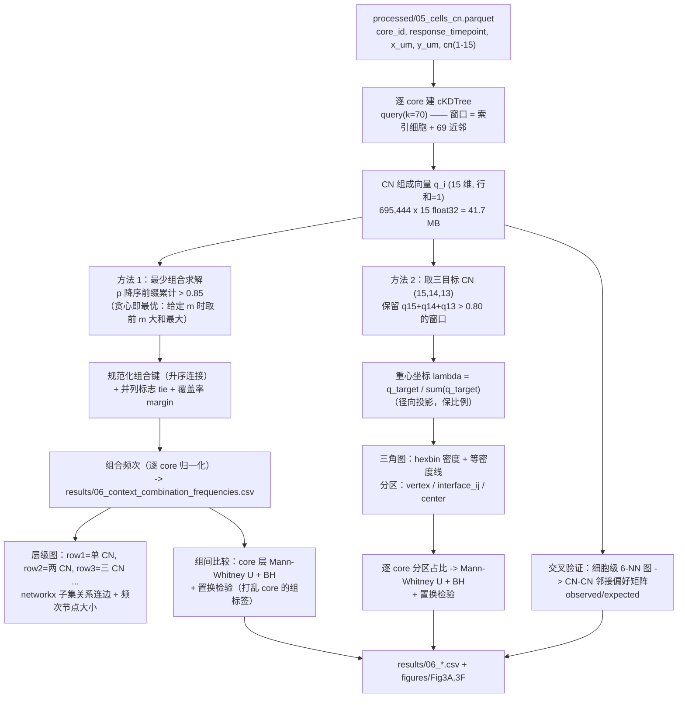

# 06 空间上下文图（spatial context map）与 CN 界面分析（barycentric）

> **目标文献**：Wang J, Nagarajan P, et al. *Integration of spatial single-cell proteomics and spatial metabolomics
> reveals tumor microenvironment predictive of immunotherapy response in mucosal melanoma.* bioRxiv 2026.
> DOI: 10.64898/2026.04.23.720453（预印本，未经同行评审）
>
> **模块对应原文**：Fig. 3A–E、Fig. 3F（其中 Fig. 3D–E 的相关分析与 2D/3D 密度图见 §4.7b）；Methods 中「Spatial context map」段与「Cellular neighborhood interface analysis」段（原文 1023 行版第 622–634 行）；Results 中「Stromal context is associated with immune exclusion and ICI resistance in MuM」全节 +「Spatial tumor-immune interactions are associated with ICI response」第 1 段（Fig. 3F 部分）
> **前置依赖**：`05_细胞邻域CN分析与Kmeans.md`（产出 `processed/05_cells_cn.parquet`，含 `cn`（1–15）与 `cn_name`；以及 `results/05_cn_naming_table.csv` 的语义映射）。本模块**只消费 CN 标签**，不重新定义 CN。
> **复现难度**：★★★★☆　**预计工时**：3 人日　**计算资源**：32 核 CPU / 64 GB 内存（70 近邻窗口构建 ~41.7 MB；组合统计与置换检验 < 8 GB）；**不需要 GPU**

---

## 1. 科学问题与逻辑位置

**一句话**：CN 描述"每个细胞在什么样的邻域里"；空间上下文图与界面分析描述"**这些邻域如何彼此相邻、如何互相渗透**"——即组织层面的**架构**（architecture），而不是单个细胞层面的环境。

本模块是全文从"细胞"走向"组织结构"的关键一步，也是 Fig. 3 的全部内容：

```
05 号模块：每个细胞的 CN 标签（15 类）
                    │
                    ▼
   本模块(06)：CN 层级的空间关系（两个独立方法，切勿混为一谈）
   ├─ 方法 1  空间上下文图（spatial context map）
   │    70 近邻窗口 → 每个窗口内"占 >85% 的最少 CN 组合" → 组合频次 → 层次图（Fig. 3A）
   │    用途：回答"哪些 CN 经常**同时出现在同一个邻域里**"，以及组合的"多样性层级"
   └─ 方法 2  CN 界面分析（barycentric coordinate projection）
        70 近邻窗口 → CN 组成 → 投影到由 3 个目标 CN 张成的重心坐标系（三角图）
        → 仅保留三目标 CN 合计 >80% 的窗口 → 界面区（interface zone）内的窗口占比（Fig. 3F）
        用途：回答"两个 CN 的**交界带**是否被某个响应组富集"
                    │
                    ▼
   07 patch 邻近分析（CN13 周边的免疫分布，Fig. 4A–C）
   09 无监督空间分型（每 core 的 CN 组成层次聚类，Fig. 4I）
```

**上游输入**：`processed/05_cells_cn.parquet`（必须同时含 `core_id`、**`response_timepoint`**（取值 `pre_R`/`pre_NR`/`post_NR`，**没有 post_R**）、`patient_id`、`x_um`、`y_um`、`cn`、`cn_name`）。
**下游输出**：`results/06_context_combination_frequencies.csv`（组合 × core 的频率矩阵）、`results/06_context_combo_tests.csv`（组间检验）、`results/06_barycentric_zones_per_core.csv`（界面分区 × core）、`results/06_cn_adjacency_matrix.csv`（CN–CN 邻接偏好，交叉验证用）。

> ⚠️ **命名口径（与上游文档必须一致，否则会静默取到空子集）**：分组列是 **`response_timepoint`**（`pre_R` / `pre_NR` / `post_NR`），**不是** `group`；谱系列是 **`major_type`**（8 类 + `Unassigned`），**不是** `major_celltype`。本文件的全部代码已按此命名。另注：原文报告 25 个 cellular phenotypes，而我方 `04_细胞表型定义与注释.md` 给出 **23 个状态**（差 2 不可复现）→ 本模块消费的是 **23 个状态标签**，这一点在统计"免疫主导 CN 的细胞份额"时不影响口径（该口径只用 CN 标签，不用 phenotype 数量）。

**为什么必须把两个方法分开讲**：它们在原文里被写在同一节（"Stromal context is associated with immune exclusion…"），但**数学对象完全不同**：

| | 空间上下文图 | CN 界面分析 |
|---|---|---|
| 顶点/单元 | **组合**（CN 的集合，如 {CN14, CN15}） | **窗口**（每个细胞一个点） |
| 输出 | 组合 × 组 的**频次矩阵** + 层级结构 | 三角图上的**点云/密度** + 分区占比 |
| 关键参数 | 覆盖阈值 **>85%**、窗口 = **70 NN** | 保留阈值 **>80%**、窗口 = **70 NN** |
| 回答的问题 | "哪些邻域**共现**、以多大比例、在几层多样性下" | "三个 CN 的**交界带**在哪个组里更厚" |
| 统计对象 | 组合频次的组间差异 | 界面区窗口占比的组间差异 |
| 原文图 | Fig. 3A（+ 3B、3C 的代表性空间图） | Fig. 3F |

> ⚠️ **导师批注（原文第 3 号矛盾：窗口定义双口径，须登记到 `12_复现质控清单、排错与批判性评述.md`）**：**同一篇论文里给了两个不同的"窗口"** —— Methods「CN definition」写 "within a **radius of 70 μm**"（05 号文档主路径），而本模块对应的 Methods「Spatial context map」与「Cellular neighborhood interface analysis」两段都写 "**window size of 70 nearest neighbors**"。**"70 μm 半径窗口"与"70 近邻窗口"是两个性质完全不同的算子**：前者窗口内细胞数可变（本队列估算 ~141 个）、物理尺度恒定为 70 μm；后者窗口内细胞数恒为 70、物理尺度随局部密度变化（本队列估算等效半径仅 ~41–50 μm，见 `05_细胞邻域CN分析与Kmeans.md` §2.3）。**本项目裁决**：本模块**按原文这两段的字面用 70 近邻**（D06-1），05 号模块按「CN definition」段用半径 70 μm（D05-1）；两套口径在项目内**必须用不同名字**（`knn70` / `radius70`），**禁止混称"窗口"**，并把两者的差异（如 `CN13-CN14-CN15` 组合频率的 ARI）作为敏感性分析报告。
>
> ⚠️ **导师批注（相邻的第二处不一致）**：原文 Results 写 "we generated spatial context maps **summarizing CN-CN adjacency patterns**"，而 Methods「Spatial context map」写的是"窗口内 >85% 的最少 CN 组合"。**"CN–CN 邻接（adjacency，两个 CN 在几何上相邻）"与"CN 共现于同一窗口（co-occurrence）"不是一回事**：前者是图的边（几何相邻），后者是集合的覆盖（组成占比）。→ 我们**主路径实现 Methods 的算法**（它有明确步骤可复现），同时**额外**实现真正的 CN–CN 邻接偏好矩阵（§4.7）作为交叉验证；两者一致时结论更稳，不一致时必须如实报告。该不一致同样登记到 `12_复现质控清单、排错与批判性评述.md`。



---

## 2. 背景知识与原理

### 2.1 为什么需要"组合"而不是"平均 CN 组成"

CN 已经给出了每个细胞的局部组成。但组织层面的问题是："**一片 70 μm 的邻域，通常由哪几类 CN 拼成？**"

- 若把所有窗口的 CN 组成求平均 → 得到一个"平均邻域"，**抹掉了多峰结构**。真实组织里，窗口要么是"纯肿瘤型"，要么是"纯免疫型"，平均之后变成"半肿瘤半免疫"的**不存在**的中间态（这就是"平均的暴政"）。
- 若只看**频率最高的单个 CN**（argmax）→ 得到的信息与"CN 空间图"几乎重复，且丢失了"两个 CN 各占四成"这种**界面态**。

"**占 >85% 的最少 CN 组合**"这个定义同时解决了两个问题：它记录**哪些 CN 一起构成了这片邻域**，并且用"组合里 CN 的个数 $m$"编码了**邻域的多样性层级**：

| 层级 $m$ | 含义 | 生物学解读 |
|---|---|---|
| $m=1$ | 单个 CN 就占了 >85% | 邻域**同质**（纯肿瘤芯 / 纯间质 / 纯免疫巢） |
| $m=2$ | 两个 CN 合计 >85% | 邻域是**两相混合**（典型：两种 CN 的交界带） |
| $m=3$ | 三个 CN 合计 >85% | **三相交界**（如 CN15/CN14/CN13 的瘤-髓-界过渡带） |
| $m\ge 4$ | 需要 4 个以上 | 高度**碎片化**的微环境 |

**这就是"层级图（hierarchical map）"的来历**：原文 Fig. 3A 图注明确写 "row 1 indicated dominance by a single CN (>85% composition), row 2 represented two dominant CNs (>85% combined), and subsequent rows denoted increasingly heterogeneous contexts"。

### 2.2 组合覆盖问题的数学：为什么"贪心即最优"

**问题形式化**：给定窗口的 CN 组成 $q \in \Delta^{14}$（15 个分量，和为 1）与阈值 $\tau = 0.85$，求

$$S^\star = \arg\min_{S \subseteq \{1,\dots,15\}} |S| \quad \text{s.t.} \quad \sum_{c \in S} q_c > \tau$$

**事实 1（给定 $m$ 时的最优子集）**：对固定基数 $m$，最大化 $\sum_{c\in S} q_c$ 的子集是 $q$ 的**前 $m$ 大分量**所对应的下标集合。

*证明（交换论证）*：设 $S$ 满足 $|S| = m$ 且 $S$ 不是前 $m$ 大；则存在 $a \in S$、$b \notin S$ 使 $q_b > q_a$。令 $S' = S \setminus \{a\} \cup \{b\}$，则 $\sum_{S'} = \sum_S - q_a + q_b > \sum_S$。矛盾。∎

**事实 2（最少组合 = 排序前缀）**：因此 $S^\star$ 就是把 $q$ 降序排列后取前缀，直到累计和首次超过 $\tau$：

$$q_{(1)} \ge q_{(2)} \ge \dots \ge q_{(15)},\qquad
m^\star = \min\Big\{m : \sum_{j=1}^{m} q_{(j)} > \tau\Big\},\qquad
S^\star = \{c : q_c \text{ 排在前 } m^\star\}$$

**实现含义**：**不需要任何组合枚举**（尽管 $2^{15} = 32{,}768$ 也能算完）。一次 `np.argsort` + `np.cumsum` 就得到全部 695,444 个窗口的 $S^\star$ 与 $m^\star$ —— 这是本模块性能上最关键的洞察：若按"对 $m=1,2,3,\dots$ 枚举 $\binom{15}{m}$ 个组合"来做，第 3 层就要枚举 455 个组合 × 695,444 个窗口 = $3.2 \times 10^8$ 次求和，慢 3 个数量级。

> ⚠️ **导师批注（并列问题）**：原文写 "the **fewest** neighborhoods that made up more than 85%"。当 $q_{(m^\star)} = q_{(m^\star+1)}$（并列，例如两个 CN 都是 0.05）时，$S^\star$ **不唯一**：取哪个 CN 会让整篇论文的组合频次表不可复现。我们强制三条规则：(1) 排序用 **稳定排序**，并列时按 **CN 编号升序**；(2) 记录 `tie_flag = (q_(m*) - q_(m*+1) < 1e-6)`；(3) 记录 `margin = Σ_{j≤m*} q_(j) - 0.85` 以量化"多接近阈值"。并列窗口的比例必须写进 QC 报告（若 > 5%，说明阈值 0.85 恰好落在数据的分割点上，应做阈值敏感性分析）。

### 2.3 重心坐标（barycentric coordinates）：定义、两种投影与为什么需要它

**（a）什么是一个单纯形上的重心坐标。**

设三角形（2-单纯形）的三个顶点为 $V_1, V_2, V_3 \in \mathbb{R}^2$。对三角形内任意一点 $P$，存在**唯一**的三元组 $(\lambda_1,\lambda_2,\lambda_3)$ 使得

$$P = \lambda_1 V_1 + \lambda_2 V_2 + \lambda_3 V_3,\qquad \lambda_i \ge 0,\quad \sum_i \lambda_i = 1$$

$(\lambda_1,\lambda_2,\lambda_3)$ 就是 $P$ 关于该三角形的重心坐标。两种等价定义：

1. **面积比定义**：$\lambda_i = A_i / A$，其中 $A$ 是三角形总面积，$A_i$ 是 **$P$ 与"除 $i$ 以外两个顶点"构成的子三角形**的面积。由此立刻得到三角图的标准读法：
   - $P$ 在顶点 $V_i$ → $\lambda_i = 1$，其余为 0（"纯 $i$"）；
   - $P$ 在 $V_i V_j$ 边上 → $\lambda_k = 0$（$k$ 为第三个顶点）→ **边 = 界面**；
   - $P$ 在重心 → $\lambda = (1/3,1/3,1/3)$ → **三种成分均衡混合**。
2. **线性代数定义**：令增广矩阵 $\tilde V = [V_1, V_2, V_3; 1,1,1] \in \mathbb{R}^{3\times3}$，则 $\lambda = \tilde V^{-1} [P; 1]$。

**（b）本项目的数据点与"投影"的确切含义。**

我们的"点"不是二维坐标，而是一个 **3 维组成子向量** $x = (q_{i_1}, q_{i_2}, q_{i_3})$（三个目标 CN 在窗口 $i$ 中的占比），其中 $x_j \ge 0$ 但一般 $\sum_j x_j < 1$（因为窗口里还有别的 CN）。要把这样的 $x$ 放到三角图上，必须"投影到单纯形"。**有两种不同的投影，语义完全不同**：

| 投影 | 公式 | 性质 | 是否本项目采用 |
|---|---|---|---|
| **径向（中心）投影** | $\lambda = x / \sum_j x_j$ | **保持三者之间的比例**；$\lambda$ 只依赖三个 CN 的相对份额，与"三者合计占多少"**解耦** | ✅ **主路径**（这正是原文"窗口组成按 CN 百分比分析"的含义） |
| 欧氏正交投影 | $\lambda = x - \frac{\sum_j x_j - 1}{3}\mathbf{1}$ | 到 $\Delta^2$ 的最近点；**会改变三者比例**；当 $\sum_j x_j < 1/3$ 时出现**负分量**（需截断到单纯形，进一步改变比例） | ❌ 仅在附录中演示差异 |

**为什么必须用重心坐标、而不能直接用"三元比例图"？**

1. **三角图的坐标天生是三个数之和为 1 的量**。三个原始占比之和为 0.85 / 0.60 / 0.30 的窗口，无法落在同一个固定三角形里（除非为每个窗口画一个不同大小的三角形）。重心坐标把它们**归一化到同一个参考三角形**，使得不同窗口可比。
2. **它把"相对组成"与"绝对覆盖"解耦**：λ = (1/3,1/3,1/3) 的窗口可以是"三 CN 各占 28% 共 85%"（真·三相混合），也可以是"各占 10% 共 30%"（三 CN 都是微弱成分，其余 70% 是别的 CN）。前者才是我们要研究的"界面"。→ 这就是**为什么必须有 >80% 的保留阈值**：它把第二种窗口剔除，保证三角图上的点都来自"三目标 CN 合计主导"的邻域。
3. **界面的几何直观**：两个 CN 的"交界带"在三角图上就是**靠近对应边**的点云；三个 CN 的"过渡带"就是**三角形中部**的点云。这使得"界面富集"这个说法有了严格的几何对应，而不只是一个比喻。

**（c）界面区的严格定义（我们采用的划分）。**

原文只写 "Windows containing less than 80% of the three selected neighborhoods were excluded"，**未给"界面"的几何定义**。我们采用一个**互斥且完备**的分区（先按优先级判定，保证每个保留窗口落入恰好一个区）：

| 区（zone） | 判据（$\lambda$ 为重心坐标，$c_{\max}=\arg\max\lambda$） | 生物学含义 |
|---|---|---|
| `pure_CNx` | $\lambda_{\max} \ge 0.60$ | 该窗口由单个目标 CN 主导（不是界面） |
| `center_tri` | 未满足上条，且 $\min_i \lambda_i \ge 0.25$ | 三个 CN 的**三相混合区**（真正的三相交界） |
| `interface_ij` | 未满足以上两条 → 取 $\lambda$ 最大的两个 CN 组成 $ij$ ；若 $\min(\lambda_i,\lambda_j) \ge 0.25$ 则为 `interface_ij` | 两个 CN 的**两相界面**（第三个 CN 是次要成分） |
| `mixed_low` | 未满足以上三条（即第二大 $\lambda < 0.25$） | 一个 CN 主导但未达 0.60 的"过渡态"（罕见） |

`assert` 保证四个区在保留窗口上的占比之和 = 1。三个 CN 目标为 (CN15, CN14, CN13) 时共有 3 个 `pure_*`、3 个 `interface_ij`（15-14、15-13、14-13）、1 个 `center_tri`、1 个 `mixed_low`。

> ⚠️ **导师批注**："界面富集"的判读必须**同时报告两件事**：(1) 某区间保留窗口的**占比**在组间的差异；(2) **保留窗口的绝对数**（因为 >80% 过滤后不同组的样本量不同，占比的置信区间宽度不同）。只报 (1) 会掩盖"某一组被过滤掉一半窗口"导致的不稳定。原文 Fig. 3F 只给了三角图点云，没有给保留窗口数、没有给分区占比的统计量 —— 这正是我们能补的定量部分。

### 2.4 阈值敏感性：85% 与 80% 有多"稳"

两个阈值都是**人为设定**，且都没有在原文中说明理由或做敏感性分析。它们的影响方式不同：

- **$\tau = 0.85$（上下文图的覆盖阈值）**：$\tau$ 越小 → 越容易用更少的 CN 覆盖 → $m^\star$ 变小 → 层级整体上移（更多窗口落在 row 1/2）；$\tau$ 越大（如 0.95）→ $m^\star$ 变大 → 组合更长。**注意 $\tau$ 只影响 $m^\star$ 与组合内容，不影响窗口的 CN 组成**。敏感性分析要跑 $\tau \in \{0.75, 0.80, 0.85, 0.90, 0.95\}$ 并报告 (a) $m^\star$ 的分布变化；(b) 目标组合（如 {13,14,15}、含 CN3 的组合、含 {9,10,12} 的组合）的频次-层级曲线。
- **$\tau' = 0.80$（界面的保留阈值）**：$\tau'$ 越大 → 保留窗口越少、越集中在"三 CN 主导"的窗口（更纯的界面）但统计功效下降；$\tau'$ 越小 → 保留窗口多，但混入大量"三 CN 都只是微弱成分"的窗口，界面信号被稀释。敏感性分析跑 $\tau' \in \{0.60, 0.70, 0.80, 0.90\}$，报告各区占比与组间检验的 p/q。

**预登记式做法**：把 $\tau=0.85$、$\tau'=0.80$ 作为**主分析**（对齐原文），并**在正文中一次性报告全部敏感性结果**（不是"试到显著为止"）。这既是 L0 §12.1 的要求，也是本项目能对原文做出的实质方法学补充。

### 2.5 统计单元：为什么不能把窗口当独立样本

一个 core 内有 5,000–10,000 个窗口，它们**高度空间自相关**（相邻细胞的 70 近邻窗口绝大部分重合，只在边界处相差一两个邻居）。若把窗口当独立样本做 Fisher 精确检验或 $\chi^2$，有效样本量会被高估 **2–3 个数量级**，p 值可以轻易到 $10^{-300}$ —— 这正是原文 Fig. 4D/4F 出现 $p < 2.22\times10^{-16}$ 的机制（见 `08_细胞间相互作用推断与置换检验.md`）。

本模块的统计纪律：

1. **主分析在 core 层**：每个 core 计算"目标组合频率"或"界面区占比"，得到 97 个（或按组拆分的）独立观测值 → Mann–Whitney U（两组）+ BH（多组合/多区）。
2. **次级分析用置换**：打乱 **core 的组标签** 10,000 次，比较组间统计量的分布（这不是"标签置换破坏空间自相关"的问题，因为置换的单位是 core，空间结构在 core 内部被完整保留 —— 恰好是 L0 §7"空间统计"要求的"保持空间自相关的零模型"）。
3. **允许的例外**：为了展示三角图的**密度形状**，可以用全部窗口画 hexbin（这只是可视化，不承担 p 值）。
4. **core 层统计的 n**：97 个 core（75 pre + 22 post），分成 pre-R / pre-NR / post-NR 三组。**原文未报告每组的具体 core 数** → 我们以实际数据为准并记录（`results/06_group_core_counts.csv`）。

### 2.6 与邻接矩阵的关系（"CN–CN adjacency"这一表述的交叉验证）

为了对齐原文 Results 的 "CN-CN adjacency patterns" 说法，我们额外实现一个**真正的邻接偏好矩阵**：在细胞级 kNN 图（每细胞 $d=6$ 个最近邻，等效物理距离约 25–35 μm）上，统计跨 CN 的**有序邻接槽**数 $O_{kl}$（每细胞的 $d$ 个邻居槽各计一次，再对称化为 $O \leftarrow O + O^{\top}$），与"CN 标签随机贴到同一批位置上"（固定度数序列的配置模型零假设）下的期望比较：

$$E_{kl} = d\cdot n_k n_l\cdot\frac{2}{N-1}\ (k \neq l),\qquad
E_{kk} = d\cdot n_k(n_k-1)\cdot\frac{1}{N-1},\qquad
R_{kl} = \frac{O_{kl}}{E_{kl}}$$

其中 $n_k$ 是 CN $k$ 的细胞数、$N$ 是总细胞数、$d=6$。**推导**：某个 $k$ 类细胞的**某一个**邻居槽落到 $l$ 类细胞的概率是 $n_l/(N-1)$，故"从 $k$ 指向 $l$"的**有向**槽数期望为 $d\,n_k n_l/(N-1)$；对称化把两个方向都计入，乘 2。**校验**：$\sum_{k,l}E_{kl} = 2dN/(N-1)\cdot N^2/N \approx 2dN = 12N$，与对称化后 $O$ 的总计数（每细胞 $d$ 个槽 → 对称化后 $2dN$）一致 —— 这个恒等式就是 §4.7 代码里的质量断言。

$R_{kl} > 1$ 表示 CN $k$ 与 $l$ 在空间上**偏好相邻**。用这个矩阵检验原文的"CN15 被 CN14 环绕、CN14 邻接 CN13"是否成立（见 §6.2 QC 判据 6）。

> ⚠️ **导师批注（期望值必须带度数 $d$，否则 $R>1$ 这个判据失效）**：若写成"$E_{kl} = n_k n_l/(2N)$"这类**不带每个细胞度数**的形式，$R$ 会被整体缩放一个常数（本处 $2d = 12$），于是 $R_{kl} > 1$ 不再是"偏好相邻"的判据，且恒等式 $\sum_{k,l}R_{kl}E_{kl} = \sum_{k,l}O_{kl}$ 不再成立。**仅看排序**（哪个邻接对最强）时这类错误会被掩盖（常数缩放不改变排序），因此必须在代码里加**显式质量断言**：`E.sum() ≈ O.sum()`。

> ⚠️ **导师批注**：$E_{kl}$ 的朴素形式（基于 CN 的频率）忽略了**每个 CN 的细胞数差异**与**细胞密度的空间异质性**，会系统性高估罕见 CN 之间的邻接。更严格的做法是用**环面平移零模型**（保持 CN 标签场的空间自相关，见 `08` 号文档）或**度校正的配置模型**（`networkx` 的 `configuration_model` 或 `chung_lu`）。本模块用朴素 $R_{kl}$ 仅作**定性**交叉验证，不作为结论依据；定量邻接显著性交给 `08` 号文档处理。

---

## 3. 原文逐句拆解

| # | 原文句（English 原词保留） | 中文转述 | 对应操作 | 原文是否给参数 | 缺失项 → 我方复现决策 |
|---|---|---|---|---|---|
| 1 | "To examine higher-level tissue organization, we generated **spatial context maps** summarizing **CN-CN adjacency patterns** for each response/timepoint group (Fig. 3A)." | 按三个组建空间上下文图，概括 CN 之间的邻接模式 | 按 `response_timepoint` 分组统计组合频次 | ✅ 分组；❌ "adjacency"的确切算法 | Results 用词是 adjacency（几何相邻），Methods 的算法是"窗口内组合覆盖" → **主路径跑 Methods 算法 + 额外跑 λ 邻接矩阵（§4.6）**；两者不一致时如实报告（⚠️ 见 §1 批注） |
| 2 | "**First, a window size of 70 nearest neighbors was used to create the composition vectors.**"（Methods「Spatial context map」） | 用 **70 近邻**窗口构造组成向量 | `cKDTree.query(k=70)`（含索引细胞，§4.1），得到 15 维 CN 组成 | ✅ 70 NN | **窗口含索引细胞**（= 索引 + 69 近邻），与 `05` 号文档的 kNN 敏感性版本口径**必须一致**（同一个参数常量 `KNN_WINDOW = 70` 从 `logs/05_params.json` 读取，禁止两处各写一份） |
| 3 | "Within each window, **the fewest neighborhoods that made up more than 85% of the neighborhoods** was identified." | 窗口内"占 >85% 的最少 CN 组合" | 降序前缀累计首次 > 0.85（§2.2 事实 2）；记录 $m^\star$、组合键、`margin`、`tie_flag` | ✅ 阈值 0.85 | 严格不等号 `> 0.85`（原文 "**more than** 85%"）；并列处理规则见 §2.2 批注；阈值敏感性 $\tau \in \{0.75,\dots,0.95\}$ |
| 4 | "This combination informed about **prominent associations of neighborhoods in the window**, which was a feature termed **spatial context**." | 该组合称为"空间上下文" | 每个窗口一个 context（= 规范化后的组合键） | ✅ 概念 | 组合键的**规范化**：CN 编号升序，用 `-` 连接（如 `CN13-CN14-CN15`），避免 `CN14-CN13-CN15` 与 `CN13-CN14-CN15` 被当作两个不同组合（陷阱 3） |
| 5 | "**Third, we counted each combination and connected the most prevalent combinations into a spatial context map.**" | 统计每个组合的频次，把最常见的组合连成图 | 组合频次表 + 层级图（节点=组合，边=子集关系，大小=频次） | ❌ "most prevalent"的截断阈值；❌ 连线规则 | 我们的决策：层级图展示**每组累计频次前 90%** 的组合（截断规则固定并写入 `logs/06_params.json`）；连线规则 = 若 $m$ 层组合 $A$ ⊂ $(m{+}1)$ 层组合 $B$，则连边（即"这个组合在更多样化的邻域里被扩展成了什么"） |
| 6 | "The hierarchical spatial context map showed **different levels of neighborhood combinations and their relative frequencies**." | 层级图展示不同层级的组合及其相对频次 | 图的"行"= $m^\star$（组合内 CN 个数） | ✅ 层级 = CN 个数（Fig. 3A 图注：row 1 = 单一 CN >85%；row 2 = 两个 CN 合计 >85%；后续行 = 更异质） | 我们把每个 $m$ 层画成一行（横向条形），行内按频次排序；另用 `networkx` 画一张子集关系图作为补充可视化 |
| 7 | "Across groups, **the interface among three tumor-associated CNs–central tumor (CN15), invasive tumor (CN14), and tumor boundary (CN13)–was increased in pre-treatment R cores compared with pre-treatment NR cores (Fig. 3A, top).**" | {CN15, CN14, CN13} 三 CN 界面在 pre-R 高于 pre-NR | ① 上下文图：统计组合键为 `CN13-CN14-CN15`（$m^\star=3$）的窗口频率；② 界面分析：`center_tri` 区的占比 | ✅ 结论方向；❌ 具体统计量、n、p | 两条路径都要给：组合频次（core 层 Mann–Whitney U + BH）与 `center_tri` 占比（同）；方向判据 = pre-R 更高；**并给效应量**（median 差 + Cliff's delta） |
| 8 | "Beyond tumor-tumor neighborhood interfaces, **CN combinations involving dendritic cell (DC)-associated CN combinations were particularly enriched in the pre-treatment R cores and post-treatment NR cores** (Fig. 3A, top and bottom)." | 含 DC（CN3）的 CN 组合在 pre-R 与 post-NR 富集 | 定义"DC 相关组合"= 组合键中包含 `CN3` 的所有组合；逐 core 求和频率 → 组间比较 | ✅ 结论方向；❌ "DC-associated CN combinations"是否只指 CN3，或 CN3 + 其他免疫 CN（CN11？）| 我们的决策：**主口径 = 组合键含 CN3**；备选口径 = 组合键含 {CN3} ∪ {CN11}（免疫富集 CN）→ 两口径都跑；原文未明确，故必须声明这是我们的口径 |
| 9 | "In parallel, **stromal CN combinations also differed across groups** … **pre-treatment and post-treatment NR cores showed increased combinations involving vimentin+ stroma CN (CN10), tumor-infiltrated stroma CN (CN9), and immune-infiltrated stroma CN (CN12)** (Fig. 3A, middle)." | 含 CN10/CN9/CN12 的基质相关组合在 pre-NR 与 post-NR 升高 | 定义"基质相关组合"= 组合键含 {CN9, CN10, CN12} 中**至少一个**；逐 core 频率 → 组间比较 | ✅ 结论方向；❌ "at least one"vs"all" | 主口径 = **含至少一个**基质 CN；备选 = 同时含 CN10 且（CN9 或 CN12）；两口径都跑 |
| 10 | "Representative spatial distributions of DC-associated CNs in a responder specimen were shown in Fig. 3B." / "Representative stromal architectures across groups were illustrated in Fig. 3C." | 代表性空间图 | 逐 core 的 CN 空间图（按组挑代表性 core，规则化选取，不靠人工挑图） | ✅ 图；❌ 选芯规则 | 代表性 core 的**可复现选取规则**：DC 组图 = pre-R 组中"含 CN3 组合频率"排名第 1/25/50 百分位的三个 core；基质组图 = 每组中"基质相关组合频率"最高的 core。规则写入 `logs/06_params.json` |
| 11 | "**A barycentric coordinate projection was generated by applying window size of 70 nearest neighbors to every cell.** Window composition was analyzed in terms of the percentage distribution of CNs. **Windows containing less than 80% of the three selected neighborhoods were excluded from the analysis.**" | 每细胞 70 近邻窗口 → CN 百分比组成 → 重心坐标投影；三目标 CN 合计 <80% 的窗口剔除 | §4.4：径向投影 + 过滤 + 三角图 | ✅ 70 NN、阈值 80%、"percentage distribution" | ① 投影 = **径向**（保比例），明确非欧氏正交投影；② "三目标 CN" 在 Fig. 3F 中是 (CN15, CN14, CN13)；③ 阈值口径是"**小于** 80% 的**被剔除**" → 保留条件为 `≥ 0.80`（注意与 #3 的严格 `>` 不同！原句是 "less than 80% … excluded"）|
| 12 | "**Correlation analysis revealed a negative association between the abundance of CN10 and the extent of immune cell infiltration in tumor areas (Fig. 3D)** … representative samples with high versus low CN10 abundance (Fig. 3E, left) … **2D and 3D immune cell density plots** … (Fig. 3E, middle and right)" | CN10 丰度与肿瘤区免疫浸润程度负相关；高/低 CN10 代表样本的 2D/3D 免疫密度图 | ① 每 core 的 CN10 频率 vs "肿瘤区内免疫细胞占比" 的 Spearman + BH；② Spyrrow `plot_3d_density` 的等价实现 | ✅ 结论方向；❌ 相关的 n 层级（core 层还是样本层）、检验细节、"免疫浸润程度"的定义 | **归属说明**：按 `00_目录与复现总览.md` 的图表→文档映射表，**Fig. 3D–E 归本模块**（等级 A/C）。实现见 §4.7b（Spearman + BH 相关）与 §4.7（2D/3D 密度图，Spyrrow `plot_3d_density` 的开源等价实现）。**输入**：CN10 频率来自本模块的组合频次表；"肿瘤区内免疫细胞占比/密度"来自 `04` 号文档的 tumor/TME ROI 标记与免疫表型（tumor ROI 由 SOX10 定义，见 Methods「Tissue segmentation and ROI definition」） |
| 13 | "**The interfaces between the invasive tumor CN (CN14) and central tumor CN (CN15) as well as invasive tumor CN (CN14) and tumor boundary CN (CN13) were enriched in pre-treatment R cores (Fig. 3F).**" | CN14–CN15 与 CN14–CN13 界面在 pre-R 富集 | 界面分区占比：`interface_CN14_CN15` 与 `interface_CN13_CN14` 的逐 core 占比 → 组间比较 | ✅ 结论方向；❌ 分区定义、阈值、统计量 | 分区定义见 §2.3(c)（$\lambda_{\max}<0.60$、$\min \lambda \ge 0.25$ 等）；**必须报告**每个区的保留窗口数与占比的组间检验；阈值 $\tau'$ 敏感性 |

---

## 4. 逐步可运行代码

> 环境：Python 3.11；`numpy` 1.26、`pandas` 2.2、`scipy` 1.13、`networkx` 3.3、`matplotlib` 3.9、`seaborn` 0.13、`tqdm` 4.66；可选 `mpltern` 1.0（三元图）、`statsmodels` 0.14（BH）。
> 随机种子：`SEED = 20260101`。所有参数落盘 `logs/06_params.json`。
> **生产实现**：本模块的窗口构建复用仓库级脚本 **`tools/spatial_cn_kmeans.py`**（`--window-mode knn --knn 70` 即 70 近邻窗口的 CN 组成向量入口，与 `05` 号文档共用同一份实现）。该脚本带 `--selftest`（合成组织自检，见 `00_目录与复现总览.md` 的工程约定），**先跑 `python tools/spatial_cn_kmeans.py --selftest`，再跑本模块的编排脚本**。
>
> ⚠️ **导师批注（不要指望 `tools/spatial_interaction_test.py` 来做 core 标签置换）**：本模块的组间检验是**先聚合到 core、再在 core 层检验**（§2.5），其置换零模型是"打乱 core 的组标签"。**`tools/spatial_interaction_test.py` 不做这件事** —— 它的 `--null-model {position_shuffle,label_shuffle,toroidal}` 全部是**分组内部、细胞层级**的置换（用于细胞-细胞距离检验，输出 `logFC`/`p_mwu`/`q_bh`），既没有"core 级标量"的输入接口，也没有"按组标签置换求尾概率"的功能。因此本模块的 core 标签置换**必须由项目内 `code/06_04_*.py` 自实现**（§4.4 的 `perm_test`），**不得**写成"复用 tools 脚本的置换零模型"。
>
> ```bash
> python tools/spatial_cn_kmeans.py --selftest
> python tools/spatial_cn_kmeans.py \
>     --cells        processed/06_cells_for_tool.tsv \
>     --x-col        x_um --y-col y_um \
>     --celltype-col cn --group-col core_id \
>     --window-mode  knn --knn 70 \
>     --k 15 --seed 20260101 --out-prefix results/06_tool
> ```
> 把 `cn` 当成"细胞类型列"传入，即可得到每细胞 70 近邻窗口内的 **CN 组成向量**：`results/06_tool_cell_cn.csv` 是细胞级表，`results/06_tool_cn_composition.csv` 是"CN × 该 CN 的窗口组成均值"（即一个 15×15 的组成矩阵）。**注意**：
> - 输入需为 CSV/TSV —— 该脚本的 `read_table` 用 `pd.read_csv`，**不读 parquet**，故需先导出 `processed/06_cells_for_tool.tsv`（列：`cell_id, core_id, x_um, y_um, cn`）。
> - 脚本**总会跑一次 K-means**（`--k` 默认 15）—— 那是对 **CN 组成向量再聚类**（CN-of-CN），本模块**不消费**该结果，只用上面两张表；不要把它误当成"重新定义 CN"（CN 的唯一生产者是 05 号文档，L0 §4.2）。
> - 脚本输出的 CN 标签是 `cn_1`…`cn_15`（`--relabel-by-size` 默认开启），**与本项目契约的整数 `cn ∈ 1..15` 不同**，需显式映射（见 `05_细胞邻域CN分析与Kmeans.md` §4.5 的批注）。
>
> 下面的代码是**可独立运行的最小实现**（便于逐行核对算法），也是本模块的主路径。

### 4.1 70 近邻窗口的 CN 组成向量

```python
# code/06_01_build_cn_composition.py
"""70 近邻窗口 -> 15 维 CN 组成向量。窗口 = 索引细胞 + 69 个最近邻。"""
import json, numpy as np, pandas as pd
from scipy.spatial import cKDTree
from tqdm import tqdm

SEED, KNN_WINDOW, CHUNK = 20260101, 70, 20_000     # KNN_WINDOW 与 05 号文档口径一致
cells = pd.read_parquet("processed/05_cells_cn.parquet")
# cells 列（契约）：core_id, patient_id, response_timepoint, cell_id, x_um, y_um, cn(1..15), cn_name
assert cells["cn"].between(1, 15).all(), "cn 标签超出 1..15"
CN = list(range(1, 16)); n_cn = len(CN)

comp = np.zeros((len(cells), n_cn), dtype=np.float32)     # CN 组成（行和 = 1）
knn_radius = np.zeros(len(cells), dtype=np.float32)       # 第 70 近邻的距离（用于物理尺度自检）

for core, idx in tqdm(cells.groupby("core_id").indices.items(), desc="cores"):
    sub = cells.iloc[idx]
    xy = np.c_[sub["x_um"], sub["y_um"]].to_numpy(np.float64)
    lab = sub["cn"].to_numpy(np.int32) - 1                # 0..14
    tree = cKDTree(xy)
    kq = min(KNN_WINDOW, len(sub))                        # 小 core 保护（否则 SciPy 会重复填充索引）
    if kq < KNN_WINDOW:
        print(f"[WARN] core {core} 仅 {len(sub)} 个细胞 < {KNN_WINDOW}，窗口退化，需在 QC 中标记")
    for s in range(0, len(sub), CHUNK):
        e = min(s + CHUNK, len(sub))
        d, ii = tree.query(xy[s:e], k=kq, workers=-1)
        d = np.atleast_2d(d); ii = np.atleast_2d(ii)
        cnt = np.zeros((e - s, n_cn), dtype=np.int32)
        for j in range(e - s):
            cnt[j] = np.bincount(lab[ii[j]], minlength=n_cn)   # ii[:,0] 是自身 -> 含索引细胞
        comp[idx[s:e]] = (cnt / cnt.sum(1, keepdims=True)).astype(np.float32)
        knn_radius[idx[s:e]] = d[:, -1].astype(np.float32)     # 第 70 近邻距离（≈等效半径）

np.savez_compressed("processed/06_cn_composition_knn70.npz", comp=comp,
                    cell_id=cells["cell_id"].to_numpy(), cores=cells["core_id"].to_numpy())
np.save("processed/06_knn70_radius.npy", knn_radius)
json.dump({"knn_window": KNN_WINDOW, "window_includes_index_cell": True,
           "n_cells": int(len(cells)), "seed": SEED,
           "median_knn70_radius_um": float(np.median(knn_radius)),
           "p05_knn70_radius_um": float(np.percentile(knn_radius, 5)),
           "p95_knn70_radius_um": float(np.percentile(knn_radius, 95))},
          open("logs/06_params.json", "w"), indent=2, ensure_ascii=False)

# 质量断言：行和 = 1；窗口 = 70（大 core 中）
assert np.allclose(comp.sum(1), 1, atol=1e-5)
assert np.isfinite(comp).all()
print("第 70 近邻距离（μm）分位数:",
      np.percentile(knn_radius, [5, 25, 50, 75, 95]).round(1))
```

**物理尺度自检（必做）**：`median_knn70_radius_um` 应在 **30–60 μm**（`05` 号文档 §2.3 估算 41–50 μm）。若中位数 ≈ 200 μm 以上，说明坐标是 px 而非 μm（或窗口被误设为 70 μm 的等价值）。若中位数 < 15 μm，说明细胞坐标被放大或 `k` 被设得过大。

### 4.2 最少组合求解（含并列标志与阈值敏感性）

```python
# code/06_02_minimal_combo.py
"""窗口内'占 >85% 的最少 CN 组合'：降序前缀累计（贪心即最优，见 §2.2）。"""
import numpy as np, pandas as pd

TAU = 0.85
z = np.load("processed/06_cn_composition_knn70.npz", allow_pickle=True)
comp = z["comp"]
CN = np.arange(1, 16)

def minimal_combo(q, tau=TAU, eps=1e-6):
    """q: (n, 15) 行和为 1 的组成向量 -> (level, combo_key, coverage, margin, tie_flag)

    稳定排序 + 并列时按 CN 编号升序（np.argsort(kind='stable') 在降序场景下需先取负号，
    负号排序对相等的 q 值保持原顺序，而原顺序是 CN 升序 -> 等价于"并列时 CN 小者优先"）。
    """
    order = np.argsort(-q, axis=1, kind="stable")            # (n, 15) 列下标 = 0..14（CN 升序）
    cum = np.cumsum(np.take_along_axis(q, order, axis=1), axis=1)
    lvl = (cum <= tau).sum(axis=1) + 1                       # 首次 > tau 的位置（1-based）
    lvl = np.minimum(lvl, q.shape[1])
    cover = cum[np.arange(len(q)), lvl - 1]
    margin = cover - tau
    # 并列判定：第 lvl 大与第 lvl+1 大几乎相等（且 lvl 之后仍有分量）
    nxt = np.where(lvl < q.shape[1],
                   np.take_along_axis(q, order, axis=1)[np.arange(len(q)),
                                                        np.minimum(lvl, q.shape[1] - 1)],
                   np.nan)
    cur = np.take_along_axis(q, order, axis=1)[np.arange(len(q)), lvl - 1]
    tie = np.where(np.isnan(nxt), False, (cur - nxt) < eps)
    keys = []
    for i in range(len(q)):
        sel = np.sort(CN[order[i, :lvl[i]]])                 # 升序规范化 -> "CN13-CN14-CN15"
        keys.append("-".join(f"CN{c}" for c in sel))
    return lvl, np.array(keys), cover, margin, tie

lvl, keys, cover, margin, tie = minimal_combo(comp)
ctx = pd.DataFrame({"cell_id": z["cell_id"], "core_id": z["cores"],
                    "level": lvl, "context": keys, "coverage": cover,
                    "margin": margin, "tie_flag": tie})
ctx.to_parquet("processed/06_spatial_context.parquet", index=False)

print("层级分布:", pd.Series(lvl).value_counts().sort_index().to_dict())
print(f"并列窗口比例 = {tie.mean():.4%}（>5% 需讨论阈值是否落在数据分割点上）")
print(f"coverage 中位数 = {np.median(cover):.4f}，margin 中位数 = {np.median(margin):.4f}")

# ---------- 阈值敏感性：tau ∈ {0.75 .. 0.95} ----------
rows = []
for tau in [0.75, 0.80, 0.85, 0.90, 0.95]:
    l, k, c, m, t = minimal_combo(comp, tau=tau)
    rows.append(dict(tau=tau, level1=(l == 1).mean(), level2=(l == 2).mean(),
                     level3=(l == 3).mean(), level_ge4=(l >= 4).mean(),
                     tie_frac=t.mean(),
                     frac_combo_131415=float(np.mean(k == "CN13-CN14-CN15"))))
sens = pd.DataFrame(rows)
sens.to_csv("results/06_context_tau_sensitivity.csv", index=False)
print(sens.round(4).to_string(index=False))
```

**预期**：`level` 分布以 1–3 为主；`frac_combo_131415` 在 $\tau=0.85$ 下应是一个小而**非零**的数（这正是 Fig. 3A 顶层那组组合；若为 0，说明该组合在我们的 CN 命名映射下不存在 → 先检查 §4.5 的命名对齐，再检查窗口定义）。

### 4.3 组合频次表与层级图（Fig. 3A）

```python
# code/06_03_context_map.py
import json, numpy as np, pandas as pd, networkx as nx
import matplotlib.pyplot as plt
from matplotlib.patches import Rectangle

ctx = pd.read_parquet("processed/06_spatial_context.parquet")
cells = pd.read_parquet("processed/05_cells_cn.parquet")[["cell_id", "response_timepoint", "patient_id"]]
ctx = ctx.merge(cells, on="cell_id", how="left", validate="one_to_one")
assert ctx["response_timepoint"].notna().all(), "response_timepoint 合并失败 → 检查 cell_id 是否唯一"

# ---------- 逐 core 归一化的组合频率（跨 core 比较的前提：每个 core 窗口数不同）----------
n_win_core = ctx.groupby("core_id").size().rename("n_win")
freq_core = (ctx.groupby(["core_id", "context"]).size().rename("n")
               .reset_index().merge(n_win_core, on="core_id"))
freq_core["freq"] = freq_core["n"] / freq_core["n_win"]

# 只保留总体频率 >= 1% 的组合（截断规则固定，写入 logs/06_params.json）
overall = ctx["context"].value_counts(normalize=True)
keep = overall[overall >= 0.01].index
freq_core = freq_core[freq_core["context"].isin(keep)]
pivot = freq_core.pivot_table(index="core_id", columns="context",
                              values="freq", fill_value=0.0)
meta = ctx.groupby("core_id")[["response_timepoint", "patient_id"]].first()
pivot = pivot.join(meta)
pivot.to_csv("results/06_context_combination_frequencies.csv")

# ---------- 目标组合的定义（预登记，见 §3 第 7/8/9 条）----------
def has_any(key, cns):   return any(f"CN{c}" in key.split("-") for c in cns)
def has_all(key, cns):   return all(f"CN{c}" in key.split("-") for c in cns)

targets = {
    "tumor_triple_CN13_14_15": lambda k: k == "CN13-CN14-CN15",
    "tumor_triple_any_order":  lambda k: set(k.split("-")) == {"CN13", "CN14", "CN15"},
    "DC_containing_CN3":       lambda k: has_any(k, [3]),
    "DC_or_immune_CN3_CN11":   lambda k: has_any(k, [3, 11]),
    "stroma_any_CN9_10_12":    lambda k: has_any(k, [9, 10, 12]),
    "stroma_CN10_and_9or12":   lambda k: has_any(k, [10]) and has_any(k, [9, 12]),
}
tgt = pd.DataFrame({name: ctx["context"].map(fn) for name, fn in targets.items()})
tgt["core_id"] = ctx["core_id"]; tgt["response_timepoint"] = ctx["response_timepoint"]
tgt_core = tgt.groupby(["core_id", "response_timepoint"]).mean()      # 逐 core 的"目标组合窗口占比"
tgt_core.to_csv("results/06_context_target_frequencies_per_core.csv")
json.dump({"tau": 0.85, "min_combo_freq_for_plot": 0.01,
           "target_definitions": list(targets.keys()),
           "knn_window": 70}, open("logs/06_params.json", "w"), indent=2, ensure_ascii=False)

# ---------- 层级图（Fig. 3A 的等价物）：每层一行横向条形 ----------
def savefig_both(fig, stem):
    fig.savefig(f"figures/{stem}.pdf", bbox_inches="tight")
    fig.savefig(f"figures/{stem}.png", dpi=300, bbox_inches="tight")

groups = ["pre_R", "pre_NR", "post_NR"]
order_g = [g for g in groups if g in set(ctx["response_timepoint"])]
levels = sorted(ctx["level"].unique())
fig, axes = plt.subplots(len(levels), len(order_g),
                         figsize=(5.2 * len(order_g), 1.1 + 0.55 * len(levels) * 4),
                         squeeze=False)
for r, lv in enumerate(levels):
    for c, g in enumerate(order_g):
        ax = axes[r][c]
        sub = ctx[(ctx["level"] == lv) & (ctx["response_timepoint"] == g)]
        vc = sub["context"].value_counts(normalize=True).head(8)[::-1]   # 层内前 8
        ax.barh(vc.index, vc.to_numpy(), color="steelblue")
        ax.set_xlabel("fraction of windows in group" if r == len(levels) - 1 else "")
        ax.set_title(f"group={g} | level m={lv} (n={len(sub):,} windows)", fontsize=9)
        for i, v in enumerate(vc.to_numpy()):
            ax.text(v, i, f" {v:.1%}", va="center", fontsize=7)
        ax.tick_params(axis="y", labelsize=7)
fig.suptitle("Spatial context map (hierarchical CN combinations, window = 70 NN, coverage > 85%)",
             fontsize=11)
fig.tight_layout()
savefig_both(fig, "Fig3A_spatial_context_map"); plt.close(fig)

# ---------- 补充：子集关系图（networkx）----------
edges = []
by_level = {lv: set(ctx.loc[ctx["level"] == lv, "context"]) for lv in levels}
for lv in levels[:-1]:
    for a in by_level[lv]:
        sa = set(a.split("-"))
        for b in by_level[lv + 1]:
            if sa < set(b.split("-")):      # 真子集 -> 连边（"扩展成了什么"）
                edges.append((a, b))
G = nx.DiGraph(); G.add_edges_from(edges)
freq_all = ctx["context"].value_counts(normalize=True)
pos = nx.multipartite_layout(G, subset_key=lambda n: len(n.split("-")))
fig, ax = plt.subplots(figsize=(14, 8))
nx.draw_networkx_nodes(G, pos, ax=ax,
                       node_size=[300 + 6000 * freq_all.get(n, 0) for n in G.nodes],
                       node_color="lightcoral")
nx.draw_networkx_edges(G, pos, ax=ax, alpha=.35, arrows=False)
nx.draw_networkx_labels(G, pos, ax=ax, font_size=6)
ax.set_title("CN combination subset graph (node size = overall frequency)"); ax.axis("off")
savefig_both(fig, "Fig3A_context_subset_graph"); plt.close(fig)
```

### 4.4 组间统计：core 层 Mann–Whitney U + BH，与 core 标签置换

```python
# code/06_04_context_stats.py
"""统计纪律见 §2.5：主分析在 core 层；次级用置换（置换单位 = core，保持芯内空间结构）。"""
import numpy as np, pandas as pd
from scipy.stats import mannwhitneyu
from statsmodels.stats.multitest import multipletests

SEED, N_PERM = 20260101, 10_000
rng = np.random.default_rng(SEED)
tgt = pd.read_csv("results/06_context_target_frequencies_per_core.csv")

def cliffs_delta(a, b):
    a = np.asarray(a); b = np.asarray(b)
    gt = (a[:, None] > b[None, :]).sum(); lt = (a[:, None] < b[None, :]).sum()
    return (gt - lt) / (len(a) * len(b))

def perm_test(a, b, n_perm=N_PERM, rng=None):
    """core 标签置换：统计量为'组间均值差'。零模型保持每个 core 内部的窗口相关性。"""
    obs = a.mean() - b.mean()
    pool = np.r_[a, b]; na = len(a)
    null = np.empty(n_perm)
    for p in range(n_perm):
        rng.shuffle(pool)
        null[p] = pool[:na].mean() - pool[na:].mean()
    p_two = (1 + (np.abs(null) >= abs(obs)).sum()) / (n_perm + 1)
    return float(obs), float(p_two), float(null.std())

zones = [c for c in tgt.columns if c not in ("core_id", "response_timepoint")]
rows = []
for a, b in [("pre_R", "pre_NR"), ("pre_NR", "post_NR"), ("pre_R", "post_NR")]:
    ga = tgt[tgt["response_timepoint"] == a]; gb = tgt[tgt["response_timepoint"] == b]
    if len(ga) < 3 or len(gb) < 3:
        print(f"[SKIP] {a} vs {b}: n_a={len(ga)}, n_b={len(gb)} 过少"); continue
    for z in zones:
        x, y = ga[z].to_numpy(), gb[z].to_numpy()
        obs, p_perm, null_sd = perm_test(x, y, rng=np.random.default_rng(SEED))
        rows.append(dict(comparison=f"{a}_vs_{b}", target=z, n_a=len(x), n_b=len(y),
                         mean_a=x.mean(), mean_b=y.mean(), mean_diff=obs,
                         U=mannwhitneyu(x, y, alternative="two-sided").statistic,
                         p_mwu=mannwhitneyu(x, y, alternative="two-sided").pvalue,
                         p_perm=p_perm, null_sd=null_sd, cliffs_delta=cliffs_delta(x, y)))
res = pd.DataFrame(rows)
res["q_mwu_bh"] = np.nan; res["q_perm_bh"] = np.nan
for cmp_, sub in res.groupby("comparison"):
    res.loc[sub.index, "q_mwu_bh"] = multipletests(sub["p_mwu"], method="fdr_bh")[1]
    res.loc[sub.index, "q_perm_bh"] = multipletests(sub["p_perm"], method="fdr_bh")[1]
res.to_csv("results/06_context_combo_tests.csv", index=False)
print(res.query("comparison == 'pre_R_vs_pre_NR'")
        .loc[:, ["target", "mean_a", "mean_b", "mean_diff", "p_mwu", "q_mwu_bh",
                 "p_perm", "cliffs_delta"]].round(4).to_string(index=False))
# 判据（§6.2）：tumor_triple_* 与 DC_containing_CN3 的 mean_diff > 0（pre-R 更高）；
#              stroma_any_CN9_10_12 在 pre_NR 与 post_NR 的 mean 高于 pre_R。
```

> ⚠️ **导师批注（为什么置换检验在这里是"干净"的）**：L0 §7 要求空间统计的置换零模型**保持空间自相关**。本模块的置换单位是 **core**，per-core 的频率（或占比）是**已经聚合过的**标量；打乱 core 的组标签**不会**破坏任何芯内的空间结构 —— 芯内的空间自相关已经被聚合吸收了。这与"把细胞标签随机打乱"（会破坏空间自相关、导致 p 值虚小）有本质区别。**唯一剩余的假设是"core 之间可交换"**，而 core 来自 26 位患者、每人数个芯 → 严格说患者层还有一个层级。因此我们（1）在 `09` 号文档中补患者层聚合版本；（2）在结论中注明"core 层检验未考虑患者内相关性"。

### 4.5 重心坐标投影与三角图（Fig. 3F）

```python
# code/06_05_barycentric.py
"""重心坐标：径向投影 lambda = x / sum(x)，保留 x15+x14+x13 >= 0.80 的窗口。"""
import json, numpy as np, pandas as pd
import matplotlib.pyplot as plt

TAU_RETAIN, CN_ORDER = 0.80, [15, 14, 13]      # 三角图顶点约定：top=CN15, left=CN14, right=CN13
z = np.load("processed/06_cn_composition_knn70.npz", allow_pickle=True)
comp, cell_id = z["comp"], z["cell_id"]
ctx = pd.read_parquet("processed/06_spatial_context.parquet")[["cell_id", "context", "level"]]
cells = pd.read_parquet("processed/05_cells_cn.parquet")[["cell_id", "core_id", "patient_id",
                                                          "response_timepoint", "x_um", "y_um"]]

assert list(cells["cell_id"]) == list(cell_id), "行序不一致 → 合并会错位（务必按 cell_id 合并）"
sub = np.c_[comp[:, CN_ORDER[0] - 1], comp[:, CN_ORDER[1] - 1], comp[:, CN_ORDER[2] - 1]]
mass = sub.sum(1)
keep = mass >= TAU_RETAIN                       # 原文："windows containing LESS THAN 80% ... excluded"
lam = np.divide(sub, mass[:, None], out=np.zeros_like(sub), where=mass[:, None] > 0)

df = cells.copy()
df[["lam15", "lam14", "lam13"]] = lam
df["tgt_mass"] = mass
df["retained"] = keep
df = df.merge(ctx, on="cell_id", how="left", validate="one_to_one")

# ---------- 互斥且完备的界面分区（§2.3c）----------
def classify(l15, l14, l13, vmax=0.60, vmin=0.25):
    l = np.array([l15, l14, l13])          # 与 CN_ORDER 对应
    if l.max() >= vmax:  return f"pure_CN{[15, 14, 13][int(l.argmax())]}"
    if l.min() >= vmin:  return "center_tri"
    pair = np.argsort(-l)[:2]
    if l[pair].min() >= vmin:
        a, b = sorted([15, 14, 13][i] for i in pair)     # 编号升序 -> interface_CN13_CN14
        return f"interface_CN{a}_CN{b}"
    return "mixed_low"

ret = df[df["retained"]].copy()
ret["zone"] = [classify(*r) for r in ret[["lam15", "lam14", "lam13"]].to_numpy()]
assert set(ret["zone"]).issubset(
    {"pure_CN15", "pure_CN14", "pure_CN13", "center_tri",
     "interface_CN13_CN14", "interface_CN13_CN15", "interface_CN14_CN15", "mixed_low"})

# 逐 core 的分区占比（统计单元 = core）
zone_core = (pd.crosstab(ret["core_id"], ret["zone"], normalize="index")
               .join(ret.groupby("core_id")[["response_timepoint", "patient_id"]].first()))
zone_core["n_retained"] = ret.groupby("core_id").size()
zone_core["n_total"] = df.groupby("core_id").size()
zone_core["retained_frac"] = zone_core["n_retained"] / zone_core["n_total"]
zone_core.to_csv("results/06_barycentric_zones_per_core.csv")
print(zone_core.groupby("response_timepoint")[["n_retained", "retained_frac"]].median().round(4))
print(ret["zone"].value_counts(normalize=True).round(4).to_dict())
json.dump({"tau_retain": TAU_RETAIN, "cn_order_top_left_right": CN_ORDER,
           "zone_rule": {"pure": "max(lambda)>=0.60", "center": "min(lambda)>=0.25",
                         "interface": "未满足上两条且 top-2 的 min>=0.25"},
           "n_retained": int(len(ret)), "n_total": int(len(df)),
           "retained_frac": float(len(ret) / len(df))},
          open("logs/06_barycentric_params.json", "w"), indent=2, ensure_ascii=False)

# ---------- 三角图绘制（自绘重心坐标 -> 笛卡尔，不依赖第三方三元图库）----------
SQRT3_2 = np.sqrt(3) / 2
def ternary_to_xy(t, l, r):
    """顶点：t=(0.5, sqrt3/2) 顶=CN15；l=(0,0) 左下=CN14；r=(1,0) 右下=CN13。t+l+r=1。"""
    t, l, r = np.asarray(t, float), np.asarray(l, float), np.asarray(r, float)
    return r + 0.5 * t, SQRT3_2 * t

def draw_frame(ax):
    X, Y = ternary_to_xy([1, 0, 0, 1], [0, 1, 0, 1], [0, 0, 1, 1])
    ax.plot(X, Y, "-", color="k", lw=1)
    for frac in (0.25, 0.5, 0.75):                       # 三组等值线 -> 读图辅助
        for i in range(3):
            t = np.full(2, frac); j, k = [(1, 2), (0, 2), (0, 1)][i]
            a = np.linspace(0, 1 - frac, 2)
            vecT = {0: t, 1: a, 2: 1 - frac - a}
            X, Y = ternary_to_xy(vecT[0], vecT[1], vecT[2])
            ax.plot(X, Y, "--", color="gray", lw=.4, alpha=.6)
    ax.text(0.5, SQRT3_2 * 1.02, "CN15 (central tumor)", ha="center", fontsize=9)
    ax.text(-0.02, -0.05, "CN14\n(invasive tumor)", ha="center", va="top", fontsize=9)
    ax.text(1.02, -0.05, "CN13\n(tumor boundary)", ha="center", va="top", fontsize=9)
    ax.set_aspect("equal"); ax.axis("off")

def savefig_both(fig, stem):
    fig.savefig(f"figures/{stem}.pdf", bbox_inches="tight")
    fig.savefig(f"figures/{stem}.png", dpi=300, bbox_inches="tight")

Xr, Yr = ternary_to_xy(ret["lam15"], ret["lam14"], ret["lam13"])
fig, axes = plt.subplots(1, 3, figsize=(16, 5.6))
for ax, g in zip(axes, ["pre_R", "pre_NR", "post_NR"]):
    m = (ret["response_timepoint"] == g).to_numpy()
    if m.sum() == 0:
        draw_frame(ax); ax.set_title(f"{g} (无保留窗口)"); continue
    hb = ax.hexbin(Xr[m], Yr[m], gridsize=32, mincnt=1, cmap="viridis", bins="log")
    draw_frame(ax)
    ax.set_title(f"{g} | n_retained = {m.sum():,} windows")
    fig.colorbar(hb, ax=ax, shrink=.7, label="log10(window count)")
fig.suptitle("Barycentric interface map: CN15-CN14-CN13 (70-NN window, retained if "
             "sum of 3 CNs >= 0.80)", fontsize=12)
fig.tight_layout(); savefig_both(fig, "Fig3F_barycentric_ternary_hexbin"); plt.close(fig)
```

**三元图读法（必须写进图注）**：顶点 = 三 CN 中某一 CN 完全主导；**边 = 两个 CN 的界面**（第三个 CN 的 λ = 0）；中心区 = 三 CN 均衡混合（三相过渡带）。点的位置只表示**相对组成**，不表示绝对占比 —— 绝对占比已被 `>= 0.80` 的过滤条件约束（保留窗口的 `tgt_mass` 分布写进 QC 报告）。

> ⚠️ **导师批注（第三方三元图库）**：若希望用成熟库出图，`mpltern`（`pip install mpltern`）的用法是
> ```python
> import mpltern  # 注册 'ternary' projection
> ax = plt.subplot(projection="ternary")
> ax.scatter(t, l, r)                    # (t, l, r) 分别对应 top / left / right 轴
> ax.set_tlabel("CN15"); ax.set_llabel("CN14"); ax.set_rlabel("CN13")
> ax.tricontourf(t, l, r, z)             # 三元等值线（需要 z 与 (t,l,r) 同长度）
> ```
> **需按当前 `mpltern` 版本核对** API（该库的小版本迭代中 `tricontourf` 的签名与 `projection` 名有过变更）。本模块主路径使用上面**自绘**的 `ternary_to_xy`，因为它只依赖 `matplotlib`，且顶点约定由我们自己固定（可写进图注、可被代码断言），避免"库更新导致图变样"的风险。

### 4.6 CN 界面分区与组间比较（Fig. 3F 的定量部分）

```python
# code/06_06_interface_stats.py
import numpy as np, pandas as pd
from scipy.stats import mannwhitneyu
from statsmodels.stats.multitest import multipletests

SEED, N_PERM = 20260101, 10_000
zc = pd.read_csv("results/06_barycentric_zones_per_core.csv", index_col=0)
zone_cols = [c for c in zc.columns if c.startswith(("pure_", "interface_", "center_", "mixed_"))]

def cliffs_delta(a, b):
    a, b = np.asarray(a), np.asarray(b)
    return ((a[:, None] > b[None, :]).sum() - (a[:, None] < b[None, :]).sum()) / (len(a) * len(b))

def perm_test(a, b, n_perm=N_PERM, seed=SEED):
    rng = np.random.default_rng(seed)
    obs = a.mean() - b.mean(); pool = np.r_[a, b]; na = len(a)
    null = np.array([(lambda q: q[:na].mean() - q[na:].mean())(
        np.random.default_rng(seed + p).permutation(pool)) for p in range(n_perm)])
    return float(obs), float((1 + (np.abs(null) >= abs(obs)).sum()) / (n_perm + 1))

rows = []
for a, b in [("pre_R", "pre_NR"), ("pre_R", "post_NR"), ("pre_NR", "post_NR")]:
    ga = zc[zc["response_timepoint"] == a]; gb = zc[zc["response_timepoint"] == b]
    if len(ga) < 3 or len(gb) < 3:
        continue
    for z in zone_cols:
        x = ga[z].fillna(0).to_numpy(); y = gb[z].fillna(0).to_numpy()
        obs, p_perm = perm_test(x, y)
        rows.append(dict(comparison=f"{a}_vs_{b}", zone=z, n_a=len(x), n_b=len(y),
                         mean_a=x.mean(), mean_b=y.mean(), mean_diff=obs,
                         p_mwu=mannwhitneyu(x, y, alternative="two-sided").pvalue,
                         p_perm=p_perm, cliffs_delta=cliffs_delta(x, y)))
res = pd.DataFrame(rows)
res["q_mwu_bh"] = np.nan; res["q_perm_bh"] = np.nan
for cmp_, sub in res.groupby("comparison"):
    res.loc[sub.index, "q_mwu_bh"] = multipletests(sub["p_mwu"], method="fdr_bh")[1]
    res.loc[sub.index, "q_perm_bh"] = multipletests(sub["p_perm"], method="fdr_bh")[1]
res.to_csv("results/06_interface_zone_tests.csv", index=False)
print(res.query("comparison == 'pre_R_vs_pre_NR'")
        .loc[:, ["zone", "mean_a", "mean_b", "mean_diff", "p_mwu", "q_mwu_bh",
                 "p_perm", "q_perm_bh", "cliffs_delta"]].round(4).to_string(index=False))
# 判据：center_tri（三相过渡带）与 interface_CN14_CN15 / interface_CN13_CN14 的
#       mean_diff > 0（pre-R 更高），与原文 Fig. 3F 的方向一致。
# 同时报告 n_retained / retained_frac 的组间差异（选择偏差的量化）。
print(zc.groupby("response_timepoint")[["n_retained", "retained_frac"]]
        .agg(["median", "count"]).round(4).to_string())

# ---------- 保留阈值 tau' 的敏感性 ----------
import json
z = np.load("processed/06_cn_composition_knn70.npz", allow_pickle=True)
comp = z["comp"]; ORDER = [15, 14, 13]
mass = comp[:, [c - 1 for c in ORDER]].sum(1)
sens = [dict(tau_retain=t, retained_frac=float((mass >= t).mean()),
             n_retained=int((mass >= t).sum())) for t in (0.60, 0.70, 0.80, 0.90)]
pd.DataFrame(sens).to_csv("results/06_barycentric_tau_sensitivity.csv", index=False)
print(pd.DataFrame(sens).round(4).to_string(index=False))
```

### 4.7 交叉验证：真正的 CN–CN 邻接偏好矩阵（+ Fig. 3E 的 3D 密度图等价实现）

```python
# code/06_07_adjacency_and_density.py
import numpy as np, pandas as pd
from scipy.spatial import cKDTree
import matplotlib.pyplot as plt
from mpl_toolkits.mplot3d import Axes3D      # noqa: F401（注册 3d projection）

SEED = 20260101
DEG = 6                                                    # 每细胞的邻居槽数（query(k=DEG+1) 去掉自身）
cells = pd.read_parquet("processed/05_cells_cn.parquet")
NC = 15

# ---------- 细胞级 6-NN 图上的 CN-CN 邻接计数 ----------
O = np.zeros((NC, NC), dtype=np.int64)
for core, sub in cells.groupby("core_id"):
    xy = np.c_[sub["x_um"], sub["y_um"]].to_numpy(np.float64)
    lab = sub["cn"].to_numpy(np.int32) - 1
    _, ii = cKDTree(xy).query(xy, k=DEG + 1, workers=-1)   # 第 0 列是自身
    for j in range(1, DEG + 1):
        np.add.at(O, (lab, lab[ii[:, j]]), 1)
O = O + O.T                                                # 对称化（无向）：总计数 = 2*DEG*N
n = cells.groupby("cn").size().reindex(range(1, NC + 1), fill_value=0).to_numpy()
N_cells = len(cells)
# 度数校正期望（§2.6）：E_kl = 2*DEG*n_k*n_l/(N-1)（k≠l）；对角取 n_k(n_k-1) 而非 n_k^2
E = np.outer(n, n) * (2.0 * DEG) / (N_cells - 1)
np.fill_diagonal(E, DEG * n * (n - 1) / (N_cells - 1))
# ★ 质量断言：期望总计数与观测总计数必须一致（不带度数 d 的写法会在这里被抓出，§2.6 批注）
assert abs(E.sum() - O.sum()) / O.sum() < 0.02, \
    f"邻接期望与观测的总计数不一致：E.sum()={E.sum():.3g} vs O.sum()={O.sum():.3g}"
with np.errstate(divide="ignore", invalid="ignore"):
    R = np.where(E > 0, O / E, np.nan)
np.fill_diagonal(R, np.nan)                                 # 对角（CN 内部）另看
adj = pd.DataFrame(R, index=[f"CN{i}" for i in range(1, NC + 1)],
                   columns=[f"CN{i}" for i in range(1, NC + 1)])
adj.to_csv("results/06_cn_adjacency_matrix.csv")
# 核验原文的空间关系：CN15 的邻居里 CN14 应最强；CN14 的邻居里 CN13 应强
for a, b in [(15, 14), (14, 13), (14, 15), (13, 14)]:
    print(f"R[CN{a}, CN{b}] = {R[a - 1, b - 1]:.3f}")
top15 = adj.loc["CN15"].dropna().sort_values(ascending=False).head(3)
top14 = adj.loc["CN14"].dropna().sort_values(ascending=False).head(3)
print("CN15 的最强邻接:", top15.round(3).to_dict())
print("CN14 的最强邻接:", top14.round(3).to_dict())

# ---------- Fig. 3E 的 2D/3D 密度图（Spyrrow plot_3d_density 的开源等价实现）----------
# 说明：Spyrrow（https://github.com/liuyunho/Spyrrow）是原文字体提到的开源可视化包，
#      其 plot_3d_density 用 (x, y) 网格上的细胞计数做 2D 热图与 3D 柱面。这里给出等价实现，
#      用 matplotlib 原生完成（不引入额外依赖；若已安装 Spyrrow，可直接调用其函数并核对图像）。
def density_grid(xy, bins=120, extent=None):
    if extent is None:
        extent = (xy[:, 0].min(), xy[:, 0].max(), xy[:, 1].min(), xy[:, 1].max())
    H, xe, ye = np.histogram2d(xy[:, 0], xy[:, 1], bins=bins, range=[[extent[0], extent[1]],
                                                                    [extent[2], extent[3]]])
    return H, xe, ye

# 免疫主导型 CN 的**显式列表**（不用字符串模糊匹配：'immune' 会误命中 CN12 immune-infiltrated
# stroma，而那是基质 CN。CN3/2/4/5/7/11 才是免疫富集/主导的 CN，见 05 号文档的命名表）
IMMUNE_CN_NAMES = {"CN3_DC", "CN2_NK", "CN4_B_cells", "CN5_B_and_CD4_T",
                   "CN7_CD8_T", "CN11_immune_enriched"}
cells["is_immune"] = cells["cn_name"].isin(IMMUNE_CN_NAMES)
assert cells["is_immune"].any(), "免疫 CN 列表与 cn_name 不匹配 → 先核对 05 号文档的命名表"

# 代表性 core 按规则选取（禁止人工挑图）：CN10 频率的高/低分位
freq_core_tbl = pd.read_csv("results/06_context_combination_frequencies.csv", index_col=0)
# 注意：组合键内的 CN 编号是**数值升序**，所以 {CN9,CN10} 写作 "CN9-CN10"。
# 用 startswith("CN10") 会漏掉 "CN1-CN10"/"CN3-CN10"/"CN9-CN10" 这类组合 —— 必须切分后做成员判断。
cn10_col = [c for c in freq_core_tbl.columns if "CN10" in c.split("-")]
assert cn10_col, "上下文组合表中未出现含 CN10 的组合 → 检查覆盖阈值或命名映射"
cn10_freq = freq_core_tbl[cn10_col].sum(1)
hi = cn10_freq[cn10_freq >= cn10_freq.quantile(0.75)]
lo = cn10_freq[cn10_freq <= cn10_freq.quantile(0.25)]
core_demo = hi.index[0] if len(hi) else lo.index[0]     # 高 CN10 代表 core（完整对比归 09 号文档）
print(f"高 CN10 代表 core = {hi.index[0]}（CN10 组合频率 {cn10_freq[hi.index[0]]:.3f}）；"
      f"低 CN10 代表 core = {lo.index[0]}（{cn10_freq[lo.index[0]]:.3f}）")

cd = cells[cells["core_id"] == core_demo]
xy_imm = cd.loc[cd["is_immune"], ["x_um", "y_um"]].to_numpy()
assert len(xy_imm) > 0, f"{core_demo} 内无免疫细胞，代表性 core 选取失败"
ext = (0, 1000, 0, 1000)                                  # 1.0 mm TMA 芯
H, xe, ye = density_grid(xy_imm, bins=100, extent=ext)
fig = plt.figure(figsize=(12, 5))
ax1 = fig.add_subplot(1, 2, 1)
im = ax1.imshow(H.T, origin="lower", extent=ext, cmap="magma", interpolation="nearest")
ax1.set_aspect("equal"); ax1.set_title(f"{core_demo}: immune cell density (2D)")
fig.colorbar(im, ax=ax1, shrink=.8, label="cells per bin")
ax2 = fig.add_subplot(1, 2, 2, projection="3d")
Xc, Yc = np.meshgrid((xe[:-1] + xe[1:]) / 2, (ye[:-1] + ye[1:]) / 2, indexing="ij")
ax2.plot_surface(Xc, Yc, H, cmap="magma", linewidth=0, antialiased=True)
ax2.set_title(f"{core_demo}: immune cell density (3D)"); ax2.view_init(35, -60)
fig.tight_layout()
fig.savefig("figures/Fig3E_density_2d_3d.pdf", bbox_inches="tight")
fig.savefig("figures/Fig3E_density_2d_3d.png", dpi=300, bbox_inches="tight")
plt.close(fig)
```

> ⚠️ **导师批注（代表性 core 的选取必须规则化，不能人工挑图）**：上面的 `core_demo` 由**代码规则**决定（"含 CN10 的组合"频率的高分位者），不是人工挑选；执行后必须把选中的 core id、其 CN10 频率与所用分位数写入 `logs/06_params.json`。**Fig. 3D–E 的完整分析在本模块完成**（§4.7b 的相关 + §4.7 的密度图），不要把图推给下游；`09` 号文档只消费"CN10 高/低分位 core"这一分组变量做临床关联。

### 4.7b Fig. 3D–E：CN10 丰度 vs 肿瘤区免疫浸润程度（本模块负责）

> **原文**："Correlation analysis revealed a negative association between the abundance of **CN10** and the extent of **immune cell infiltration in tumor areas** (Fig. 3D)"。
> **两个量各自的定义（原文均未报告 → 我们的操作化，写入 D06-8）**：
> - **CN10 丰度**：主口径 = **该 core 内 CN10 细胞占比**（来自 `results/05_cn_frequencies_per_core.csv` 的 `CN10` 列，`05` 号文档的产物）；备选 = 含 CN10 的**空间上下文组合频率**（本模块 §4.3 的产物）。两者都报。
> - **肿瘤区免疫浸润程度**：主口径 = **tumor ROI 内免疫细胞占比** $=\dfrac{\#\{\text{免疫细胞}, roi=\text{tumor}\}}{\#\{\text{全部细胞}, roi=\text{tumor}\}}$（`roi` 列由 `03` 号文档的 SOX10 像素分类产出、`04` 号文档继承）；备选 = tumor ROI 内的免疫细胞**密度**（需要 ROI 掩膜面积 `processed/03_roi_mask_<core_id>.tif` 或 `results/03_qc_segmentation.csv` 的 ROI 面积，缺失时报错退出）。

```python
# code/06_07b_cn10_immune.py
"""Fig. 3D：CN10 丰度 vs 肿瘤区免疫浸润（core 层 Spearman + BH）；并输出 Fig. 3E 所需的高/低 CN10 分组。"""
import numpy as np, pandas as pd
from scipy.stats import spearmanr
from statsmodels.stats.multitest import multipletests

SEED = 20260101
# ---- 量 1：CN10 丰度（两个口径）----
freq = pd.read_csv("results/05_cn_frequencies_per_core.csv", index_col=0)
cn10_cell = freq["CN10"].rename("cn10_cell_freq")                      # 主口径（细胞占比）
ctx_freq = pd.read_csv("results/06_context_combination_frequencies.csv", index_col=0)
cn10_ctx = (ctx_freq[[c for c in ctx_freq.columns if "CN10" in c.split("-")]].sum(1)
            .rename("cn10_context_freq"))                              # 备选口径
# ---- 量 2：肿瘤区免疫浸润程度 ----
cells = pd.read_parquet("processed/04_cells_phenotyped.parquet")
for col in ("roi", "major_type", "phenotype"):
    assert col in cells.columns, (f"细胞表缺少 `{col}` 列。`roi` 由 03 号文档产出、04 号文档继承；"
                                  "Fig. 3D–E 的『肿瘤区』定义依赖它，缺失时必须显式报错（L0 §4.2.5）")
# 免疫谱系的规范标签（8 大类 = Tumor / Macrophage / DC / T_cell / NK / B_cell / Stroma / Endothelial）
IMMUNE_MAJOR = ["Macrophage", "DC", "T_cell", "NK", "B_cell"]
tum = cells[cells["roi"] == "tumor"].copy()
assert (tum["major_type"] == "Tumor").mean() > 0.3, (
    "tumor ROI 内 SOX10⁺ Tumor 细胞占比 < 30%，ROI 分类可能标反（tumor/TME 互换）→ 回到 03 号文档核对掩膜")
immune = tum["major_type"].isin(IMMUNE_MAJOR)
infil = (immune.groupby(tum["core_id"]).mean().rename("immune_frac_in_tumor"))   # 主口径
n_tum = tum.groupby("core_id").size().rename("n_tumor_cells")

tab = pd.concat([cn10_cell, cn10_ctx, infil, n_tum], axis=1).dropna()
tab = tab[tab["n_tumor_cells"] >= 100]                    # 细胞太少的 core 不参与相关（记录剔除数）
print(f"参与分析的 core 数 = {len(tab)}；剔除（tumor ROI 细胞 < 100）= {len(cn10_cell) - len(tab)}")

rows = []
for xcol in ("cn10_cell_freq", "cn10_context_freq"):
    rho, p = spearmanr(tab[xcol], tab["immune_frac_in_tumor"])
    # 同时在患者层做敏感性（同一患者 3 个芯不独立）
    pat = tab.join(freq[["patient_id"]]).groupby("patient_id").mean(numeric_only=True)
    rho_p, p_p = spearmanr(pat[xcol], pat["immune_frac_in_tumor"])
    rows.append(dict(x=xcol, y="immune_frac_in_tumor", level="core", n=len(tab),
                     spearman_rho=rho, p=p, n_patients=len(pat),
                     rho_patient_level=rho_p, p_patient_level=p_p))
res = pd.DataFrame(rows)
res["q_bh"] = multipletests(res["p"], method="fdr_bh")[1]        # 两个口径一起校正
res.to_csv("results/06_cn10_vs_immune_correlation.csv", index=False)
print(res.round(4).to_string(index=False))
# 判据：主口径的 spearman_rho < 0 且 q_bh < 0.05（负相关，对齐原文 Fig. 3D 的方向）

# ---- Fig. 3E 的高/低 CN10 分组（规则化，供密度图与 09 号文档复用）----
q1, q3 = tab["cn10_cell_freq"].quantile([0.25, 0.75])
grp = pd.Series(np.where(tab["cn10_cell_freq"] >= q3, "CN10_high",
                         np.where(tab["cn10_cell_freq"] <= q1, "CN10_low", "mid")),
                index=tab.index, name="cn10_group")
grp.to_frame().join(tab).to_csv("results/06_cn10_group_assign.csv")
print(grp.value_counts().to_dict(), f"（阈值：Q1 = {q1:.4f}, Q3 = {q3:.4f}）")
# 一致性检查：CN10_low 组的 immune_frac_in_tumor 中位数应高于 CN10_high 组
print(tab.assign(cn10_group=grp).groupby("cn10_group")["immune_frac_in_tumor"].median().round(4))

# ---- 出图（Fig. 3D：显著性标注 + 回归线用 LOWESS，不画最小二乘直线以贴合"相关"而非"线性模型"）----
import matplotlib.pyplot as plt, seaborn as sns
fig, ax = plt.subplots(figsize=(5.2, 4.2))
sns.regplot(data=tab, x="cn10_cell_freq", y="immune_frac_in_tumor", lowess=True, ax=ax,
            scatter_kws=dict(s=18, alpha=.75), line_kws=dict(color="crimson"))
ax.set_xlabel("CN10 abundance (fraction of cells in core)")
ax.set_ylabel("immune fraction within tumor ROI")
ax.set_title(f"Spearman ρ = {res.loc[0, 'spearman_rho']:.3f}, "
             f"p = {res.loc[0, 'p']:.2g}, q(BH) = {res.loc[0, 'q_bh']:.2g}, n = {len(tab)} cores")
fig.savefig("figures/Fig3D_cn10_vs_immune.pdf", bbox_inches="tight")
fig.savefig("figures/Fig3D_cn10_vs_immune.png", dpi=300, bbox_inches="tight")
plt.close(fig)
```

> ⚠️ **导师批注（三个必须写进图注的点）**：
> 1. **"免疫浸润程度"的定义是我们的操作化**（tumor ROI 内免疫细胞占比）。原文只说 "the extent of immune cell infiltration in tumor areas"，未给定义。**换一个定义（免疫密度、或按 6-NN 邻域判定的"肿瘤区"）可能改变 ρ 的大小**，因此我们同时报告密度口径（需要 ROI 掩膜面积）作为敏感性。
> 2. **core 层 n = 97 级，而患者只有 26 例** → 主表给 core 层结果，同时必须给患者层（本文件已输出 `rho_patient_level`）。**若两层方向不一致，只能写"探索性相关"**（L0 §12）。
> 3. **相关 ≠ 因果**：原文的叙事是"基质形成物理屏障限制免疫浸润"。我们的分析只能支持"两者负相关"，**不能**支持"CN10 阻断了免疫浸润"（L0 §12.4）。

### 4.8 合成数据验证（已知 CN 空间排布 → 检验算法能否恢复）

```python
# code/06_08_synthetic_validation.py
"""构造三层同心环组织：中心 CN15、环带 CN14、外环 CN13 + 远处免疫岛（CN3）。
   期望结论：(1) 上下文图的三层组合 CN13-CN14-CN15 频次显著 >0；
             (2) 重心坐标 center_tri 区占比在'界面宽'的模拟组更高；
             (3) 邻接矩阵中 R[15,14] 与 R[14,13] 最强。"""
import numpy as np, pandas as pd
from scipy.spatial import cKDTree

SEED, KNN_WINDOW = 20260101, 70
rng = np.random.default_rng(SEED)

def simulate_concentric(n_cells=60_000, r_center=120., r_mid=240., r_out=360.,
                        core=1000., immune_islands=4, cells_per_island=800):
    r = rng.uniform(0, r_out, n_cells)
    a = rng.uniform(0, 2 * np.pi, n_cells)
    cn = np.where(r < r_center, 15, np.where(r < r_mid, 14, 13))
    xy = np.c_[500 + r * np.cos(a), 500 + r * np.sin(a)]
    for _ in range(immune_islands):                     # 远处免疫岛 = CN3（DC）
        cx, cy = rng.uniform(650, 950, 2)
        rr = rng.uniform(0, 60, cells_per_island); aa = rng.uniform(0, 2 * np.pi, cells_per_island)
        xy = np.vstack([xy, np.c_[cx + rr * np.cos(aa), cy + rr * np.sin(aa)]])
        cn = np.r_[cn, np.full(cells_per_island, 3)]
    return xy, cn

xy, cn = simulate_concentric()
tree = cKDTree(xy)
_, ii = tree.query(xy, k=KNN_WINDOW, workers=-1)                 # 含自身
q = np.zeros((len(xy), 15), dtype=np.float32)
for j in range(15):
    q[:, j] = (cn[ii] == j + 1).mean(1)

order = np.argsort(-q, axis=1, kind="stable")
cum = np.cumsum(np.take_along_axis(q, order, axis=1), axis=1)
lvl = np.minimum((cum <= 0.85).sum(1) + 1, 15)
keys = np.array(["-".join(f"CN{c}" for c in np.sort(np.arange(1, 16)[order[i, :lvl[i]]]))
                 for i in range(len(xy))])
print("模拟组织中 CN13-CN14-CN15 组合的窗口频率 =",
      round(float((keys == "CN13-CN14-CN15").mean()), 4))
print("层级分布:", pd.Series(lvl).value_counts(normalize=True).sort_index().round(3).to_dict())

sub = q[:, [14, 13, 12]]                    # CN15, CN14, CN13
mass = sub.sum(1); keep = mass >= 0.80
lam = np.divide(sub[keep], mass[keep, None])
po = np.argsort(-lam, axis=1)[:, :2]; mx = lam.max(1); mn = lam.min(1)
zones = np.where(mx >= 0.60, "pure", np.where(mn >= 0.25, "center_tri", "interface"))
print("保留窗口占比 =", round(float(keep.mean()), 4),
      "| 分区分布 =", pd.Series(zones).value_counts(normalize=True).round(3).to_dict())
# 期望：center_tri 有一定占比（同心环的界面在 70 NN 尺度上表现为三相混合），
#      pure 占多数（远离界面的细胞）；若 center_tri ≈ 0 → 检查窗口大小是否与环宽匹配

# ---- (2) 独立实现交叉验证（对应 §6.2 QC #15）----
# 用"暴力"方式重算组合键：先算全量距离矩阵取每行的 70 个最小距离下标（不做 KDTree），
# 再走同样的"降序前缀累计 > 0.85"逻辑。两条路径的实现完全不同（无共享代码），
# 因此逐窗口一致 = 算法实现正确的直接证据（L0 §12.2）。
n_bf = 5000
idx_bf = rng.choice(len(xy), n_bf, replace=False)
Xb, cnb = xy[idx_bf], cn[idx_bf]
D = np.linalg.norm(Xb[:, None, :] - Xb[None, :, :], axis=2)     # 5000x5000 = 200 MB（float64）
nn70 = np.argpartition(D, KNN_WINDOW - 1, axis=1)[:, :KNN_WINDOW]   # 含自身（距离 0）
qb = np.zeros((n_bf, 15), dtype=np.float32)
for j in range(15):
    qb[:, j] = (cnb[nn70] == j + 1).mean(1)
order_b = np.argsort(-qb, axis=1, kind="stable")
cum_b = np.cumsum(np.take_along_axis(qb, order_b, axis=1), axis=1)
lvl_b = np.minimum((cum_b <= 0.85).sum(1) + 1, 15)
keys_b = np.array(["-".join(f"CN{c}" for c in np.sort(np.arange(1, 16)[order_b[i, :lvl_b[i]]]))
                   for i in range(n_bf)])
# 与 KDTree 路径在同一批细胞上的结果比对（注意：暴力用的是"全体细胞的 70NN"，
# 而 KDTree 路径是"全体细胞的 70NN"，两者窗口一致 → 组合键必须逐窗口相同）
agree = float((keys_b == keys[idx_bf]).mean())
print(f"[独立实现交叉验证] 组合键一致率 = {agree:.4%}（判据：= 100%）")
assert agree == 1.0, "两条独立实现给出的组合键不一致 → 检查并列处理与 m* 的 1-based 计算"
```

**这个模拟为什么重要**：它给出了"**中心 CN15 + 环带 CN14 + 外环 CN13**"这一原文所描述的空间构型（"CN15 was surrounded by CN14. In turn, CN14 was bordered by CN13"）的**可控版本**。在此数据上，正确的实现必然给出非零的 `CN13-CN14-CN15` 组合频率与正值 `center_tri` 占比；若我们的代码在该数据上给不出这些信号，说明代码有 bug（而不是原文不可复现）—— 这正是 L0 §12.2 要求的"先用两条独立实现路径排除'我没复现出来'"。

---

## 5. 参数解释、调参空间与"原文未写清"的复现决策

### 5.1 关键参数表

| 参数 | 含义 | 原文取值 | 我们的取值 | 改变后的后果 |
|---|---|---|---|---|
| **窗口定义** | 组成向量的空间支撑 | **70 nearest neighbors**（本模块原文明确写 kNN） | 70 NN（索引 + 69 近邻） | 改成 70 μm 半径 → 平均窗口 ~141 个细胞 → 组成更平滑 → $m^\star$ 系统性**变小**（更容易被少数 CN 覆盖 >85%）→ 层级整体上移，组合频次表不可比（陷阱 1） |
| **覆盖阈值 $\tau$** | 上下文组合的覆盖下限 | **> 85%** | 0.85（严格大于） | $\tau\downarrow$ → $m^\star\downarrow$（层级上移）；$\tau\uparrow$ → 组合变长。敏感性 0.75/0.80/0.90/0.95（§4.2） |
| **保留阈值 $\tau'$** | 三角图纳入窗口的门槛 | **<80% 者剔除**（即保留 ≥80%） | 0.80（≥） | $\tau'\uparrow$ → 更纯的界面但样本量下降；$\tau'\downarrow$ → 混入"三 CN 均为微弱成分"的窗口。敏感性 0.60/0.70/0.90（§4.6） |
| **三目标 CN** | 三角图顶点 | Fig. 3F = CN15 / CN14 / CN13 | (15, 14, 13)，属性顺序固定为 top/left/right | 换成别的三元组（如 10/9/12）→ 完整另一张图；**顶点顺序改变会让"上/左下/右下"的生物学标签互换**，图注必须写死 |
| **投影方式** | 3 维组成 → 三角图坐标 | 原文未说明 | **径向投影** $\lambda=x/\sum x$ | 改用欧氏正交投影 → λ 不再保持比例，且可能出现负分量（须截断）→ 界面区定义失效（陷阱 9） |
| **分区阈值** | `pure`/`center`/`interface` 的边界 | **未定义** | 0.60 / 0.25 | 阈值改变直接改变各区占比与检验结果；**必须作为方法学声明**（我们在 §2.3c 给出完整定义并把阈值写入 `logs/06_barycentric_params.json`） |
| **组合截断** | 层级图保留哪些组合 | 未报告（"most prevalent"） | 总体频率 ≥ 1%（表）+ 每层前 8（图）+ 累计 90%（图） | 截断越松 → 图越不可读；截断影响"看起来"的结论（不代表统计结论） |
| **统计单元** | 检验的独立单位 | 未报告 | **core**（主）+ 患者层（敏感性，在 `09`） | 用窗口层 → 伪重复，p 值虚小（陷阱 7） |
| **置换次数** | 置换检验的分辨率 | 未报告（Fig. 3 未提置换） | **10,000** | 经验 p 的分辨率 = $1/(P+1)$；< 1,000 时尾部分位数不稳 |
| **邻接图 $k$** | 交叉验证用 | 未报告 | 6（细胞级） | $k$ 决定"邻接"的物理尺度（~25–35 μm）；$k$ 过大 → 变成"同芯任意两细胞"（无意义） |

### 5.2 三个必须显式声明的复现决策（★ 会改变结论口径）

1. ★ **"DC-associated CN combinations" 的操作化定义**：原文只说 "CN combinations involving dendritic cell (DC)-associated CN combinations"。CN3 是明确命名的 DC CN，但 CN11（immune-enriched）也可能含 DC。→ 主口径 = 含 CN3；备选 = 含 {CN3, CN11}。**两个口径的结果都要报告**，若方向相反则以主口径为准并声明。
2. ★ **"stromal CN combinations" 的操作化定义**：原文列了 CN10、CN9、CN12 三个 CN，未说明是"含任意一个"还是"含全部"。→ 主口径 = 含至少一个；备选 = 含 CN10 且（CN9 或 CN12）。同上。
3. ★ **"interface" 的几何定义**：原文只给 ">80% 过滤 + barycentric projection"，未给"界面"的判据；我们采用 §2.3c 的互斥完备分区（阈值 0.60/0.25）。这是**我们的定义**，不是原文的陈述，必须在方法学与图注中写明。

### 5.3 其他实现决策

| 项 | 决策 | 理由 |
|---|---|---|
| 组合键格式 | 编号升序、`-` 连接（`CN13-CN14-CN15`） | 避免同一组合两种写法导致频次被拆散（陷阱 3） |
| 并列（tie）处理 | 稳定排序 + CN 编号升序；记录 `tie_flag` 与 `margin` | 保证可复现；并把"阈值恰好落在分割点"的风险量化 |
| 上下文产物 | `processed/06_spatial_context.parquet`（逐细胞一行） | 下游（`07`/`09`）需要"细胞 → 空间上下文"的映射 |
| 频率归一化 | **逐 core 归一化**（该 core 内窗口数做分母） | 不同 core 的细胞数差 2–5 倍；不归一化则组合频次被大 core 主导 |
| 三角图着色 | `hexbin` + `bins="log"` | 窗口数极大（10⁴–10⁵），线性色标会被少数密集区饱和 |
| 三角图辅助线 | 每维 0.25/0.5/0.75 三组等值线 | 给读者可读的坐标参考（自绘，不依赖第三方库） |
| 图件 | `.pdf` + `.png` (dpi=300) | L0 §3.2.5 |

### 5.4 本模块需要登记的 D 表条目

| 待登记 | 决策项 | 裁决（主路径） | 备选/敏感性 | ★ |
|---|---|---|---|---|
| D06-1 | 窗口定义（本模块） | **70 近邻**（对齐原文 Methods 本段） | 70 μm 半径（与 `05` 号主路径一致，用于交叉核对） | ★ |
| D06-2 | 上下文覆盖阈值 | **0.85（严格 >）** | 0.75 / 0.80 / 0.90 / 0.95 | — |
| D06-3 | 界面保留阈值 | **0.80（≥）** | 0.60 / 0.70 / 0.90 | — |
| D06-4 | 界面分区定义 | **§2.3c（pure ≥0.60；center min ≥0.25；其余取 top-2 界面，min ≥0.25）** | 距离边界的连续得分（1−λ_k）作连续变量 | ★ |
| D06-5 | DC/基质组合口径 | **DC=含 CN3；基质=含 {9,10,12} 任意** | DC=含{3,11}；基质=含 10 且(9或12) | ★ |
| D06-6 | 统计单元 | **core 层** | 患者层（在 `09`） | ★ |
| D06-7 | 邻接矩阵期望 | **度数校正配置模型** $E_{kl}=2d\,n_kn_l/(N-1)$（$d=6$；§2.6），**仅定性** | 环面平移零模型（在 `08`） | — |
| D06-8 | Fig. 3D–E 的两个量 | CN10 丰度 = **core 内 CN10 细胞占比**；免疫浸润 = **tumor ROI 内免疫细胞占比** | CN10 = 含 CN10 的组合频率；浸润 = ROI 内免疫密度（需掩膜面积） | ★ |

---

## 6. 预期结果与 QC 检查点

### 6.1 原文报告的确切数值（引用时必须一致）

| 项目 | 原文数值 |
|---|---|
| 上下文图窗口 | **70 nearest neighbors** |
| 上下文阈值 | "the fewest neighborhoods that made up **more than 85%**" |
| 上下文图的层级 | row 1 = 单一 CN >85%；row 2 = 两个 CN 合计 >85%；后续行 = 更异质 |
| 界面分析窗口 | **70 nearest neighbors**（对每个细胞） |
| 界面保留阈值 | "**Windows containing less than 80% of the three selected neighborhoods were excluded**" |
| 界面目标 CN（Fig. 3F） | central tumor（**CN15**）、invasive tumor（**CN14**）、tumor boundary（**CN13**） |
| 结果 1 | **{CN15, CN14, CN13} 三 CN 界面在 pre-treatment R 高于 pre-treatment NR**（Fig. 3A top） |
| 结果 2 | **含 DC 的 CN 组合在 pre-treatment R 与 post-treatment NR 富集**（Fig. 3A top and bottom） |
| 结果 3 | **含 CN10 / CN9 / CN12 的基质组合在 pre-treatment 与 post-treatment NR 升高**（Fig. 3A middle） |
| 结果 4 | **CN14–CN15 界面与 CN14–CN13 界面在 pre-treatment R 富集**（Fig. 3F） |
| 结果 5（本模块，§4.7b） | CN10 丰度与肿瘤区免疫浸润程度**负相关**（Fig. 3D–E） |
| 代表性样本 | Fig. 3B = 三个 pre-treatment R core 的 DC 富集 CN 分布；Fig. 3C = 三个组的基质架构代表图 |

**原文未报告（必须自测，不得编造）**：每组的 core 数 $n$；组合频次的具体数值与统计检验（p/q/效应量）；`center_tri`/`interface` 的占比；被 >80% 过滤剔除的窗口数与比例；分区阈值；"DC-associated"与"stromal"组合的确切定义；三角图的点数与密度归一化方式；Fig. 3A 各层的组合清单。

### 6.2 QC 检查点与 Go / No-Go

| # | 检查 | 期望 / 判据（Go） | 不合格时的排查 |
|---|---|---|---|
| 1 | 第 70 近邻距离中位数 | **30–60 μm**（`05` 号文档密度估算 41–50 μm） | 偏离 → 坐标单位错（px vs μm）或窗口参数被改 |
| 2 | 组成行和 | `allclose(sum, 1, atol=1e-5)` | `bincount` 的 `minlength` / 归一化遗漏 |
| 3 | 层级分布 | $m^\star \in \{1,2,3\}$ 覆盖 **≥90%** 的窗口 | 若 90% 窗口 $m^\star \ge 5$ → 窗口过大或坐标错；若全部 $m^\star = 1$ → 窗口过小 |
| 4 | 并列窗口比例 | `tie_flag.mean() < 5%` | ≥5% → 阈值 0.85 恰好落在数据分割点；做 $\tau$ 敏感性并在正文说明 |
| 5 | `margin` 分布 | 中位数在 **0.02–0.10** | margin ≈ 0 → 大量窗口"刚好"越线，层级不稳定；margin 过大（>0.15）→ 阈值形同虚设 |
| 6 | CN–CN 邻接（交叉验证原文空间关系） | `R[CN15,CN14]` 是 CN15 的**最强邻接**；`R[CN14,CN13]` 是 CN14 的最强邻接之一 | 不满足 → 先查 `05` 号文档的命名映射（label switching），再查窗口定义 |
| 7 | 组合 `CN13-CN14-CN15` 频率 | **> 0**（Fig. 3A 顶层存在该组合） | = 0 → 命名映射错、或 $m^\star$ 分布不含 3、或窗口过大把界面抹平 |
| 8 | 组间方向（结果 1/4） | pre-R vs pre-NR：`tumor_triple_*` 与 `center_tri` / `interface_CN14_CN15` / `interface_CN13_CN14` 的 `mean_diff > 0` | 方向相反 → 检查 group 标签、是否误把 core 层频率用窗口层计算、是否 CN 编号映射错 |
| 9 | 组间方向（结果 2/3） | DC 组合：pre-R > pre-NR 且 post-NR > pre-NR；基质组合：pre-NR 与 post-NR > pre-R | 同上 |
| 10 | 保留窗口比例 | 全队列 `retained_frac` 在 **10%–60%**（我们的经验区间；原文未报告） | <5% → 阈值太严或 CN 命名与原文不同；>80% → 阈值形同虚设（检查是否忘记过滤） |
| 11 | 组间保留比例平衡 | 三组的 `retained_frac` 中位数差 **< 2 倍** | 差过大 → 界面区占比的组间比较受**选择偏差**污染，必须降级为"探索性"表述 |
| 12 | 置换零分布 | `null_sd > 0` 且 `p_perm` 与 `p_mwu` 方向一致（数量级可不同） | 完全不相关 → 检查置换是否真的打乱了 core 标签（`rng` 被重复初始化是常见 bug） |
| 13 | BH 后显著性 | 报告 raw p 与 q 双口径 | 若仅 raw p 显著而 q 不显著 → 如实说明，不得只报 p |
| 14 | 合成数据 | `CN13-CN14-CN15` 频率 > 0 且 `center_tri` 占比 > 0（§4.8） | 若为 0 → 代码有 bug（合成数据已知有该构型），回到 §4.2/§4.5 查 |
| 15 | 合成数据门槛 | **无 `00_目录与复现总览.md` §五 的专属门槛**（该节的三条替代门槛是"CN 恢复 ARI > 0.7""相互作用功效 > 0.8 且 FPR < 0.1""patch 环带计数误差 < 15%"，**都针对别的模块**，不适用于本模块的"组合频次"）→ 本节自定：**组合键与层级 $m^\star$ 与暴力独立实现在 5,000 细胞子样本上逐窗口一致（一致率 = 100%）** | 出现不一致 → 先查 `np.argsort(-q, kind="stable")` 的并列处理与 `lvl` 的 1-based 计算；这正是 L0 §12.2「先用两条独立实现路径排除『我没复现出来』」的落地 |
| 16 | Fig. 3D–E 方向 | `cn10_cell_freq` vs `immune_frac_in_tumor`：Spearman ρ **< 0** 且 q(BH) < 0.05；`CN10_low` 组的免疫占比中位数 **>** `CN10_high` 组 | 方向相反 → 先查 `roi` 是否标反（tumor/TME 互换，§4.7b 的断言会拦），再查 CN10 的列名（`CN10` vs `CN1-CN10`） |
| 17 | 相关分析的层级一致性 | core 层与患者层 ρ 同号；若异号则结论降级为探索性 | 患者层只有 26 例 → 功效低，异号时不得只报 core 层 |

### 6.3 三层复现性表（本模块）

| 层级 | 内容 | 可复现程度 | 需要替代方案 / 声明 |
|---|---|---|---|
| **A. 可完全复现** | ① 70 近邻窗口的 CN 组成向量；② ">85% 最少组合"的求解（含并列处理与阈值敏感性）；③ 层级图与组合频次表（逐 core 归一化）；④ 重心坐标径向投影 + >80% 过滤 + 互斥完备分区；⑤ 三角图（自绘 hexbin）；⑥ core 层 Mann–Whitney U + BH 与 core 标签置换；⑦ CN–CN 邻接偏好矩阵（交叉验证）；⑧ 合成同心环数据上的 ground-truth 验证；⑨ 全部参数与种子落盘 | **✅ 算法 100% 可复现** | "界面"的分区阈值（0.60/0.25）与 DC/基质组合口径是**我们的定义**；组间比较的 n 与 p 值是我们的计算值，**不能**与原文数值比对（原文未报告） |
| **B. 需替代数据** | 用公开多重成像数据（`squidpy.datasets.mibitof`、`squidpy.datasets.imc`；HTAN `https://humantumoratlas.org`；公开黑色素瘤 mIF/CODEX 数据集，**具体 accession 待核实**）跑通"CN → 上下文图 → 界面"全链路，验证组合频次与界面分区在两个独立数据集上**可重复计算** | **⚠️ 需替代** | 替代数据的 CN 体系与 MuM 的 15 个 CN 完全不同 → 只能验证**算法可移植与统计量可计算**，不得用于推断 MuM 生物学；所有相关图注必须标"替代数据" |
| **C. 不可复现** | ① Fig. 3A 各层组合的**具体频次**与三组间的统计量；② Fig. 3B/3C 的代表性空间图（需要原始图像与配准结果）；③ 15 个 CN 的原始组成与编号；④ 各组的 core 数与患者构成细节 | **❌ 需要原始数据** | 原文数据不公开（"available upon reasonable request"）。我们能复现**算法、定义与统计口径**，但 Fig. 3 的**数值与图像**无法核对；这一边界必须在结题报告（`12`）的 gap 表中明确写出 |

---

## 7. 常见陷阱与排错表

| # | 现象 | 根因 | 解决 |
|---|---|---|---|
| 1 | 上下文图的层级分布与预期完全不符（例如几乎所有窗口 $m^\star=1$） | **把"70 近邻"当成"70 μm 半径"**（或反之）：半径 70 μm 窗口平均 ~141 个细胞，组成更平滑；kNN 窗口恒定 70 个，尺度随密度变化 | 本模块**必须用 70 NN**（原文该段明确写 nearest neighbors）；从 `logs/05_params.json` 读取同一份窗口常量，禁止两处各写一份 |
| 2 | 同一组合出现两种写法（`CN14-CN13-CN15` 与 `CN13-CN14-CN15`），频次被拆成两半 | 组合键未规范化 | 生成组合键时对 CN 编号**升序排序**再拼接（§4.2）；在 `assert` 中断言所有键都满足"编号递增" |
| 3 | 换一个随机种子后组合频次表变了 | "$m^\star$ 处并列"未处理：两个 CN 份额相等时取哪个不确定 | 稳定排序 + 并列时 CN 编号升序；记录 `tie_flag`；并列比例 >5% 时讨论阈值敏感性（§2.2 批注） |
| 4 | 阈值从 0.85 改到 0.90 后，"最重要的组合"换了 | $m^\star$ 对 $\tau$ 敏感（尤其当份额分布接近均匀时） | 把 $\tau$ 敏感性作为**标准输出**（`results/06_context_tau_sensitivity.csv`）；结论只建立在跨 $\tau$ 稳定的组合上 |
| 5 | 组合频次在不同组之间不可比 | 未按 core 归一化：大 core（细胞数多）贡献的窗口多，主导池化频次 | **逐 core 归一化**（`freq = n_combo_core / n_windows_core`），再做 core 层统计 |
| 6 | 把组合频次读成"CN 占比" | 概念混淆：组合频次的分母是**窗口数**，不是细胞数；一个窗口对应一个细胞但组合是集合 | 图注与正文写清"per-window frequency"；CN 占比请引用 `05` 号文档的频率表 |
| 7 | p 值小到 $10^{-16}$ 甚至 0 | 把**窗口**当独立样本（同一 core 内上万窗口高度自相关，有效 n 只有个位数） | 主分析在 **core 层**（§2.5）；如需窗口层描述，只作可视化不报 p；置换的单位也必须是 core |
| 8 | 三角图上某个区的占比在组间差异巨大，但保留窗口数差异也巨大 | ">80% 过滤"是**选择**：不同组的 CN 组成不同 → 保留的窗口数与细胞类型构成不同 → 占比不可直接比 | 同时报告 `n_retained`、`retained_frac`（§4.5）；若组间保留比例差 >2 倍 → 结论降级为探索性 |
| 9 | 三角图上出现"界面上点很多"但生物学上说不通 | 投影方式混用：径向投影 $\lambda=x/\sum x$ 与欧氏正交投影 $\lambda = x-(\sum x-1)/3$ 给出**不同**的 λ；后者还可能为负 | 统一用**径向投影**并在代码中固定（§4.4）；如需正交投影，必须显式声明并做单纯形截断 |
| 10 | 三角图密密麻麻看不出结构 | 窗口数 $10^{4}$–$10^{5}$，散点过绘（overplotting） | 用 `hexbin(gridsize=32, bins="log")` 或 2D KDE 等密度线；并给 `n` 与色标说明 |
| 11 | 把三角形顶点读成"距离"或把中心读成"平均值" | 重心坐标是**相对组成**，不是物理距离；中心 = 三 CN 各占约 1/3 的**条件**比例 | 图注写明读法（§4.5）；并在图上画 0.25/0.5/0.75 等值线作参考 |
| 12 | 跨 core 取到了"隔壁芯"的邻居 | 用**全局** KDTree 而 TMA 上多芯共片 | 逐 `core_id` 建树（§4.1）；断言窗口内细胞全来自同一 core |
| 13 | 邻接矩阵里罕见 CN 之间 R 值虚高 | 配置模型期望忽略细胞密度的空间异质性与 CN 内聚集（每个 CN 自身成团）→ 把"同类型挨着同类型"算进了"跨类型偏好" | ① **期望必须带度数** $E_{kl}=2d\,n_kn_l/(N-1)$ 并断言 `E.sum() ≈ O.sum()`（§2.6/§4.7，不带度数会让 $R>1$ 失去意义）；② 邻接矩阵**仅作定性交叉验证**；定量显著性交给 `08` 号文档的零模型（含环面平移） |
| 14 | 组合频次的 Fisher/χ² 检验给出极小 p | 把窗口/cell 当独立样本（同 #7）；且 Fisher 对超大 n 几乎必然显著 | 用 core 层 Mann–Whitney U + 置换；**同时报告效应量**（Cliff's delta） |
| 15 | `mpltern`/`python-ternary` 的顶点顺序与自己的假设不一致，导致"上/左下/右下"标签互换 | 不同库对 (a,b,c) 的轴映射不同（有的把第一个参数放顶部，有的放左下） | 主路径用**自绘** `ternary_to_xy`（顶点约定写在代码里并可断言）；若用第三方库，先用三个顶点值 `(1,0,0)/(0,1,0)/(0,0,1)` 画图核对标签位置 |

---

## 8. 与原文图表的对应关系表

| 原文图 | 内容 | 本模块产出的文件 | QC 判据 |
|---|---|---|---|
| Fig. 3A（top/middle/bottom 三行） | 三个组（`pre_R`/`pre_NR`/`post_NR`）的层级空间上下文图 | `results/06_context_combination_frequencies.csv`、`results/06_context_target_frequencies_per_core.csv`、`results/06_context_combo_tests.csv`、`results/06_context_tau_sensitivity.csv`、`figures/Fig3A_spatial_context_map.pdf|png`、`figures/Fig3A_context_subset_graph.pdf|png` | 层级分布合理；`CN13-CN14-CN15` 频率 >0；目标组合方向符合 §6.2 #8/#9 |
| Fig. 3B | 三个 pre-treatment R core 的 DC 富集 CN 分布 | `figures/Fig3B_DC_CN_maps_<core>.pdf|png`（规则化选芯） | DC 相关组合频率排名前 10% 的 core |
| Fig. 3C | 三个组的基质相关 CN 架构代表图 | `figures/Fig3C_stroma_CN_maps_<group>_<core>.pdf|png` | 每组取基质组合频率最高的 core |
| Fig. 3D | CN10 丰度 vs 肿瘤区免疫浸润的**负相关**散点 | `results/06_cn10_vs_immune_correlation.csv`、`figures/Fig3D_cn10_vs_immune.pdf`+`.png`（§4.7b） | Spearman ρ < 0 且 q(BH) < 0.05；core 层 n 与解释变量定义已记录 |
| Fig. 3E | 高/低 CN10 代表 core 的 CN+ROI 图与 2D/3D 免疫密度图 | `figures/Fig3E_density_2d_3d.pdf`+`.png`（§4.7）、`results/06_cn10_group_assign.csv` | 高分位 core 的免疫密度**低于**低分位 core（方向与 Fig. 3D 一致） |
| Fig. 3F | 三个组的重心坐标三角图（CN15/CN14/CN13） | `results/06_barycentric_zones_per_core.csv`、`results/06_interface_zone_tests.csv`、`results/06_barycentric_tau_sensitivity.csv`、`figures/Fig3F_barycentric_ternary_hexbin.pdf|png` | `center_tri` 与两个界面区在 pre-R 更高；保留比例组间差 <2 倍 |
| Methods「Spatial context map」 | 70 NN → >85% 最少组合 → 层级图 | `logs/06_params.json`、`logs/06_barycentric_params.json`、`processed/06_spatial_context.parquet` | 参数与阈值可追溯；并列比例已量化 |
| Methods「Cellular neighborhood interface analysis」 | 70 NN → barycentric → <80% 剔除 | 同上 | 保留阈值口径（≥0.80）与原句（"less than 80% … excluded"）一致 |
| （原文无对应图） | CN–CN 邻接偏好矩阵（交叉验证"adjacency"表述） | `results/06_cn_adjacency_matrix.csv` | `R[CN15,CN14]`、`R[CN14,CN13]` 位居最强邻接 |

---

### 附：给 `12_复现质控清单、排错与批判性评述.md` 的登记项

1. **"adjacency" 与 "co-occurrence" 混用**：Results 说 spatial context map 概括的是 "CN-CN **adjacency** patterns"，Methods 给的算法却是"窗口内 **>85% 最少 CN 组合**"。二者数学对象不同。→ 我们主跑 Methods 算法，额外用细胞级 6-NN 邻接偏好矩阵交叉验证，并把两者的差异如实报告。
2. **两个阈值（85%、80%）均无理由、无敏感性分析**。我们补齐 $\tau \in \{0.75,\dots,0.95\}$ 与 $\tau' \in \{0.60,\dots,0.90\}$ 的敏感性曲线，并把这些结果作为**补充图**而非"重跑直到显著"的调参（L0 §12.1）。
3. **"界面"无几何定义**。原文只说做了 barycentric projection 并剔除 <80% 的窗口，没有定义"界面富集"如何量化。我们给出互斥完备的四分区定义（§2.3c）并明确标注**这是我们的操作化**。
4. **Fig. 3A/3F 没有任何统计量**。原文给出的是方向性陈述（"increased"/"enriched"），无 n、无 p、无效应量。我们的 core 层检验与该图**不可直接比对** —— 只能校验方向。这一点必须在结题时写清（L0 §12.2）。
5. **列名与容器口径**：本模块消费的 `processed/05_cells_cn.parquet` 中，分组列为 `response_timepoint`、谱系列为 `major_type`、CN 列为整数 `cn`(1–15) ＋ 字符串 `cn_name`；而 `08` 号文档消费的是同内容的 `processed/05_cells_cn.h5ad`（`obs["cn"]` 为分类 `CN1`…`CN15`）。**同一概念两种表示**是跨文档事故的高发点，已登记为接口一致性项（L0 §3.3）。
6. **本模块与 `05` 号文档的窗口定义在本项目内是两套**（`05` 主路径 = 70 μm 半径；本模块 = 70 NN）。这是**因为原文如此**，不是我们的不一致；但项目内必须用两个不同的名字（`radius70` / `knn70`）并禁止混称"窗口"，否则下游 `07`/`08`/`09` 会拿错口径。
