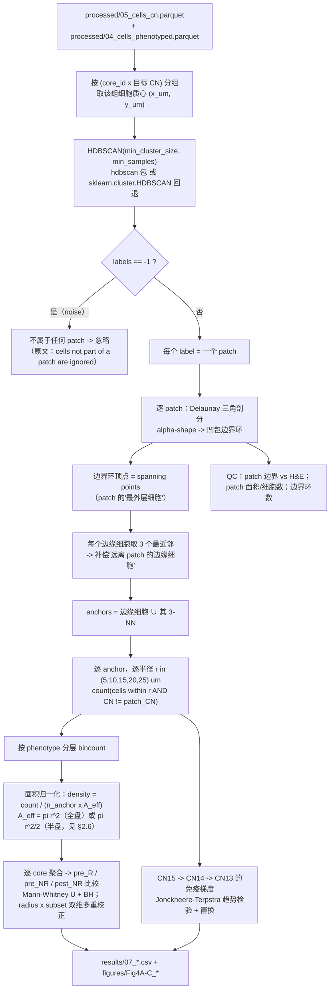

# 07 Patch 邻近分析（HDBSCAN 连通块 → 凹包 → 多半径环带计数）

> **目标文献**：Wang J, Nagarajan P, et al. *Integration of spatial single-cell proteomics and spatial metabolomics
> reveals tumor microenvironment predictive of immunotherapy response in mucosal melanoma.* bioRxiv 2026.
> DOI: 10.64898/2026.04.23.720453（预印本，未经同行评审）
>
> **模块对应原文**：Fig. 4A–C（Fig. 4D–H 的相互作用与表达分析见 `08_细胞间相互作用推断与置换检验.md`）；Methods 中「Patch proximity analysis」段（原文 1023 行版第 592–601 行）；Results 中「Spatial tumor-immune interactions are associated with ICI response」第 1–2 段
> **前置依赖**：`05_细胞邻域CN分析与Kmeans.md`（`processed/05_cells_cn.parquet`，含 `cn`/`cn_name`/`response_timepoint`）、`04_细胞表型定义与注释.md`（`processed/04_cells_phenotyped.parquet`，含状态粒度 `phenotype`（原文 25 / 我方 23 个状态）与 `major_type`）、`03_影像预处理配准与细胞分割.md`（细胞坐标与 0.23 μm/pixel 换算、`processed/03_core_manifest.csv` 的 core 组织掩膜）。本模块另需 CN13 的语义映射（`results/05_cn_naming_table.csv`）。
> **复现难度**：★★★★☆　**预计工时**：4 人日　**计算资源**：32 核 CPU / 64 GB 内存（HDBSCAN 对每个 core × 目标 CN 的质心聚类，最坏 ~100 次调用，每次 < 1 min；环带计数 5 个半径 × ~5 × 10⁴ anchor × ~50 邻居 < 10 min）；**不需要 GPU**

---

## 1. 科学问题与逻辑位置

**一句话**：CN 只告诉你"每个细胞的邻居环境是什么"；patch 分析回答的是一个更接近生物学问题的问题 ——「**一个具体的结构（patch）周围，免疫细胞是怎么分布的**」。

```
05 号模块：CN 标签（无监督的局部组成）
                    │
                    ▼
   本模块(07)：把 CN 从"逐细胞属性"变成"**空间中的结构**"
   ├─ patch = 同一 CN 的空间连通块（HDBSCAN 密度聚类，Fig. 4A 左）
   ├─ patch 边界 = 凹包（concave hull）→ spanning points → 边缘细胞
   ├─ 边缘细胞 + 3-NN 扩展 = "围绕 patch 的一圈细胞"（anchors）
   ├─ 以 anchors 为中心，在 5/10/15/20/25 μm 内计数**不属于该 patch** 的细胞
   │    → 按细胞类型/表型分层 → 得到"patch 周边的免疫分布"
   └─ 应用到 **CN13（tumor boundary）**：R vs NR 的免疫亚型差异（Fig. 4A–C）
                    │
                    ▼
   08 号模块：patch 内/CN 内的细胞-细胞相互作用（Delaunay + 置换，Fig. 4D–H）
   11 号模块：patch 邻近带（尤其 CN13）内的代谢物–免疫耦合（Fig. 5H–I）
```

**为什么需要"patch"这个中间层**：

1. **CN 没有"整体"的概念**。CN15/CN14/CN13 的组成向量描述的是"局部"，但"瘤芯 → 侵袭缘 → 瘤界"这三层结构是**空间上的实体**。要问"瘤界的巨噬细胞是不是比瘤芯多"，必须先定义"瘤界这块结构在哪里"—— 这就是 patch。
2. **"周围"必须有明确的参照物**。用"CN13 细胞的 25 μm 邻域"和用"CN13 patch 边界的 25 μm 环带"是**两个不同的问题**：前者是"CN13 细胞看到的邻居"（会被 CN13 区域内部与外部平均掉），后者是"从瘤界向外走 25 μm 会遇到什么"（几何上对应"免疫细胞是否成功穿越瘤界"）。原文显然是后者（"patch proximity analysis centered on CN13, examining its immune distributions within 25 μm"）。
3. **它是"免疫排斥/浸润"这一叙事的几何化**：如果免疫细胞被基质挡在瘤界之外，那么从瘤界向外的环带里应当看到免疫细胞在**近程富集、远程迅速衰减**；如果免疫细胞能进入瘤芯，则环带计数应当更平缓。原文 Fig. 4C 用一张代表性切片展示了"从 central tumor CN 向 tumor boundary CN，DC/巨噬/CD4⁺/CD8⁺ T 逐渐增多"的**梯度**。

**上游输入**：CN 标签 + 细胞表型 + 坐标（μm）。
**下游输出**（与 §4 的代码逐一对齐）：
- `processed/07_patch_labels.parquet`（每个细胞 → `(core_id, cn, patch_label, patch_prob)`；`patch_label == -1` = 不属于任何 patch）
- `results/07_patch_qc.csv`（逐 patch 与逐 core 的 QC：patch 数、大小、noise 比例、所用引擎）
- `results/07_patch_hulls.csv`（逐 patch 的凹包：`R_max_um`、环数/空洞数、覆盖率、spanning 点数、面积）
- `processed/07_spanning_points.parquet`、`processed/07_patch_hull_polygons.parquet`（有序边界顶点）
- `processed/07_patch_anchors.parquet`（anchor 细胞：是否边缘、3-NN 距离、所属 patch）
- `results/07_proximity_counts_by_radius.csv`（长表：`core_id, cn, patch_id, radius_um, phenotype, count, count_unique, density_per_um2, n_anchor, a_eff_um2, mode`）
- `results/07_proximity_annulus_counts.csv`（环带差分计数）、`results/07_proximity_subset_tests.csv`（组间检验）、`results/07_proximity_major_lineage_control.csv`（阴性对照）、`results/07_gradient_test.csv`（CN15→CN13 梯度）

> ⚠️ **命名口径（与上游文档必须一致，否则会静默取到空子集）**：分组列是 **`response_timepoint`**（`pre_R` / `pre_NR` / `post_NR`），**不是** `group`；谱系列是 **`major_type`**，**不是** `major_celltype`。patch 的唯一键是 **`(core_id, cn, patch_id)`**（HDBSCAN 的 `patch_id` 在每个 `(core, cn)` 内独立编号，跨 CN 会撞号）。全文件的代码已按此命名。
>
> ⚠️ **跨文档产物名对齐（已核对一致）**：本模块的产物命名以**本节清单为准**（`results/07_proximity_*.csv`）。`08_细胞间相互作用推断与置换检验.md` 的对应关系表中该引用此前写作 `results/07_patch_proximity_*.csv`，**已在 08 号文档中改为 `results/07_proximity_*.csv` / `results/07_proximity_subset_tests.csv`**，两处现已一致。同时 08 号文档消费 05 的 `processed/05_cells_cn.h5ad`，本模块消费 05 的 `processed/05_cells_cn.parquet` —— 两者是同内容的两个容器（05 号文档 §4.2 已声明），**CN 标签只由 05 生成**，07/08 都不得重跑 K-means（L0 §4.2 生产者唯一）。



---

## 2. 背景知识与原理

### 2.1 为什么"CN 无监督"还不够：从属性到结构

| 层次 | 对象 | 数据 | 能回答 | 不能回答 |
|---|---|---|---|---|
| 细胞 | 单个细胞 | 坐标 + 表型 | "这是 CD8⁺ T" | — |
| 邻域（CN） | 细胞 + 其 70 μm 窗口组成 | 无监督的局部组成 | "这个细胞的邻居环境像瘤芯还是像瘤界" | "瘤芯这块结构有多大、边界在哪" |
| **结构（patch）** | **同一 CN 的空间连通块** | **密度聚类的连通区域** | "从瘤界向外 25 μm 有什么" | "为什么"（因果） |

**关键区别**：CN 是**逐细胞的属性**（每个细胞一个标签），patch 是**整体对象**（有细胞集合、边界、面积、形状）。只有 patch 才能作为"参照物"来定义"周围（proximity）"。

> ⚠️ **导师批注**：原文没有定义 patch 的"位置"是**质心**还是**边界**。Methods 写 "running HDBSCAN clustering over all centroids in the specified CN" —— "centroids" 指的是**每个细胞的质心坐标**（cell centroid），不是"patch 的质心"。这句话的意思是"对所有属于该 CN 的细胞的坐标做 HDBSCAN"。**这是一个容易读错的句子**：不是"对 patch 质心做聚类"。我们按"对细胞坐标做 HDBSCAN"实现（§4.1）。

### 2.2 HDBSCAN 的原理：为什么它适合"仅有坐标"的 patch 检测

**（a）DBSCAN 的局限。** DBSCAN 用**全局**参数 $(\varepsilon, \text{minPts})$：所有簇必须在同一个密度阈值 $\varepsilon$ 下连通。

- 瘤界的 patch 细胞密度高（示意：约 $2\times10^{-2}$ cells/μm²，即本队列 CN13 细胞的局部密度可以比基质区高出数倍），基质深处的 patch 细胞密度低 → **同一个 $\varepsilon$ 只能检测一种密度的 patch**；
- $\varepsilon$ 稍大 → 相邻但生物学上不同的两块 patch 被连成一块；$\varepsilon$ 稍小 → 稀疏 patch 全部变成噪声；
- 而且 DBSCAN 无法给出"这个点有多确定属于该簇"。

**（b）HDBSCAN 的三个核心概念。**

1. **核心距离（core distance）**：$k = \texttt{min\_samples}$ 时，
$$d_{\text{core}}(x) = \text{到第 } k \text{ 近邻的距离}$$
2. **互达距离（mutual reachability distance）**：
$$d_{\text{mreach}}(a,b) = \max\{\, d_{\text{core}}(a),\; d_{\text{core}}(b),\; \lVert a-b\rVert \,\}$$
**直觉**：在稀疏区域里，$d_{\text{core}}$ 很大，把"稀疏区的两点之间距离"**抬升**到与局部密度同量级；在稠密区几乎不变（$d_{\text{mreach}} \approx \lVert a-b\rVert$）。这一步是 HDBSCAN 能用一个**统一标准**处理不同密度区域的关键。
3. **密度层级与λ**：以 $\lambda = 1/d_{\text{mreach}}$ 为"密度水平"，从 $\lambda=0$（全部点连成一体）到 $\lambda\to\infty$（每个点自成一簇）构建**最小生成树**（MST），再按 $\lambda$ 下降构建**凝聚树**（condensed tree）：每个簇在某个 $\lambda$ 处"分裂"。**簇的稳定性**（Campello et al. 2013 的定义）为
$$\text{stability}(C_i) = \sum_{x_j \in C_i}\big(\lambda_{\max}(x_j, C_i) - \lambda_{\min}(C_i)\big)$$
其中 $\lambda_{\min}(C_i)$ 是簇 $C_i$ **诞生**（首次从父簇分裂出来）时的密度水平，$\lambda_{\max}(x_j, C_i)$ 是点 $x_j$ **离开** $C_i$ 时的密度水平（即它在凝聚树中从 $C_i$ 分出去的那个 $\lambda$）。
**注意符号方向**：$\lambda$ 越大 = 密度越高，且**恒有** $\lambda_{\max}(x_j,C_i) \ge \lambda_{\min}(C_i)$，因此每一项都 $\ge 0$、稳定性单调随"簇存活过多少密度区间"增长。若把两项写反（$\lambda_{\min} - \lambda_{\max}$），所有稳定性都会变成非正值、`eom` 选簇行为完全错乱 —— 这是实现/讲解 HDBSCAN 时最常见的符号错误。
4. **簇选择**：`cluster_selection_method='eom'`（excess of mass，默认）取"总稳定性最大"的簇集合；`'leaf'` 取凝聚树的叶子簇（更细）。还可以用 `cluster_selection_epsilon`（**单位 = 坐标单位**，对我们的数据就是 μm）强制"在 $\varepsilon$ 以上的密度层级不再分裂"→ 把靠得很近的小簇合并。

**（c）为什么 HDBSCAN 而不是 DBSCAN（本项目的选择依据）。**

| 维度 | DBSCAN | HDBSCAN |
|---|---|---|
| 密度阈值 | **全局** $\varepsilon$（单一） | **自适应**（在每个密度层级上评估稳定性） |
| 参数 | $\varepsilon$ + minPts（$\varepsilon$ 极难调） | `min_cluster_size` + `min_samples`（**有物理直觉**，见 §5.1） |
| 变密度数据 | 失败（要么漏检稀疏簇，要么合并稠密簇） | 正常 |
| 噪声 | 有（label 0） | 有（label −1）+ 每个点的**隶属概率**（`probabilities_`） |
| 簇的层次 | 无 | 有凝聚树（可用于 QC："这些 patch 是不是同一个大结构在更低密度处的分裂"） |

在本数据上尤其重要：97 个 core、每个 core 的细胞密度差 2–5 倍，且**同一个 CN 在不同 core 里的密度也不同**（CN13 在瘤界密集、在间质里可能只是零星分布）→ 全局 $\varepsilon$ 的 DBSCAN 必然失败。

**（d）"仅有坐标"的实现细节。**

- **特征**：只用 $(x, y)$ 两列（μm），**不加**表型/CN/面积等特征 —— 否则"空间连通块"变成"特征空间里的簇"，与"结构"的语义不符。
- **度量**：`metric='euclidean'`（2D 欧氏）。
- **分组的键**：`(core_id, cn)`。**必须先按 core 分组**：TMA 上多芯共片，若把所有 core 拼在一起聚类，相邻芯之间会连成假 patch（§7 陷阱 10）。
- **每个 CN 单独聚类**：不能把所有 CN 混在一起聚类再按 CN 拆分 —— 那样不同 CN 的细胞会互相成为邻居，簇边界不再对应 CN 的连通块。
- **坐标尺度**：HDBSCAN 的距离参数（`min_samples` 通过核心距离、`cluster_selection_epsilon`）**依赖坐标单位**。用 μm 就一路用 μm；若换成 px，`cluster_selection_epsilon` 需要重设（1 μm = 4.348 px）。
- **`min_samples` 的物理含义**：它是"稀疏区的核心距离由第几近邻决定"→ 在 ~9×10⁻³ cells/μm² 的密度下（`05` 号文档 §2.3 的估算），一个细胞周围 ~15 μm 半径内约 6 个细胞 → `min_samples ≈ 5–15` 对应"局部 ~10–20 μm 尺度的密度感知"。

### 2.3 凹包（concave hull）与 spanning points

**（a）凸包为什么不够。** 凸包（convex hull）是"包含全部点的最小**凸**多边形"。瘤界 patch 常是**弯月形/C 形/环状**（绕着瘤巢），凸包会把"凹陷"填平：

- 被填平的区域里其实**没有 patch 细胞**（是别的东西，例如免疫巢）；
- 这些区域与 patch 的几何距离很小，但**不属于 patch** → 凸包会让"边缘细胞"错位到没有细胞的地方，进而把 anchor 环带放到错误的位置；
- 结论："patch 周边的免疫密度"会被系统性**低估**（因为锚点跑到了离真实边界更远的地方，而免疫细胞其实紧贴着真实的凹边界）。

**（b）凹包 = alpha-shape（Edelsbrunner 1983）。** 做法（本项目实现）：

1. 对 patch 的细胞坐标做 **Delaunay 三角剖分**（`scipy.spatial.Delaunay`）；
2. 每个三角形 $T$ 有一个**外接圆半径** $R_T$；
3. 设定阈值 $R_{\max}$（单位 μm，物理直觉清楚）：**保留 $R_T \le R_{\max}$ 的三角形**，删除其余；
4. 剩下的三角形集合（alpha-complex）的**边界边**（只属于一个保留三角形的边）构成边界环；**边界环的顶点**就是"最外层细胞"（spanning points）。

**参数直觉**：$R_{\max}$ **越小 → 边界越"紧"**（大三角形被删掉，边界贴合细胞实际轮廓，可能出现多个环/空洞）；$R_{\max}$ **越大 → 越接近凸包**（$R_{\max} \ge \max_T R_T$ 时就是凸包）。

| 参数化方式 | 常见库 | 关系 |
|---|---|---|
| $R_{\max}$（μm） | 本项目自实现 | 直接物理量；**推荐** |
| $\alpha = 1/R_{\max}$ | `alphashape`（`alphashape(points, alpha)`） | $\alpha$ 大 → 紧；**需按当前版本核对**：不同库对 $\alpha$ 的语义（是 $1/R$ 还是 $R$）不一致 |
| `ratio ∈ (0,1]` | `concave_hull` 包（Park & Oh 2012） | `ratio=1` → 凸包；越小越凹。原文提到的 Spyrrow 用 Polygon 构造 patch 多边形，其内部实现即属这一类 |

**（c）$R_{\max}$ 怎么选？—— 覆盖率规则（我们的决策）。**

原文**未报告**凹包参数。我们采用**可复现、有统计意义**的规则：

> **在所有使得"patch 内 ≥ 99% 的细胞落在边界环内"的 $R_{\max}$ 中取最小的那个**（即"最紧但仍能包住 99% 细胞"的凹包）。

实现：候选 $R_{\max}$ 取 Delaunay 三角形外接半径的经验分位数（如 1%–99% 的 100 个分位点），对每个候选用"包含判定"检查覆盖率（判定技巧：`Delaunay.find_simplex(p)` 返回包含 $p$ 的单纯形下标；若该单纯形被保留则 $p$ 在 alpha-complex 内），取满足覆盖率 ≥ 99% 的最小 $R_{\max}$。**敏感性**：同时报告覆盖率阈值 95% / 99% / 100% 下的结果。

**（d）多条边界环的处理。** 真实凹包可能给出**多环**（一个外环 + 若干空洞环）。我们的处理：按"环内面积"取最大的作为 **patch 外边界**；其余环作为**空洞**记录到 QC（`n_holes`）。若 `n_holes` 很大（> 20% 的 patch），说明 $R_{\max}$ 过小 → 边界碎片化，需要提高阈值并在 QC 中报告。

### 2.4 边缘细胞扩展（3-NN）：它在纠正什么

原文句："To include cells close to the outlining border of the patch and to **correct for cells that were distant from the patch**, three nearest neighbors for each edge cell were included as well, resulting in a group of cells surrounding each patch."

两个作用（都是必要的）：

1. **"include cells close to the outlining border"**：凹包的 **顶点** 在平滑边界上**很稀疏**（一条缓弯的边界可能只有 3–5 个顶点跨过几百 μm），直接用顶点当 anchor 会在边界上留下大段"空档"，环带计数变成"在几个点上采样"而不是"沿边界采样"。纳入每个顶点的 3 个最近邻，相当于把"沿边界的采样点"加密。
2. **"correct for cells that were distant from the patch"**：凹包的顶点虽然"在边界上"，但它可能是一个**凸出的尖角**（跨过凹陷，离 patch 主体较远）。这类顶点向外扩展 3-NN 时，最近邻会把它**拉回** patch 主体一侧 → 锚点环带重新贴合真实边界。**这一条解释了为什么是"3 个最近邻"而不是"半径 r 内的所有细胞"**：3-NN 是**自适应**的（密集处邻居近、稀疏处邻居远），半径法会在这类尖角处引入明显的偏差。

**实现要点与偏差**：

- $k$-NN 扩展**没有距离上限** → 在稀疏区（如基质中的零星 CN13），3-NN 的距离可能达 30–50 μm，把"离 patch 很远的细胞"拉进 anchor 集合，等价于**放大**了有效边界带宽度。
- **我们的控制**：记录每个 anchor 的"3-NN 最大距离"，并做**敏感性分析**：丢弃"3-NN 距离 > 15 μm"的 anchor（以及丢弃"离 patch 主体质心 > patch 半径 × 1.5"的 anchor），比较结论是否变化。把这个上限定为 15 μm 的依据是"细胞直径 7–10 μm → 15 μm ≈ 1.5–2 个细胞直径"，即"紧邻"的尺度。
- **anchor 去重**：同一个细胞可能同时是 patch A 的边缘细胞、patch A 另一个边缘细胞的邻居、以及 patch B 的邻居。**必须按 patch 分组聚合**，并在跨 patch 汇总时对细胞去重（否则同一个细胞被计数多次，环带计数被放大）。

### 2.5 多半径环带计数：累积 vs 环带、计数 vs 密度

**（a）原文的做法。** "the selected cells were used as anchor cells to span a radius (**5 µm, 10 µm, 15 µm, 20 µm, and 25 µm**) around each selected cell. Cells within the radius that **did not belong to the patch** were counted as cells within spatial proximity."

→ 计数是**累积的**（within the radius），5 个半径给的是 5 条"累积曲线"，不是 5 个互斥的环带。

**（b）两种量的区别与各自的解读。**

| 量 | 定义 | 解读 | 我们的处理 |
|---|---|---|---|
| 累积计数 | $N(r) = \sum_{a}\sum_{j \notin \text{patch}} \mathbb{1}[\lVert x_j - x_a\rVert \le r]$ | "在 patch 周边 $r$ 以内共有多少非 patch 细胞" | 对齐原文，主输出 |
| 环带（annulus）计数 | $A(r) = N(r) - N(r - \Delta r)$ | "在 $r-\Delta r$ 到 $r$ 这一圈里的细胞数" | 补充输出（能看出"衰减"的形状） |
| **面积归一化密度** | $\rho(r) = \dfrac{N(r)}{n_{\text{anchor}} \cdot A_{\text{eff}}(r)}$ | "$r$ 以内的**非 patch 细胞密度**" | **必须输出**（见下） |

**为什么必须做面积归一化**：即使**空间完全均匀**（非 patch 细胞的密度为常数 $\rho_0$），累积计数也会随 $r$ **按面积增长**：

$$N(r) \approx n_{\text{anchor}} \cdot \rho_0 \cdot \pi r^2 \quad\Rightarrow\quad N(25\,\mu m) \approx 25 \times N(5\,\mu m)$$

**若只看计数，任何"随半径增加"都会被误读成"免疫细胞在 patch 周围聚集"** —— 这是本节最容易犯的错误，也是原文只用计数时的**隐含假设**：*它假设不同组、不同半径的"可及面积"与本地细胞总密度是**可比的***。这个假设在 R 与 NR 之间很可能**不成立**（NR 的基质更多 → 细胞密度更低）。因此：

1. 我们的主输出是**密度** $\rho(r)$（用面积归一化）；
2. 同时输出**原始计数**（对齐原文，便于与原文图形态对照）；
3. 额外输出**相对密度** $\rho(r) / \rho_{\text{core,non-patch}}(r_{\text{ref}})$ —— 用同一个 core 内"非 patch 区域的全局密度"作参照，把"细胞总密度差异"消掉，只留下"patch 周边的富集/排斥"。**这一条是本项目对原文最实质的量化补强。**

**（c）$A_{\text{eff}}$ 的陷阱：锚点在边界上，盘内一半是 patch。**

锚点是 patch 的边界细胞。以它为中心的圆盘，**大约一半落在 patch 内部**。若"非 patch 细胞密度"在 patch 内外的真实值不同（这正是我们要检验的东西！），那么用 $\pi r^2$ 归一化得到的是"内外两半的平均密度"，会**低估**外侧密度、**高估**内侧密度（相对于"纯外侧"的定义）。

**我们的做法（三档口径，全部报告）**：

1. **全盘**：$A_{\text{eff}} = \pi r^2$（对齐"within the radius"的字面含义，最简单）；
2. **半盘**：$A_{\text{eff}} = \pi r^2 / 2$，并只统计位于"向外半平面"的邻居 —— 外法线取"从 patch 质心指向该 anchor 的单位向量"（对近似凸的 patch 足够准确；对强凹 patch 会偏，见 §7 陷阱 16）；
3. **暴露面积（几何精确）**：$A_{\text{eff}}(r) = \pi r^2 - |\text{圆盘} \cap \text{patch 多边形}|$，用 `matplotlib.path.Path.contains_points` 做**蒙特卡洛**估计（在圆盘内均匀撒 $10^3$ 个点，统计落在 patch 多边形外的比例）。这是最正确的口径，代价是计算量。

主分析用 **(1) 全盘**（对齐原文），(2)/(3) 作为敏感性分析；若 (1) 与 (2)/(3) 的**方向**不一致，结论必须降级（说明"富集"主要来自 patch 内侧的贡献）。

**（d）分层计数。** 计数必须按**细胞表型**（状态粒度 `phenotype`；原文 25 个、我方 04 号文档 23 个）与**主要谱系**（8 个 `major_type`）分层。原文 Fig. 4B 的结构是：

- top：**major cell types** 在 tumor CN 之间与 5–25 μm 窗口内的相对丰度（原文结论：R 与 NR **大体可比**）；
- middle：**macrophage 亚型**（CD163⁺ 等）；
- bottom：**T 细胞亚型**（Ki67⁺CD8⁺、Granzyme B⁺CD8⁺、FOXP3⁺CD4⁺）。

> ⚠️ **导师批注（Fig. 4B 混了两种量，必须拆开）**："R cores showed **higher abundance** of cycling CD8⁺ T (Ki67⁺) cells and cytotoxic CD8⁺ T (Granzyme B⁺) cells, whereas regulatory CD4⁺ T (FOXP3⁺) cells were **less frequent**" —— 这里的 "abundance/frequent" 既可能是 **(i) 空间计数/密度**（patch 邻近带内该类细胞的密度），也可能是 **(ii) 亚型构成比**（该类细胞在其母谱系中的占比，如 CD163⁺/全部巨噬），还可能是 **(iii) 区域内比例**（在该 CN 区域内细胞总数的占比）。三者是**不同的量**：例如"CD163⁺ 巨噬占全部巨噬的比例上升"可以在巨噬绝对密度不变时发生。原文未说明是哪一个。**我们的复现决策：三个都算、都报告**（`results/07_proximity_subset_tests.csv` 中加一列 `metric ∈ {density, count, subset_fraction, region_fraction}`），并在图注中写清用的是哪一个。（关于原文"R cores showed higher abundance of cycling CD8⁺ T" 的正确中文转述见 §3 第 6 条。）

### 2.6 三个空间尺度：本模块在全文多尺度设计中的位置

这是本文空间分析**最值得强调的设计亮点**：三（四）个尺度上做互补的推断，而不是只用一个大尺度把细节抹平。

| 尺度 | 数值 | 单位换算 | 提出处 | 回答的问题 |
|---|---|---|---|---|
| **细胞级邻接** | **5 / 10 / 15 / 20 / 25 μm** | 1 个细胞直径 7–10 μm；5 μm ≈ 1 个细胞间隙，25 μm ≈ 2–3 个细胞直径 | Methods「Patch proximity analysis」 | "紧贴结构表面的免疫细胞有多少" |
| **邻域级组成** | **70 μm**（= 304.3 px @ 0.23 μm/px） | — | Methods「CN definition」 | "细胞的局部环境属于哪种邻域类型" |
| **相互作用阈值** | **265 px ≈ 61 μm**（$265 \times 0.23 = 60.95$） | 与 70 μm 同量级（**约小 13%**） | Methods「Cell-cell interaction analysis」 | "两个细胞是否算'相互作用'"（Delaunay 边长度过滤） |
| **跨尺度拼接** | **约 165 μm** = $2\times70 + 25$ | 一个瘤界 patch 的一侧邻域（70）+ 另一侧邻域（70）+ 表面外推（25） | **本项目综合出的"组织级"跨度**（见下方批注） | "从瘤芯跨过瘤界到间质，整体的免疫梯度" |

> ⚠️ **导师批注（诚实性）**：**165 μm 这个数字不是原文报告的**，而是我们把三个已报告的尺度拼接后得到的"组织级视野"量级（$2\times70\,\mu m + 25\,\mu m$）。之所以值得写出，是因为它恰好对应"从瘤芯（CN15）经侵袭缘（CN14）到瘤界（CN13）再向外 25 μm"这一原文所描述的构型跨度，并解释了为什么 Fig. 4C 能看到清晰的**单侧梯度**而不是随机分布。**写作时必须标注"这是我们的综合，原文未报告该数字"**，不得写成"原文使用 165 μm 的组织级尺度"。
>
> ⚠️ **导师批注（原文疏漏 #4：265 pixels 的单位）**：上表第 3 行的 **60.95 μm 是我们按原文自报的 0.23 μm/pixel 反推出来的**，原文 Methods 只写 "**265 pixels**"，**没有给 μm 换算、也没有说明用的是哪一层坐标系的像素**（详见 `08_细胞间相互作用推断与置换检验.md` §2.3 的四种口径与 `05_细胞邻域CN分析与Kmeans.md` §2.4 的单位换算表）。本模块引用该数值时**必须同时写出 px 与 μm 两个口径**。
>
> 另一个必须写清的量级关系：**61 μm（265 px）的相互作用阈值 ≈ 70 μm 的邻域半径**，即"能算相互作用的最远距离"与"邻域尺度"几乎相同 —— 这意味着 Delaunay 相互作用分析（`08` 号文档）与 CN 分析**不是独立的证据**，两者在空间尺度上高度重叠。这一点在结题评述中要提出（`12` 号文档）。

### 2.7 为什么选 CN13（tumor boundary）作为中心

原文的动机链（Results）：

1. **Fig. 3F** 先发现 CN14–CN15 与 CN14–CN13 的**界面**在 pre-R 富集（`06` 号文档）；
2. → 于是"quantified cell-type composition across the three tumor-associated CNs—CN15, CN14, and CN13—and performed **patch proximity analysis centered on CN13**"；
3. 选择 CN13（瘤界）而非 CN15（瘤芯）的理由是**生物学**：**瘤界是免疫细胞能否进入瘤巢的"关口"**。若免疫排斥成立，差异应当出现在瘤界附近；而 CN13 的组成（肿瘤 + 浸润巨噬）本身就说明它是最"活跃"的界面。
4. 这也是"**tumor boundary**"命名与"CN13 富集于 R"（Fig. 2D）两个结论的衔接点：**CN13 更多的 R 样本，若其瘤界周围免疫更活跃，就支持"瘤-髓界面是响应相关结构"的假说**。

> ⚠️ **导师批注**：本模块的所有结论都是**相关性**。原文 Discussion 也说 "While our data are correlative…"。写作时禁止把"R 的瘤界周围 CD163⁺ 巨噬更多"升级为"CD163⁺ 巨噬介导了响应"（L0 §12.4）。

---

## 3. 原文逐句拆解

| # | 原文句（English 原词保留） | 中文转述 | 对应操作 | 原文是否给参数 | 缺失项 → 我方复现决策 |
|---|---|---|---|---|---|
| 1 | "**Patches were detected in COMET data by running HDBSCAN clustering over all centroids in the specified CN.**" | 对指定 CN 的**全部细胞坐标**跑 HDBSCAN，得到 patch | 按 `(core_id, cn)` 分组 → `HDBSCAN(min_cluster_size, min_samples)` on $(x,y)$（μm） | ✅ 算法（HDBSCAN）；❌ `min_cluster_size`、`min_samples`、`cluster_selection_method`、是否按 core 分组、用哪些坐标 | `min_cluster_size = 50`（或该 CN 细胞数的 1%，取大者）、`min_samples = 10`、`eom`、**按 core 分组**（必须）、坐标 = μm（2D 欧氏）。全部参数写入 `logs/07_params.json`；做 `min_cluster_size ∈ {20, 50, 100, 200}` 的敏感性 |
| 2 | "**The resulting clusters were used as patches, and cells that were not part of a patch are ignored.**" | 每个簇 = 一个 patch；不属于任何 patch 的细胞忽略 | HDBSCAN 的 **noise 标签（−1）** 与"被 `min_cluster_size` 归并掉的小簇"都视为"不属于任何 patch" | ✅ 语义 | **noise 的两种来源要分开记录**：`label == -1`（密度噪声）与"低概率隶属"（`probabilities_ < 0.5` 的细胞也算 patch 成员，但标记出来做敏感性）。`results/07_patch_qc.csv` 记录每 core 的 noise 比例 |
| 3 | "**The outermost cells of each patch were selected by constructing a concave hull and selecting the spanning points.**" | 用凹包取 patch 的"最外层细胞"（spanning points） | Delaunay → alpha-shape（$R_{\max}$ 覆盖率规则）→ 外边界环 → **环顶点** = spanning points | ✅ 方法（concave hull）；❌ 参数（$R_{\max}$ / $\alpha$ / ratio）、环的处理 | $R_{\max}$ = "使 ≥99% 的 patch 细胞落在边界环内的最小值"；取面积最大的环为外边界，其余记为空洞；敏感性：覆盖率 95%/99%/100% + `n_holes` 记录 |
| 4 | "To include cells close to the outlining border of the patch **and to correct for cells that were distant from the patch**, **three nearest neighbors for each edge cell** were included as well, resulting in a group of cells surrounding each patch." | 每个边缘细胞再纳入 3 个最近邻，得到"围绕 patch 的细胞群" | `cKDTree.query(edge_cells, k=4)` 取第 1–3 列；anchors = 边缘细胞 ∪ 3-NN | ✅ $k = 3$；❌ 是否有距离上限、是否去重 | 主路径**不设距离上限**（对齐原文）；敏感性：丢弃 3-NN 距离 > 15 μm 的 anchor；**跨 patch 汇总时对 anchor 去重**（同一细胞可能属于多个 patch 的边界带） |
| 5 | "Subsequently, the selected cells were used as **anchor cells to span a radius (5 µm, 10 µm, 15 µm, 20 µm, and 25 µm) around each selected cell.**" | 以 anchors 为中心，在 5 个半径上统计 | `query_ball_point(anchors, r)`，5 个半径逐个做（累积） | ✅ 5 个半径 | 半径单位 = **μm**（不是 px！5–25 μm 对应 21.7–108.7 px）。同时输出**环带**（差分）计数供解读 |
| 6 | "**Cells within the radius that did not belong to the patch were counted as cells within spatial proximity.**" | 半径内**不属于该 patch** 的细胞 = "空间邻近细胞" | 计数集合 = {该 core 内所有细胞} \ {该 patch 的细胞}（含 noise 与其他 patch 的细胞） | ✅ 语义 | 边界条件：**anchor 自身**（属于 patch）不计入；同一个细胞若同时是 patch A 的邻近细胞与 patch B 的成员，则在 A 的分析中**要计入**（因为对 A 而言它确实不在 A 里）→ 因此**必须按 patch 分别计数，不要全局去重** |
| 7 | "Motivated by this observation, we next quantified cell-type composition across the three tumor-associated CNs—**CN15, CN14, and CN13**—and performed **patch proximity analysis centered on CN13, examining its immune distributions within 25 μm** (Fig. 4A)." | 中心 = **CN13**；查看其 25 μm 内的免疫分布 | 只对 CN13 建 patch；报告 5/10/15/20/25 μm 五个半径 | ✅ CN13、25 μm | 我们**额外**对 CN14、CN15 也跑一遍（同参数）→ 用于 §4.6 的 **CN15→CN14→CN13 梯度**检验（原文 Fig. 4C 展示的梯度需要三个 CN 都有结果） |
| 8 | Fig. 4A 图注："…spatial mapping of cell type proportions **across eight layers**, visualized as pie plots over a representative tissue core." | 用饼图展示 8 层的细胞类型比例 | 原文未说明 8 层的定义 | ❌ "eight layers"的构成 | **⚠️ 与 Methods 的 5 个半径不一致**（原文已知矛盾之一）：8 ≠ 5。可能的口径：(a) 5 个半径 + 3 个额外层；(b) 三个 CN × 若干层；(c) 图表排版口径。**我们的决策：以 Methods 的 5 个半径为准**，把"8 层"登记到 `12_复现质控清单、排错与批判性评述.md` |
| 9 | "At the level of major immune lineages, pre-treatment R and NR cores showed **broadly comparable distributions** across tumor CNs and across the 5–25 μm boundary window (Fig. 4B, top)." | **主要谱系**层面 R 与 NR 大体无差异 | 按 8 个 major type 分层做环带计数 → 组间检验 | ✅ 结论方向（阴性！） | **这是必须复现并如实报告的阴性结果**（L0 §12.5）：major lineage 层面应**不显著**；若我们的实现对多数 major 类型给出显著差异 → 说明统计口径有问题（很可能是把细胞当独立样本 → 伪重复） |
| 10 | "In R cores, **macrophages were more frequently of the CD163⁺ subtype** and were more abundant than in NR cores." | R 中巨噬更常为 CD163⁺ 亚型，且更多 | ① 亚型构成比：CD163⁺ / 全部巨噬；② （巨噬的）密度/计数 | ✅ 方向；❌ 统计量口径 | 三个量都算（§2.5d 批注）：`subset_fraction`（CD163⁺/macrophage）、`density`（CD163⁺ 巨噬 / μm²）、`region_fraction`；均按 core 层聚合 |
| 11 | "R cores also showed **higher abundance of cycling CD8⁺ T (Ki67⁺) cells** and **cytotoxic CD8⁺ T (Granzyme B⁺) cells**, whereas **regulatory CD4⁺ T (FOXP3⁺) cells were less frequent** than relative to NR cores." | R 中 Ki67⁺CD8⁺ T 与 GZMB⁺CD8⁺ T 更多，FOXP3⁺CD4⁺ T 更少 | 同 #10（三个量都算），针对 4 个具体表型 | ✅ 方向（含原文语法小错 "than relative to"）；❌ 统计量口径 | 这是我们**最重要的复现判据**之一：4 个表型的符号必须与原文一致（+、+、−），并在 core 层与患者层各报一次 |
| 12 | "Spatial mapping of a representative tissue core further corroborated these findings, demonstrating a **clear spatial gradient in immune cell distribution, with enrichment of DCs, macrophages, CD4⁺ T and CD8⁺ T cells from the central tumor CN toward the tumor boundary CN**, highlighting boundary-associated immune accumulation (Fig. 4C)." | 从 central tumor CN（CN15）向 tumor boundary CN（CN13）存在免疫梯度（DC/巨噬/CD4⁺/CD8⁺ T 递增） | 对 CN15/CN14/CN13 三个区域分别计算免疫细胞密度 → 有序趋势检验 | ✅ 方向；❌ 量化方法（"梯度"如何检验） | **逐核心**在三个 CN 区域内计算免疫密度 → **Jonckheere–Terpstra 趋势检验**（有序备择：CN15 < CN14 < CN13）+ 置换版；同时报告 Spearman（CN 秩 vs 密度）作交叉验证 |
| 13 | Fig. 4B 的 x 轴含义："across tumor CNs and **within 5–25 µm of patches from the tumor boundary CN**" | 两个维度：**tumor CN**（区域）+ **patch 邻近半径**（5–25 μm） | 计数表要同时按 `cn`（区域）与 `radius`（邻近带）汇总 | ✅ 两个维度 | 我们的输出表用长表（`core_id, cn, radius_um, phenotype, count, density, metric`），便于任意维度汇总；并在图注中写清 x 轴的两个维度 |

---

## 4. 逐步可运行代码

> 环境：Python 3.11；`numpy` 1.26、`pandas` 2.2、`scipy` 1.13、`scikit-learn` 1.5（含 `sklearn.cluster.HDBSCAN`，需 ≥ 1.3）、`hdbscan` 0.8.40（可选，若可用则优先）、`matplotlib` 3.9、`seaborn` 0.13、`tqdm` 4.66、`pyarrow` 16。
> 随机种子：`SEED = 20260101`；参数落盘 `logs/07_params.json`。
> **生产实现**：本模块的核心算法在仓库级脚本 **`tools/patch_proximity.py`** 中（HDBSCAN patch → 凹包边界 → edge 3-NN 扩展 → 多半径环带计数 → 面积归一化密度），带 `--selftest`（**合成椭圆 patch**自检：报告环带计数与理论值的相对误差，断言 < 15%，见 `00_目录与复现总览.md` 的工程约定）。项目内 `code/07_*.py` 只做编排与项目特有参数（CN13 目标、分组口径、图形规格）：**先 `python tools/patch_proximity.py --selftest`，再跑编排脚本**。
> ```bash
> python tools/patch_proximity.py --help      # 入参/出参**逐字以 --help 为准**（tools/ 接口属 L0 契约）
>
> # ① 输入适配：tools/ 脚本只读 CSV/TSV（read_table → pd.read_csv），不读 parquet；
> #    且表型列必须与 CN 同表（脚本只有一个 --cells 输入，没有独立的表型表参数）
> python - <<'PY'
> import pandas as pd
> cn = pd.read_parquet("processed/05_cells_cn.parquet")[["cell_id","core_id","x_um","y_um","cn"]]
> ph = pd.read_parquet("processed/04_cells_phenotyped.parquet")[["cell_id","phenotype"]]
> cn.merge(ph, on="cell_id", how="left", validate="one_to_one") \
>   .to_csv("processed/07_cells_for_tool.tsv", sep="\t", index=False)
> PY
>
> # ② 生产脚本（主分析 = CN13 patch；CN14/CN15 换 --patch-value 各跑一遍做梯度分析）
> python tools/patch_proximity.py \
>     --cells        processed/07_cells_for_tool.tsv \
>     --x-col        x_um --y-col y_um \
>     --celltype-col phenotype --group-col core_id \
>     --patch-by     cn --cn-col cn --patch-value 13 \
>     --cluster-method hdbscan --min-cluster-size 50 --hdbscan-min-samples 10 \
>     --edge-method  auto --edge-knn 3 \
>     --radii-um     5,10,15,20,25 --pixel-size-um 0.23 \
>     --ring-origin  anchor --seed 20260101 \
>     --out-prefix   results/07_proximity
> ```
> 脚本产物为 `results/07_proximity_patch_summary.csv`（逐 patch：`hull_method`、`n_patch`、`noise` 等）与 `results/07_proximity_ring_counts.csv`（环带计数与密度）。项目内的 `code/07_*.py` 再把它们展开成本模块契约中的长表与 QC 表（§1）。
>
> ⚠️ **导师批注（`tools/` 脚本与本文件代码的四处口径差异，必须核对）**：
> 1. `--patch-value` 的比较实现是 `df[patch_col].astype(str) == str(patch_value)`，因此 `--patch-value 13` 对**整数 `cn` 列**有效；若上游把 `cn` 存成了 `cn_13`，则必须传 `--patch-value cn_13`（先 `print(df['cn'].unique())` 核对）。
> 2. 脚本**没有 `--hull-coverage` 参数**：凹包走 `--edge-method {auto,concave,alpha,convex_fallback}`（默认 `auto` = 凹包→alpha-shape→凸包逐级回退）+ `--concave-ratio`（默认 0.3）。本文件 §2.3c 的"覆盖率 ≥ 99% 自适应 $R_{\max}$"是**项目内 `code/07_02` 独立实现**的规则，脚本不实现它——两条路径要交叉核对（`hull_method` 列 + `results/07_patch_hulls.csv`）。
> 3. `--min-cluster-size`（不是 `--hdbscan-min-cluster-size`）；`--hdbscan-min-samples` 拼写正确。
> 4. `--ring-origin {anchor,boundary}`（默认 `anchor`）决定环带半径的测量原点：`anchor` 与原文"以每个 anchor 为中心"一致但**系统性偏大 0~edge_band**；`boundary` 无偏、便于与几何理论值比较。本模块主口径 = `anchor`（对齐原文），敏感性 = `boundary`。
> 5. ⚠️ **计数口径不同（最容易踩）**：脚本输出的是**互斥环带** $(r_{i-1}, r_i]$ 的计数（列 `ring_inner_um` / `ring_outer_um` 明确给出区间），**不是**原文"**within the radius**"的**累积**计数。要把脚本结果对齐原文口径，必须对 `radius_um` 做 `cumsum`（按 `group × patch_id × celltype` 分组、按半径升序累加 `count` 与 `ring_area_um2` 后再算密度）。**本模块 §4.4 的项目内实现才是累积口径的主路径**；脚本用于交叉验证时必须先做这一步转换，且比较的是**密度**而非计数。
> 6. ⚠️ **列名与主键不同**：脚本用 `group`（= 我们传进去的 `--group-col core_id` 的列名）而非 `core_id`；用 `celltype` 而非 `phenotype`；`patch_id` 是**字符串**（形如 `patch_0`），不是整数。项目内契约表用的是 `core_id` / `phenotype` / 整数 `patch_id`，因此 `code/07_*.py` 需要一层显式改名与类型转换（并断言一一对应），否则 join 会**静默产生空表**（L0 附录 C 的"标签错配"）。
> 7. `out_prefix` 是**前缀**而不是目录：产物固定为 `<PREFIX>_patch_summary.csv` 与 `<PREFIX>_ring_counts.csv`（脚本会自动创建输出目录）。

### 4.1 HDBSCAN 检测 patch（逐 core × 逐 CN）

```python
# code/07_01_patch_detection.py
"""对指定 CN 的细胞坐标做 HDBSCAN（按 core 分组），得到 patch 标签。"""
import json, numpy as np, pandas as pd
from tqdm import tqdm

SEED = 20260101
MIN_CLUSTER_SIZE, MIN_SAMPLES, EPS_UM = 50, 10, None       # EPS_UM -> cluster_selection_epsilon
TARGET_CNS = [13]                                          # 主分析：CN13；梯度分析时改为 [15, 14, 13]

def run_hdbscan(xy, min_cluster_size, min_samples, eps_um=None):
    """优先 hdbscan 包（含 probabilities_ 与 condensed tree），回退 sklearn.cluster.HDBSCAN。"""
    kw = dict(min_cluster_size=min_cluster_size, min_samples=min_samples,
              cluster_selection_method="eom",
              cluster_selection_epsilon=(eps_um if eps_um is not None else 0.0))
    try:
        import hdbscan                                        # 0.8.40
        m = hdbscan.HDBSCAN(metric="euclidean", core_dist_n_jobs=-1, **kw).fit(xy)
        return m.labels_, m.probabilities_, "hdbscan"
    except ImportError:
        from sklearn.cluster import HDBSCAN                   # scikit-learn >= 1.3
        m = HDBSCAN(metric="euclidean", n_jobs=-1, **kw).fit(xy)
        return m.labels_, m.probabilities_, "sklearn"

cells = pd.read_parquet("processed/05_cells_cn.parquet")
assert {"core_id", "cn", "x_um", "y_um", "cell_id"}.issubset(cells.columns)
# 断言坐标是 μm：1.0 mm 芯内 x 跨度应 ~1000 μm（若 ~4000 则是 px）
span = cells.groupby("core_id")["x_um"].agg(lambda s: s.max() - s.min()).median()
assert 300 < span < 1500, f"core 内 x 跨度中位数 {span:.0f}，不像 μm（1.0 mm 芯）→ 检查 0.23 μm/px 换算"

rows, lab_frames = [], []
for cn in TARGET_CNS:
    sub_cn = cells[cells["cn"] == cn]
    for core, sub in tqdm(sub_cn.groupby("core_id"), desc=f"CN{cn} patches"):
        xy = sub[["x_um", "y_um"]].to_numpy(np.float64)
        if len(xy) < MIN_CLUSTER_SIZE:                        # 细胞太少 → 不可能成 patch
            rows.append(dict(cn=cn, core_id=core, n_cells=len(xy), n_patches=0, n_noise=len(xy),
                             engine="skipped", note="cells < min_cluster_size"))
            continue
        labels, probs, engine = run_hdbscan(xy, MIN_CLUSTER_SIZE, MIN_SAMPLES, EPS_UM)
        lab = sub[["cell_id", "core_id", "x_um", "y_um"]].copy()
        lab["cn"], lab["patch_label"], lab["patch_prob"] = cn, labels, probs
        lab_frames.append(lab)
        pids = [p for p in np.unique(labels) if p != -1]
        for p in pids:
            m = labels == p
            rows.append(dict(cn=cn, core_id=core, n_cells=len(xy), patch_id=int(p),
                             patch_n=int(m.sum()), patch_prob_median=float(np.median(probs[m])),
                             n_noise=int((labels == -1).sum()),
                             noise_frac=float((labels == -1).mean()), engine=engine))

lab = pd.concat(lab_frames, ignore_index=True)
lab.to_parquet("processed/07_patch_labels.parquet", index=False)
qc = pd.DataFrame(rows)
qc.to_csv("results/07_patch_qc.csv", index=False)

print(qc.groupby("cn")[["n_patches", "patch_n", "noise_frac"]]
        .agg({"n_patches": "sum", "patch_n": ["median", "min", "max"], "noise_frac": "median"})
        .round(3).to_string())
# QC 判据（§6.2）：
#   (1) 每个含足量 CN13 细胞的 core 至少 1 个 patch；
#   (2) patch_n 中位数 >= 100（>= min_cluster_size 的 2 倍，避免"全是刚好 50 的小块"）；
#   (3) noise_frac 中位数 < 0.30（过高 → 该 CN 在该 core 内本就碎片化，patch 语义不成立）
json.dump({"min_cluster_size": MIN_CLUSTER_SIZE, "min_samples": MIN_SAMPLES,
           "cluster_selection_epsilon_um": EPS_UM, "target_cns": TARGET_CNS,
           "seed": SEED, "um_per_px": 0.23}, open("logs/07_params.json", "w"),
          indent=2, ensure_ascii=False)
```

**`min_cluster_size` 的敏感性（必做）**：

```python
# code/07_01b_hdbscan_sensitivity.py
import numpy as np, pandas as pd
from code.c07_01_utils import run_hdbscan          # 复用 §4.1 的封装（生产中放 tools/）
cells = pd.read_parquet("processed/05_cells_cn.parquet")
sub = cells[cells["cn"] == 13]
rows = []
for mcs in [20, 50, 100, 200]:
    for ms in [5, 10, 20]:
        n_patch = n_patch_cells = n_noise = 0
        for core, s in sub.groupby("core_id"):
            xy = s[["x_um", "y_um"]].to_numpy(np.float64)
            if len(xy) < mcs:
                n_noise += len(xy); continue
            labels, probs, _ = run_hdbscan(xy, mcs, ms)
            n_patch += (np.unique(labels[labels != -1]).size)
            n_patch_cells += int((labels != -1).sum()); n_noise += int((labels == -1).sum())
        rows.append(dict(min_cluster_size=mcs, min_samples=ms, n_patches=n_patch,
                         patch_cell_frac=n_patch_cells / (n_patch_cells + n_noise),
                         median_patch_n=n_patch_cells / max(n_patch, 1)))
pd.DataFrame(rows).to_csv("results/07_hdbscan_param_sensitivity.csv", index=False)
print(pd.DataFrame(rows).round(3).to_string(index=False))
# 选择规则：取 patch_cell_frac >= 0.60 且 median_patch_n >= 100 的最小 min_cluster_size
# （越小越保守地保留结构；过大则把真实 patch 判为噪声）
```

### 4.2 凹包（alpha-shape）与 spanning points

```python
# code/07_02_concave_hull.py
"""Delaunay + alpha-shape 求 patch 的凹包外边界与 spanning points。

约定：保留外接圆半径 R_T <= R_max 的三角形（R_max 小 -> 更紧/更凹）。
"""
import numpy as np, pandas as pd
from scipy.spatial import Delaunay
from collections import defaultdict

def delaunay_with_R(xy):
    tri = Delaunay(xy)
    simp = tri.simplices                                   # (n_tri, 3)
    a, b, c = xy[simp[:, 0]], xy[simp[:, 1]], xy[simp[:, 2]]
    # 外接圆半径：R = abc / (4 * Area)
    la = np.linalg.norm(b - c, axis=1); lb = np.linalg.norm(a - c, axis=1)
    lc = np.linalg.norm(a - b, axis=1)
    area = 0.5 * np.abs(np.cross(b - a, c - a))
    with np.errstate(divide="ignore", invalid="ignore"):
        R = np.where(area > 0, la * lb * lc / (4 * area), np.inf)     # 退化三角形 -> inf（必被剔除）
    return tri, simp, R

def boundary_loops(tri, simp, keep):
    """保留三角形集合的边界边 -> **按顺序排列的**环。

    关键：环必须按边界顺序（cycle order）返回，因为下游要用 shoelace 公式算面积、
    并用 matplotlib.path.Path 做点包含判定 —— 这两者都要求顶点**有序**。
    （用 DFS/BFS 收集顶点集合会得到无序点集，shoelace 结果完全错误，这是本类代码最常见的 bug。）
    """
    edge_count = defaultdict(int)
    for t in simp[keep]:
        for i, j in ((0, 1), (1, 2), (2, 0)):
            edge_count[tuple(sorted((t[i], t[j])))] += 1
    adj = defaultdict(list)
    for (i, j), c in edge_count.items():
        if c == 1:                                     # 只属于一个保留三角形 = 边界边
            adj[i].append(j); adj[j].append(i)
    used, loops = set(), []
    for start in list(adj):
        for nxt in adj[start]:
            if (start, nxt) in used:
                continue
            loop, prev, cur = [start], start, nxt
            used.add((start, nxt)); used.add((nxt, start))
            while cur != start:
                loop.append(cur)
                cand = [w for w in adj[cur] if w != prev]
                if not cand:                           # 极端情形：夹点（degree > 2）导致走断
                    break
                nxt2 = cand[0]
                used.add((cur, nxt2)); used.add((nxt2, cur))
                prev, cur = cur, nxt2
            if len(loop) >= 3:
                loops.append(np.array(loop, dtype=np.int64))     # ← 有序环
    loops.sort(key=len, reverse=True)
    return loops

def concave_hull(xy, coverage=0.99, n_candidates=100):
    """返回 (outer_loop_idx, R_max, coverage_achieved, n_loops, n_holes)

    规则（§2.3c）：在使"patch 内 >= coverage 比例的细胞落在 alpha-complex 内"的 R_max 中取**最小**者
    （即"最紧但仍能包住 coverage 比例细胞"的凹包）。R_max 越大 -> 越接近凸包。
    """
    tri, simp, R = delaunay_with_R(xy)
    p_simplex = tri.find_simplex(xy)                    # 所在单纯形；-1 = 在凸包外（含边界点）
    finite = R[np.isfinite(R)]
    if finite.size == 0:
        return np.arange(len(xy)), np.inf, 1.0, 0, 0
    cands = np.quantile(finite, np.linspace(0.01, 0.999, n_candidates))
    chosen = None
    for Rmax in cands:                                  # 从小到大 -> 从紧到松
        keep = R <= Rmax
        inside = keep[np.clip(p_simplex, 0, len(simp) - 1)] & (p_simplex >= 0)
        cov = float(inside.mean())
        if cov >= coverage:
            chosen = (Rmax, cov, keep)
            break
    if chosen is None:                                  # 全部候选都不达标 -> 退化为凸包
        Rmax, keep = np.inf, np.ones(len(simp), bool)
        cov = float((p_simplex >= 0).mean())
    else:
        Rmax, cov, keep = chosen
    loops = boundary_loops(tri, simp, keep)
    if not loops:                                       # 极端：全部点共线/单点
        return np.arange(len(xy)), Rmax, cov, 0, 0
    outer = loops[0]                                    # 顶点最多的环 = 外边界（loops 已按长度降序）
    return outer, float(Rmax), cov, len(loops), len(loops) - 1

lab = pd.read_parquet("processed/07_patch_labels.parquet")
rows, span_rows, poly_rows = [], [], []
for (cn, core, pid), sub in lab[lab["patch_label"] != -1].groupby(["cn", "core_id", "patch_label"]):
    xy = sub[["x_um", "y_um"]].to_numpy(np.float64)
    # 注意：patch_id 由 HDBSCAN 在每个 (core, cn) 内独立编号 -> 全项目的 patch 唯一键是
    #      (core_id, cn, patch_id)，下游所有 groupby/merge 都必须用这个三元组（见 §7 陷阱 11b）
    if len(xy) < 20:                                    # 顶点数太少 -> 无法构造有意义的凹包
        rows.append(dict(core_id=core, cn=int(cn), patch_id=int(pid), n_patch=len(xy),
                         R_max_um=np.nan, n_loops=0, n_holes=0, coverage=np.nan,
                         n_spanning=0, hull_area_um2=np.nan))
        continue
    idx, Rmax, cov, n_loops, n_holes = concave_hull(xy, coverage=0.99)
    verts = xy[idx]                                     # **有序**边界环顶点
    x, y = verts[:, 0], verts[:, 1]
    area = 0.5 * abs(np.dot(x, np.roll(y, -1)) - np.dot(y, np.roll(x, -1)))   # shoelace（顶点有序才成立）
    rows.append(dict(core_id=core, cn=int(cn), patch_id=int(pid), n_patch=len(xy),
                     R_max_um=Rmax, n_loops=int(n_loops), n_holes=int(n_holes),
                     coverage=float(cov), n_spanning=len(idx), hull_area_um2=float(area)))
    span_rows.append(pd.DataFrame({"cell_id": sub["cell_id"].to_numpy()[idx],
                                   "core_id": core, "cn": int(cn), "patch_id": int(pid)}))
    poly_rows.append(pd.DataFrame({"core_id": core, "cn": int(cn), "patch_id": int(pid),
                                   "order": np.arange(len(idx)),
                                   "x_um": verts[:, 0], "y_um": verts[:, 1]}))
hull = pd.DataFrame(rows)
hull.to_csv("results/07_patch_hulls.csv", index=False)
pd.concat(span_rows, ignore_index=True).to_parquet("processed/07_spanning_points.parquet", index=False)
pd.concat(poly_rows, ignore_index=True).to_parquet("processed/07_patch_hull_polygons.parquet", index=False)
print(hull.groupby("cn")[["R_max_um", "n_spanning", "n_holes", "hull_area_um2"]]
        .median().round(2).to_string())
# QC：hull_area_um2 / (n_patch x 平均单细胞面积) 应在 1.0-3.0 之间
#     （面积 ≈ 细胞数 x 单细胞面积的 1-3 倍才说明"凹包贴合、没有虚胖也没有碎片化"）
```

> ⚠️ **导师批注（实现细节，三处容易踩）**：
> 1. **`tri.find_simplex` 对凸包边界上的点返回 −1**（视为"在外"）。因此我们的覆盖率分母是所有 patch 细胞，分子是"所在单纯形被保留"的细胞；边界上的少数点会被判为外点，从而让 $R_{\max}$ 略偏大。**这是保守方向**（略偏凸），可接受；若要求精确，改用 `matplotlib.path.Path.contains_points` 做多边形包含判定（更慢但严格）。
> 2. **"面积最大的环"按环长（顶点数）近似**：`boundary_loops` 按顶点数降序，外环通常顶点最多。更严格应按多边形面积排序；代码同时输出 `hull_area_um2`（shoelace 计算的边界面积），QC 时应检查"面积最大的环 = 顶点数最多的环"是否成立，不成立则按面积重排（若用第三方库，如 `alphashape`（`alphashape(points, alpha)`）或 `concave_hull`（`concave_hull(points, ratio=0.1)`），**需按当前包版本核对参数语义**：不同包对 $\alpha$ 与 ratio 的方向定义相反）。
> 3. **`np.cross` 在 2D 上返回标量**（等价于 $a_xb_y - a_yb_x$），`area` 因此是标量数组 → 与 `la*lb*lc` 形状一致。若后续 NumPy 版本对 2D `np.cross` 有废弃告警，改为显式 `np.abs(a[:, 0]*b[:, 1] - a[:, 1]*b[:, 0])`。**需按当前 NumPy 版本核对**。

### 4.3 边缘细胞 + 3-NN 扩展 → anchors

```python
# code/07_03_edge_expansion.py
import numpy as np, pandas as pd
from scipy.spatial import cKDTree

SEED, EDGE_KNN, MAX_3NN_DIST_UM = 20260101, 3, 15.0        # 15 μm 仅用于敏感性分析
lab = pd.read_parquet("processed/07_patch_labels.parquet")
span = pd.read_parquet("processed/07_spanning_points.parquet")
cells = pd.read_parquet("processed/04_cells_phenotyped.parquet")[
    ["cell_id", "phenotype", "major_type"]]
lab = lab.merge(cells, on="cell_id", how="left", validate="one_to_one")
assert lab["phenotype"].notna().all(), "表型合并失败 → 检查 cell_id 唯一性与 04 号文档的产物名"

anchors = []
for (cn, core, pid), sub in lab.groupby(["cn", "core_id", "patch_label"]):
    if pid == -1:
        continue                                     # noise 不是 patch（但计数时会作为"非 patch 细胞"计入）
    xy = sub[["x_um", "y_um"]].to_numpy(np.float64)
    sp_ids = set(span.loc[(span["core_id"] == core) & (span["cn"] == cn)
                          & (span["patch_id"] == pid), "cell_id"])
    if not sp_ids:
        continue
    edge_mask = sub["cell_id"].isin(sp_ids).to_numpy()          # 位置掩码（与 xy 行序对齐）
    if edge_mask.sum() < 3:
        continue                                                # 边界点太少，扩展无意义
    tree_patch = cKDTree(xy)
    k = min(EDGE_KNN + 1, len(xy))
    d, ii = tree_patch.query(xy[edge_mask], k=k)                 # d[:,0]=0（自身）；d[:,1:]=3-NN
    d = np.atleast_2d(d); ii = np.atleast_2d(ii)
    edge_pos = np.flatnonzero(edge_mask)                         # 边缘细胞的**位置下标**
    edge_d_max = d[:, -1]                                        # 每个边缘细胞的第 3 近邻距离（μm）
    is_edge = np.zeros(len(sub), bool); is_edge[edge_pos] = True
    is_knn = np.zeros(len(sub), bool)
    for row in ii[:, 1:min(EDGE_KNN + 1, ii.shape[1])]:
        is_knn[row] = True
    near = {}                                                    # 位置 -> 其"源边缘细胞"的 3-NN 距离
    for r_i, pos in enumerate(edge_pos):
        for nb in ii[r_i, 1:min(EDGE_KNN + 1, ii.shape[1])]:
            near[nb] = max(near.get(nb, 0.0), float(edge_d_max[r_i]))
    for j in np.flatnonzero(is_edge | is_knn):
        anchors.append(dict(cell_id=sub["cell_id"].iloc[j], core_id=core, cn=int(cn),
                            patch_id=int(pid), is_edge=bool(is_edge[j]),
                            is_3nn_only=bool(is_knn[j] and not is_edge[j]),
                            # 仅对"由 3-NN 补进来的细胞"记录其到源边缘细胞的距离（敏感性分析用）
                            threenn_dist_um=(np.nan if is_edge[j] else float(near.get(j, np.nan))),
                            x_um=float(sub["x_um"].iloc[j]), y_um=float(sub["y_um"].iloc[j]),
                            phenotype=sub["phenotype"].iloc[j]))
anc = pd.DataFrame(anchors)
anc.to_parquet("processed/07_patch_anchors.parquet", index=False)
print(f"anchor 数 = {len(anc):,}；其中边缘细胞 {anc['is_edge'].sum():,}，"
      f"仅 3-NN 补充 {anc['is_3nn_only'].sum():,}")
print("anchors / spanning points 比 =", round(len(anc) / max(span.shape[0], 1), 1))
print("3-NN 距离（仅 3-NN 补充的 anchor）分位数（μm）:",
      np.nanpercentile(anc.loc[anc["is_3nn_only"], "threenn_dist_um"], [50, 90, 99]).round(1))
# 预期：anchors / spanning 比 >> 1（这正是 3-NN 扩展的意义：spanning points 太少，无法沿边界充分采样）；
#       3-NN 距离中位数 <= 15 μm（否则说明在稀疏区把远处的细胞拉进了 anchor 集合 -> 用敏感性口径复核）
```

### 4.4 多半径环带计数 + 面积归一化（含半盘与蒙特卡洛暴露面积）

```python
# code/07_04_proximity_counts.py
"""多半径环带计数 + 三种有效面积口径 + per-anchor 累加与去重计数（同一循环内一次算完）。"""
import json, numpy as np, pandas as pd
from scipy.spatial import cKDTree
from matplotlib.path import Path
from tqdm import tqdm

SEED = 20260101
RADII = [5, 10, 15, 20, 25]                       # μm（原文的五个半径）
MODE = "full"                                     # "full" | "half" | "mc"（§2.5c）
MC_SAMPLES = 1000

lab = pd.read_parquet("processed/07_patch_labels.parquet")      # cell_id, core_id, cn, patch_label
anc = pd.read_parquet("processed/07_patch_anchors.parquet")     # cell_id, core_id, cn, patch_id
cells = pd.read_parquet("processed/04_cells_phenotyped.parquet")[
    ["cell_id", "phenotype", "major_type"]]
lab = lab.merge(cells, on="cell_id", how="left", validate="one_to_one")
assert lab["phenotype"].notna().all()
pheno_list = sorted(lab["phenotype"].unique())
pcode = {p: i for i, p in enumerate(pheno_list)}
P = len(pheno_list)

polys = pd.read_parquet("processed/07_patch_hull_polygons.parquet")   # 有序凹包顶点
def patch_path(core, cn, pid):
    v = polys[(polys["core_id"] == core) & (polys["cn"] == cn) & (polys["patch_id"] == pid)] \
            .sort_values("order")
    xy = v[["x_um", "y_um"]].to_numpy()
    return Path(np.vstack([xy, xy[:1]]))           # 闭合多边形（顶点有序，来自 §4.2）

def exposed_area(anchor_xy, r, path, mode, rng):
    """有效面积（μm²）：full = pi r^2；half = pi r^2 / 2；mc = 蒙特卡洛估计的"盘内 patch 外"面积。"""
    if mode == "full":
        return np.pi * r * r
    if mode == "half":
        return np.pi * r * r / 2.0
    jitter = (rng.random((MC_SAMPLES, 2)) * 2 - 1) * r
    jitter = jitter[(jitter ** 2).sum(1) <= r ** 2]
    pts = anchor_xy + jitter
    return float((~path.contains_points(pts)).mean() * np.pi * r * r)

# 蒙特卡洛的 rng 只在**模块级**创建一次：同一 seed 下，每次调用 consume 新的随机流 →
# 各 anchor / 各半径的抖动点相互独立（若在循环内反复 default_rng(SEED)，所有 anchor 会共用同一份
# 抖动图案，Monte-Carlo 误差不会被平均掉，方差被低估）。结果对固定数据顺序完全可复现。
rng_mc = np.random.default_rng(SEED)

records = []
for (core, cn), g in tqdm(lab.groupby(["core_id", "cn"]), desc="core x CN"):
    xy_all = g[["x_um", "y_um"]].to_numpy(np.float64)
    pid_all = g["patch_label"].to_numpy()
    ph_all = g["phenotype"].to_numpy()
    core_tree = cKDTree(xy_all)
    for pid in [p for p in np.unique(pid_all) if p != -1]:
        m_patch = pid_all == pid
        a = anc[(anc["core_id"] == core) & (anc["cn"] == cn) & (anc["patch_id"] == pid)]
        if a.empty:
            continue
        axy = a[["x_um", "y_um"]].to_numpy(np.float64)
        n_anchor = len(axy)
        # anchor 的位置下标集合（用于 O(1) 排除自身；anchor 属于该 patch，本就不该被计数）
        cid2pos = {cid: i for i, cid in enumerate(g["cell_id"].to_numpy())}
        anchor_pos = {cid2pos[c] for c in a["cell_id"].to_numpy() if c in cid2pos}
        # 半盘口径的外法线：由 patch 质心指向 anchor（近似凸 patch；强凹 patch 见批注）
        centroid = xy_all[m_patch].mean(0)
        normals = axy - centroid
        norms = np.linalg.norm(normals, axis=1, keepdims=True)
        normals = np.divide(normals, norms, out=np.zeros_like(normals), where=norms > 0)
        path = patch_path(core, cn, pid) if MODE == "mc" else None
        for r in RADII:
            nb = core_tree.query_ball_point(axy, r=r, workers=-1, return_sorted=False)
            cnt = np.zeros(P, dtype=np.int64)                 # per-anchor 累加（对齐原文口径）
            uniq = set()                                      # 跨 anchor 去重的独立细胞
            area_sum = 0.0
            for i, lst in enumerate(nb):
                sel = [j for j in lst if j not in anchor_pos and not m_patch[j]]
                if MODE == "half":                            # 只保留"向外半平面"的邻居
                    sel = [j for j in sel
                           if np.dot(xy_all[j] - axy[i], normals[i]) > 0]
                if sel:
                    cnt += np.bincount([pcode[ph_all[j]] for j in sel], minlength=P)
                    uniq.update(sel)
                area_sum += exposed_area(axy[i], r, path, MODE, rng_mc)
            a_eff = area_sum / n_anchor                        # 每个 anchor 的平均有效面积
            area_tot = max(area_sum, 1e-12)
            for pi, ph in enumerate(pheno_list):
                records.append(dict(core_id=core, cn=int(cn), patch_id=int(pid),
                                    radius_um=r, phenotype=ph,
                                    count=int(cnt[pi]),                    # per-anchor 累加
                                    count_unique=int(sum(1 for j in uniq if ph_all[j] == ph)),
                                    density_per_um2=float(cnt[pi] / area_tot),
                                    n_anchor=n_anchor, a_eff_um2=float(a_eff), mode=MODE))
cnt_df = pd.DataFrame(records)
cnt_df.to_csv("results/07_proximity_counts_by_radius.csv", index=False)
chk = (cnt_df.groupby(["core_id", "cn", "patch_id", "radius_um"])
             .agg(count=("count", "sum"), unique=("count_unique", "sum")).reset_index())
chk["dup_rate"] = chk["count"] / chk["unique"].replace(0, np.nan)
print("重复采样率 count/count_unique 分位数:", np.nanpercentile(chk["dup_rate"], [50, 90, 99]).round(2))
print(cnt_df.groupby("radius_um")["count"].sum().round(0).to_string())
json.dump({"radii_um": RADII, "mode": MODE, "mc_samples": MC_SAMPLES, "seed": SEED,
           "patch_key": "(core_id, cn, patch_id)",
           "count_semantics": "per-anchor 累加（原文口径）；count_unique 为跨 anchor 去重",
           "area_normalization": "density = count / sum_i A_eff(anchor_i, r)"},
          open("logs/07_proximity_params.json", "w"), indent=2, ensure_ascii=False)
```

**关于"是否跨 anchor 去重"的说明**（对应 §3 第 6 条）：原文的口径是"以每个 anchor 为中心计数"，因此**同一个邻近细胞若同时落在 3 个 anchor 的半径内就会被计数 3 次**。这在**累积计数**（$N(r)$）的语义下是常见的做法（度量"每个锚点平均看到多少邻居"），但会被误读为"细胞总数"。→ 因此我们在**同一循环内**同时输出：

- `count`（per-anchor 累加，对齐原文口径；解释为"总采样次数"）
- `count_unique`（跨 anchor 去重后的**独立细胞数**；解释为"该半径内至少被一个 anchor 看到的细胞数"）

两者之比（`dup_rate`）本身就是 QC 指标：若中位数 > 5，说明 anchors 极密、环带统计严重重复采样，**密度必须按 per-anchor 平均解读**。

> ⚠️ **导师批注（`MODE="mc"` 需要 §4.2 的有序多边形）**：蒙特卡洛暴露面积依赖**有序**的凹包顶点（`processed/07_patch_hull_polygons.parquet`）。若用无序的点集构造 `Path`，`contains_points` 的结果是自交多边形的绕数，完全不可用。这就是 §4.2 里坚持"按边界顺序遍历环"的原因。另外，`"half"` 口径的邻居筛选已经**同时**作用在计数与面积上（面积取 $\pi r^2/2$），两者一致；若只改面积而不筛邻居，密度会被系统性放大 2 倍（§7 陷阱 16）。

**环带（annulus）计数**（差分）与**相对密度**：

```python
# code/07_04c_annulus_and_relative.py
"""环带（差分）计数 + 两个口径的相对密度。**全部为可运行实现，无占位符**。"""
import numpy as np, pandas as pd

RADII = [5, 10, 15, 20, 25]                       # μm（原文的五个半径）
df = pd.read_csv("results/07_proximity_counts_by_radius.csv")

# ---------- (1) 环带计数：A(r) = N(r) - N(r - dr)，dr = 相邻半径差 ----------
wide = (df.groupby(["core_id", "cn", "patch_id", "phenotype", "radius_um"])["count"].sum()
          .unstack("radius_um").sort_index(axis=1))
ann = wide.diff(axis=1)                           # 第一列（5 μm）保持 NaN = 无更小半径可比
ann = ann.rename(columns={c: f"annulus_{c}" for c in ann.columns})
ann.reset_index().to_csv("results/07_proximity_annulus_counts.csv", index=False)
assert list(wide.columns) == RADII, f"半径列顺序异常：{list(wide.columns)}"

# ---------- (2) 相对密度口径 A（不依赖上游掩膜）：同一 core 内 25 μm 密度的中位数作参照 ----------
ref_A = (df[df["radius_um"] == 25]
         .groupby(["core_id", "phenotype"])["density_per_um2"].median().rename("dens_ref_25um"))
rel_A = df.merge(ref_A.reset_index(), on=["core_id", "phenotype"], how="left", validate="many_to_one")
rel_A["rel_density"] = rel_A["density_per_um2"] / rel_A["dens_ref_25um"].replace(0, np.nan)
rel_A.to_csv("results/07_proximity_relative_density_A.csv", index=False)
print("口径 A（core 内 25 μm 密度作参照）：",
      rel_A.loc[rel_A["radius_um"] == 5, "rel_density"].describe()[["count", "50%"]].to_dict())

# ---------- (3) 相对密度口径 B（严格）：以"该 core 的非 patch 细胞密度"作参照 ----------
#     dens_ref = (该 core 该表型细胞总数 - 该 patch 内该表型细胞数) / (组织面积 - 该 patch 面积)
#     ★ 两个上游量缺一不可：组织掩膜面积（03 号文档）与 patch 多边形面积（本模块 §4.2）。
#       缺失时**显式报错退出**，不静默退化为绝对密度（L0 §4.2.5）。
manifest = pd.read_csv("processed/03_core_manifest.csv")
if "area_tissue_um2" not in manifest.columns:
    raise KeyError("processed/03_core_manifest.csv 缺少 area_tissue_um2（03 号文档的组织掩膜面积）"
                   "；相对密度口径 B 无法计算。请先在 03 号文档补齐该列，或改用口径 A。"
                   "（禁止：自动搜寻同名文件 / 用 patch 面积代替组织面积 / 静默退化为绝对密度）")
tissue_area = manifest.set_index("core_id")["area_tissue_um2"].astype(float)

hull = pd.read_csv("results/07_patch_hulls.csv")                     # 逐 patch 的凹包面积
if "hull_area_um2" not in hull.columns:
    raise KeyError("results/07_patch_hulls.csv 缺少 hull_area_um2；请先跑 §4.2")
patch_area = (hull.set_index(["core_id", "cn", "patch_id"])["hull_area_um2"].astype(float))

lab = pd.read_parquet("processed/07_patch_labels.parquet")           # cell_id, core_id, cn, patch_label
ph = pd.read_parquet("processed/04_cells_phenotyped.parquet")[["cell_id", "phenotype"]]
lab = lab.merge(ph, on="cell_id", how="left", validate="one_to_one")
assert lab["phenotype"].notna().all(), "表型合并失败 → 检查 04 号文档的产物名与 cell_id 唯一性"

n_core_ph = lab.groupby(["core_id", "phenotype"]).size().rename("n_core_pheno")   # 该 core 该表型总数
n_patch_ph = (lab[lab["patch_label"] != -1]
              .groupby(["core_id", "cn", "patch_label", "phenotype"]).size()
              .rename("n_patch_pheno").reset_index()
              .rename(columns={"patch_label": "patch_id"}))
rows = []
for r in n_patch_ph.itertuples(index=False):
    key = (r.core_id, r.cn, r.patch_id)
    if key not in patch_area.index or r.core_id not in tissue_area.index:
        continue                                        # 该 patch 无面积或无组织掩膜 → 记入 QC，不参与口径 B
    n_core = int(n_core_ph.get((r.core_id, r.phenotype), 0))
    area_np = float(tissue_area[r.core_id]) - float(patch_area[key])
    if area_np <= 0:
        continue
    rows.append(dict(core_id=r.core_id, cn=r.cn, patch_id=r.patch_id, phenotype=r.phenotype,
                     n_nonpatch=int(n_core - r.n_patch_pheno), area_nonpatch_um2=area_np,
                     dens_ref_nonpatch=float((n_core - r.n_patch_pheno) / area_np)))
ref_B = pd.DataFrame(rows)
rel_B = df.merge(ref_B, on=["core_id", "cn", "patch_id", "phenotype"],
                 how="inner", validate="many_to_one")
rel_B["rel_density"] = rel_B["density_per_um2"] / rel_B["dens_ref_nonpatch"].replace(0, np.nan)
rel_B.to_csv("results/07_proximity_relative_density_B.csv", index=False)
print(f"口径 B（严格，非 patch 密度作参照）：覆盖 {len(rel_B):,} 行；"
      f"被跳过（缺面积/缺掩膜）= {len(n_patch_ph) - len(ref_B):,} 个 patch-表型组合")
# ★ 判据：口径 A 与 B 的**方向必须一致**（同一 (cn, radius, phenotype) 下组间 mean_diff 同号）；
#   不一致 → 结论降级（说明"富集"主要来自"细胞总密度差异"而非"patch 周边的相对富集"）。
```

> ⚠️ **导师批注（为什么口径 B 必须"报错退出"而不是降级）**：口径 B 需要两个额外上游量 —— (a) 组织掩膜面积（`03_影像预处理配准与细胞分割.md` 的 `processed/03_core_manifest.csv` 中的 `area_tissue_um2`），(b) patch 多边形面积（本模块 `results/07_patch_hulls.csv` 的 `hull_area_um2`）。**这两个量在 03 号文档定稿前可能不存在**。按 L0 §4.2.5「上游缺失可降级：消费方应能识别上游产物不存在并给出清晰报错，而不是自动猜路径」，代码在上游列缺失时**直接 `raise`**；只有到"缺个别 core 的掩膜"这一层面才允许**逐条跳过并计数**（上面的 `continue` + 打印跳过数），因为那是数据完整性而非契约问题。**绝不允许**静默退化成"绝对密度"或自动搜索同名文件。

### 4.5 组间统计（Fig. 4B 的判据）：core 层 + 三个量口径

```python
# code/07_05_group_stats.py
import numpy as np, pandas as pd
from scipy.stats import mannwhitneyu
from statsmodels.stats.multitest import multipletests

SEED, N_PERM = 20260101, 10_000
cnt = pd.read_csv("results/07_proximity_counts_by_radius.csv")
cells = pd.read_parquet("processed/04_cells_phenotyped.parquet")[["cell_id", "phenotype", "major_type"]]
lab = pd.read_parquet("processed/07_patch_labels.parquet").merge(cells, on="cell_id",
                                                                how="left", validate="one_to_one")
meta = pd.read_parquet("processed/05_cells_cn.parquet")[["cell_id", "response_timepoint", "patient_id"]]
lab = lab.merge(meta, on="cell_id", how="left", validate="one_to_one")
assert lab["response_timepoint"].notna().all()
# 每个 patch 属于哪个组/患者。**唯一键 = (core_id, cn, patch_id)**（patch_id 在每个 (core, cn) 内独立编号）
pg = lab.groupby(["core_id", "cn", "patch_label"]).agg(
        group=("response_timepoint", "first"), patient_id=("patient_id", "first"),
        group_nuniq=("response_timepoint", "nunique")).rename_axis(["core_id", "cn", "patch_id"])
assert (pg["group_nuniq"] == 1).all(), "同一 patch 内出现多个 group → core 的组标签有误"
cnt = cnt.merge(pg[["response_timepoint", "patient_id"]].reset_index(),
                on=["core_id", "cn", "patch_id"], how="left", validate="many_to_one")
assert cnt["response_timepoint"].notna().all()

# ---------- 目标表型（原文 Fig. 4B 的 middle/bottom）----------
# ⚠️ 这些字符串必须与 04 号文档的 phenotype 取值**逐字符一致**（先 print 核对再写死）；
#    生产脚本 tools/patch_proximity.py 对不存在的表型直接报错退出。
SUBSETS = {
    "macrophage_CD163": "CD163+ macrophage",
    "T_CD8_Ki67":       "Ki67+ CD8+ T",
    "T_CD8_GZMB":       "Granzyme B+ CD8+ T",
    "T_CD4_FOXP3":      "FOXP3+ CD4+ T",
    "DC_CD11c":         "CD11c+ DC",
    "macrophage_all":   "macrophage (all)",
    "T_CD8_all":        "CD8+ T (all)",
    "T_CD4_all":        "CD4+ T (all)",
}
missing = [p for p in SUBSETS.values() if p not in set(cells["phenotype"])]
assert not missing, f"以下目标表型在 04 号文档中不存在，请核对命名：{missing}\n" \
                    f"可用表型：{sorted(set(cells['phenotype']))}"

def cliffs_delta(a, b):
    a, b = np.asarray(a), np.asarray(b)
    return ((a[:, None] > b[None, :]).sum() - (a[:, None] < b[None, :]).sum()) / (len(a) * len(b))

def perm_p(a, b, n_perm=N_PERM, seed=SEED):
    """core 标签置换（置换单位 = core；零模型保持每个 core 内部的窗口/细胞相关性）。"""
    obs = a.mean() - b.mean()
    pool = np.r_[a, b]; na = len(a)
    null = np.empty(n_perm)
    for p in range(n_perm):
        perm = np.random.default_rng(seed + p).permutation(pool)
        null[p] = perm[:na].mean() - perm[na:].mean()
    return float((1 + (np.abs(null) >= abs(obs)).sum()) / (n_perm + 1))

# ---------- 三个"量"口径的逐 core 表（§2.5d 批注）----------
per_core = []
for (cn, r), g in cnt.groupby(["cn", "radius_um"]):
    if cn != 13:                                  # 主分析 = CN13 patch
        continue
    for ph in SUBSETS.values():
        gsub = g[g["phenotype"] == ph]
        # 量 1：per-core 密度（patch 级先取中位数，避免同一 core 多 patch 造成的伪重复）
        for cid, v in gsub.groupby("core_id")["density_per_um2"].median().items():
            per_core.append(dict(core_id=cid, cn=cn, radius_um=r, phenotype=ph,
                                 metric="density", value=float(v)))
        # 量 2：per-core 计数
        for cid, v in gsub.groupby("core_id")["count"].median().items():
            per_core.append(dict(core_id=cid, cn=cn, radius_um=r, phenotype=ph,
                                 metric="count", value=float(v)))
    # 量 3：亚型构成比 = 该亚型计数 / 其母谱系计数（**同一半径、同一 core** 内）
    for ph in SUBSETS.values():
        parent = ("macrophage (all)" if ph.endswith("macrophage") else
                  "CD8+ T (all)" if "CD8" in ph else
                  "CD4+ T (all)" if "CD4" in ph else None)
        if parent is None or parent == ph:
            continue
        n_sub = g[g["phenotype"] == ph].groupby("core_id")["count"].sum()
        n_par = g[g["phenotype"] == parent].groupby("core_id")["count"].sum()
        frac = (n_sub / n_par.replace(0, np.nan)).dropna()
        for cid, v in frac.items():
            per_core.append(dict(core_id=cid, cn=cn, radius_um=r, phenotype=ph,
                                 metric="subset_fraction", value=float(v)))
pc = pd.DataFrame(per_core).merge(
        lab.groupby("core_id")[["response_timepoint", "patient_id"]].first().reset_index(),
        on="core_id", how="left")
assert pc["response_timepoint"].notna().all()

rows = []
for (r, m, ph), g in pc.groupby(["radius_um", "metric", "phenotype"]):
    for a, b in [("pre_R", "pre_NR"), ("pre_NR", "post_NR")]:
        x = g.loc[g["response_timepoint"] == a, "value"].to_numpy()
        y = g.loc[g["response_timepoint"] == b, "value"].to_numpy()
        if len(x) < 3 or len(y) < 3:
            continue
        rows.append(dict(cn=13, radius_um=r, phenotype=ph, metric=m,
                         comparison=f"{a}_vs_{b}", n_a=len(x), n_b=len(y),
                         mean_a=x.mean(), mean_b=y.mean(), mean_diff=x.mean() - y.mean(),
                         p_mwu=mannwhitneyu(x, y, alternative="two-sided").pvalue,
                         p_perm=perm_p(x, y), cliffs_delta=cliffs_delta(x, y)))
res = pd.DataFrame(rows)
res["q_bh"] = np.nan
for (r, m), sub in res.groupby(["radius_um", "metric"]):     # 半径 × 指标 分别做 BH
    res.loc[sub.index, "q_bh"] = multipletests(sub["p_mwu"], method="fdr_bh")[1]
res.to_csv("results/07_proximity_subset_tests.csv", index=False)
print(res.query("comparison == 'pre_R_vs_pre_NR' and radius_um == 25 and metric == 'density'")
        .loc[:, ["phenotype", "mean_a", "mean_b", "p_mwu", "q_bh", "cliffs_delta"]]
        .round(4).to_string(index=False))
# 复现判据（与原文 Fig. 4B 的符号一致）：
#   macrophage_CD163 : mean_diff > 0（R 更高；density 与 subset_fraction 两个口径都要一致）
#   T_CD8_Ki67       : mean_diff > 0
#   T_CD8_GZMB       : mean_diff > 0
#   T_CD4_FOXP3      : mean_diff < 0（R 更低）
# 并且，**major lineage 层面应"大体无差异"**（原文的阴性结果；见 §4.5b）
```

> ⚠️ **导师批注（表型名必须先核对，不要照抄本文件的字符串）**：上面 `SUBSETS` 里的 phenotype 字符串（`"CD163+ macrophage"`、`"Ki67+ CD8+ T"` 等）是**按 04 号文档契约写的示例值，实际取值必须以 04 号文档的产物为准**。执行前必须：
> ```python
> print(sorted(pd.read_parquet("processed/04_cells_phenotyped.parquet")["phenotype"].unique()))
> ```
> 并据此**精确**改写键名（大小写、空格、`+` 号位置、`Granzyme B` vs `GZMB` 都可能不同），否则 `g[g["phenotype"] == ph]` 会静默返回**空表**（L0 附录 C 的"标签错配 → 取子集为空"是头号高发失败模式）。生产脚本 `tools/patch_proximity.py` 对此有断言：若目标表型在数据中不存在，**直接报错退出**并打印可用表型列表。

### 4.5b major lineage 的阴性对照（Fig. 4B top 的判据）

原文 Fig. 4B **top** 是一个**阴性结果**："At the level of major immune lineages, pre-treatment R and NR cores showed broadly comparable distributions"（L0 §12.5 要求阴性结果必须保留）。这一格代码把它变成**可判定的检查**：若我们的实现对多数 major 类型给出显著差异，说明统计口径有问题（最可能是把细胞当独立样本 → 伪重复）。

```python
# code/07_05b_major_lineage_control.py
import numpy as np, pandas as pd
from scipy.stats import mannwhitneyu
from statsmodels.stats.multitest import multipletests

pc = pd.read_csv("results/07_proximity_counts_by_radius.csv")
pmap = pd.read_parquet("processed/04_cells_phenotyped.parquet") \
          .drop_duplicates("phenotype").set_index("phenotype")["major_type"].to_dict()
pc["major"] = pc["phenotype"].map(pmap)
meta = pd.read_parquet("processed/05_cells_cn.parquet")[["core_id", "response_timepoint"]].drop_duplicates("core_id")
# 逐 core 的 major 密度（patch 级先取中位数）
d = (pc[(pc["cn"] == 13) & (pc["radius_um"] == 25)]
       .groupby(["core_id", "major"])["density_per_um2"].median().reset_index()
       .merge(meta, on="core_id", how="left"))
rows = []
for maj, g in d.groupby("major"):
    x = g.loc[g["response_timepoint"] == "pre_R", "density_per_um2"].to_numpy()
    y = g.loc[g["response_timepoint"] == "pre_NR", "density_per_um2"].to_numpy()
    if len(x) < 3 or len(y) < 3:
        continue
    rows.append(dict(major=maj, n_R=len(x), n_NR=len(y), mean_R=x.mean(), mean_NR=y.mean(),
                     mean_diff=x.mean() - y.mean(),
                     p=mannwhitneyu(x, y, alternative="two-sided").pvalue))
r = pd.DataFrame(rows)
r["q_bh"] = multipletests(r["p"], method="fdr_bh")[1]
r.to_csv("results/07_proximity_major_lineage_control.csv", index=False)
print(r.round(4).to_string(index=False))
# 判据：|mean_diff| 应较小、且 q_bh 显著者占少数（"broadly comparable"）。
# 若大多数 major 类型 q_bh < 0.05 → 回到 §2.5 检查统计单元（core 层 vs 细胞层）
```

### 4.6 CN15 → CN14 → CN13 的免疫梯度（Fig. 4C 的定量检验）

```python
# code/07_06_gradient.py
"""有序趋势检验：Jonckheere-Terpstra + 置换版（备择假设 CN15 < CN14 < CN13）。"""
import numpy as np, pandas as pd
from scipy.stats import spearmanr

SEED, N_PERM = 20260101, 10_000
lab = pd.read_parquet("processed/07_patch_labels.parquet")
cells = pd.read_parquet("processed/04_cells_phenotyped.parquet")[["cell_id", "phenotype", "major_type"]]
lab = lab.merge(cells, on="cell_id", how="left", validate="one_to_one")
# 8 大类的规范标签（04 号文档：Tumor / Macrophage / DC / T_cell / NK / B_cell / Stroma / Endothelial）
IMMUNE_MAJOR = ["Macrophage", "DC", "T_cell", "NK", "B_cell"]
lab["is_immune"] = lab["major_type"].isin(IMMUNE_MAJOR)

def jt_stat(groups):
    """JT 统计量：对所有 (i<j) 的组对，统计 x_i < x_j 的个数 + 0.5 * 平局数。"""
    U = 0.0
    for i in range(len(groups)):
        for j in range(i + 1, len(groups)):
            a, b = groups[i][:, None], groups[j][None, :]
            U += (a < b).sum() + 0.5 * (a == b).sum()
    return float(U)

# 逐 core 在三个 CN 区域内计算免疫密度（用 Voronoi 面积近似细胞面积占比：这里用"细胞数比例"
# 作为密度代理，因为一个 core 内三个 CN 的区域面积在细胞总数很多时近似成比例 ——
# 更严格的做法是用 results/07_patch_hulls.csv 的 patch 面积，见下方批注）
rows = []
for core, g in lab[lab["cn"].isin([15, 14, 13])].groupby("core_id"):
    med = {}
    for cn in (15, 14, 13):
        s = g[g["cn"] == cn]
        if len(s) < 100:                     # 区域太小，密度估计不可靠
            med[cn] = np.nan; continue
        med[cn] = float(s["is_immune"].mean())     # 免疫细胞占该 CN 区域细胞的比例（密度代理）
    if all(np.isfinite(list(med.values()))):
        rows.append(dict(core_id=core, cn15=med[15], cn14=med[14], cn13=med[13]))
gr = pd.DataFrame(rows)
rng = np.random.default_rng(SEED)
obs_JT = jt_stat([gr["cn15"].to_numpy(), gr["cn14"].to_numpy(), gr["cn13"].to_numpy()])
# 置换：在 core 层打乱"三个区域的标签"（保持每个 core 的三元组不变 → 检验的是"区域顺序"）
null = np.empty(N_PERM)
vals = gr[["cn15", "cn14", "cn13"]].to_numpy()
for p in range(N_PERM):
    perm = np.array([rng.permutation(row) for row in vals])       # 每个 core 内部打乱三个区域
    null[p] = jt_stat([perm[:, 0], perm[:, 1], perm[:, 2]])
p_jt = (1 + (null >= obs_JT).sum()) / (N_PERM + 1)
# Spearman：秩按 15→14→13 取 1→2→3（递增方向 = 朝 CN13），rho > 0 即"免疫向瘤界递增"
cn_rank = np.tile([1, 2, 3], len(gr))
rho, p_rho = spearmanr(cn_rank, gr[["cn15", "cn14", "cn13"]].to_numpy().ravel())
print(f"JT = {obs_JT:.1f}, 置换 p = {p_jt:.4f}（备择：CN15 < CN14 < CN13 免疫密度递增）")
print(f"Spearman(CN 秩, 免疫比例) rho = {rho:.3f}, p = {p_rho:.2e}")
pd.DataFrame([dict(n_core=len(gr), JT=obs_JT, p_perm=p_jt, spearman_rho=rho,
                   p_spearman=p_rho)]).to_csv("results/07_gradient_test.csv", index=False)
```

> ⚠️ **导师批注（这个检验的两种口径，必须选一个并在图注中声明）**：
> **(口径 A) 区域内比例**（上面实现）：免疫细胞数 / 该 CN 区域细胞总数。好处是不需要面积，坏处是它**不是密度**（若三个区域的细胞总密度不同，比例 ≠ 密度）。
> **(口径 B) 面积归一化密度**：免疫细胞数 / **该 CN patch 的面积**。这需要 `results/07_patch_hulls.csv` 的 `hull_area_um2`（只覆盖 HDBSCAN 判为 patch 的部分，noise 细胞无归属）与组织掩膜。**这是更严格的密度**，但会丢弃 noise 细胞、且面积估计受凹包参数影响。
> 我们的决策：**主口径 A**（与 Fig. 4C"相对富集"的视觉陈述一致、且不依赖凹包参数），**口径 B 作为敏感性**。两者的方向一致才写"支持梯度"。
> 另外必须注意：**梯度检验的置换单位是 core（每个 core 内部打乱三个区域的标签）**，这样零分布保持"core 间的异质性"，只检验"core 内区域顺序"的效应 —— 与 §2.5 的统计纪律一致。

### 4.7 出图（Fig. 4A–C）

```python
# code/07_07_plots.py
import numpy as np, pandas as pd, matplotlib.pyplot as plt, seaborn as sns

def savefig_both(fig, stem):
    fig.savefig(f"figures/{stem}.pdf", bbox_inches="tight")
    fig.savefig(f"figures/{stem}.png", dpi=300, bbox_inches="tight")

lab = pd.read_parquet("processed/07_patch_labels.parquet")
cnt = pd.read_csv("results/07_proximity_counts_by_radius.csv")
RADII = [5, 10, 15, 20, 25]

# ---------- Fig. 4A：代表性 core 上的 patch 轮廓 + 饼图 ----------
# 代表性 core 的规则化选取（禁止人工挑图）：patch 数最多、其次 patch 细胞总数最多
score = (lab[lab["patch_label"] != -1].groupby("core_id")
            .agg(n_patch=("patch_label", "nunique"), n_cell=("cell_id", "size")))
demo = score.sort_values(["n_patch", "n_cell"], ascending=False).index[0]
sub = lab[lab["core_id"] == demo]
demo_cn = int(sub["cn"].mode().iloc[0])            # 该 core 的主 target CN（主分析下恒为 13）
fig, axes = plt.subplots(1, 2, figsize=(13, 6))
ax = axes[0]
nz = sub[sub["patch_label"] == -1]
ax.scatter(nz["x_um"], nz["y_um"], s=1, c="lightgray", label="noise（不属于任何 patch）")
for pid, gg in sub[sub["patch_label"] != -1].groupby("patch_label"):
    ax.scatter(gg["x_um"], gg["y_um"], s=1.5, label=f"patch {int(pid)}")
ax.set_aspect("equal"); ax.invert_yaxis()
ax.set_title(f"{demo}: CN{demo_cn} patches (n = {sub['patch_label'].nunique() - 1})")
ax.set_xlabel("x (μm)"); ax.set_ylabel("y (μm)"); ax.legend(markerscale=6, fontsize=6)
# 饼图/堆叠图：以 radii 分层，展示环带内非 patch 细胞的表型构成
ax = axes[1]
maj = (cnt[cnt["cn"] == demo_cn].groupby(["radius_um", "phenotype"])["count"].sum()
          .groupby("radius_um").apply(lambda s: s / s.sum()).unstack())
bottom = np.zeros(len(RADII))
for ph in maj.columns:
    vals = maj[ph].reindex(RADII).fillna(0).to_numpy()
    ax.bar([str(r) for r in RADII], vals, bottom=bottom, label=ph)
    bottom += vals
ax.set_xlabel("radius (μm)"); ax.set_ylabel("fraction of non-patch cells")
ax.set_title("phenotype composition in the boundary band")
ax.legend(fontsize=6, ncol=2, bbox_to_anchor=(1.02, 1), loc="upper left")
fig.tight_layout(); savefig_both(fig, "Fig4A_patch_structure_and_pies"); plt.close(fig)

# ---------- Fig. 4B：按 CN 与半径的丰度（major / macrophage / T 亚型 三层）----------
for tier, key in [("major", "major_type"), ("macrophage", None), ("tcell", None)]:
    d = cnt.copy()
    if tier == "major":
        pmap = pd.read_parquet("processed/04_cells_phenotyped.parquet") \
                  .drop_duplicates("phenotype").set_index("phenotype")["major_type"].to_dict()
        d["layer"] = d["phenotype"].map(pmap)
    elif tier == "macrophage":
        d = d[d["phenotype"].str.contains("macrophage", case=False, na=False)]
        d["layer"] = d["phenotype"]
    else:
        d = d[d["phenotype"].str.contains("T ", case=False, na=False) |
              d["phenotype"].str.contains("CD8|CD4", case=False, na=False)]
        d["layer"] = d["phenotype"]
    fig, ax = plt.subplots(figsize=(12, 4.5))
    # 注意：errorbar="se" 需要 seaborn >= 0.12；旧版本为 ci="se"（**需按当前 seaborn 版本核对**）
    sns.barplot(data=d, x="radius_um", y="count", hue="layer", ax=ax, errorbar="se")
    ax.set_xlabel("radius (μm)"); ax.set_ylabel("total count of non-patch cells")
    ax.set_title(f"Fig4B tier = {tier} (CN13 patches; per-anchor summed counts)")
    ax.legend(fontsize=7, ncol=2, bbox_to_anchor=(1.02, 1), loc="upper left")
    fig.tight_layout(); savefig_both(fig, f"Fig4B_proximity_{tier}"); plt.close(fig)

# ---------- Fig. 4C：代表性 core 的 CN 区域 + 免疫梯度 ----------
fig, axes = plt.subplots(1, 2, figsize=(13, 6))
ax = axes[0]
for cn, gg in sub.groupby("cn"):
    ax.scatter(gg["x_um"], gg["y_um"], s=1.2, label=f"CN{cn}")
ax.set_aspect("equal"); ax.invert_yaxis(); ax.legend(markerscale=6, fontsize=7)
ax.set_title(f"{demo}: tumor-associated CNs"); ax.set_xlabel("x (μm)"); ax.set_ylabel("y (μm)")
ax = axes[1]
grad = pd.read_csv("results/07_gradient_test.csv")       # 只读统计量
gtab = pd.read_parquet("processed/07_patch_labels.parquet")
cells = pd.read_parquet("processed/04_cells_phenotyped.parquet")[["cell_id", "major_type"]]
gtab = gtab.merge(cells, on="cell_id", how="left", validate="one_to_one")
gtab = gtab[gtab["cn"].isin([15, 14, 13])]
gtab["is_immune"] = gtab["major_type"].isin(["Macrophage", "DC", "T_cell", "NK", "B_cell"])
summ = gtab.groupby("cn")["is_immune"].mean().reindex([15, 14, 13])
ax.bar(["CN15", "CN14", "CN13"], summ.to_numpy(), color=["#4477AA", "#66CCEE", "#EE6677"])
ax.set_ylabel("immune fraction within CN region")
ax.set_title(f"immune gradient CN15→CN13 (perm p = {grad['p_perm'].iloc[0]:.4f})")
fig.tight_layout(); savefig_both(fig, "Fig4C_CN_regions_and_gradient"); plt.close(fig)
```

### 4.8 合成数据验证（已知 patch + 已知免疫环 → 检验计数与密度是否被正确恢复）

```python
# code/07_08_synthetic_validation.py
"""构造一个已知的瘤界 patch（弯月形）与已知的免疫环带分布，检验：
   (1) HDBSCAN 能否恢复该 patch；(2) 凹包比凸包更贴近真实边界；
   (3) 5/10/15/20/25 μm 的非 patch 计数/密度能否恢复预设的'近程富集、远程衰减'。"""
import numpy as np, pandas as pd
from scipy.spatial import cKDTree, ConvexHull

# 门槛（`00_目录与复现总览.md` 的「A 类复现替代门槛」）：**patch 环带计数误差 < 15%**
# —— 在已知 ground truth 的模拟组织上，各半径的计数/密度与理论值的相对误差需 < 15%。
SEED = 20260101
rng = np.random.default_rng(SEED)

def crescent_patch(n=3000, r_out=200., r_in=110., offset=60., center=(500., 500.)):
    """弯月形 patch = {距外圆心 <= r_out} ∩ {距内圆心 >= r_in}，内外圆心相距 offset。
       注意：offset + r_in = 170 <= r_out = 200，故内圆完全落在外圆内 -> 精确面积为 pi(r_out^2 - r_in^2)。"""
    cx, cy = center
    pts = []
    while len(pts) < n:
        x = rng.uniform(cx - r_out, cx + r_out, 4 * n)
        y = rng.uniform(cy - r_out, cy + r_out, 4 * n)
        ok = (np.hypot(x - cx, y - cy) <= r_out) & (np.hypot(x - (cx + offset), y - cy) >= r_in)
        pts.extend(zip(x[ok], y[ok]))
    return np.array(pts[:n])

patch = crescent_patch()
expected_area = np.pi * (200.0 ** 2 - 110.0 ** 2)                  # = 27,900 pi ≈ 87,650 μm²

def band_immune(patch, n=2000, side="concave", center=(500., 500.), offset=60., r_in=110.):
    """免疫细胞沿指定侧的边界呈指数衰减分布（衰减尺度 40 μm）。"""
    d_out = np.hypot(patch[:, 0] - center[0], patch[:, 1] - center[1])
    d_inn = np.hypot(patch[:, 0] - (center[0] + offset), patch[:, 1] - center[1])
    score = (d_out.max() - d_out) if side == "convex" else (d_inn - r_in)   # 距该侧边界越近 -> 越小
    w = np.exp(-np.abs(score) / 40.0); w /= w.sum()
    idx = rng.choice(len(patch), size=n, p=w)
    return patch[idx] + rng.normal(0, 8, size=(n, 2))              # 8 μm 抖动（≈ 细胞大小）

immune = band_immune(patch, n=2000, side="concave")                # 预设：凹侧的免疫更密
is_patch = np.r_[np.ones(len(patch), bool), np.zeros(len(immune), bool)]

# --- (1) HDBSCAN 能否把 patch 恢复成"一个簇、低噪声" ---
try:
    import hdbscan
    m = hdbscan.HDBSCAN(min_cluster_size=50, min_samples=10).fit(patch)
    labels, engine = m.labels_, "hdbscan"
except ImportError:
    from sklearn.cluster import HDBSCAN
    m = HDBSCAN(min_cluster_size=50, min_samples=10).fit(patch)
    labels, engine = m.labels_, "sklearn"
print(f"[{engine}] 合成 patch 的簇数 = {len(np.unique(labels[labels != -1]))}，"
      f"noise 比例 = {(labels == -1).mean():.4f}（期望 1 个簇、noise 很低）")

# --- (2) 凸包 vs 真实凹形：面积虚胖程度 ---
ch_area = ConvexHull(patch).volume                                 # 2D 时 ConvexHull.volume 即面积
print(f"凸包面积 = {ch_area:.0f} μm²；真实弯月面积 = {expected_area:.0f} μm²；"
      f"虚胖倍数 = {ch_area / expected_area:.2f}（> 1.5 说明凸包严重填平了凹结构）")
# 期望：虚胖倍数 ~1.5-1.8 -> 这就是必须用凹包的定量理由

# --- (3) 密度归一化 vs 原始计数：验证"计数上升但密度下降" ---
tree_imm = cKDTree(immune)                                          # 只统计"非 patch 细胞"= 免疫细胞
# anchor：取凹侧边界上的 patch 细胞（内圆附近 20 μm 内的 patch 细胞）
d_inn = np.hypot(patch[:, 0] - 560, patch[:, 1] - 500)
anchor = patch[d_inn <= 110 + 20]
print(f"anchor 数 = {len(anchor):,}（凹侧边界带）")
for r in (5, 10, 15, 20, 25):
    c = int(tree_imm.query_ball_point(anchor, r=r, workers=-1,
                                      return_length=True).sum())    # 只返回长度，省内存
    dens = c / (len(anchor) * np.pi * r * r)
    print(f"r = {r:2d} μm: 累积计数 = {c:6d}, 面积归一化密度 = {dens:.5f} cells/μm²")
# 期望：计数**上升**（面积增长），密度**下降**（预设的 40 μm 指数衰减）。
# 这就是 §2.5 的核心论点：只看累积计数会把"面积增长"误读成"免疫细胞向 patch 聚集"。
```

**这个验证为什么关键**：它**同时**验证了三件事 ——（i）HDBSCAN 能把"结构"与"散点"分开；（ii）凹包在弯月形结构上的必要性（凸包面积明显偏大 = 会把非 patch 区域误认为 patch 内部）；（iii）**"计数上升"与"密度下降"可以同时发生** —— 若有人在报告里只贴累积计数曲线，就会得出与事实相反的结论。合成代码可直接上移到 `tools/`。

---

## 5. 参数解释、调参空间与"原文未写清"的复现决策

### 5.1 关键参数表

| 参数 | 含义 | 原文取值 | 我们的取值 | 改变后的后果 |
|---|---|---|---|---|
| **目标 CN** | 建 patch 的 CN | **CN13**（tumor boundary） | 13（主）+ 15、14（梯度分析） | 换 CN → 完全不同的生物学问题（CN15 是瘤芯，其"周围"是侵袭缘） |
| **`min_cluster_size`** | 一个 patch 至少多少个细胞 | **未报告** | **50**（或该 core 内该 CN 细胞数的 1%，取大者） | 太小 → 大量小 patch，几乎每个都是噪声结构；太大 → 真实 patch 被判噪声，patch 数量骤减。敏感性 20/50/100/200 |
| **`min_samples`** | 核心距离用的近邻数（密度的"平滑"尺度） | **未报告** | **10** | 与局部密度比较：在 9×10⁻³ cells/μm² 下，10 个近邻 ≈ 19 μm 半径 → 相当于"用 ~20 μm 尺度感知密度"。太大 → 结构被平滑掉（patch 变少变圆） |
| **`cluster_selection_method`** | `eom` vs `leaf` | **未报告** | **eom**（默认，取总稳定性最大） | `leaf` → 更细碎、更多 patch（偏向过分割）；`eom` 更稳 |
| **`cluster_selection_epsilon`** | 在 μm 尺度上阻止过度分裂 | **未报告** | 0（不做合并）；敏感性 10 μm / 25 μm | 设成 25 μm → 相距 <25 μm 的同类结构会被合并（对"同一瘤界被免疫巢切开"的情形有用） |
| **分组键** | 聚类的空间范围 | **未报告** | **`(core_id, cn)`** | 全局聚类 → 跨芯假 patch（灾难性）；混 CN 聚类 → 簇边界不对应 CN 连通块 |
| **凹包参数** | $R_{\max}$（μm）或 $\alpha$/ratio | **未报告** | $R_{\max}$ = "使 ≥99% 细胞落入边界环的最小值"（逐 patch 自适应） | 太紧 → 边界碎片化（多环/空洞）、部分细胞落到环外；太松 → 接近凸包（凹结构被填平）。敏感性：覆盖率 95/99/100 + 固定 $R_{\max}$ ∈ {15, 25, 40 μm} |
| **边缘扩展 $k$** | 每个边缘细胞的近邻数 | **3** | 3 | $k$ 越大 → anchor 带越宽（等效于把"边界"变成一个厚度带）；$k=1$ 就等于只用边界细胞 |
| **3-NN 距离上限** | 是否限制扩展距离 | **未报告**（未设上限） | 主路径**无上限**（对齐原文）；敏感性丢弃 >15 μm | 稀疏区可能出现"远距离邻居"把锚点拉离边界 |
| **半径集合** | 邻近带的尺度 | **5/10/15/20/25 μm** | 同（累积）；另输出环带差分 | 半径单位必须是 μm（5–25 μm = 21.7–108.7 px） |
| **有效面积口径** | 归一化用什么面积 | **未报告**（只写计数） | **全盘 $\pi r^2$**（主）；半盘 / 蒙特卡洛暴露面积（敏感性） | 用全盘 → 内外两半平均；用半盘 → 只看外侧；差异大时结论必须降级 |
| **计数口径（累积 vs 环带）** | "within the radius" → **累积** | **累积**（原文句） | 主路径**累积**（对齐原文）；同时输出**环带差分** $A(r)=N(r)-N(r-\Delta r)$ | 把环带的数当成累积数 → 曲线形状完全相反（环带计数在远端通常下降、累积恒升）。**`tools/patch_proximity.py` 输出的是环带**，交叉验证前必须先 `cumsum`（见 §4 开头的批注第 5 条） |
| **计数口径（per-anchor vs 去重）** | 同一邻近细胞被多个 anchor 重复计数 | 未报告（"counted"） | 两者都输出（`count` / `count_unique`） | per-anchor 累加会被重复采样放大（anchor 密时） |
| **统计单元** | 检验的独立单位 | **未报告** | **core 层**（patch 级先聚合到 core） | 细胞/patch 层 → 伪重复（p 值虚小）；这正是原文 $p<2.22\times10^{-16}$ 的成因（见 `08`） |
| **多重校正** | 半径 × 表型 的双维检验 | 未报告 | **按半径分层做 BH**；同时报告"按全体检验做 BH"的结果 | 双口径报告，避免"校正方式决定结论"的质疑 |
| **显著性阈值** | p 或 q | **< 0.05** | p 与 q < 0.05 双口径 | — |

### 5.2 三个必须显式声明的复现决策（★）

1. ★ **"abundance/frequent" 的操作化**：原文 Fig. 4B 混用了三种可能的量（密度、计数、亚型构成比）。我们**三个都算**，主分析用 `density`（面积归一化，最接近"丰度"的字面含义），`subset_fraction` 用于回答"更常为 CD163⁺ 亚型"这一句。
2. ★ **有效面积口径**：主口径全盘 $\pi r^2$（对齐 "within the radius"），敏感性半盘与暴露面积。**若方向不一致必须降级结论**。
3. ★ **梯度检验的口径**：主口径"区域内免疫细胞比例"（不依赖凹包），敏感性"面积归一化密度"（依赖 patch 面积）。置换单位 = core。

### 5.3 其他实现决策

| 项 | 决策 | 理由 |
|---|---|---|
| patch 细胞的"隶属概率" | 保留全部非 noise 细胞；记录 `patch_prob`；敏感性只保留 `prob ≥ 0.5` | HDBSCAN 的 soft clustering 更稳健；但低概率点的边界归属不确定 |
| anchor 去重 | **按 patch 分别计数**（不跨 patch 去重）；同一 patch 内的 anchor 集合去重 | 对齐原文"per anchor"口径；避免同一细胞在一个 patch 的 anchor 集合里重复 |
| 计数集合 | 该 core 内所有细胞 \ 该 patch 的细胞（**含其他 patch 与 noise**） | 理由：对 patch A 而言，别的 patch 的细胞确实是"非 A 的邻近细胞" |
| 半径实现 | `cKDTree.query_ball_point` 逐个半径查询（而非一次取全部） | 5 个半径的返回量差异大；逐个查询内存更省 |
| 环带差分 | $A(r) = N(r) - N(r-5\,\mu m)$ | 解读"衰减形状"；与累积口径并列输出 |
| 相对密度 | 需要组织掩膜面积 + patch 面积（上游契约） | 消掉"细胞总密度组间差异"这一混杂；缺失时**报错退出**（不静默降级） |
| core 掩膜 | 计数前剔除组织掩膜外的细胞 | TMA 芯边缘的"空区"会产生虚假的"低密度" |
| 图件 | `.pdf` + `.png` (dpi=300) | L0 §3.2.5 |

### 5.4 本模块需要登记的 D 表条目

| 待登记 | 决策项 | 裁决（主路径） | 备选/敏感性 | ★ |
|---|---|---|---|---|
| D07-1 | HDBSCAN 参数 | `min_cluster_size=50`, `min_samples=10`, `eom`, ε=0 | 20/100/200 与 ms=5/20；ε=10/25 μm | ★ |
| D07-2 | 聚类分组 | `(core_id, cn)` 分别聚类 | （全局聚类已知错误，不设） | ★ |
| D07-3 | 凹包参数 | $R_{\max}$ 覆盖率 99% 自适应 | 覆盖率 95/100%；固定 15/25/40 μm | ★ |
| D07-4 | 边缘扩展 | $k=3$，无距离上限 | 上限 15 μm；$k=1,5$ | — |
| D07-5 | 有效面积 | 全盘 $\pi r^2$ | 半盘；蒙特卡洛暴露面积 | ★ |
| D07-6 | Fig. 4B 的量 | `density`（面积归一化） | `count`；`subset_fraction`；`region_fraction` | ★ |
| D07-7 | 梯度检验 | 区域内免疫比例 + JT 置换（core 内打乱） | 面积归一化密度 | ★ |
| D07-8 | 统计单元 | core 层 | 患者层（在 `09`） | ★ |

---

## 6. 预期结果与 QC 检查点

### 6.1 原文报告的确切数值（引用时必须一致）

| 项目 | 原文数值 |
|---|---|
| patch 检测 | 对指定 CN 的**全部细胞（centroids）**跑 **HDBSCAN** |
| 被忽略的细胞 | "cells that were **not part of a patch** are ignored" |
| 边界提取 | **concave hull** + **spanning points** 取"最外层细胞" |
| 边缘扩展 | 每个边缘细胞纳入 **3 个最近邻** |
| 分析半径 | **5 / 10 / 15 / 20 / 25 μm**（五个） |
| 计数规则 | 半径内**不属于该 patch** 的细胞 = "spatial proximity" |
| 中心 CN | **CN13（tumor boundary）**；查看其 **25 μm** 内的免疫分布（Fig. 4A） |
| Fig. 4B top（阴性结果） | **major immune lineage 层面 pre-R 与 pre-NR 大体可比**（无显著差异） |
| Fig. 4B middle | R 中巨噬**更常为 CD163⁺ 亚型**且**更多** |
| Fig. 4B bottom | R 中 **Ki67⁺CD8⁺ T** 与 **Granzyme B⁺CD8⁺ T 更多**；**FOXP3⁺CD4⁺ T 更少** |
| Fig. 4C | 代表性 core 显示**从 central tumor CN（CN15）向 tumor boundary CN（CN13）的免疫梯度**：**DC、巨噬、CD4⁺ T、CD8⁺ T 富集** |
| Fig. 4A "eight layers" | 图注写 "across **eight layers**"，与 Methods 的 5 个半径不一致（原文矛盾） |

**原文未报告（必须自测，不得编造）**：`min_cluster_size`、`min_samples`、`cluster_selection_method`、是否按 core/CN 分组、凹包参数与实现、边缘扩展是否有距离上限、每个 core 的 patch 数、patch 大小分布、noise 比例、每组的 core 数 $n$、各类细胞的具体计数/密度、任何 p 值/效应量、五条半径曲线的具体形状、CN15→CN13 梯度的统计检验。

### 6.2 QC 检查点与 Go / No-Go

| # | 检查 | 期望 / 判据（Go） | 不合格时的排查 |
|---|---|---|---|
| 1 | 坐标单位 | 1.0 mm 芯内 x 跨度 ≈ 1000 μm | 跨度为 ~4350 → 数据是 px，半径需换算或先除 0.23 |
| 2 | 每 core patch 数 | 含足量 CN13 细胞的 core **至少 1 个 patch** | 0 个 → `min_cluster_size` 太大 / 该 core 的 CN13 本就稀少（记录为缺失，不得当作"无免疫"） |
| 3 | `patch_n` 中位数 | **≥ 100**（≥ 2×`min_cluster_size`） | 全部接近 50 → 参数把真实结构切碎；看 `results/07_hdbscan_param_sensitivity.csv` |
| 4 | noise 比例 | 中位数 **< 0.30** | 过高 → 该 CN 在该 core 内碎片化，patch 概念不成立；记录并在统计中排除该 core |
| 5 | 凹包覆盖率 | 每个 patch 的 `coverage` **≥ 0.99**（或退化情形已标注） | 未达标 → 该 patch 形状异常；检查是否全部共线/单点 |
| 6 | 边界环数 | `n_holes = 0` 的 patch 占 **≥ 80%** | 大量多环 → $R_{\max}$ 过小（边界碎片化），提高覆盖率阈值或固定 $R_{\max}$ |
| 7 | spanning points 数 | 中位数 **5–50** 个 | <3 → 凹包退化为三角形（点太少/共线）；>200 → 边界过度碎片化 |
| 8 | anchors / spanning 比 | **≥ 3**（3-NN 扩展确实加密了边界采样） | ≈1 → 扩展失效（去重把所有细胞都去掉了 / 3-NN 落在 patch 内且被去重） |
| 9 | 3-NN 距离分布 | 中位数 **≤ 15 μm**；>25 μm 的 anchor 比例 **< 10%** | 过大 → 稀疏区锚点离边界太远 → 用敏感性口径（上限 15 μm）复核 |
| 10 | 累积计数随半径单调 | $N(r)$ 严格不减（数学上必然） | 不单调 → 代码 bug（半径循环或计数集合写错） |
| 11 | **密度随半径的形状** | 若"近程富集"成立，$\rho(r)$ 应**下降**（或至少不随 $r$ 上升） | $\rho(r)$ 随 r 上升 → 说明存在"远处聚集"（真实信号）或半径/面积单位错 |
| 12 | 计数 vs 去重计数比 | `count / count_unique` **< 5** | ≥5 → anchor 过密、重复采样严重；密度必须按 per-anchor 平均解读 |
| 13 | 组间方向（Fig. 4B） | pre-R vs pre-NR：`macrophage_CD163`、`T_CD8_Ki67`、`T_CD8_GZMB` 的 `mean_diff > 0`；`T_CD4_FOXP3` 的 `mean_diff < 0` | 方向相反 → 先查表型名映射（§4.5 批注），再查 group 标签 |
| 14 | major lineage 阴性对照 | 8 个 major type 在 5–25 μm 内**多数不显著**（对齐原文 "broadly comparable"） | 多数显著 → 统计单元错（用了细胞层 → 伪重复） |
| 15 | 梯度方向（Fig. 4C） | `JT` 统计量显著（p < 0.05）且 Spearman ρ > 0（免疫比例随 CN15→CN14→CN13 上升） | 不显著 → 检查三区域细胞数是否都 ≥100；用口径 B（面积归一化）复核 |
| 16 | 合成数据 | 合成弯月 patch 上：簇数 = 1、noise < 5%、**密度随半径下降而计数上升**（§4.8） | 不满足 → 代码 bug（不是原文不可复现） |
| 17 | 上游契约完整性 | 相对密度所需的组织掩膜面积与 patch 面积**存在**；不存在时脚本**报错退出** | 静默退化为绝对密度 → 违反 L0 §4.2.5 |

### 6.3 三层复现性表（本模块）

| 层级 | 内容 | 可复现程度 | 需要替代方案 / 声明 |
|---|---|---|---|
| **A. 可完全复现** | ① HDBSCAN patch 检测（含参数敏感性与 `sklearn` 回退）；② Delaunay + alpha-shape 凹包与 spanning points（覆盖率规则）；③ 边缘细胞 3-NN 扩展与 anchors 构建；④ 5 个半径的累积计数 + 环带差分 + 面积归一化密度（全盘/半盘/蒙特卡洛三档）；⑤ 分层计数（状态粒度 `phenotype` × 8 个 `major_type`）；⑥ core 层 Mann–Whitney U + BH（半径分层校正）与 core 标签置换；⑦ CN15→CN14→CN13 的 Jonckheere–Terpstra 梯度检验；⑧ 合成弯月 patch 上的 ground-truth 验证（含"计数上升但密度下降"的对照）；⑨ 全部参数与种子落盘 | **✅ 算法 100% 可复现** | 凹包参数、HDBSCAN 参数、有效面积口径、Fig. 4B 的"量"都是**我们的决策**；与原文图**只能比方向**，不能比数值 |
| **B. 需替代数据** | 用公开多重成像数据集（`squidpy.datasets.mibitof` MIBI-TOF、`squidpy.datasets.imc`；HTAN `https://humantumoratlas.org`；公开黑色素瘤 mIF/CODEX 数据集，**具体 accession 待核实**）跑通"选一个区域型细胞群 → HDBSCAN 建 patch → 凹包 → 多半径邻近计数"全链路，验证算法在**不同细胞密度、不同 patch 形状**下的稳定性 | **⚠️ 需替代** | 替代数据没有 MuM 的 15 个 CN 与同一套表型体系（原文 25 / 我方 23 个状态）→ 只能用"某细胞类型（如 tumor/epithelial）"充当 patch、用"免疫类型"充当被计数者；**只能验证算法可移植性与参数鲁棒性**，不得用于推断 MuM 生物学；图注必须标"替代数据" |
| **C. 不可复现** | ① Fig. 4B 的丰度数值、p 值、每组 core 数；② Fig. 4A 的"8 层"饼图与代表性 core 的选择；③ Fig. 4C 的代表性核心图像与"梯度"的实际曲线；④ CN13 patch 的真实形状/面积分布 | **❌ 需要原始数据** | 原文数据不公开。我们能复现**算法与统计口径**并给出方向性判据，但 **Fig. 4A–C 的数值与图像不可核对**；结题时必须在 gap 表中写明（`12` 号文档） |

---

## 7. 常见陷阱与排错表

| # | 现象 | 根因 | 解决 |
|---|---|---|---|
| 1 | 某些 CN 上"每个细胞都变成一个小 patch"，patch 数上千 | `min_cluster_size` 太小（相对于该 CN 的细胞数） | 用"该 CN 细胞数的 1%"与绝对下限 50 的**较大者**；跑 `results/07_hdbscan_param_sensitivity.csv`，选 `patch_cell_frac ≥ 0.60` 且 `median_patch_n ≥ 100` 的参数 |
| 2 | 所有细胞都被判为 noise（label 全 −1） | `min_cluster_size` 大于该 core 内该 CN 的细胞总数；或坐标单位错（px 当 μm：距离被放大约 4.3 倍，密度感知完全错位） | 打印每 core 的 `len(xy)` 与 `min_cluster_size` 比较；断言 x 跨度 ≈ 1000 μm |
| 3 | 换用 `sklearn.cluster.HDBSCAN` 后结果与 `hdbscan` 包不一致 | 两实现的默认值不同（`algorithm`、`cluster_selection_epsilon` 的语义、`allow_single_cluster`） | 显式传全部参数（`metric`、`min_cluster_size`、`min_samples`、`cluster_selection_method`、`cluster_selection_epsilon`）；把引擎名写进 `results/07_patch_qc.csv` 的 `engine` 列；**不得在同一份结果里混用两个引擎** |
| 4 | 凹包边界"穿过" patch 内部（把不相连的两块连成一个"哑铃"） | $R_{\max}$ 过大（接近凸包） | 按覆盖率规则自适应选 $R_{\max}$；检查 `n_holes` 与 `hull_area_um2 / (patch_n × 平均单细胞面积)` 的比值（>10 说明边界严重虚胖） |
| 5 | 凹包严重碎片化（几十个环、边界不自交但断成多段） | $R_{\max}$ 过小（只有极小的三角形被保留） | 提高覆盖率阈值（95% 而非 100%）或设 $R_{\max}$ 下限（如 15 μm）；把 `n_loops`、`n_holes` 纳入 QC 报告 |
| 6 | 用凸包代替凹包，导致"patch 周边免疫"被系统性低估 | 凸包填平了凹结构，锚点跑到没有 patch 细胞的区域 | **必须用凹包**；用合成弯月数据（§4.8）对比凸包/凹包的锚点位置与密度估计差异 |
| 7 | 稀疏区 anchor 离 patch 主体很远，环带计数变成"在空地里采样" | 3-NN 扩展无距离上限（原文如此） | 记录 3-NN 距离；敏感性分析：丢弃 3-NN > 15 μm 的 anchor；报告两种口径 |
| 8 | 半径用了像素值（5–25 而不是 109–109 px 的换算关系搞反） | 单位混用 | 显式写 `r_um` 与 `r_px = r_um / 0.23`；断言 `0 < r_um <= 100`（μm 尺度上 5–25 是合理值，px 尺度上会是几百） |
| 9 | 累积计数看起来"很有信号"（随半径增大而增大） | **只是面积增长**（$\pi r^2$）：均匀分布也会有 25 倍增长 | **必须报面积归一化密度**；并把"密度随半径的形状"作为判断依据（§6.2 #11）；参照"合成数据上的计数上升 + 密度下降"对照 |
| 10 | 把 anchor（属于 patch）也计入"邻近细胞" | 计数集合未排除 patch 成员 | 计数集合 = 所有细胞 \ 该 patch 细胞；anchor 自身自然被排除（它属于该 patch） |
| 11 | 跨 core 合并建 patch（一个 patch 横跨两个 TMA 芯） | 未按 `core_id` 分组 | **先按 `(core_id, cn)` 分组**；断言每个 patch 的细胞都来自同一 core |
| 12 | noise 细胞被当成一个叫 "−1" 的 patch | `np.unique(labels)` 里把 −1 也当簇 | 过滤 `labels != -1`；同时**不要把 noise 直接丢弃**（它们是"非 patch 细胞"，在计数时**要被计入**） |
| 13 | 同一个细胞被多个 patch 的 anchor 环带反复计数，计数被放大数倍 | 未记录重复采样率 | 同时输出 `count` 与 `count_unique`；比值 >5 时密度按 per-anchor 平均解读，并在图注注明 |
| 14 | 组间 p 值极小（$10^{-16}$ 量级） | 把细胞或 patch 当独立样本（伪重复） | 主分析在 **core 层**（patch 先聚合到 core）；置换单位 = core；报效应量 |
| 15 | 某组"patch 数明显多"导致比较不公平 | 不同组的 core 内 CN13 细胞数不同（R 的 CN13 本就更多，Fig. 2D） | 比较**密度与比例**而不是绝对计数；报告每组的 patch 数、anchor 数、核数（`results/07_patch_qc.csv`），把"细胞数差异"作为混杂显式讨论 |
| 16 | 用"从 patch 质心指向 anchor 的单位向量"定义外法线，在强凹 patch 上方向错误 | 质心-锚点方向 ≠ 局部外法线（凹处指向相反侧） | 半盘口径只对近似凸的 patch 有效；对强凹 patch 用蒙特卡洛暴露面积（口径 3）或按**边界环的局部边方向**取法线（相邻边界顶点连线的垂线，取指向外侧者） |
| 17 | 表型名写错导致计数表全为 0 但脚本"成功"退出 | L0 附录 C 的"标签错配"：`+` 号、大小写、`Granzyme B` vs `GZMB` 不一致 | 先 `print(sorted(phenotype.unique()))` 再写常量；生产脚本对目标表型做存在性断言并**报错退出**（不得静默继续） |
| 18 | 相对密度算不出来（报错或得到 inf） | 上游缺 `area_tissue_um2`（组织掩膜面积）或 `hull_area_um2` | 契约要求：缺失时**报错退出**并指明缺哪个文件/列（L0 §4.2.5）；不要自动猜路径或静默退化为绝对密度 |
| 19 | 与 `tools/patch_proximity.py` 的结果"对不上"（形状相反、量级差几倍） | 三处口径差异：① 脚本给**环带**计数而本模块主路径给**累积**计数；② 脚本列名是 `group`/`celltype`/字符串 `patch_id`，契约表是 `core_id`/`phenotype`/整数 `patch_id`；③ 脚本的凹包走 `--edge-method auto`，本模块走"覆盖率 ≥99% 自适应 $R_{\max}$" | 交叉验证前：先按 `group × patch_id × celltype` 分组、按 `radius_um` 升序对 `count` 与 `ring_area_um2` 做 `cumsum`，改名对齐，并**只比密度不比计数**；若仍不一致，比对 `hull_method` 列与 `results/07_patch_hulls.csv` 的 $R_{\max}$（凹包不同 → anchor 位置不同 → 环带必然不同） |

---

## 8. 与原文图表的对应关系表

| 原文图 | 内容 | 本模块产出的文件 | QC 判据 |
|---|---|---|---|
| Fig. 4A（左） | CN13/CN14/CN15 的示意 | `figures/Fig4A_cn_schematic.pdf|png`（自绘）、`processed/07_patches.parquet` | patch 数与大小分布合理 |
| Fig. 4A（右） | 代表性 core 上"逐层细胞类型比例"的饼图 | `figures/Fig4A_patch_structure_and_pies.pdf|png`、`results/07_proximity_counts_by_radius.csv` | 饼图分层与 Methods 的 5 个半径一致（"8 层"不一致已登记） |
| Fig. 4B（top） | major cell type 的丰度（CN × 5–25 μm） | `results/07_proximity_counts_by_radius.csv`（按 `major_type` 聚合）、`figures/Fig4B_proximity_major.pdf|png` | **多数 major 类型组间不显著**（对齐原文阴性结论） |
| Fig. 4B（middle） | macrophage 亚型 | `figures/Fig4B_proximity_macrophage.pdf|png`、`results/07_proximity_subset_tests.csv` | CD163⁺ 在 R 更高（density 与 subset_fraction 口径） |
| Fig. 4B（bottom） | T 细胞亚型 | `figures/Fig4B_proximity_tcell.pdf|png` | Ki67⁺CD8⁺ ↑、GZMB⁺CD8⁺ ↑、FOXP3⁺CD4⁺ ↓（R vs NR） |
| Fig. 4C | 代表性 core 的 CN 区域 + 免疫梯度 | `figures/Fig4C_CN_regions_and_gradient.pdf|png`、`results/07_gradient_test.csv` | JT 置换 p < 0.05 且 Spearman ρ > 0（CN15→CN13 免疫上升） |
| Methods「Patch proximity analysis」 | HDBSCAN → concave hull → 3-NN → 5 半径计数 | `logs/07_params.json`、`logs/07_proximity_params.json`、`processed/07_patch_labels.parquet`、`processed/07_patch_anchors.parquet`、`results/07_patch_hulls.csv`、`results/07_patch_qc.csv` | 全部参数、引擎、覆盖率、半径、面积口径可追溯；与 `tools/patch_proximity.py` 的 `_patch_summary.csv` / `_ring_counts.csv`（环带口径、`group`/`celltype`/字符串 `patch_id`）逐项对齐后再比较 |
| Methods（图外补充） | 参数敏感性（HDBSCAN、凹包、3-NN 上限、面积口径） | `results/07_hdbscan_param_sensitivity.csv`、`results/07_proximity_annulus_counts.csv` | 敏感性方向一致才写"稳健" |
| Fig. 5H–I（下游） | CN13 内的代谢物–CD163 相关与 tryptophan score | **接口输出**：CN13 patch 的细胞清单（`processed/07_patch_labels.parquet` 的 `cn==13`） | 见 `10_空间代谢组学分析.md` / `11_蛋白-代谢物空间耦合与多组学整合.md` |
| Fig. 4D–H（下游） | CN13/CN14 内的细胞对相互作用与 IRF4/Arg1 表达 | 本模块提供**细胞 → patch/CN 区域的映射** | 见 `08_细胞间相互作用推断与置换检验.md` |

---

### 附：给 `12_复现质控清单、排错与批判性评述.md` 的登记项

1. **HDBSCAN 参数完全未报告**（`min_cluster_size`、`min_samples`、`cluster_selection_method`、是否按 core 分组）。这三个参数直接决定 patch 的数量、大小与形状，从而决定"patch 周边"的位置。我们补做参数敏感性（`results/07_hdbscan_param_sensitivity.csv`），但**无法与原文参数对照**。
2. **凹包实现与参数未报告**（concave hull 的具体算法、$R_{\max}$/$\alpha$/ratio）。不同实现的凹包可以差出 10–30% 的面积 → 锚点位置随之变化。我们改用"覆盖率 ≥ 99%"的自适应规则并做敏感性。
3. **Fig. 4A 的 "eight layers" 与 Methods 的 5 个半径（5/10/15/20/25 μm）不一致**（原文已知矛盾之一）。我们以 Methods 为准，把 8 层的口径登记为未解释项。
4. **计数未做面积归一化**：Methods 只写 "counted"，图注也只给"丰度"。在均匀分布下计数也会随 $r^2$ 增长 → 只用计数时，"随半径增加的曲线"不能解读为"聚集"。我们补出密度与相对密度，并指出原文的隐含假设（各组"可及面积"与本地细胞总密度可比）。
5. **Fig. 4B 的"abundance/frequent"口径不明**（密度？计数？亚型构成比？区域内比例？）。三种量的含义不同，可能给出不同结论。我们三个都算并全部报告。
6. **Fig. 4B 的 p 值与 n 完全缺失**：原文只给"higher/lower"。我们的 core 层检验只能校验**方向**，不能校验数值。
7. **伪重复风险**：97 个 core 来自 26 位患者（每人 ≤3 芯）。若原文的统计以细胞或 patch 为单位，则 p 值被严重高估显著性。我们在 core 层做检验，并把患者层聚合留给 `09` 号文档。
8. **产物命名与跨文档引用（已解决）**：`08_细胞间相互作用推断与置换检验.md` 原先引用本模块产物为 `results/07_patch_proximity_*.csv`，现已改为本模块的实际产物名 `results/07_proximity_*.csv`。`08` 号文档消费 05 的 **h5ad** 容器、本模块消费 **parquet** 容器（内容等价，05 号 §4.2 已声明同源）。另：原文报告 **25 个 cellular phenotypes**，我方 `04_细胞表型定义与注释.md` 给出 **23 个状态**（差 2 不可复现，04 号文档已登记 gap 且禁止硬凑）；**08 号文档已按 23 类运行并以 `N_PHENO = 23` 常量声明**，本模块同样按 23 个状态分层计数 —— 全项目口径一致，结题时仍需在 gap 表中说明 25 vs 23 的差异。
9. **相关性不等于因果**：patch 邻近的免疫富集只说明"空间共定位"，不说明"招募/排斥机制"。原文 Discussion 已声明 "our data are correlative"，我们在结论中保持一致（L0 §12.4）。
