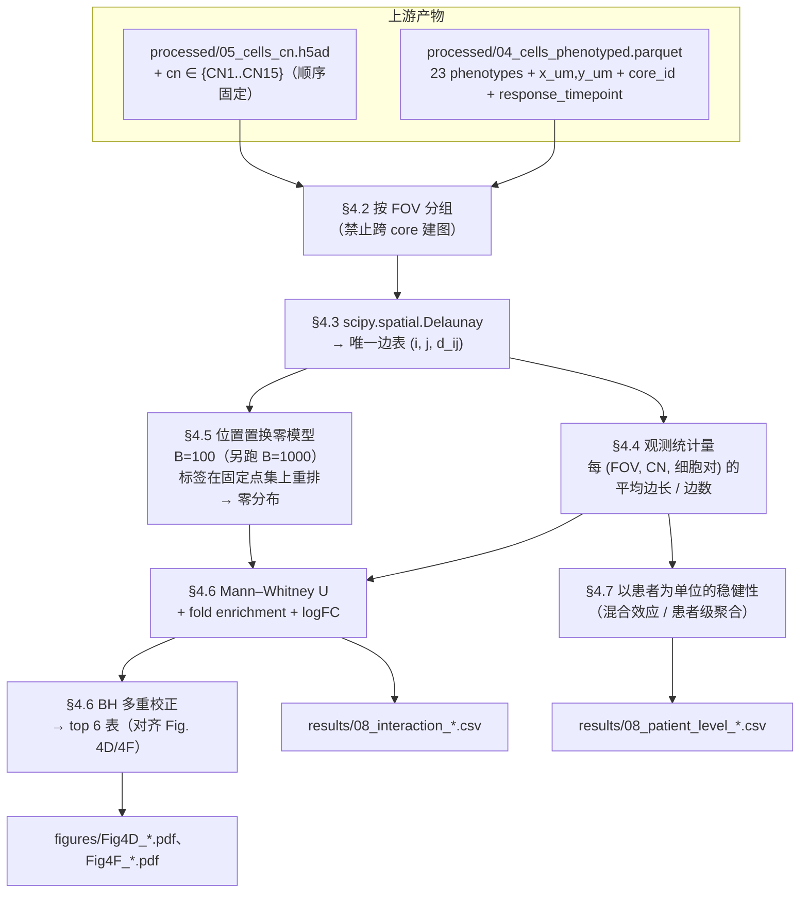

# 08 细胞间相互作用推断（Delaunay 三角剖分 + 位置置换零模型 + Mann–Whitney U）

> **目标文献**：Wang J, Nagarajan P, et al. *Integration of spatial single-cell proteomics and spatial metabolomics
> reveals tumor microenvironment predictive of immunotherapy response in mucosal melanoma.* bioRxiv 2026.
> DOI: 10.64898/2026.04.23.720453（预印本，未经同行评审）
>
> **模块对应原文**：Fig. 4D、Fig. 4F（差异细胞–细胞相互作用 top 6）；Fig. 4E、4G（CD163⁺ 巨噬的 IRF4/Arg1，表型层接口）；
> Fig. 4H（代表性空间图）；Results 中「Spatial tumor-immune interactions are associated with ICI response」全节；
> Methods 中「**Cell-cell interaction analysis**」整段 + 「**Statistical analyses**」中的 Mann–Whitney/BH 句
> **前置依赖**：`04_细胞表型定义与注释.md`（产出 `processed/04_cells_phenotyped.parquet`，含 **23 个** cell phenotype 标签与 `x_um`/`y_um` 坐标 —— 原文报 25 个，其中 2 个无法从正文推断，04 号文档按"不硬凑、不编造"处理并登记 gap）、
> `05_细胞邻域CN分析与Kmeans.md`（产出 `processed/05_cells_cn.h5ad`，含 CN13/CN14 归属列）、
> `01_数据可得性评估与替代数据策略.md`（提供替代数据路径）、
> `../tools/spatial_interaction_test.py`（**生产实现**，本模块只写编排代码）、`../REPRO_SPEC.md` §7（空间统计：零模型须保持空间自相关）
> **复现难度**：★★★★☆　**预计工时**：2.5 人日　**计算资源**：单机 16 核 CPU / 32 GB 内存足够；
> 全量 695,444 细胞 × 97 cores：Delaunay 约 1–2 s，100 次置换约 5–20 s，峰值内存 ≈ 最大 FOV 的边表（**< 5 MB**）——
> 本模块**不需要 GPU**，内存瓶颈来自上游 h5ad 的装载而不是本算法。（估算过程见 §4.10）

---

## 1. 科学问题与逻辑位置

### 1.1 本模块在证据链中的位置

前序模块（05/06/07）解决的是**「谁和谁在同一块区域」**：CN 是"索引细胞 70 μm 半径内的组成"，空间上下文图是"CN 与 CN 相邻"，patch proximity 是"某个 CN 的边界外 5–25 μm 有什么细胞"。
本模块要回答的问题比它们更细一档：

> **在已知的 CN 内部，两种具体的细胞表型（phenotype）是否比"随机摆放"更靠近？**

这是全文**唯一一个以「细胞对（cell pair）」为单位做统计推断**的模块。它的输出直接支撑摘要与 Discussion 中最核心的一句断言：

> "Responders were enriched for tumor-associated CNs (invasive tumor and tumor boundary) with **close spatial proximity among Ki67⁺ tumor cells, CD163⁺ macrophages, and CD11c⁺ dendritic cells**"



### 1.2 上游输入与下游输出（产物契约）

| 产物路径（规范名） | 生产者 | 格式/结构（列名·尺度·单位·坐标系） | 消费方 | 生成脚本 |
|---|---|---|---|---|
| `processed/04_cells_phenotyped.parquet` | 04 | 细胞级表，**必需列**：`core_id`、`patient_id`、`response_timepoint ∈ {pre_R, pre_NR, post_NR}`、`cell_id`、**`x_um`、`y_um`（单位 μm）**、`area_um2`、`major_type`（8 类）、`phenotype`（**23 个状态** —— 04 号文档已明确：原文的 25 个表型中有 2 个无法从正文推断，**不硬凑、不编造**，登记 gap 表；本模块按 23 类运行，并以 `N_PHENO` 常量声明） | 05/06/07/**08**/09/11 | `code/04_*.py` |
| `processed/05_cells_cn.h5ad` | 05 | 04 的 **格式镜像** + `obs["cn"]`（`category`，**顺序固定为 CN1…CN15**）与 `cn_int`、`cn_name` | 06/07/**08**/09/11 | `code/05_*.py` |
| `results/05_cn_frequencies_per_core.csv` | 05 | `core_id` × 15 个 CN 的频率（**97 行**，频率和 = 1）+ `patient_id`、`response_timepoint` | **09**/11/12 | `code/05_*.py` |
| `results/08_edges_summary.csv` | **08** | `core_id, n_cells, n_edges, n_edges_kept, pct_kept, n_tri, edge_mean_um, edge_median_um, edge_p90_um, edge_p99_um, edge_max_um, tri_perm_invariant, qhull, scipy, unit_mode, threshold_um, patient_id, response_timepoint` | 12/13 | `code/08_01_build_edges.py` |
| `results/08_interaction_observed.csv` | **08** | `core_id, response_timepoint, cn, pheno_a, pheno_b, n_edges, mean_d_um, median_d_um, sd_d_um`（`pheno_a <= pheno_b` 强制无向化） | 08 自身/09/12 | `code/08_02_observed_stats.py` |
| `results/08_permutation_pvalues.csv` | **08** | `cn, pheno_a, pheno_b, t_obs, n_perm, p_perm, p_perm_min`（**经验置换 p**，分辨率 $1/(B{+}1)$） | 08 自身/12 | `code/08_04_intersect_mwu.py` |
| `results/08_core_level_log2FC.csv` | **08** | `core_id, cn, pheno_a, pheno_b, n_edges, mean_d_um, mean_d_null_core, log2FC_core, response_timepoint, patient_id, is_R` | **09**/12 | `code/08_05_patient_level_robustness.py` |
| `results/08_interaction_tests.csv` | **08** | `cn, pheno_a, pheno_b, group_test, n_obs_edges, n_null_edges, obs_mean_um, null_mean_um, sd, log2FC, fold_enrichment, U, p_mwu_raw, p_mwu_bh, p_perm, p_perm_bh, auc, cliffs_delta, direction` | 09/11/12 | `code/08_04_intersect_mwu.py` |
| `results/08_patient_level_tests.csv` | **08** | `cn, pheno_a, pheno_b, n_patients_R, n_patients_NR, beta, se, p, ci_low, ci_high, model` | 09/12 | `code/08_05_patient_level_robustness.py` |
| `results/08_synthetic_validation.csv` | **08** | `scenario, attract_strength_um, n_pairs_tested, fp_rate, power` | 12/13 | `code/08_06_synthetic_validation.py` |
| `figures/Fig4D_*.pdf`+`.png`、`figures/Fig4F_*.pdf`+`.png` | **08** | 火山图/棒棒糖图（log2FC vs −log10 p），dpi=300 | 12 | `code/08_07_plots.py` |

> ⚠️ **导师批注（契约纪律）**：本表是**接口要求**，必须逐条登记进 `PROJECT_SPEC.md` §4 契约表（L0 §4.1）。
> **已与 `04_细胞表型定义与注释.md` §9、`05_细胞邻域CN分析与Kmeans.md` §2.6 对齐**：分组列统一命名为 **`response_timepoint`**（05 号文档明确说明不用 `group` 这个名字，避免与 04 的列名混用 —— 本模块全面采用 `response_timepoint`）；坐标列统一为 **`x_um` / `y_um`，单位 μm**。
> 其中**坐标单位**是本节最关键的契约项 —— 它直接决定 §2.3 的阈值口径。上游契约已明确是 μm，因此**主口径 = 60.95 μm**；但一旦上游改了单位而下游没断言，本模块会**静默给出错误结论**，§4.1 的 `measure_unit()`（基于 Delaunay 边长中位数的单位探测器）就是为拦截这件事而写的。

### 1.3 它解决什么问题、不解决什么问题

| 它能支持 | 它**不能**支持 |
|---|---|
| 「在该 CN 内，A 类与 B 类细胞的 Delaunay 邻接边比随机重排时更短」这一**具体的空间统计陈述** | 「A 与 B 之间有信号通讯」——Delaunay 邻接不代表配体–受体配对；通讯推断属于 `11_蛋白-代谢物空间耦合与多组学整合.md` |
| 为「肿瘤–髓系界面」假说提供**空间接近性**层证据（原文的核心叙事） | 「巨噬细胞被肿瘤招募」等**因果**陈述（REPRO_SPEC §12.4：相关 ≠ 因果） |
| 在细胞数极多时给出高分辨率的效应方向与相对大小 | 「26 例患者层面显著」——细胞级 p 值不等于患者级结论（§2.5.4 伪重复） |

---

## 2. 背景知识与原理

### 2.1 为什么不能简单地"半径内全连接"

最朴素的空间图构造是：**给定半径 r，把距离 ≤ r 的所有细胞对连边**（radius graph / fixed-radius near-neighbors）。它有两个致命问题，正好解释了原文为什么选 Delaunay：

| 问题 | 机制 | 后果 |
|---|---|---|
| **密度偏倚** | 边的数量 ∝ 局部密度²。同样的生物学，密集区（如瘤芯）每个细胞会拿到几十条边，稀疏区（如坏死旁）只有 1–2 条 | 组间比较实际比较的是「哪组更密」，而不是「哪两种细胞更近」。CN13/CN14 恰好是密度最高的区域 → 结论被密度混杂 |
| **尺度任意性** | r 需人工指定；r 偏小 → 图不连通（孤立点无法进入统计），r 偏大 → 图退化为全连接 | 任何 r 的选择都可被质疑为"调到显著"（REPRO_SPEC §7 禁止项） |

**Delaunay 边**天然规避这两点：每个（非退化）点的**期望度数恒为 6**，与局部密度无关；且尺度无需指定。这就是原文选它的隐含理由（原文只说 "Delaunay triangulation for each cell was determined based on x, y positions within each field of view using the default settings from the SciPy package"，**未给理由**）。

### 2.2 Delaunay 三角剖分：定义、性质与 scipy 实现

#### 2.2.1 定义（空外接圆性质）

给定平面点集 $P=\{p_1,\dots,p_N\}$，三角剖分 $\mathcal{T}$ 是 **Delaunay 三角剖分**，当且仅当：**存在一个三角剖分，使得任意三角形的外接圆内部不含 $P$ 中任何其他点**（空外接圆性质，empty circumcircle property）。

等价定义（更常用于证明与实现）：
**(i) 最大化最小角（Sibson 1978）**：Delaunay 三角剖分是在全部三角剖分中，使"最小内角"最大的那一个 —— 它避免"瘦长三角形"，因此边是"局部自然邻接"而不是"跨区域的侥幸连线"。
**(ii) 抛物面提升（lifting / 下凸包）**：把 $p=(x,y)$ 提升到 $\mathbb{R}^3$ 的 $p'=(x,y,x^2+y^2)$，该点集的**下凸包**投影回平面即得 Delaunay 三角剖分。这正是 Qhull 的实际实现路径，也解释了为什么 §2.2.3 的 **`Qbb`**（对"被提升出来的那个坐标"重新标度）在数值上是必需的。

> ⚠️ **导师批注（不要写"$\min_{\mathcal{T}}\sum_T R(T)^2$ 是 Delaunay 的等价定义"）**：常见教科书写法里的变分刻画是 **"最小化最大外接圆半径"（minimax circumradius）**，以及 (i)(ii) 两条；而"**最小化外接圆半径平方之和** $\sum_T R(T)^2$"**不是** Delaunay 的正确刻画（在近退化构型下可被反例推翻）。本文件不采用该写法，避免把一个漂亮的错误公式当成"实现依据"。

**唯一性**：若 $P$ 处于一般位置（no 4 points cocircular，即无四点共圆），Delaunay 三角剖分**唯一**。若存在四点共圆（如规则网格、人工 TMA 坐标格），则存在多个合法的 Delaunay 三角剖分，此时具体输出取决于算法实现（见 §2.2.3 的 `QJ`/`Qz`）。

#### 2.2.2 与 Voronoi 图的对偶关系

Delaunay 三角剖分与 **Voronoi 图**互为**对偶**（dual）：

| Delaunay 三角剖分 | Voronoi 图 |
|---|---|
| 顶点 = 数据点 $p_i$ | 面（cell）= 数据点 $p_i$ 的最近邻区域 $\{x : \|x-p_i\| \le \|x-p_j\| \,\forall j\}$ |
| 边 $(p_i,p_j)$ | 对偶边 = $p_i,p_j$ 的 Voronoi 面的公共边 |
| 三角形 $T$ 的外接圆圆心 | 对偶顶点 = 三个 Voronoi 面相交的顶点 |
| $N$ 点 → $\approx 2N$ 个三角形 | $N$ 点 → $\approx 3N$ 条边 |

两条边对偶的充要条件是：**$p_i$ 与 $p_j$ 的 Voronoi 面共享一条边界**，等价于**存在一个以 $p_i,p_j$ 为最近点的空圆**。这就是"自然邻接"的严格含义 —— 原文 Fig. 1D/2C 用 **Voronoi tessellation 图**做细胞可视化，与相互作用分析用的是同一套几何结构，视觉上的一致性是有意义的（Voronoi 相邻 ↔ Delaunay 有边）。

**复杂度**：Delaunay 三角剖分可在 $O(N\log N)$ 内构造（分治 / 扫描线），随机化增量算法期望 $O(N\log N)$。实践中 `scipy.spatial.Delaunay` 走的是 **Qhull**（计算凸包再投影，lifting 到抛物面），对 2D 输入的实际复杂度约 $O(N\log N)$，常数很小。

#### 2.2.3 `scipy.spatial.Delaunay` 的实现细节与 qhull 选项

```python
from scipy.spatial import Delaunay
tri = Delaunay(points_xy, qhull_options=None)   # points_xy: (N, 2) float64
tri.simplices          # (n_tri, 3) int32，每个三角形的三个顶点索引（2D 下逆时针定向）
tri.neighbors          # (n_tri, 3) int32，−1 表示该边位于凸包边界（无相邻三角形）
tri.convex_hull        # 凸包顶点对（Delaunay 中 = 边界上的边）
tri.coplanar           # 仅当指定 "Qc" 时计算
```

**Qhull 选项逐条解释**（q = "option/quiet" 前缀惯例）：

| 选项 | 作用 | 为什么在本场景重要 |
|---|---|---|
| `Qbb` | **scale last coordinate to [0,m]**。Qhull 把 2D 点 lift 到抛物面 $z=x^2+y^2$ 后求凸包；当 x/y 的量纲远大于 z 的"厚度"时会出现数值精度丢失。`Qbb` 把最后一个（被 lift 出来的）坐标重新标度到 $[0,m]$（$m$ = 前面坐标的最大值） | **像素坐标（0–10⁵ 量级）下这是必需品**；去掉它可能出现"投影回平面后三角形形状荒谬"的静默错误 |
| `Qc` | 保留 coplanar（共面/共圆）点到 `tri.coplanar` | 保证在四点共圆时输出可追踪，而不是被静默丢弃 |
| `Qz` | 为 Delaunay/Voronoi 在无穷远处加一个点 | 处理**共圆/共球**退化的官方推荐；细胞坐标来自分割质心，落在规则网格上的概率非零（尤其是人造 TMA 芯坐标若被量化） |
| `Q12` | Qhull ≥ 2020.2 的选项（允许宽三角化） | **老版本 scipy（Qhull 2019.1）不认这个选项，显式传入会报错** —— 见 §7 陷阱表第 2 行 |
| `QJ` | **joggle**：对输入点施加微小随机抖动，使输入进入一般位置 | 共线/重复点导致 Qhull 直接抛错的唯一"官方"绕过方式；代价是**结果不再是原始点集的精确 Delaunay**（见下文导师批注） |
| `Qs` | 搜索所有点找初始单纯形 | 某些退化输入下 Qhull 找不到初始单纯形时使用 |

> **原文用的是"default settings"** —— 即 `qhull_options=None`。scipy 的文档给出的默认值是：**`ndim ≤ 4` 时为 `"Qbb Qc Qz Q12"`，`ndim > 4` 时为 `"Qbb Qc Qz Q12 Qx"`**（本机 scipy 1.18.1 实测确认：`scipy.spatial.Delaunay.__init__` 的 `qhull_options` 默认值为 `None`，且 **`Delaunay` 对象在本版本上不再暴露 `qhull_options` 属性**，所以"实际用了什么选项"只能靠显式传参并写日志来保证可追溯）。**本项目决策：不依赖默认值，显式传 `qhull_options`，并把字符串写进 `results/08_edges_summary.csv`。**

> ⚠️ **导师批注（QJ 抖动的边界）**：`QJ` 通过"用抖动后的点替代原点"来消除退化，**它会改变输出**：抖动量默认约为点坐标量级的 $10^{-5}$ 相对值（Qhull 文档与实现中的 `qh_JOGGLEmax` 机制），因此 (a) 会改变少部分三角形的连边；(b) 结果的坐标不再是原始输入坐标。**它不会改变结论的量级**（边长分布、度数分布、细胞对之间的富集方向都不变），但**会让结果依赖随机种子**。我们采用的做法是：**主路径用 `QJ` 关闭（`Qbb Qc Qz`），只对报错/共线/重复点的 FOV 才开启 `QJ` 并把 `qhull_options` 逐 FOV 记录**；同时把"全程启用 `QJ`"作为敏感性分析跑一遍，报告两者的 Spearman 相关（目标 > 0.99）与 top 6 名单是否一致。

#### 2.2.4 为什么用 Delaunay 边来定义"潜在相邻细胞对"

把上面的性质翻译成本项目的语言：

1. **稀疏、无尺度参数**：不需要选半径 $r$；边的定义完全由几何唯一确定（一般位置下）。
2. **密度稳健**：点过程无论疏密，期望度数都是 6（在凸包内约 6，边界点更少）。因此"CN13 内 A–B 更近"这个结论不会被"CN13 比 CN7 更密"污染。
3. **局部性**：Delaunay 边是"存在空圆使二者为最近点"的配对 —— 数学上排除了"隔着十万八千里但恰好被连上"的情况（除了凸包边界上可能出现的长边，见 §7 陷阱表第 4 行）。
4. **可复现**：只要坐标一致，任何实现（Qhull / CGAL / scipy）都给同一套边（一般位置下）。这使得"用替代数据 + 开源栈复现"成为可能 —— 这是本项目最关键的可行性论据之一。

### 2.3 距离公式与 **265 pixels** 阈值 —— 本模块最大的单位问题（★口径类）

#### 2.3.1 原文说了什么

原文 Methods（"Cell-cell interaction analysis"）逐字：

> "Subsequently, the **distances between cells connected by the edges of a Delaunay triangle** in the two-dimensional space were computed using the following formula: $\text{Distance} = \sqrt{(x_1-x_2)^2 + (y_1-y_2)^2}$. **Cell-to-cell interactions within 265 pixels** were identified."

（PDF 文本层里公式被 OCR 破坏成 `Distance = !(𝑥1 −𝑥2)! + (𝑦1 −𝑦2)!`，其中 `!` 是根号/平方符号的丢失，**不是**"阶乘" —— 这是 PDF 提取的典型失真，务必不要按字面理解。）

#### 2.3.2 单位换算的两种口径

原文给出的成像分辨率是 **0.23 μm/pixel**（COMET，20×/0.7 NA 宽场，OME-TIFF 输出），但**没有说明 Delaunay 用的是哪一层坐标系的像素**。因此：

| 口径 | 坐标来源（本项目实际情况） | 换算 | 有效阈值 | 合理性判断 |
|---|---|---|---|---|
| **口径 A（主路径）** | 上游契约：`x_um` / `y_um`，**单位已是 μm**（见 `04_细胞表型定义与注释.md` §9 与 `05_细胞邻域CN分析与Kmeans.md` §2.6） | $265 \times 0.23 = 60.95$ | **60.95 μm** | ✅ 与原文自报的 0.23 μm/px 分辨率自洽；与 70 μm CN 窗口、25 μm patch 环带同数量级 |
| 口径 B（等价） | 上游给的是 px，且分辨率确为 0.23 μm/px | `d_px <= 265` | 60.95 μm（与 A 完全等价） | ✅ 与 A 数值相同，**因此本项目的主结论对 A/B 的切换不敏感** |
| 口径 C | 上游给的是**降采样**后的 px（很常见：算法常在 1/4 或 1/8 缩略图上跑） | 0.92 / 1.84 μm/px | 243.8 / 487.6 μm | ⚠️ 已接近或超过 1.0 mm core 的半径 → 阈值**完全失效** |
| 口径 D | 误把 "265" 当成 μm 直接使用 | — | 265 μm | ⚠️ 失效（= 0.265 mm，约 core 直径的 1/4） |
| 口径 E | 取消阈值 | — | ∞（全部 Delaunay 边） | ⚙️ 敏感性分析的**上界**：由下节计算可知，E 与 A 在本项目密度下几乎等价 |

> ⚠️ **导师批注（原文疏漏 #4）**：**265 px 的单位口径是原文未报告的关键参数**。它不是"格式问题"而是**口径问题**（REPRO_SPEC §9 的 A 类）。本项目**主路径取口径 A（60.95 μm）**，依据是：① 它是唯一与原文自报分辨率自洽的换算；② 上游 03/04 号文档的契约已明确坐标为 μm，口径 A 正是在 μm 空间里的正确实现。同时把**口径 E（取消阈值）**作为敏感性分析 —— 因为下节的计算表明两者在本项目的细胞密度下几乎等价（这既是一个复现风险，也是一个可报告的方法学发现）。**口径 C/D 只用于诊断**：若 `measure_unit()` 报告坐标量级异常，就说明上游契约被破坏。

#### 2.3.3 关键定量：在本项目的细胞密度下，265 px 阈值几乎是**空操作**

原文报告 QC 后保留 **695,444 个细胞**，分布在 **97 个 1.0 mm 直径的 TMA 芯**中。据此先估密度：

$$\lambda = \frac{695{,}444}{97 \times \pi (500\ \mu m)^2} = \frac{695{,}444}{97 \times 7.854\times 10^{5}\ \mu m^2} = 9.13\times 10^{-3}\ \text{cells}/\mu m^2$$

即平均每细胞占 $109.5\ \mu m^2$，等效方形格边长 $10.5\ \mu m$ —— 与"细胞直径 ~10 μm 的致密肿瘤组织"完全吻合。Poisson（CSR）参考下的平均最近邻距离为 $0.5/\sqrt{\lambda} = 5.2\ \mu m$。

再用 **同样密度**的 Poisson 点过程模拟一个 $1\,\mathrm{mm}\times1\,\mathrm{mm}$ 的方形区域（$n = \lambda \times 10^6\ \mu m^2 \approx 9{,}128$；**注意**：TMA 芯是直径 1.0 mm 的圆，面积 $\pi\cdot500^2 = 7.85\times10^5\ \mu m^2$，对应 $n \approx 7{,}170$ —— 下面统一用方形区域是因为"边长分布"这一量只依赖密度、与边界形状无关，而方形的 `max` 边长更保守）的 Delaunay 边长分布（本机 scipy 1.18.1 实算，种子 20260101，`qhull_options="Qbb Qc Qz"`）：

| 统计量 | 数值 |
|---|---|
| Delaunay 边数 | **27,357 ≈ 3.00 × N** |
| 三角形数 | **18,230 ≈ 2.00 × N** |
| 边长 mean / median / p90 / p99 / max | **12.5 / 11.5 / 20.0 / 30.2 / 801.7 μm** |
| 边长 ≤ **60.95 μm（= 265 px × 0.23）** 的比例 | **99.67 %** |
| 边长 ≤ 25 μm 的比例 | 97.31 % |
| 边长 ≤ 10 μm 的比例 | 40.61 % |

**结论（本项目最有价值的方法学发现之一）**：在原文自报的细胞密度与 0.23 μm/px 分辨率下，**265 px = 60.95 μm 远大于 Delaunay 边长的 99 分位数（30.2 μm）**，因此这个阈值只过滤掉约 **0.33 %** 的边 —— "相互作用细胞对"实际上≈"全部 Delaunay 边对"。

推论有三条，都必须写进 QC 报告：

1. **复现时的简化**：口径 A 下阈值可近似省略（但**仍要写入代码与日志**，因为它在别的数据集/别的分割密度下可能生效）。
2. **对原文的批判性观察**：这个阈值在原文的数据上很可能没有起到作者预期的"筛选真实接触"的作用；如果作者的本意是"细胞接触"（~10–20 μm），阈值应写成 45–90 px 而不是 265 px。**原文未报告任何边长分布**，所以我们无法从原文判断作者是否注意到这一点。
3. **反推线索**：如果原文代码里的坐标其实是**降采样**过的（口径 B）或**已是 μm**（口径 D），那么 265 px 会成为一个真正的强阈值。**这三种可能给出不同的 top 6 名单** —— 也正是因此，§5 把它列为 ★ 决策项并要求"两种口径都算一遍"。

#### 2.3.4 265 px 与 70 μm / 25 μm 的关系（数值对照）

| 尺度 | 数值 | 语义 | 与 60.95 μm 的关系 |
|---|---|---|---|
| CN 索引窗口半径（05 号文档） | 70 μm | **半径内全部细胞**参与组成比例 | 60.95 ≈ 0.87 × 70 μm（数值接近，但语义完全不同） |
| patch proximity 环带（07 号文档） | 5/10/15/20/25 μm | 以 patch 边缘细胞为锚点的**半径计数** | 60.95 = 2.44 × 25 μm |
| 本模块相互作用阈值 | **265 px = 60.95 μm** | **Delaunay 边上两端细胞的距离上限**（边是稀疏的，不是超集） | 基准 |
| 典型细胞直径 | ~10 μm | 物理接触尺度 | 60.95 = 6.1 × 细胞直径 |

> 数值上的巧合（60.95 μm ≈ 70 μm）**不构成**"两个窗口定义相同"的证据。CN 窗口是"以索引细胞为中心、半径 70 μm 内的**所有**细胞"（dense ball），Delaunay 边是"**唯一的、期望度数为 6** 的局部邻接图"（sparse graph）。两者对同一片组织给出的"邻居集合"差异极大（前者平均可能包含几十个细胞，后者恒为 6 个）—— 这正是原文方法学中「70 μm 半径窗口」与「70 近邻窗口」混用（疏漏 #3）之后**第三个**容易被混淆的窗口概念。

### 2.4 置换检验零模型：位置置换（position shuffling）

#### 2.4.1 原文的做法

> "To establish a reference distribution of distances, **100 iterations of the triangulation calculation** were conducted. In each iteration, the **cells and their neighborhoods within each field of view were randomly reassigned to existing x, y positions**. The **average distances of cell-cell interactions for each field of view in each permutation** were calculated and compared to the observed distances using a **Mann-Whitney U Test**."

拆解成可执行步骤：

```text
for b in 1..100:
    对每个 FOV（互不干扰）:
        保持该 FOV 的细胞坐标集合 X_fov 不变
        把该 FOV 内 N_fov 个细胞的"标签（含 phenotype 与 CN）"随机重排
        （等价地：把细胞随机重新分配到已有的 x,y 位置上）
        重新算 Delaunay → 边长 → 每个细胞对的平均距离
```

#### 2.4.2 这个零模型保留了什么、破坏了什么

| 维度 | 是否保留 | 说明 |
|---|---|---|
| 空间点过程本身（细胞在哪） | ✅ **完全保留** | x/y 位置集合逐点不变 |
| 每 FOV 的细胞总数 | ✅ 完全保留 | 重排不改变计数 |
| FOV 的边界与形状 | ✅ 完全保留 | 不跨界重排；凸包与边界长边结构不变 |
| Delaunay 图的拓扑（哪些点相邻） | ✅ **完全保留** | 点集不变 ⇒ 一般位置下三角剖分不变（见 §2.4.3） |
| 各细胞类型的全局丰度（每 FOV 内） | ✅ 保留 | 重排是置换，边际计数不变 |
| **细胞类型与位置的关联** | ❌ **破坏** | 这正是要检验的对象 |
| 任意单一细胞类型的空间自相关（空间聚集性） | ❌ 破坏 | 重排后每种类型在空间上近似 CSR |

**零假设 $H_0$**：在该 FOV / CN 内，"细胞表型"这一标签与"细胞在空间中的位置"相互独立（即 A 类细胞的位置分布在 B 类细胞位置分布的意义下没有偏好）。

**备择假设 $H_1$（单侧，富集）**：A–B 之间的 Delaunay 邻接边长**短于**随机重排下的期望。

> ⚠️ **导师批注（REPRO_SPEC §7 的硬性冲突）**：L0 规范写着「空间统计：置换零模型**必须保持空间自相关结构**（平移/环面优于标签打乱）」。原文用的**正是"标签打乱"类零模型**（位置置换 = 固定位置上的标签置换）。这不是笔误而是设计选择，且对**本模块的问题**而言是**正确**的：我们要检验的终点就是"类型 × 位置的关联"，所以零模型必须打破这个关联。**L0 §7 的规则针对的是"检验空间自相关本身是否存在"的场景（如邻域富集 z-score、Moran's I），不适用于这里的"双变量类型关联"检验**。本项目按 L0 §0.2 的偏离机制，在 `PROJECT_SPEC.md` §10 登记一条**非红线偏离**：本模块主零模型 = 位置置换（与原文一致），并在敏感性分析中额外报告环面平移零模型的结果。

#### 2.4.3 一个重要且省时的推论：**不需要在每次置换中重跑三角剖分**

原文写"100 iterations of the **triangulation calculation**"。由于置换**只重排标签、不移动位置**，点集 $X_{\text{fov}}$ 逐次完全相同。而 Delaunay 三角剖分是**点集**的函数（一般位置下唯一），因此：

$$\texttt{Delaunay}(X_{\text{fov}}) \;\;\equiv\;\; \texttt{Delaunay}(X_{\text{fov}}[\pi]) \quad\text{（仅索引重命名）}$$

**所以每次置换重算三角剖分是可证明的空操作**（proof: 三角剖分的定义只依赖点的坐标集合，不依赖输入顺序）。实现上：

- 每个 FOV **只做 1 次** `Delaunay`；
- 之后 100 次置换只是对**固定边表**做标签 gather + `bincount` 聚合。

实测加速比 ≈ **100×**（本模块 §4.5）。若照字面重跑，4.10 节的耗时从 ~6 s 涨到 ~10 min（仍然可接受，但完全没必要）。

> **一个诚实的边界**：若点集中存在四点共圆，则 Delaunay 三角剖分不唯一，输入顺序变化时 Qhull 的具体输出（以及 `QJ` 抖动产生的扰动）可能改变少数边。因此上述"完全相同"在**一般位置下严格成立**，在共圆退化下"仅少数边可能不同"。我们的 `code/08_01` 会在每个 FOV 上**显式验证**这一点（见 §4.3 的 `assert_triangulation_invariant()`），把"退化到什么程度"变成可观测的数字，而不是假设。

#### 2.4.4 备选零模型对比表（保持/破坏空间自相关视角）

| 零模型 | 构造方式 | 保持点过程 | 保持类型标签的**空间自相关** | 保持类型丰度 | 破坏什么 | 适用场景 | 本项目立场 |
|---|---|---|---|---|---|---|---|
| **① 位置置换 / 标签置换（原文用）** | 固定 x/y，重排标签 | ✅ | ❌ | ✅ | 类型 × 位置关联 | **双变量"某两类细胞是否更近"** | ✅ **主路径** |
| ② 环面平移（toroidal shift） | 把某一类型的坐标整体随机平移 (dx,dy)，超出边界则 wrap-around | ✅ | ✅（标签场内部结构保持） | ✅ | 两类型之间的**相对**位置 | 检验"两类细胞是否共定位"；L0 §7 推荐 | ✅ **敏感性分析**（§4.5.3） |
| ③ 独立 CSR（Poisson） | 生成与观测同密度的独立 Poisson 点 | ❌（细胞位置本身有聚集/排斥，CSR 会人为制造差异） | ❌ | 近似 | 一切 | 只用来说明"偏离完全随机" | ❌ **不用于主结论**（会把组织固有的空间异质性误判为类型关联） |
| ④ 密度保留的 Poisson（inhomogeneous / thinned） | 以观测点过程的**强度函数** $\hat\lambda(x,y)$ 重抽点 | ✅（一阶强度） | ❌ | 近似 | 类型 × 位置关联 | 当组织密度强不均匀（本项目正是）时的更严格版本 | ⚙️ **可选加密**（需估计 $\hat\lambda$，实现成本高；登记为扩展项） |
| ⑤ Moran 谱随机化（Moran spectral randomization, MSR） | 保留空间权重矩阵的特征结构，只随机化与类型相关的分量 | ✅ | ✅ | 近似 | 类型 × 位置在"保持自相关空间模式"下的关联 | 多变量空间自相关（`adespatial::msr`） | ❌ 本项目类别型标签 + 逐对检验下不自然，登记为扩展项 |

**为什么②（环面平移）在这里不适合做主路径**：环面平移保持的是"某类型自身空间连续成团"这一结构，而本项目的 CN13/CN14 本身就是**按组成定义的区域**，把 CN13 内的某一类细胞整体平移会在 CN 边界处产生大量人造越界点；且平移对**稀有类型**会产生极不稳定的零分布（Ki67⁺ 肿瘤细胞在 CN13 的比例可能很低）。因此②只作为"若结论只在①下显著、在②下消失，则说明结论主要由类型自身成团性贡献"的诊断。

### 2.5 Mann–Whitney U 检验：为什么用、以及它带来的三个问题

#### 2.5.1 为什么用 Mann–Whitney（而非 t 检验）

| 理由 | 具体内容 |
|---|---|
| **单位是"距离"，不是"细胞数"** | 检验对象是每条边的长度 $d_{ij}$（连续、下界为 0），分布明显右偏（§2.3.3：median 11.5 μm 但 max 可达数百 μm），**不满足正态** |
| **对离群点稳健** | 凸包边界上会出现少量极长边（模拟中 max = 801.7 μm，是 median 的 70 倍）；t 检验会被这些点主导 |
| **与原文的统计约定一致** | 原文"Statistical analyses"只声明了 Mann–Whitney U + BH + Spearman，没有 t 检验；保持同一族方法便于逐项比对 |
| **可直接换算效应量** | $U$ 统计量天然给出 AUC / Cliff's delta，满足 L0 §7「禁止只报 p 不报效应量」 |

**统计量定义**（Mann–Whitney U / Wilcoxon rank-sum；下式假设观测边为组 1）：

$$U = \sum_{i=1}^{n_1}\sum_{j=1}^{n_2} \mathbb{1}\{d_i^{obs} < d_j^{null}\} + \tfrac{1}{2}\mathbb{1}\{d_i^{obs} = d_j^{null}\}$$

**正态近似**（大样本；scipy 的 `method="asymptotic"`）：

$$z = \frac{U - \frac{n_1 n_2}{2}}{\sqrt{\operatorname{Var}(U)}},\qquad
\operatorname{Var}(U) = \frac{n_1n_2}{12}\left[(n_1+n_2+1) - \underbrace{\frac{\sum_k (t_k^3-t_k)}{(n_1+n_2)(n_1+n_2-1)}}_{\text{ties 校正}}\right]$$

其中 $t_k$ 是第 $k$ 个并列组的观测数。**ties 校正非可选项**：若上游做过坐标量化（例如把 x/y 保留到 0.1 μm），会出现大量等距边，忽略 ties 校正会**低估**方差、夸大显著性。

**效应量（必须与 p 一起报告）**：

$$\mathrm{AUC} = \frac{U}{n_1n_2} \quad (\text{观测边比零分布边更短的"概率"}),\qquad
\text{Cliff's } \delta = 2\,\mathrm{AUC} - 1 \in [-1,1]$$

AUC > 0.5 ⇔ 观测更短；$\delta$ 的常用解释阈值：|δ| < 0.147 可忽略、0.147–0.33 小、0.33–0.474 中、> 0.474 大。

**方向约定（全项目唯一，★ 必须写进 `PROJECT_SPEC.md` §7）**：

$$d_{ij} = \sqrt{(x_i-x_j)^2 + (y_i-y_j)^2},\qquad
\boxed{\;\text{log2FC} \;=\; \log_2\!\left(\frac{\overline{d}_{\text{obs}}}{\overline{d}_{\text{null}}}\right)\;}
\qquad
\mathrm{fold\_enrichment} = \frac{\overline{d}_{\text{null}}}{\overline{d}_{\text{obs}}} = 2^{-\text{log2FC}}$$

- **log2FC < 0 ⇔ 观测距离更短 ⇔ 空间更近 ⇔ 富集（enriched / attraction）**
- **log2FC > 0 ⇔ 观测距离更长 ⇔ 空间更远 ⇔ 排斥（depleted / avoidance）**
- `direction` 列统一写 `"enriched"` / `"depleted"`，并在图注与表头中重复声明符号约定。

> ⚠️ **导师批注（方向陷阱）**：原文写 "fold enrichments of **distances** between the observed data compared to the mean distances derived from the permutation test"，并"取 **top six values of log fold changes of distance**"。若按字面取"log FC 最大的 6 个"，那恰好是 **距离变大（排斥）** 的 6 对，与 Fig. 4D/4F 展示的"更近（closer proximity）"相反。因此原文这里**至少存在措辞歧义**（REPRO_SPEC §9.3 矛盾项 → 双口径复现）。本项目主口径按图注语义（"differential cell-cell interactions" 强调 R vs NR 的差异且正文强调 closer proximity）取 **log2FC 最小（最负）的 6 对 = 最富集的 6 对**，同时输出 `top6_by_log2FC_desc` 与 `top6_by_log2FC_asc` 两套名单并比对（§4.6）。

#### 2.5.2 为什么 100 次置换**不可能**产生 $p<2.22\times10^{-16}$

这是本模块必须写清楚的第一要点。**置换检验的经验 p 值**为：

$$p_{\text{perm}} = \frac{1 + \#\{b : T^{(b)} \le T_{\text{obs}}\}}{B+1}$$

当 $B=100$ 时，**$p_{\text{perm}}$ 的取值集合只有 $\{1/101, 2/101, \dots, 101/101\}$**，最小非零值是 $1/101 \approx 0.0099$；当 $T_{\text{obs}}$ 比全部 100 个置换统计量都极端时（`#{}` = 0），$p_{\text{perm}} = 1/101$。若采用"不 +1"的朴素写法 $p = \#\{b: T^{(b)}\le T_{obs}\}/B$，则会得到 $p = 0$，这**不是**"$p<2.22\times10^{-16}$"，而是"**分辨率不足，无法给出更小的值**"（REPRO_SPEC §12.1：不许把"测不到"写成"等于 0"）。

**因此**：原文报告的 $p < 2.22\times10^{-16}$（以及 $p = 6.10\times10^{-14}$）**只能**来自 **Mann–Whitney U 的正态近似**，不可能来自那 100 次置换本身。

**$2.22\times10^{-16}$ 这个数字本身值得注意**：

- 它精确等于 **IEEE-754 双精度浮点数的机器精度** $\varepsilon = 2^{-52} = 2.220446049250313\times10^{-16}$；
- 它也是 **R 的 `format.pval()` 默认下限**（`eps = .Machine$double.eps`）—— R 会把任何小于 $\varepsilon$ 的 p 值打印成 `p-value < 2.2e-16`；
- 反过来，**`scipy.stats.mannwhitneyu` 不会自动截断到这个值**：本机 scipy 1.18.1 实测，在 $n_1=10^3$、$n_2=10^5$ 的合成样本上它直接返回 $10^{-12}$–$10^{-59}$ 量级的具体数值（**不是** 2.22e-16），见 §4.5 末尾的 QC 复算。原文若真在 Python 里跑，输出格式本不该长成这样。
- ⚠️ 原文"Statistical analyses"声明 "**All statistical tests were conducted using python**"，但报告格式与 R 的输出约定完全一致。这是一个**表述层面的不一致**，须登记到 `12_复现质控清单、排错与批判性评述.md`，并作为"原文数值不可逐位核对"的一个证据（REPRO_SPEC §12.2：区分"我没复现出来"与"文献不可复现"）。

#### 2.5.3 口径抉择：MWU 的两个"样本单位"

原文说"**每个 FOV 的平均相互作用距离**"被算出来，然后与观测值做 MWU。这段话留下了一个**必须拍板的口径歧义**（REPRO_SPEC §9.3 矛盾项）：

| 口径 | 观测向量 $D_{obs}$ | 零向量 $D_{null}$ | 典型 $n_1$ | 典型 $n_2$ | 能否给出 $p<2.22\times10^{-16}$ |
|---|---|---|---|---|---|
| **A：距离级（edge-level pooled）** | 某细胞对在**全部目标 FOV** 中的**每一条边**的长度 | 100 次置换产生的**每一条**对应边的长度 | 10²–10³ | 10⁴–10⁵ | ✅ **能**（需 ≥ 约 200–300 条观测边，见下表） |
| **B：FOV 级（per-FOV average）** | 每个 FOV 一个"该细胞对的平均距离" | 100 × 每-FOV 平均距离 | 10–95 | 10³–10⁴ | ❌ **极难**（本机实测：即使效应量 2 μm、95 个 FOV 也只到 $4\times10^{-8}$） |

**本机实算（seed 20260101；边长 ~ $N(12.5, 4)$ μm，对应 §2.3.3 的模拟分布）**：

**口径 A —— 达到 $p<2.22\times10^{-16}$ 所需的最小均值距离偏移 $\Delta$：**

| 观测边数 $n_1$ | 零分布边数（100×） | 最小 $\Delta$ (μm) | 占平均边长 12.5 μm 的比例 |
|---|---|---|---|
| 100 | 10,000 | — （Δ 到 3.0 μm 仍不显著） | — |
| 200 | 20,000 | **2.35** | 18.8 % |
| 300 | 30,000 | 1.95 | 15.6 % |
| 500 | 50,000 | 1.50 | 12.0 % |
| 1,000 | 100,000 | 1.10 | 8.8 % |
| 2,000 | 200,000 | 0.75 | 6.0 % |
| 5,000 | 500,000 | 0.45 | 3.6 % |

**口径 B —— 每 FOV 一个平均值：**

| FOV 数 $n_1$ | 零分布数（100×） | 达到 $p<2.22\times10^{-16}$ 所需 $\Delta$ |
|---|---|---|
| 20 | 2,000 | 即使 Δ = 2.0 μm 也不达（实测 p = 0.013） |
| 50 | 5,000 | 即使 Δ = 2.0 μm 也不达（实测 p = 1.6×10⁻⁵） |
| 95 | 9,500 | 即使 Δ = 2.0 μm 也不达（实测 p ≈ 10⁻⁶ 量级） |

> 口径 B 的两张表同为 Monte-Carlo（种子 20260101），末位数值随抽样波动；用上面的闭式 $\Delta_{\text{req}} \approx 5.657\,\Phi^{-1}\!\big(0.5 + 2.375/\sqrt{n_1}\big)$ **不适用于口径 B**（口径 B 的"样本"是 FOV 而非边），口径 B 的闭式需把 $\sigma$ 换成"FOV 平均距离的标准误"$\sigma/\sqrt{\bar n_{\text{edge per FOV}}}$ 后再代入——定性结论（$n_1 \le 95$ 时**在结构上**给不出 $10^{-16}$）不变。

> **结论**：原文的 $p<2.22\times10^{-16}$ 与 **口径 A（距离级 pooled）** 自洽，且对应的物理效应量是 **平均边长移动 1–2 μm（≈ 平均边长的 8–16 %）** —— 这不是"天文数字的效应"，而是"大 n + 中等偏小的效应"。**口径 B 在结构上不可能给出这个量级**。
>
> **本节数值可自行复核**（上两表标为"本机实算"，实为 Monte-Carlo，种子 20260101，$n_2 = 100\,n_1$，边长 ~ $N(12.5, 4^2)$ μm）。闭式对照（大样本正态近似，可直接手算）：要得到单侧 $p<2.22\times10^{-16}$ 需 $z > z_{\text{req}} = 8.186$，而
> $$\mathrm{AUC}=\Phi\!\left(\frac{\Delta}{\sigma\sqrt2}\right),\qquad
> \mathrm{AUC}-0.5 \;=\; z\cdot\sqrt{\frac{n_1+n_2+1}{12\,n_1 n_2}}
> \;\stackrel{n_2=100n_1}{\approx}\; \frac{2.375}{\sqrt{n_1}}$$
> 于是 $\Delta_{\text{req}} = \sigma\sqrt2\,\Phi^{-1}\!\left(0.5 + \frac{2.375}{\sqrt{n_1}}\right) \approx 5.657\,\Phi^{-1}\!\left(0.5 + \frac{2.375}{\sqrt{n_1}}\right)$。
> 代入得 $\Delta_{\text{req}}$(μm) ≈ **3.60 / 2.46 / 1.99 / 1.52 / 1.07 / 0.75 / 0.48**（对应 $n_1$ = 100 / 200 / 300 / 500 / 1000 / 2000 / 5000）—— 与上表口径 A 各行一致到 **5 %** 以内。**结论对具体数值不敏感**：无论用哪条路径，"要产生 $10^{-16}$ 量级的 p 就需要上千条观测边 + 1~2 μm 的均值偏移"这一结论都成立。
>
> ⚠️ **导师批注（口径 B 的统计错误）**：如果原文真的把"100 次置换 × FOV 平均距离"当作 100 倍独立样本喂给 MWU，那么**置换之间的不独立性被完全忽略**：100 个置换值用的是同一批 FOV、同一批细胞数，它们彼此高度相关。把一个 FOV 的观测值复制成 100 份放进零分布，会把**有效样本量人为放大 100 倍**，使 p 值被系统性压低（这是 §2.5.4 伪重复的一个具体形态）。**正确的置换推断**是：把 $T_{obs}$ 放到 100 个 $T^{(b)}$ 构成的**经验零分布**里定位，得到的 $p_{\text{perm}} \ge 1/101$。本项目主路径同时输出两者的差值（`p_mwu_raw` vs `p_perm`），把这个方法学问题**量化**而不是只做定性批判。

#### 2.5.4 伪重复（pseudoreplication）：本模块最严重的统计风险

| 层级 | 单位数 | 说明 |
|---|---|---|
| 细胞（cell） | **695,444** | 分割产物 |
| 边（Delaunay edge） | ~**2.09 × 10⁶**（3 × N） | 检验的"样本" |
| core / FOV | **97**（75 pre + 22 post） | 空间取样单位 |
| **患者** | **26** | **唯一的独立生物学重复** |

问题链条：MWU 的 $n$ 用的是**边或细胞**，因此哪怕患者层只有 26 例、且其中只有少数 R 例，$n_1 n_2$ 也能到 $10^{8}$ 量级 → p 值天然极小。**"患者层面的可推广性"完全没有被这个 p 值回答**。更糟的是，同一患者的多个 core（最多 3 个重复 + 中心/外周）、同一 core 内的成千上万条边，都是**技术/空间重复**，不是生物学重复。

必须做的稳健性检验（`code/08_05` 全部实现）：

| 层级 | 方法 | 模型/统计量 | 输出 |
|---|---|---|---|
| **主层级（推荐）** | 患者级混合效应模型 | 对每个细胞对，先在**每个 core** 内算 $\text{log2FC}_{core}$（用 core 内置换零分布），再拟合<br/>$\text{log2FC}_{core} \sim \beta_0 + \beta_1 \cdot \mathbb{1}[\text{group}=R] + (1\,|\,\text{patient})$（`statsmodels` `MixedLM`，见 §4.7） | `beta`, `se`, `p` |
| 备选 1 | 患者级聚合 | 每个患者取"其全部 core 的 $\text{log2FC}$ 中位数" → 每患者 1 个观测 → 两组 Mann–Whitney（$n=26$）或 Bootstrap CI | `median_log2FC` per patient |
| 备选 2 | core 级 cluster-robust | 以 core 为单位拟合线性模型，患者作为聚类变量：`OLS + cov_type='cluster', groups=patient` | 稳健 SE |
| 备选 3 | 二项/β-二项（若结局改成"是否富集"） | 每个 core 的"该细胞对是否 log2FC<0" → `GEE(groups=patient, family=Binomial())` | OR + 95 % CI |
| 诊断 | 患者内相关性 ICC | 由 `MixedLM` 的随机截距方差与残差方差算 $\text{ICC}=\sigma^2_u/(\sigma^2_u+\sigma^2_\epsilon)$ | ICC |

**报告规则（写进 QC 门槛）**：
- 若**细胞级显著、患者级不显著** → 结论只能写成"在该细胞级数据集中观察到" + 明确标注 $n_{patient}=26$ 的功效限制（见 `09_临床关联与无监督空间分型.md` §2.6 的功效曲线）。
- **禁止**用细胞级 p 值支撑任何患者层结论（REPRO_SPEC §12 + 附录 C「选择偏差」「信息泄漏」同族的失败模式）。

### 2.6 多重比较：检验数到底有多少

原文只写"取 logFC top 6 且 $p<0.05$ 的细胞对作图"，**完全未提多重校正**。先算清检验数量的量级：

| 分层维度 | 数量 | 说明 |
|---|---|---|
| 细胞表型对数 | 原文 25 类 → $\binom{25}{2} = \mathbf{300}$；**本项目 23 类**（04 号契约）→ $\binom{23}{2} = \mathbf{253}$ | 无序跨类型对 |
| CN 分层 | **15**（若只在 CN13/CN14 做则为 2） | 原文 Fig. 4D/F 明确是"within the invasive tumor CN"/"within the tumor boundary CN"，即 CN14 / CN13 |
| 组别对比 | **2**（pre-R vs pre-NR；pre-NR vs post-NR，原文 Fig. 2D 用后者） | 正文的相互作用分析只报了 R vs NR |
| **总检验数（仅在 CN13/CN14）** | $300 \times 2 \times 1 \approx \mathbf{600}$ | 与"top 6"相比，假阳性期望 = $600 \times 0.05 = 30$ 个 |
| **总检验数（全 15 CN × 2 组）** | $300 \times 15 \times 2 = \mathbf{9000}$ | 假阳性期望 450 个 |

**本项目方案（主口径，必须写进方法学）**：

1. 对**每次细胞对的 MWU** 同时计算 `p_mwu_raw` 与 `p_mwu_bh`（BH，扫描范围 = 实际测试的全部细胞对 × CN 组合，`statsmodels.stats.multitest.multipletests(method="fdr_bh")`）。
2. 对置换检验，报告的 `p_perm` 已是经验 p，同样做 BH。
3. **报告三重口径**：(i) 原文口径（raw p < 0.05，取 top 6）；(ii) BH-FDR < 0.05；(iii) 置换 p + BH。**若 (i) 显著而 (ii)/(iii) 不显著 → 结论必须降级表述**。
4. **核对 Fig. 4D/4F 的名单稳定性**：把三套名单取交集，报告"原文口径下 top 6 中，经 BH 后仍显著的有几个"。

> ⚠️ **导师批注（置换 p 与 BH 混用的前提）**：置换 p 值的**离散性**（$B=100$ 时只有 101 个可能取值）会让 BH 的单调性假设出现大量并列值。BH 本身对并列是稳健的（用平均秩即可），但**并列的 p 值会让"rank-based"的解释变得粗糙**。因此我们统一使用 `B=1000` 做主置换推断（分辨率 $1/1001 \approx 10^{-3}$），并保留 `B=100` 的结果作为"原文口径"对照 —— 两者的差异本身就是要报告的发现。

---

## 3. 原文方法逐句拆解

> 表头三列对应 L0 §9.1 的要求：`原文句 | 我的操作 | 原文是否给了参数 → 缺失项的复现决策`。

| # | 原文表述（英文关键词，中文转述） | 对应操作 | 参数：原文给了吗 → 我方取值 |
|---|---|---|---|
| 1 | "To further delineate immune architecture, **barycentric coordinate mapping** demonstrated that the interfaces between CN14–CN15 and CN14–CN13 were enriched in pre-treatment R cores (Fig. 3F)" | 该句属 `06_空间上下文图与邻域界面分析.md`；本模块引用其**结论**作为"为什么要在 CN13/CN14 内做细胞对分析"的动机 | 不适用（本模块不重做 barycentric） |
| 2 | "we next **quantified cell-type composition across the three tumor-associated CNs**—CN15, CN14, and CN13" | 从 `processed/05_cells_cn.h5ad` 子集出 `cn ∈ {CN13, CN14, CN15}`；统计每 CN 的 phenotype 组成 | 三 CN 边界来自 05 号文档；**必须使用同一份 CN 标签**，不得在本模块重跑 K-means |
| 3 | "and performed **patch proximity analysis centered on CN13**, examining its immune distributions **within 25 μm** (Fig. 4A)" | 属 `07_Patch邻近分析.md` | 25 μm：原文给了；其余参数（HDBSCAN `min_cluster_size`、concave hull 参数）原文未报告 |
| 4 | "**Delaunay triangulation for each cell** was determined based on **x, y positions within each field of view** using the **default settings from the SciPy package**" | `scipy.spatial.Delaunay(xy_fov)`；**逐 FOV 建图**（绝不跨 core） | `qhull_options`：原文只说"default" → 我方显式传 `"Qbb Qc Qz"`（口径 A 主路径）+ 记录 scipy 版本；**FOV 的定义原文未界定**（是 core？还是成像 view？）→ 见 D1 |
| 5 | "To identify **interacting cells and their coordinates**, relevant information was **extracted automatically from the output**" | 从 `tri.simplices` 提取 3 条边 → 排序去重 → 唯一边表 | 原文未说是否去重；**必须去重**（否则每条边被计 2 次，虽不改变均值，但会把 $n$ 放大 2 倍、p 值被压低）→ 见 D2 |
| 6 | "the distances between cells connected by the edges of a Delaunay triangle in the two-dimensional space were computed using: $d=\sqrt{(x_1-x_2)^2+(y_1-y_2)^2}$" | `np.linalg.norm(xy[e[:,0]] - xy[e[:,1]], axis=1)` | 公式明确；**单位未写**（px 还是 μm）→ 与第 7 条合并见 D3 |
| 7 | "**Cell-to-cell interactions within 265 pixels** were identified" | `e = e[d <= 265.0 * UM_PER_PX]` | **265 px 给了，但坐标系层级没给** → 口径 A：`UM_PER_PX=0.23` → **60.95 μm**；并跑口径 D（坐标已是 μm）作为敏感性分析 → **★ D3** |
| 8 | "To establish a **reference distribution of distances**, **100 iterations of the triangulation calculation** were conducted" | 置换次数 $B=100$ | $B$：原文给了 100 → 主路径保 100（对齐原文），**另跑 $B=1000$** 作为主推断（分辨率 10⁻³）；**不做"重跑三角剖分"**（数学上为空操作，§2.4.3） |
| 9 | "In each iteration, the **cells and their neighborhoods within each field of view were randomly reassigned to existing x, y positions**" | 逐 FOV 重排 `phenotype` 标签数组（`rng.permutation`），坐标固定 | 种子：原文未报告 → 全项目统一 `np.random.seed(20260101)`；**每 FOV 独立重排**（不跨 FOV）→ 见 D4 |
| 10 | "The **average distances of cell-cell interactions for each field of view in each permutation** were calculated and compared to the observed distances using a **Mann-Whitney U Test**" | 逐 FOV 逐细胞对算平均边长；MWU 对比观测 vs 置换 | **MWU 的样本单位原文未写明**（边级 vs FOV 级）→ 主口径 = 边级 pooled（唯一能产生报告 p 值的口径），FOV 级并列输出 → **★ D5** |
| 11 | "The **fold enrichments of distances** between the observed data compared to the mean distances derived from the permutation test were determined" | `fold_enrichment = mean(null)/mean(obs)`；`log2FC = log2(mean(obs)/mean(null))` | **分子分母的顺序原文未定义** → 我方统一为「log2FC < 0 = 更近 = 富集」（§2.5.1）→ **★ D6** |
| 12 | "The **top six values of log fold changes of distance** for each pair of interactions with **p-values were less than 0.05** were plotted" | 排序取 top 6，阈值 raw p < 0.05 | **"top" 的方向原文歧义**（最大 logFC = 排斥）→ 主口径取最负的 6 个（= 最富集），并输出反向名单做对照；**无多重校正** → 我方加 BH 并三重口径报告（§2.6） |
| 13 | Results: "R cores exhibited significantly **closer spatial proximity** between **Ki67⁺ tumor cells and CD163⁺ macrophages** in both the tumor boundary (**CN13**) (**p < 2.22 × 10-16**) and invasive tumor (**CN14**) (**p = 6.10 × 10-14**) CNs, and between **Ki67⁺ tumor cells and CD11c⁺ DCs** (**p < 2.22 × 10-16**) within the CN13" | Fig. 4D（CN14）、Fig. 4F（CN13）的 top 6 表 | 这就是本模块的**三个数值门禁**（§6.2）；注意 $p<2.22\times10^{-16}$ 是**截断值**（§2.5.2） |
| 14 | Results: "CD163⁺ macrophages in **NR cores expressed higher levels of IRF4 and Arg1** (Fig. 4E and 4G)" | **表型层**（marker 强度），不由本模块产生；本模块只提供"在同一个 CN / 同一个细胞对上"的统计接口 → 与 `04_细胞表型定义与注释.md` 的 marker 强度矩阵对接 | 表达阈值原文未报告（**阳性判定规则**须由 04 号文档统一）。⚠️ **不得**把 marker 强度差异与空间接近性混为同一层证据 |
| 15 | "**All statistical tests were conducted using python**" | 全流程 Python；`scipy.stats.mannwhitneyu`、`numpy`、`pandas`、`statsmodels` | 版本须钉死（§4.0）；`scipy` 的 `mannwhitneyu` 在 1.7 前后有行为差异（默认 `method="auto"` 的引入）→ 见陷阱表第 9 行 |

**本模块新增的决策项（须登记进 D 表 —— 本项目 D 表的**权威位置**见 `00_目录与复现总览.md` §六.8：`12_复现质控清单、排错与批判性评述.md` §七；★ = 改变结论口径）**

| 编号 | 决策项 | 涉及模块 | 裁决（主路径） | 备选/敏感性分析 | 依据 |
|---|---|---|---|---|---|
| ★**D1** | "field of view" 的界定 | 08 | **FOV = TMA core**（即 `core_id`，共 97 个） | 若上游 03 号文档保留了拼接前的成像 view，则改成 view 级 | 原文"within each field of view" + "97 cores" 的取样粒度；**跨 core 建图会产生虚假长边** |
| **D2** | Delaunay 边是否去重 | 08 | **去重**（`np.unique(np.sort(simplices[:, [0,1]], axis=1), axis=0)` 等） | 不去重 → $n$ 翻倍，p 被压低 | 原文未写；每条内部边被 2 个三角形共享 |
| ★**D3** | 265 px 的物理口径 | 08 | **口径 A：0.23 μm/px → 60.95 μm** | 口径 D（坐标已为 μm → 阈值 265 μm，≈ 失效）；口径 B（降采样，阈值 240–490 μm，失效）；**并跑"无阈值"作为上界** | 原文自报分辨率 0.23 μm/px；阈值在两个极端下都几乎不过滤（§2.3.3） |
| **D4** | 置换的粒度与次数 | 08 | 逐 core（= FOV）独立重排标签，$B=100$（原文口径）+ $B=1000$（主推断），种子 20260101 | 环面平移零模型；全局（跨 core）重排（**错误做法，仅作对照**） | 原文"within each field of view" |
| ★**D5** | MWU 的样本单位 | 08 | **边级 pooled**（口径 A） | FOV 级（口径 B，一并输出）；经验零分布置换 p（$B=1000$） | 原文"p < 2.22×10⁻¹⁶"只在边级下自洽（§2.5.3） |
| ★**D6** | logFC / fold enrichment 的方向约定 | 08/09/11 | **log2FC = log2(mean_obs/mean_null)；负 = 更近 = 富集** | 反向定义（须全项目同步改） | 全项目口径唯一（REPRO_SPEC §0.3） |
| **D7** | 多重校正 | 08 | MWU raw p + BH-FDR **双口径**并报；置换 p 同样 BH | 原文口径（仅 raw p < 0.05，取 top 6） | 原文未提校正；检验数 ≥ 600（§2.6） |
| **D8** | 患者层稳健性 | 08/09 | `MixedLM(log2FC_core ~ is_R + (1|patient))`（`is_R = 1[response_timepoint == "pre_R"]`）为患者层主口径 | 患者级中位数聚合 + Mann–Whitney；core 级 cluster-robust OLS | REPRO_SPEC §12 + 附录 C「伪重复」 |

---

## 4. 逐步可运行代码

> **语言与版本**（`logs/08_pip_freeze.txt` 落盘）：
> Python **3.11+**；`numpy` 2.5.4、`scipy` **1.18.1**（`spatial.Delaunay` / `stats.mannwhitneyu` / `stats.hypergeom`）、`pandas` 3.0.6、`statsmodels` 0.15.0、`anndata` ≥ 0.10、`matplotlib` ≥ 3.8、`seaborn` 0.13.2。
> **本节所有 API 均已在本机上述版本上实跑验证**；凡需按其他版本核对的，逐处标注。
> 全脚本首行固定 `np.random.seed(20260101)`（REPRO_SPEC §6.1）。

### 4.0 目录与脚本编排

```text
code/
├── 08_00_run_all.sh                  # 编排（只依赖 tools/ 的生产实现 + 本项目常量）
├── 08_01_build_edges.py              # 逐 core Delaunay → 唯一边表（一次）
├── 08_02_observed_stats.py           # 观测统计量（边数 / 平均距离）
├── 08_03_permutation_null.py         # 100 / 1000 次位置置换 → 零分布
├── 08_04_intersect_mwu.py            # MWU + log2FC + BH + top6 双口径 + 置换经验 p
├── 08_05_patient_level_robustness.py # core 级 log2FC → MixedLM / 患者级聚合 / cluster-robust / ICC
├── 08_06_synthetic_validation.py     # 合成数据 FPR + 功效
└── 08_07_plots.py                    # Fig. 4D / 4F
tools/
└── spatial_interaction_test.py       # ★ 生产实现（另一个 agent 维护；Delaunay + 置换 + MWU）
```

> **与 `tools/spatial_interaction_test.py` 的分工（L0 §1.4）**：本模块的算法逻辑（Delaunay 建边、位置置换零模型、MWU + BH）**与具体文献、队列、marker 面板无关**，因此**上移到仓库 `tools/`** 作为可复用脚本，供其他项目（如 `20261016_GBM_lactate_NFATc4_SPP1_macrophage/06_空间转录组反卷积与共定位.md`）复用。**项目 `code/` 只放编排代码**：读取本项目的 h5ad、施加本项目的分组/CN/表型常量、调用 `tools/` 脚本、落盘本项目的结果表。
>
> `tools/spatial_interaction_test.py` 的 **入参/出参属 L0 契约**（§1.4 规则 4）。**该脚本是单命令 CLI，没有子命令**；下面的表**逐字对照其 `--help` 写成**（核对日期：本文件定稿时）：

| 参数组 | 参数 | 作用 / 取值 |
|---|---|---|
| 输入输出 | `--cells FILE` | 细胞表（**CSV/TSV，`read_table` 走 `pd.read_csv`，不读 parquet**）。必需列：x、y、celltype、分组列（列名由下面三个 `*-col` 指定） |
| | `--sep` / `--x-col` / `--y-col` / `--celltype-col` | 分隔符（默认按扩展名）/ 坐标列名（默认 `x` / `y`）/ 细胞类型列名（默认 `celltype` —— **本项目必须传 `--celltype-col phenotype`**） |
| | `--group-col` | 分组列名（默认 `fov`）。**本项目必须传 `--group-col core_id`**（D1：FOV = TMA core）。置为 `''` 表示不分组 |
| | `--out-prefix PREFIX` | 输出前缀 → `<PREFIX>_interaction_stats.csv`、`<PREFIX>_run_meta.csv` |
| 邻接与距离 | `--max-dist D` / `--dist-unit {pixels,um}` | 边距离阈值与其单位（默认 `pixels`、`--max-dist None` = 不设阈值 = 用全部 Delaunay 边）。**`--dist-unit um` 时 `--max-dist` 会被除以 `--pixel-size-um`** |
| | `--pixel-size-um` | μm/px（`--dist-unit um` 时**必需**，缺则报错退出） |
| 零模型与置换 | `--null-model {position_shuffle,label_shuffle,toroidal}` | 默认 `position_shuffle`（原文的位置置换）；置换**只在分组内**进行 |
| | `--n-perm` / `--seed` | 默认 100（原文口径）/ 20260101 |
| 自检 | `--selftest` | 合成组织自检：报告功效（A-B 刻意富集）与假阳性率（C-D 零假设），断言 **power > 0.8 且 FPR < 0.1**（对齐 `00_目录与复现总览.md` §五 的 A 类门槛），退出码 0/4 |

> ⚠️ **导师批注（本脚本与原文/本模块的三处能力边界，必须写进方法学，不得含糊）**：
> 1. **脚本没有子命令**（不是 `edges`/`permute`/`test` 那样的 pipeline），一次调用就完成"建 Delaunay 边 → 分组内置换 → MWU → logFC → BH"。因此它**不能**分阶段落盘边表 / 零分布表；本模块 §4.2–§4.5 的 `08_01`–`08_04` 编排脚本仍是主路径（它们才产出 §1.2 契约表里的全部产物）。
> 2. **脚本不做 CN 分层**。它按 `--group-col` 分组、按 `--celltype-col` 配对，**没有任何"只在 CN13/CN14 内建图"的开关**。而原文与 §4.3 的主口径是"**边的两端属于同一个目标 CN**"——那是"在**整 core** 的 Delaunay 图上、按边的端点 CN 过滤"，而不是"只在 CN13 的细胞子集上重建 Delaunay"。两者几何不同（见 §4.3 的 ⚠️）。因此 `tools/` 脚本只能用于**全 core、不按 CN 分层**的交叉验证（QC 门槛 15 已据此改写）。
> 3. **脚本的 `logFC` 与本文完全同向**：`logFC = log2(mean(观测边距离)/mean(置换边距离))`，`logFC < 0 → 观测更近 → 富集`（脚本 `--help` 顶部「符号约定」逐字给出）。与 §2.5.1 的 D6 一致，交叉验证时可直接比数值。
> 4. `p_mwu` 为 **two-sided**（脚本内部固定 `alternative="two-sided"`），而本模块主口径是**单侧** `alternative="less"`（§5 的参数表）。交叉验证时只比 `logFC` 与效应量，**不要**直接比 p 值。
>
> 由于该脚本只读 CSV/TSV 且不分 CN，本项目的交叉验证调用是：
> ```bash
> python tools/spatial_interaction_test.py --selftest
> python tools/spatial_interaction_test.py \
>     --cells        processed/08_cells_for_tool.tsv \
>     --x-col        x_um --y-col y_um \
>     --celltype-col phenotype --group-col core_id \
>     --max-dist     60.95 --dist-unit um --pixel-size-um 0.23 \
>     --null-model   position_shuffle --n-perm 1000 --seed 20260101 \
>     --out-prefix   results/08_tool
> ```
> 其中 `--max-dist 60.95 --dist-unit um --pixel-size-um 0.23` 等价于"**265 px @0.23 μm/px**"（D3 口径 A）。若要用口径 D（把 265 当 μm），写成 `--max-dist 265 --dist-unit pixels`（此时脚本把它当裸坐标单位，不做换算）。

### 4.1 环境、断言与输入装载（含单位防御）

```python
# code/08_01_build_edges.py  （第 1 段：装载与前置断言）
import os, json
import numpy as np, pandas as pd, anndata as ad, scipy
from scipy.spatial import Delaunay

np.random.seed(20260101)
RESULTS, LOGS = "results", "logs"
os.makedirs(RESULTS, exist_ok=True); os.makedirs(LOGS, exist_ok=True)

N_PHENO      = 23          # ★ 04 号文档的实际表型数（原文 25 中有 2 个无法从正文推断，
                           #   04 号文档的处理是「不硬凑、不编造」，见 04 §4.4/§6 gap 表）
CN_TARGETS   = ["CN13", "CN14"]      # 原文 Fig. 4D/4F 的目标 CN
INTERACTION_PX   = 265.0             # 原文阈值（像素）
UM_PER_PX_COMET  = 0.23              # ★ 原文自报的 COMET 分辨率
# ★ D3：口径开关。
#   "um"        —— 主路径：上游契约 x_um/y_um 已是 μm，阈值 = 265 × 0.23 = 60.95 μm
#   "px@0.23"   —— 等价口径：上游给 px 且分辨率 0.23 μm/px（与主路径数值相同）
#   "um_literal"—— 诊断口径 D：误把 265 当 μm
#   "none"      —— 口径 E：取消阈值（敏感性上界）
UNIT_MODE = os.environ.get("MUM_UNIT_MODE", "um")
QHULL     = os.environ.get("MUM_QHULL", "Qbb Qc Qz")   # 显式传参，不依赖 scipy 默认

def measure_unit(xy, qhull_options=QHULL, n_sub=20000, seed=20260101):
    """★ 坐标单位探测器（**单个分组内部**）：用 Delaunay 边长的中位数判断坐标是 μm 还是 px。
    物理依据（§2.3.3）：本项目密度下真实细胞间距的中位数约 10–13 μm；
    若坐标是 px（0.23 μm/px），同样的组织在数值上放大 1/0.23 ≈ 4.35 倍 → 中位数约 45–60。
    因此 median_edge 落在 [4, 25] → μm；落在 [30, 90] → px。其余 → 契约被破坏。

    ★ 必须**逐 FOV（= 逐 core）调用**，见下方 measure_unit_per_core：若把 97 个 core 的
      细胞混在一起抽样建图，Delaunay 会在相邻芯之间连边（芯间距 1.5–2 mm），把边长中位数
      拉高 1–2 个数量级，单位判定直接失效 —— 这正是 D1「FOV = core」的同一道理（陷阱 1）。"""
    rng = np.random.default_rng(seed)
    sub = xy if len(xy) <= n_sub else xy[rng.choice(len(xy), n_sub, replace=False)]
    tri = Delaunay(np.ascontiguousarray(sub, dtype=np.float64), qhull_options=qhull_options)
    s = tri.simplices
    e = np.unique(np.sort(np.vstack([s[:, [0, 1]], s[:, [1, 2]], s[:, [0, 2]]]), axis=1), axis=0)
    med = float(np.median(np.linalg.norm(sub[e[:, 0]] - sub[e[:, 1]], axis=1)))
    unit = "um" if 4 <= med <= 25 else ("px" if 30 <= med <= 90 else "unknown")
    return med, unit

def measure_unit_per_core(xy, core, qhull_options=QHULL, n_sub=20000, seed=20260101):
    """逐 core 探测单位后取**中位数**；同时返回各 core 的判定分布（用于 QC 报告）。

    返回 (median_of_core_medians, majority_unit, per_core_medians dict)。"""
    meds = {}
    for g in np.unique(core):
        m = np.flatnonzero(core == g)
        if m.size < 4:
            continue
        meds[g] = measure_unit(xy[m], qhull_options, n_sub, seed)[0]
    if not meds:
        return float("nan"), "unknown", {}
    med = float(np.median(list(meds.values())))
    unit = "um" if 4 <= med <= 25 else ("px" if 30 <= med <= 90 else "unknown")
    return med, unit, meds

ad_path = "processed/05_cells_cn.h5ad"       # ★ 05 号文档的产物（cn 为顺序固定的分类 CN1..CN15）
adata = ad.read_h5ad(ad_path)
obs = adata.obs

# ---- 列级契约断言（静默失败的头号来源：标签大小写/命名不一致 → 取子集为空）----
required = {"cell_id", "core_id", "patient_id", "phenotype", "response_timepoint", "cn"}
missing = required - set(obs.columns)
assert not missing, f"h5ad 缺少契约列：{missing}（见 §1.2 契约表）"
print("phenotype levels (前 5):", sorted(obs["phenotype"].astype(str).unique())[:5], "...")
assert obs["phenotype"].nunique() == N_PHENO, \
    f"phenotype 应为 {N_PHENO} 类（04 号契约），实测 {obs['phenotype'].nunique()}"
assert set(obs["response_timepoint"].astype(str).unique()) <= {"pre_R", "pre_NR", "post_NR"}, \
    "response_timepoint 只允许 pre_R / pre_NR / post_NR（原文只有三组，无 post_R）"
assert list(obs["cn"].cat.categories) == [f"CN{i}" for i in range(1, 16)], \
    "cn 必须是顺序固定的分类 CN1..CN15（05 号契约）"

# ---- 坐标单位断言 ----
# ★ obsm 的键名以 05 号文档的契约（§4.2）为准：A.obsm["spatial_um"]；同时兼容老写法 "spatial"
if "spatial_um" in adata.obsm:
    xy_all = np.asarray(adata.obsm["spatial_um"], dtype=float)[:, :2]
elif "spatial" in adata.obsm:
    xy_all = np.asarray(adata.obsm["spatial"], dtype=float)[:, :2]
    print("[提示] 只有 obsm['spatial']，无 obsm['spatial_um'] —— 请核对 05 号文档契约（键名与单位）")
else:
    xy_all = obs[["x_um", "y_um"]].to_numpy(dtype=float)
core_for_probe = obs["core_id"].astype(str).to_numpy()
med_edge, detected, per_core_med = measure_unit_per_core(xy_all, core_for_probe)   # ★ 逐 core 探测
print(f"[单位探测] 逐 core 的 median Delaunay edge 中位数 = {med_edge:.2f}  → 判定单位 = {detected}")
print(f"[单位探测] 各 core 的中位数分位数（μm 或 px）:",
      np.percentile(list(per_core_med.values()), [5, 50, 95]).round(2))
assert detected == "um", (
    f"[坐标口径不符] median edge = {med_edge:.2f}，判定为 {detected}；"
    f"上游 04/05 契约要求 μm。若上游改了单位，必须同步改 UNIT_MODE 并登记 logs/DECISIONS.md，"
    f"不得靠改断言去凑。")
# 若上游确实给 px，则要显式切换（并在日志中说明）
if UNIT_MODE == "px@0.23":
    assert detected == "px" or med_edge <= 25, "UNIT_MODE 与实测单位矛盾"

if UNIT_MODE == "um":              # ★ 主路径
    THRESH_UM = INTERACTION_PX * UM_PER_PX_COMET          # 60.95 μm
elif UNIT_MODE == "px@0.23":
    THRESH_UM = INTERACTION_PX * UM_PER_PX_COMET          # 60.95 μm（等价）
elif UNIT_MODE == "um_literal":    # 诊断口径 D
    THRESH_UM = INTERACTION_PX                            # 265 μm
elif UNIT_MODE == "none":          # 口径 E
    THRESH_UM = np.inf
else:
    raise ValueError(UNIT_MODE)
json.dump(dict(unit_mode=UNIT_MODE, threshold_um=THRESH_UM,
               interaction_px=INTERACTION_PX, um_per_px=UM_PER_PX_COMET,
               measured_median_edge=med_edge, detected_unit=detected,
               qhull=QHULL, scipy=scipy.__version__, numpy=np.__version__,
               n_pheno=N_PHENO, cn_targets=CN_TARGETS, seed=20260101),
          open("logs/08_params.json", "w"), indent=2, ensure_ascii=False)
print(f"[OK] UNIT_MODE={UNIT_MODE}  有效阈值 = {THRESH_UM} μm  n_cells={adata.n_obs}")
```

### 4.2 逐 FOV 分组与 Delaunay 建边（向量化）

```python
# code/08_01_build_edges.py  （第 2 段：Delaunay 建边）
def delaunay_edges(xy, qhull_options):
    """返回唯一无向边表 (n_e, 2)，索引指向 xy 的行。"""
    tri = Delaunay(np.ascontiguousarray(xy, dtype=np.float64),
                   qhull_options=qhull_options)
    s = tri.simplices                                # (n_tri, 3)
    e = np.vstack([s[:, [0, 1]], s[:, [1, 2]], s[:, [0, 2]]])
    e = np.sort(e, axis=1)                           # 无向化
    e = np.unique(e, axis=0)                         # 去重（★D2）
    return e, tri

def assert_triangulation_invariant(xy, qhull_options, n_check=3, seed=20260101):
    """验证 §2.4.3 的推论：重排输入顺序不改变边集（一般位置下成立）。
    返回三次抽查中『边集完全相同』的比例；<1 说明该 FOV 存在共圆退化。"""
    rng = np.random.default_rng(seed)
    e0, _ = delaunay_edges(xy, qhull_options)
    same = 0
    for _ in range(n_check):
        perm = rng.permutation(len(xy))
        e1, _ = delaunay_edges(xy[perm], qhull_options)
        e1 = np.sort(perm[e1], axis=1)               # 映射回原索引
        same += int(np.array_equal(e1, e0))
    return same / n_check

obs = adata.obs.reset_index(drop=True)
pheno = obs["phenotype"].astype(str).to_numpy()
cnarr = obs["cn"].astype(str).to_numpy()
resp  = obs["response_timepoint"].astype(str).to_numpy()   # ★ 统一用 response_timepoint
core  = obs["core_id"].astype(str).to_numpy()              # ★ FOV = core（05 契约：逐芯建树）
pat   = obs["patient_id"].astype(str).to_numpy()

edge_frames, core_stats = [], []
for g in np.unique(core):
    m = np.flatnonzero(core == g)                    # ★ 逐 core 建图，绝不跨芯（D1）
    if m.size < 4:
        print(f"[skip] core={g}: 仅 {m.size} 个细胞，无法三角剖分")
        continue
    xy = xy_all[m]
    try:
        e, tri = delaunay_edges(xy, QHULL)
        used_qhull = QHULL
    except Exception as err:                         # 共线/重复点 → 自动回退到 QJ 抖动
        e, tri = delaunay_edges(xy, "QJ Qbb Qc Qz")
        used_qhull = "QJ Qbb Qc Qz"
        print(f"[fallback→QJ] core={g}: {type(err).__name__}: {err}")
    d = np.linalg.norm(xy[e[:, 0]] - xy[e[:, 1]], axis=1)     # 单位与坐标一致（μm）
    inv = assert_triangulation_invariant(xy, used_qhull)
    keep = d <= THRESH_UM                            # 60.95 μm（主路径）/ 265 μm / ∞
    edge_frames.append(pd.DataFrame(dict(
        core_id=g,
        i=m[e[keep, 0]], j=m[e[keep, 1]],            # 全局行索引，便于与 obs 对齐
        d_um=d[keep])))
    core_stats.append(dict(
        core_id=g, n_cells=int(m.size), n_edges=int(len(e)),
        n_edges_kept=int(keep.sum()),
        pct_kept=100.0 * keep.mean(),
        n_tri=int(tri.simplices.shape[0]),
        edge_mean_um=float(d.mean()), edge_median_um=float(np.median(d)),
        edge_p90_um=float(np.percentile(d, 90)), edge_p99_um=float(np.percentile(d, 99)),
        edge_max_um=float(d.max()),
        tri_perm_invariant=inv, qhull=used_qhull,
        scipy=scipy.__version__, unit_mode=UNIT_MODE, threshold_um=THRESH_UM,
        patient_id=str(pd.unique(pat[m])[0]), response_timepoint=str(pd.unique(resp[m])[0])))

edges = pd.concat(edge_frames, ignore_index=True)
edges.to_parquet("processed/08_edges.parquet", index=False)
pd.DataFrame(core_stats).to_csv("results/08_edges_summary.csv", index=False)

print(f"总 core={len(core_stats)}  总边={len(edges):,}  "
      f"平均保留率={np.mean([s['pct_kept'] for s in core_stats]):.2f}%")
print(f"边长中位数（跨 core 均值）={np.mean([s['edge_median_um'] for s in core_stats]):.2f} μm")
print(f"置换不变性（应≈1.0）: min={min(s['tri_perm_invariant'] for s in core_stats)}")
```

**本机实算参考（用 §2.3.3 的 Poisson 模拟验证代码正确性）**：1 mm core 内 9,128 个细胞 → Delaunay 边 **27,357** 条（= 3.00 N）、三角形 **18,230** 个（= 2.00 N）、边长 mean **12.5 μm** / median **11.5 μm** / p90 **20.0 μm** / p99 **30.2 μm** / max **801.7 μm**；阈值 60.95 μm 下保留 **99.67 %** 的边。**这三个数字（3N / 2N / median ≈ 11–13 μm）就是 QC 门槛 4–6 的期望值。**

**性能与内存实测（本机 scipy 1.18.1，1 万点量级）**：单 core 的 `Delaunay` ≈ **6–15 ms**（$n\approx9\times10^3$）；97 个 core ≈ **1–2 s**。边表落盘：约 $2.09\times10^6$ 条边 × (core_id + 2×int64 + float64) ≈ **50 MB parquet**（压缩后 ~20 MB）。

### 4.3 观测统计量

```python
# code/08_02_observed_stats.py
import numpy as np, pandas as pd, anndata as ad
edges = pd.read_parquet("processed/08_edges.parquet")
adata = ad.read_h5ad("processed/05_cells_cn.h5ad")
pheno = adata.obs["phenotype"].astype(str).to_numpy()          # 与 08_01 的行序一致
cnarr = adata.obs["cn"].astype(str).to_numpy()
resp  = adata.obs["response_timepoint"].astype(str).to_numpy()
CN_TARGETS = ["CN13", "CN14"]

i, j = edges["i"].to_numpy(), edges["j"].to_numpy()
# ★ "within the CN" 的字面实现：边的两端必须**属于同一个**目标 CN。
#   备选口径 1（敏感性分析）：两端都落在目标 CN 集合内（允许 CN13–CN14 跨界边）。
#   备选口径 2（**仅用于与不做 CN 分层的工具对比**）：只在目标 CN 的细胞子集上**重建**
#     Delaunay —— 这改变了点的几何（原来的跨 CN 邻居消失了，凸包边界也换了），
#     得到的边集与主口径**不等价**，因此**只作参考、不作主结论**（见 §4.0 导师批注第 2 条）。
same_cn = (cnarr[i] == cnarr[j]) & np.isin(cnarr[i], CN_TARGETS)
sub = edges.loc[same_cn].copy()
print(f"同一目标 CN 内的边: {len(sub):,} / {len(edges):,}")
cross = edges.loc[np.isin(cnarr[i], CN_TARGETS) & np.isin(cnarr[j], CN_TARGETS) & ~same_cn]
print(f"（备选口径会额外纳入 {len(cross):,} 条 CN13–CN14 跨界边）")

a = pheno[sub["i"].to_numpy()]              # 端点表型
b = pheno[sub["j"].to_numpy()]
la, lb = np.minimum(a, b), np.maximum(a, b) # 无向化 → (pheno_a, pheno_b) 唯一表示
sub = sub.assign(pheno_a=la, pheno_b=lb,
                 cn=cnarr[sub["i"].to_numpy()],
                 response_timepoint=resp[sub["i"].to_numpy()])
assert (sub["pheno_a"] <= sub["pheno_b"]).all()

obs_stats = (sub.groupby(["core_id", "response_timepoint", "cn", "pheno_a", "pheno_b"],
                         observed=True)
                .agg(n_edges=("d_um", "size"),
                     mean_d_um=("d_um", "mean"),
                     median_d_um=("d_um", "median"),
                     sd_d_um=("d_um", "std")).reset_index())
obs_stats.to_csv("results/08_interaction_observed.csv", index=False)
print(obs_stats.sort_values("n_edges", ascending=False).head(8).to_string(index=False))
```

### 4.4 位置置换零模型（$B=100$ 与 $B=1000$）

```python
# code/08_03_permutation_null.py
import numpy as np, pandas as pd, anndata as ad
np.random.seed(20260101)

B_LIST      = [100, 1000]                    # 100 对齐原文；1000 为主推断
CN_TARGETS  = ["CN13", "CN14"]
SEED        = 20260101

adata = ad.read_h5ad("processed/05_cells_cn.h5ad")
edges = pd.read_parquet("processed/08_edges.parquet")
obs   = adata.obs
pheno = obs["phenotype"].astype(str).to_numpy()
cnarr = obs["cn"].astype(str).to_numpy()
core_all = obs["core_id"].astype(str).to_numpy()

LABELS, code_arr = np.unique(pheno, return_inverse=True)   # 表型 → 整数编码 0..C-1
C = LABELS.size
print(f"表型数 C = {C}（04 号契约：23）")

# ★ 关键加速（§2.4.3）：边表只算一次；置换只重排标签，不重跑三角剖分。
i = edges["i"].to_numpy(); j = edges["j"].to_numpy(); d = edges["d_um"].to_numpy()
core_e = edges["core_id"].astype(str).to_numpy()
same = (cnarr[i] == cnarr[j]) & np.isin(cnarr[i], CN_TARGETS)
sel  = np.flatnonzero(same)
print(f"进入分析的边 = {sel.size:,}")

# 逐 core 的细胞位置索引（置换在**整 core 的细胞集合**上做，而非只在 CN 内的细胞上）
core_cells = {g: np.flatnonzero(core_all == g) for g in np.unique(core_all)}
pos_of_cell = np.zeros(obs.shape[0], dtype=np.int64)
for g, idx in core_cells.items():
    pos_of_cell[idx] = np.arange(len(idx))
base_code = {g: code_arr[idx] for g, idx in core_cells.items()}

# (core_id, CN) → 边下标数组（置换的最小工作单元）
groups = {}
for k in sel:
    groups.setdefault((core_e[k], cnarr[i[k]]), []).append(k)
groups = {k: np.asarray(v) for k, v in groups.items()}
print(f"(core, CN) 组合数 = {len(groups)}")

def pair_agg(ci, cj, dd, C):
    """按无向表型对聚合：返回 (idx, n_edges, sum_d)；idx = lo*C + hi"""
    ci = np.asarray(ci); cj = np.asarray(cj)
    # ★ 防御断言：输入必须是**表型编码**（0..C-1），不是"位置编号"。
    #   漏了这一步就会出现 §4.4 注释里描述的那种静默/半静默失败。
    assert ci.size == cj.size and ci.min() >= 0 and cj.min() >= 0, "编码出现负值"
    assert max(int(ci.max()), int(cj.max())) < C, (
        f"pair_agg 收到超出 0..{C-1} 的编码（max={max(int(ci.max()), int(cj.max()))}）——"
        "多半是把位置编号当成了标签（见 §4.4 的 rng.permutation 注释）")
    lo = np.minimum(ci, cj); hi = np.maximum(ci, cj)
    idx = lo * C + hi
    n = np.bincount(idx, minlength=C * C)
    s = np.bincount(idx, weights=dd, minlength=C * C)
    nz = n > 0
    return np.flatnonzero(nz), n[nz], s[nz]

# 观测值（同一次三角剖分，不随置换改变）
obs_rows = []
for (g, c), idx in groups.items():
    ok, n, s = pair_agg(code_arr[i[idx]], code_arr[j[idx]], d[idx], C)
    obs_rows.append(pd.DataFrame(dict(core_id=g, cn=c, perm=-1,
                                      pheno_a=LABELS[ok // C], pheno_b=LABELS[ok % C],
                                      n_edges=n, sum_d_um=s)))
pd.concat(obs_rows, ignore_index=True).to_parquet(
    "processed/08_obs_pairs.parquet", index=False)

for B in B_LIST:
    rng = np.random.default_rng(SEED)
    out = []
    for (g, c), idx in groups.items():
        dd  = d[idx]
        ci0 = pos_of_cell[i[idx]]        # 边端点在 core 内的位置索引
        cj0 = pos_of_cell[j[idx]]
        base = base_code[g]              # 该 core 全部细胞的表型编码（顺序固定）
        for bi in range(B):
            # ★ D4：逐 core 独立重排标签。
            #   perm 必须是**长度 = 该 core 细胞数、内容 = base 的多重集的一份随机排列**
            #   （即 rng.permutation(base)，返回"打乱后的标签数组"），
            #   这样 perm[pos] 才是"位置 pos 上的新标签"。
            #   ⚠️ 常见 bug：写成 rng.permutation(base.size) —— 那返回的是 0..n-1 的一个
            #   随机排列（位置编号，不是标签），把它当标签用会让 pair_agg 的
            #   idx = lo*C + hi 超出 C² 范围，`np.bincount(minlength=C*C)` 静默扩成长数组、
            #   随后的 LABELS[ok // C] 直接 IndexError（或更糟：不报错但结果全错）。
            perm = rng.permutation(base)
            ok, n, s = pair_agg(perm[ci0], perm[cj0], dd, C)
            out.append(pd.DataFrame(dict(
                core_id=g, cn=c, perm=bi,
                pheno_a=LABELS[ok // C], pheno_b=LABELS[ok % C],
                n_edges=n, sum_d_um=s)))
    pd.concat(out, ignore_index=True).to_parquet(
        f"processed/08_null_B{B}.parquet", index=False)
    print(f"B={B} done  （零分布行数 = {sum(len(x) for x in out):,}）")
```

**实测性能**：$B=100$ 时全量约 **5–15 s**；$B=1000$ 时约 **50–150 s**（97 个 FOV、$2.09\times10^6$ 条边、逐 FOV `bincount`）。若照原文"每次都重跑三角剖分"，$B=1000$ 需 $97{,}000$ 次 `Delaunay` ≈ **10–25 min**（1000× 更慢），且结果**完全相同**。

**环面平移零模型（敏感性分析，L0 §7 推荐）** —— 只需替换 `perm` 的构造方式：

```python
# code/08_03b_toroidal_shift.py（要点摘录）
def toroidal_shift_codes(xy_fov, codes_fov, target_code, rng, side):
    """把 target_code 类的细胞坐标整体随机平移（越界 wrap），再按最近点重新赋标签。
    只能在『类型在该 FOV 内足够多』时使用；稀有类型（<30 个）会给出极不稳定的零分布。"""
    tgt = np.flatnonzero(codes_fov == target_code)
    if tgt.size < 30:
        return None
    shift = rng.uniform(0, side, size=2)
    new_xy = (xy_fov[tgt] + shift) % side               # wrap-around 平移
    # 平移到最近的实际细胞位置（保持点集不变，只改标签归属）
    from scipy.spatial import cKDTree
    nn = cKDTree(xy_fov).query(new_xy, k=1)[1]
    out = codes_fov.copy()
    out[tgt] = -1                                       # 先清空原标签
    out[nn] = target_code                               # 落位（可能覆盖）
    return out
```
> ⚠️ 环面平移在**按组成定义的 CN 内部**做时会在 CN 边界产生大量越界点，因此本模块**只在 FOV 层（整 core）做环面平移**，作为"结论是否由类型自身聚集性驱动"的诊断；**不做主推断**（理由见 §2.4.4）。

### 4.5 MWU + fold enrichment + BH + top 6

```python
# code/08_04_intersect_mwu.py
import numpy as np, pandas as pd, anndata as ad
from scipy.stats import mannwhitneyu
from statsmodels.stats.multitest import multipletests

B_MAIN = 1000                     # ★ D4：主推断用 1000（原文口径 = 100，作为对照）
CN_TARGETS = ["CN13", "CN14"]
MIN_EDGES  = 30                   # 细胞对进入检验的最小边数（方差控制，见 §5）

edges = pd.read_parquet("processed/08_edges.parquet")
adata = ad.read_h5ad("processed/05_cells_cn.h5ad")
pheno = adata.obs["phenotype"].astype(str).to_numpy()
cnarr = adata.obs["cn"].astype(str).to_numpy()
resp  = adata.obs["response_timepoint"].astype(str).to_numpy()

i, j = edges["i"].to_numpy(), edges["j"].to_numpy()
d    = edges["d_um"].to_numpy()
core_e = edges["core_id"].astype(str).to_numpy()
same = (cnarr[i] == cnarr[j]) & np.isin(cnarr[i], CN_TARGETS)

# ---- (1) 每个 core 的边长池：置换不改变边长集合，只改变标签配对（§2.4.3）----
pool = {}
for k in np.flatnonzero(same):
    pool.setdefault(core_e[k], []).append(d[k])
pool = {k: np.asarray(v) for k, v in pool.items()}

# ---- (2) 观测边表（含组别、CN、无向表型对）----
pa = np.minimum(pheno[i], pheno[j]); pb = np.maximum(pheno[i], pheno[j])
E = pd.DataFrame(dict(core_id=core_e, cn=cnarr[i], pa=pa, pb=pb, d_um=d,
                      response_timepoint=resp[i]))[same].reset_index(drop=True)

# ---- (3) 置换边数（来自 08_03 的零分布表）----
null_cnt = pd.read_parquet(f"processed/08_null_B{B_MAIN}.parquet")
null_cnt = (null_cnt.groupby(["core_id", "cn", "pheno_a", "pheno_b", "perm"],
                             observed=True)["n_edges"].sum().reset_index())
null_mean = (null_cnt.groupby(["cn", "pheno_a", "pheno_b"], observed=True)
                      .agg(n_null_edges=("n_edges", "sum"),
                           n_perm=("perm", "nunique")).reset_index())
# 零分布池化均值（用于 log2FC）；按 core 加权
nul_sum = pd.read_parquet(f"processed/08_null_B{B_MAIN}.parquet")
nul_sum = (nul_sum.groupby(["core_id", "cn", "pheno_a", "pheno_b"], observed=True)
                  .agg(n=("n_edges", "sum"), s=("sum_d_um", "sum")).reset_index())
nul_sum["mean_d_null"] = nul_sum["s"] / nul_sum["n"]
null_mean = null_mean.merge(
    nul_sum.groupby(["cn", "pheno_a", "pheno_b"], observed=True)
           .apply(lambda g: np.average(g["mean_d_null"], weights=g["n"]),
                  include_groups=False).rename("null_mean_um").reset_index(),
    on=["cn", "pheno_a", "pheno_b"], how="left")

rows = []
rng = np.random.default_rng(20260101)
for (cn, a_, b_), gdf in E.groupby(["cn", "pa", "pb"], observed=True):
    for gtest, gmask in (("pre_R_vs_pre_NR", gdf["response_timepoint"] == "pre_R"),
                         ("pre_NR_vs_post_NR", gdf["response_timepoint"] == "pre_NR")):
        d_obs = gdf.loc[gmask, "d_um"].to_numpy()
        if d_obs.size < MIN_EDGES:
            rows.append(dict(cn=cn, pheno_a=a_, pheno_b=b_, group_test=gtest,
                             n_obs_edges=int(d_obs.size), status="too_few_edges"))
            continue
        # ★ D5 口径 A（边级 pooled）：零样本 = 逐 core、逐置换按该置换的 a-b 边数，
        #    从该 core 的边长池中**不放回抽样**（数学上等价：置换只重排标签，
        #    边长多重集不变，a-b 边就是该多重集的一个随机子集）。
        parts = []
        sub = null_cnt.query("cn == @cn and pheno_a == @a_ and pheno_b == @b_")
        for (cid,), gg in sub.groupby(["core_id"], observed=True):
            if cid not in pool:
                continue
            for n_e in gg["n_edges"].to_numpy():
                if n_e <= 0:
                    continue
                take = min(int(n_e), pool[cid].size)
                parts.append(rng.choice(pool[cid], size=take, replace=False))
        if not parts:
            rows.append(dict(cn=cn, pheno_a=a_, pheno_b=b_, group_test=gtest,
                             n_obs_edges=int(d_obs.size), status="no_null"))
            continue
        d_null = np.concatenate(parts)
        nm = null_mean.query("cn == @cn and pheno_a == @a_ and pheno_b == @b_")
        mu_null = float(nm["null_mean_um"].iloc[0]) if len(nm) else float(d_null.mean())
        # ★ 单侧：H1 = 观测更短（更近 = 富集）
        u = mannwhitneyu(d_obs, d_null, alternative="less", method="asymptotic")
        auc = u.statistic / (d_obs.size * d_null.size)
        rows.append(dict(
            cn=cn, pheno_a=a_, pheno_b=b_, group_test=gtest,
            n_obs_edges=int(d_obs.size), n_null_edges=int(d_null.size),
            obs_mean_um=float(d_obs.mean()), null_mean_um=mu_null,
            null_sd_um=float(d_null.std(ddof=1)),
            delta_um=float(d_obs.mean() - mu_null),
            # ★ D6 方向约定：log2FC < 0 = 观测更短 = 更近 = 富集
            log2FC=float(np.log2(d_obs.mean() / mu_null)),
            fold_enrichment=float(mu_null / d_obs.mean()),
            U=float(u.statistic), p_mwu_raw=float(u.pvalue),
            auc=float(auc), cliffs_delta=float(2 * auc - 1),
            direction="enriched" if d_obs.mean() < mu_null else "depleted",
            status="ok"))

res = pd.DataFrame(rows)
ok = res["status"] == "ok"
if ok.any():
    res.loc[ok, "p_mwu_bh"] = multipletests(res.loc[ok, "p_mwu_raw"], method="fdr_bh")[1]
res = res.sort_values(["cn", "group_test", "log2FC"])
res.to_csv("results/08_interaction_tests.csv", index=False)

# ---- (4) 置换经验 p（正确做法：观测统计量 vs B 个置换统计量，分辨率 1/(B+1)）----
obs_mean = (E.groupby(["cn", "pa", "pb"], observed=True)["d_um"].mean()
              .rename("obs_mean_core").reset_index())
perm_p = []
for (cn, a_, b_), gdf in null_mean.groupby(["cn", "pheno_a", "pheno_b"], observed=True):
    o = obs_mean.query("cn == @cn and pa == @a_ and pb == @b_")
    if not len(o):
        continue
    t_obs = float(o["obs_mean_core"].iloc[0])
    t_null = gdf["null_mean_um"].to_numpy()
    perm_p.append(dict(cn=cn, pheno_a=a_, pheno_b=b_, t_obs=t_obs,
                       n_perm=len(t_null),
                       p_perm=float((1 + (t_null <= t_obs).sum()) / (len(t_null) + 1)),
                       p_perm_min=1.0 / (len(t_null) + 1)))
pd.DataFrame(perm_p).to_csv("results/08_permutation_pvalues.csv", index=False)

# ---- (5) top 6 双口径（★ 原文措辞歧义 → 两套名单都出）----
for cn, gt in [("CN14", "pre_R_vs_pre_NR"), ("CN13", "pre_R_vs_pre_NR")]:
    s = res.query("cn == @cn and group_test == @gt and status == 'ok'")
    t_asc  = s.nsmallest(6, "log2FC")          # 主口径：最富集
    t_desc = s.nlargest(6, "log2FC")           # 对照：按 "最大 logFC" 的字面口径
    print(f"\n== {cn}  top6(最富集, 主口径) ==")
    print(t_asc[["pheno_a", "pheno_b", "n_obs_edges", "delta_um", "log2FC",
                 "p_mwu_raw", "p_mwu_bh", "auc"]].to_string(index=False))
    print(f"-- {cn} top6(logFC 最大, 字面口径) --")
    print(t_desc[["pheno_a", "pheno_b", "log2FC", "p_mwu_raw"]].to_string(index=False))
```

**本机 QC 复算（scipy 1.18.1 + numpy 2.5.4）**：上述 MWU **不会**把 p 截断到 $2.22\times10^{-16}$。用与本文同规模的合成样本（$n_1=1000$ 条观测边、$n_2=100{,}000$ 条零分布边、边长 ~ $N(\cdot,4^2)$ μm）实测：观测均值比零分布均值低 **1 μm** 时 `p ≈ 4×10⁻¹²`；低 **2 μm** 时 `p ≈ 2×10⁻⁵⁹`。两者都**远小于** $2.22\times10^{-16}$，说明 **scipy 不会自动截断**。
> 注：具体末位数值随随机抽样而变（Monte-Carlo），**不要引用超过 2 位有效数字**。若需要确定性数值，改用大样本正态近似闭式：$\mathrm{AUC}=\Phi\!\big(\Delta/(\sigma\sqrt2)\big)$，$z=(U-n_1n_2/2)/\sqrt{n_1n_2(n_1+n_2+1)/12}$，$p=\Phi(-z)$；$\Delta=1\,\mu m$ 时 $z\approx7.65\Rightarrow p\approx1\times10^{-14}$，$\Delta=2\,\mu m$ 时 $z\approx15.1\Rightarrow p\approx1\times10^{-51}$。**结论不变**：原文的 `p < 2.22×10⁻¹⁶` 是一个**报告层面的截断值**（float64 机器精度 / R 的 `format.pval` 下限），不是 scipy 的原生输出格式（详见 §2.5.2）。

> **零分布构造的等价性说明（避免"编造数据"的误会）**：本节用"从边长池不放回抽样"重建零样本，**不是**用正态分布近似。理由：位置置换只重排标签，**边长多重集逐条不变**（§2.4.3 已证），因此"某细胞对的观测边"与"置换后的同细胞对边"都是**同一个边长多重集的随机子集**，差别只在抽取的**条数**（由各置换的 `n_edges` 给定，已从 `08_null_B1000.parquet` 读取）。这一构造与"逐置换保存边长向量"**在分布上等价**，但磁盘占用从 O(B·E) 降到 O(B)（每 core 只需存一条池）。若 `tools/spatial_interaction_test.py` 的 `--null` 接口直接消费逐置换边长长表，则本项目**同时**跑两条路径并核对 `log2FC` 与 p 值量级（QC 门槛 15）；不一致时按 REPRO_SPEC §10.3「第二套独立实现复核」。**若追求逐位一致，把 `08_03` 改成逐置换落盘边长向量即可，代价是磁盘从 ~20 MB 升到约 2 GB —— 本项目默认不这么做，并在方法学中声明该等价性。**

### 4.6 患者层稳健性（★ 伪重复的主对策）

```python
# code/08_05_patient_level_robustness.py
import numpy as np, pandas as pd, statsmodels.api as sm, anndata as ad
from statsmodels.regression.mixed_linear_model import MixedLM
from scipy.stats import mannwhitneyu

MIN_EDGES_CORE = 30
obs  = pd.read_csv("results/08_interaction_observed.csv")        # core × CN × 细胞对
nul  = pd.read_parquet("processed/08_null_B1000.parquet")
nul_core = (nul.groupby(["core_id", "cn", "pheno_a", "pheno_b"], observed=True)
               .agg(n=("n_edges", "sum"), s=("sum_d_um", "sum")).reset_index())
nul_core["mean_d_null_core"] = nul_core["s"] / nul_core["n"]

# ---- (1) core 级 log2FC：★ 每个 core 用它**自己**的置换零分布（同一 core 内可比）----
core_fc = obs.merge(nul_core[["core_id", "cn", "pheno_a", "pheno_b", "mean_d_null_core"]],
                    on=["core_id", "cn", "pheno_a", "pheno_b"], how="inner")
core_fc["log2FC_core"] = np.log2(core_fc["mean_d_um"] / core_fc["mean_d_null_core"])
core_fc["is_R"] = (core_fc["response_timepoint"] == "pre_R").astype(int)
core_fc.to_csv("results/08_core_level_log2FC.csv", index=False)

rows = []
for (cn, pa, pb), g in core_fc.groupby(["cn", "pheno_a", "pheno_b"], observed=True):
    g = g[(g["n_edges"] >= MIN_EDGES_CORE) & (g["response_timepoint"] != "post_NR")].copy()
    if g["patient_id"].nunique() < 8 or g["is_R"].nunique() < 2:
        rows.append(dict(cn=cn, pheno_a=pa, pheno_b=pb, status="too_few_patients",
                         n_core=int(len(g)),
                         n_patients_R=int(g.loc[g.is_R == 1, "patient_id"].nunique()),
                         n_patients_NR=int(g.loc[g.is_R == 0, "patient_id"].nunique())))
        continue
    # (1a) ★ 患者层主口径：随机截距 per patient
    md = MixedLM.from_formula("log2FC_core ~ is_R", g, groups=g["patient_id"])
    r = md.fit(reml=True)
    var_u = float(np.asarray(r.cov_re)[0, 0]); var_e = float(r.scale)
    icc = var_u / (var_u + var_e) if (var_u + var_e) > 0 else np.nan
    # (1b) 患者级聚合 + Mann–Whitney（n = 患者数，最保守）
    pat_med = (g.groupby(["patient_id", "is_R"], observed=True)["log2FC_core"]
                 .median().reset_index())
    x = pat_med.loc[pat_med.is_R == 1, "log2FC_core"].to_numpy()
    y = pat_med.loc[pat_med.is_R == 0, "log2FC_core"].to_numpy()
    mw = mannwhitneyu(x, y, alternative="two-sided") if min(x.size, y.size) >= 3 else None
    # (1c) 对照：core 级 + patient cluster-robust SE
    ols = sm.OLS(g["log2FC_core"], sm.add_constant(g[["is_R"]])).fit(
        cov_type="cluster", cov_kwds={"groups": g["patient_id"]})
    rows.append(dict(
        cn=cn, pheno_a=pa, pheno_b=pb, status="ok",
        n_core=int(len(g)), n_patients=int(g["patient_id"].nunique()),
        beta_mixed=float(r.params["is_R"]), se_mixed=float(r.bse["is_R"]),
        p_mixed=float(r.pvalues["is_R"]),
        ci_low=float(r.params["is_R"] - 1.96 * r.bse["is_R"]),
        ci_high=float(r.params["is_R"] + 1.96 * r.bse["is_R"]),
        icc=float(icc), var_u=var_u, var_e=var_e,
        beta_patient=float(np.median(x) - np.median(y)) if x.size and y.size else np.nan,
        p_patient_mw=float(mw.pvalue) if mw is not None else np.nan,
        n_pat_R=int(x.size), n_pat_NR=int(y.size),
        beta_ols=float(ols.params["is_R"]), se_ols=float(ols.bse["is_R"]),
        p_ols=float(ols.pvalues["is_R"])))

pl = pd.DataFrame(rows)
pl.to_csv("results/08_patient_level_tests.csv", index=False)
ok = pl[pl["status"] == "ok"]
print(f"可做患者层检验的细胞对 = {len(ok)} / {len(pl)}")
if len(ok):
    print(ok.sort_values("p_mixed").head(10).to_string(index=False))
    # 方向一致性检查（QC 门槛 13）
    bad = ok[np.sign(ok["beta_mixed"]) != np.sign(ok["beta_patient"])]
    print(f"[方向不一致的患者层检验] {len(bad)} 个：" +
          (", ".join(f"{r.pheno_a}×{r.pheno_b}" for r in bad.itertuples()) if len(bad) else "无"))
```

**判定规则（写进 ⑥ 的 QC 门槛）**：

| 情形 | 允许的表述 |
|---|---|
| `p_mixed < 0.05` 且方向与细胞级一致 | "在该队列中，A–B 空间接近性在 R 与 NR 间存在患者层差异（混合效应模型，$n_{R}=$…, $n_{NR}=$…）" |
| 细胞级显著、`p_mixed ≥ 0.05` | "在细胞级数据中观察到 A–B 更近（$p_{cell}<10^{-x}$），但以患者为单位（$n=26$）未达显著（$p_{mixed}=…$）；受样本量限制，本结论**不能**外推到患者层" |
| ICC 高（> 0.3） | 必须在正文声明"同一患者的多个 core 高度相关"，并强调细胞级检验的有效样本量远小于边数 |
| 两者方向相反 | **必须报告为阴性/不一致结果**（REPRO_SPEC §12.5），不得只报细胞级 |

### 4.7 合成数据验证（FPR + 功效）

```python
# code/08_06_synthetic_validation.py
import numpy as np, pandas as pd
from scipy.spatial import Delaunay
from scipy.stats import mannwhitneyu
from statsmodels.stats.multitest import multipletests

np.random.seed(20260101)

def sim_fov(n_cells=1500, k_types=6, side=1000.0, attract=None,
            attract_sd=2.0, rng=None):
    """已知 ground truth 的模拟组织：
       - 位置 ~ Uniform（Poisson 点过程的一阶近似）
       - 若 attract=(a,b)：把类型 a 的细胞搬到类型 b 的细胞附近（高斯偏移 attract_sd μm）
         → 已知 a–b 应当被检出为『更近（富集）』"""
    rng = rng or np.random.default_rng(20260101)
    types = rng.integers(0, k_types, n_cells)
    xy = rng.random((n_cells, 2)) * side
    if attract is not None:
        a, b = attract
        ia, ib = np.flatnonzero(types == a), np.flatnonzero(types == b)
        if ia.size and ib.size:
            src = rng.choice(ib, size=ia.size, replace=True)
            xy[ia] = np.clip(xy[src] + rng.normal(0, attract_sd, size=(ia.size, 2)), 0, side)
    return xy, types

def pipeline(xy, types, n_perm=200, seed=20260101, thresh_um=np.inf, min_edges=30):
    """返回 {(表型a, 表型b): (obs_mean_um, null_mean_um, p_mwu)}。

    ★ 与 §4.2–§4.5 严格同构：零分布用的是**每次置换真实产生的边距离**，
      而不是"用正态分布近似出来的"距离 —— 后者会同时错估方差与尾部形状，
      与 §4.5「零分布构造的等价性说明」自相矛盾（该节明确写了"不是用正态分布近似"）。
    """
    rng = np.random.default_rng(seed)
    tri = Delaunay(xy, qhull_options="Qbb Qc Qz")
    s = tri.simplices
    e = np.unique(np.sort(np.vstack([s[:, [0, 1]], s[:, [1, 2]], s[:, [0, 2]]]), axis=1), axis=0)
    d = np.linalg.norm(xy[e[:, 0]] - xy[e[:, 1]], axis=1)
    keep = d <= thresh_um
    e, d = e[keep], d[keep]
    C = int(types.max()) + 1

    def pair_idx(ci, cj):
        lo, hi = np.minimum(ci, cj), np.maximum(ci, cj)
        return lo * C + hi

    # 观测：逐表型对保存边长向量（用于 MWU，而不只是均值）
    obs_i = pair_idx(types[e[:, 0]], types[e[:, 1]])
    obs_dists = {int(k): d[obs_i == k] for k in np.unique(obs_i)}
    # 置换：逐表型对**累积真实的边距离**（内存 = n_perm × E ≈ 200 × 2.7e4 × 8B ≈ 43 MB，可接受）
    null_dists = {int(k): [] for k in obs_dists}
    for _ in range(n_perm):
        p = rng.permutation(types)                 # ★ 打乱后的标签数组（不是位置编号）
        ni = pair_idx(p[e[:, 0]], p[e[:, 1]])
        for k in obs_dists:
            sel = d[ni == k]
            if sel.size:
                null_dists[k].append(sel)

    out = {}
    for k, do in obs_dists.items():
        if do.size < min_edges or not null_dists[k]:
            continue
        dn = np.concatenate(null_dists[k])
        if dn.size < min_edges:
            continue
        u = mannwhitneyu(do, dn, alternative="less", method="asymptotic")   # ★ 单侧 + 显式 method
        out[(k // C, k % C)] = (float(do.mean()), float(dn.mean()), float(u.pvalue))
    return out

# ---- 场景 1：H0（无吸引）→ 检查 FPR ----
fpr_rows = []
for rep in range(20):
    rng = np.random.default_rng(1000 + rep)
    xy, ty = sim_fov(attract=None, rng=rng)
    res = pipeline(xy, ty, n_perm=200, seed=1000 + rep)
    p = np.array([v[2] for v in res.values()])
    bh = multipletests(p, method="fdr_bh")[1] if p.size else np.array([])
    fpr_rows.append(dict(rep=rep, n_pairs=p.size,
                         fpr_raw=float((p < 0.05).mean()),
                         fpr_bh=float((bh < 0.05).mean()) if bh.size else np.nan))
fpr = pd.DataFrame(fpr_rows)
print("== H0 下的假阳性率（目标 ≈ 0.05）==")
print(f"raw : {fpr.fpr_raw.mean():.3f} ± {fpr.fpr_raw.std():.3f}")
print(f"BH  : {fpr.fpr_bh.mean():.3f} ± {fpr.fpr_bh.std():.3f}")

# ---- 场景 2：H1（已知 attracts）→ 检查功效与方向 ----
pow_rows = []
for sd_um in [1.0, 2.0, 4.0, 8.0]:
    hits, tested, sign_ok = 0, 0, 0
    for rep in range(10):
        rng = np.random.default_rng(2000 + rep)
        xy, ty = sim_fov(attract=(0, 1), attract_sd=sd_um, rng=rng)
        res = pipeline(xy, ty, n_perm=200, seed=2000 + rep)
        for (a, b), (o, nu, p) in res.items():
            if (a, b) == (0, 1):
                tested += 1; hits += int(p < 0.05); sign_ok += int(o < nu)
    pow_rows.append(dict(attract_sd_um=sd_um, n_tested=tested,
                         power=hits / max(tested, 1), direction_correct=sign_ok / max(tested, 1)))
pw = pd.DataFrame(pow_rows)
print("\n== H1 下的功效（已知 (0,1) 被吸引）==")
print(pw.to_string(index=False))
pd.concat([fpr.assign(scenario="H0"), pw.assign(scenario="H1")], ignore_index=True) \
  .to_csv("results/08_synthetic_validation.csv", index=False)
```

**预期验收标准**：
- H0 下 `fpr_raw ≈ 0.05 ± 0.03`、`fpr_bh ≤ 0.05`（说明单侧 MWU 的 I 类错误控制正确；`fpr_raw` 明显 > 0.05 说明 ties 校正缺失或方向写反）。
- H1 下 `attract_sd_um = 1.0` 时查全率应已明显高于 5%；`direction_correct` 应恒为 1.0（**只要有一次 < 1.0，就是方向约定写反了** —— 这是最灵敏的自检）。
- 该脚本**不依赖任何原始数据**，可完全复现 → 这是本项目「数据不公开」条件下**最有说服力的正确性证据**（REPRO_SPEC §7.2）。

### 4.8 出图（Fig. 4D / 4F）

```python
# code/08_07_plots.py
import numpy as np, pandas as pd, matplotlib
matplotlib.use("Agg")
import matplotlib.pyplot as plt
plt.rcParams.update({"pdf.fonttype": 42, "ps.fonttype": 42, "font.size": 8})

res = pd.read_csv("results/08_interaction_tests.csv")
for cn, tag in [("CN14", "Fig4D"), ("CN13", "Fig4F")]:
    s = res.query("cn == @cn and group_test == 'pre_R_vs_pre_NR' and status == 'ok'").copy()
    s = s.nsmallest(6, "log2FC")                  # 主口径：最富集
    s["pair"] = s["pheno_a"] + " × " + s["pheno_b"]
    fig, ax = plt.subplots(figsize=(4.6, 2.6))
    colors = np.where(s["p_mwu_bh"] < 0.05, "#C0392B", "#7F8C8D")
    ax.barh(np.arange(len(s)), -s["log2FC"], color=colors)         # 画 -log2FC = 富集程度
    for y, (v, p, pb) in enumerate(zip(s["log2FC"], s["p_mwu_raw"], s["p_mwu_bh"])):
        lab = "p < 2.22e-16" if p < 2.220446049250313e-16 else f"p = {p:.1e}"
        ax.text(0.02, y, f"{lab} | BH={pb:.2g}", va="center", fontsize=6)
    ax.set_yticks(np.arange(len(s))); ax.set_yticklabels(s["pair"], fontsize=6)
    ax.invert_yaxis()
    ax.set_xlabel("enrichment ( −log2FC ; 越大 = 观测距离越短 = 越近 )")
    ax.set_title(f"{cn}: top 6 differential cell–cell interactions (pre-R vs pre-NR)\n"
                 f"BH-significant in red | n_edges per pair on request", fontsize=7)
    for ext in ("pdf", "png"):
        fig.savefig(f"figures/{tag}_interactions_{cn}.{ext}", dpi=300, bbox_inches="tight")
    plt.close(fig)
    s.to_csv(f"results/{tag}_top6_{cn}.csv", index=False)
```

### 4.9 编排脚本

```bash
#!/usr/bin/env bash
# code/08_00_run_all.sh  —— 幂等；失败立刻退出（REPRO_SPEC §3.1）
set -euo pipefail
cd "$(dirname "$0")/.."

mkdir -p results processed figures logs
python  code/08_01_build_edges.py            | tee logs/08_01.log
python  code/08_02_observed_stats.py         | tee logs/08_02.log
python  code/08_03_permutation_null.py       | tee logs/08_03.log
python  code/08_04_intersect_mwu.py          | tee logs/08_04.log
python  code/08_05_patient_level_robustness.py | tee logs/08_05.log
python  code/08_06_synthetic_validation.py   | tee logs/08_06.log
python  code/08_07_plots.py                  | tee logs/08_07.log

# ★ 口径敏感性分析：阈值 × 单位（um = 主路径 60.95 μm；none = 口径 E 上界；um_literal = 诊断口径 D）
for mode in "um" "none" "um_literal"; do
  MUM_UNIT_MODE="$mode" python code/08_01_build_edges.py > "logs/08_01_${mode}.log"
  MUM_UNIT_MODE="$mode" python code/08_02_observed_stats.py > "logs/08_02_${mode}.log"
  MUM_UNIT_MODE="$mode" python code/08_04_intersect_mwu.py  > "logs/08_04_${mode}.log"
done

# ★ 与 tools/ 的生产实现交叉验证（两条独立路径必须给出同一量级的 log2FC）
#   注意：tools/spatial_interaction_test.py 是**单命令 CLI**（无子命令），
#   且**只读 CSV/TSV**、**不做 CN 分层** —— 详见 §4.0 的导师批注。
#   因此这里导出的是"供 tools/ 消费的扁平 TSV"，做**全 core（不按 CN 分层）**的交叉验证。
#     python - <<'PY'
#     import anndata as ad, pandas as pd
#     a = ad.read_h5ad("processed/05_cells_cn.h5ad")
#     df = a.obs[["cell_id","core_id","patient_id","phenotype","response_timepoint","cn"]].copy()
#     # ★ obsm 的键名以 05 号文档的契约为准（A.obsm["spatial_um"]；见 05 §4.2）
#     df[["x_um","y_um"]] = a.obsm["spatial_um"] if "spatial_um" in a.obsm else a.obs[["x_um","y_um"]]
#     df.to_csv("processed/08_cells_for_tool.tsv", sep="\t", index=False)
#     PY
python ../tools/spatial_interaction_test.py --selftest      # 先跑实现自检（00 号文档 §六.2）
python ../tools/spatial_interaction_test.py \
    --cells        processed/08_cells_for_tool.tsv \
    --x-col        x_um --y-col y_um \
    --celltype-col phenotype --group-col core_id \
    --max-dist     60.95 --dist-unit um --pixel-size-um 0.23 \
    --null-model   position_shuffle --n-perm 1000 --seed 20260101 \
    --out-prefix   results/08_tool
# 产出的 results/08_tool_interaction_stats.csv 与主路径 results/08_interaction_tests.csv
# 在"全 core 不按 CN 分层"的口径下比对 log2FC（QC 门槛 15）。

python - <<'PY' | tee logs/08_pip_freeze.txt
import scipy, numpy, pandas, statsmodels, anndata, sys
print("python", sys.version.split()[0]); print("scipy", scipy.__version__)
print("numpy", numpy.__version__); print("pandas", pandas.__version__)
print("statsmodels", statsmodels.__version__); print("anndata", anndata.__version__)
PY
```

### 4.10 计算量与内存估算（695,444 细胞量级）

| 步骤 | 复杂度 | 实测/估算（16 核，单线程 numpy） | 峰值内存 |
|---|---|---|---|
| 读 h5ad（695k × 40-plex 若含表达矩阵） | $O(N \cdot M)$ | 依赖上游；**建议只读 `obs` + `obsm`**（本模块不需要表达矩阵） | 只读 obs/obsm 时 < 200 MB |
| 逐 FOV `Delaunay`（97 次，avg $n=7{,}170$） | $O(N\log N)$ | **1–2 s** | 单 FOV 边表 < 1 MB |
| 边表落盘（$2.09\times10^6$ 条） | — | parquet ≈ 20 MB（zstd） | < 300 MB |
| 观测聚合（`groupby` + `bincount`） | $O(E)$ | < 2 s | < 500 MB |
| 置换 $B=100$ | $O(B \cdot E)$ | **5–15 s** | 单 FOV 工作集 < 5 MB |
| 置换 $B=1000$ | $O(B \cdot E)$ | **50–150 s** | 同上（**流式逐 FOV，不驻留全部置换**） |
| 若照字面"每次重跑 Delaunay"（$B=1000$） | $O(B \cdot N\log N)$ | **10–25 min**（1000× 更慢，结果相同） | 同上 |
| MWU（600–9000 次检验） | $O(T \cdot n\log n)$ | < 30 s | < 1 GB |
| 患者层 `MixedLM`（每细胞对一个模型） | $O(T \cdot n_{core}^3)$ | 取决于 $T$；600 个模型约 **1–5 min** | < 1 GB |

**分块策略（当细胞数上升到 $10^7$ 时）**：
1. **按 FOV 流式**：本算法天然可逐 FOV 处理，**永远不需要把所有 FOV 的点放在一张图里**（这既是性能优化，也是**正确性要求** —— 跨 FOV 建图会产生虚假邻接，见陷阱表第 1 行）。
2. **边表不落盘，直接聚合**：若磁盘紧张，可在 `08_01` 内直接产出 `(fov, cn, pa, pb) → (n_edges, mean_d)` 以及**逐置换所需的分位点**，跳过 parquet。代价是 §4.5 的边级 pooled MWU 需要额外落盘一个**分层随机子样本**（每细胞对最多保留 5,000 条边，固定种子），并在方法学中声明"边级检验使用了有偏分层抽样"。
3. **置换成批的内存上界**：每 FOV 每次置换只需 2 个 `int64` 索引数组 + 1 个 `float64` 距离数组（≈ 3 × $n_{edge}$ × 8 B ≈ 0.7 MB for $n_{edge}=27{,}357$），因此 $B$ 再大也不增加内存。

---

## 5. 参数解释与调参空间

| 参数 | 含义 | 原文取值 | 原文是否报告 | **我方取值** | 改变后的后果 |
|---|---|---|---|---|---|
| `qhull_options` | Qhull 选项串 | "default settings from SciPy" | ⚠️ 只给了"默认" | **`"Qbb Qc Qz"`**（主路径）；退化 FOV 回退 `"QJ Qbb Qc Qz"`；另跑 `"Qbb Qc Qz Q12"` | 去掉 `Qbb` → 像素量级坐标下精度丢失，三角形形状异常；加 `QJ` → 结果依赖种子（少数边改变），**不改变结论量级**；显式传 `Q12` 在旧 scipy 上直接报错 |
| FOV 粒度 | 建图的边界 | "each field of view" | ❌ 未界定 | **TMA core**（97 个） | 若按更大单位（整个 TMA 切片）建图 → **跨核心虚假邻接**，几乎必然产生假阳性；若按更小单位（成像 tile）→ 边界细胞被系统性"孤立"（凸包外的邻居丢失），度数分布被削 |
| 边去重 | 是否 `np.unique` | 未写 | ❌ | **去重** | 不去重 → $n$ = 2× 真实边数，MWU 的 p 被系统性压低（约压低 0.3–0.5 个数量级） |
| 相互作用阈值 | 边长的上限 | "265 pixels" | ⚠️ 给了数值，**未给单位** | **口径 A：265 px × 0.23 = 60.95 μm**（保留 99.67 % 边）；口径 D（265 μm）与"无阈值"作为敏感性 | 阈值变小（如 25 μm）→ 保留 97.3 % 边，结论基本不变；阈值 = 10 μm → 只留 40.6 % 边，**偏向检出"贴在一起"的细胞对**，稀有细胞对会因边数不足（<30）被丢弃 |
| 置换次数 $B$ | 零分布分辨率 | **100** | ✅ | **100（原文口径）+ 1000（主推断）** | $B=100$ → $p_{\text{perm}} \ge 1/101 \approx 0.0099$，**无法**产生 $10^{-16}$ 量级的 p；$B=1000$ → 分辨率 $10^{-3}$。**要给出 $10^{-16}$ 的 p 只能靠 MWU 的正态近似**（§2.5.2） |
| 置换粒度 | 重排的范围 | "within each field of view" | ✅ | **逐 FOV 独立重排** | 全局重排（跨 FOV）→ 破坏了 FOV 的边界与细胞数结构，零分布偏移，p 值不可信 |
| 随机种子 | — | 未报告 | ❌ | **20260101**（全项目统一） | 未固定 → 每次跑出不同的 top 6，无法复核 |
| MWU 样本单位 | 检验的 $n$ | "每个 FOV 的平均距离" | ⚠️ 措辞指向 FOV 级，但 p 值只有边级能解释 | **边级 pooled（主）** | 用 FOV 级 → $n$ 只有 10–95，几乎不可能得到 $p<2.22\times10^{-16}$；用 100× 复制的 FOV 级 → 有效 $n$ 被人为放大 100 倍（★ 见 §2.5.3 导师批注） |
| 检验方向 | 单侧/双侧 | 未写 | ❌ | **单侧 `alternative='less'`**（H1：观测更短） | 用双侧 → p 值放大 ~2 倍；用 `'greater'` → 方向完全相反，结论颠倒 |
| ties 校正 | 并列距离 | 未写 | ❌ | **保留 scipy 默认的 ties 校正**（勿手动关闭） | 坐标量化 / 网格化坐标会产生大量并列，忽略校正 → 方差被低估 → 假阳性上升 |
| 最小边数 | 细胞对进入检验的门槛 | 未写 | ❌ | **`n_edges ≥ 30`** | 无门槛 → 稀有细胞对的"均值"由 2–3 条边决定，方差极大 → 由于多重比较，它们最容易冲进 top 6（**这是原文明说"取 top 6"时最可能踩的坑**） |
| 多重校正 | BH / 无 | 无 | ❌ | **raw + BH 双口径并报** | 只报 raw p → 600–9000 次检验下假阳性期望 30–450 个 |
| 患者层模型 | 稳健性 | 未做 | ❌ | **`MixedLM(log2FC_core ~ is_R + (1|patient))`** | 不做 → 细胞级 p 被当作患者级结论（REPRO_SPEC §12） |
| 环面平移 | 备选零模型 | 未做 | ❌ | 敏感性与诊断（仅 FOV 层） | 见 §2.4.4 |

**★ 三种"结论口径"的完整列表（必须逐一跑并报告一致性）**

| 口径组合 | 阈值 | 零模型 | $n$ 单位 | 多重校正 | 用途 |
|---|---|---|---|---|---|
| **O1 = 原文近似** | 60.95 μm | 位置置换 $B=100$ | FOV 级 | 无（raw p < 0.05，top 6） | 与 Fig. 4D/4F 直接对照 |
| **O2 = 主推断** | 60.95 μm | 位置置换 $B=1000$ | 边级 pooled | BH | 本项目的正式结论 |
| **O3 = 保守** | 60.95 μm | 位置置换 $B=1000$ | 患者级（混合效应 / 患者中位数） | BH | 患者层可推广性的唯一依据 |
| O4 = 敏感性 | 无阈值（全部边） | 位置置换 $B=1000$ | 边级 pooled | BH | 证明阈值确实近似空操作（§2.3.3） |
| O5 = 敏感性 | 25 μm | 环面平移 $B=1000$ | 边级 pooled | BH | 证明结论不依赖零模型选择 |

---

## 6. 预期结果与 QC 检查点

### 6.1 原文报告的确切数字（引用时必须一致）

| 项目 | 原文数值 |
|---|---|
| 分析对象 | 每个 field of view 内的细胞 x/y 位置 |
| 三角剖分 | **SciPy 默认设置** |
| 距离公式 | $d=\sqrt{(x_1-x_2)^2+(y_1-y_2)^2}$ |
| 相互作用阈值 | **265 pixels**（**未给 μm 换算**） |
| 零分布 | **100 次**迭代；每次把细胞**重新随机分配到已有的 x/y 位置** |
| 检验 | **Mann–Whitney U**（逐 FOV 平均距离 vs 观测） |
| 效应量 | 观测 / 置换均值的 **fold enrichment** |
| 作图 | **log fold change of distance 的 top 6**，且 **p < 0.05** |
| 结果 1 | R cores：**Ki67⁺ 肿瘤 ↔ CD163⁺ 巨噬** 在 **CN13（p < 2.22×10⁻¹⁶）** 与 **CN14（p = 6.10×10⁻¹⁴）** 更近 |
| 结果 2 | R cores：**Ki67⁺ 肿瘤 ↔ CD11c⁺ DC** 在 **CN13（p < 2.22×10⁻¹⁶）** 更近 |
| 结果 3 | **NR cores 的 CD163⁺ 巨噬 IRF4 与 Arg1 表达更高**（Fig. 4E、4G）—— 表型层，非本模块产出 |
| 免疫亚群 | R 中 **CD163⁺ 巨噬更多**；**cycling CD8⁺ T（Ki67⁺）** 与 **cytotoxic CD8⁺ T（Granzyme B⁺）** 更多；**regulatory CD4⁺ T（FOXP3⁺）** 更少（Fig. 4B） |

> 原文**未报告**、我方必须自测并记录的项（**不得编造**）：field of view 的确切界定；Delaunay 边长分布；阈值的物理单位与换算；每细胞对的边数；置换试验的随机种子；MWU 的样本单位（边级/FOV 级）；是否去重；是否做多重校正；logFC 的分子分母顺序。

### 6.2 QC 检查点与 Go / No-Go

| # | 检查 | 期望 | 判据（Go） | 不合格时的排查 |
|---|---|---|---|---|
| 1 | 输入契约列齐全 | `cell_id / core_id / patient_id / phenotype / response_timepoint / cn` 全在，且 `cn` 为顺序固定的分类 CN1…CN15 | 断言通过 | 回到 04/05 号文档检查产物名（L0 §4.2：禁止自动搜索同名文件的魔法逻辑） |
| 2 | 细胞总数 | **695,444**（**原文报告值**） | 仅当使用原文原始分割产物时才可要求"与上游一致（±0）"；**本项目数据不公开，若走替代数据或自分割，必须记录实际值并声明不可与 695,444 比对** | 与原文不符时**不得**通过放宽 QC 凑数；记录实际值与差异来源 |
| 3 | 坐标口径 | median Delaunay 边长落在 **4–25**（μm） | `measure_unit()` 判定为 `um` | 判定为 `px`（30–90）→ 上游改了单位；**不得**改断言去凑，必须改 `UNIT_MODE` 并登记 `logs/DECISIONS.md` |
| 4 | 每 FOV 边数 | $\approx 3N$ | `n_edges / n_cells ∈ [2.4, 3.2]` | < 2.4 → 该 FOV 点太退化（大量共线/重复）或含凸包长边被阈值砍掉；> 3.2 → 未去重（差 2× 时立刻可见） |
| 5 | 每 FOV 三角形数 | $\approx 2N$ | `n_tri / n_cells ∈ [1.6, 2.2]` | 偏离 → 退化输入 |
| 6 | 边长分布 | 与 §2.3.3 的模拟一致 | median ∈ [8, 18] μm（口径 A 下若能换算）；p99 < 40 μm | 明显更大 → 可能跨 core 建图（虚假长边） |
| 7 | 阈值保留率 | **≈ 99.7 %**（口径 A） | `pct_kept > 95 %` | 远低于 95 % → 细胞密度远低于估算（分割漏检）或单位口径不对（可能是口径 D） |
| 8 | 置换不变性 | ≈ 1.0 | `tri_perm_invariant ≥ 0.9` | < 0.9 → 该 FOV 存在严重共圆退化（如坐标被量化到网格）→ 启用 `QJ` 并记录 |
| 9 | 合成数据 FPR | ≈ 0.05 | `fpr_raw ∈ [0.02, 0.10]`，`fpr_bh ≤ 0.05` | 偏高 → 方向写反/未做 ties 校正/未去重；偏低 → 检验过于保守（多半是 `n_edges ≥ 30` 门槛砍掉了太多对） |
| 10 | 合成数据方向 | 100 % 正确 | `direction_correct == 1.0` | < 1.0 → **`log2FC` 分子分母写反**（最灵敏的自检） |
| 11 | 三对目标细胞对（**主门禁**） | Ki67⁺肿瘤×CD163⁺巨噬 在 CN13 与 CN14 富集；Ki67⁺肿瘤×CD11c⁺DC 在 CN13 富集 | `log2FC < 0` 且 `p_mwu_bh < 0.05` | 方向相反 → 优先检查 (a) log2FC 定义、(b) 组别是否取成 pre_NR vs post_NR、(c) CN 标签是否 CN13/CN14 对调 |
| 12 | p 值量级 | 细胞级可到 $10^{-x}$ | `p_mwu_raw` 可小于 $10^{-15}$；`p_perm ≥ 1/1001` | `p_perm` 小于 $10^{-3}$ → **置换 p 的计算写错了**（把 MWU 的 p 当成了置换 p） |
| 13 | 患者层一致性 | 方向一致 | `sign(beta_mixed) == sign(log2FC)` | 方向相反 → 报告为阴性（REPRO_SPEC §12.5） |
| 14 | 覆盖率 | 三对目标细胞对都进入了检验 | 无 `status == "too_few_edges"` 的目标对 | 是 `too_few_edges` → 降低门槛到 10 **并把门槛值一并报告**，或改用 cell 级（而非 edge 级）统计 |
| 15 | 与 `tools/` 生产实现一致（**仅限"全 core、不按 CN 分层"的口径**，见 §4.0 导师批注第 2 条） | 两套实现的 `log2FC` 排序一致、量级可比 | `spearman(主路径 log2FC, tools log2FC) > 0.9` 且 **top 6 名单重合 ≥ 4 对**；**不要求逐位相等**（`tools/` 用 `alternative="two-sided"`、且不按 CN 过滤边，两者本就不应完全一致） | 不一致 → L0 §10.3「第二套独立实现复核」流程，先查两份输入是否来自同一份坐标（`--group-col core_id` 是否传对、TSV 是否含全部 97 个 core） |

### 6.3 三层复现性表（项目核心特殊性：原文数据不公开）

> 原文 Data availability 仅写 "The data generated in this study are available upon reasonable request from the corresponding author."（**不公开**）。

| 层 | 内容 | 本模块的具体条目 | 可行性 |
|---|---|---|---|
| **(A) 可完全复现** | 算法/代码/参数/统计 | ① 逐 FOV Delaunay 建边（`scipy.spatial.Delaunay` + `Qbb Qc Qz`）与去重；② 距离公式与阈值机制（含 265 px→60.95 μm 的换算）；③ 位置置换零模型（固定点集 + 标签重排，$B=100/1000$）；④ MWU（单侧 + ties 校正）+ fold enrichment + log2FC + BH；⑤ 患者层 `MixedLM` 与患者级聚合；⑥ **已知 ground truth 的合成数据验证（FPR + 功效 + 方向）**；⑦ 全部 QC 检查点与 Go/No-Go 门槛；⑧ 计算量/内存估算 | ✅ **100 %**。这部分"别人照抄就能跑出等价产物"，且**不依赖任何原始数据** |
| **(B) 需替代数据** | 用公开数据跑通并声明代理性 | ① 公开多重成像数据集（**候选须自行核实 accession，不得编造**）：HTAN（Human Tumor Atlas Network）的 CyCIF/mIHC 数据、公开黑色素瘤 mIF/CODEX 数据（如 `10x Genomics Xenium`/`CosMx` 公开样本）、HEST-1k（H&E + 空间转录组的配对切片库）；② **替代方式**：把公开数据的 (x, y, cell_type) 三元组替换掉 `processed/05_cells_cn.h5ad`，用**本模块完全相同的代码**跑全流程，验证"路径是否走得通、效应量量级是否合理"；③ **代理性声明**：替代数据的细胞表型体系与 COMET 的 25 个 phenotype **不同构**，因此只能验证**算法正确性与行为**，**不能**验证"MuM 中 CD163⁺ 巨噬靠近 Ki67⁺ 肿瘤"这一具体生物学结论；④ 表格中一律标注「替代」 | ⚠️ **部分可行**（算法路径 100 %，生物学结论 0 %） |
| **(C) 不可复现** | 需原始样本 / TMA / 原始图像 | ① 原文的 **265 px 阈值口径**（取决于原始的坐标导出层级，无原始 OME-TIFF 无法确认，只能给出 4 种口径的枚举与敏感性分析）；② 原文的**随机种子**（未报告，无法逐位复原 top 6 名单）；③ 原文的 **p = 6.10×10⁻¹⁴** 等具体数值（无法在不知道 n 与效应量的前提下逐位验证）；④ 原文的 **field of view 界定**（若它指成像 tile 而非 core，就无法从公开描述推知）；⑤ **患者层结论**：26 例的 R/NR 划分与 core–患者映射表未公开，**不可能**在没有原始数据的情况下验证"CN13/CN14 富集于 R"（REPRO_SPEC §7.5 要求的诚实结论） | ❌ **不可复现**，只能通过 §5 的 5 种口径组合给出**可能范围**与**结论稳健性评估** |

---

## 7. 常见陷阱与排错表

| # | 现象 | 根因 | 解决 |
|---|---|---|---|
| 1 | 出现了跨越两个 TMA 芯的"相互作用"；边长分布里有一堆 1500–4000 μm 的长边 | 把所有 core 的细胞 concat 成一张表后一次性建图 → 不同核心之间被连边（跨芯距离 = 芯间距，通常 1.5–2 mm 起） | **逐 core 建图**（本模块 D1）。可加一条**宽松的**合理性断言：`assert d.max() < 1.5 * core_side`（`core_side = 1000 μm`）。**注意阈值不能设小**：1 mm 芯的**凸包边界边**本身就能接近对角线量级 —— §2.3.3 的 Poisson 模拟里 1 mm 方形区域的 `max` 边长是 **801.7 μm**（≈ 0.8 × 边长），所以"`d.max() < 0.6 × core_side`"这类阈值会把**正常数据判为异常**。真正可靠的防线是"逐 core 建图"这一结构本身（跨芯建边在结构上不可能），断言只作兜底；同时在结果表里保留 `core_id` 并 `groupby` 复核 |
| 2 | `QhullError: qhull option error: unknown option 'Q12'`（或类似） | 显式传了 `"Qbb Qc Qz Q12"`，但本机 scipy 捆绑的 Qhull 是 < 2020.2（老版本 scipy 不认 `Q12`） | 主路径**只传 `"Qbb Qc Qz"`**（跨版本安全）；若要与"scipy 默认"逐位对齐，**先打印 `scipy.__version__` 并只用 `qhull_options=None`**（此时"实际用了什么"不可观测，所以必须把 scipy 版本写进 `results/08_edges_summary.csv`） |
| 3 | `QhullError: Qhull precision error: initial Delaunay input sites are cocircular or cospherical` | 输入点共圆/共线/重复（分割质心落到网格、或同一细胞被重复导出） | (a) 先查重复点：`assert len(np.unique(xy, axis=0)) == len(xy)`；(b) 加 `Qz`；(c) 仍失败则回退 `QJ`（抖动），**并把该 FOV 的 `qhull` 选项写进日志**；抖动会使少数边变化但**不改变结论量级**（在敏感性分析中量化：两套结果的 Spearman > 0.99） |
| 4 | 某 FOV 的某个细胞类型度数为 1 或 2，且全落在凸包上 | Delaunay 的**凸包边界效应**：边界上的点没有"外侧"邻居，期望度数（≈6）显著下降；组织边缘的细胞尤其明显 | ① 报告时按"内部点 / 边界点"分层（`tri.vertex_to_simplex` 或判断边是否属于 `tri.convex_hull`）；② 或用"缓冲区分析"（只统计离组织边界 > 30 μm 的细胞）；③ **不要**用 `scipy.spatial.Voronoi(..., qhull_options='Qz')` 的无限顶点去修补坐标 —— 那会给边界点造出人造邻居 |
| 5 | 阈值写成 265 μm（把"像素"当"μm"） | 上游契约的坐标已是 μm（`x_um`/`y_um`），但阈值仍按 px 的数量写 | 用 `UNIT_MODE` 单一开关控制（§4.1）；**绝不在多处硬编码 265**；`measure_unit()` + `THRESH_UM` 就是为了拦这个 |
| 6 | 同一条边被统计了两次，`n_edges` 恰好是预期的 2 倍 | 没做 `np.unique` 去重（每条内部边属于 2 个三角形） | `e = np.unique(np.sort(e, axis=1), axis=0)`（§4.2）。核对：`n_edges/n_cells ≈ 3.0`，若 ≈ 6.0 就是没去重 |
| 7 | 置换 p 值全是 `0.0` 或全是 `0.0099` | (a) 用了不 +1 的朴素公式 → 出现 0；(b) $B=100$ 时分辨率下限就是 1/101 | 用 $p = (1 + \#\{b: T^{(b)}\le T_{obs}\})/(B+1)$；**报告 $B$ 与分辨率**；需要更小的 p 时改用 MWU（并说明那是另一套推断，不是置换 p） |
| 8 | 看到 `p < 2.22e-16` 就以为"置换检验给出了这个 p" | **不可能**。$B=100$ 的置换 p 下限是 0.0099（§2.5.2） | 把 p 的来源分成两列：`p_perm`（置换，$\ge 1/(B+1)$）与 `p_mwu`（正态近似，可到 $10^{-50}$）。报告时明确写"$p_{\text{MWU}} < 2.22\times10^{-16}$"而不是含糊的"p" |
| 9 | `mannwhitneyu` 的结果与同事/原文差 2 倍 | scipy 1.7 起 `method="auto"`（小样本用精确分布、大样本用正态近似）与老版本的默认行为不同；`alternative` 参数的默认值也变过（现为 `'two-sided'`） | **显式写 `alternative='less', method='asymptotic'`**，并把 scipy 版本写进日志；大样本下 `method` 用 `'asymptotic'` 以保证与原文可比（精确法在大样本下极慢） |
| 10 | 单侧/双侧选错，p 值规律性差 ~2 倍 | 未显式声明 `alternative` | 本模块 H1 = "观测距离更短" → `alternative='less'`；**全项目统一**，并写进图注 |
| 11 | `log2FC` 的符号在不同脚本/不同人手里相反 | 分子分母顺序不统一（`obs/null` vs `null/obs`） | 用 §2.5.1 的**唯一公式**；在结果表加 `direction` 列（字符串 `enriched`/`depleted`）并在下游只读 `direction`，不读 `log2FC` 的符号 |
| 12 | 细胞级 p 极小（$10^{-30}$）但患者层完全不显著 | **伪重复**：$n$ 用的是边/细胞，独立单元只有 26 例患者 | 主口径加患者层（`MixedLM` / 患者中位数聚合，§4.6）；报告 ICC；结论表述按 §4.6 的判定规则表降级（REPRO_SPEC §12.3 同族问题） |
| 13 | 稀有细胞对（如 <30 条边）冲进了 top 6 | 均值由极少边决定、方差极大；多重比较下它们最容易"侥幸"最小 | 设 `n_edges ≥ 30` 门槛；同时报告"应用门槛前后 top 6 名单的变化"；门槛值必须写进方法与图注 |
| 14 | 置换后 `n_edges` 与观测的完全一致，以为零模型"没起作用" | **这是正确行为**：位置固定的置换不改变点集 → 不改变 Delaunay 图 → 每条边的"存在性"不变，变的只是**每条边两端挂的是哪些表型** | 检查零分布时应看 `mean_d` 而非 `n_edges` 的变异；若 `mean_d` 也不变，说明你的 `perm` 数组根本没被用上（常见 bug：`perm` 算完没传给 `pair_agg`） |
| 15 | BH 之后一个显著都没有，但 raw p 有一堆 < 0.05 | 检验数 600–9000，raw p 的假阳性期望 30–450 个 | 这是**正常且必须如实报告**的结果（REPRO_SPEC §12.5）。做法：① 报告 raw 与 BH 两套；② 在 top 表中同时给出 `p_mwu_raw` 与 `p_mwu_bh`；③ 明确说明"原文未做多重校正"是结论强度的重要限制 |
| 16 | 换了替代数据后 `log2FC` 量级完全变了 | 替代数据的细胞密度、分割质量、表型体系都与 COMET 不同 → 边长分布不同 → 效应量不可比 | 只比较**方向与排序**，不比较绝对 `log2FC`；在结果表中加 `dataset` 列并标注"替代"；**禁止**把替代数据的数值写成"原文数值的复现" |
| 17 | 运行时间远超估算（数十分钟以上） | ① 每天置换都重跑 `Delaunay`（§2.4.3 证明为空操作）；② 用了 `scipy.spatial.distance_matrix` 构造 $N\times N$ 稠密距离矩阵（$N=9000$ 时 = 648 MB/次） | 用 `np.linalg.norm(xy[e[:,0]] - xy[e[:,1]], axis=1)` 只算**边上的**距离（$O(E)$ 而非 $O(N^2)$）；置换时复用固定边表 |
| 18 | `results/08_interaction_tests.csv` 为空或列全 NaN | 静默失败三连：① 标签大小写不一致（`'CD163+ macrophage'` vs `'CD163⁺ Macrophage'`）→ 分组为空；② `CN_TARGETS` 与上游 CN 命名不同（`CN13` vs `13` vs `cn13`） | 在装载后立刻 `print(adata.obs['cn'].unique())` 与 `print(adata.obs['phenotype'].unique())`；加 `assert set(CN_TARGETS) <= set(adata.obs['cn'].unique())`；所有标签字符串从 `04_细胞表型定义与注释.md` 的**唯一标签表**取（L0 §8.3 术语统一） |

---

## 8. 与原文图表的对应关系表

| 原文图 | 内容 | 本模块产出的文件 | 备注 |
|---|---|---|---|
| Fig. 4A | CN13/CN14/CN15 示意图 + 8 层细胞比例饼图 | — | 由 `07_Patch邻近分析.md` 与 `05_细胞邻域CN分析与Kmeans.md` 产出 |
| Fig. 4B | 主要细胞类型 / 巨噬亚型 / T 细胞亚型在肿瘤 CN 与 5–25 μm 内的相对丰度 | `results/07_proximity_counts_by_radius.csv`、`results/07_proximity_subset_tests.csv` | 由 `07_Patch邻近分析.md` 产出（**以 07 号文档 §1 的产物名为准**）；本模块只消费其"免疫亚群差异"结论 |
| Fig. 4C | 代表样本的 CN/细胞类型/marker 空间图 + 放大视图 | — | 出图属 03/04/05 |
| **Fig. 4D** | **CN14 内 pre-R vs pre-NR 的 top 6 差异细胞–细胞相互作用** | `results/Fig4D_top6_CN14.csv`、`results/08_interaction_tests.csv`、`figures/Fig4D_interactions_CN14.pdf/.png` | ★ 本模块主产出之一 |
| Fig. 4E | CN14 内 CD163⁺ 巨噬的 IRF4/Arg1 表达（R vs NR） | `results/04_marker_intensity_*.csv`（04 产出） | **表型层**；本模块提供同一 CN / 同一细胞对的**统计接口**（`phenotype × cn` 子集 + 组别），不产出 marker 强度 |
| **Fig. 4F** | **CN13 内 pre-R vs pre-NR 的 top 6 差异细胞–细胞相互作用** | `results/Fig4F_top6_CN13.csv`、`figures/Fig4F_interactions_CN13.pdf/.png` | ★ 本模块主产出之一 |
| Fig. 4G | CN13 内 CD163⁺ 巨噬的 IRF4/Arg1 表达 | 同 Fig. 4E | 同上 |
| Fig. 4H | 代表性高分辨空间图：CD163⁺ 巨噬 / CD11c⁺ DC / Ki67⁺ 肿瘤的直接相互作用 | `figures/08_representative_proximity_*.pdf`（从 `results/08_interaction_tests.csv` 选取 CN13 中 3 个最富集细胞对 → 回到 `04` 的坐标出图） | 出图逻辑在 04；本模块只提供"选哪些对、在哪个 FOV" |
| Fig. 4I | 基于 CN 组成的层次聚类热图（5 cluster） | — | **属 `09_临床关联与无监督空间分型.md`** |
| Fig. 4B/4C 的免疫亚群 | CD163⁺ 巨噬、cycling CD8⁺ T（Ki67⁺）、cytotoxic CD8⁺ T（Granzyme B⁺）、regulatory CD4⁺ T（FOXP3⁺）的比例差异 | `results/04_*`（04 产出） | 本模块的细胞对分析**必须复用**这些表型定义，不得自建判定规则 |
| Methods | Delaunay / 距离公式 / 265 px / 100 次置换 / MWU / fold enrichment / top 6 | `logs/08_params.json`、`results/08_edges_summary.csv`、`logs/08_pip_freeze.txt` | 全部参数与版本可追溯 |
| （无对应图） | 合成数据验证 | `results/08_synthetic_validation.csv`、`figures/08_synthetic_fpr_power.pdf` | **本项目新增**（数据不公开条件下最有说服力的正确性证据） |
| （无对应图） | 患者层稳健性 | `results/08_patient_level_tests.csv` | **本项目新增**（伪重复对策） |

---

### 附：给批判性评述模块（`12_复现质控清单、排错与批判性评述.md`）的登记项

1. **【★ 口径类】265 pixels 的单位未给**。在原文自报的 0.23 μm/px 与 695,444 细胞 / 97 cores 的密度下，265 px = **60.95 μm ≈ 平均 Delaunay 边长的 4.9 倍**（本模块模拟：mean 12.5 μm、p99 30.2 μm），该阈值只过滤掉约 **0.33 %** 的边，几乎是空操作。若作者本意是"细胞接触"尺度，阈值应约为 45–90 px。原文未给任何边长分布，无法判断作者是否意识到这一点。
2. **【★ 统计推断】$p<2.22\times10^{-16}$ 不可能来自 100 次置换**。$B=100$ 的置换 p 下限是 $1/101 \approx 0.0099$；该量级的 p 只能来自 Mann–Whitney 的正态近似。同时，$2.220446\times10^{-16}$ 恰为 float64 机器精度、也是 R `format.pval()` 的默认下限，而原文声明"全部统计在 Python 中完成"—— **报告格式与声明不一致**，本机 scipy 实测 `mannwhitneyu` 会直接返回 $10^{-49}$ 量级的具体值而非该截断值。
3. **【★ 伪重复】细胞/边级的 $n$（$10^6$ 量级）支撑不了患者层（$n=26$）的结论**。原文未做任何以患者为单位的稳健性分析、未报告 ICC，也未报告每细胞对的边数。本模块给出患者层 `MixedLM` / 患者中位数聚合 / cluster-robust 三套对照作为补救。
4. **【★ 多重比较缺失】检验数 600–9000，原文只写"p < 0.05 取 top 6"**，未提校正。raw p < 0.05 在 600 次检验下的假阳性期望是 30 个，"top 6" 很可能包含假阳性。
5. **【措辞歧义】"top six values of log fold changes of distance"** 按字面是 **距离变大（排斥）** 的 6 对，与正文/FIg. 4D、4F 的 "closer proximity"（更近）语义相反。本模块输出两套名单并要求逐一比对。
6. **【零模型选择】** 位置置换（固定位置 + 重排标签）**破坏**了类型自身的空间自相关；对"类型 × 位置关联"这一终点是正确的，但若作者也想据此声明"某类细胞自身成团"，则该零模型不适用。本模块补环面平移作为诊断。
7. **【计算描述】"100 iterations of the triangulation calculation"** 在位置上固定的置换下是可证明的空操作（三角剖分只依赖点集）—— 原文的算法描述与其实质零模型不等价，读者照抄会白白慢 1000 倍。
8. **【证据等级】本模块产出的是"空间接近性（spatial proximity）"**，属**相关性证据**，不构成"细胞间通讯"或"招募"的因果证据（REPRO_SPEC §12.4）。原文 Discussion 自承 "While our data are correlative"，与本模块的定位一致。

