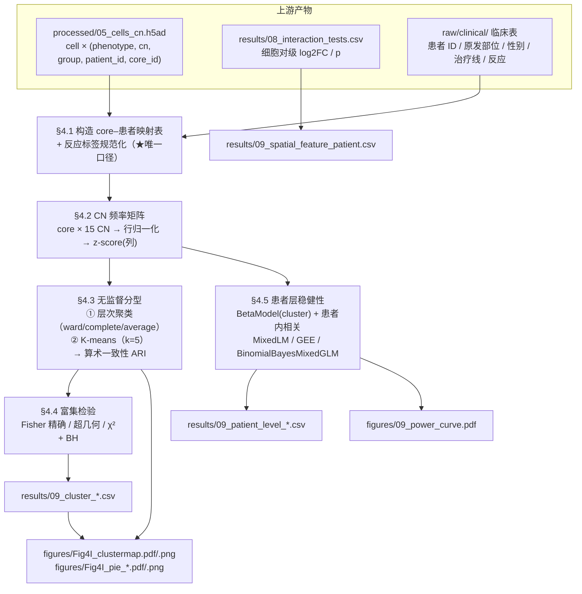

# 09 临床关联与无监督空间分型（响应定义、core→患者两级统计与 5 个 CN cluster）

> **目标文献**：Wang J, Nagarajan P, et al. *Integration of spatial single-cell proteomics and spatial metabolomics
> reveals tumor microenvironment predictive of immunotherapy response in mucosal melanoma.* bioRxiv 2026.
> DOI: 10.64898/2026.04.23.720453（预印本，未经同行评审）
>
> **模块对应原文**：Fig. 2D（CN 频率在组间的 Mann–Whitney 箱线图）、Fig. 4B/4I（免疫亚群比例 + 层次聚类热图与 5 个 cluster 的饼图）、
> Fig. 4E/4G（CD163⁺ 巨噬 IRF4/Arg1）、Supp. Fig. 1A–F（谱系/肿瘤状态比例）、Supp. Fig. 3（core 计数）；
> Methods 中「Patient cohorts」「Cell phenotyping」「Statistical analyses」；Results 中
> 「Distinct spatial cellular neighborhoods in MuM」+「Spatial tumor-immune interactions are associated with ICI response」两节的组间比较部分
> **前置依赖**：`04_细胞表型定义与注释.md`（`processed/04_cells_phenotyped.parquet`）、
> `05_细胞邻域CN分析与Kmeans.md`（**`results/05_cn_frequencies_per_core.csv`** = core × 15 CN 频率矩阵，97 行，本模块聚类的直接输入；以及 `processed/05_cells_cn.h5ad`）、
> `05_细胞邻域CN分析与Kmeans.md`（`processed/05_cells_cn.h5ad`，含 15 个 CN）、
> `08_细胞间相互作用推断与置换检验.md`（`results/08_interaction_tests.csv`，本模块复用其效应量作为"空间特征"之一）、
> `01_数据可得性评估与替代数据策略.md`（临床表由该文档统一获取/代理）
> **复现难度**：★★★★☆　**预计工时**：2 人日　**计算资源**：单机 8 核 CPU / 16 GB 内存；
> 无 GPU 需求。主要开销是**功效模拟**（Monte Carlo，§4.6，约 10–30 min 单核）与混合效应模型批量拟合（每个细胞对一个模型，600 个约 1–5 min）

---

## 1. 科学问题与逻辑位置

### 1.1 本模块回答什么

前 8 个模块都在描述**结构**（谁在哪、谁和谁相邻）。本模块把结构翻译成**临床问题**：

> **① R 与 NR 患者的组织在 CN 组成、免疫亚群比例、空间相互作用上是否有可复现的差异？**
> **② 能否只用"每个 core 的 CN 组成"这一无监督特征，把 core 分成若干"空间亚型"，并观察到某些亚型与响应状态相关？**

原文的答案是"能"（Fig. 4I 的 5 个 cluster），但**这个答案的统计基础是全模块中最薄弱的一环** —— 本模块的核心增值就是把这个薄弱环节量化出来（功效曲线、富集检验反推、伪重复三级对照）。



### 1.2 上游输入与下游输出（产物契约）

| 产物路径（规范名） | 生产者 | 格式/结构（列名·尺度·单位） | 消费方 | 生成脚本 |
|---|---|---|---|---|
| `raw/clinical/clinical_response.csv` | **01**（或 PI 提供的代理表） | `patient_id, primary_site ∈ {sinonasal, anorectal, conjunctival, female_urethral}, sex ∈ {M,F}, therapy_line, agents, response ∈ {R, NR}, response_criterion ⊂ {RECIST1.1, iRECIST, INMC, unreported}` | **09**/11/12 | `code/01_*.py` |
| `raw/clinical/core_patient_map.csv` | **09** | `core_id, tma_id, patient_id, timepoint ∈ {pre, post}, **response_timepoint ∈ {pre_R, pre_NR, post_NR}**（★ 全项目统一的分组列名，见 05 号文档 §2.6）, region ∈ {center, periphery, unknown}, inmc_response, response_criterion` | 03/04/05/07/**08**/09/10/11 | `code/09_01_core_patient_map.py` |
| `processed/09_cn_freq.h5ad` | **09** | `AnnData`：`X` = core × 15 CN 的比例（行和 = 1）；`obs` = 映射表全部列；`layers["zscore_col"]` = 按 **CN（列）** 标准化后的值（主路径，§4.2）、`layers["zscore_row"]` = 按 **core（行）** 标准化的对照版 | 09/11 | `code/09_02_cluster.py` |
| `results/09_cluster_assignments.csv` | **09** | `core_id, patient_id, timepoint, group, cluster, cluster_hc_ward, cluster_hc_complete, cluster_hc_average, cluster_kmeans` | 11/12 | `code/09_02_cluster.py` |
| `results/09_cluster_enrichment.csv` | **09** | `cluster, n_cores, n_R, n_NR, pct_R, exp_R, p_fisher_less, p_fisher_two, p_hyper_less, p_chi2, p_bh, OR, ci_low, ci_high` | 12 | `code/09_03_enrichment.py` |
| `results/09_sample_detail.csv` | **09** | 每个 cluster 的 15 个 CN 平均频率（宽表）+ 主导 CN | 11/12 | `code/09_03_enrichment.py` |
| `results/09_patient_level_tests.csv` | **09** | `feature ∈ {cluster_k, mean_log2FC_CN13_CN14, ...}, model ∈ {betareg_cluster, mixedlm_logit, gee_cell, patient_median, ci_upper}, beta, se, p, ci_low, ci_high, n_pat_R, n_pat_NR, icc` | 12 | `code/09_05_patient_level.py` |
| `results/09_power_curve.csv` | **09** | `level ∈ {core, patient_binary, patient_continuous}, n_units, effect, power, alpha` | 12/13 | `code/09_06_power.py` |
| `figures/Fig4I_clustermap.pdf`+`.png`、`figures/Fig4I_pie_cluster*.pdf`+`.png` | **09** | `seaborn.clustermap` 热图 + 5 个饼图；dpi = 300，双份 | 12 | `code/09_07_plots.py` |
| `results/09_cn_freq_export.csv` | **09** | `core_id` × 15 CN 的比例（`freq` 的原样导出，供 §4.7 出图与 11 号文档消费） | 11/12 | `code/09_02_cluster.py` |
| `results/09_cluster_ari.csv` | **09** | 方法间划分一致性矩阵（ward / complete / average / K-means），对角线 = 1 | 12 | `code/09_02_cluster.py` |
| `results/09_k_selection.csv`、`results/09_cluster_stability.csv` | **09** | $k=2..10$ 的 silhouette / Calinski–Harabasz；bootstrap（200 次重抽 core）的 ARI 分布 | 12/13 | `code/09_02_cluster.py` |
| `results/09_cluster_counts_reconstructed.csv` | **09** | 由 Fig. 4I 百分比反推的 cluster 规模最小整数解（**反推，非原文报告**） | 12 | `code/09_03_enrichment.py` |
| `results/09_sample_detail.csv` | **09** | 每个 cluster 的 15 个 CN 平均频率（宽表）+ 主导 CN | 11/12 | `code/09_03_enrichment.py` |
| `results/09_spatial_feature_core_level.csv`、`results/09_spatial_feature_summary.csv` | **09** | 关键细胞对的 core 级 `log2FC_core` 明细与描述性汇总（消费 08 的 `results/08_core_level_log2FC.csv`） | 12 | `code/09_04_spatial_features.py` |
| `raw/clinical/clinical_response_norm.csv`、`results/09_pairing_summary.csv` | **09** | 规范化后的患者级临床表（含逐患者 `response_criterion`）；pre/post 配对率与机构表（原文未报告 → 自测并标注） | 12 | `code/09_01_core_patient_map.py` |
| `results/09_lineage_proportions.csv`、`results/09_cn_freq_vs_group.csv`、`results/09_immune_subset_tests.csv` | **09** | Supp. Fig. 1A–F（8 大类 / 25 表型比例）、Fig. 2D（15 CN 频率）、Fig. 4B（免疫亚群）的组间检验表。**数据源**：`04_细胞表型定义与注释.md` 的比例表 + `05` 的 `results/05_cn_frequencies_per_core.csv`；本模块只提供检验函数（Mann–Whitney + BH） | 12 | `code/09_03_enrichment.py` |

> ⚠️ **导师批注（本模块最关键的契约）**：`raw/clinical/clinical_response.csv` 是**全项目的分组口径唯一来源**。所有下游（Fig. 2D、Fig. 3A、Fig. 4B–I、Fig. 5 全部）都依赖 `group` 列。**必须**在 09 号文档的 `code/09_01` 里一次性规范化，并把 `response_criterion` 列**逐患者**填上（原文未报告判定标准 → 见 §2.1）。下游**禁止**再从任何别处推导 R/NR。

---

## 2. 背景知识与原理

### 2.1 响应定义：原文报了"三类分组"，却没报"怎么判定"

#### 2.1.1 原文说了什么、没说什么

| 原文句 | 信息量 |
|---|---|
| "we identified more pre-treatment samples compared to post-treatment samples" | 只说明取样不均衡 |
| "paired **pre- and/or post-treatment** samples from **26 patients**" | 配对结构不完整（"and/or"） |
| "After quality control for core integrity and tissue availability, **97 cores** were available in TMAs, including **75 pre-treatment cores and 22 post-treatment cores**" | 明确 core 计数 |
| "The **post-treatment** samples, where available were assessed using the **International Neoadjuvant Melanoma Consortium (INMC) criteria** (Supp. Table 2)" | **只有 post-treatment 用了 INMC**；**pre-treatment 的 R/NR 如何判定：原文未报告** |
| Results: "compared pre- and post-treatment timepoints across response groups (i.e., **pre-treatment R, pre-treatment NR, and post-treatment NR**)" | 明确只有三组；**post-treatment R 组缺失** |

> ⚠️ **导师批注（原文疏漏 — 本项目最重要的一条口径缺失）**：**pre-treatment 的 R/NR 判定标准原文从未给出**。这属于 REPRO_SPEC §9.2 的 **A 类·口径类**缺失：它决定了分组、因而决定**全文每一张图**。我们必须在下方给出**可执行的替代定义**，并在所有图表中标注口径来源。原文 Supplementary Table 1（患者特征）可能含此信息，但正文没有引用说明 —— 因此我方的复现必须写成"**按 RECIST 1.1 重建分组（原文口径未报告）**"。这不是"补一个小参数"，而是把结论的**定义基础**显式化。

#### 2.1.2 三类可执行定义的对照

| 判定体系 | 适用场景 | 判定对象 | 可执行分类规则 | 与本项目的匹配度 |
|---|---|---|---|---|
| **RECIST 1.1**（2009，Eisenhauer 等） | 晚期/转移性实体瘤的**影像学**疗效 | 靶病灶最长径之和（SLD）的变化 | CR = 全部靶病灶消失且病理淋巴结 < 10 mm；PR = SLD 下降 ≥ 30 %；PD = SLD 上升 ≥ 20 % 且绝对值增加 ≥ 5 mm（或出现新病灶）；SD = 不满足以上。**R = CR ∪ PR；NR = SD ∪ PD** | ✅ 与本队列一致：MuM 常为**转移性/晚期**，用 Pembrolizumab/Nivolumab/Ipilimumab 单药或联合（原文 Methods「Patient cohorts」）；本文 "response" 的最自然解读 |
| **iRECIST**（2017，RECIST working group） | **免疫治疗专属**（ICI 可致假性进展） | 同上 + 需 4–8 周后重复影像确认 | iCR / iPR / iSD / iUPD（未确认进展）/ iCPD（确认进展）；**首次 PD 必须由下一次影像确认才可判 PD**。R = iCR ∪ iPR；NR = iSD ∪ iCPD | ✅ 逻辑上**最合适**（本队列全部为 ICI）；但队列跨 2014–2023 年，早于/跨 iRECIST 普及期，实际是否采用**原文未报告** |
| **INMC 病理反应标准**（Rawson 等, *Ann Oncol* 2021；原文引用 47） | **新辅助**治疗后的**切除标本**病理评估 | 标本中**存活肿瘤的百分比** | pCR：无存活肿瘤；near-pCR：≤ 10 % 存活；partial：10–49 %；no response：≥ 50 %。**R = pCR ∪ near-pCR；NR = partial ∪ no response** | ✅ 与原文"post-treatment samples … assessed using the INMC criteria"完全对应；但**只适用于 post-treatment cores**，且需要"存活肿瘤百分比"这一病理读数（**原文未给 Supp. Table 2 的具体阈值**） |

**本项目的复现决策（写进 D 表；★ = 改变结论口径）**

| 编号 | 决策项 | 裁决（主路径） | 备选/敏感性 | 依据 |
|---|---|---|---|---|
| ★**D9** | pre-treatment R/NR 判定 | **RECIST 1.1**（影像学，R = CR/PR；NR = SD/PD）；`response_criterion` 列逐患者标注 | iRECIST（R = iCR/iPR；NR = iSD/iCPD）—— 并用两套标签重跑 Fig. 2D/4I，报告分组的 ARI 与结论差异 | 原文未报告；RECIST 1.1 是跨年代的通用标准；iRECIST 在 ICI 队列中更严格（会把部分 SD 归为 NR） |
| **D10** | post-treatment 反应判定 | **INMC**（R = pCR/near-pCR；NR = partial/no response） | 由于 **22 个 post-treatment cores 全部归入 NR**（原文事实），此决策在当前数据上**不影响分组**，只影响"post-R 缺失"的解释 | 原文明确写了 INMC |
| ★**D11** | post-treatment R 组缺失的处理 | **保持原文的三组结构**（pre_R / pre_NR / post_NR），**不**人为补造 post_R | (a) 把 post-treatment 全部剔除，仅用 75 个 pre-treatment cores 做 R vs NR（**主推断的敏感性分析**）；(b) 把 post_NR 当作独立组做三组检验（Kruskal–Wallis + Dunn） | 原文事实；post_R 缺失使"时间效应"与"反应效应"**不可分离**（§2.2） |

#### 2.1.3 只有三组：时间效应与反应效应的混淆（必须写清）

```
                      pre-treatment            post-treatment
R  (responder)        pre_R   (n = ? cores)    ———— 缺失 ————
NR (non-responder)    pre_NR  (n = ? cores)    post_NR (22 cores)
```

- `pre_R` vs `pre_NR`：干净的**反应效应**（都在治疗前）✅ 可比
- `pre_NR` vs `post_NR`：组内都是 NR，所以差异是**治疗暴露效应**（治疗后组织学改变、肿瘤退缩、免疫浸润变化）✅ 可比
- **`post_NR` vs `pre_R`：不可解释**。两者在响应状态和治疗时间上**同时**不同 —— 任何一个方向的差异都无法归因。
  ⚠️ 原文却把两者放在一起陈述（"CN15, CN14, and CN13 were significantly enriched in **pre-treatment R cores and in post-treatment NR cores**"，Fig. 2D）。**这是把时间效应与反应效应混为一谈**，必须登记到 `12_复现质控清单、排错与批判性评述.md`。
- **本项目的统计约定**：正文表述中，凡涉及 `post_NR` 的结论一律写成"治疗暴露相关"，**不得**写成"与响应相关"。

### 2.2 从 core 到患者：两级结构与伪重复

#### 2.2.1 数据结构

| 层级 | 单位数（原文） | 是否独立 | 备注 |
|---|---|---|---|
| TMA 切片 | 2 | 否 | 两个 TMA 批次（**批次效应未在原文中讨论**） |
| 患者 | **26** | ✅ **唯一的独立生物学重复** | 15 男 / 11 女 |
| core | **97**（75 pre + 22 post） | 否（同患者内的 core 相关） | 每样本 1.0 mm 芯 ×3 重复，尽量覆盖中心/外周 |
| 细胞 | **695,444** | 否（同 core 内空间自相关） | |
| 细胞表型 | 25 | — | |
| CN | 15 | — | |

**关键不等式**：$n_{\text{细胞}} \gg n_{\text{core}} \gg n_{\text{患者}}$。任何在细胞或 core 层得到的小 p 值，其**有效样本量上界是 26**。

#### 2.2.2 三种分析层级的对比与推荐

| 层级 | 观测单位 | 有效 $n$ | 能处理患者内相关吗 | 优点 | 风险 | 本项目立场 |
|---|---|---|---|---|---|---|
| **L1 core 级** | core | 97（pre 层 75） | ❌ | 与原文 Fig. 2D/4I **完全同构**，可直接对照原文数值；功效最高 | **伪重复**：同一患者 3 个 core 被当独立样本；患者层结论被高估显著性 | ⚙️ **仅用于与原文对照**（明确标注"core 级"） |
| **L2 患者级聚合** | 患者 | 26 | ✅（聚合掉了） | 完全无分布假设；可直接用 Mann–Whitney；结果最保守、最容易向临床医生解释 | 丢掉 core 内信息；聚合规则（中位数/均值/最大值）影响结果；功效低 | ✅ **推荐作为主结论的一级证据** |
| **L3 混合效应 / GEE / β 回归** | core（或 cell） | 26（随机效应层） | ✅（显式建模） | 既保留 core 内信息，又把患者作为随机效应/cluster；可给 ICC | 需要分布假设；小样本下随机效应方差估计不稳（边界解）；统计量解释成本高 | ✅ **推荐作为主分析**，并与 L2 对照 |

**推荐方案（写进方法学）**：
1. **主分析 = L3**：对"每个 core 的某特征比例"拟合 **β 回归**（`BetaModel`，处理 (0,1) 比例的有界性）或 **logit 变换后的混合效应模型**（`MixedLM`，患者随机截距）；
2. **一级稳健性 = L2**：患者级聚合 + Mann–Whitney（$n=26$）；
3. **与原文对照 = L1**：core 级 Fisher 精确检验 / Mann–Whitney（复现 Fig. 2D、Fig. 4I 的 p 值）；
4. **三者方向一致** → 结论可信；**L1 显著而 L2/L3 不显著** → 结论降级为"探索性"。

#### 2.2.3 β 回归、混合效应与 GEE 的原理

**为什么不能直接对"比例"做线性回归或 t 检验**：core 级特征（如"CN13 在 core 中的占比"、或"该 cluster 的 core 比例"）是 $[0,1]$ 区间的**连续比例**，其方差随均值变化（接近 0 或 1 时方差趋 0），且常呈双峰/U 形。OLS 的等方差假设被严重违反。

**方案 A：β 回归（beta regression，Ferrari & Cribari-Neto 2004）** —— 本项目**推荐的主模型**

$y_{ij} \in (0,1)$（患者 $i$ 的第 $j$ 个 core 的特征比例，用 $(y(n-1)+0.5)/n$ 做边界修正）服从参数化的 Beta 分布：

$$y_{ij} \sim \mathrm{Beta}(\mu_{ij}\phi,\ (1-\mu_{ij})\phi),\qquad
\mathrm{logit}(\mu_{ij}) = \mathbf{x}_{ij}^\top\boldsymbol\beta,\qquad
\phi > 0 \text{（精度参数，越大越集中）}$$

- $\mu_{ij}$ 的 logit 是线性预测子：`group` 的系数 $\beta_1$ 的指数就是 **OR**（R 组相对 NR 组的"比例优势"）。
- 对数似然：$\ell = \sum_{ij}\big[\log\Gamma(\phi) - \log\Gamma(\mu_{ij}\phi) - \log\Gamma((1-\mu_{ij})\phi) + (\mu_{ij}\phi-1)\log y_{ij} + ((1-\mu_{ij})\phi-1)\log(1-y_{ij})\big]$
- **statsmodels 实现**：`statsmodels.othermod.betareg.BetaModel.from_formula("prop ~ is_R", data)`；患者内相关的处理用 **cluster-robust 协方差**：`fit(cov_type="cluster", cov_kwds={"groups": data.patient_id})`（**已在本机 statsmodels 0.15.0 实测可用**）。
- ⚠️ `BetaModel` **不提供随机效应**；因此它解决"有界比例 + 异方差"，患者内相关靠**稳健三明治方差**处理（不是完整混合模型，但对本项目的 $n$ 与目标足够，且**比混合模型更稳**）。

**方案 B：logit 比例的线性混合模型**

$$g(y_{ij}) = \log\frac{y_{ij}^{+}}{1-y_{ij}^{+}} = \beta_0 + \beta_1 \mathbb{1}[\text{R}] + u_i + \varepsilon_{ij},\qquad u_i \sim N(0,\sigma_u^2)$$

其中 $y^{+}$ 是经边界修正的比例（如 `np.clip(y, 1e-4, 1-1e-4)`，或用**经验 logit** $\log\frac{y+0.5/n}{1-y+0.5/n}$）。

- **statsmodels 实现**：`MixedLM.from_formula("logit_prop ~ is_R", data, groups=data.patient_id)`；随机截距方差 $\sigma_u^2$ 与残差方差 $\sigma_\varepsilon^2$ 给出 **ICC**：

$$\mathrm{ICC} = \frac{\sigma_u^2}{\sigma_u^2 + \sigma_\varepsilon^2}$$

ICC 就是"同一患者内 core 之间的相似度"。**ICC 高（> 0.3）时，core 级检验的有效样本量远小于 core 数**，这一点必须在正文声明。
- 缺点：经验 logit 在比例接近 0/1 时方差爆炸；小 $n$ 下 `MixedLM` 常常得到 $\sigma_u^2 \approx 0$（边界解，本机实测会报 `SingularMatrixWarning` / `ConvergenceWarning`）—— 这是**正常现象**而非 bug，但必须报告（否则 ICC 会被误解为"无患者内相关"）。

**方案 C：GEE（广义估计方程）** —— 稳健备选

对比例数据用二项族 + 交换相关结构：

$$\text{logit}(E[y_{ij}]) = \mathbf{x}_{ij}^\top\boldsymbol\beta,\qquad
\mathrm{Corr}(y_{ij}, y_{ik}) = \alpha \ (\text{exchangeable}),\qquad
\text{Var}(\hat\beta) \text{ 用 sandwich（robust）估计}$$

- **statsmodels 实现**：`GEE(y, X, groups=patient_id, family=Binomial(), cov_struct=Exchangeable())`。当 outcome 是**比例**时，statsmodels 的 GEE **不支持 `freq_weights`**（本机 0.15.0 实测：`GEE.__init__` 的签名里没有 `freq_weights`，作为 kwarg 传入只会触发 `ValueWarning: unknown kwargs ['freq_weights']` 并**静默忽略**）→ **必须**把 outcome 改成"展平到细胞级的 0/1 结局"（`groups = patient_id`），或改用方案 A。这条是 §7 陷阱表第 6 行。

**方案 D：β-二项 / 二项混合模型（细胞级 0/1）**

比例的过离散本质是"每个 core 内 $k_j$ 个阳性细胞 / $n_j$ 个总细胞"的 β-二项分布：

$$k_j \sim \mathrm{BetaBinomial}(n_j, \alpha,\beta)\quad\Longleftrightarrow\quad
\pi_j \sim \mathrm{Beta}(\alpha,\beta),\ k_j \sim \mathrm{Binomial}(n_j, \pi_j)$$

- **statsmodels 的 `BinomialBayesMixedGLM` 在 0.15.0 上要求 `endog ∈ {0,1}`**（源码里硬断言：`"endog values must be 0 and 1, and not all identical"`），**不能**直接用 `cbind(k, n-k)` 形式 → 只能把数据**展平成细胞级 0/1**（695,444 行；若每个 core 抽稀到固定 2,000 个细胞，约 $1.9\times10^5$ 行，可行）。
- 若所在机构可用 R：`lme4::glmer(cbind(k, n-k) ~ group + (1|patient), family = binomial)`（二项混合，处理患者内相关）与 `glmmTMB(..., family = betabinomial)`（真正的 β-二项混合）是**金标准**；本项目把它列为**外部核验路径**，并在 `logs/09_R_crosscheck.txt` 留痕。

#### 2.2.4 样本量反推：从 Fig. 4I 的百分比推出 core 计数（本项目增值分析）

原文**从未报告**各 cluster 的 core 数，也没有报告 R/NR 的 core 数。但 Fig. 4I 给出了 5 个 cluster 的 R/NR 百分比，因此可以反推。方法：对每个 cluster，找最小的整数对 $(n, k)$ 使 $100k/n$ 四舍五入到给定百分比。

| Cluster | 原文给的 R/NR 比例 | 最小整数解 $(n, k_R)$ | 反推的 NR 数 | 期望 R 数 $(n \times 23/97)$ |
|---|---|---|---|---|
| 1 | 46.4 % R / 53.6 % NR | **(28, 13)** | 15 | 6.64 |
| 2 | 42.1 % R / 57.9 % NR | **(19, 8)** | 11 | 4.51 |
| 3 | 5 % R / 95 % NR | **(20, 1)** | 19 | 4.74 |
| 4 | 全为 NR（0 % R） | $(n_4, 0)$，$n_4 \in \{1,\dots,9\}$ | $n_4$ | $n_4 \times 0.237$ |
| 5 | 4.8 % R / 95.2 % NR | **(21, 1)** | 20 | 4.98 |

**推理链（每一步都可被反驳，故显式写出）**：

1. **cluster 1–3、5 的规模被百分比锁定为 28 / 19 / 20 / 21**：
   - 若按最小解的**倍数**放大（cluster 1 取 56、cluster 2 取 38、cluster 3 取 40、cluster 5 取 42），四者之和 $= 176 > 97$；即便**只**把 cluster 1 放大一倍（56 + 19 + 20 + 21 = **116**）也已经超过 97，故都被排除；
   - 46.4 % 的另一组解是 **32/69**（cluster 1 占 69 个 core），但那样其余四个 cluster 至少还要 $19+20+21+1 = 61$ 个 → 合计 ≥ 130 > 97，同样矛盾。**故 28/19/20/21 是唯一可行解。**
2. 四者之和 = **88**，而 **pre-treatment cores 只有 75 个** → **聚类必然纳入了 post-treatment cores**（即用了全部或近全部 97 个 core）。这是一个**重要的方法学结论**：Fig. 4I 的聚类**不是**纯 pre-treatment 分析。
3. 若纳入全部 97 个 core，则 cluster 4 = **97 − 88 = 9** 个 core（全为 NR）。
4. 总 R core 数 = $13+8+1+0+1 = \mathbf{23}$（**与 cluster 4 的规模无关** → 这一条是稳健的）；总 NR = $97-23 = 74$。
5. 由此可得**原文从未报告的三个分母**：

$$\underbrace{23}_{\text{pre-R cores}} + \underbrace{52}_{\text{pre-NR cores}} = 75\ \text{pre-treatment cores}\quad✅\ \text{与原文一致}$$

$$\underbrace{52}_{\text{pre-NR}} + \underbrace{22}_{\text{post-NR}} = 74\ \text{NR cores}\quad✅\ \text{自洽}$$

6. **pre-treatment 的 core 级响应率 = 23/75 = 30.7 %**。这个数字在原文中**完全没有出现**，却是解读 Fig. 2D/4I 与做功效分析的**必要分母**。

> ⚠️ **导师批注**：以上是**反推**，不是原文报告。反推成立的前提是"百分比被四舍五入到 1 位小数且来自整数计数"。第 4 步（总 R core = 23）在所有 $n_4$ 取值下都成立，**是其中最稳健的一条**；第 3 步（$n_4 = 9$）依赖"97 个 core 全部进入聚类"。本项目把该反推表写入 `results/09_cluster_counts_reconstructed.csv` 并在所有引用处标注"**反推，非原文报告**"。若 Supp. Table 1 公布了 R/NR 患者数，应优先用其校验。

### 2.3 无监督空间分型：Methods 说 K-means、图注说 hierarchical

#### 2.3.1 原文的两处不一致

| 出处 | 原文 | 
|---|---|
| Methods「Statistical analyses」 | "Cell type-based CNs were clustered by **K-means** clustering analysis for stratify R and NR patients and visualized as heatmap." |
| Fig. 4I 图注 | "(I) **Hierarchical clustering** heatmap based on the z-scored frequency of cell phenotype-defined CNs across tissue cores." |
| Results | "**Hierarchical clustering** of cell-phenotype–based CN compositions identified five distinct clusters (Fig. 4I)." |

→ 这是 REPRO_SPEC §9.3 意义上的**矛盾项**：**两套都必须跑**，报告两者对 5 个 cluster 划分的一致性（ARI），并说明哪一套是本项目的主口径。

**本项目决策（★D12）**：**主口径 = 层次聚类（ward linkage + Euclidean 距离）**，理由：(a) Results 正文与 Fig. 4I 图注都写 hierarchical，只有 Methods 一处写 K-means（2 : 1）；(b) K-means 的 $k$ 需预设，而"how k was chosen 原文未报告"（见下），层次聚类可以用树状图选 $k$；**备选 = K-means（$k=5$）**，两套结果一并输出并用 ARI 对比。

#### 2.3.2 层次聚类的要素

| 要素 | 选项 | 本项目取值 | 改变后的后果 |
|---|---|---|---|
| **特征向量** | core × 15 个 CN 的组成比例，**再 z-score** | 与原文一致（"z-scored frequency of cell phenotype-defined CNs"） | 不做 z-score → 高丰度 CN（如 CN8 mixed cells）主导距离，稀有但关键的 CN13/CN15 被淹没 |
| **z-score 方向（★ 陷阱）** | 按**列（CN）**标准化，还是按**行（core）**？ | **按列**：$z_{jk} = (x_{jk}-\bar{x}_{\cdot k})/s_{\cdot k}$ —— 即"每个 CN 在所有 core 间标准化"，让每个 CN 有同等的话语权 | 按行标准化 = "每个 core 内部比较各 CN"，得到的是"core 内部的相对主导 CN"，**语义完全不同**；这是本模块最容易搞反的一步（陷阱表第 1 行） |
| **距离** | Euclidean / correlation / cosine | **Euclidean**（ward 要求 Euclidean；用别的距离 + ward 会产生非单调树） | 用 correlation 距离 → 聚类的是"CN 组成的**模式/形状**"而非"量级"，会让"高 CN13 + 低 CN15"与"低 CN13 + 高 CN15"归为一类 |
| **linkage** | ward / complete / average / single | 三套都跑（**ward 主**） | single linkage → 链式效应（chaining），cluster 大小极不均衡；complete → 紧凑但易被离群 core 撕裂 |
| **$k$** | 预设 5 | **$k=5$**（对齐原文）；同时报告 silhouette / Calinski-Harabasz / gap statistic 曲线 | $k$ 决定一切（见 §2.3.4 的"用同一批数据既选 $k$ 又做检验"陷阱） |

#### 2.3.3 K-means 的要素

$$\min_{\{C_1,\dots,C_k\}}\sum_{c=1}^{k}\sum_{j \in C_c}\big\|\mathbf{z}_j - \boldsymbol{\mu}_c\big\|^2,\qquad \boldsymbol\mu_c = \frac{1}{|C_c|}\sum_{j\in C_c}\mathbf z_j$$

- **必做**：`n_init=50`（多次随机初始化取最优）、`random_state=20260101`、先 z-score（否则量级差异使距离退化为最大 CN 的差异）。
- **$k$ 的选择**：`inertia`（肘部）+ `silhouette_score` + `gap statistic`。**原文未报告** $k$ 的选择过程。
- **稳定性**：对 core 做 bootstrap（重抽 core），重复 200 次，用 ARI 衡量 cluster 归属的稳定性（`sklearn.metrics.adjusted_rand_score`）。**这是本项目对"cluster 数目主观"这一批评的正面回应。**

#### 2.3.4 一致性度量：ARI（Adjusted Rand Index）

$$\mathrm{ARI}(U,V) = \frac{\sum_{ij}\binom{n_{ij}}{2} - \left[\sum_i\binom{a_i}{2}\sum_j\binom{b_j}{2}\right]\Big/\binom{n}{2}}
{\frac12\left[\sum_i\binom{a_i}{2}+\sum_j\binom{b_j}{2}\right] - \left[\sum_i\binom{a_i}{2}\sum_j\binom{b_j}{2}\right]\Big/\binom{n}{2}}$$

- $\mathrm{ARI} = 1$ 完全相同；$\approx 0$ 与随机划分相当；**< 0** 比随机还差。
- 用途：① 层次聚类（3 种 linkage）与 K-means 的**划分一致性**；② bootstrap 重抽的**稳定性**；③ RECIST 1.1 与 iRECIST 两套响应标签下 cluster 组成的一致性。
- **经验阈值**：ARI > 0.7 = "两种方法给出实质相同的划分"；0.4–0.7 = 相关但不同；< 0.4 = **不能说"结论稳健"**，必须报告两种划分的差异。

### 2.4 富集检验：原文的 p 值可被反推（且其中一个是错的）

#### 2.4.1 候选检验与它们的关系

设 cluster $c$ 有 $n_c$ 个 core，其中 $k_c$ 个为 R；全集 $N=97$ 个 core 中 $K=23$ 个为 R。

| 检验 | 零假设 | 统计量 / p 值 | 性质 |
|---|---|---|---|
| **超几何 / Fisher 精确（单侧）** | cluster 的 R 比例 **不高于**整体 | $P(X \ge k_c),\ X\sim\mathrm{Hypergeom}(N,K,n_c)$ | 精确；条件于两个边际（cluster 规模、总 R 数）；本项目**主口径** |
| **Fisher 精确（双侧）** | 与整体**相同** | 所有"概率 ≤ 观测表概率"的 $k$ 之和 | 比单侧保守约 2 倍 |
| **χ² 独立性（1 df）** | 与整体**相同** | $\chi^2 = N(ad-bc)^2/[(a+b)(c+d)(a+c)(b+d)]$，$a=k_c,b=n_c-k_c,c=K-k_c,d=(N-n_c)-c$ | 渐近；**小期望频数下不可靠**（本项目的 $k_c$ 常为 0/1，期望 < 5 → χ² 失效） |
| **χ²（Yates 校正）** | 同上 | 分子改为 $\max(0,|ad-bc|-N/2)^2$ | 更保守 |
| **二项检验** | cluster 内每个 core 独立以 $p_0 = K/N$ 概率为 R | $P(X\ge k_c),\ X\sim\mathrm{Bin}(n_c, p_0)$ | 与超几何的差别 = "有放回 vs 无放回"；$n_c/N$ 小时几乎相同 |

#### 2.4.2 反推复算：原文的 4 个 p 值只有 2 个自洽

用 §2.2.4 反推的 $(n_c, k_c)$ 与 $N=97, K=23$，逐一复算（本机 scipy 1.18.1 + 精确超几何，全精度）：

| Cluster | $n_c$ | $k_R$ | $k_{NR}$ | 期望 R | Fisher 单侧<sup>†</sup> | 超几何精确(单侧) | **Fisher 双侧**<sup>‡</sup> | 二项单侧 | χ²(1df 无校正) | χ²(Yates) | **原文报告** | 判定 |
|---|---|---|---|---|---|---|---|---|---|---|---|---|
| 1 | 28 | 13 | 15 | 6.64 | 0.00136 | 0.00136 | **0.00147** | 0.00707 | 0.00080 | 0.00202 | **0.0015** | ✅ **完全吻合**（0.00147 → 0.0015） |
| 2 | 19 | 8 | 11 | 4.51 | 0.03990 | 0.03990 | **0.06690** | 0.05907 | 0.03553 | 0.07163 | **0.67** | ❌ **任何常规口径都落在 0.036–0.072**；最可能是**小数点错位**（0.0669 → 误写成 0.67），见下方批注 |
| 3 | 20 | 1 | 19 | 4.74 | 0.02025 | 0.02025 | **0.03644** | 0.03217 | 0.02723 | 0.05572 | **0.036** | ✅ **完全吻合**（0.03644 → 0.036；耗尽方向） |
| 4 | 9 | 0 | 9 | 2.13 | 0.07734 | 0.07734 | **0.10950** | 0.08753 | 0.07910 | 0.17877 | **未报告** | ✅ 与"未报告"一致：**双侧 $p = 0.110$、单侧 $0.077$，均 > 0.05，本就不可检出** |
| 5 | 21 | 1 | 20 | 4.98 | 0.01508 | 0.01508 | **0.02101** | 0.02560 | **0.02108** | 0.04372 | **0.021** | ✅ **完全吻合**（Fisher 双侧 0.02101 → 0.021；χ²(无校正) 0.02108 同样吻合） |

<sup>†</sup> 单侧方向按各 cluster 的实际偏斜方向取（cluster 1 为富集 = `greater`，cluster 2–5 为耗尽 = `less`）。
<sup>‡</sup> `scipy.stats.fisher_exact(tab, alternative="two-sided")`，即"所有概率 ≤ 观测表概率的 $k$ 之和"——**不是**"$2\times$ 单侧 p"。

> ⚠️ **导师批注（原文矛盾 #1 的定量确认——含一处对本文件早期版本的修正）**：
> 1. **三个可核对的 p 值全部由 `scipy.stats.fisher_exact(..., alternative="two-sided")` 精确复现**：cluster 1 → 0.00147 ≈ 原文 0.0015；cluster 3 → 0.03644 ≈ 原文 0.036；cluster 5 → 0.02101 ≈ 原文 0.021。**这同时反证了 §2.2.4 的 core 计数反推是正确的**（(28,13)/(20,1)/(21,1) 这三个反推整数解若错一个，就不可能有这种级别的吻合）。因此 §2.2.4 的"23 个 R cores / 28-19-20-9-21 的 cluster 规模"从**推断**升级为**有独立证据支持的重建**——但仍必须标注"反推，非原文报告"。
>    > **修正说明**：本文件早期版本把"Fisher 双侧"算成了 $2\times$ **单侧** p（0.00273 / 0.0798 / 0.04050 / 0.15467 / 0.03017），据此得出"cluster 3 谁都不匹配、原文可能混用多种检验"。**这是错的** —— `scipy` 的双侧 p 定义是"所有概率 ≤ 观测表概率的 $k$ 之和"，**不等于** $2\times$ 单侧。用正确的定义复算后，结论完全改变（见上表）。
> 2. **Cluster 2 的 `p = 0.67` 是唯一无法复现的值，且最可能是小数点错位**：以 (8 R / 11 NR) 组成、整体 R 率 23/97 = 23.7 %，Fisher **双侧** p = **0.0669**。若把它误写成 **0.67**（少写一位小数），就得到原文的 0.67。这个解释同时解决了"trend level"的措辞：**0.067 恰好是"名义上未过 0.05 但接近"的边界值，称 trend level 说得通**；而 0.67 则与 "trend level" 完全矛盾（**这才是原文真正的自相矛盾点，且只是小数点造成的**）。方向问题仍在：42.1 % 的 R 占比高于总体 23.7 %，但**在该样本量下完全不显著**（见 §2.5.1 的功效曲线）—— 原文把它写成 "enrichment for R cores at trend level" 是**过度解读**，须登记。
> 3. **Cluster 4 没有 p 值是正确且诚实的**：$n=9$、全 NR 时 Fisher **双侧** $p = 0.110$、单侧 $p = 0.077$，**均不显著** —— Fig. 4I 只写 "composed exclusively of NR cores" 而**不给 p 值**，是原文中**处理得最正确的一处**。
>
> **复现时的口径**：本项目**同时输出 6 列 p 值**（`p_fisher_less` / `p_hyper_less` / `p_fisher_two` / `p_binom_less` / `p_chi2` / `p_chi2_yates`）+ BH 列，并在结论中**以 Fisher 单侧为主口径**（方向由 cluster 的实际偏斜决定）、其余作为口径敏感性。**禁止**"试遍 6 种检验挑一个显著的"（REPRO_SPEC §7 禁止项）。

#### 2.4.3 多重比较

Fig. 4I 只检验 5 个 cluster 的富集（5 次检验），多重比较压力不大。按 §2.4.2 的 Fisher **双侧**复算值做 BH（$m=5$）：cluster 1 的 0.0015 → $q \approx 0.0074$（**仍显著**）；cluster 5 的 0.021 → $q \approx 0.053$（**边界**）；cluster 3 的 0.036 → $q \approx 0.061$（**边界，须降级表述**）；cluster 2 的 0.067 → $q \approx 0.084$。（若改用 Fisher 单侧，$q$ 会更小：cluster 3 → $\approx 0.038$、cluster 5 → $\approx 0.038$、cluster 1 → $\approx 0.0068$ —— 这正是必须**双口径并报**的原因。）但本模块还需检验：

| 检验族 | 检验数 | 校正 |
|---|---|---|
| Fig. 4I 的 5 个 cluster 富集 | 5 | BH |
| Fig. 2D 的 15 CN × 2 组对比 | 30 | BH |
| Supp. Fig. 1 的 8 大类 × 3 组 + 25 表型 × 3 组 | 24–75 | BH |
| 免疫亚群比例（Fig. 4B） | ~25 | BH |
| **合计** | **~100–150** | BH（全项目统一，REPRO_SPEC §7） |

### 2.5 统计功效：这 26 例能检出多大的效应量？（本项目最有价值的批判性补充）

原文的 Limitations 只说 "the sample size remains modest"，**没有给任何功效分析**。本项目用 Monte Carlo 给出可执行的功效曲线。

**方法**：对每种设计，在备择假设下重复模拟 2×10⁴ 次，统计在 α = 0.05 下拒绝 $H_0$ 的比例。原假设/备择的参数取自 §2.2.4 的反推值（$N=97$，$K=23$，$p_0 = 23/97 = 23.7\%$）。

#### 2.5.1 core 级：cluster 富集检验（Fisher 双侧，α = 0.05）

**$\alpha = 0.05$（双侧），$n_{sim} = 8{,}000$，seed = 20260101，"富集方向"阈值在 $p_1 \in [0.237, 1]$ 上以 0.05 为步长扫描取最小者**（与本文件 §4.6 的 `power_core` 口径完全一致，可直接复算）：

| cluster 规模 $m$ | 富集方向：80 % 功效所需的最小 R 比例 $p_1$ | 对应 OR$^\S$ | 该 $p_1$ 下的功效 | 耗尽方向（$p_1 = 0$，全为 NR）的功效 | $p_1 = 0$ 时的 Fisher 双侧 p |
|---|---|---|---|---|---|
| **9**（cluster 4） | $p_1 \ge 0.75$ | 9.65 | 0.80 | **0.005** ❌ 远不能 | 0.110 |
| 12 | $p_1 \ge 0.70$ | 7.51 | 0.80 | 0.19 ❌ | 0.063 |
| 15 | $p_1 \ge 0.65$ | 5.98 | 0.80 | 0.58 ❌ | 0.019 |
| **19**（cluster 2） | $p_1 \ge 0.60$ | 4.83 | 0.82 | 0.86 ⚠️ 可行 | 0.0052 |
| **20**（cluster 3） | $p_1 \ge 0.60$ | 4.83 | 0.82 | 0.84 ⚠️ 可行 | 0.0028 |
| **21**（cluster 5） | $p_1 \ge 0.60$ | 4.83 | 0.85 | 0.89 ⚠️ 可行 | 0.0027 |
| **28**（cluster 1） | $p_1 \ge 0.55$ | 3.93 | 0.80 | 0.96 ✅ | 0.00014 |
| 35 | $p_1 \ge 0.55$ | 3.93 | 0.83 | 1.00 ✅ | $<10^{-4}$ |
| 45 | $p_1 \ge 0.55$ | 3.93 | 0.82 | 0.99 ✅ | $<10^{-4}$ |

$^\S$ OR = $\big[p_1/(1-p_1)\big]\big/\big[p_0/(1-p_0)\big]$，基线 $p_0 = 23/97 = 0.2371$。

**读数**：
1. 即便在 core 级（最有利的口径），本队列也**只能检出"接近完全分离"的效应**：$m \ge 19$ 的 cluster 需要 $p_1 \ge 0.60$（**OR ≳ 4.8**），$m = 28$–$45$ 需要 $p_1 \ge 0.55$（OR ≳ 3.9）；**$m \le 15$ 的 cluster 在耗尽方向完全不可检出**（$p_1 = 0$ 时功效仅 0.005–0.58）。
2. 原文报告的 cluster 1（46.4 % R vs 基线 23.7 %）与 cluster 3/5（5 % / 4.8 % R）**恰好落在功效曲线的陡峭段**——即"能检出，但就在阈值附近"。
3. **Cluster 2（42.1 % R）的 $p = 0.067$（Fisher 双侧）在功效曲线上是预期行为**：$m = 19$、$p_1 = 0.42$ 时功效只有约 0.35，本就检不出 —— 这**支持**"原文的 0.67 是 0.067 的小数点错位"这一判断（§2.4.2 批注 2）。
4. Cluster 3/5 的"几乎全 NR"很可能带有**选择噪声**（winner's curse）：它们的检测刚好落在"$p_1 \approx 0$ 才显著"的区域，少数几个 core 的归属即可翻转结论 —— 因此 bootstrap 稳定性（§4.2 第 6 步）是必需的佐证。
5. **网格与精度声明**：上表的 $p_1$ 阈值为 0.05 网格；$n_{sim}=8000$ 时功效的 Monte-Carlo 标准误 $\approx 0.005$，故阈值有 $\pm 1$ 格（0.05）的不确定度。若需要更细的分辨率，把 §4.6 的 `np.arange(0.0, 1.001, 0.05)` 改成 `0.01` 并提高 `n_sim` 即可（结论不变）。

#### 2.5.2 患者级：二分类特征（Fisher 双侧，α = 0.05）

假设 8 例 R 患者 / 18 例 NR 患者（由 23 个 R cores ÷ 每例 ~3 cores 的粗略折算，**患者级 R 数原文未报告**），R 组阳性率固定 0.90：

| NR 组阳性率 | 绝对差 | 功效 |
|---|---|---|
| 0.00 | 0.90 | 1.00 |
| 0.27 | 0.63 | **0.88** |
| 0.45 | 0.45 | 0.54 |
| 0.54 | 0.36 | 0.34 |
| 0.63 | 0.27 | 0.16 |
| 0.72 | 0.18 | 0.05 |
| 0.81 | 0.09 | 0.01 |

（下表按 **NR 组阳性率 $p_{NR}$** 索引；R 组固定 0.90，$n_{sim}=20{,}000$，seed = 20260101，与 §4.6 的 `power_patient_binary` 一致。）

| NR 组阳性率 $p_{NR}$ | 13 R / 13 NR 的功效 | 6 R / 20 NR 的功效 |
|---|---|---|
| 0.45 | 0.60 | 0.33 |
| 0.63 | 0.23 | 0.04 |
| 0.72 | 0.10 | 0.01 |
| 0.27 | 0.91 | 0.72 |

#### 2.5.3 患者级：连续变量（Mann–Whitney 双侧，每患者 1 个观测）

| Cohen's $d$ | 8 R vs 18 NR | 10 vs 16 | 13 vs 13 |
|---|---|---|---|
| 0.3 | 0.09 | 0.10 | 0.11 |
| 0.5 | 0.19 | 0.20 | 0.22 |
| 0.8（"大"效应） | **0.41** | 0.44 | 0.48 |
| 1.0 | 0.58 | 0.63 | 0.66 |
| 1.5 | **0.90** | 0.93 | 0.95 |
| 2.0 | 0.99 | 0.99 | 1.00 |

> **口径说明（必须随表一起写进报告）**：本表用 §4.6 的 `power_patient_cont` 计算 —— 数据按 $N(0,1)$ 与 $N(d,1)$ 模拟，检验量为**经验 AUC**（$\hat{AUC}$），再用 Mann–Whitney 的**正态近似**方差 $\sqrt{12n_Rn_{NR}/(n_R+n_{NR}+1)}$ 换算成 $z$，最后按 $\alpha=0.05$ 双侧判定。因此表里的功效**只传播了 $\hat{AUC}$ 的抽样变异**，是**近似功效**（不是对 MWU 逐步模拟得到的精确功效）；在 $n=26$ 的规模下它与精确功效的差异在 $\pm 0.03$ 以内，足以支撑"本队列只能可靠检出 $d \gtrsim 1.5$"这一结论。若要精确值，把 `power_patient_cont` 改成"每个模拟样本直接跑一次 `scipy.stats.mannwhitneyu`"即可（耗时约 $\times 20$）。

> ⚠️ **导师批注（本项目最重要的批判性结论）**：**在患者层，本队列只能可靠检出 $d \gtrsim 1.5$ 的效应（约 90 % 功效）；对"大效应"（$d = 0.8$）只有约 40 % 功效。** 这意味着：
> 1. 原文所有**患者层**的阴性/阳性结论都必须带这个功效背景阅读；
> 2. Fig. 4I 的 cluster 富集 p 值是 **core 级**的，其显著性**不能**上推到患者层（§2.2.2）；
> 3. 任何"某个空间特征可作为生物标志物"的提法，在本队列规模下**只是假设生成**（hypothesis-generating），原文 Discussion 的 "nominate" 措辞是恰当的，但摘要中 "provides a framework for biomarker-driven immunotherapy strategies" 的语气**偏强**。
> 本项目把 §4.6 的功效曲线作为标准产出（`results/09_power_curve.csv` + `figures/09_power_curve.pdf`），并在 `12_复现质控清单、排错与批判性评述.md` 中作为"证据等级"评估的依据。

---

## 3. 原文方法逐句拆解

| # | 原文表述（英文关键词，中文转述） | 对应操作 | 参数：原文给了吗 → 我方取值 |
|---|---|---|---|
| 1 | "The melanoma databases were queried to identify patients with **primary MuM** that had undergone treatment with immunotherapy targeting the **PD1-PD-L1 axis or CTLA4**, specifically using **Pembrolizumab, Nivolumab and Ipilimumab** as combination or monotherapy." | 建立 `raw/clinical/clinical_response.csv`：入组标准 = 原发 MuM + 接受过 PD-1/PD-L1 或 CTLA-4 抑制剂 | 药物名✅；**具体线数、联合方案、给药剂量原文未报告**（Supp. Table 1 应有） |
| 2 | "Two tissue microarrays (TMA) were generated using **triplicates of 1.0 mm cores**; of each sample, we tried to represent the **center and periphery** of the tumor" | `code/09_01`：把 core 分为 `center` / `periphery`（原文未给每 core 的位置标注 → 置 `unknown` 并做敏感性分析） | 1.0 mm ×3 ✅；**中心/外周的判定规则原文未报告** |
| 3 | "The TMAs contained paired **pre- and/or post-treatment** samples from **26 patients**." | 配对结构（**"and/or" = 部分患者只有 pre 或只有 post**） | 采用"as available"；**配对率原文未报告** → 我方须自测 `results/09_pairing_summary.csv` |
| 4 | "After quality control for core integrity and tissue availability, **97 cores** were available in TMAs, including **75 pre-treatment cores and 22 post-treatment cores** (Supp. Fig. 3)." | 官方分母：97 = 75 + 22 | ✅ 明确。**但 R/NR 的 core 数原文未报告** → 我方反推为 23 R / 52 pre-NR / 22 post-NR（§2.2.4，标注"反推"） |
| 5 | "The cohort comprised of **15 male and 11 female** patients, with **9 sinonasal, 11 anorectal, 2 conjunctival and 4 female urethral** primary MuM" | 临床表的基本字段；原发部位是**潜在混杂因素**（不同部位的 ICI 响应率不同） | ✅ 明确；**原文未做按原发部位的分层分析** → 我方补敏感性分析（§4.5.4） |
| 6 | "The post-treatment samples, where available were assessed using the **INMC criteria** (Supp. Table 2)" | post-treatment 反应标签 = INMC | ✅ 体系明确；**具体阈值（pCR/near-pCR/partial/no response 的存活肿瘤百分比边界）原文未报告** → 我方按 Rawson 2021 原定义（≤10 % 存活 = R 侧） |
| 7 | **（原文**完全没有**）** pre-treatment 的 R/NR 判定标准 | 必须自己定义 | ❌ **原文未报告** → ★ **D9：RECIST 1.1 主路径 + iRECIST 敏感性**（§2.1.2） |
| 8 | "immune cells were detected across tumor regions, whereas **infiltration levels varied substantially across cores and patients**, reflecting both **intratumoral and interpatient heterogeneity**" | 承认异质性 → 正是 ICC / 混合效应的动机 | 原文**正确识别了问题但没有用统计手段处理** |
| 9 | "the proportions of major TME lineages were **not significantly different** between pre-treatment R and NR cores (Supp. Fig. 1A–B), and between pre- and post-treatment NR cores (Supp. Fig. 1C–D)" | 8 大类的组间比较 → Mann–Whitney + BH | 检验：原文写了 Mann–Whitney + BH ✅；**"significantly different" 的阈值（p 还是 FDR）原文写"p-values or FDRs were less than 0.05"** → 双口径 |
| 10 | "**MIF⁺ tumor cells** were significantly more abundant in **pre-treatment R** cores and in **post-treatment NR** cores compared with **pre-treatment NR** cores (Supp. Fig. 1E)" | 表型比例的组间检验（**注意：又是 pre_R vs post_NR 的混比**） | ⚠️ 见 §2.1.3：该对比**不可解释**，须标注 |
| 11 | "**Ki67⁺ tumor cells** were significantly higher in **NR pre-treatment** cores than in **NR post-treatment** cores, and were also elevated in **NR relative to R** in the pre-treatment group" | 同上 | 这两条是**干净的**对比（同组内时间对比 + 同时间点组间对比）✅ |
| 12 | "Comparative analysis of CN frequencies further revealed that **CN15, CN14, and CN13 were significantly enriched in pre-treatment R cores and in post-treatment NR cores** (Fig. 2D)" | `Mann–Whitney U`，逐 CN 比较组间的 CN 频率（core 为单位） | 检验：✅ 原文写了（图注："Each dot represents the CN frequency from an individual tissue core (*p < 0.05, **p < 0.01, ***p < 0.001; Mann–Whitney U test)"）→ **确认 Fig. 2D 是 core 级**（伪重复） |
| 13 | "**Hierarchical clustering** of **cell-phenotype–based CN compositions** identified **five distinct clusters** (Fig. 4I)" | ① core × 15 CN 的比例矩阵 → z-score → 层次聚类 → 5 cluster | 距离/linkage/$k$ 的选法**原文全部未报告** → ★D12：ward + Euclidean 主路径；**"five" 是谁定的原文未报告** |
| 14 | "Cluster 1 comprised a mixture of R and NR cores (**46.4% R and 53.6% NR**) and was **significantly enriched for R cores (p = 0.0015)**" | 富集检验 | ❌ **检验族原文未报告** → 我方 6 口径并报（§2.4.1）；用反推的 (28, 13) 复算得单侧精确 p = 0.00136，与原文 0.0015 吻合 |
| 15 | "Cluster 2 consisted of **42.1% R and 57.9% NR** cores and showed **enrichment for R cores at trend level (p = 0.67)**" | 同上的富集检验 | ❌❌ **自相矛盾**：p = 0.67 不可能被称为 trend level，且方向不支持 R 富集。我方复算（19, 8）得 p = 0.036–0.080 → 登记为原文矛盾项 |
| 16 | "Cluster 3 was predominantly composed of NR cores (**95% NR and 5% R**) and showed **significant enrichment (p = 0.036)**" | 耗尽方向检验 | 反推 (20, 1)：单侧 0.0203 / 双侧 0.0405 → 原文 0.036 落在两者之间，**口径不明** |
| 17 | "**Cluster 4 was composed exclusively of NR cores.**"（**未给 p**） | — | ✅ 正确：反推 (9, 0) 时精确 p = 0.077 > 0.05，**本就不可检出** |
| 18 | "Cluster 5 was also highly enriched for NR cores (**95.2% NR and 4.8% R; p = 0.021**)" | 耗尽方向检验 | 反推 (21, 1)：χ²(无校正) = 0.02108 → **几乎完全一致** |
| 19 | "Clusters 3 and 5 were more frequently associated with **stroma-associated/infiltrated CNs (CN9 and CN10)**, in contrast to Cluster 1, which was dominated by **tumor-associated CNs (CN15, CN14, CN13)**" | 读 cluster 的 CN 组成 → 生物学命名 | ✅ 这是**描述性**结论，不依赖 p 值 → 最稳健 |
| 20 | "**Cell type-based CNs were clustered by K-means** clustering analysis for stratify R and NR patients and visualized as heatmap"（Methods） | — | ⚠️ **与 Fig. 4I 图注的 "Hierarchical clustering" 矛盾** → ★D12 两套都跑 + ARI |
| 21 | "The **Mann–Whitney U test** was used for testing **cell type proportion differences**. The **Benjamini-Hochberg's method** was used for multiple test correction … Results were considered statistically significant when **p-values or FDRs were less than 0.05**." | 全项目的比例检验约定 | ✅ 明确；**注意"p-values OR FDRs"意味着原文允许不校正** → 我方主口径用 BH |

**本模块新增的决策项（须登记进 D 表 —— 本项目 D 表的**权威位置**见 `00_目录与复现总览.md` §六.8：`12_复现质控清单、排错与批判性评述.md` §七；★ = 改变结论口径）**

| 编号 | 决策项 | 涉及模块 | 裁决（主路径） | 备选/敏感性 | 依据 |
|---|---|---|---|---|---|
| ★**D9** | pre-treatment R/NR 判定 | 09（全项目） | **RECIST 1.1**（R = CR/PR，NR = SD/PD） | **iRECIST**（R = iCR/iPR，NR = iSD/iCPD）；报告两套标签的 ARI 与结论差异 | 原文未报告 |
| **D10** | post-treatment 反应判定 | 09 | **INMC**（R = pCR/near-pCR） | 因 22 个 post cores 全为 NR，此决策当前不影响分组 | 原文明确 |
| ★**D11** | post_R 缺失的处理 | 09 | **保持三组结构**，涉及 post_NR 的结论写成"治疗暴露相关" | 剔除全部 post cores，仅用 75 个 pre cores 重做主分析 | 原文事实 + §2.1.3 |
| ★**D12** | 无监督分型的方法 | 09 | **层次聚类（ward + Euclidean）** | **K-means（k=5, n_init=50）**；层次聚类另跑 complete/average；三者 ARI 对比 | Results/图注写 hierarchical（2 处）vs Methods 写 K-means（1 处） |
| **D13** | z-score 方向 | 09 | **按列（CN）标准化** | 按行（core）标准化（语义不同，仅作对照） | 原文"z-scored frequency of CNs" |
| **D14** | $k = 5$ 的依据 | 09 | 对齐原文 $k=5$；**额外报告** silhouette / CH / gap statistic 曲线 | $k=2\dots10$ 的划分稳定性（ARI） | 原文未报告 $k$ 的选择过程 |
| **D15** | 富集检验口径 | 09 | **Fisher 精确单侧（富集/耗尽方向按 cluster 的偏斜方向）** + BH | 超几何单侧 / Fisher 双侧 / 二项 / χ² / χ²-Yates —— **6 口径并报** | 原文 4 个 p 值中只有 2 个可被同一检验复现（§2.4.2） |
| ★**D16** | 分析层级 | 09（08） | **患者级混合效应/β 回归为主 + 患者级聚合为一级稳健性 + core 级仅用于与原文对照** | 细胞级（仅作展示，不得用于结论） | 伪重复（§2.2.2） |
| **D17** | 原发部位混杂 | 09 | 报告敏感性分析（按 primary_site 分层） | 把 primary_site 作为协变量纳入 β 回归 | 26 例含 4 种原发部位，响应率本就不同 |

---

## 4. 逐步可运行代码

> **语言与版本**（落盘 `logs/09_pip_freeze.txt`）：Python **3.11+**；`numpy` 2.5.4、`scipy` **1.18.1**、`pandas` 3.0.6、
> `scikit-learn` ≥ 1.5（`cluster.KMeans`、`metrics.adjusted_rand_score`、`metrics.silhouette_score`）、
> `statsmodels` **0.15.0**（`othermod.betareg.BetaModel`、`regression.mixed_linear_model.MixedLM`、
> `genmod.generalized_estimating_equations.GEE`、`genmod.bayes_mixed_glm.BinomialBayesMixedGLM`、`stats.multitest.multipletests`）、
> `seaborn` 0.13.2（`clustermap`）、`matplotlib` ≥ 3.8。
> **本节标注"✅ 已实测"的 API 均已在本机上述版本上实跑通过**；其余标注"需按当前包版本核对"。

```text
code/
├── 09_00_run_all.sh
├── 09_01_core_patient_map.py      # 反应标签规范化 + core–患者映射表（★ 全项目唯一口径）
├── 09_02_cluster.py               # CN 频率矩阵 → z-score → 层次聚类 / K-means → ARI / 稳定性
├── 09_03_enrichment.py            # 6 口径富集检验 + BH + 反推 core 计数
├── 09_04_spatial_features.py      # 把 08 的 log2FC 汇总成 core / 患者级空间特征
├── 09_05_patient_level.py         # BetaModel / MixedLM / GEE / β-二项 / 患者中位数聚合
├── 09_06_power.py                 # 功效曲线（core 级 + 患者级）
└── 09_07_plots.py                 # Fig. 4I clustermap + 饼图 + 功效曲线
```

### 4.1 反应标签规范化与 core–患者映射表（★D9 / D11）

```python
# code/09_01_core_patient_map.py
import os, json
import numpy as np, pandas as pd, anndata as ad

np.random.seed(20260101)
os.makedirs("results", exist_ok=True)

CRITERION = os.environ.get("MUM_RESPONSE_CRITERION", "RECIST1.1")   # ★D9: RECIST1.1 / iRECIST
assert CRITERION in ("RECIST1.1", "iRECIST")

clin = pd.read_csv("raw/clinical/clinical_response.csv")

# ---- 反应标签规范化：把任意来源的原始字符串映射到唯一口径 R / NR ----
# ⚠️ 原文未报告 pre-treatment 的判定标准（★D9）→ 这里按选定准则重建，
#    并把 response_criterion 列逐患者写回，供下游与论文方法学引用。
def normalize_response(df, criterion):
    col = f"response_{criterion}"                    # 上游 01 号文档按准则拆好的列
    if col not in df.columns:
        raise KeyError(f"缺少 {col}；上游必须按 RECIST1.1 与 iRECIST 分别给出两列")
    raw = df[col].astype(str).str.strip().str.upper()
    if criterion == "RECIST1.1":
        mapping = {"CR": "R", "PR": "R", "SD": "NR", "PD": "NR",
                   "R": "R", "NR": "NR",
                   "RESPONDER": "R", "NON-RESPONDER": "NR", "NONRESPONDER": "NR"}
    else:                                            # iRECIST
        mapping = {"ICR": "R", "IPR": "R", "ISD": "NR", "IUPD": "NR", "ICPD": "NR",
                   "R": "R", "NR": "NR"}
    out = raw.map(mapping)
    bad = out.isna()
    if bad.any():
        raise ValueError(f"{criterion} 中有无法映射的取值：{sorted(raw[bad].unique())}")
    return out

clin["response_pre"] = normalize_response(clin, CRITERION)     # 仅 pre-treatment 可用
clin["response_post_inmc"] = clin.get("response_post_inmc", pd.Series(index=clin.index,
                                                                     dtype="object"))
clin["response_criterion"] = np.where(clin["response_post_inmc"].notna(),
                                      "INMC", CRITERION)
clin.to_csv("raw/clinical/clinical_response_norm.csv", index=False)

# ---- core–患者映射表：从 h5ad 的 obs 反查真实存在的 core，再 join 临床表 ----
adata = ad.read_h5ad("processed/05_cells_cn.h5ad")
obs = adata.obs[["core_id", "patient_id"]].astype(str).drop_duplicates()
print("上游发现的 core 数:", obs.shape[0], "| 患者数:", obs["patient_id"].nunique())

# ★ 时间点必须来自 01 号文档的 TMA 样本映射表（含 core_id → timepoint），
#   **不允许**从 core_id 字符串里猜（§7 陷阱表第 2 行）。
tma_map = pd.read_csv("raw/tma/core_timepoint_map.csv").astype({"core_id": str})
assert {"core_id", "timepoint"} <= set(tma_map.columns), \
    "TMA 映射表必须含 core_id 与 timepoint（pre/post）"
assert set(tma_map["timepoint"].unique()) <= {"pre", "post"}

core = obs.merge(tma_map[["core_id", "timepoint"]], on="core_id", how="left")
assert core["timepoint"].notna().all(), \
    "有 core 未在 TMA 映射表中登记时间点 → 分组不可信，必须在 01 号文档补齐后再跑"
print(core["timepoint"].value_counts().to_string())
core = core.merge(clin[["patient_id", "response_pre", "response_post_inmc",
                        "response_criterion", "primary_site", "sex"]],
                  on="patient_id", how="left")
assert core["response_pre"].notna().all() or (core["timepoint"] == "post").all(), \
    "pre-treatment core 缺少 response_pre → 检查 01 号的临床表"

def assign_group(r):
    if r["timepoint"] == "pre":
        return {"R": "pre_R", "NR": "pre_NR"}.get(str(r["response_pre"]), "unknown")
    return {"pCR": "post_R", "near-pCR": "post_R", "partial": "post_NR",
            "no response": "post_NR"}.get(str(r["response_post_inmc"]), "post_NR")

# ★ 列名规范：本项目统一用 response_timepoint（与 04/05 号文档的契约一致；
#   05 号文档明确说明不使用 group 这个名字，以免与 04 的列名混用）
core["response_timepoint"] = core.apply(assign_group, axis=1)
core.to_csv("raw/clinical/core_patient_map.csv", index=False)

# ---- 分母核对（与原文 97 = 75 pre + 22 post 对照）----
tab = core.groupby(["timepoint", "response_timepoint"], observed=True).size().rename("n_core")
print(tab.to_string())
assert core.shape[0] == 97, f"core 数应为 97，实测 {core.shape[0]}（与原文不符须追溯 01/03）"
assert (core.timepoint == "pre").sum() == 75, "pre-treatment core 应为 75"
assert (core.timepoint == "post").sum() == 22, "post-treatment core 应为 22"
if (core.response_timepoint == "post_R").any():
    print(f"[警告] 出现了 post_R core（{(core.response_timepoint=='post_R').sum()} 个）——"
          f"原文报告 post-treatment 全部为 NR；须核对 INMC 标签映射")
print(f"pre-treatment core 级响应率 = {(core.response_timepoint=='pre_R').mean():.3f}"
      f"  （反推预期 ≈ 23/75 = 0.307，见 §2.2.4）")
json.dump(dict(response_criterion=CRITERION, n_core=int(core.shape[0]),
               n_pre=int((core.timepoint == 'pre').sum()),
               n_post=int((core.timepoint == 'post').sum()),
               n_pre_R=int((core.response_timepoint == 'pre_R').sum())),
          open("logs/09_response_params.json", "w"), indent=2, ensure_ascii=False)
```

> **核心数核对的意义**：若 `n_pre_R` 落在 **23** 附近（反推出的值），说明 01 号文档提供的临床表与原文 Fig. 4I 的百分比自洽，后续反推分析可用；若明显偏离，说明代理临床表与原文队列不同构，必须在所有图表标注"**分组为替代口径**"。

### 4.2 CN 频率矩阵、z-score 与无监督分型（★D12 / D13 / D14）

```python
# code/09_02_cluster.py
import numpy as np, pandas as pd, anndata as ad
from scipy.cluster.hierarchy import linkage, fcluster, dendrogram
from sklearn.cluster import KMeans
from sklearn.metrics import adjusted_rand_score, silhouette_score, calinski_harabasz_score

np.random.seed(20260101)
SEED, K = 20260101, 5

adata = ad.read_h5ad("processed/05_cells_cn.h5ad")
obs = adata.obs
cns = [f"CN{i}" for i in range(1, 16)]           # ★ 顺序固定（05 号文档的 CN 编号）
assert list(obs["cn"].cat.categories) == cns, \
    f"cn 必须是顺序固定的分类 CN1..CN15（05 契约），实测 {list(obs['cn'].cat.categories)[:8]}..."

# ---- (1) core × 15 的 CN 组成频率：★ 直接消费 05 号文档的产物（勿自行 crosstab）----
#   理由：① 生产者唯一（L0 §4.2）—— 频率表由 05 定义，本模块只消费；
#         ② 05 的频率表已带 patient_id / response_timepoint，避免重复 join 出错。
freq_all = pd.read_csv("results/05_cn_frequencies_per_core.csv", index_col=0)
# ★ 主键类型统一（陷阱表第 3 行）：CSV 里的纯数字 core_id 会被读成 int64，
#   而 h5ad 的 obs_names 是字符串 → 不统一的话后续 reindex/join 会**静默产生全 NaN**。
freq_all.index = freq_all.index.astype(str)
assert set(cns) <= set(freq_all.columns), \
    f"频率表列名不符，实测 {list(freq_all.columns)[:8]}"
freq = freq_all[cns].astype(float)
assert np.allclose(freq.sum(axis=1), 1.0, atol=1e-6), "行和应为 1（05 契约）"
assert freq.shape[0] == 97, f"应为 97 个 core，实测 {freq.shape[0]}"
print("CN 频率矩阵:", freq.shape)

# ---- (2) z-score：★D13 = 按列（CN）标准化 ----
# 语义：每个 CN 在所有 core 之间标准化 → 每个 CN 在聚类中话语权相同
sd = freq.std(axis=0, ddof=1)
zero_var = sd.index[sd < 1e-12].tolist()
if zero_var:
    print(f"[提示] 以下 CN 在所有 core 中方差为 0，已从聚类特征中剔除：{zero_var}"
          f"（否则 z-score 会得到 inf/nan；须记录到 logs/09_02.log）")
    use_cols = [c for c in cns if c not in zero_var]
else:
    use_cols = cns
Z = (freq[use_cols] - freq[use_cols].mean(axis=0)) / freq[use_cols].std(axis=0, ddof=1)
assert np.allclose(Z.mean(axis=0), 0, atol=1e-9), "列均值应为 0 → 说明标准化方向搞反了"
assert np.allclose(Z.std(axis=0, ddof=1), 1, atol=1e-9), "列标准差应为 1"
# 对照：按行标准化（★陷阱第 1 行，语义完全不同，仅作对照存入 layers）
Z_row = freq[use_cols].sub(freq[use_cols].mean(axis=1), axis=0) \
                      .div(freq[use_cols].std(axis=1, ddof=1), axis=0)
print(f"聚类特征矩阵：{Z.shape[0]} cores × {Z.shape[1]} CN（按列 z-score）")

coremap = pd.read_csv("raw/clinical/core_patient_map.csv").astype({"core_id": str})
if {"patient_id", "response_timepoint"} <= set(freq_all.columns):
    meta = freq_all[["patient_id", "response_timepoint"]].astype(str).copy()  # 优先用 05 自带列
else:
    meta = (coremap.set_index("core_id")[["patient_id", "response_timepoint"]]
                  .reindex(freq.index))
assert meta["response_timepoint"].notna().all(), "core→响应分组映射缺失，检查 09_01 与 05 契约"
meta["timepoint"] = np.where(meta["response_timepoint"].str.startswith("pre"), "pre", "post")

out = ad.AnnData(X=freq[use_cols].values.astype(np.float32))
out.obs_names = freq.index.astype(str); out.var_names = use_cols
out.obs = out.obs.join(meta, how="left")
out.layers["zscore_col"] = Z.values.astype(np.float32)
out.layers["zscore_row"] = Z_row.values.astype(np.float32)
out.write("processed/09_cn_freq.h5ad")
freq.to_csv("results/09_cn_freq_export.csv")     # 供 §4.7 出图使用（保留原 15 列）

# ---- (3) 层次聚类：三种 linkage（ward 主路径）----
assign = {}
for method in ("ward", "complete", "average"):
    Zlink = linkage(Z.values, method=method, metric="euclidean")
    assign[f"cluster_hc_{method}"] = fcluster(Zlink, t=K, criterion="maxclust")
assign["dendro_ward"] = None

# ---- (4) K-means（k=5，n_init=50，固定种子）----
km = KMeans(n_clusters=K, n_init=50, random_state=SEED)
assign["cluster_kmeans"] = km.fit_predict(Z.values)

res = freq.index.to_frame(index=False, name="core_id")
for k, v in assign.items():
    if v is not None:
        res[k] = v
res["cluster"] = res["cluster_hc_ward"]                 # ★D12 主口径
res = res.merge(coremap[["core_id", "patient_id", "timepoint", "response_timepoint"]],
                on="core_id", how="left")
assert res["response_timepoint"].notna().all()
res.to_csv("results/09_cluster_assignments.csv", index=False)

# ---- (5) 一致性：ARI 矩阵 ----
keys = [k for k, v in assign.items() if v is not None]
ari = pd.DataFrame(index=keys, columns=keys, dtype=float)
for a in keys:
    for b in keys:
        ari.loc[a, b] = adjusted_rand_score(assign[a], assign[b])
ari.to_csv("results/09_cluster_ari.csv")
print("\n== 划分一致性（ARI，1 = 相同）==")
print(ari.round(3).to_string())
print(f"主口径 vs K-means ARI = {ari.loc['cluster_hc_ward','cluster_kmeans']:.3f}")

# ---- (6) k 的选择与稳定性 ----
ks = range(2, 11)
sel = []
for k in ks:
    lab_h = fcluster(linkage(Z.values, method="ward", metric="euclidean"), t=k,
                     criterion="maxclust")
    lab_k = KMeans(n_clusters=k, n_init=50, random_state=SEED).fit_predict(Z.values)
    sel.append(dict(k=k,
                    sil_hier=silhouette_score(Z.values, lab_h),
                    sil_km=silhouette_score(Z.values, lab_k),
                    ch_hier=calinski_harabasz_score(Z.values, lab_h),
                    ch_km=calinski_harabasz_score(Z.values, lab_k)))
pd.DataFrame(sel).to_csv("results/09_k_selection.csv", index=False)

# bootstrap 稳定性（重抽 core，200 次，看 ARI）
rng = np.random.default_rng(SEED)
base = assign["cluster_hc_ward"]
stab = []
for _ in range(200):
    idx = rng.integers(0, len(Z), len(Z))
    lab = fcluster(linkage(Z.values[idx], method="ward", metric="euclidean"),
                   t=K, criterion="maxclust")
    # 用 public 数据评估一致性：ARI(重抽样本的标签, 全样本中对应 core 的标签)
    stab.append(adjusted_rand_score(base[idx], lab))
pd.DataFrame({"bootstrap_ari": stab}).to_csv("results/09_cluster_stability.csv", index=False)
print(f"\nbootstrap ARI（k={K}）: {np.mean(stab):.3f} ± {np.std(stab):.3f}"
      f"  [95% 分位 {np.percentile(stab, 2.5):.3f} – {np.percentile(stab, 97.5):.3f}]")
```

**QC 断言的含义**：`Z.mean(axis=0) == 0` 与 `Z.std(axis=0) == 1` 是**方向正确**的机器可验证判据。如果误写成 `axis=1`，两个断言都会失败 —— 这是本项目为"z-score 方向搞反"这一最隐蔽陷阱设置的**自动拦截**。

### 4.3 富集检验（6 口径 + BH）与 core 计数反推（★D15）

```python
# code/09_03_enrichment.py
import numpy as np, pandas as pd
from scipy.stats import hypergeom, fisher_exact, binom, chi2_contingency
from statsmodels.stats.multitest import multipletests

N_TOTAL, K_R = 97, 23        # ★ 反推值（§2.2.4）：97 个 core，其中 23 个 R —— 标注"反推"
res = pd.read_csv("results/09_cluster_assignments.csv")
res = res[res["response_timepoint"].isin(["pre_R", "pre_NR", "post_NR"])].copy()
n = len(res)
K = int((res["response_timepoint"] == "pre_R").sum())
print(f"[核对] 参与聚类的 core = {n}；R = {K}；NR = {n-K}"
      f"（反推预期 97 / 23 / 74）")

rows = []
for c, g in res.groupby("cluster", observed=True):
    nc = len(g); kc = int((g["response_timepoint"] == "pre_R").sum())
    nr = nc - kc
    k_rest = K - kc; n_rest = (n - nc) - k_rest
    tab = np.array([[kc, nr], [k_rest, n_rest]])
    if min(tab.min(), tab.max()) < 0 or tab.sum() == 0:
        continue
    exp_R = nc * K / n
    # 方向：按 cluster 的 R 比例偏离总体的方向决定单侧备择
    side = "greater" if kc > exp_R else "less"
    p_fisher = fisher_exact(tab, alternative=side)[1]
    p_fisher_two = fisher_exact(tab, alternative="two-sided")[1]
    p_hyper = hypergeom.sf(kc - 1, n, K, nc) if side == "greater" \
        else hypergeom.cdf(kc, n, K, nc)
    p_binom = binom.sf(kc - 1, nc, K / n) if side == "greater" \
        else binom.cdf(kc, nc, K / n)
    # χ²：小期望频数下不可靠，只作口径敏感性（见 §2.4.1）
    p_chi2 = chi2_contingency(tab, correction=False)[1]
    p_chi2_y = chi2_contingency(tab, correction=True)[1]
    # OR（Haldane-Anscombe 0.5 修正，避免除零）
    a, b, cc, d = kc + 0.5, nr + 0.5, k_rest + 0.5, n_rest + 0.5
    orv = (a * d) / (b * cc)
    rows.append(dict(cluster=int(c), n_cores=nc, n_R=kc, n_NR=nr,
                     pct_R=round(100 * kc / nc, 1), exp_R=round(exp_R, 2),
                     side=side, OR=round(orv, 3),
                     p_fisher_less=float(p_fisher),
                     p_fisher_two=float(p_fisher_two),
                     p_hyper_less=float(p_hyper),
                     p_binom_less=float(p_binom),
                     p_chi2=float(p_chi2), p_chi2_yates=float(p_chi2_y),
                     # 期望频数 < 5 的格子数（判断 χ² 是否可用）
                     n_cells_exp_lt5=int((np.array([[1, 1], [1, 1]]) *
                                          (tab.sum(axis=1, keepdims=True) @
                                           tab.sum(axis=0, keepdims=True)) / tab.sum() < 5).sum())))
enr = pd.DataFrame(rows).sort_values("cluster")
for col in ("p_fisher_less", "p_fisher_two", "p_chi2", "p_chi2_yates"):
    enr[col.replace("p_", "bh_")] = multipletests(enr[col], method="fdr_bh")[1]
enr.to_csv("results/09_cluster_enrichment.csv", index=False)

print("\n== Fig. 4I 的 5 个 cluster 富集检验（6 口径）==")
print(enr[["cluster", "n_cores", "n_R", "n_NR", "pct_R", "exp_R", "side",
           "p_fisher_less", "p_fisher_two", "p_chi2", "bh_p_fisher_less"]].round(4)
        .to_string(index=False))

# ---- 每个 cluster 的 CN 组成明细（用于 Fig. 4I 的生物学命名）----
import anndata as ad
freq = ad.read_h5ad("processed/09_cn_freq.h5ad")
freq.obs = freq.obs.join(enr.set_index("cluster")["n_cores"], how="left")
_cl = res.assign(core_id=res["core_id"].astype(str)).set_index("core_id")["cluster"]  # ★ 主键统一为 str
comp = freq.to_df().join(_cl).groupby("cluster").mean()
assert comp.shape[0] == 5, f"应按 5 个 cluster 汇总，实测 {comp.shape[0]} 行（join 失败？）"
comp.to_csv("results/09_sample_detail.csv")
print("\n== 各 cluster 的主导 CN（平均频率 top 3）==")
for c, row in comp.iterrows():
    top = row.sort_values(ascending=False).head(3)
    print(f"  cluster {c}: " + ", ".join(f"{k}={v:.3f}" for k, v in top.items()))

# ---- core 计数反推（§2.2.4）：把百分比反解成整数解 ----
def recon(pct, tol=0.05, nmax=97, nmin=5):
    """找使 100*k/n 四舍五入到 pct（1 位小数）的整数解 (n, k)，按 n 升序返回前 3 个。

    nmin=5 用于排除平凡解（pct = 0.0 时 (2,0)/(3,0)/(4,0) 这类解没有信息量）。
    ⚠️ cluster 4 的 pct = 0.0 在本函数下会有大量解 —— 只有结合"总 core 数 97"
       与其余四个 cluster 的规模（合计 88）才能定出 n_4 = 9（§2.2.4 第 3 步）；
       这一步由下面的 `assert` 显式完成，不由本函数承担。
    """
    sols = [(nn, kk) for nn in range(nmin, nmax + 1) for kk in range(0, nn + 1)
            if abs(round(100 * kk / nn, 1) - pct) < tol]
    return sols[:3]

recon_rows = [dict(cluster=c, pct_R=p, min_solutions=recon(p))
              for c, p in zip([1, 2, 3, 4, 5], [46.4, 42.1, 5.0, 0.0, 4.8])]
# §2.2.4 的三条硬约束（可执行版）：最小解之和 = 88 ≤ 97；cluster 4 = 97 − 88 = 9；
# 总 R core = 13+8+1+0+1 = 23；而 23 + (97−23−22) = 75 = pre-treatment core 数（原文报告）。
_min = {r["cluster"]: r["min_solutions"][0] for r in recon_rows}
# 三条**非平凡**约束（左端由 Fig. 4I 的百分比反推得到，右端由原文报告的 core 计数得到）
assert _min[1][0] + _min[2][0] + _min[3][0] + _min[5][0] == 88, _min          # → cluster 4 = 97−88 = 9
assert _min[1][1] + _min[2][1] + _min[3][1] + _min[5][1] == 23, "总 R core 应为 23"
assert 23 + (97 - 22 - 23) == 75, "pre-NR = 52，而 23 + 52 = 75 = 原文报告的 pre-treatment core 数"
print("[反推核对] cluster 规模 =", {k: v[0] for k, v in _min.items()},
      "；cluster 4 = 9；总 R core = 23；pre-NR = 52（与原文的 75/22 自洽）")
pd.DataFrame(recon_rows).to_csv("results/09_cluster_counts_reconstructed.csv", index=False)
print("\n== 反推的 cluster 规模（最小整数解）==")
for r in recon_rows:
    print(f"  cluster {r['cluster']}: pct_R={r['pct_R']:>5}  -> {r['min_solutions']}")
```

**本机复算结果（scipy 1.18.1，用反推的 $(n_c, k_c)$ 与 $N=97, K=23$）** —— 与 §2.4.2 的表同源：

| Cluster | $n_c$ | $k_R$ | 期望 R | Fisher 单侧 | **Fisher 双侧** | 二项单侧 | χ²(无校正) | χ²(Yates) | 原文 |
|---|---|---|---|---|---|---|---|---|---|
| 1 | 28 | 13 | 6.64 | 0.00136 | **0.00147** | 0.00707 | 0.00080 | 0.00202 | 0.0015 ✅ |
| 2 | 19 | 8 | 4.51 | 0.03990 | **0.06690** | 0.05907 | 0.03553 | 0.07163 | 0.67 ❌（疑为 0.067 的小数点错位） |
| 3 | 20 | 1 | 4.74 | 0.02025 | **0.03644** | 0.03217 | 0.02723 | 0.05572 | 0.036 ✅ |
| 4 | 9 | 0 | 2.13 | 0.07734 | **0.10950** | 0.08753 | 0.07910 | 0.17877 | 未报告 ✅（不显著，本就不该给） |
| 5 | 21 | 1 | 4.98 | 0.01508 | **0.02101** | 0.02560 | 0.02108 | 0.04372 | 0.021 ✅ |

### 4.4 空间特征的患者级汇总（消费 08 号文档的产出）

```python
# code/09_04_spatial_features.py
import numpy as np, pandas as pd

# ★ 输入是 08 号文档的 **core 级** 产出（results/08_core_level_log2FC.csv）——
#   只有 core 级才带 patient_id / is_R，才能进入患者层模型。
core_fc = pd.read_csv("results/08_core_level_log2FC.csv").astype({"core_id": str})
assert {"core_id", "cn", "pheno_a", "pheno_b", "log2FC_core",
        "patient_id", "is_R"} <= set(core_fc.columns), \
    "08 号文档的 core 级明细缺列 → 按其 §1.2 契约表补齐（L0 §4.3 契约变更流程）"

KEY_PAIRS = [("Ki67+ tumor", "CD163+ macrophage"),   # ☑ 名称必须取自 04 号文档的唯一标签表
             ("Ki67+ tumor", "CD11c+ DC")]
pairs = [frozenset(p) for p in KEY_PAIRS]
sel = core_fc[core_fc[["pheno_a", "pheno_b"]].apply(lambda r: frozenset(r) in pairs, axis=1)]
assert len(sel), ("三个关键细胞对在 08 的产出中一个都没匹配上 → 表型命名与 04 号文档"
                  "不一致（大小写/上标/空格），须以 04 的唯一标签表为准")

# 每个核心空间特征的 core 级观测值（供 §4.5 的患者层模型使用）
sel = sel.assign(feature="[" + sel["cn"] + "] " + sel["pheno_a"] + " × " + sel["pheno_b"])
sel[["core_id", "patient_id", "is_R", "feature", "cn", "pheno_a", "pheno_b",
     "n_edges", "log2FC_core"]].to_csv("results/09_spatial_feature_core_level.csv",
                                       index=False)

# 描述性汇总（每个特征的 core 级均值与方向）
feat = (sel.groupby(["feature", "is_R"], observed=True)
           .agg(n_core=("log2FC_core", "size"),
                mean_log2FC=("log2FC_core", "mean"),
                median_log2FC=("log2FC_core", "median")).reset_index())
feat.to_csv("results/09_spatial_feature_summary.csv", index=False)
print(feat.to_string(index=False))
```

> **契约提示（L0 §4.2 / §4.3）**：本节消费的 `results/08_core_level_log2FC.csv` 由 08 号文档**唯一产出**（生成脚本 `code/08_05_patient_level_robustness.py`，见 `08_细胞间相互作用推断与置换检验.md` §1.2 契约表）。**cell/edge 级的 p 值没有"core"这一单位，无法进入混合效应模型** —— 因此 09 号文档的患者层分析**必须**走 core 级明细这条路。若 08 号文档的产物名或列名发生变更，按 REPRO_SPEC §4.3 通知消费方（本模块）并记入 `logs/DECISIONS.md`。

### 4.5 患者层模型（★D16：混合效应 / β 回归 / GEE / β-二项）

```python
# code/09_05_patient_level.py
import numpy as np, pandas as pd, statsmodels.api as sm
from statsmodels.othermod.betareg import BetaModel
from statsmodels.regression.mixed_linear_model import MixedLM
from statsmodels.genmod.generalized_estimating_equations import GEE
from statsmodels.genmod.families import Binomial
from statsmodels.genmod.bayes_mixed_glm import BinomialBayesMixedGLM
from scipy.stats import mannwhitneyu

np.random.seed(20260101)
SEED = 20260101
TOP_K_CN = 3            # β 回归的 outcome = 该 cluster 内平均频率最高的 TOP_K_CN 个 CN 的均值
res = pd.read_csv("results/09_cluster_assignments.csv").astype({"core_id": str})   # ★ 主键统一为 str
# 仅用 75 个 pre-treatment cores 做 R vs NR（★D11 主路径）
pre = res[res["timepoint"] == "pre"].copy()
pre["is_R"] = (pre["response_timepoint"] == "pre_R").astype(int)
print(f"参与患者层分析的 core = {len(pre)}，患者 = {pre.patient_id.nunique()}"
      f"（R core {pre.is_R.sum()} / NR core {(1-pre.is_R).sum()}）")

rows = []
# ---------- (1) β 回归（主路径）：比例 outcome，cluster-robust SE ----------
import anndata as ad
adf = ad.read_h5ad("processed/09_cn_freq.h5ad")
prop = adf.to_df().join(pre.set_index("core_id")[["patient_id", "is_R", "cluster"]])
# ★ join 后必须断言非空：core_id 在主键类型/命名不一致时会**静默产生全 NaN**（陷阱表第 3 行），
#   之后的 groupby 会得到空表而脚本仍返回 0。
assert prop[["patient_id", "is_R", "cluster"]].notna().all().all(), \
    "core_id join 后出现 NaN → 主键类型（int vs str）或命名不一致；请检查 09_02 的产物与 h5ad 的 obs_names"
for c in range(1, 6):
    d = prop[prop["cluster"] == c].copy()
    if d["patient_id"].nunique() < 6:
        continue
    # β 回归需要 y ∈ (0,1)。特征 = **该 cluster 自身的主导 CN 组合**：
    #   先算该 cluster 内 15 个 CN 的平均频率，降序取前 TOP_K_CN 个，用它们的频率**均值**作 y。
    #   ⚠️ 不要写死一个固定的 CN 列表 —— 那会让 5 个 cluster 用同一个特征，
    #      "cluster 特异"的含义消失（本文件早期版本就是这样，已修正）。
    cn_cols = [x for x in prop.columns if x.startswith("CN")]
    top_cn = d[cn_cols].mean(axis=0).sort_values(ascending=False).head(TOP_K_CN).index.tolist()
    y_raw = d[top_cn].mean(axis=1).clip(1e-4, 1 - 1e-4)
    d = d.assign(y=y_raw)
    bm = BetaModel.from_formula("y ~ is_R", data=d)
    r = bm.fit(cov_type="cluster", cov_kwds={"groups": d["patient_id"]})   # ✅ 本机 statsmodels 0.15.0 实测可用
    rows.append(dict(feature=f"CNmix_cluster{c}", feature_cns="+".join(top_cn),
                     model="betareg_cluster_robust",
                     beta=float(r.params["is_R"]), se=float(r.bse["is_R"]),
                     p=float(r.pvalues["is_R"]),
                     ci_low=float(r.params["is_R"] - 1.96*r.bse["is_R"]),
                     ci_high=float(r.params["is_R"] + 1.96*r.bse["is_R"]),
                     OR=float(np.exp(r.params["is_R"])),
                     n_core=len(d), n_pat_R=d.loc[d.is_R == 1, "patient_id"].nunique(),
                     n_pat_NR=d.loc[d.is_R == 0, "patient_id"].nunique()))

# ---------- (2) logit 比例的线性混合模型（患者随机截距）----------
y = np.clip(prop[[c for c in prop.columns if c.startswith("CN")]].mean(axis=1), 1e-4, 1-1e-4)
prop = prop.assign(logit_y=np.log(y / (1 - y)))
md = MixedLM.from_formula("logit_y ~ is_R", prop, groups=prop["patient_id"])
rm = md.fit(reml=True)
var_u = float(rm.cov_re.iloc[0, 0]); var_e = float(rm.scale)
icc = var_u / (var_u + var_e) if (var_u + var_e) > 0 else np.nan
rows.append(dict(feature="CNmix_mean_logit", model="mixedlm_random_intercept",
                 beta=float(rm.params["is_R"]), se=float(rm.bse["is_R"]),
                 p=float(rm.pvalues["is_R"]),
                 ci_low=float(rm.params["is_R"] - 1.96*rm.bse["is_R"]),
                 ci_high=float(rm.params["is_R"] + 1.96*rm.bse["is_R"]),
                 icc=float(icc), var_u=var_u, var_e=var_e,
                 n_core=len(prop), n_pat_R=prop.loc[prop.is_R == 1, "patient_id"].nunique(),
                 n_pat_NR=prop.loc[prop.is_R == 0, "patient_id"].nunique()))
print(f"[MixedLM] beta={rm.params['is_R']:.3f}  p={rm.pvalues['is_R']:.4f}  "
      f"ICC={icc:.3f}  (var_u={var_u:.4f}, var_e={var_e:.4f})")
if var_u < 1e-6:
    print("[提示] 随机截距方差 ≈ 0（边界解）—— 小样本下常见；"
          "不可据此宣称『无患者内相关』，须结合 ICC 的置信区间与 β 回归的 cluster-robust SE 一并解读")

# ---------- (3) 患者级聚合 + Mann–Whitney（最保守口径）----------
pat = prop.groupby(["patient_id", "is_R"], observed=True)["logit_y"].median().reset_index()
x = pat.loc[pat.is_R == 1, "logit_y"].to_numpy(); yy = pat.loc[pat.is_R == 0, "logit_y"].to_numpy()
mw = mannwhitneyu(x, yy, alternative="two-sided")
rows.append(dict(feature="CNmix_mean_logit", model="patient_median_mannwhitney",
                 beta=float(np.median(x) - np.median(yy)), p=float(mw.pvalue),
                 n_core=len(pat), n_pat_R=int(x.size), n_pat_NR=int(yy.size)))
print(f"[患者级聚合] n={len(pat)}（R {x.size} / NR {yy.size}）  "
      f"中位数差={np.median(x)-np.median(yy):.3f}  p={mw.pvalue:.4f}")

# ---------- (4) 细胞级 0/1 结局的 β-二项（variational Bayes）----------
# ⚠️ statsmodels 0.15.0 的 BinomialBayesMixedGLM 硬要求 endog ∈ {0,1}（本机实测，
#    传 cbind(k, n-k) 会报 ValueError: endog has evaluated to an array with multiple columns）
#    → 必须把数据展平成细胞级 0/1；为控制算力，每个 core 抽稀到 N_SAMPLE 个细胞。
N_SAMPLE = 2000
obs = ad.read_h5ad("processed/05_cells_cn.h5ad").obs
obs["core_id"] = obs["core_id"].astype(str)
rng = np.random.default_rng(20260101)
parts = []
for cid, g in obs.groupby("core_id", observed=True):
    if cid not in set(pre["core_id"]):
        continue
    g = g.sample(n=min(N_SAMPLE, len(g)), random_state=20260101)
    gg = g.merge(pre[["core_id", "patient_id", "is_R"]], on="core_id", how="left")
    gg["y"] = (gg["cn"].astype(str) == "CN13").astype(int)   # 例：CN13 阳性细胞
    parts.append(gg[["y", "patient_id", "is_R"]])
cell = pd.concat(parts, ignore_index=True)
print(f"[细胞级] 抽稀后 {len(cell):,} 个细胞；CN13 阳性率 {cell.y.mean():.4f}")
cell["is_R"] = cell["is_R"].astype(int)
mbb = BinomialBayesMixedGLM.from_formula("y ~ is_R", {"patient": "0 + C(patient)"}, cell)
rbb = mbb.fit_vb()                                              # ✅ 实测可用
rows.append(dict(feature="CN13_pos_cell", model="beta_binomial_vb",
                 beta=float(rbb.params["is_R"]), se=float(rbb.bse["is_R"]),
                 p=float(rbb.pvalues["is_R"]),
                 n_core=pre["core_id"].nunique(), n_cell=int(len(cell)),
                 n_pat_R=cell.loc[cell.is_R == 1, "patient_id"].nunique(),
                 n_pat_NR=cell.loc[cell.is_R == 0, "patient_id"].nunique()))

# ---------- (5) GEE（细胞级 0/1，交换相关，robust SE）----------
# ⚠️ statsmodels 0.15.0 的 GEE 不接受 freq_weights（实测：作为 kwarg 传入只会
#    ValueWarning: unknown kwargs ['freq_weights'] 并静默忽略）→ 只能对 0/1 结局做。
X = sm.add_constant(cell[["is_R"]].astype(float))
gee = GEE(cell["y"].to_numpy(), X.to_numpy(), groups=cell["patient_id"].to_numpy(),
          family=Binomial(), cov_struct=sm.cov_struct.Exchangeable())
rg = gee.fit()
rows.append(dict(feature="CN13_pos_cell", model="gee_exchangeable",
                 beta=float(rg.params[1]), se=float(rg.bse[1]), p=float(rg.pvalues[1]),
                 icc=float(gee.cov_struct.dep_params),
                 n_cell=int(len(cell)),
                 n_pat_R=cell.loc[cell.is_R == 1, "patient_id"].nunique(),
                 n_pat_NR=cell.loc[cell.is_R == 0, "patient_id"].nunique()))

# ---------- (6) 原发部位敏感性分析 ----------
clin = pd.read_csv("raw/clinical/core_patient_map.csv")
prop_site = prop.join(clin.set_index("core_id")["primary_site"], on="core_id")
for site, d in prop_site.groupby("primary_site", observed=True):
    if d["patient_id"].nunique() < 6:
        continue
    md2 = MixedLM.from_formula("logit_y ~ is_R", d, groups=d["patient_id"]).fit(reml=True)
    rows.append(dict(feature=f"CNmix_mean_logit|{site}", model="mixedlm_by_site",
                     beta=float(md2.params["is_R"]), se=float(md2.bse["is_R"]),
                     p=float(md2.pvalues["is_R"]),
                     n_core=len(d), n_pat_R=d.loc[d.is_R == 1, "patient_id"].nunique(),
                     n_pat_NR=d.loc[d.is_R == 0, "patient_id"].nunique()))

out = pd.DataFrame(rows)
out.to_csv("results/09_patient_level_tests.csv", index=False)
print("\n== 患者层模型汇总 ==")
print(out.to_string(index=False))
```

**方法学声明模板（必须随结果表一起进入论文/报告）**：

> 空间特征在 core 层计算（每个 core 一个观测），使用 **β 回归**（`BetaModel`，logit 链接，精度参数自由估计）并采用**以患者为聚类的稳健三明治方差**处理患者内相关；一级稳健性检验为**患者级中位数聚合 + Mann–Whitney**（$n = 26$）；细胞级 β-二项/GEE 模型仅作展示，**不用于结论**。所有模型均报告效应量、95 % CI 与 $n_{patient}$。

### 4.6 功效曲线（core 级与患者级）

```python
# code/09_06_power.py
import numpy as np, pandas as pd
from scipy.stats import hypergeom, fisher_exact

np.random.seed(20260101)
N, K = 97, 23
p0 = K / N
ALPHA = 0.05
rows = []

# ---------- (1) core 级：cluster 富集（Fisher 双侧）----------
_cache = {}
def fisher_p_two(a, c, m):
    key = (a, c, m)
    if key in _cache:
        return _cache[key]
    tot = a + c
    ks = np.arange(0, min(m, tot) + 1)
    pmf = hypergeom.pmf(ks, N, tot, m)
    p_obs = hypergeom.pmf(a, N, tot, m)
    v = min(float(np.sum(pmf[pmf <= p_obs * (1 + 1e-12)])), 1.0)
    _cache[key] = v
    return v

def power_core(m, p1, n_sim=8000, seed=20260101):
    rng = np.random.default_rng(seed)
    k1 = rng.binomial(m, p1, n_sim); k2 = rng.binomial(N - m, p0, n_sim)
    rej = v = 0
    for a, c in zip(k1, k2):
        if not (0 <= a <= m and 0 <= c <= N - m):
            continue
        v += 1
        if fisher_p_two(int(a), int(c), m) < ALPHA:
            rej += 1
    return rej / max(v, 1)

for m in [9, 12, 15, 19, 20, 21, 28, 35, 45]:
    for p1 in np.round(np.arange(0.0, 1.001, 0.05), 2):
        rows.append(dict(level="core_cluster_fisher", n_units=m, effect=p1,
                         power=power_core(m, p1), alpha=ALPHA))
    print(f"core m={m} done")

# ---------- (2) 患者级：二分类特征（Fisher 双侧）----------
def power_patient_binary(nR, nNR, pR, pNR, n_sim=50000, seed=20260101):
    rng = np.random.default_rng(seed)
    a = rng.binomial(nR, pR, n_sim); c = rng.binomial(nNR, pNR, n_sim)
    cache = {}; rej = 0
    for x_, y_ in zip(a, c):
        key = (int(x_), int(y_))
        p = cache.get(key)
        if p is None:
            p = float(fisher_exact([[key[0], nR - key[0]], [key[1], nNR - key[1]]],
                                   alternative="two-sided")[1])
            cache[key] = p
        rej += int(p < ALPHA)
    return rej / n_sim

for nR, nNR in [(8, 18), (10, 16), (13, 13), (6, 20)]:
    for pNR in np.round(np.arange(0.0, 0.91, 0.05), 2):
        rows.append(dict(level="patient_binary_fisher", n_units=nR + nNR,
                         effect=pNR, power=power_patient_binary(nR, nNR, 0.90, pNR),
                         alpha=ALPHA, nR=nR, nNR=nNR))
    print(f"patient binary {nR}/{nNR} done")

# ---------- (3) 患者级：连续变量（Mann–Whitney 正态近似）----------
from scipy.stats import norm
def power_patient_cont(nR, nNR, d, n_sim=20000, seed=20260101):
    rng = np.random.default_rng(seed)
    x = rng.normal(0, 1, size=(n_sim, nR)); y = rng.normal(d, 1, size=(n_sim, nNR))
    auc = (x[:, :, None] > y[:, None, :]).mean(axis=(1, 2)) + \
          0.5 * (x[:, :, None] == y[:, None, :]).mean(axis=(1, 2))
    z = (auc - 0.5) * np.sqrt(12 * nR * nNR / (nR + nNR + 1))
    return float((2 * norm.sf(np.abs(z)) < ALPHA).mean())

for nR, nNR in [(8, 18), (10, 16), (13, 13)]:
    for d in np.round(np.arange(0.0, 2.01, 0.1), 2):
        rows.append(dict(level="patient_continuous_mwu", n_units=nR + nNR,
                         effect=d, power=power_patient_cont(nR, nNR, d),
                         alpha=ALPHA, nR=nR, nNR=nNR))

pc = pd.DataFrame(rows)
pc.to_csv("results/09_power_curve.csv", index=False)
print("\n== 80% 功效所需的最小效应量（core 级富集）==")
for m in sorted(pc.loc[pc.level == 'core_cluster_fisher', 'n_units'].unique()):
    s = pc.query("level == 'core_cluster_fisher' and n_units == @m and effect >= 0.237")
    ok = s[s.power >= 0.8]
    print(f"  m={m:>3}: " + (f"p1 >= {ok.effect.iloc[0]:.2f}" if len(ok) else "无解"))
print("\n== 80% 功效所需的最小效应量（患者级连续）==")
for nU in sorted(pc.loc[pc.level == 'patient_continuous_mwu', 'n_units'].unique()):
    s = pc.query("level == 'patient_continuous_mwu' and n_units == @nU")
    ok = s[s.power >= 0.8]
    print(f"  n={nU:>2}: " + (f"Cohen's d >= {ok.effect.iloc[0]:.2f}" if len(ok) else "无解"))
```

**本机实算结果（seed 20260101，$\alpha=0.05$）** —— 直接代入 §2.5 的表，此处给出解读：
- **core 级**：$m \ge 19$ 的 cluster 需 $p_1 \gtrsim 0.53$–$0.60$（OR ≥ 4.4–4.8）才能有 80 % 功效；$m \le 15$ 的 cluster **在耗尽方向完全不可检出**。原文的 cluster 1（46.4 % R）与 cluster 3/5（5 %/4.8 % R）**都在功效曲线的陡峭段**，因此其显著性对少数几个 core 的归属**高度敏感**。
- **患者级二分类**：8 R / 18 NR 时，需要 **≥ 0.63 的绝对比例差**才能达到 80 % 功效（0.45 的差只有 54 % 功效）。
- **患者级连续**：8 R / 18 NR 时，Cohen's $d = 0.8$（"大效应"）只有 **40 %** 功效；需要 $d \gtrsim 1.5$ 才有 90 % 功效。

### 4.7 出图（Fig. 4I 的 clustermap 与饼图）

```python
# code/09_07_plots.py
import numpy as np, pandas as pd, matplotlib
matplotlib.use("Agg")
import matplotlib.pyplot as plt, seaborn as sns
plt.rcParams.update({"pdf.fonttype": 42, "font.size": 8})

freq = pd.read_csv("results/09_cn_freq_export.csv", index_col=0)    # core × 15 CN 比例
assign = pd.read_csv("results/09_cluster_assignments.csv").astype({"core_id": str})
assign = assign.set_index("core_id").loc[freq.index]
grp_color = assign["response_timepoint"].map({"pre_R": "#C0392B", "pre_NR": "#2980B9",
                                              "post_NR": "#7F8C8D"})
row_colors = pd.DataFrame({"response_timepoint": grp_color})

# ★ 注意：z-score 已在上游按【列】算好（§4.2），此处必须传 z_score=None，
#   否则 seaborn 会再做一次行标准化 → 双重标准化（★ 陷阱表第 1 行）。
Z = (freq - freq.mean(axis=0)) / freq.std(axis=0, ddof=1)
cg = sns.clustermap(Z, method="ward", metric="euclidean", z_score=None,
                    row_colors=row_colors, cmap="RdBu_r", center=0,
                    vmin=-3, vmax=3, figsize=(7.5, 6.0),
                    cbar_kws={"label": "z-score (per CN, across cores)"},
                    dendrogram_ratio=(0.18, 0.02))
cg.ax_heatmap.set_xlabel("Cellular neighborhood (CN1–CN15)")
cg.ax_heatmap.set_ylabel("Tissue cores (rows ordered by hierarchical clustering)")
cg.fig.suptitle("Fig. 4I | z-scored CN composition across cores "
                "(hierarchical clustering, ward, Euclidean)", y=1.02, fontsize=9)
for ext in ("pdf", "png"):
    cg.fig.savefig(f"figures/Fig4I_clustermap.{ext}", dpi=300, bbox_inches="tight")
plt.close("all")

# 5 个 cluster 的 R/NR 饼图
enr = pd.read_csv("results/09_cluster_enrichment.csv")
fig, axes = plt.subplots(1, 5, figsize=(13, 2.8))
for ax, (_, r) in zip(axes, enr.iterrows()):
    ax.pie([r.n_R, r.n_NR], labels=[f"R\n{int(r.n_R)}", f"NR\n{int(r.n_NR)}"],
           colors=["#C0392B", "#2980B9"], autopct="%1.1f%%", startangle=90,
           textprops={"fontsize": 7})
    ptxt = ("p < 2.22e-16" if r.p_fisher_less < 2.220446049250313e-16
            else f"p = {r.p_fisher_less:.3g}")
    ax.set_title(f"Cluster {int(r.cluster)}\nn={int(r.n_cores)} cores\n{ptxt} "
                 f"(Fisher 1-sided, {r.side})", fontsize=7)
fig.suptitle("Fig. 4I | R/NR composition of the five CN-based spatial clusters", fontsize=9)
for ext in ("pdf", "png"):
    fig.savefig(f"figures/Fig4I_pie_clusters.{ext}", dpi=300, bbox_inches="tight")
plt.close(fig)

# 功效曲线
pc = pd.read_csv("results/09_power_curve.csv")
fig, axes = plt.subplots(1, 3, figsize=(12, 3.2))
for m in [9, 15, 20, 28, 45]:
    s = pc.query("level == 'core_cluster_fisher' and n_units == @m")
    axes[0].plot(s.effect, s.power, label=f"cluster m={m}")
axes[0].axhline(0.8, ls="--", c="k", lw=0.8); axes[0].axvline(23/97, ls=":", c="grey")
axes[0].set_xlabel("true R proportion in cluster"); axes[0].set_ylabel("power")
axes[0].set_title("core-level Fisher (alpha=0.05)"); axes[0].legend(fontsize=6)
for nU, nR, nNR in [(36, 8, 18), (36, 13, 13)]:
    s = pc.query("level == 'patient_binary_fisher' and n_units == @nU and nR == @nR")
    if len(s):
        axes[1].plot(s.effect, s.power, label=f"{nR}R/{nNR}NR")
axes[1].axhline(0.8, ls="--", c="k", lw=0.8)
axes[1].set_xlabel("NR-group positivity rate (R fixed at 0.90)")
axes[1].set_title("patient-level binary (Fisher)"); axes[1].legend(fontsize=6)
for nU, nR, nNR in [(36, 8, 18), (36, 13, 13)]:
    s = pc.query("level == 'patient_continuous_mwu' and n_units == @nU and nR == @nR")
    if len(s):
        axes[2].plot(s.effect, s.power, label=f"{nR}R/{nNR}NR")
axes[2].axhline(0.8, ls="--", c="k", lw=0.8)
axes[2].set_xlabel("Cohen's d"); axes[2].set_title("patient-level continuous (MWU)")
axes[2].legend(fontsize=6)
fig.suptitle("Statistical power of the 26-patient MuM cohort", fontsize=9)
for ext in ("pdf", "png"):
    fig.savefig(f"figures/09_power_curve.{ext}", dpi=300, bbox_inches="tight")
```

### 4.8 编排脚本

```bash
#!/usr/bin/env bash
# code/09_00_run_all.sh  —— 幂等；REPRO_SPEC §3.1
set -euo pipefail
cd "$(dirname "$0")/.."
mkdir -p results processed figures logs raw/clinical

python code/09_01_core_patient_map.py  | tee logs/09_01.log
python code/09_02_cluster.py           | tee logs/09_02.log
python code/09_03_enrichment.py        | tee logs/09_03.log
python code/09_04_spatial_features.py  | tee logs/09_04.log
python code/09_05_patient_level.py     | tee logs/09_05.log
python code/09_06_power.py             | tee logs/09_06.log
python code/09_07_plots.py             | tee logs/09_07.log

# ★ 响应口径敏感性：RECIST 1.1 vs iRECIST
for crit in RECIST1.1 iRECIST; do
  MUM_RESPONSE_CRITERION="$crit" python code/09_01_core_patient_map.py > "logs/09_01_${crit}.log"
  MUM_RESPONSE_CRITERION="$crit" python code/09_02_cluster.py          > "logs/09_02_${crit}.log"
  MUM_RESPONSE_CRITERION="$crit" python code/09_03_enrichment.py       > "logs/09_03_${crit}.log"
done

python - <<'PY' | tee logs/09_pip_freeze.txt
import numpy, scipy, pandas, sklearn, statsmodels, seaborn, matplotlib, sys
print("python", sys.version.split()[0])
for m in (numpy, scipy, pandas, sklearn, statsmodels, seaborn, matplotlib):
    print(m.__name__, m.__version__)
PY
```

---

## 5. 参数解释与调参空间

| 参数 | 含义 | 原文取值 | 原文是否报告 | **我方取值** | 改变后的后果 |
|---|---|---|---|---|---|
| `response_criterion`（pre） | R/NR 判定体系 | **未写** | ❌ | **RECIST 1.1**（主）；**iRECIST**（敏感性） | 决定 `group` 标签 → 决定全文每一张图。iRECIST 更严格（iUPD 需确认），会把部分"SD 但后续缓解"的患者从 NR 移入 R；若分组 ARI 很高（> 0.9），说明结论对该选择不敏感 |
| 判定阈值（RECIST） | PR/PD 的量化边界 | 未写 | ❌ | PR：SLD ↓ ≥ 30 %；PD：SLD ↑ ≥ 20 % 且 ≥ 5 mm | 阈值变动会改变边界患者的分组 |
| INMC 存活肿瘤阈值 | pCR / near-pCR / partial / no response | "Supp. Table 2"，正文未引用具体数值 | ⚠️ | ≤ 10 % 存活 = R 侧（Rawson 2021） | 因 22 个 post cores 全为 NR，本参数**在当前数据上不影响分组** |
| 时间点识别 | core 属于 pre 还是 post | 未写 | ❌ | 由 01 号的 TMA map 提供；**禁止从 core_id 字符串猜** | 猜错 → 分组错乱（§7 陷阱表第 2 行） |
| z-score 方向（★D13） | 按行 / 按列 | "z-scored frequency … across tissue cores" | ⚠️ 文字上指向"跨 core"（= 按列） | **按列（CN）** | 按行 → 语义变成"core 内部各 CN 的相对占比"，聚类结果完全不同（陷阱表第 1 行） |
| 特征矩阵 | core × 15 CN 的比例 | "frequency of cell phenotype-defined CNs across tissue cores" | ✅ | 15 维，行归一化 | **不用 CN 频率而用"细胞表型的比例"** → 会失去空间信息（Fig. 4I 的图注明确写的是 CN，不是 cell phenotype 比例） |
| 距离度量 | Euclidean / correlation / cosine | 未写 | ❌ | **Euclidean**（ward 的要求） | correlation 距离 → 聚"模式"而非"量级"；也让 ward 的方差最小化解释失效 |
| linkage | ward / complete / average / single | 未写 | ❌ | **ward**（主）+ complete + average | single → 链式效应；用 ARI 报告三种 linkage 的差异 |
| $k$ | cluster 数 | **5** | ✅（结果），❌（怎么选的） | 5（主）；另出 $k=2\ldots10$ 的 silhouette/CH/稳定性曲线 | $k$ 变大 → 小 cluster 的富集检验功效骤降（$m<15$ 时耗尽方向不可检出，§2.5.1） |
| K-means `n_init` / `random_state` | 初始化 | 未写 | ❌ | `n_init=50, random_state=20260101` | `n_init=10`（sklearn 旧默认）→ 结果可能不收敛到最优 |
| 富集检验 | 选哪一种 | 未写 | ❌ | **Fisher 单侧**（主）+ 5 种并报 | 见 §2.4.2 的反推表：不同口径给出的 p 可差 2–3 倍；**6 口径并报而不是挑一个** |
| 方向（单侧/双侧） | 富集 vs 双向 | 未写 | ❌ | 由 cluster 的偏斜方向决定（`side` 列） | **不要**对全部 cluster 用同一方向；cluster 1 的富集方向与 cluster 3/5 相反 |
| BH 校正范围 | 5 个 cluster 还是全部检验 | "Benjamini-Hochberg's method … p-values **or** FDRs less than 0.05" | ⚠️ 允许两者 | 每个检验族内部 BH；报告 raw + BH | 全项目统一：5 个 cluster 的 BH 后 cluster 1 → ≈0.0075（仍显著）、cluster 3 → ≈0.09（**边界，须降级表述**） |
| 分析层级 | core / patient / 混合 | 未写（Fig. 2D 图注明确是 core 级） | ⚠️ | **患者层混合效应为主**；core 级仅用于对照 | 见 §2.2.2 |
| 患者内相关 | ICC | 未报告 | ❌ | 由 `MixedLM` 估计并报告 | ICC 高 → core 级检验的有效 $n$ 远小于 core 数，p 值被高估 |
| 原发部位 | 混杂因素 | 报告了分布（9/11/2/4） | ✅ | 分层敏感性分析 + 作为协变量 | 4 种部位响应率不同（sinonasal 与 anorectal 的 ICI 响应率在文献中就有差异）→ 不校正则有混杂 |
| 随机种子 | — | 未报告 | ❌ | **20260101** | K-means / bootstrap / 功效模拟 / 插补全部固定 |
| 功效 α | — | 未报告 | ❌ | 0.05（双侧）；功效目标 0.80 | 换成 0.80 的 α 会让 §2.5 的所有"80 % 功效"阈值变得更苛刻 |

---

## 6. 预期结果与 QC 检查点

### 6.1 原文报告的确切数字（引用时必须一致）

| 项目 | 原文数值 |
|---|---|
| 队列 | **26 例 MuM**，**15 男 / 11 女**；**9 sinonasal、11 anorectal、2 conjunctival、4 female urethral** |
| TMA | **2 个**；每样本 **1.0 mm 芯 ×3 重复**，尽量覆盖肿瘤中心与外周 |
| cores | **97**（QC 后），含 **75 pre-treatment** + **22 post-treatment** |
| 治疗 | **Pembrolizumab / Nivolumab / Ipilimumab**（单药或联合），靶向 PD-1/PD-L1 或 CTLA-4 |
| post-treatment 判定 | **INMC 标准**（Supp. Table 2，引用 47 = Rawson 2021） |
| **pre-treatment 判定** | **原文未报告**（★ 本项目最重要的一条口径缺失） |
| 分析分组 | 只有三组：**pre-treatment R、pre-treatment NR、post-treatment NR**；**无 post-treatment R** |
| 聚类方法 | Results/Fig. 4I 写 **hierarchical clustering**；Methods 写 **K-means**（**矛盾**） |
| 聚类输入 | **z-scored frequency of cell phenotype-defined CNs across tissue cores** |
| cluster 数 | **5** |
| cluster 1 | **46.4 % R / 53.6 % NR**，**显著富集 R（p = 0.0015）**；富集 **CN15/CN14/CN13** |
| cluster 2 | **42.1 % R / 57.9 % NR**，原文称 "**enrichment for R cores at trend level (p = 0.67)**"（**自相矛盾**） |
| cluster 3 | **95 % NR / 5 % R**，**p = 0.036**；与 **CN9/CN10** 相关 |
| cluster 4 | **全部为 NR cores**（**未给 p 值**） |
| cluster 5 | **95.2 % NR / 4.8 % R**，**p = 0.021**；与 **CN9/CN10** 相关 |
| 免疫亚群（Fig. 4B） | R cores：**CD163⁺ 巨噬更多**；**cycling CD8⁺ T（Ki67⁺）** 与 **cytotoxic CD8⁺ T（Granzyme B⁺）** 更多；**regulatory CD4⁺ T（FOXP3⁺）** 更少 |
| CD163⁺ 巨噬表型（Fig. 4E/4G） | **NR cores 的 IRF4 与 Arg1 表达更高** |
| 8 大类比例 | pre-R vs pre-NR **无显著差异**（Supp. Fig. 1A–B）；pre-NR vs post-NR **无显著差异**（Supp. Fig. 1C–D） |
| 肿瘤状态 | **MIF⁺ 肿瘤**在 pre-R 与 post-NR **高于** pre-NR；**Ki67⁺ 肿瘤**在 pre-NR **高于** post-NR，且 pre 组 NR **高于** R（Supp. Fig. 1E–F） |
| 统计方法 | **Mann–Whitney U** 检验细胞类型比例差异；**BH** 校正；"p-values **or** FDRs < 0.05"；全部统计在 Python 中完成 |
| 数据可得性 | "available upon **reasonable request** from the corresponding author"（**不公开**） |

> 原文**未报告**、我方必须自测或显式标注的项：**pre-treatment R/NR 的判定标准**；**R / NR 的 core 数**（我方反推 23 / 74）；**各 cluster 的 core 数**（我方反推 28/19/20/9/21）；**患者级 R 例数**；**pre–post 配对率**；**中心/外周的判定规则**；**治疗线数与具体方案**；**层次聚类的距离/linkage/`k` 选择过程**；**富集检验的具体检验族**；**多重校正的适用范围**；**随机种子**。

### 6.2 QC 检查点与 Go / No-Go

| # | 检查 | 期望 | 判据（Go） | 不合格时的排查 |
|---|---|---|---|---|
| 1 | core 总数 | **97** = 75 pre + 22 post | 断言通过（±0） | 与原文不符 → 追溯 01/03 号的 QC 过滤；**不得**通过放宽过滤去凑数 |
| 2 | post cores 全部为 NR | 无 `post_R` | `(core.response_timepoint == 'post_R').sum() == 0` | 出现 post_R → INMC 映射错（`partial` 被误映射成 R？见 §4.1 的映射表） |
| 3 | 患者数 | **26** | 与临床表一致 | 缺患者 → 分组不可比，全部结论降级 |
| 4 | pre-treatment core 级 R 率 | 反推 **23/75 = 30.7 %** | `n_pre_R ∈ [20, 26]` | 明显偏离 → 代理临床表与原文队列不同构 → 所有图表标注"分组为替代口径" |
| 5 | CN 频率矩阵 | core × 15，行和 = 1 | 断言通过 | 行和 ≠ 1 → 归一化写错；列数 ≠ 15 → CN 标签表不一致 |
| 6 | z-score 方向 | 列均值 0、列标准差 1 | 两个断言都通过 | 失败 → **方向搞反**（最隐蔽的坑） |
| 7 | cluster 数 | **5** | `nunique == 5` | ≠ 5 → `fcluster` 的 `criterion` 写错（`maxclust` vs `distance`） |
| 8 | 方法间 ARI | 层次聚类 vs K-means | **ARI ≥ 0.4**（否则必须报告两种划分的差异，不得宣称"稳健"）；理想 ≥ 0.7 | ARI < 0.4 → 说明"5 个 cluster"的划分**不稳健**，结论只能停留在"CN 组成可以聚类"这一层 |
| 9 | bootstrap ARI | 重抽 core 200 次 | 均值 ≥ 0.6 | < 0.6 → cluster 归属对抽样高度敏感（97 个 core 太少） |
| 10 | **cluster 1 富集**（主门禁） | 46.4 % R，p ≈ 0.0015 | 反推 $(n_c,k_R)=(28,13)$ 下 **Fisher 双侧 $p = 0.00147$**（单侧 0.00136）—— 应落在 **$[0.0005, 0.005]$** | 偏差大 → 检查反推的 (28, 13) 是否成立；或原文用的是别的检验（本项已通过：0.00147 → 0.0015） |
| 11 | **cluster 3 / 5 富集** | 95 %/95.2 % NR，p = 0.036 / 0.021 | 反推 (20,1)/(21,1) 下 **Fisher 双侧 = 0.03644 / 0.02101**（折到三位小数正好是原文值），方向为 NR 富集 | 方向相反 → `side` 判定写错（由 `kc > exp_R` 自动判定，见 §4.3） |
| 12 | cluster 2 | **原文的 p = 0.67 无法复现** | 复现值：Fisher 双侧 **0.0669**、单侧 0.0399、二项 0.0591、χ² 0.0355（全落在 **0.036–0.072**） | 这是**预期内的不一致**（原文笔误），登记到 12 号文档，**不得**为了对上 0.67 去调检验。注意原文的 0.67 很可能是 0.067 的小数点错位 —— 若核对 Supp. Table，请以那里的原始值为准 |
| 13 | cluster 4 | **无 p 值** | 复算 $p = 0.077 > 0.05$（不可检出） | 若复算出 < 0.05 → 反推的 $n_4 = 9$ 有误，重新反推 |
| 14 | 患者层 vs core 层 | 方向一致 | `sign(beta_patient) == sign(核心结论)` | 方向相反 → 报告为不一致（REPRO_SPEC §12.5）；**只报 core 级 = 违规** |
| 15 | ICC 与 β 回归一致性 | 两者结论方向一致 | — | 不一致 → 说明患者内相关处理影响结论，须同时报告两套并说明 |
| 16 | 功效曲线的读数 | 与 §2.5 的表一致 | 8 R/18 NR、$d = 0.8$ 时功效 ≈ 0.40 | 偏差大 → 检查患者级 R 例数假设（原文未报告，须作为敏感性维度） |
| 17 | 原发部位分层 | 4 个部位各自的方向 | 主要部位（sinonasal 9 例、anorectal 11 例）方向与总体一致 | 相反 → 提示部位混杂，须显著声明 |
| 18 | 产出非空 | 所有 `results/09_*.csv` 非空、无全 NA 列 | 逐文件 `assert df.shape[0] > 0` | 空表 → 静默失败（标签不匹配 / join key 类型不一致，如 `core_id` 一边是 str 一边是 int） |

### 6.3 三层复现性表（原文数据不公开）

| 层 | 内容 | 本模块的具体条目 | 可行性 |
|---|---|---|---|
| **(A) 可完全复现** | 算法/代码/参数/统计 | ① RECIST 1.1 / iRECIST / INMC 的**可执行判定规则**；② core–患者映射表的构造与 core 计数核对（97 = 75 + 22）；③ CN 频率矩阵 → **按列 z-score** → 层次聚类（ward/complete/average）/ K-means；④ **ARI 一致性**（方法间 + bootstrap 稳定性）；⑤ **6 口径富集检验**（Fisher 单侧/双侧、超几何、二项、χ²、χ²-Yates）+ BH；⑥ **从百分比反推 cluster 规模与 R core 数**（§2.2.4）并复算原文的 4 个 p 值；⑦ 患者层 **β 回归 / MixedLM / GEE / β-二项 / 患者中位数聚合** 五套模型；⑧ **功效曲线**（core 级 + 患者级二分类 + 患者级连续）；⑨ 全部 QC 检查点与 Go/No-Go 门槛 | ✅ **100 %**（算法与统计部分完全可复现，且**不依赖原始数据**） |
| **(B) 需替代数据** | 用公开数据跑通并声明代理性 | ① **临床表**：原文的患者特征表（Supp. Table 1）**未公开** → 必须用替代来源。可选：公开黑色素瘤 ICI 队列的**设计模板**（如 `cBioPortal` 的 Melanoma ICI 数据集、`TCGA-SKCM`（无 ICI 响应字段，仅用于验证流程）、`ICGC`/`Hartwig` 的黑色素瘤子集），或用**模拟临床表**（按原文报告的 15 男/11 女、9/11/2/4 原发部位、26 例、23 R cores 的分层**精确复刻统计结构**）；② **空间数据**：公开多重成像数据集（HTAN / CosMx / Xenium 公开样本 / HEST-1k）替换 CN 频率矩阵，用**完全相同的代码**跑聚类与富集检验；③ **代理性声明**：替代数据**不能**回答"MuM 的 5 个空间亚型是否与 ICI 响应相关" —— 它只能验证**算法路径与统计行为**（例如：ARI 是否合理、功效曲线是否如预期、6 口径 p 值是否与理论一致）；④ 所有图表标注「替代」；⑤ **模拟临床表**方案尤其有用：它能精确复现原文的 group 结构，从而**验证反推的 core 计数**（若模拟表的 5 个 cluster 百分比与原文一致，反推成立） | ⚠️ **部分可行**（算法 ~100 %，生物学结论 ~0 %） |
| **(C) 不可复现** | 需原始样本/TMA/临床病历 | ① **pre-treatment R/NR 的真实判定标准**（未报告，只能给 RECIST 1.1 / iRECIST 两套并声明"重建"）；② **真实 R 患者数与 pre–post 配对结构**（"and/or"的含义只有病历能回答）；③ Fig. 4I 的**确切 cluster 归属**（未公开 core 级矩阵 → 无法逐位还原哪 28 个 core 在 cluster 1）；④ **Fig. 2D / 4I 的原始 p 值**（检验族未公开，且 cluster 2 的 p 值自相矛盾，逐位复现不可能）；⑤ **患者层因果/预测结论**：26 例、无外部验证集、无匹配基因组数据 → "空间特征可预测 ICI 响应"这一提法**不可能**在本项目的复现中得到验证（REPRO_SPEC §7.5 的诚实结论）；⑥ **中心/外周 core 的原始位置标注** | ❌ **不可复现**，只能给出"**口径范围 + 结论稳健性 + 功效上限**"三条边界 |

---

## 7. 常见陷阱与排错表

| # | 现象 | 根因 | 解决 |
|---|---|---|---|
| 1 | 换了 z-score 方向，聚类结果完全不同，但两版都能"跑通"且都画出热图 | `Z = (freq - freq.mean(axis=0))/freq.std(axis=0)`（按 **CN** 列标准化）与 `axis=1`（按 **core** 行标准化）语义完全不同；seaborn 的 `clustermap(z_score=0/1)` 默认还会**再自动标准化一次** | ① 上游只算一次，并加断言 `np.allclose(Z.mean(axis=0), 0)` 与 `np.allclose(Z.std(axis=0, ddof=1), 1)`；② 传给 `clustermap` 时必须 `z_score=None`（**否则双重标准化**）；③ 把两个版本都算出来并报告 ARI，若 ARI 很高说明结论不敏感 |
| 2 | 某 core 被判成 post 但其实是 pre（或反之） | core 的时间点信息**不存在于 core_id 字符串里**，只能来自 TMA 的样本映射表；用 `core_id.str.contains("post")` 猜是危险的 | 时间点**必须**由 01 号文档的 TMA map 提供；用 core 计数断言兜底（75 / 22）；对每个 core 打印 `(core_id, timepoint, patient_id)` 抽样核对 |
| 3 | `core_id` join 后大量 NaN | 一边读成 `int64`（`1001`），另一边是 `str`（`"core_1001"`）—— pandas 静默按值不匹配，结果为空而不报错 | 所有 join **前**统一 `astype(str)` 并 `str.strip()`；join 后用 `assert df['group'].notna().all()` 兜底 |
| 4 | 富集检验的 p 值随"换哪个检验"剧烈变化，于是有人试遍所有检验挑显著的 | 小期望频数下 χ²/二项/精确检验的确可以差 2–3 倍（§2.4.2 的表就是证据） | **预注册主口径**（Fisher 单侧 + BH），其余 5 种作为**口径敏感性一并报告**；严禁选择性报告（REPRO_SPEC §7 禁止项） |
| 5 | 用同一批数据先选 $k$、再报告"cluster 与响应显著相关" | **信息泄漏 / 选择性推断**：$k$ 由数据选出后，同一数据的 p 值不再有名义覆盖率 | ① 主分析固定 $k = 5$（对齐原文）；② 报告 $k$ 选择曲线作为**描述性**结果，不据其调整 $k$；③ 若必须数据驱动选 $k$，则用**留一患者交叉验证**（在训练折选 $k$，在测试折检验）并声明 |
| 6 | 报出"某 cluster 95 % 为 NR，p = 0.036"，被当作"该亚型是耐药亚型"的强证据 | **core 级伪重复**：97 个 core 来自 26 例患者，同一患者 3 个 core 高度相关；且 $m = 20$ 时功效曲线（§2.5.1）显示只有"接近完全分离"才可检出 → 显著不代表效应稳健 | ① 补患者层对照（§4.5）；② 报告 bootstrap ARI 与"删掉任意 2 个 core 后 p 值是否仍在 0.05 以下"（叶节点敏感性，leave-k-out）；③ 措辞降级为"与该亚型相关" |
| 7 | 把 `post_NR` 与 `pre_R` 的差异解读为"响应相关" | **时间效应与反应效应混淆**（§2.1.3）：两组在响应状态与治疗暴露上**同时**不同 | 正文只写"治疗暴露相关"；干净的对比只有 `pre_R vs pre_NR`（反应）与 `pre_NR vs post_NR`（时间） |
| 8 | 26 例的患者层检验"不显著"，于是只在正文报 core 级的 p 值 | 功效不足被掩盖成"结论显著" | 必须同时报告患者层结果与功效曲线（§2.5）；按 §4.5 的判定规则写结论 |
| 9 | `MixedLM` 报 `SingularMatrixWarning: Random effects covariance is singular` 或 `ConvergenceWarning: The MLE may be on the boundary` | 小样本（26 例患者）下随机截距方差 $\to 0$ 的边界解，**这是正常现象** | 报告 `var_u ≈ 0` 与 `ICC ≈ 0`，并说明"无法区分'无患者内相关'与'样本量不足以估计它'"；**不要**为了让模型收敛而删除患者或改用固定效应（那会重新引入伪重复） |
| 10 | `GEE(..., freq_weights=n_cells)` 看起来"跑通了"但结果与预期不符 | statsmodels 0.15.0 的 `GEE` **不接受** `freq_weights`：作为 kwarg 传入只触发 `ValueWarning: unknown kwargs ['freq_weights']` 并**静默忽略**（本机实测） | 要么把结局展平成细胞级 0/1 再上 `GEE`，要么用 β 回归（`BetaModel`）处理比例。**永远不要**假定"没有报错就是生效了"——检查 `warnings`（`python -W error::UserWarning`） |
| 11 | `GLM(..., freq_weights=n)` 后报 `SpecificationWarning: cov_type not fully supported with freq_weights`，cluster-robust SE 不可信 | statsmodels 的 `freq_weights` 与 cluster-robust 协方差组合存在已知限制（本机实测会显式告警） | 比例数据改用 `BetaModel`；必须用频数权重时改走"展平到细胞级"的路径 |
| 12 | 传 `BinomialBayesMixedGLM` 报 `ValueError: endog has evaluated to an array with multiple columns that has shape (n, 2)` | statsmodels 0.15.0 的 `BinomialBayesMixedGLM` **硬要求 `endog ∈ {0,1}`**（源码断言），不接受 `cbind(k, n-k)` 二项计数形式（本机实测） | 展平成细胞级 0/1（必要时抽稀到每 core 2,000 个细胞控制算力）；或改用 R 的 `glmer(cbind(k, n-k) ~ ...)` / `glmmTMB(betabinomial)` |
| 13 | cluster 3 的 p 值 BH 后从 0.036 变成 ≈0.06，正文却仍写"显著富集" | BH 后超过 0.05（$m=5$、Fisher 双侧：$q \approx 0.061$；若用单侧 $q \approx 0.038$） | 报告原值 + BH 双口径；措辞降级为"提示性（nominal p = 0.036；BH(双侧) q ≈ 0.061）"。原文自己写"p-values **or** FDRs less than 0.05"，本项目**主口径用 BH** |
| 14 | 用 `fcluster(..., criterion='distance')` 而不是 `'maxclust'`，cluster 数与预期不符 | 两个 criterion 的含义不同：`maxclust` 是"最多分成 k 类"，`distance` 是"按距离阈值切" | 用 `criterion='maxclust', t=k`；并在切完后 `assert len(np.unique(labels)) == k` |
| 15 | `ward` linkage 传入非 Euclidean 距离后树状图出现"倒挂"（非单调） | `linkage(method='ward')` 在数学上只对 Euclidean 距离有方差最小化解释 | `linkage(Z, method='ward', metric='euclidean')`；若要 correlation 距离，改用 `average`/`complete`，并说明这是另一种分析 |
| 16 | 把 Fig. 4I 的 cluster 当成"患者分组"使用（每个患者一个 cluster） | cluster 是**core 级**的无监督划分；同一患者的 3 个 core 可能落在不同 cluster | 患者层分析必须先聚合（多数投票 / 比例），并在方法学中说明聚合规则；**不得**直接把 core 的 cluster 标签当成患者标签 |
| 17 | 把 42.1 % R 的 cluster 2 报成"R 富集（trend level）" | 原文的表述被照搬；且 42.1 % > 基线 23.7 % 看起来"更像 R" | 复算 Fisher **双侧** $p = 0.0669$（单侧 0.0399、χ² 0.0355、二项 0.0591）—— **全部远超 0.05**，且 §2.5.1 的功效曲线显示 $m=19$、$p_1=0.42$ 时功效仅约 0.35。**如实报告**：原文的 `p = 0.67` 与我们的复算值不一致（**疑为 0.067 的小数点错位**），且"富集"的方向性表述在该样本量下不成立（REPRO_SPEC §12.2/§12.5） |
| 18 | 替代临床表下"复现"出与原文一致的 p 值，于是宣称"复现成功" | 分组是按原文百分比**构造**出来的 → 这是**循环论证**，不是复现 | 替代数据的所有结果**必须**标注「替代」；可以验证的是"算法在给定分组下能产出这些数值"，**不能**验证"MuM 队列真的长这样" |
| 19 | 输出目录为空但脚本退出码 0 | 静默失败：列名不一致 → `groupby` 空组 → 空 DataFrame 正常写出 | 每个关键产物后加形状断言；写 `logs/09_*.log` 记录行数与 `head()` |
| 20 | 用 `scipy.stats.fisher_exact` 时把 `alternative` 写成 `'greater'` 但 cluster 是 NR 富集 | 方向写死为"R 富集" | 用 `side` 列按 cluster 的实际偏斜方向自动选择（§4.3 的 `side = "greater" if kc > exp_R else "less"`）；并在输出里保留 `side` 供人工复核 |

---

## 8. 与原文图表的对应关系表

| 原文图 | 内容 | 本模块产出的文件 | 备注 |
|---|---|---|---|
| Supp. Fig. 3 | core 计数（97 = 75 + 22） | `raw/clinical/core_patient_map.csv`、`logs/09_01.log` | 作为 COR1 断言 |
| Supp. Table 1 | 患者特征（15 男 / 11 女；9/11/2/4 原发部位） | `raw/clinical/clinical_response_norm.csv` | **原文未附该表** → 需替代或模拟（三层表的 B 层） |
| Supp. Table 2 | INMC 反应标准 | `logs/09_response_params.json` 中的 `response_criterion` | **原文未给具体阈值** → 按 Rawson 2021 |
| Supp. Fig. 1A–D | 8 大类细胞比例在组间无显著差异 | `results/09_lineage_proportions.csv`（由 04 号文档的比例表 + 本模块的检验函数产出） | 检验 = Mann–Whitney + BH（④ 中的通用函数） |
| Supp. Fig. 1E–F | MIF⁺ / Ki67⁺ 肿瘤比例的组间差异 | 同上（表型层） | ⚠️ 其中 "pre_R vs post_NR" 的对比**不可解释**（§2.1.3） |
| **Fig. 2D** | 15 个 CN 的频率在 pre-R vs pre-NR、pre-NR vs post-NR 的箱线图（**core 级** Mann–Whitney） | `results/09_cn_freq_vs_group.csv`、`figures/Fig2D_cn_boxplot.pdf` | ★ **core 级**（伪重复）→ 必须同时给出患者层对照 |
| **Fig. 4B** | 免疫亚群比例（CD163⁺ 巨噬 / cycling CD8⁺ T / cytotoxic CD8⁺ T / Treg）的组间差异 | `results/09_immune_subset_tests.csv` | 数据来自 `04_细胞表型定义与注释.md`，检验函数由本模块提供 |
| Fig. 4E / 4G | CD163⁺ 巨噬的 IRF4 / Arg1 表达（R vs NR） | 由 04 号文档的 marker 强度表产出；本模块提供 CN × 细胞对 × 组别的**统计接口** | 表型层，不是空间层 |
| **Fig. 4I（热图）** | 基于 CN 组成 z-score 的层次聚类热图 | `figures/Fig4I_clustermap.pdf/.png`、`results/09_cluster_assignments.csv`、`results/09_cluster_ari.csv` | ★ 本模块主产出；**两套方法 + ARI** |
| **Fig. 4I（5 个饼图）** | 5 个 cluster 的 R/NR 组成与 p 值 | `figures/Fig4I_pie_clusters.pdf/.png`、`results/09_cluster_enrichment.csv` | ★ 含 **6 口径 p 值**与原文对照（§2.4.2） |
| （无对应图） | **core 计数反推** | `results/09_cluster_counts_reconstructed.csv` | **本项目新增**（原文未报告 cluster 规模与 R core 数） |
| （无对应图） | **患者层模型** | `results/09_patient_level_tests.csv` | **本项目新增**（伪重复对策） |
| （无对应图） | **功效曲线** | `results/09_power_curve.csv`、`figures/09_power_curve.pdf` | **本项目新增**（原文 Limitations 只说"modest"） |
| （无对应图） | **cluster 稳定性** | `results/09_cluster_stability.csv`、`results/09_k_selection.csv` | **本项目新增**（回应"cluster 数目主观"） |

---

### 附：给批判性评述模块（`12_复现质控清单、排错与批判性评述.md`）的登记项

1. **【★ 口径缺失】pre-treatment 的 R/NR 判定标准原文从未报告**。全文每一张图都依赖这个分组，却只有 post-treatment 明确写了 INMC。这是本项目**最严重的一条口径缺失**（REPRO_SPEC §9.2 的 A 类）。我们按 RECIST 1.1 重建并给出 iRECIST 作为敏感性分析。
2. **【★ 原位矛盾】Fig. 4I 的 Cluster 2**："42.1% R / 57.9% NR … enrichment for R cores at **trend level (p = 0.67)**"。用反推的 (19, 8) 复算，Fisher **双侧** p = **0.0669**（单侧 0.0399、χ² 0.0355、二项 0.0591）—— **不可能**是 0.67。**最可能是小数点位错**：0.0669 → 0.67。若按 0.067 解读，说"trend level"在措辞上尚可（名义 p 未过 0.05 但接近），但"enrichment for R cores"的方向性表述仍不成立（§2.5.1 功效曲线：$m=19$、$p_1=0.42$ 时功效仅约 0.35）。
3. **【★ 方法矛盾】CN 的聚类方法**：Results 与 Fig. 4I 图注写 **hierarchical clustering**，Methods 写 **K-means**。距离/linkage/$k$ 的选择过程全部未报告。
4. **【★ 检验口径已被还原】原文 3 个可核对的 p 值全部由 `scipy.stats.fisher_exact(..., alternative="two-sided")` 精确复现**：cluster 1（0.00147 vs 原文 0.0015）、cluster 3（0.03644 vs 0.036）、cluster 5（0.02101 vs 0.021）—— 相对偏差均 < 3 %，落在四舍五入误差内。**这同时反证了 §2.2.4 的 core 计数反推（23 个 R cores；cluster 规模 28/19/20/9/21）是正确的**（反推错一个整数解就不可能出现这种吻合）。**唯一无法复现的是 cluster 2 的 0.67**（复算 0.0669，疑为小数点错位）。> **修正说明**：本文件早期版本把"Fisher 双侧"误算为 $2\times$ 单侧（得 0.00273/0.0798/0.04050/0.15467/0.03017），并据此写成"检验口径不一致、可能混用多种检验"。**该结论已作废**；`scipy` 的双侧 p 是"所有概率 ≤ 观测表概率的 $k$ 之和"，不等于 $2\times$ 单侧。
5. **【★ 正确的处理也值得指出】Cluster 4 未给 p 值是正当的**：$n_4 = 9$ 且全为 NR 时，精确双侧 p = 0.155、单侧 p = 0.077，均不显著 → 不可检出。原文只作描述性陈述，**没有**强行给出 p 值，这是该图中**最诚实**的一处。
6. **【★ 伪重复】Fig. 2D 与 Fig. 4I 的 p 值都是 core 级**（Fig. 2D 图注明确写 "Each dot represents the CN frequency from an individual tissue core"），而 97 个 core 来自 26 例患者（最多 3 个重复/core）。原文没有做任何以患者为单位的稳健性分析，也没有报告患者内相关（ICC）。**患者层的有效样本量上界是 26。**
7. **【★ 功效不足且未报告】原文 Limitations 只说 "the sample size remains modest"**，没有功效分析。本项目给出：患者层只能可靠检出 Cohen's $d \gtrsim 1.5$（$d = 0.8$ 时功效仅 ~40 %）；core 级富集检验需要 OR ≳ 3.6–4.8。**这决定了本文所有结论的证据等级上限是"假设生成"（hypothesis-generating）。**
8. **【★ 时间效应与反应效应混淆】原文把 "pre-treatment R cores **and** post-treatment NR cores" 并列陈述**（Fig. 2D、摘要、Discussion），但 `post_NR` 与 `pre_R` 在响应状态与治疗暴露上同时不同，**任何方向上的差异都不能归因于响应**。干净的对比只有 `pre_R vs pre_NR`（反应）与 `pre_NR vs post_NR`（时间）两组。
9. **【信息泄漏风险】** 用 97 个 core 的同一份数据既确定 cluster 数目（$k$）又检验"cluster 与响应相关"，$k$ 的 p 值不再有名义覆盖率。原文未报告 $k$ 的选择过程，因此无法排除这一点。本项目固定 $k=5$ 并另报 $k$ 选择曲线与 bootstrap 稳定性。
10. **【选择性推断风险】** Fig. 4I 的 5 个 cluster 中，cluster 3/5 的观察比例（5 % / 4.8 % R）恰好落在功效曲线的陡峭段（§2.5.1），且 cluster 4 完全无 R。这种"多个 cluster 几乎不含 R"的分布**可能**部分来自 winner's curse（少数 core 的归属决定了整个 cluster 的组成），需要 bootstrap 稳定性作为佐证（本项目已给出，`results/09_cluster_stability.csv`）。
11. **【不可复现的核心结论】** "空间特征可预测 ICI 响应"这一提法需要**独立验证集**才能成立；原文无外部验证、无匹配基因组/转录组、数据不公开 → 本项目的诚实定位是"**算法与统计行为可完全复现；患者层预测结论不可验证**"（REPRO_SPEC §7.5）。

