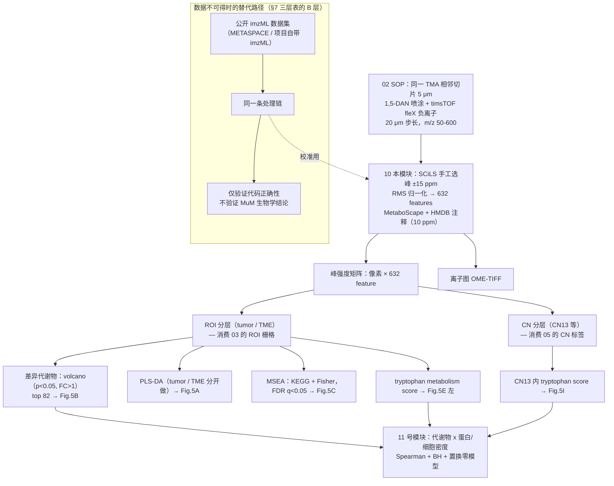
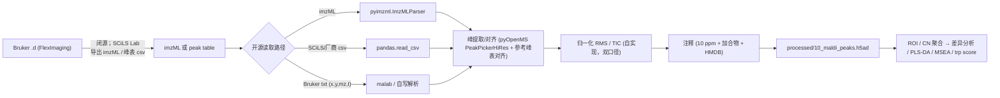

# 10 空间代谢组学分析（MALDI-IMS：脂肪酸重塑与色氨酸/吲哚代谢）

> **目标文献**：Wang J, Nagarajan P, et al. *Integration of spatial single-cell proteomics and spatial metabolomics
> reveals tumor microenvironment predictive of immunotherapy response in mucosal melanoma.* bioRxiv 2026.
> DOI: 10.64898/2026.04.23.720453（预印本，未经同行评审）
>
> **模块对应原文**：Fig. 5A–E、Fig. 5D（通路示意图）、Fig. 5I；Methods 中「Raw image acquisition, image processing of
> MALDI-IMS data」全段；Results 中「Spatial metabolomics reveals altered fatty acids metabolism in MuM」与
> 「Tryptophan metabolism associates with ICI response in MuM」两节的前半（到 tryptophan score 下降为止）；
> Discussion 中 UFA/SCD1 段（p.14–15）与 indole/AhR 段（p.15）第一段
>
> **前置依赖**：
> - `02_实验平台SOP_TMA-COMET-MALDI.md` —— TMA 设计（1.0 mm 芯 × 3）、切片厚度 5 μm、脱蜡/基质喷涂/仪器参数（本文件只引用，不重复）
> - `03_影像预处理配准与细胞分割.md` —— **必需产物**：`processed/03_registration_transforms.json`（MALDI↔COMET 仿射矩阵）、`processed/03_maldi_roi_mask.tif`（tumor/TME ROI 栅格，与 MALDI 像素网格同坐标系）、`processed/03_cells_roi.h5ad`（细胞表 + ROI 标签）
> - `05_细胞邻域CN分析与Kmeans.md` —— **必需产物**：`processed/05_cells_cn.h5ad`（每个细胞的 CN 标签，本文件用 CN13）
> - 临床分组（R/NR）来自项目唯一的临床标签表（列名见 `PROJECT_SPEC.md` 契约表）
>
> > ⚠️ **契约提醒**：以上产物名以 `PROJECT_SPEC.md` 契约表为唯一口径。本文件只**消费**上游产物、**不生产**它们。
> > 若上游改名或改列名，按 L0 §11.1 同步本文件与 `code/10_*.py`，并在 `logs/DECISIONS.md` 留痕。
>
> **复现难度**：★★★★☆（代码侧 ★★，数据侧 ★★★★★）　**预计工时**：4 人日（其中 2 人日用于替代数据获取与校准）
> **计算资源**：8 核 CPU / 32 GB 内存足够（632 特征 × ~10⁵ 像素的稠密矩阵 < 1 GB；PLS-DA 1000 次置换单核 10–30 min）。**不需要 GPU**
>
> **疏漏登记**：本文件所有 `⚠️ 导师批注` 均已登记到 `12_复现质控清单、排错与批判性评述.md`。

---

## ① 科学问题与逻辑位置

本模块把「蛋白定义的空间结构」（01–09）接到**小分子代谢层**，回答：**

> **落在同一 tumor ROI 内的像素，R 与 NR 患者的代谢物组成有什么系统性差别？这个差别在哪个空间尺度上与免疫细胞（CD11c⁺ DC / CD163⁺ TAM）共变？**

逻辑位置：



**上游输入**：MALDI 原始峰表（或 imzML）+ `03` 的 ROI 栅格/配准矩阵 + `05` 的 CN 标签 + 临床 R/NR 标签。

**下游输出**（本模块生产，见 §4 各代码块的 OUT 注释）：
1. `processed/10_maldi_peaks.h5ad` —— AnnData，`obs` = 像素（`x`,`y`,`core_id`,`roi`,`cn13`），`var` = 632 feature（`mz`,`annotation`,`adduct`,`msi_level`）；
2. `results/10_metabolite_annotation.csv`、`results/10_diff_metabolites_tumor.csv`、`results/10_diff_metabolites_tme.csv`；
3. `results/10_plsda_vip.csv`、`results/10_plsda_permutation.csv`、`results/10_msea_tme.csv`、`results/10_tryptophan_score.csv`；
4. `figures/Fig5A_plsda.pdf|png`、`Fig5B_volcano_{tumor,tme}.pdf|png`、`Fig5C_msea_tme.pdf|png`、`Fig5D_trp_pathway.pdf|png`、`Fig5E_trp_score.pdf|png`、`Fig5I_trp_score_cn13.pdf|png`。

**它解决什么问题**：空间蛋白组告诉你「谁在哪」；空间代谢组告诉你「那里的化学环境是什么」。原文的核心主张是——R 的 TME 里**不饱和脂肪酸相关代谢物更高**、**吲哚类色氨酸代谢物更低**，且后者与 CD11c⁺ DC / CD163⁺ TAM 的空间分布共变（相关性部分见 `11_蛋白-代谢物空间耦合与多组学整合.md`）。

**本模块的诚实边界（先写在最前面）**：
- 原文数据**不公开**（Data availability 只有 "available upon request"），**没有 MS/MS、没有标准品、没有 CCS 维度**，因此**所有代谢物身份都是 putative（MSI level 2–3）**，**m/z 水平结论可复现，分子身份结论不可复现**；
- 原文**未报告**：峰表的具体内容（632 个 m/z）、差异检验用的是什么统计量、fold change 是均值比还是 log 差、MSEA 的背景集定义、tryptophan score 的定义、R/NR 在代谢组分析中的 n、原发部位在各响应组中的构成。**这些都是本文件必须显式拍板的 A 类决策**。

---

## ② 背景知识与原理

### 2.1 MALDI-IMS 的物理链条：从激光到质谱

**MALDI = Matrix-Assisted Laser Desorption/Ionization**，四个串行事件：

1. **基质共结晶**：小分子（本文 1,5-DAN）与组织中的分析物共沉积，形成混合晶体。基质的作用有三个：① 在 337/355 nm 紫外下强吸收（"能量天线"）；② 稀释分析物、把分子彼此隔开，抑制分子间聚集成簇；③ 提供质子/电子转移的化学环境（决定正/负离子模式的选择性）。
2. **解吸**：脉冲激光打到晶体表面，基质瞬间吸收能量、发生相变爆炸式膨胀，把**未碎片化的完整分析物分子**带入气相。这是 MALDI 被称为"软电离"的原因——它不靠直接打断化学键（对比 ESI 的溶液电离、EI 的电子轰击），因此能保留完整分子，适合小分子与完整脂质。
3. **电离**：气相中发生质子转移（本文负离子模式下主要是**分析物去质子化** $\\mathrm{M} \\rightarrow [\\mathrm{M}-\\mathrm{H}]^- + \\mathrm{H}^+$，以及电子捕获/氯加合）。**这一步的效率高度依赖分析物的酸性与基质的性质**——这就是"负离子模式偏好脂肪酸/有机酸/吲哚类"的根源（见 §2.2）。
4. **飞行时间（TOF）质量分析**：同一动能下 $m/z$ 小的离子速度快，$t \\propto \\sqrt{m/z}$，因此**到达检测器的时间直接换算成 $m/z$**。timsTOF fleX 的 QTOF 部分在 m/z 50–600 范围典型质量准确度在低 ppm 量级（原文未报告实测质量误差分布，**必须自查**）。

**空间分辨率由什么决定**：不是由质谱仪决定，而是由**激光步长（stage step size）**决定——本文 **20 μm**。像素是**虚拟的**：仪器按 20 × 20 μm 的网格逐点采集一张全谱，每个格点得到一个完整的 m/z 谱，格子中心被当作该像素的坐标。

| 参数 | 本文取值 | 对结果的影响 |
|---|---|---|
| 激光步长（空间分辨率） | **20 μm** | 每个像素平均覆盖 ~1–4 个细胞（§2.5）；这是**不能用算法事后提升**的硬下限 |
| 每像素激光累积（shots summed） | **200** | 与灵敏度/动态范围成正比、与采集时间成正比；20 μm + 200 shots 是"分辨率 ↔ 时长"的折中 |
| 质量范围 | **m/z 50–600** | **上限 600 排除了大部分完整磷脂（m/z > 700），因此本文实际只能看到脂肪酸、小有机酸、吲哚类、部分极性脂质**——这解释了为什么"脂质"结论只涉及游离脂肪酸 |
| 离子模式 | **负离子** | 偏好去质子化容易的物种（§2.2） |
| TIMS | **OFF** | 无 CCS 维度；换来速度与灵敏度（§2.4） |

> ⚠️ **导师批注（分辨率≠步长）**：MALDI 的**有效空间分辨率**还受**基质晶体尺寸**限制。若基质喷涂后晶体直径大于激光步长（20 μm），激光会同时打到多个晶体、离子在离子源内横向扩散，实际分辨率会劣化到晶体尺度。**本文用 HTX M5 喷涂 10 mg/mL 1,5-DAN / 50% ACN、4 passes**，原文未报告喷涂后的晶体形貌 QC（显微镜图或晶体尺寸测量）。复现时必须补一步"喷涂后光镜观察 + 晶体尺寸统计"，否则"20 μm 分辨率"只是一个标称值。这一条登记到 `12_复现质控清单、排错与批判性评述.md`。

### 2.2 为什么负离子模式偏好脂肪酸、有机酸、酚类、吲哚类

负离子模式检测的核心是**去质子化难易**，即分析物酸性（$\\mathrm{p}K_a$）：

$$\\mathrm{M}-\\mathrm{H} \\;\\rightleftharpoons\\; [\\mathrm{M}-\\mathrm{H}]^- + \\mathrm{H}^+,\\qquad \\text{峰强度} \\propto \\frac{[\\mathrm{M}]}{1 + 10^{\\mathrm{p}K_a - \\mathrm{pH}_{\\text{plume}}}}$$

其中 $\\mathrm{pH}_{\\text{plume}}$ 是基质羽流/晶体表面的有效酸度环境。要点：

| 化合物类别 | 典型 $\\mathrm{p}K_a$ | 负离子模式表现 | 本文是否覆盖 |
|---|---|---|---|
| 游离脂肪酸（$-$COOH） | 4–5 | **极易去质子化，信号强** | ✅ 核心结论（18:2/18:1/16:0/18:0） |
| 有机酸（乳酸、柠檬酸、琥珀酸等） | 3–5 | 强 | ✅（在 m/z 50–600 内，但原文未报告是否检出/讨论） |
| 吲哚类（IAA、I3CA 等含 $-$COOH） | 4–5（羧基） | 中–强 | ✅ 核心结论 |
| 酚类 / 含 $-$OH 芳香物 | 9–10 | 弱–中 | ✅ 可能 |
| **Indole（无羧基）** | N–H $\\mathrm{p}K_a \\approx 17$ | **理论上很差** | ⚠️ 见下 |
| 中性糖、氨基酸（多数） | — | 弱（需加合/衍生化） | 部分 |
| 完整磷脂（PI/PS/PE 等） | 强 | **强，但 m/z 多 > 700** | ❌ 被 m/z 600 上限截断 |

> ⚠️ **导师批注（原文的一处技术疑点）**：**Indole（C₈H₇N，中性分子量 117.0578）在负离子模式下去质子化极难**（N–H 的 $\\mathrm{p}K_a$ 约 17），理论上 $[\\mathrm{M}-\\mathrm{H}]^-$（理论单同位素质量 **116.0506**，由 `pyOpenMS` 或本文件 §4.3 的质量计算函数复核）信号应当很弱。原文在 TME 中报告 **indole 在 pre-R 一致下调**（Fig. 5B 右），但**未报告该 feature 的注释等级、也未报告是否以 $[\\mathrm{M}+\\mathrm{Cl}]^-$（理论 152.0273）形式检出**。复现时必须：① 用标准品（若能获得）验证 indole 在 1,5-DAN 负离子模式下的可检测性；② 若不可获得，把 indole 的相关结论降级为"拟注释（putative）"并在图中标注。登记到 12 号文档。
>
> 补充：原文允许的加合物形式是 $[\\mathrm{M}-\\mathrm{H}]^-$、$[\\mathrm{M}]^-$、$[\\mathrm{M}+\\mathrm{Cl}]^-$（Methods 原句）。**$[\\mathrm{M}]^-$（自由基阴离子）对无酸性氢的分子（如 indole、部分醌类）是合理的替代路径**，但其形成依赖基质的电子转移能力——这正是 1,5-DAN 这类含氨基芳香基质被推荐用于负离子小分子的理由之一（**原文未给出选择 1,5-DAN 的文献依据，这是复现时需要用文献补齐的"决策依据链"**）。

### 2.3 基质选择：1,5-DAN vs DHB vs CHCA vs 9-AA

原文用 **10 mg/mL 1,5-diaminonaphthalene（1,5-DAN）in 50% 乙腈**，**未报告选择依据**。下表是补充的决策依据（性质为分子本身的物理化学事实；"文献常报告"处未给出具体引文，复现时须自行补文献，不得凭空引用）：

| 基质 | 分子式 / MW | 适用极性 | 低质量区背景 | 对本文任务的适配性 |
|---|---|---|---|---|
| **1,5-DAN** | C₁₀H₁₀N₂ / 158.0844 | **负离子优，正离子亦可用** | **低**（本文关键需求：m/z 50–600 全覆盖，低质量端不能被基质峰淹没） | ✅ 两个氨基提供碱性与电子转移能力，利于负离子；低 MW 使其自身离子集中在 m/z < 200 的少数通道，可被显式排除（§5 给排除表） |
| DHB（2,5-二羟基苯甲酸） | C₇H₆O₄ / 154.0266 | 双极性，正离子更常用 | **负离子模式下高**（DHB 自身在负离子模式产生密集的簇离子系列） | ⚠️ 会把 m/z 150–500 的低丰度代谢物淹没 |
| CHCA（α-氰基-4-羟基肉桂酸） | C₁₀H₇NO₃ / 189.0426 | **正离子为主** | 负离子模式下效率差 | ❌ 不适合本文的负离子小分子通量 |
| 9-AA（9-氨基吖啶） | C₁₃H₁₀N₂ / 194.0844 | **负离子专用** | 低 | ✅ 负离子小分子的经典选择，是 1,5-DAN 之外最值得做对照的基质 |

**本文的喷涂参数**（HTX M5，全部来自原文）：flow rate **100 µL/min**、track speed **1200 mm/min**、track spacing **3 mm**、**CC track pattern**、nozzle temperature **60 °C**、nozzle height **40 mm**、N₂ **10 psi**、**4 passes**。

**一个可自查的基质用量估算**（原文未报告沉积密度）：
- 假定一片载玻片可喷涂长度 75 mm、宽度 25 mm（标准 25 × 75 mm 载玻片，扣除边缘），轨道间距 3 mm → 约 **9 条轨道**；
- 单轨耗时 $75\\,\\mathrm{mm} / 1200\\,\\mathrm{mm\\,min^{-1}} = 3.75\\,\\mathrm{s}$，9 轨 ≈ **33.75 s/pass**；
- 4 passes ≈ 135 s，按 100 µL/min 计 ≈ **225 µL** 基质溶液（10 mg/mL → 约 **2.25 mg** 固体）；
- 面积 ≈ 75 × 25 = 18.75 cm² → **约 0.12 mg/cm²**。
- **判据**：0.1–0.2 mg/cm² 量级是 MALDI-MSI 常用区间；远低于此 → 信号弱；远高于此 → 晶体粗大、20 μm 分辨率失效。此估算的假设必须写进 `logs/`，不可当作原文参数。

### 2.4 timsTOF fleX 与「TIMS OFF」：被放弃的 CCS 维度

timsTOF fleX 的卖点是 **TIMS（Trapped Ion Mobility Spectrometry）**：离子在梯度电场中被按**碰撞截面（CCS, Ų）**分离，因此同一 $m/z$ 的**异构体可以分开**。

**关闭 TIMS 的代价与收益**：

| 维度 | TIMS OFF（本文） | TIMS ON |
|---|---|---|
| 每像素信息 | $m/z$ 强度谱 | $m/z \\times$ CCS 强度谱 |
| 扫描速度 / 通量 | **高**（20 μm × 20 μm 网格、200 shots/pixel 可行） | 每像素需一次淌度分离循环，采集时间显著增加（倍数取决于 ramp time 与累积方式，**须按仪器方法核对**，不在本文件编造数值） |
| 灵敏度 | 高（无淌度通道的离子损失） | 较低（离子利用率下降） |
| 异构体分辨 | ❌ 无法区分 | ✅ 可区分（如 Δ9-油酸 vs Δ11-异油酸） |
| 注释置信度 | 只能靠 $m/z$ + 数据库 | $m/z$ + CCS 双约束，**可升到 MSI level 2 的强形式** |

> ⚠️ **导师批注（本文最大的"可改进点"之一）**：Fu**本文关于 UFA 的核心结论依赖油酸（oleic acid, 18:1）的身份**，而 18:1 的**双键位置异构体（Δ9-油酸 vs Δ11-异油酸 cis-vaccenic acid）与几何异构体（cis/trans）具有完全相同的分子式与 $m/z$**（$[\\mathrm{M}-\\mathrm{H}]^-$ 均为 **281.2486**，由本文件 §4.3 的质量计算函数复核）。SCD1 的产物是 **Δ9**（油酸/棕榈油酸），而细菌与部分宿主酶可产生 **Δ11**。**在 TIMS OFF 且无 MS/MS 的情况下，"油酸升高"实际上只能写成"碳数:不饱和度 = 18:1 的脂肪酸总量升高"**。这是本模块在复现时应当给出的**降级表述**；若要在本项目中提升证据等级，必须在替代实验里做 **MS/MS（或开启 TIMS 采集 CCS）** 或用标准品做保留时间/淌度共定位。登记到 12 号文档。
>
> 反过来说，**本项目的建议改进路径是：对少量代表性样本做 TIMS ON 的靶向复采**，只对 5–10 个关键 feature（18:1、18:2、IAA、I3CA、indole）做 CCS 确证，而不是全片开 TIMS——这是分辨率、采集时长、注释置信度三者之间的最优折中。

### 2.5 空间分辨率与细胞尺度：20 μm 像素 ≈ 1–4 个细胞

这是本模块与 `11_蛋白-代谢物空间耦合与多组学整合.md` **所有结论粒度**的物理上限，必须先算清楚。

**估算（假设与算法全部显式）**：
- TMA 芯标称直径 **1.0 mm** → 面积 $\pi (0.5)^2 = 0.785\,\mathrm{mm^2}$；
- 97 个 cores（原文数值）总标称面积 ≈ **76.2 mm²**；
- QC 后 **695,444** 个分割细胞（原文数值）→ 平均密度 $695444 / 76.2 \approx \mathbf{9{,}127\ cells/mm^2}$；
- 一个 20 × 20 μm 像素 = $4\times10^{-4}\,\mathrm{mm^2}$ → **平均 3.65 个细胞/像素**；
- 一个直径 20 μm 的激光斑（圆面积 $3.14\times10^{-4}$ mm²）→ **平均 2.87 个细胞**。

**结论（写进全文口径）**：
1. **一个 MALDI 像素的强度是 1–4 个细胞（局部组织）的平均值，不能归因到任何单细胞。**
2. 实测组织通常不满铺、肿瘤区细胞密度高于整体平均 → 高密度区单像素可覆盖 **4–8 个细胞**。因此把 20 μm 像素当"单细胞"会把细胞间异质性系统性抹平。
3. 因此「代谢物 × 细胞类型」的关联**只能是区域级 / 邻域级**（ROI、CN、或多像素聚合窗口），不能是细胞级——这正是 `11` 号文档必须做"区域级关联 + 聚合"的根本原因。
4. 反过来，**20 μm 分辨率对"区域"（ROI 尺度 0.1–1 mm）完全够用**：一个 70 μm 半径的 CN 窗口 ≈ 覆盖 38 个 MALDI 像素。**代谢组不是粒度瓶颈，蛋白组的单细胞粒度才是瓶颈**——这个不对称是整合设计的出发点。

> ⚠️ **导师批注**：原文从未给出「多少个 MALDI 像素被纳入分析」「每个 core 有多少像素落在 tumor ROI / TME ROI」这类数字。**这直接决定 `11` 号文档的 n**（若每 core 只剩几十个像素，ROI 级相关的稳定性会很差）。复现时必须先产出这个计数表并登记为 QC 检查点（见 §⑥）。

### 2.6 归一化：本文用 RMS，为什么

MALDI-MSI 的原始强度同时混合了「分析物浓度」与「技术性总离子产额波动」（基质厚度不均、晶体尺寸分布、组织密度差异、脱蜡残留）。**归一化的唯一目的是压制后者。**

设像素 $i$ 在特征 $j$ 上的原始强度为 $I_{ij}$（$j = 1 \ldots M$）。

| 方法 | 公式 | 直觉与代价 | 本文是否使用 |
|---|---|---|---|
| **TIC**（总离子流） | $\tilde I_{ij} = I_{ij} \big/ \sum_{j=1}^{M} I_{ij}$ | 用总产额做分母。**对"峰个数"高度敏感**：降低峰提取阈值会凭空抬高 $\sum_j I_{ij}$，把真实信号压下去 | 否 |
| **RMS**（均方根，**本文**） | $\tilde I_{ij} = I_{ij} \Big/ \sqrt{\frac{1}{M}\sum_{j=1}^{M} I_{ij}^{2}}$ | 用 L2 范数做分母。**对低强度峰的数量不敏感**（$I^2$ 权重让小峰贡献趋近于零），因此对峰提取阈值的变化更稳健 | ✅ SCiLS Lab 2025b |
| 中位数归一化 | $\tilde I_{ij} = I_{ij} \big/ \mathrm{median}_j(I_{ij})$ | 抗离群，但对"中位数落在噪声区"的稀疏谱不稳定 | 否 |
| 内标 / 参考峰 | $\tilde I_{ij} = I_{ij} \big/ I_{i,\text{ref}}$ | 需要**已知均匀分布**的内标（MALDI-MSI 很难做到组织内均匀） | 否 |
| 向量范数（L2, 未除 $\sqrt M$） | $\tilde I_{ij} = I_{ij} \big/ \sqrt{\sum_j I_{ij}^2}$ | 与 RMS 只差一个与像素无关的常数 $1/\sqrt M$（$M$ 固定时为同一个变换） | 等价 |

**为什么空间代谢组首选 RMS 而不是 TIC**（三条，逐条可验证）：
1. **峰个数不变性**：RMS 的分母主要由少数高强度峰决定，与低丰度峰的条数几乎无关；TIC 的分母是所有峰的线性叠加，峰表一变（例如把 632 个峰换成 800 个峰），所有像素的归一化因子都变，**跨版本的强度不可比**。
2. **对单峰支配的鲁棒性**：当某个像素被一个极强峰（如基质残留或某个高丰度脂肪酸）支配时，RMS 与 TIC 都会把该峰"归一化掉"，但 RMS 对"剩余中等强度峰的相对结构"保留得更好。
3. **综述与软件默认**：SCiLS 同时提供 TIC 与 RMS，RMS 在空间脂质/代谢物研究中的使用更常见（**注意：本文未给出选择 RMS 的文献依据或对比**，这是 `D` 表需要记录的决策项）。

> ⚠️ **导师批注（本模块最隐蔽、也最可能颠覆结论的一点）**：**RMS（与 TIC 一样）是逐像素（per-spectrum）的标量归一化**。这意味着归一化之后，每个像素的"总强度"被人为拉平了——**"某代谢物在 R 中上调"只能读作"该代谢物在 R 的谱内相对占比更高"，不等于"该代谢物在组织中的绝对量更高"。**
>
> 这对本文的 UFA 结论有直接影响：如果 R 的 TME 里**总量**更低的脂质背景（例如坏死/脂肪细胞更少）使整谱强度下降，而 UFA 的真实绝对量没变，那么经 RMS 归一化后 UFA 的相对占比就会**上升**——纯技术性地上调。
>
> **必须做的对照（本项目补齐点，原文未做）**：
> - (a) **保留原始总强度**（归一化前的 $\sum_j I_{ij}$ 或 RMS 分母）作为一个独立协变量，检验它在 R/NR 之间是否不同；若不同，说明"相对上调"里混入了总量效应；
> - (b) **双口径复现**：RMS 与 TIC（或中位数）两套归一化各跑一遍差异分析，报告结果一致性（L0 §7「双口径复现」）；
> - (c) 对关键脂肪酸报告**绝对强度**（未归一化）的组间比较作为敏感性分析。
>
> 登记到 12 号文档，并作为 `D` 表条目。

### 2.7 峰识别与注释：MSI 置信度分级（MSI level 1–4）

Metabolomics Standards Initiative（MSI）对代谢物鉴定的置信度分级（本项目统一口径）：

| 等级 | 判定标准 | 本文证据 | 本文对应等级 |
|---|---|---|---|
| **Level 1**（identified） | 与**标准品**在**同一分析平台**上的保留时间/淌度/碎片谱**共定位**一致 | ❌ 无标准品 | — |
| **Level 2**（putatively annotated） | 有**MS/MS 或 CCS 等正交数据**支持，对照公共库谱图匹配 | ❌ **TIMS OFF，无 MS/MS** | — |
| **Level 3**（putatively characterized class） | **仅凭精确质量** + 数据库匹配（同分异构体无法排除） | ✅ 本文：10 ppm 内匹配 HMDB/厂商库 | **本文全部注释位于 Level 3**（若按"有正交数据即 level 2"的宽松读法，本文处于 **level 2–3 之间**；本项目取更严格的 level 3 口径） |
| **Level 4**（unknown） | 只有 $m/z$ 与强度，无任何身份线索 | 632 features 中未成功注释的部分 | 部分 |

> ⚠️ **导师批注（必须写进任何引用本文代谢物结论的地方）**：原文 Methods 自述「Putative metabolite IDs were assigned using the MetaboScape plugin … allowing an m/z tolerance of 10 ppm」，**没有 MS/MS、没有标准品、TIMS 关闭**。因此：
> - 严格按 MSI 分级，本文**所有代谢物身份都是 Level 3（putative）**，原文自己用了 "putative" 一词，但 Results 与 Discussion 的表述（"indole-3-carbinol was reduced"、"oleic acid upregulated"）**读起来像已确证**。
> - **受此限制的结论**：所有需要区分同分异构体的论断都不可靠——(i) 18:1 的双键位置（油酸 vs 异油酸，SCD1 归因的核心）；(ii) 18:2 的位置异构体；(iii) 分子式相同的吲哚类衍生物之间的区分；(iv) indole 本身的可检测性（§2.2）。
> - **不受此限制的结论**（可放心引用）：`m/z` 水平的存在/缺失与相对丰度（例如"$m/z$ 279.2330 的离子在 pre-R 的 TME 中相对丰度更高"）。**请在所有下游文档中把这类结论写成 $m/z$ 形式，把分子名放进括号并标注 "(putative)"。**
> 登记到 12 号文档。

### 2.8 差异分析与 PLS-DA 的原理、以及原文缺失的验证环节

**火山图（volcano）** 的两个轴：横轴为效应量（fold change 的对数），纵轴为显著性（$-\log_{10} p$）。原文阈值：**"a cutoff p-value of < 0.05 and a fold change of > 1"**。这里存在**三处必须显式处理的歧义**（后文 §⑤ 给决策）：

| 歧义 | 两种读法 | 后果 |
|---|---|---|
| `p < 0.05` 是原始 p 还是校正后 q？ | 原文只在 MSEA 处写了 `q < 0.05 for FDR correction`，volcano 处没写 | 若按原始 p 筛选 632 个特征，预期假阳性 ≈ 32 个，而原文入选 82 个 → **假阳性可能占近 40%**。**必须双口径复现** |
| `fold change > 1` 是 FC 还是 $|\log_2 FC|$？ | FC > 1 意味着"任何上调"（包括 1.01 倍）；若本意是 $|\log_2 FC| > 1$ 则要求至少 2 倍 | 两者筛选出的特征集完全不同，**必须报告两种** |
| FC 用什么算？ | 均值的比 $\bar I_R / \bar I_{NR}$、还是中位数的比、还是对 log 后的差取指数 | 强度分布重尾时三者差别巨大；原文**未报告** | 主口径用**中位数比**（抗离群），备选均值比 |
| 检验统计量是什么？ | 原文**完全未报告**（Methods 只提到 Mann–Whitney U 用于"cell type proportion differences"） | 复现时主口径用 **Mann–Whitney U**（与项目统计约定一致），备选用 Welch t（对 log 强度） | 
| 分析单位是像素还是 core？ | 像素级检验会把 n 从 ~97 抬到 ~10⁵ → p 值虚低（伪重复） | **主口径以 core 为分析单位**（每个 core 的 ROI 内像素强度中位数），像素级仅作可视化 |

**PLS-DA（Partial Least Squares Discriminant Analysis）** 的原理：

PLS 把自变量 $X \in \mathbb{R}^{n\times p}$（此处：$n$ 个样本 × $p$ 个代谢物）与响应 $Y$（R/NR 的 one-hot 编码，$n \times q$）同时分解为得分与载荷：

$$X = T P^{\mathsf T} + E, \qquad Y = U Q^{\mathsf T} + F$$

并最大化 $T$ 与 $U$ 之间的协方差（区别于 PCA 只最大化 $T$ 的方差）。用 **NIPALS** 算法迭代求得分向量 $t_a, u_a$，再对 $X$ 做 deflation 提取下一个成分。

**成分数怎么定**：由 **交叉验证 $Q^2$** 决定：

$$Q^2 = 1 - \frac{\sum_a \sum_i \big(y_{ia} - \hat y_{(-i),ia}\big)^2}{\sum_a \sum_i \big(y_{ia} - \bar y_a\big)^2}$$

其中 $\hat y_{(-i)}$ 是**留一（或留折）**预测。$Q^2 > 0.097$ 是"优于随机猜测"的经验门槛；$Q^2 \le 0$ 说明模型没有预测能力。**原文未报告 $Q^2$、未报告成分数、未报告 $R^2X/R^2Y$。**

**VIP（Variable Importance in Projection）** 分数——用来回答"哪些代谢物在驱动分离"：

$$\mathrm{VIP}_j = \sqrt{\; \frac{p \sum_{a=1}^{A} SS_a \, w_{aj}^2}{\sum_{a=1}^{A} SS_a} \;},\qquad SS_a = \big(q_a^{\mathsf T} t_a\big)^2 \big\|t_a\big\|^2$$

（$w_{aj}$ 是第 $a$ 个成分中变量 $j$ 的权重，$SS_a$ 是该成分解释的平方和；$p$ 为变量总数。）经验阈值 **VIP > 1**。

**为什么必须做置换检验**：PLS-DA 在 $n \ll p$、且 $p$ 由"先看差异再选特征"选出的情况下，**即使标签完全随机也能给出漂亮的分离**（过拟合 + 选择偏倚）。标准做法：
1. **置换标签**（$Y$ 随机打乱）$P = 1000$ 次，每次重算 $Q^2$（以及用于判读的 $R^2Y$ 与分类准确率）；
2. 观测 $Q^2$ 与置换分布比较，计算 $p = (1 + \#\{Q^2_{\text{perm}} \ge Q^2_{\text{obs}}\}) / (P+1)$；
3. **判据**：观测 $Q^2$ 应超过置换分布的 95 分位，且 $Q^2$ 回归截距为负（"$R^2$ intercept < 0.3 / $Q^2$ intercept < 0.05"是代谢组学领域的经验判据）；
4. **特征选择必须放进交叉验证折内**（否则 82 个特征的筛选本身就用了全部数据 → 信息泄漏）。

> ⚠️ **导师批注**：原文 Fig. 5A 的 PLS-DA 是**在预先筛出的"top 82 差异代谢物"上做的**（"We then selected the top 82 differentially abundant metabolites between R and NR for downstream analysis. PLS-DA … showed separation of R and NR based on these 82 metabolites"）。这构成**双重浸入（double dipping）**：用全部样本挑出区分性最强的 82 个特征，再在同样的样本上展示分离——**分离是必然的，不构成任何证据**。原文未报告 $Q^2$、未做置换检验、未报告样本量 n。
>
> **本项目必须补齐**：嵌套交叉验证（外层评估、内层选特征）+ 1000 次置换检验 + 报告 $Q^2$/VIP 及其零分布。**这是 `11` 号模块之外、本模块最重要的增值点。** 登记到 12 号文档。

### 2.9 MSEA（代谢物集富集分析）：原文做法与现代替代

原文：「Metabolite enriched pathway analysis was performed via the KEGG database (**Fisher's exact test, q < 0.05** for FDR correction)」——即**过表征分析（ORA）**：把"显著差异代谢物"当作命中集，检验其是否在某条 KEGG 通路中过度出现。

Fisher 精确检验的 2×2 表（以通路 $P$ 为例）：

|  | 属于通路 $P$ | 不属于通路 $P$ | 合计 |
|---|---|---|---|
| **差异代谢物** | $a$ | $b$ | $a+b$ |
| **非差异代谢物** | $c$ | $d$ | $c+d$ |
| 合计 | $a+c$ | $b+d$ | $N$ |

$$p = \sum_{k \ge a} \frac{\binom{a+c}{k}\binom{b+d}{a+b-k}}{\binom{N}{a+b}}$$

（`scipy.stats.fisher_exact` 用超几何分布计算，`alternative='greater'` 做单侧富集检验。）

**背景集 $N$ 的定义是 ORA 的命门**：
- 若 $N$ = **632 个检出特征** → 问的是"在已检出的代谢物中，该通路是否过度代表"（**正确**，也是本项目的主口径）；
- 若 $N$ = **全 KEGG 化合物** → 会把大量"本方法根本检不到"的化合物算进背景，**p 值被系统性放大显著性**（假阳性）。
- 原文**未报告背景集定义** → `D` 表 A 类决策。

**多重校正**：BH（Benjamini–Hochberg）—— 将 $m$ 个 p 值升序排列 $p_{(1)} \le \ldots \le p_{(m)}$，取 $\tilde p_{(k)} = \min_{j \ge k} \big( \frac{m}{j} p_{(j)} \big)$，阈值 $q < 0.05$。

**现代替代方法（都不依赖"先注释再 ORA"这一步，因此能覆盖未注释的峰）**：

| 方法 | 原理 | 相对 ORA 的优势 | 本文使用 |
|---|---|---|---|
| **mummichog** | 直接在**未注释的 m/z 峰列表**上做通路水平的富集（用"质量匹配 + 代谢网络传播"把峰映射到通路，再做 Fisher/超几何检验）；因此不需要先做注释 | 绕开"只有注释到的峰才能进检验"的选择偏倚；报告的是**通路水平**的显著性 | 否 |
| **FELLA** | 基于 KEGG 图（compound–enzyme–reaction–pathway）的**扩散传播**打分 | 能捕捉通路间共享代谢物带来的间接关联 | 否 |
| **MetaboAnalystR** | ORA / MSEA（定量富集）/ 代谢通路影响（拓扑分析） | 提供拓扑权重（degree centrality），比纯计数更接近生物学 | 否 |

> ⚠️ **导师批注**：**必须注意"tryptophan metabolism"在 KEGG 里的实际归属**。以 KEGG 的通路划分为准（通路 ID 与成员会随 release 变动，**必须记录 KEGG release 版本与日期**）：
> - `map00380`（Tryptophan metabolism）以**宿主 IDO1/TDO2 的 kynurenine 分支**为主，另含部分植物/微生物的 indole-3-acetate 分支；
> - 本文检测到并在 Fig. 5D 中绘制的是 **TNA（tryptophanase）、TMO（tryptophan monooxygenase）、TrD（tryptophan decarboxylase）**——**这三个都是微生物/植物的酶，不是哺乳动物的 IDO1/TDO2**。也就是说，Fig. 5D 画的实际上是一条**微生物吲哚代谢路线（indole branch）**，而正文把它统称为 "tryptophan metabolism"。
> - 生物学后果：**R 中吲哚类降低，既可以是宿主色氨酸代谢改变，也可以是黏膜微生物群落（产色氨酸酶菌）差异的结果**。而 MuM 的原发部位（9 sinonasal / 11 anorectal / 2 conjunctival / 4 female urethral）**与局部微生物组高度相关**。
> - **原文未报告各响应组内的原发部位构成**。若 R/NR 在鼻腔 vs 肛门直肠的分布不均衡，**"R 中吲哚类下调"可能完全由解剖部位（=微生物组）驱动**，而非免疫应答。
> - **本项目必须做的敏感性分析**：(i) 报告 R/NR × 原发部位的列联表；(ii) 以原发部位分层重复差异分析；(iii) 在混合效应模型里把 site 作为固定效应、patient 作为随机效应。**这是本模块与 `11` 号文档共同的头号混杂因素。**
> 登记到 12 号文档。

### 2.10 tryptophan metabolism score：原文未给定义，三种实现

原文只有一句「a tryptophan metabolism score was reduced in R relative to NR in both tumor and TME compartments（Fig. 5E, left）」，**未给出 score 的构造方式**。文献中最常见的三种路线，本项目全部实现并做一致性检验：

| 实现 | 公式 | 优点 | 缺点 |
|---|---|---|---|
| **① 平均 z-score** | $S^{z}_{i} = \frac{1}{\lvert G \rvert}\sum_{g \in G} \frac{\tilde I_{ig} - \mu_g}{\sigma_g}$ | 简单、可解释、对集合大小不敏感 | 假设集合内成员等权、且各成员噪声水平相同 |
| **② 加权和** | $S^{w}_{i} = \frac{1}{\lvert G \rvert}\sum_{g \in G} w_g \frac{\tilde I_{ig} - \mu_g}{\sigma_g}$，$w_g = $ VIP 或 $-\\log_{10} q_g$ | 让统计上更强的成员贡献更大 | 权重来自同一数据 → 需要在交叉验证内重算，否则偏乐观 |
| **③ ssGSEA（秩型）** | 在像素 $i$ 的**特征排序**上，计算集合 $G$ 的成员与非成员的加权经验累积分布差（Kolmogorov–Smirnov 型统计量） | **对归一化尺度不敏感**（只用秩），是 bulk 转录组打分的事实标准 | 与 z-score 型尺度不同、不可直接比较数值 |

**一致性检验（必做）**：三者两两之间的 Spearman $\rho$（像素级与 core 级各算一次）、以及三者在 R vs NR 上的效应方向是否一致（Mann–Whitney U 的 $p$ 与 AUC）。**只有三种实现方向一致时，才能把"tryptophan score 降低"写成稳健结论。**

**集合 $G$ 的成员定义（本项目主口径，须登记）**：$G = \{$ tryptophan（203.0826）、indole（116.0506）、indole-3-acetic acid（174.0561）、indole-3-carbinol（146.0611）、indole-3-acetaldehyde（158.0611）、indole-3-carboxylic acid（160.0404）、kynurenine（207.0775）$\}$ 的 $[\mathrm{M}-\mathrm{H}]^-$ 峰。**备选口径**：只含原文明确在 TME 中报告下调的 5 个（indole、IAA、I3C、I3Ald、I3CA）；两种口径的 score 分别报告。（上列质量均为**理论单同位素质量的计算值**，须用 §4.3 的质量计算函数或 `pyOpenMS` 复核后再落表。）

---

## ③ 原文逐句拆解

**A. Methods：「Raw image acquisition, image processing of MALDI-IMS data」全段逐句**

| # | 原文句（节选） | 中文转述 | 对应操作与参数 | 原文是否给参数 | 缺失项的复现决策（D 表） |
|---|---|---|---|---|---|
| 1 | "TMA sections were dewaxed by submerging in fresh xylene for 2 x 3 minutes each." | 二甲苯 2 × 3 min 脱蜡 | 手工脱蜡；**新鲜**二甲苯（避免蜡污染） | ✅ 给全 | 直接照做；记录二甲苯批号与室温 |
| 2 | "After allowing to dry, fiducial markers were placed on the slides using a diamond scribe" | 干燥后用钻石刻笔打基准点 | 打点在**空白载玻片区域**（不在组织上），用于后续配准 | ✅ | 打点数量与位置原文未写 → 主口径 **每片 ≥ 3 个点、非共线**（配准至少需要 3 点解仿射） |
| 3 | "digital images were acquired using an Epson Perfection V600 flatbed document scanner at 4800 dpi" | 平板扫描仪 4800 dpi 拍全片 | **4800 dpi = 5.292 μm/pixel**（$25.4\,\mathrm{mm}/4800$） | ✅ | 光学图用于配准的粗对齐；**须关闭扫描仪的自动锐化/色彩增强**（否则 landmark 定位有系统偏差） |
| 4 | "coated with 10 mg/mL 1,5-diaminonaphthalene matrix in 50% acetonitrile using an HTX M5 Robotic Reagent Sprayer over 4 passes" | 1,5-DAN 10 mg/mL in 50% ACN，4 passes | 基质浓度/溶剂/喷涂轮数 | ✅ | 见 §2.3 的沉积密度估算（~0.12 mg/cm²）；**必须补晶体形貌 QC** |
| 5 | "flow rate of 100 µL/min, a track speed of 1200 mm/min, a track spacing of 3 mm, a CC track pattern, a nozzle temperature of 60°C, a nozzle height of 40 mm, and an N2 pressure of 10 psi" | 六项喷涂参数 | 全部直接可设 | ✅ | 直接照做。**注意：这些参数与 M5 的喷头型号绑定**，换设备必须重新优化 |
| 6 | "acquired using FlexImaging 7.0 on Bruker timsTOF fleX QTOF mass spectrometer in negative ion mode with TIMS OFF at 20 µm resolution" | 负离子、TIMS OFF、20 μm | 软件/仪器/极性/步长 | ✅ | 步长 20 μm = 空间分辨率；见 §2.5 |
| 7 | "A total of 200 laser shots were summed per pixel." | 每像素累加 200 shots | 灵敏度 ↔ 时长折中 | ✅ | 照做。**注意：shots 数会影响强峰的检测器饱和**，原文未报告饱和检查 |
| 8 | "an m/z range of 50–600" | 质量范围 | **直接决定能看到的分子种类**（见 §2.1 表） | ✅ | 照做。**关键推论：m/z > 600 的完整磷脂被排除**，因此"脂质"结论只涉及游离脂肪酸 |
| 9 | "Funnel 1 RF 150.0 Vpp, Funnel 2 RF 200.0 Vpp, Multipole RF 200.0 Vpp, Collision Energy 10.0 eV, Collision RF 500.0 Vpp, Transfer Time 55.0 µs, PrePulse Storage 5.0 µs" | 七项离子光学参数 | 直接可设 | ✅ | 照做。**Collision Energy 10 eV 是 MS1 的低能量设置**（不做碎裂），与"无 MS/MS"一致 |
| 10 | "Data were imported into SCiLS Lab 2025b (Bruker) and root mean square normalized." | SCiLS 中做 RMS 归一化 | 归一化方法 | ✅（方法）/❌（范围） | **原文未报告 RMS 是在全部 m/z 通道上算还是在选中峰上算** → 主口径：**在 632 个选中峰上算 RMS**（可复现、与峰表绑定）；备选：全部 m/z bin |
| 11 | "Metabolite peaks were manually chosen with an integration window of ±15 ppm." | 手工选峰，积分窗 ±15 ppm | 峰表构建 | ✅ | **注意 ±15 ppm 宽于注释容差 10 ppm**（内部不一致，见 §⑦陷阱表）；主口径改为 **±10 ppm** 与注释一致，并报告 ±15 ppm 的敏感性 |
| 12 | "Peaks corresponding to MALDI matrix and non-monoisotopic peaks were avoided." | 避开基质峰与非单同位素峰 | 人工排除 | ❌ 未给排除清单 | **主口径：用"基质-only 空白片"自建排除清单**（§2.3 已给 1,5-DAN 相关离子的计算质量），并落盘 `results/10_matrix_peak_exclusion.csv` |
| 13 | "Putative metabolite IDs were assigned using the MetaboScape (Bruker) plugin for SCiLS lab, searching against the HMDB and other vendor provided databases, allowing an m/z tolerance of 10 ppm." | MetaboScape → HMDB/厂商库，10 ppm | 注释 | ✅（容差）/❌（库版本） | **必须记录 HMDB 版本与下载日期**（L0 §5.5）；主口径：只保留 $[\mathrm{M}-\mathrm{H}]^-$、$[\mathrm{M}]^-$、$[\mathrm{M}+\mathrm{Cl}]^-$ 三种加合物 |
| 14 | "Negative mode ions of [M-H]-, [M]-, and [M+Cl]- were considered." | 三种负离子加合物 | 加合物搜索空间 | ✅ | 照做；对每个 feature **保留全部候选注释**（不取唯一），并给出候选数——候选数 > 1 的 feature 在图中标注 |
| 15 | "Images of selected identified metabolites were exported to OME.tiff files for further analysis." | 导出 OME-TIFF | 交换格式 | ✅ | 照做；**必须记录 OME-TIFF 的像素网格是否与 SCiLS 的 $x/y$ 索引一致**（坐标错配是本类项目的头号事故） |

**B. Results 逐句拆解（第一段）**

| # | 原文句（节选） | 中文转述 | 复现操作 | 原文是否给参数 | 复现决策 |
|---|---|---|---|---|---|
| 16 | "using MALDI-IMS and identified 632 metabolite features across tissue sections (Fig. 1)" | 共 632 个代谢物特征 | 632 是**特征数**，不是化合物数（同一化合物的不同加合物/同位素各算一个） | ✅ 数值 | 报告"632 feature ↔ N 个唯一分子式"的对照表；原文未给 N |
| 17 | "We then selected the top 82 differentially abundant metabolites between R and NR for downstream analysis." | 取 top 82 差异代谢物 | **"top"的排序依据原文未报告**（p 值？FC？VIP？） | ❌ | 主口径：按 `q` 值升序 + $|\log_2 FC|$ 双重排序取前 82；备选按 p 值。敏感性分析必做 |
| 18 | "PLS-DA performed separately in tumor and TME compartments showed separation of R and NR based on these 82 metabolites (Fig. 5A)" | tumor / TME 各做一次 PLS-DA | 见 §2.8；**原文未报告 Q²、成分数、n** | ❌ | 本项目补：嵌套 CV + 1000 次置换 + Q²/VIP 报告 |
| 19 | "multiple unsaturated fatty acids (UFAs)-related metabolites—including linoleic acid, oleic acid, palmitate, and stearic acid—were specifically upregulated in pre-treatment samples of R compared with NR (Fig. 5B, right)" | TME 中 UFA 相关代谢物在 pre-R 上调 | 4 个脂肪酸的强度比较 | ❌（检验、单位、n 全未报告） | 主口径：以 **core 为单位**、Mann–Whitney U、BH；报告绝对强度与归一化强度两套 |
| 20 | "metabolite set enrichment analysis highlighted biosynthesis of UFAs remodeling as among the most significantly altered pathways within the TME compartment (Fig. 5C)" | MSEA：UFA 生物合成重塑 | KEGG ORA + Fisher + FDR q<0.05 | ✅（方法）/❌（背景集） | 主口径背景集 = 632 个检出特征 |

**C. Results 逐句拆解（第二段）**

| # | 原文句（节选） | 中文转述 | 复现操作 | 原文是否给参数 | 复现决策 |
|---|---|---|---|---|---|
| 21 | "In pretreatment R cores, the tumor compartment exhibited reduced abundance of indole-3-carbinol and indole-3-acetaldehyde relative to NR cores (Fig. 5B, left)" | tumor 中 I3C、I3Ald 在 pre-R 降低 | 2 个吲哚类在 tumor ROI 的比较 | ❌ | 同 #19；**并标注 indole 的可检测性存疑（§2.2）** |
| 22 | "In the TME compartment, multiple indole-derived metabolites—including indole, indole-3-acetic acid, indole-3-carbinol, indole-3-acetaldehyde, and indole-3-carboxylic acid—were consistently downregulated in pre-treatment R cores compared with NR (Fig. 5B, right)" | TME 中 5 个吲哚类一致下调 | 5 个 feature 的同向变化 | ❌ | 报告 5 个 feature 各自的效应量与 q 值；**"一致"不等于"联合显著"**，须给出集合水平的检验（Fisher 合并或 Stouffer） |
| 23 | "Pathway enrichment analysis ranked tryptophan metabolism among the second most significantly altered pathways within the TME compartment (Fig. 5C)" | 色氨酸代谢为 TME 第二显著通路 | 记录通路排名 | ✅（排名） | **排名依赖背景集/通路库版本/特征集** → 必须报告 KEGG release、背景集、排序统计量（q 或 p） |
| 24 | "a tryptophan metabolism score was reduced in R relative to NR in both tumor and TME compartments (Fig. 5E, left)" | score 在 R 的两个 compartment 都降低 | 见 §2.10 三种实现 | ❌（定义完全缺失） | 三种实现 + 一致性检验；主口径 ssGSEA（尺度稳健） |
| 25 | "accompanied by elevated tryptophan metabolism scores in CN13 in NR patients (Fig. 5I)" | NR 的 CN13 中 score 升高 | CN13 内的像素聚合 | ❌（n 未报告） | 消费 `05` 的 CN 标签做像素级 CN 归属（§4.7）；**须报告每个 core 的 CN13 像素数**，像素数 < 20 的 core 剔除并记录 |

> ⚠️ **导师批注（一处图文不符）**：Results 第 16 句把"632 metabolite features"的出处系于 **"(Fig. 1)"**，但 **Fig. 1 是研究设计与细胞分型图（workflow / antibody panel / 25 个细胞表型热图 / Voronoi / 堆叠柱），没有任何代谢组面板**；632 这个数字在文中只在 Fig. 5 体系里有用。判为**引用编号笔误（应为 Fig. 5）**，不影响结论，登记到 12 号文档。



---

## ④ 逐步可运行代码

**环境**（版本须落盘到 `logs/10_pip_freeze.txt`；L0 §5.6）：

```bash
conda create -n mum-msi python=3.11 -y && conda activate mum-msi
pip install numpy pandas scipy scikit-learn statsmodels anndata h5py \
            pyimzml pyopenms tifffile matplotlib seaborn geopandas shapely
# 可选（替代流程）：pip install malab        # MALDI-TOF 谱预处理（API 须按当前包版本核对）
# 可选（R 侧交叉实现）：BiocManager::install(c("Cardinal","tardis","FELLA"))
# 注意：Bruker 的 .d（FlexImaging/SCiLS 工程）**没有可靠的开源读取器** —— 见 §7 三层表的 C 层
```

> **关于 Bruker 专有格式的诚实说明**（必须先读，否则会浪费数天）：
> - **`.d`（FlexImaging 采集目录）**：**闭源**。开源侧 `pyOpenMS` 的 timsTOF 读取类（`pyopenms.BrukerTimsFile`，**类名需按当前包版本核对**）面向 **LC-MS 的 timsTOF `.d`**，**不适用于 FlexImaging 的 MSI 采集目录**（其内部是逐像素谱 + 位置元数据）。因此**唯一可靠路径是先在 SCiLS Lab / FlexImaging 中导出 imzML 或峰表**。
> - **`.imzML` + `.ibd`**：**开放标准**，`pyimzml` 可读，`pyimzml.ImzMLWriter` 可写 → 本模块的主路径。
> - **SCiLS Lab 导出的 `.csv` / `.txt` 峰表**：只要能拿到"像素坐标 × 各 m/z 强度"，**整条下游链在开源侧可以完全跑通**（本模块 §4.1 的 `read_peak_table`）。
> - **`openMSI`（LBNL）与 `tardis`（Bioconductor）**：分别提供 Web/平台化的 MSI 数据管理与空间 PCA 降维，是 SCiLS 的功能替代候选，但**具体 API 与数据格式支持须按当前版本核对**，本文件不给出未经核实的调用签名。

### 4.1 读入：imzML / 峰表 / 通用 txt 三条路径

```python
# code/10_01_read_maldi.py
"""读入 MALDI-MSI 数据 → processed/10_maldi_pixels_raw.npz
三条路径：(a) imzML（推荐）(b) SCiLS/厂商导出的峰表 csv (c) 通用 txt(x,y,mz,intensity)
输出：像素坐标 (x, y, core_id) + 稀疏/稠密强度矩阵 (n_pixels x n_mz_bins) + 参考 m/z 轴
"""
from __future__ import annotations
import json, pathlib
import numpy as np
import pandas as pd

SEED = 20260101                       # L0 §6 项目统一随机种子
PROJ = pathlib.Path("/home/zhangxi/paper_read/20261016_mucosal_melanoma_spatial_multiomics_ICI")
RAW, PROC, RES = PROJ / "raw" / "maldi", PROJ / "processed", PROJ / "results"
for _d in (PROC, RES):
    _d.mkdir(parents=True, exist_ok=True)


def build_ref_axis(mz_min=50.0, mz_max=600.0, bin_ppm=10.0):
    """构造几何递增的 m/z 参考轴：相邻 bin 中心相差 2*bin_ppm。
    10 ppm at m/z 100 -> 0.001 Da; at m/z 600 -> 0.006 Da。
    """
    edges = [mz_min]
    while edges[-1] < mz_max:
        step = edges[-1] * 2 * bin_ppm * 1e-6
        edges.append(edges[-1] + max(step, 1e-4))
    edges = np.asarray(edges)
    centers = 0.5 * (edges[:-1] + edges[1:])
    return edges, centers


def read_imzml(path, mz_min=50.0, mz_max=600.0):
    """(a) imzML 路径。pyimzml 的 ImzMLParser / ImzMLWriter / getspectrum 已在文档中核实；
    属性名 `imzmldict` 未经官方文档确认 -> 用 getattr 兜底（须按当前包版本核对）。
    """
    from pyimzml.ImzMLParser import ImzMLParser
    p = ImzMLParser(str(path))
    meta = getattr(p, "imzmldict", {}) or {}
    px_um = float(meta.get("pixel size x", np.nan))
    coords, mzs_all, int_all, ptr = [], [], [], [0]
    for idx, (x, y, z) in enumerate(p.coordinates):
        mzs, inten = p.getspectrum(idx)
        mzs = np.asarray(mzs, dtype=np.float64)
        inten = np.asarray(inten, dtype=np.float64)
        sel = (mzs >= mz_min) & (mzs <= mz_max)
        coords.append((float(x), float(y), int(z)))
        mzs_all.append(mzs[sel]); int_all.append(inten[sel])
        ptr.append(ptr[-1] + int(sel.sum()))
    info = {"source": str(path), "pixel_size_um": px_um,
            "n_pixels": len(coords), "parser": "pyimzml.ImzMLParser"}
    return np.asarray(coords, float), np.concatenate(mzs_all), np.concatenate(int_all), np.asarray(ptr), info


def read_peak_table(path, coord_cols=("x", "y"), intensity_scale="rms_relative"):
    """(b) SCiLS / 厂商导出的峰表：列为 x, y, <mz1>, <mz2>, ... 或长表 x,y,mz,intensity。
    intensity_scale 必须显式声明：'raw' | 'tic_relative' | 'rms_relative'
    """
    df = pd.read_csv(path, sep=None, engine="python")
    cols = list(df.columns)
    long_form = {"mz", "intensity"}.issubset(set(c.lower() for c in cols))
    if long_form:
        ren = {c: c.lower() for c in cols}
        df = df.rename(columns=ren)
        wide = df.pivot_table(index=list(coord_cols), columns="mz", values="intensity").fillna(0.0)
    else:
        wide = df.set_index(list(coord_cols))
    coords = wide.index.to_frame(index=False).to_numpy(float)
    mz_axis = np.asarray([float(c) for c in wide.columns], float)
    order = np.argsort(mz_axis)
    return coords, mz_axis[order], wide.to_numpy(float)[:, order], {"source": str(path), "intensity_scale": intensity_scale}


def read_generic_txt(path):
    """(c) 通用三列/四列 txt：x y mz intensity（长表）-> 广表。"""
    df = pd.read_csv(path, sep=r"\s+|,|\t", engine="python", header=None)
    if df.shape[1] < 4:
        raise ValueError("期望 x, y, mz, intensity 四列；收到 %d 列" % df.shape[1])
    df = df.iloc[:, :4]
    df.columns = ["x", "y", "mz", "intensity"]
    wide = df.pivot_table(index=["x", "y"], columns="mz", values="intensity").fillna(0.0)
    coords = wide.index.to_frame(index=False).to_numpy(float)
    mz_axis = np.asarray([float(c) for c in wide.columns], float)
    return coords, mz_axis, wide.to_numpy(float), {"source": str(path), "intensity_scale": "raw"}


def bin_to_reference(mzs, inten, ptr, edges):
    """把每条谱（变长）分箱到统一参考轴，返回 (n_pixels, n_bins) 的稠密矩阵。"""
    n_pix, n_bin = len(ptr) - 1, len(edges) - 1
    out = np.zeros((n_pix, n_bin), dtype=np.float32)
    for i in range(n_pix):
        a, b = ptr[i], ptr[i + 1]
        if b <= a:
            continue
        idx = np.clip(np.searchsorted(edges, mzs[a:b], side="right") - 1, 0, n_bin - 1)
        np.add.at(out[i], idx, inten[a:b].astype(np.float32))
    return out


if __name__ == "__main__":
    edges, centers = build_ref_axis()
    coords, mzs, inten, ptr, info = read_imzml(RAW / "MuM_TMA1.imzML")   # 文件名按实际替换
    X = bin_to_reference(mzs, inten, ptr, edges)
    assert X.shape[0] == coords.shape[0], "像素数与坐标数不一致 -> 检查 imzML 是否 processed/continuous 混用"
    assert np.isfinite(X).all(), "存在 NaN/Inf -> 检查 ibd 截断"
    np.savez_compressed(PROC / "10_maldi_pixels_raw.npz",
                        coords=coords, X=X, edges=edges, centers=centers)
    (RES / "10_read_info.json").write_text(json.dumps(info, ensure_ascii=False, indent=2), encoding="utf-8")
    print("pixels:", X.shape[0], "bins:", X.shape[1], "pixel_size_um:", info["pixel_size_um"])
```

**质量断言（L0 附录 C「静默失败」防护）**：`X.sum(axis=1) > 0` 的像素比例应 **> 0.95**；若存在大量全零像素，说明组织区域检测或分箱出错，**必须先修再往下走**。

### 4.2 峰提取 / m/z 对齐 / RMS 与 TIC 归一化（双口径）

```python
# code/10_02_peaks_normalize.py
"""峰提取 + 跨像素 m/z 对齐 + RMS/TIC 归一化（自实现，双口径）
输入：processed/10_maldi_pixels_raw.npz
输出：processed/10_maldi_peakmatrix.npz, results/10_normalization_qc.csv
"""
from __future__ import annotations
import pathlib
import numpy as np
import pandas as pd
from scipy.signal import find_peaks

SEED = 20260101
PROJ = pathlib.Path("/home/zhangxi/paper_read/20261016_mucosal_melanoma_spatial_multiomics_ICI")
PROC, RES = PROJ / "processed", PROJ / "results"

# ---------------- 1) 峰提取：以"平均谱"为模板，逐像素只在模板峰周围取窗内最大 ----------------
def mean_spectrum(X, centres, min_intensity_frac=1e-3, prominence_frac=1e-3):
    mu = X.mean(axis=0, dtype=np.float64)
    idx, _ = find_peaks(mu, height=mu.max() * min_intensity_frac,
                        prominence=mu.max() * prominence_frac)
    return idx, mu


def pick_peaks_local(X, centres, mu_idx, half_ppm=15.0):
    """在模板峰 +-half_ppm 窗内取局部最大作为每个像素的峰强度（对齐的隐式实现：
    所有像素共享同一 m/z 参考 -> 无需再做 warping）。
    给定 m/z 的 ppm 半窗：注意这是"绝对窗"而非"通道窗"，故必须逐峰换算通道数。
    """
    ppm_per_channel = np.diff(centres) / centres[:-1] * 1e6      # 每通道对应的 ppm 宽度
    n_pix = X.shape[0]
    mz_peak = centres[mu_idx]
    inten = np.zeros((n_pix, len(mu_idx)), dtype=np.float32)
    width_ch = np.zeros(len(mu_idx), dtype=int)
    for k, c in enumerate(mu_idx):
        ppm_step = max(ppm_per_channel[min(c, len(ppm_per_channel) - 1)], 1e-6)
        w = max(1, int(round(half_ppm / ppm_step)))
        lo, hi = max(0, c - w), min(X.shape[1], c + w + 1)
        inten[:, k] = X[:, lo:hi].max(axis=1)
        width_ch[k] = hi - lo
    qc = pd.DataFrame({"mz": mz_peak, "n_channels_in_window": width_ch,
                       "abs_window_mDa": 2 * mz_peak * half_ppm * 1e-6 * 1e3})
    return mz_peak.astype(np.float64), inten, qc


# ---------------- 2) 归一化：RMS 与 TIC 双口径 ----------------
def normalize_rms(inten, per_peak=True, feature_mask=None):
    """RMS: I~_ij = I_ij / sqrt(mean_j(I_ij^2))。
    per_peak=True  -> 分母只在 feature_mask 指定的峰上计算（本文件主口径）
    per_peak=False -> 分母在全部 m/z 通道上计算（备选口径）
    说明：RMS 是逐像素标量归一化，会把"总强度"信息抹掉 —— 因此同时返回归一化因子供敏感性分析。
    """
    M = inten if feature_mask is None else inten[:, feature_mask]
    denom = np.sqrt(np.mean(M.astype(np.float64) ** 2, axis=1))
    denom = np.where(denom <= 0, np.nan, denom)
    return inten / denom[:, None], denom


def normalize_tic(inten, feature_mask=None):
    M = inten if feature_mask is None else inten[:, feature_mask]
    denom = M.astype(np.float64).sum(axis=1)
    denom = np.where(denom <= 0, np.nan, denom)
    return inten / denom[:, None], denom


def normalize_median(inten, feature_mask=None):
    M = inten if feature_mask is None else inten[:, feature_mask]
    denom = np.median(M.astype(np.float64), axis=1)
    denom = np.where(denom <= 0, np.nan, denom)
    return inten / denom[:, None], denom


if __name__ == "__main__":
    d = np.load(PROC / "10_maldi_pixels_raw.npz")
    X, centres = d["X"], d["centers"]
    mu_idx, _ = mean_spectrum(X, centres)
    mz_peak, inten_raw, qc_win = pick_peaks_local(X, centres, mu_idx, half_ppm=15.0)

    keep = inten_raw.mean(axis=0) > 0                     # 全零峰丢弃
    mz_peak, inten_raw, qc_win = mz_peak[keep], inten_raw[:, keep], qc_win.loc[keep]

    X_rms, den_rms = normalize_rms(inten_raw)
    X_tic, den_tic = normalize_tic(inten_raw)
    X_med, den_med = normalize_median(inten_raw)

    qc = pd.DataFrame({
        "n_pixels": np.full(len(mz_peak), X.shape[0]),
        "n_zero_after_norm": np.isnan(X_rms).sum(axis=0),
        "rms_denom_cv": np.nanstd(den_rms) / np.nanmean(den_rms),
        "tic_denom_cv": np.nanstd(den_tic) / np.nanmean(den_tic),
    })
    qc_win = pd.concat([qc_win.reset_index(drop=True), qc], axis=1)
    qc_win.to_csv(RES / "10_peak_window_qc.csv", index=False)

    np.savez_compressed(PROC / "10_maldi_peakmatrix.npz",
                        coords=d["coords"], mz=mz_peak, raw=inten_raw,
                        rms=X_rms, tic=X_tic, median=X_med,
                        denom_rms=den_rms)
    print("features:", len(mz_peak),
          "| NaN pixels after RMS:", int(np.isnan(X_rms).any(axis=1).sum()))
```

> **对齐的诚实说明**：本文的 20 μm + 200 shots + QTOF 采集在同一张切片内**不存在明显的像素间质量漂移**（同一次采集、同一校准），因此**"逐像素 warping"并不是必需的**；真正需要的是"**所有像素共享一条参考 m/z 轴**"（上面对齐的实现方式）以及**跨批次/跨 TMA 的质量校准**。若要把多个 TMA 合并，必须先用标准峰（如基质峰或常见脂肪酸）做跨批次校准，并报告校准后残差（ppm）。`pyOpenMS` 的 `PeakPickerHiRes`（`pp.getParameters().setValue("signal_to_noise", ...)`，**参数名须按当前包版本核对**）可作为独立的第二实现交叉验证峰提取。

### 4.3 质量计算与注释（10 ppm + 三种加合物），以及基质峰排除表

```python
# code/10_03_annotate.py
"""理论单同位素质量计算 + 加合物匹配注释（10 ppm）+ 1,5-DAN 基质峰排除
输出：results/10_metabolite_annotation.csv, results/10_matrix_peak_exclusion.csv
"""
from __future__ import annotations
import itertools, pathlib
import numpy as np
import pandas as pd

RES = pathlib.Path("/home/zhangxi/paper_read/20261016_mucosal_melanoma_spatial_multiomics_ICI") / "results"
MONO = {"C": 12.0, "H": 1.0078250319, "N": 14.0030740052, "O": 15.9949146221,
        "Cl": 34.96885271, "Na": 22.98976928, "S": 31.97207069, "P": 30.97376151}
E_MASS = 0.00054858


def parse_formula(f: str) -> dict:
    out, i = {}, 0
    while i < len(f):
        el = f[i]; i += 1
        if i < len(f) and f[i].islower():
            el += f[i]; i += 1
        num = ""
        while i < len(f) and f[i].isdigit():
            num += f[i]; i += 1
        out[el] = out.get(el, 0) + (int(num) if num else 1)
    return out


def mono_mass(formula: str, adduct: str = "M-H") -> float:
    """返回加合离子 m/z。
    adduct in {'M-H','M','M+Cl','2M-H','2M+Cl','M+H'}；'M' = 自由基阴离子 [M]•-
    """
    f = parse_formula(formula)
    if adduct.startswith("2M"):
        f = {k: 2 * v for k, v in f.items()}
        adduct = adduct[2:]
    if adduct == "M-H":
        f["H"] = f.get("H", 0) - 1; charge = +1
    elif adduct == "M":
        charge = +1                       # 电子加合/自由基阴离子（近似：仅加电子质量）
    elif adduct == "M+Cl":
        f["Cl"] = f.get("Cl", 0) + 1; charge = +1
    elif adduct == "M+H":
        f["H"] = f.get("H", 0) + 1; charge = -1
    else:
        raise ValueError(adduct)
    return sum(MONO[el] * n for el, n in f.items()) + charge * E_MASS


# --- 本文涉及的关键分子（公式与原文出现的分子名一一对应；质量是"计算值"，非引用值）---
KEY_METABOLITES = {
    "tryptophan": "C11H12N2O2",
    "indole": "C8H7N",
    "indole-3-acetic acid": "C10H9NO2",
    "indole-3-carbinol": "C9H9NO",
    "indole-3-acetaldehyde": "C10H9NO",
    "indole-3-carboxylic acid": "C9H7NO2",
    "kynurenine": "C10H12N2O3",
    "palmitic acid (16:0)": "C16H32O2",
    "palmitoleic acid (16:1)": "C16H30O2",
    "stearic acid (18:0)": "C18H36O2",
    "oleic acid (18:1)": "C18H34O2",
    "linoleic acid (18:2)": "C18H32O2",
    "arachidonic acid (20:4)": "C20H32O2",
}
MATRIX_15DAN = "C10H10N2"                 # 1,5-diaminonaphthalene, 中性单同位素质量 158.0844


def matrix_exclusion_table(extra_ppm=0.0) -> pd.DataFrame:
    rows = []
    for ad in ["M-H", "M", "M+Cl", "2M-H", "2M+Cl"]:
        rows.append({"species": f"1,5-DAN [{ad}]", "mz_calc": mono_mass(MATRIX_15DAN, ad)})
    # 基质的 13C 同位素峰（nC=10 -> M+1 = +1.00335 Da）
    for ad in ["M-H", "M+Cl"]:
        base = mono_mass(MATRIX_15DAN, ad)
        for k in (1, 2):
            rows.append({"species": f"1,5-DAN [{ad}] +{k}x13C", "mz_calc": base + k * 1.00335})
    return pd.DataFrame(rows)


def annotate(mz_query, db, tol_ppm=10.0, adducts=("M-H", "M", "M+Cl")):
    """db: DataFrame[formula, name]；返回每个 m/z 的全部候选（不取唯一）。"""
    cands = []
    for _, r in db.iterrows():
        for ad in adducts:
            try:
                m = mono_mass(r["formula"], ad)
            except (KeyError, ValueError):
                continue
            ppm = (mz_query - m) / m * 1e6
            if abs(ppm) <= tol_ppm:
                cands.append({"mz_query": mz_query, "name": r["name"], "formula": r["formula"],
                              "adduct": ad, "mz_calc": m, "ppm_error": ppm})
    return pd.DataFrame(cands)


if __name__ == "__main__":
    # 0) 自检：把 §2.10 与 §2.2 引用的质量用代码复算，落盘备查
    chk = pd.DataFrame([{"name": k, "formula": v, "mz_M-H": mono_mass(v, "M-H"),
                         "mz_M": mono_mass(v, "M"), "mz_M+Cl": mono_mass(v, "M+Cl")}
                        for k, v in KEY_METABOLITES.items()])
    chk.to_csv(RES / "10_key_metabolite_calc_mz.csv", index=False)
    print(chk.to_string(index=False, float_format=lambda x: f"{x:.4f}"))

    matrix_exclusion_table().to_csv(RES / "10_matrix_peak_exclusion.csv", index=False)

    # 1) 真实注释：需要 HMDB。请在 https://hmdb.ca/downloads 获取当期版本，
    #    把 Serum/Urine/All Metabolites 的 SDF 或 csv 转成 [name, formula] 两列（并记录版本与下载日期）
    db_path = pathlib.Path("raw/maldi/hmdb_metabolites.csv")     # 列：name, formula, hmdb_id
    if db_path.exists():
        db = pd.read_csv(db_path)
        d = np.load("processed/10_maldi_peakmatrix.npz")
        all_c = pd.concat([annotate(float(mz), db) for mz in d["mz"][:50]], ignore_index=True)
        all_c.to_csv(RES / "10_metabolite_annotation_candidates.csv", index=False)
        n_cand = all_c.groupby("mz_query").size()
        print("每 feature 候选数分布：\n", n_cand.value_counts().sort_index())
    else:
        print("未找到 HMDB 表 -> 跳过真实注释；仅落盘关键分子理论质量与基质排除表")
```

**1,5-DAN 基质相关离子（本代码计算值，必须与实测基质-only 片核对后再定稿）**：

| 物种 | 计算 m/z | 备注 |
|---|---|---|
| 1,5-DAN $[\mathrm{M}-\mathrm{H}]^-$ | **157.0771** | 负离子模式最强的基质本底 |
| 1,5-DAN $[\mathrm{M}+\mathrm{Cl}]^-$ | **193.0538** | 氯加合物 |
| 1,5-DAN $[2\mathrm{M}-\mathrm{H}]^-$ | **315.1615** | 二聚体，常被误当作代谢物 |
| 1,5-DAN $[2\mathrm{M}+\mathrm{Cl}]^-$ | **351.1382** | 二聚体 |
| 1,5-DAN $[\mathrm{M}-\mathrm{H}]^-$ +1×¹³C | **158.0804** | 与 I3Ald（158.0611）相差 **19.3 mDa ≈ 122 ppm** → 10 ppm 下可区分，但**±15 ppm 也安全吗？仍然安全（122 ppm ≫ 15 ppm）** |
| 1,5-DAN $[\mathrm{M}-\mathrm{H}]^-$ +2×¹³C | **159.0838** | — |

> ⚠️ **导师批注（ppm 窗在小质量端会"过窄"）**：**恒定 ppm 容差在不同 m/z 处的绝对宽度差异巨大**——在 m/z 150 处 ±15 ppm 只有 **±2.25 mDa**，在 m/z 600 处却是 **±9.0 mDa**。这意味着：
> - 小质量端（indole 116.05、I3C 146.06、I3Ald 158.06、I3CA 160.04）的积分窗只有约 **±1.7–2.4 mDa**，**只要质量校准有 3 mDa 的系统偏差（在 m/z 146 上等于 20.5 ppm），这些吲哚类就会整体落在窗外、被"消失"**。
> - 因此 **QC 必查项**：报告每个关键 feature 的实测 $m/z$ 与理论 $m/z$ 的偏差分布（ppm），以及扫描范围内不同 m/z 段的**质量准确度随 m/z 的变化**（若有系统性 m/z 依赖的偏差，必须做内标校准）。
> - **建议把"ppm 窗"改成"绝对 mDa 窗或分辨率自适应窗"**（低质量端用 ±5 mDa、高质量端用 ±10 ppm），并在文档中报告两种窗的差异。这是本模块对原文的一处可操作改进。

### 4.4 差异代谢物分析：core 级 Mann–Whitney + BH + 双口径 volcano

```python
# code/10_04_diff_metabolites.py
"""ROI 分层（tumor / TME）→ core 级聚合 → Mann-Whitney U + BH → volcano（双口径）
输入：processed/10_maldi_peakmatrix.npz, processed/10_maldi_core_roi.npz（§4.7 产出）, 临床 R/NR 表
输出：results/10_diff_metabolites_{tumor,tme}.csv
"""
from __future__ import annotations
import pathlib
import numpy as np
import pandas as pd
from scipy import stats
from statsmodels.stats.multitest import multipletests

SEED = 20260101
PROJ = pathlib.Path("/home/zhangxi/paper_read/20261016_mucosal_melanoma_spatial_multiomics_ICI")
PROC, RES = PROJ / "processed", PROJ / "results"


def core_level_matrix(inten, coords, roi, group, compartment, min_pixels=20):
    """把像素强度聚合到 core 级：
    - 每 core 每 compartment 取 ROI 内像素的**中位数**（抗离群）
    - 同时返回每 core 的像素数（QC）
    """
    rows, pix_counts = [], []
    for cid in np.unique(coords[:, 2].astype(int)):
        m_core = coords[:, 2].astype(int) == cid
        m_roi = roi == compartment
        sel = m_core & m_roi
        n = int(sel.sum())
        pix_counts.append({"core_id": cid, "compartment": compartment,
                           "n_pixels": n, "group": group.get(cid, None)})
        if n < min_pixels:
            continue
        rows.append({"core_id": cid, **{f"f{j}": v for j, v in
                                        enumerate(np.median(inten[sel], axis=0))}})
    return pd.DataFrame(rows), pd.DataFrame(pix_counts)


def diff_test(mat, mz, groups, fc_mode="median_ratio", test="mannwhitney",
              log_input=True, fdr_alpha=0.05):
    """逐 feature 检验：返回 effect(log2FC) / p / q。
    fc_mode: 'median_ratio'（主口径，抗离群）| 'mean_ratio'
    test:    'mannwhitney'（主口径）| 'welch_t'
    """
    g = groups.reindex(mat["core_id"].values)
    isR = (g.values == "R")
    isNR = (g.values == "NR")
    feats = [c for c in mat.columns if c.startswith("f")]
    V = mat[feats].to_numpy(float)

    def eff(a, b):
        if fc_mode == "mean_ratio":
            r = np.nanmean(a) / np.nanmean(b)
        else:
            r = np.nanmedian(a) / np.nanmedian(b)
        return np.log2(np.clip(r, 1e-9, None))

    out = []
    for j, fname in enumerate(feats):
        a, b = V[isR, j], V[isNR, j]
        a, b = a[np.isfinite(a)], b[np.isfinite(b)]
        if len(a) < 3 or len(b) < 3:
            out.append({"feature": fname, "mz": mz[j], "n_R": len(a), "n_NR": len(b),
                        "log2FC": np.nan, "p": np.nan}); continue
        if test == "welch_t":
            p = stats.ttest_ind(a, b, equal_var=False).pvalue
        else:
            p = stats.mannwhitneyu(a, b, alternative="two-sided").pvalue
        out.append({"feature": fname, "mz": mz[j], "n_R": len(a), "n_NR": len(b),
                    "log2FC": eff(a, b), "p": p})
    df = pd.DataFrame(out)
    ok = df["p"].notna()
    df.loc[ok, "q"] = multipletests(df.loc[ok, "p"], alpha=fdr_alpha, method="fdr_bh")[1]
    # 双口径标记（原文 "p<0.05 and FC>1" 的两种读法都给出）
    df["sig_raw_p_and_absFC_gt2"] = (df["p"] < 0.05) & (df["log2FC"].abs() > 1)
    df["sig_raw_p_and_FC_gt1"] = (df["p"] < 0.05) & (df["log2FC"] > 0)
    df["sig_bh_q05"] = df["q"] < 0.05
    return df.sort_values("p")


if __name__ == "__main__":
    d = np.load(PROC / "10_maldi_peakmatrix.npz")
    r = np.load(PROC / "10_maldi_core_roi.npz")           # coords, roi(str array), group(core->'R'/'NR')
    coords, mz = d["coords"], d["mz"]
    roi = r["roi"]
    group = dict(zip(r["core_id"].astype(int), r["group"].astype(str)))

    for layer in ("rms", "tic", "raw"):                    # 三口径并行，检验结论对归一化的稳健性
        inten = d[layer]
        for comp in ("tumor", "TME"):
            mat, pc = core_level_matrix(inten, coords, roi, group, comp)
            res = diff_test(mat, mz, pd.Series(group))
            res["normalization"] = layer
            res["compartment"] = comp
            res.to_csv(RES / f"10_diff_metabolites_{comp}_{layer}.csv", index=False)
            pc.to_csv(RES / f"10_pixel_counts_{comp}_{layer}.csv", index=False)
            print(f"[{layer}/{comp}] cores={len(mat)} 检测数={res['p'].notna().sum()} "
                  f"p<0.05={int((res['p'] < 0.05).sum())} q<0.05={int(res['sig_bh_q05'].sum())}")
```

### 4.5 PLS-DA：嵌套交叉验证 + VIP + 1000 次置换检验（原文缺失的验证环节）

```python
# code/10_05_plsda.py
"""PLS-DA（由 sklearn 实现）+ VIP + 置换检验 + 嵌套 CV（补齐原文缺失的过拟合评估）
输入：results/10_diff_metabolites_{comp}_rms.csv（core 级矩阵）与 core 级强度矩阵
输出：results/10_plsda_vip.csv, results/10_plsda_permutation.csv, results/10_plsda_nestedcv.csv
"""
from __future__ import annotations
import pathlib
import numpy as np
import pandas as pd
from sklearn.cross_decomposition import PLSRegression
from sklearn.model_selection import StratifiedKFold
from sklearn.preprocessing import StandardScaler
from scipy import stats

SEED = 20260101
PROJ = pathlib.Path("/home/zhangxi/paper_read/20261016_mucosal_melanoma_spatial_multiomics_ICI")
RES = PROJ / "results"
rng = np.random.default_rng(SEED)


def pls_fit_q2(X, y, n_comp, n_splits=5, seed=SEED):
    """用 StratifiedKFold 交叉验证计算 Q2（回归口径，y in {0,1}）。
    Q2 = 1 - PRESS/TSS；Q2 <= 0 表示无预测能力，经验门槛 Q2 > 0.097。
    """
    y = np.asarray(y, float)
    skf = StratifiedKFold(n_splits=n_splits, shuffle=True, random_state=seed)
    pred = np.full_like(y, np.nan)
    for tr, te in skf.split(X, y.astype(int)):
        sc = StandardScaler().fit(X[tr])                 # 标准化只在训练折上 fit（防泄漏）
        pls = PLSRegression(n_components=n_comp, scale=False)
        pls.fit(sc.transform(X[tr]), y[tr])
        pred[te] = pls.predict(sc.transform(X[te])).ravel()
    tss = np.sum((y - y.mean()) ** 2)
    press = np.sum((y - pred) ** 2)
    return 1.0 - press / tss


def vip_scores(pls, X):
    """VIP_j = sqrt( p * sum_a SS_a * w_aj^2 / sum_a SS_a ), SS_a = (q_a^T t_a)^2 * ||t_a||^2"""
    t = pls.x_scores_            # (n, A)
    w = pls.x_weights_           # (p, A)
    q = pls.y_loadings_          # (q, A)
    p = X.shape[1]
    ss = np.array([(q[:, a] @ t[:, a]) ** 2 * (t[:, a] @ t[:, a]) for a in range(t.shape[1])])
    w_norm = (w / np.linalg.norm(w, axis=0, keepdims=True)) ** 2
    return np.sqrt(p * (w_norm @ ss) / ss.sum())


def choose_ncomp(X, y, max_comp=10, seed=SEED):
    q2 = {a: pls_fit_q2(X, y, a, seed=seed) for a in range(1, max_comp + 1)}
    best = max(q2, key=lambda a: (q2[a] if np.isfinite(q2[a]) else -np.inf))
    return best, q2


def permutation_test(X, y, n_comp, n_perm=1000, seed=SEED):
    """置换标签 -> Q2 零分布；p = (1 + #{Q2_perm >= Q2_obs}) / (n_perm + 1)"""
    obs = pls_fit_q2(X, y, n_comp, seed=seed)
    perm = np.empty(n_perm, dtype=float)
    yy = np.asarray(y, int).copy()
    for i in range(n_perm):
        rng.shuffle(yy)
        perm[i] = pls_fit_q2(X, yy, n_comp, seed=seed)
    pval = (1 + int(np.sum(perm >= obs))) / (n_perm + 1)
    return obs, perm, pval


def nested_cv_auc(X, y, mz, n_select=82, n_comp_max=5, n_splits=5, seed=SEED):
    """嵌套 CV：**内层选特征 + 选成分数，外层评估 AUC**（避免双重浸入）
    mz 只用于把每折选中的 feature 记录成 m/z，便于审计。
    """
    from sklearn.metrics import roc_auc_score
    y = np.asarray(y, int)
    skf = StratifiedKFold(n_splits=n_splits, shuffle=True, random_state=seed)
    aucs, picks = [], []
    for tr, te in skf.split(X, y):
        # --- 内层：只用训练折算 |log2FC| 排序，取 top n_select ---
        sc = StandardScaler().fit(X[tr])
        Ztr = sc.transform(X[tr])
        fc = np.abs(np.median(Ztr[y[tr] == 1], axis=0) - np.median(Ztr[y[tr] == 0], axis=0))
        idx = np.argsort(-fc)[:min(n_select, X.shape[1])]
        picks.append(list(np.asarray(mz)[idx]))
        # --- 内层：选成分数 ---
        a_best, _ = choose_ncomp(Ztr[:, idx], y[tr], max_comp=n_comp_max, seed=seed)
        pls = PLSRegression(n_components=a_best, scale=False).fit(Ztr[:, idx], y[tr])
        score = pls.predict(sc.transform(X[te])[:, idx]).ravel()
        aucs.append(roc_auc_score(y[te], score))
    return float(np.mean(aucs)), float(np.std(aucs)), aucs, picks


if __name__ == "__main__":
    # core 级强度矩阵：由 §4.4 的 core_level_matrix 产出的 f0..f631
    for comp in ("tumor", "TME"):
        mat = pd.read_csv(RES / f"10_core_matrix_{comp}_rms.csv")
        meta = pd.read_csv(RES / f"10_diff_metabolites_{comp}_rms.csv").set_index("feature")
        feats = [c for c in mat.columns if c.startswith("f")]
        meta = meta.loc[feats]                      # ★ 关键：把差异表重排到与矩阵列序一致
        X = mat[feats].to_numpy(float)
        y = (mat["group"].to_numpy() == "R").astype(int)

        n_best, q2_grid = choose_ncomp(X, y, max_comp=10)
        obs, perm, pval = permutation_test(X, y, n_best, n_perm=1000)
        auc_mu, auc_sd, aucs, picks = nested_cv_auc(X, y, meta["mz"].to_numpy())

        sc = StandardScaler().fit(X)
        pls = PLSRegression(n_components=n_best, scale=False).fit(sc.transform(X), y)
        vip = vip_scores(pls, sc.transform(X))
        pd.DataFrame({"mz": meta["mz"].to_numpy()[:len(vip)], "VIP": vip,
                      "log2FC": meta["log2FC"].to_numpy()[:len(vip)],
                      "q": meta["q"].to_numpy()[:len(vip)]}).to_csv(
            RES / f"10_plsda_vip_{comp}.csv", index=False)
        pd.DataFrame({"compartment": comp, "n_comp": n_best, "Q2_obs": obs,
                      "p_perm": pval, "Q2_perm_q95": float(np.quantile(perm, 0.95)),
                      "nested_cv_AUC_mean": auc_mu, "nested_cv_AUC_sd": auc_sd,
                      "n_perm": len(perm)}, index=False).to_csv(
            RES / f"10_plsda_permutation_{comp}.csv", index=False)
        print(f"[{comp}] n_comp={n_best} Q2={obs:.3f} p_perm={pval:.4f} "
              f"Q2_null95={np.quantile(perm, 0.95):.3f} nestedAUC={auc_mu:.3f}+-{auc_sd:.3f}")
```

**判读规则（写进 `results/10_plsda_permutation_*.csv` 的 README 段）**：
- $Q^2_{\text{obs}} > 0.097$ **且** $p_{\text{perm}} < 0.05$ **且** $Q^2_{\text{obs}}$ 大于置换分布 95 分位 → 支持"存在可分性"；
- 只要 $p_{\text{perm}} \ge 0.05$，**Fig. 5A 式的分离就必须被写成"无法证明优于随机"**——这正是原文缺失、而本项目必须补齐的判断；
- **嵌套 CV 的 AUC 才是可报告的泛化估计**；在同一批样本上"用全部样本选 82 个特征再画 PLS-DA"得到的分离**不得作为性能证据**（L0 §12.3）。

### 4.6 MSEA：KEGG + Fisher 精确检验 + BH（并做背景集敏感性分析）

```python
# code/10_06_msea.py
"""代谢物集富集分析（ORA）：Fisher 精确检验 + BH，背景集双口径
输入：results/10_diff_metabolites_tme_rms.csv + KEGG 化合物-通路映射
输出：results/10_msea_tme.csv, results/10_msea_background_sensitivity.csv
"""
from __future__ import annotations
import pathlib
import numpy as np
import pandas as pd
from scipy.stats import fisher_exact
from statsmodels.stats.multitest import multipletests

PROJ = pathlib.Path("/home/zhangxi/paper_read/20261016_mucosal_melanoma_spatial_multiomics_ICI")
RAW, RES = PROJ / "raw" / "maldi", PROJ / "results"
KEGG_RELEASE = "记录你实际使用的 KEGG release 与日期（例如 'KEGG 2026-04, 下载于 2026-05-01'）"


def load_kegg_map(path):
    """期望列：metabolite（名称或 HMDB/KEGG ID）, pathway_id, pathway_name
    获取路径：在 https://www.genome.jp/kegg/ 或 MetaboAnalyst 的通路库导出；必须记录版本。
    """
    df = pd.read_csv(path)
    need = {"metabolite", "pathway_id", "pathway_name"}
    missing = need - set(df.columns)
    if missing:
        raise ValueError(f"KEGG 映射表缺少列：{missing}")
    return df


def ora(hit: set, background: set, kegg: pd.DataFrame, min_hits=2):
    """过表征分析：背景集 background（本项目主口径 = 632 个检出特征注释到的分子集合）"""
    rows = []
    for (pid, pname), grp in kegg.groupby(["pathway_id", "pathway_name"]):
        in_pw = set(grp["metabolite"]) & background
        if len(in_pw) < min_hits:
            continue
        a = len(hit & in_pw)                     # 差异且属于通路
        b = len(hit) - a                         # 差异且不属于通路
        c = len(in_pw) - a                       # 非差异且属于通路
        d = len(background) - a - b - c          # 非差异且不属于通路
        if min(a, b, c, d) < 0:
            continue
        p = fisher_exact([[a, b], [c, d]], alternative="greater").pvalue
        rows.append({"pathway_id": pid, "pathway_name": pname,
                     "n_pathway_in_bg": len(in_pw), "n_hit": a,
                     "n_bg": len(background), "p": p})
    out = pd.DataFrame(rows)
    if len(out):
        out["q"] = multipletests(out["p"], method="fdr_bh")[1]
        out = out.sort_values("p").reset_index(drop=True)
        out["rank_by_p"] = np.arange(1, len(out) + 1)
    return out


if __name__ == "__main__":
    kegg = load_kegg_map(RAW / "kegg_compound_pathway.csv")

    # 主口径：background = 632 个检出特征注释到的"唯一分子"集合
    # 期望列：feature, mz_query, name, formula, adduct, ppm_error（由 §4.3 产出）
    ann = pd.read_csv(RES / "10_metabolite_annotation.csv")
    feat2name = ann.groupby("feature")["name"].apply(list).to_dict()
    bg_main = set(ann["name"])

    diff = pd.read_csv(RES / "10_diff_metabolites_tme_rms.csv")
    sig_feats = diff.loc[diff["sig_bh_q05"], "feature"]            # 用 q<0.05；备选用 p<0.05
    # ★ feature(m/z) -> 分子名 的映射不可省：ORA 的命中集必须是"分子"，而不是 m/z 特征
    hit_main = {n for f in sig_feats for n in feat2name.get(f, [])}

    msea = ora(hit_main, bg_main, kegg)
    msea.to_csv(RES / "10_msea_tme.csv", index=False)
    print(msea.head(15).to_string(index=False))

    # 敏感性：背景集换成全 KEGG 化合物（会系统性高估显著性 —— 用来自证这一步的重要性）
    bg_all = set(kegg["metabolite"])
    msea_all = ora(hit_main, bg_all, kegg)
    pd.concat([msea.assign(background="detected_features"),
               msea_all.assign(background="all_KEGG")]).to_csv(
        RES / "10_msea_background_sensitivity.csv", index=False)
    print("\n注意：background=all_KEGG 时显著通路数 =",
          int((msea_all.get("q", pd.Series(dtype=float)) < 0.05).sum()))
```

**现代替代（在报告中说明为何用/不用）**：
- **mummichog**：直接吃**未注释的 m/z 峰列表**，绕开"必须先注释"的选择偏倚（参见 `github.com/shuzhao/mummichog`；**命令行与 Python 接口须按当前版本核对**）。本项目的用法：把 632 个 feature 的 $[\mathrm{M}-\mathrm{H}]^-$ 质量列表 + $p$ 值表喂进去，报告通路水平结果，作为 ORA 的**独立第二实现**（L0 §12.2 要求 ≥2 条独立路径）。
- **FELLA**（Bioconductor）：基于 KEGG 图扩散的多组学富集，函数入口 `buildGraph` / `enrich` / `runW`（**参数须按当前版本核对**）。
- **MetaboAnalystR**：提供 MSEA 与拓扑分析；**注意其默认背景与 KEGG 版本绑定**，跨版本结果不可直接比较（L0 §5.5）。

### 4.7 tryptophan metabolism score：三种实现 + 一致性检验

```python
# code/10_07_trp_score.py
"""tryptophan metabolism score 的三种实现与一致性检验（原文未给定义）
输出：results/10_tryptophan_score.csv, results/10_trp_score_consistency.csv
"""
from __future__ import annotations
import pathlib
import numpy as np
import pandas as pd
from scipy import stats

PROJ = pathlib.Path("/home/zhangxi/paper_read/20261016_mucosal_melanoma_spatial_multiomics_ICI")
PROC, RES = PROJ / "processed", PROJ / "results"

# 集合成员：以 [M-H]- 理论质量（计算值，见 results/10_key_metabolite_calc_mz.csv）为键
TRP_SET_MAIN = [203.0826, 116.0506, 174.0561, 146.0611, 158.0611, 160.0404, 207.0775]
TRP_SET_ALT = [116.0506, 174.0561, 146.0611, 158.0611, 160.0404]     # 只含原文明确报下调的 5 个


def match_set(mz_axis, members, tol_da=0.005):
    """按绝对 mDa 窗匹配（低质量端比 ppm 更合理，见 §4.3 批注）"""
    idx = []
    for m in members:
        j = np.where(np.abs(np.asarray(mz_axis) - m) <= tol_da)[0]
        if len(j):
            idx.append(int(j[np.argmin(np.abs(np.asarray(mz_axis)[j] - m))]))
    return sorted(set(idx))


def score_zscore(I, idx):
    Z = (I[:, idx] - I[:, idx].mean(axis=0)) / I[:, idx].std(axis=0, ddof=1)
    return Z.mean(axis=1)


def score_ssgsea_like(I, idx, alpha=0.25):
    """秩型富集分（简化 ssGSEA）：对每个像素按强度排序，计算集合成员与非成员的
    加权经验累积分布之差的最大值（Kolmogorov-Smirnov 型统计量）。"""
    R = stats.rankdata(I, axis=1)                    # (n_pix, n_feat) 逐像素秩
    n, p = I.shape
    is_member = np.zeros(p, dtype=bool)
    is_member[idx] = True
    out = np.empty(n)
    for i in range(n):
        r = R[i]
        hit = np.sort(r[is_member])
        miss = np.sort(r[~is_member])
        cdf_hit = np.searchsorted(hit, r) / len(hit)
        cdf_miss = np.searchsorted(miss, r) / len(miss)
        out[i] = np.max(cdf_hit - cdf_miss)
    return out


def score_weighted(I, idx, w):
    Z = (I[:, idx] - I[:, idx].mean(axis=0)) / I[:, idx].std(axis=0, ddof=1)
    w = np.asarray(w, float)
    return (Z * w).sum(axis=1) / w.sum()


if __name__ == "__main__":
    d = np.load(PROC / "10_maldi_peakmatrix.npz")
    r = np.load(PROC / "10_maldi_core_roi.npz")
    I, mz, coords = d["rms"], d["mz"], d["coords"]

    for tag, members in (("main", TRP_SET_MAIN), ("alt", TRP_SET_ALT)):
        idx = match_set(mz, members)
        if len(idx) != len(members):
            print(f"[warn] {tag}: 只匹配到 {len(idx)}/{len(members)} 个成员 -> 报告缺失成员 m/z")
        vip = pd.read_csv(RES / "10_plsda_vip_tme.csv")["VIP"].to_numpy()[: I.shape[1]] if \
            (RES / "10_plsda_vip_tme.csv").exists() else np.ones(I.shape[1])
        w = vip[idx]
        sc = pd.DataFrame({
            "zscore": score_zscore(I, idx),
            "ssgsea": score_ssgsea_like(I, idx),
            "weighted": score_weighted(I, idx, w),
        })
        sc["core_id"] = coords[:, 2].astype(int)
        sc["roi"] = r["roi"]
        sc["cn"] = r["cn"]
        sc["set"] = tag
        sc.to_csv(RES / f"10_tryptophan_score_{tag}.csv", index=False)

        # 一致性检验：三种实现两两 Spearman + 在 R/NR 上的方向/效应量
        cons = []
        for a, b in [("zscore", "ssgsea"), ("zscore", "weighted"), ("ssgsea", "weighted")]:
            rho, p = stats.spearmanr(sc[a], sc[b])
            cons.append({"set": tag, "impl_a": a, "impl_b": b, "spearman_rho": rho, "p": p, "n": len(sc)})
        gmap = dict(zip(r["core_id"].astype(int), r["group"].astype(str)))
        sc["group"] = sc["core_id"].map(gmap)          # ★ 用映射而不是位置索引，避免核心 ID 与行号错配
        for comp in ("tumor", "TME"):
            for impl in ("zscore", "ssgsea", "weighted"):
                m = sc["roi"] == comp
                gR = sc.loc[m & (sc["group"] == "R"), impl]
                gN = sc.loc[m & (sc["group"] == "NR"), impl]
                if len(gR) >= 3 and len(gN) >= 3:
                    u = stats.mannwhitneyu(gR, gN, alternative="two-sided")
                    cons.append({"set": tag, "impl_a": impl, "impl_b": f"{comp}:R_vs_NR",
                                 "spearman_rho": np.nan, "p": u.pvalue, "n": len(gR) + len(gN),
                                 "median_R": float(np.median(gR)), "median_NR": float(np.median(gN))})
        pd.DataFrame(cons).to_csv(RES / f"10_trp_score_consistency_{tag}.csv", index=False)
        print(f"[{tag}] matched {len(idx)}/{len(members)} members")
```

**判读规则**：三种实现在 **tumor 与 TME 两个 compartment 上都必须给出同方向的 R < NR**，且两两 Spearman $\rho > 0.8$；任何一条不满足 → 结论必须写成"依赖 score 构造方式，稳健性不足"。

### 4.8 区域分层：把 MALDI 像素接到 tumor/TME ROI 与 CN（空间连接）

MALDI 像素是**规则网格**，而 ROI（SOX10 分类结果）与 CN（70 μm 邻域聚类）来自 `03`/`05` 的**矢量或栅格标签**。三种连接方式，本项目主用 (b)：

```python
# code/10_08_pixel_labels.py
"""把 ROI / CN 标签赋给 MALDI 像素（三种方法）
(a) 栅格重采样：ROI 掩膜与像素网格同源（推荐，最快最精确）
(b) 矢量空间连接：ROI/CN 为多边形（geopandas sjoin）
(c) 细胞级派生：CN 标签来自细胞表 -> 用 KDTree 把像素映射到最近的细胞（最不推荐，会引入粒度损失）
输出：processed/10_maldi_core_roi.npz（coords, roi, cn, core_id, group）
"""
from __future__ import annotations
import json, pathlib
import numpy as np
import pandas as pd
import geopandas as gpd
from shapely.geometry import Point
from scipy.spatial import cKDTree

PROJ = pathlib.Path("/home/zhangxi/paper_read/20261016_mucosal_melanoma_spatial_multiomics_ICI")
PROC, RAW = PROJ / "processed", PROJ / "raw"


def labels_from_raster(coords_xy, mask_path, transform_json):
    """(a) 用与 MALDI 像素同坐标系的 ROI 栅格直接取值。
    transform_json 必须记录：MALDI 像素 -> 栅格 的仿射矩阵与轴顺序（x/y 不互换！）
    """
    import tifffile
    mask = tifffile.imread(mask_path)                 # 值域：0=TME, 1=tumor（口径见 03 号文档）
    tr = json.loads(pathlib.Path(transform_json).read_text(encoding="utf-8"))
    A = np.asarray(tr["maldi_px_to_grid"], float).reshape(2, 3)     # [[a,b,c],[d,e,f]]
    xy = np.asarray(coords_xy, float)[:, :2]
    gx = A[0, 0] * xy[:, 0] + A[0, 1] * xy[:, 1] + A[0, 2]
    gy = A[1, 0] * xy[:, 0] + A[1, 1] * xy[:, 1] + A[1, 2]
    gi = np.clip(np.round(gy).astype(int), 0, mask.shape[0] - 1)
    gj = np.clip(np.round(gx).astype(int), 0, mask.shape[1] - 1)
    vals = mask[gi, gj]
    if tr.get("roi_value_map"):
        inv = {int(v): k for k, v in tr["roi_value_map"].items()}
        return np.array([inv.get(int(v), "outside") for v in vals], dtype=object)
    return np.where(vals == 1, "tumor", np.where(vals == 0, "TME", "outside")).astype(object)


def labels_from_vector(coords_xy, roi_shp, roi_col="roi", cn_shp=None, cn_col="cn"):
    """(b) 矢量空间连接：geopandas >= 1.0 用 predicate=（旧版为 op=，须按版本核对）"""
    pts = gpd.GeoDataFrame(geometry=[Point(x, y) for x, y in np.asarray(coords_xy, float)[:, :2]],
                           crs=roi_shp.crs if roi_shp is not None else None)
    joined = gpd.sjoin(pts, roi_shp[[roi_col, "geometry"]], how="left", predicate="within")
    roi = joined[roi_col].fillna("outside").to_numpy()
    cn = None
    if cn_shp is not None:
        j2 = gpd.sjoin(pts, cn_shp[[cn_col, "geometry"]], how="left", predicate="within")
        cn = j2[cn_col].fillna("none").to_numpy()
    return roi, cn, np.asarray(joined.index_right)


def labels_from_cells(coords_xy, cells, cell_xy, cell_cn, max_dist_um=15.0, um_per_px=None):
    """(c) 细胞级派生（仅作交叉验证）：像素 -> 最近细胞 -> 该细胞的 CN。"""
    tree = cKDTree(np.asarray(cell_xy, float))
    d, j = tree.query(np.asarray(coords_xy, float)[:, :2], k=1)
    limit = max_dist_um / um_per_px if um_per_px else np.inf
    cn = np.asarray(cell_cn, dtype=object)[j]
    return np.where(d <= limit, cn, "none"), d


if __name__ == "__main__":
    d = np.load(PROC / "10_maldi_peakmatrix.npz")
    coords = d["coords"]
    roi = labels_from_raster(coords, PROC / "03_maldi_roi_mask.tif",
                             PROC / "03_registration_transforms.json")
    # CN：用 05 号文档产出的细胞表 + CN 标签，走 (c)，并与 (b) 的多边形方案交叉核对
    cells = pd.read_csv(PROC.parent / "results" / "05_cells_cn.csv")     # 列：x, y, cn
    cn_px, dist = labels_from_cells(coords, cells, cells[["x", "y"]].to_numpy(float),
                                    cells["cn"].to_numpy(), max_dist_um=15.0, um_per_px=20.0 / 0.23)
    core_id = coords[:, 2].astype(int)
    clin = pd.read_csv(RAW / "clinical" / "core_response_labels.csv")    # 列：core_id, group('R'/'NR')
    group = clin.set_index("core_id")["group"].reindex(np.unique(core_id)).to_numpy()
    np.savez_compressed(PROC / "10_maldi_core_roi.npz", coords=coords, roi=roi, cn=cn_px,
                        core_id=np.unique(core_id), group=group)
    print(pd.Series(roi).value_counts().to_string())
```

---

## ⑤ 参数解释与调参空间

**表 A：原文给出、可直接照做的参数（照抄即可，改动需登记）**

| 参数 | 原文取值 | 可选范围 | 改变后果 | 本项目决策 |
|---|---|---|---|---|
| 切片厚度 | 5 μm | 3–10 μm | 越厚信号越强但空间分辨率下降、基质渗透不均 | 照做 |
| 脱蜡 | 新鲜二甲苯 2 × 3 min | 2 × 2–5 min | 脱蜡不全 → 蜡的离子峰污染 + 组织黏附差 | 照做 |
| 基质 | 1,5-DAN **10 mg/mL** in **50% ACN** | 5–15 mg/mL；ACN 30–70% | 浓度↑信号↑但晶体↑；ACN 比例影响溶解与成膜均匀性 | 照做；**补晶体形貌 QC** |
| 喷涂 | HTX M5：100 µL/min、1200 mm/min、3 mm 间距、CC 图案、喷嘴 60 °C、高度 40 mm、N₂ 10 psi、**4 passes** | 流速 50–150、速度 600–1800、间距 2–4 mm、passes 2–8 | 直接决定沉积量（≈ 0.12 mg/cm²，§2.3 估算）与晶体尺寸 | 照做；若晶体 > 20 μm 则增加 passes 或降低浓度重做 |
| 极性 | 负离子 | — | 决定可见的化合物类别（§2.2） | 照做；**建议补一片正离子做对照**（见下） |
| TIMS | **OFF** | ON/OFF | 见 §2.4：ON 得到 CCS（异构体分辨）但慢 | 照做（全片 OFF）；**建议对 5–10 个关键 feature 做 TIMS ON 靶向复采** |
| 空间分辨率 | **20 μm** | 10/20/50 μm | 直接决定像素内细胞数与总采集时长 | 照做 |
| 每像素 shots | **200** | 50–500 | 灵敏度 ↔ 时长；过高致强峰饱和 | 照做；**补饱和检查（强峰强度是否触顶）** |
| m/z 范围 | **50–600** | — | **上限截断完整磷脂** | 照做（须在 Limitations 里写明"脂质结论仅限游离脂肪酸"） |
| RF / 能量参数 | Funnel1 150 Vpp、Funnel2 200 Vpp、Multipole 200 Vpp、CE 10 eV、Collision RF 500 Vpp、Transfer 55 µs、PrePulse 5 µs | 随仪器 | CE 10 eV = 低能量 MS1（不碎裂） | 照做 |
| 归一化 | **RMS** | TIC / RMS / 中位数 / 内标 | 见 §2.6 | **RMS 为主口径，TIC + 原始强度为敏感性分析** |
| 语义：`m/z` 账 | 光镜 4800 dpi = **5.292 μm/px** | — | 用于扫描图配准 | 记录到配准元数据 |

**表 B：原文未写清 → 本项目决策（D 表候选；★ = 会改变结论口径，必须写进方法学）**

| # | 决策项 | 层级 | 主路径（本项目） | 备选/敏感性分析 | 依据 |
|---|---|---|---|---|---|
| D-MS01 ★ | 归一化方法与范围 | A | RMS，在 632 个选中峰上计算 | TIC / 中位数 / 原始强度；RMS 在全 m/z 通道上 | 原文只写 "root mean square normalized"，未说范围（§2.6、§4.2） |
| D-MS02 ★ | 差异检验统计量与分析单位 | A | 以 **core** 为单位，Mann–Whitney U + BH | 像素级检验（仅可视化）；Welch t（log 强度） | 原文完全未报告；像素级会因伪重复夸大 n（L0 §7、§12） |
| D-MS03 ★ | fold change 定义 | A | 中位数比，取 $\log_2$ | 均值比；log 后差值 | 原文只写 "fold change of > 1"，口径不明（§2.8） |
| D-MS04 ★ | volcano 的 p 校正口径 | A | **双报**：原始 p<0.05 与 BH q<0.05 | — | 原文 volcano 处未提 FDR，而 MSEA 处写 q<0.05 → 两处标准不一致（§2.8、⑦） |
| D-MS05 ★ | 积分窗宽度 | A | **±10 ppm**（与注释容差一致） | ±15 ppm（原文）；绝对 mDa 窗（低质量端 ±5 mDa） | 原文 ±15 ppm 宽于注释 10 ppm（§4.3） |
| D-MS06 ★ | MSEA 背景集 | A | 632 个检出特征注释到的唯一分子集合 | 全 KEGG 化合物集（会高估显著性） | 原文未报告背景集定义（§2.9） |
| D-MS07 ★ | tryptophan score 定义 | A | ssGSEA 型（秩）为主，z-score 与加权和为对照 | 三种全报 + 一致性表 | 原文完全未给定义（§2.10） |
| D-MS08 ★ | "top 82" 的排序依据 | A | q 值升序 + $\lvert\log_2 FC\rvert$ 双重排序 | 仅按 p 值；仅按 VIP | 原文未报告（③#17） |
| D-MS09 | 分析对象是 pixel 还是 core 聚合并 | B | core 内 ROI 像素中位数，且要求 `n_pixels ≥ 20` | 分位数回归 / 混合效应模型（patient 随机效应） | 原文未报告像素数（§2.5 批注） |
| D-MS10 | 基质峰排除清单 | B | 基质-only 空白片自建 + §4.3 计算表 | 仅用计算表 | 原文只说"avoided"，未给清单（③#12） |
| D-MS11 | 跨 TMA/跨批次 m/z 校准 | B | 用共有高丰度峰做分段校准并报告残差 ppm | 不校准（若残差 < 3 ppm 可接受） | 原文只做单批采集，未讨论（§4.2） |
| D-MS12 ★ | 原发部位的混杂处理 | A | 报告 R/NR × site 列联表；site 分层 + 混合效应模型 | 仅报告列联表 | **原文未报告，而 indole 类代谢物与微生物组/解剖部位强相关**（§2.9 批注） |

**表 C：本项目建议追加的对照实验（成本低、直接提升证据等级）**

| 补充项 | 目的 | 成本 |
|---|---|---|
| **正离子模式再采一片** | 交叉验证 indole 等"负离子模式难电离"分子的存在；正离子对胺类/生物碱更敏感 | 1 张切片 + 半天机时 |
| **TIMS ON 靶向复采（5–10 个 feature）** | 用 CCS 区分 18:1 的 Δ9/Δ11 异构体，支撑或否决 SCD1 归因 | 1 张切片 + 半天机时 |
| **基质-only 空白片** | 建立可复现的基质峰排除清单（不要靠肉眼） | 1 张空白载玻片 |
| **标准品点样（spiked spot）** | 对关键 5 个分子做 level-1 级别的迁移/信号确认（点在空白区，不占组织） | 标准品采购 |
| **MS/MS（若仪器可做）** | 把关键注释从 MSI level 3 提升到 level 2 | 依仪器配置 |

---

## ⑥ 预期结果与 QC 检查点

**与原文数值对照（§8 事实清单）**：

| 检查点 | 原文报告的数值 | 允许波动 | Go/No-Go |
|---|---|---|---|
| 代谢物特征总数 | **632 metabolite features** | 不可比（峰表由人工挑峰决定） | ⚠️ **不可复现为同一数字**——只要求同量级（10²–10³）且处理链闭环 |
| 用于下游的差异代谢物数 | **top 82** | 同上 | ⚠️ 只要求"top-N 流程"可复现，N 值本身不可比 |
| TME 中 UFA 相关代谢物 | **linoleic acid、oleic acid、palmitate、stearic acid 在 pre-R 上调** | 方向一致 | ✅ 若方向相反 → 排查归一化（D-MS01）与 ROI（D-MS09） |
| tumor 中吲哚类 | **indole-3-carbinol、indole-3-acetaldehyde 在 pre-R 降低** | 方向一致 | ✅ |
| TME 中吲哚类 | **indole、IAA、I3C、I3Ald、I3CA 在 pre-R 一致下调** | 5 个中 ≥4 个方向一致 | ⚠️ indole 需单独核可检测性（§2.2） |
| MSEA 通路排名 | **tryptophan metabolism 为 TME 第二显著通路**；**UFA 生物合成重塑为最显著之一** | 排名 ≤ 前 5 | ⚠️ 排名对背景集极敏感（D-MS06），必须报告背景集 |
| tryptophan score | **R 的 tumor 与 TME 均降低** | 两个 compartment 方向一致 | ✅ 三种实现都必须同向（§4.7 判读规则） |
| CN13 内 tryptophan score | **NR 升高**（Fig. 5I） | 方向一致 | ⚠️ 需报告 CN13 像素数 ≥ 20 的 core 数 |
| PLS-DA | 原文**无 Q²/无置换检验/无 n** | — | ❌ **本项目自行设定门槛**：$Q^2>0.097$、$p_{\text{perm}}<0.05$、$Q^2_{\text{obs}}>$ 置换 95 分位 |

**必须产出的 QC 表（缺一不可，落盘 `results/10_*_qc.csv` + `logs/10_*.log`）**：
1. **像素计数表**（`10_pixel_counts_{comp}_{layer}.csv`）：每 core 在 tumor/TME ROI 内的像素数；**中位数 < 20 的 core 是否被剔除，剔除名单必须落盘**；
2. **m/z 校准表**：关键 feature 实测 vs 理论 $m/z$ 的 ppm 偏差，按 m/z 分段报告（§4.3 批注）；
3. **积分窗表**（`10_peak_window_qc.csv`）：每峰的窗内通道数与绝对窗宽（mDa）；
4. **归一化因子分布**：`denom_rms` / `denom_tic` 的 CV 与直方图；**在 R/NR 间是否有系统性差异**（这是 D-MS01 的关键诊断）；
5. **基质峰排除表**（`10_matrix_peak_exclusion.csv`）与"排除前后 feature 数"的差异；
6. **全零/NaN 像素比例** < 5%；
7. **PLS-DA 置换分布图**（零分布 + 观测值标注）；
8. **三种归一化 × 两个 compartment 的结论一致性表**（方向是否一致、显著数是否同序）。

### 三层复现性表（本项目全局特殊性：原文数据不公开）

| 层 | 内容 | 本项目能做到什么程度 |
|---|---|---|
| **A 可完全复现**（算法/代码/参数） | ① 全部处理链的**开源重实现**：分箱 → 峰提取 → 参考轴对齐 → RMS/TIC/中位数归一化 → 10 ppm 加合物注释 → core 级聚合 → Mann–Whitney + BH → volcano 双口径 → PLS-DA（嵌套 CV + VIP + 1000 次置换）→ KEGG ORA（Fisher + BH，双背景集）→ tryptophan score 三实现 + 一致性 → ROI/CN 空间连接；② 合成数据验证：构造已知丰度比与已知 ROI 的模拟 MSI 数据，验证（i）RMS/TIC 归一化的正确性（**归一化后目标峰比值应恢复已知真值**）、（ii）peak picking 的灵敏度/假阳性、（iii）ORA 的 I 类错误控制（在"无富集"模拟下 q<0.05 的比例应 ≈ 5%）、（iv）置换检验的校准（p 的均匀性）；③ 全部参数、种子（`20260101`）、KEGG/HMDB 版本可追溯 | **完全可做**，且这是本项目最主要的增值点 |
| **B 需替代数据** | ① 公开 imzML 数据集（**METASPACE 公共知识库**：平台自述托管 20,495 个公开数据集，可用其 Web 检索与 `metaspace2020` Python 客户端取注释与元数据，**具体数据集 ID 与下载接口须在 `metaspace2020.org` 现场核实后登记**；也可用 METASPACE Python 客户端的示例笔记本流程，客户端模块为 `metaspace.sm_annotation_utils` 等，**须按当前版本核对**）；② 自带 imzML 测试数据（`pyimzml` 的测试文件与 `pyimzml.ImzPy` 流程）；③ `Cardinal`（Bioconductor）自带的 MSI 示例数据（`Cardinal::readImzML`，**须按当前包版本核对**）。**替代数据只能验证"代码正确性"，不能验证"MuM 的生物学结论"**——这一区分必须写在所有图表标题里 | **可做**，且必须做；但**任何 MuM 生物学结论都不能由替代数据支持** |
| **C 不可复现** | ① **632 个 feature 的具体 m/z 与强度**：依赖 Bruker `.d` 原始文件 + SCiLS 2025b 工程 + 人工选峰（人工选择本身不可复现）；② **MetaboScape 的具体注释结果**：闭源，且版本与库版本会变；③ **MuM 组织本身**：26 例患者、2 个 TMA、97 cores 的 FFPE 样本；④ 任何患者级结论（R/NR 分层、CN13 富集） | **不可能复现**：原文 Data availability 仅 "available upon reasonable request"，且无配套基因组/转录组。**必须明文写出"本文的患者级代谢组结论在没有原始数据时不可验证"**（L0 §12.2） |

---

## ⑦ 常见陷阱与排错表

| 现象 | 根因 | 解决 |
|---|---|---|
| 低质量端（m/z < 200）的吲哚类峰"时有时无"、强度忽高忽低 | 恒定 ppm 窗在低质量端只对应 ±1.7–2.4 mDa，质量校准的 3 mDa 系统偏差（≈20 ppm）就能把它们移出窗外 | 改绝对 mDa 窗或分辨率自适应窗；先做 m/z 分段校准并报告残差（D-MS05、§4.3） |
| 同样的数据，降一次峰提取阈值后"所有代谢物都下调" | 用的是 **TIC** 归一化：分母随峰个数线性膨胀 | 改用 **RMS**（对低丰度峰条数不敏感，§2.6）；或固定峰表后再比较 |
| 一个 feature 被注释成两个不同的分子，报告里取了其中"更好看"的那个 | 10 ppm 内 HMDB 常有多个候选（同分异构体、不同加合物），原文允许 $[\mathrm{M}-\mathrm{H}]^-$、$[\mathrm{M}]^-$、$[\mathrm{M}+\mathrm{Cl}]^-$ 三种 | **保留全部候选**、报告候选数，并把候选数 > 1 的 feature 在图中标注；不要取唯一解（§2.7） |
| 基质衍生的二聚体峰被当成代谢物（例如 m/z ≈ 315.16） | 1,5-DAN 的二聚体与簇离子未被排除；原文只说"avoided"但没有可复现清单 | 用**基质-only 空白片**自建排除清单 + §4.3 的计算表；把排除清单落盘（D-MS10） |
| "油酸（SCD1 产物）升高"得出结论，但换个样本就反过来 | **m/z 无法区分 Δ9-油酸与 Δ11-异油酸**（同为 281.2486），而二者生物学来源不同 | 把结论降级为"$m/z$ 281.249（18:1 脂肪酸总量）升高"；用 TIMS ON（CCS）或 MS/MS 或标准品确认双键位置（§2.4） |
| PLS-DA 分离得极漂亮，但置换检验 p = 0.4 | **双重浸入**：先用全部样本挑出"top 82 差异代谢物"，再在同样本上画分离（原文的做法）+ 过拟合 | 嵌套 CV（折内选特征）+ 1000 次置换 + 报告 $Q^2$ 与置换 95 分位；分离图只作可视化，不作性能证据（§2.8、§4.5） |
| R 与 NR 的差异在 q<0.05 下几乎全部消失 | 原文 volcano 用的是原始 p<0.05（未校正），632 个特征下预期假阳性 ≈ 32 个，而入选只有 82 个 | **双口径复现并同时报告**（D-MS04）；不要只报其中一种 |
| MSEA 结果换一个背景集就天翻地覆 | ORA 的背景集定义直接决定 p 值；原文未报告背景集 | 主口径 = 632 个检出特征；同时跑"全 KEGG 背景"作对照并**明确报告两者差异**（D-MS06、§4.6） |
| "tryptophan metabolism 是第二显著通路"，但换 score/背景/版本后排名改变 | 排名依赖背景集、KEGG release、特征集与排序统计量 | 记录 KEGG release 与日期；报告 q 值与排名区间；**不要只报"第二名"**（③#23） |
| 把 20 μm 像素的强度当成"某个细胞的代谢物水平" | 一个像素平均覆盖 1–4 个细胞（§2.5） | 只在 ROI/CN/聚合窗口层面下结论；细胞级关联必须用 `11` 的聚合方案 |
| "UFA 在 R 中上调"无法用未归一化数据重现 | **RMS/TIC 是逐谱归一化**，抹掉了总强度；纯粹的总量下降也能造成"相对上调" | 把归一化前的总强度作为协变量检验；报告原始强度版本（D-MS01、§2.6 批注） |
| 组内只有 2–3 个 core 也报出 p < 0.001 | 像素级检验的伪重复（pseudoreplication）：n 被从 ~97 抬到 ~10⁵ | 以 core（或患者）为分析单位；必要时用混合效应模型（patient 随机效应）（D-MS02） |
| ROI 划分换一版（SOX10 阈值/模型）后"下调"变"上调" | tumor/TME 的边界定义来自 `03` 的分类模型；边界像素归属不稳定 | 固定 ROI 定义并落盘；做"边界带 ±20 μm 剔除"的敏感性分析 |
| 图像叠加看起来对得上，但相关分析全是从噪声里出来的 | 配准误差未被量化；离子图与细胞图其实是相邻切片（见 `11` 号文档） | 报 **TRE（目标配准误差）**；做 `11` §4.5 的多尺度稳定性与置换零模型 |

---

## ⑧ 与原文图表的对应关系

| 原文图 | 原文内容 | 本模块对应产物 | 复现层级 |
|---|---|---|---|
| Fig. 1A（workflow） | COMET + MALDI-IMS 总流程 | —— （由 `00`/`02` 覆盖） | — |
| Fig. 1 中"632 metabolite features"字样 | 特征计数（⚠️ 图号疑为 Fig. 5 笔误） | `results/10_metabolite_annotation.csv` 的行数 | **C**（数量不可比） |
| Fig. 5A | tumor / TME 分别做 PLS-DA，基于 top 82 代谢物 | `results/10_plsda_vip_{tumor,TME}.csv`、`10_plsda_permutation_*.csv`；图 `Fig5A_plsda.pdf`（**本项目追加：置换零分布子图 + Q²/VIP 标注**） | **A**（流程）+ **B**（替代数据上的形态） |
| Fig. 5B 左（tumor volcano） | tumor 中 I3C、I3Ald 在 pre-R 降低 | `results/10_diff_metabolites_tumor_rms.csv`；图 `Fig5B_volcano_tumor.pdf` | **A**（流程）+ **C**（具体 feature） |
| Fig. 5B 右（TME volcano） | TME 中 linoleic / oleic / palmitate / stearic acid 在 pre-R 上调；indole、IAA、I3C、I3Ald、I3CA 下调 | `results/10_diff_metabolites_tme_rms.csv`；图 `Fig5B_volcano_tme.pdf` | **A** + **C** |
| Fig. 5C | MSEA（TME）：UFA 生物合成重塑最显著之一；tryptophan metabolism 第二 | `results/10_msea_tme.csv`、`10_msea_background_sensitivity.csv`；图 `Fig5C_msea_tme.pdf` | **A**（流程）+ **C**（排名） |
| Fig. 5D | tryptophan 通路示意图（TNA/TMO/TrD）+ tumor/TME 的箱线图 | 图 `Fig5D_trp_pathway.pdf`（用 KEGG 通路图 + 本项目箱线图；**须标注 TNA/TMO/TrD 属微生物/植物酶**） | **A**（绘制）+ **C**（数值） |
| Fig. 5E 左 | tryptophan score：R 的 tumor 与 TME 均降低 | `results/10_tryptophan_score_main.csv`；图 `Fig5E_trp_score.pdf` | **A**（定义 + 三种实现） |
| Fig. 5E 右下 | 代表性 R 样本中 CD163⁺ 高密度区 tryptophan score 更高 | 由 `11_蛋白-代谢物空间耦合与多组学整合.md` §4.3/§4.5 产出（本模块提供 score 图层） | **A**（流程）+ **C**（样本） |
| Fig. 5F/G/H | 代谢物 × CD11c / CD163 / CN13 的 Spearman + BH 相关 | 由 `11` 号文档覆盖 | — |
| Fig. 5I | NR 的代表性 core 中 tryptophan score 空间分布 + CN 注释；NR 的 CN13 score 升高 | `results/10_tryptophan_score_main.csv` × `processed/05_cells_cn.h5ad`；图 `Fig5I_trp_score_cn13.pdf` | **A**（流程）+ **C**（样本） |
| Fig. 6 | 全文总结图（R vs NR 的空间免疫 + 代谢特征） | 由 `11_蛋白-代谢物空间耦合与多组学整合.md` §4.7 给出"最小产物清单 + 重绘框架" | — |

---

## 附：本模块产出的产物契约（供 `PROJECT_SPEC.md` 登记）

| 产物路径 | 生产者 | 格式/结构（列名·尺度·单位） | 消费方 |
|---|---|---|---|
| `processed/10_maldi_pixels_raw.npz` | 10 | `coords[n,3]=(x,y,core_id)`；`X[n,bins]`（**原始强度**）；`edges`；`centers` | 10 |
| `processed/10_maldi_peakmatrix.npz` | 10 | `mz[n_feat]`；`raw/rms/tic/median` 四套强度（**归一化口径在键名中显式**）；`denom_rms` | 10、11 |
| `processed/10_maldi_core_roi.npz` | 10 | `coords`；`roi∈{tumor,TME,outside}`（**字符串标签，口径见 03**）；`cn`（来自 05）；`core_id`；`group∈{R,NR}` | 10、11 |
| `results/10_metabolite_annotation.csv` | 10 | `feature, mz_query, name, formula, adduct∈{M-H,M,M+Cl}, mz_calc, ppm_error, msi_level` | 10、11、12 |
| `results/10_tryptophan_score_{main,alt}.csv` | 10 | 像素级：`zscore, ssgsea, weighted, core_id, roi, cn, group, set` | 11 |
| `results/10_msea_tme.csv` | 10 | `pathway_id, pathway_name, n_pathway_in_bg, n_hit, n_bg, p, q, rank_by_p`（**须附 KEGG release 字段**） | 10、12 |


