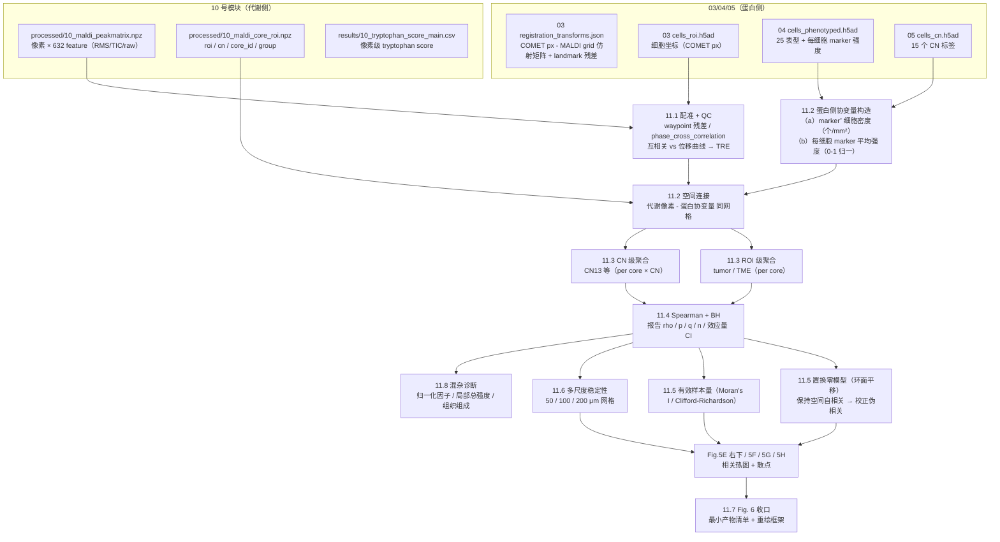
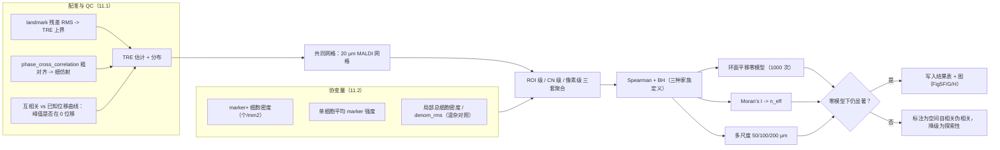

# 11 蛋白–代谢物空间耦合与多组学整合（跨模态关联、误差传播与 Fig. 6 收口）

> **目标文献**：Wang J, Nagarajan P, et al. *Integration of spatial single-cell proteomics and spatial metabolomics
> reveals tumor microenvironment predictive of immunotherapy response in mucosal melanoma.* bioRxiv 2026.
> DOI: 10.64898/2026.04.23.720453（预印本，未经同行评审）
>
> **模块对应原文**：Fig. 5E（右下，代表性样本中 CD163⁺ 高密度区 tryptophan score 更高）、Fig. 5F–H（代谢物 ×
> CD11c / CD163 / CN13 的相关分析）、Fig. 6（全文总结图）；Methods 中「Image preprocessing and alignment」全段
> （配准）与「Statistical analyses」全段（Spearman + BH）；Results 中「Tryptophan metabolism associates with ICI
> response in MuM」节的后半（从 "We next investigated metabolite patterns with spatial immune phenotypes" 起）；
> Discussion 中「Importantly, spatial 'enrichment' within a given core can coexist with overall low pathway
> abundance at the group level」段
>
> **前置依赖**：
> - `10_空间代谢组学分析.md` —— **必需产物**：`processed/10_maldi_peakmatrix.npz`（`mz` + `rms`/`tic`/`raw` 四套强度 + `denom_rms`）、`processed/10_maldi_core_roi.npz`（`roi`、`cn`、`core_id`、`group`）、`results/10_tryptophan_score_{main,alt}.csv`
> - `03_影像预处理配准与细胞分割.md` —— **必需产物**（**以 03 号文档 §产出契约为准**）：`results/03_registration_<pair>.tfm.json`（MALDI↔COMET 与切片↔切片的仿射矩阵、`tre_um` 与 landmark 残差）、`processed/03_cells_<tma>.parquet`（细胞级主表，**坐标一律 μm 的 `x_um`/`y_um`**）、`processed/03_roi_mask_<core_id>.tif`、`processed/03_core_manifest.csv`（逐 core 的 `tre_um`、`usable`——**本模块的 TRE 门槛据此过滤 core**）
> - `04_细胞表型定义与注释.md` —— **必需产物**：`processed/04_cells_phenotyped.parquet`（`major_type` + `phenotype` + `pos_<marker>` 布尔列 + `arcsinh_c<value>` 的 marker 强度矩阵；本模块据此把"marker 强度"与"marker⁺ 细胞密度"分开，见 §2.1 批注）。**注**：原文报告 25 个 cellular phenotypes，本项目的表型重建数为 **23 个状态**（见 04 号文档；差异须在结题报告中统一说明）
> - `05_细胞邻域CN分析与Kmeans.md` —— **必需产物**：`processed/05_cells_cn.h5ad`（CN13 等 15 个 CN 标签）
>
> > ⚠️ **契约提醒**：本文件**只消费**上游产物。若上游列名/文件名变更，按 L0 §11.1 同步本文件与 `code/11_*.py`，并在 `logs/DECISIONS.md` 留痕。
>
> **复现难度**：★★★★☆（其中"把两个模态对齐并诚实地报告不确定性"占 ★★★★ 的全部难度）
> **预计工时**：4 人日　**计算资源**：16 核 CPU / 64 GB 内存（环面平移零模型 1000 次 × 多模态图层、块 bootstrap 1000 次；**不需要 GPU**）
>
> **疏漏登记**：本文件所有 `⚠️ 导师批注` 均已登记到 `12_复现质控清单、排错与批判性评述.md`。

---

## ① 科学问题与逻辑位置

`10` 号文档给出的是**代谢物在组织里的空间图层**；`03`–`09` 给出的是**细胞、表型、邻域（CN）、区域（ROI）的图层**。本模块要回答一个**跨模态**问题：

> **代谢物丰度的空间格局，与蛋白/细胞的空间格局在多大程度上"共变"？这种共变是真实的，还是空间自相关 + 配准误差 + 归一化伪影造成的假象？**

这是全文**证据链的最末端、也是最脆弱的一环**。原文在这一步的表述是 "spatially associate（空间关联）"、"track with（随之变化）"、"coupling（耦合）"，并在 Discussion 中把它推到 "myeloid-metabolic programs（髓系–代谢程序）" 的高度。**本项目必须严格区分"相关"与"耦合/调控"**（L0 §12.4）。



**上游输入**：`10` 的代谢图层与 tryptophan score；`03` 的配准矩阵与细胞坐标；`04` 的表型与 marker 强度；`05` 的 CN 标签；临床 R/NR 标签。

**下游输出**：
1. `results/11_covariates_protein.csv`（每个空间单元的蛋白侧协变量）；
2. `results/11_corr_{compartment}_{group}*.csv`（**compartment ∈ {tumor,TME,CN13}、group ∈ {R,NR}**；列含 ρ、p、q、n、CI、偏相关、检验家族定义，见 §4.3 与文末契约表）；
3. `results/11_null_torus_{...}.csv`（置换零分布与经验 p）、`results/11_n_eff.csv`（有效样本量）；
4. `results/11_multiscale_{50,100,200}um.csv`；
5. `figures/Fig5E_right_*.pdf|png`、`Fig5F_*.pdf|png`、`Fig5G_*.pdf|png`、`Fig5H_*.pdf|png`、`Fig6_summary.pdf|png`、`figures/11_registration_qc.pdf|png`。

**本模块的诚实边界**：
- 原文报道的所有相关**都是相关，不是因果**；Discussion 自己也写了 "While our data are correlative"（针对巨噬细胞部分）。**本项目在摘要与结论中不得使用"驱动"、"调控"、"耦合"等因果性词汇**，除非另有功能实验；
- 原文**未报告**：相关分析的**分析单位**（像素？ROI？core？）、**n**、**检验家族大小**（BH 的 m 是多少）、**TRE**、**是否做过空间零模型**、**CD11c/CD163 是"细胞密度"还是"marker 强度"**。这些是本文件的 A 类决策。

---

## ② 背景知识与原理

### 2.1 跨模态空间关联的三个硬约束

**约束 1：两个模态拍的不是同一张切片。** 原文 Methods 明确写「Serial tissue sections were co-registered via the Tissuealign module」——**连续切片（serial sections）**，这意味着：

- 两模态之间**天然存在一个物理偏移**：切片厚度 5 μm（COMET）× 2，加上切片时的压缩/拉伸差异（FFPE 连续切片在 x、y 方向常有 1–5% 的形变差）；
- **同一个生物实体（例如一个 CD163⁺ 巨噬细胞）在两片上的位置不可能完全相同**；
- 组织是**三维**的：5 μm 切片只代表一个平面，相邻两片之间的细胞（直径约 10 μm）**未必同时出现在两片上**。**这是"相邻切片 ≠ 同一组织"的本质**：单层切片的采样体积只有细胞直径的一半，跨片细胞重叠率本就不可能是 100%。

**约束 2：分辨率相差 87 倍。** COMET 的 OME-TIFF 是 **0.23 μm/pixel**，MALDI 是 **20 μm/pixel**：$20 / 0.23 \approx \mathbf{87\times}$。任何跨模态比较都必须先在**共同网格**上做（本项目统一到 MALDI 的 20 μm 网格）。

**约束 3：分析单元的粒度不同。** 蛋白侧可以到**单细胞**（695,444 个），代谢侧只能到**像素**（1 个像素 ≈ 1–4 个细胞，见 `10_空间代谢组学分析.md` §2.5）。因此**"细胞级关联"在物理上不成立**，只能做**区域级 / CN 级**关联。

> ⚠️ **导师批注**：原文关于这一点有一处**术语混用**，必须澄清。Fig. 5E 右下写的是 "CD163+ macrophages cell density"（**细胞密度**），而 Fig. 5F/G/H 写的是 "positively correlated with CD11c expression" / "correlated positively with CD163 expression"（**蛋白表达强度**）。**这两者在数学上是不同的量**：
> - **marker 表达强度**（每个像素/区域的平均荧光强度）= 细胞密度 × 单细胞平均表达量；
> - 因此**一个 marker 强度与代谢物的相关性，既可能由"那里有更多该细胞"驱动，也可能由"那里的该细胞表达更多该 marker"驱动**，还可能由两者共同驱动。
>
> **本项目必须把两个协变量分开计算并分别报告**（§4.2）：
> (a) **marker⁺ 细胞密度**（个/mm²，来自 `04` 的表型标签与细胞坐标）；
> (b) **单细胞平均 marker 强度**（来自 `04` 的每细胞强度表，仅在 marker⁺ 细胞内取平均）。
> 如果原文的相关性在 (a) 上显著而在 (b) 上不显著（或反之），**结论的生物学含义完全不同**。登记到 12 号文档。

### 2.2 误差传播：两种独立的相关系数衰减机制

跨模态关联最容易被忽略的一步是：**你观测到的 $\rho_{obs}$ 不是真实关联 $\rho_{true}$ 的无偏估计**。两种机制各自独立地把它压低。

#### 机制 A：加性测量噪声（"校正衰减"公式，correction for attenuation）

设真实信号 $X, Y$，观测为 $X^\* = X + \varepsilon_X$，$Y^\* = Y + \varepsilon_Y$，噪声与信号、彼此独立：

$$\rho_{obs} = \frac{\mathrm{Cov}(X^\*, Y^\*)}{\sigma_{X^\*}\sigma_{Y^\*}} = \frac{\mathrm{Cov}(X,Y)}{\sqrt{(\sigma_X^2 + \sigma_{\varepsilon_X}^2)(\sigma_Y^2 + \sigma_{\varepsilon_Y}^2)}} = \rho_{true}\sqrt{\lambda_X \lambda_Y}$$

其中**信度（reliability）** $\lambda_X = \dfrac{\sigma_X^2}{\sigma_X^2 + \sigma_{\varepsilon_X}^2} \in (0,1]$。

**这是本项目里最实用的一个式子**：它把"我该不该聚合"变成了可算的问题——**聚合降低噪声方差 $\sigma_\varepsilon^2$（若噪声独立），从而抬高 $\lambda$**。第 2.3 节给出具体数字。

#### 机制 B：空间配准误差（misregistration)

设两个模态的场都具有**高斯型空间自相关**（相距 $d$ 的两点相关为 $\exp[-d^2/(2\ell^2)]$，$\ell$ 为特征长度尺度），配准位移 $d=(d_x,d_y)$ 各轴独立 $\sim N(0,\sigma_d^2)$。则

$$\rho_{obs} = \rho_{true}\cdot\mathbb{E}\!\left[e^{-d^2/(2\ell^2)}\right]^{k} = \rho_{true}\left(1+\frac{\sigma_d^2}{\ell^2}\right)^{-k}$$

**推导**：$\mathbb{E}[e^{-(d_x^2+d_y^2)/(2\ell^2)}] = \big[\mathbb{E}\,e^{-d_x^2/(2\ell^2)}\big]^2 = \big[(1+\sigma_d^2/\ell^2)^{-1/2}\big]^2 = (1+\sigma_d^2/\ell^2)^{-1}$（高斯积分），再对 $k$ 个独立偏移的场相乘。**$k=1$**：只有一个模态相对另一个偏移；**$k=2$**：两个模态各自相对"真实位置"偏移（连续切片的情形）。**它的推论极其重要：$\rho_{obs}$ 不是随 $\sigma_d$ 线性下降，而是在 $\sigma_d \approx \ell$ 之后断崖式崩塌。**

**数值表（$\rho_{true} = 0.60$，$k=2$）**：

| 特征尺度 $\ell$ ↓ \ 配准误差 $\sigma_d$ → | 5 μm | 10 μm | 20 μm | 50 μm |
|---|---|---|---|---|
| **30 μm**（CN 内局部结构） | 0.568 | 0.486 | **0.288** | **0.042** |
| **50 μm**（巨噬细胞聚集区） | 0.588 | 0.555 | 0.446 | 0.150 |
| **100 μm**（ROI 内渐变） | 0.597 | 0.588 | 0.555 | 0.384 |
| **200 μm**（全 core 尺度） | 0.599 | 0.597 | 0.588 | 0.531 |

**读法（必须掌握）**：
- 若真实关系发生在 **30 μm 尺度**（例如 CD163⁺ 巨噬细胞成簇、直径几十 μm），而配准误差为 **20 μm**，那么**观测到的相关系数只有真实值的 48%**（0.288/0.60）；若配准误差到 **50 μm**，**真实关联几乎被完全抹掉**（0.042，等于噪声）。
- 若真实关系是 **200 μm 尺度**（整片区域的代谢状态），那么 20 μm 的配准误差几乎无害（0.588）。
- **结论**：**"没看到相关"可能只是分辨率/配准不够，而不是"没有关联"；"看到相关"也可能只反映大尺度共变。因此必须报告 $\ell$ 与 $\sigma_d$**——而原文**两者都没报告**（只写 "quantitative assessment of registration accuracy"，未给数字）。

> ⚠️ **导师批注（本条是本模块对原文最实质的方法学挑战）**：原文的配准由 Visiopharm Tissuealign 完成，QC 是 "overlay visualization and quantitative assessment of registration accuracy"——**"定量评估"的具体数值（TRE，目标配准误差）没有出现在正文、图注或 Methods 里**。
> 后果：**读者无法判断 Fig. 5F–H 的相关性是在什么空间尺度上成立的**。更尖锐的问题是：原文**从未报告做过空间零模型**，因此无法排除"两个都有大尺度空间趋势的变量天然相关"这一最平凡的解释（§2.5）。
> **本项目的要求**：(i) 必须给出 TRE 的点估计与分布（用 landmark 残差 + 互相关曲线两种方法交叉验证，§4.1）；(ii) 必须报告"在什么尺度上相关"（多尺度稳定性，§4.6）；(iii) 必须用保持空间自相关的零模型做检验（§4.5）。三条缺一 → 该相关性结论降级为"探索性"。登记到 12 号文档。

### 2.3 像素级 vs 聚合级：Poisson 噪声与"为什么要先聚合再算相关"

蛋白侧的"细胞密度"本质上是一个**计数**：一个 20 μm 像素内落着 $n$ 个细胞。若真实密度为 $\mu$，则 $n \sim \mathrm{Poisson}(\mu)$，**方差的绝对下限就是 $\mu$**（技术噪声）。而真实的空间变异 $\sigma_X^2$ 来自组织的生物学异质性。于是：

$$\lambda_{X} = \frac{\sigma_X^2}{\sigma_X^2 + \mu}\quad(\text{像素级，}m=1),\qquad \lambda_X^{(m)} = \frac{\sigma_X^2}{\sigma_X^2 + \mu/m}\quad(\text{聚合 }m\text{ 个像素后})$$

**数值（取"真实空间变异 = 均值的一半"，即 $\sigma_X = 0.5\mu$）**：

| 细胞密度 $\mu$（个/像素） | 像素级 $\lambda_X$ | 像素级 $\rho_{obs}/\rho_{true}$（取 $\lambda_{metab}=0.8$） | 聚合 38 像素（≈ 一个 70 μm CN 窗口）后 $\lambda_X$ | 聚合后 $\rho_{obs}/\rho_{true}$ |
|---|---|---|---|---|
| 3 | 0.429 | **0.586** | 0.966 | **0.879** |
| 5 | 0.556 | 0.667 | 0.979 | 0.885 |
| 8 | 0.667 | 0.730 | 0.988 | 0.889 |

**两条结论**：
1. **像素级相关最多只能看到真实关联的 60–73%**（即使代谢侧信度不错），这就是"聚合"的定量理由；
2. **从像素级（m=1）换到 CN/ROI 级（m=38+）后，衰减从约 41% 降到约 12%**。所以**聚合不是"降精度"，而是"提信度"**——这与"越小越好"的直觉相反，必须在方法学里讲清楚。

**但聚合有代价**：$m$ 越大，${n}$ 越小、空间细节丢失越多，而且**聚合会把真实存在于小尺度的关联平均掉**（ecological fallacy，见 §2.7）。因此正确做法是**多尺度并行报告**（§4.6），而不是选一个"最好看"的尺度。

### 2.4 空间自相关：为什么必须做零模型，以及有效样本量

**伪相关的机制**：若 $X$ 与 $Y$ 各自都是空间平滑的（自相关），即使它们完全独立，**样本相关系数也会因为"两片平滑的场很难不相像"而偏离 0**，且其方差远比独立样本假设下的大。

**量化 1：有效样本量（Clifford–Richardson–Hémon 型修正）**。相关系数 $r$ 的方差膨胀因子为

$$\eta = 1 + \frac{1}{n}\sum_{i \ne j}\rho_X(i,j)\,\rho_Y(i,j),\qquad n_{\text{eff}} = \frac{n}{\eta}$$

对一维 AR(1) 过程（自相关 $a$）可解析求得上界：$\eta = \dfrac{1+a^2}{1-a^2}$：

| $a$（相邻单元自相关） | $\eta$ | $n_{\text{eff}}$（若 $n = 100{,}000$） |
|---|---|---|
| 0.5 | 1.67 | 60,000 |
| 0.8 | 4.56 | 21,951 |
| **0.9** | **9.53** | **10,497** |
| 0.95 | 19.51 | 5,125 |
| **0.99** | **99.50** | **1,005** |

**读法**：空间代谢组/空间蛋白组的数据几乎必然 $a \ge 0.9$。**因此"n = 10⁵ 个像素 → p 极小"是幻觉**：有效样本量可能只有 $10^3$ 量级。对 Fisher $z$ 变换的 95% CI 半宽（取 $\rho \approx 0.3$ 量级时）：$n=100{,}000$ 时是 **0.006**（几乎确定），而 $n=75$（**原文的 pre-treatment core 数**）时是 **0.231**——**两者差约 38 倍**。原文在相关分析部分**未给出任何 p 值**，但其细胞级检验低至 $2.22\times10^{-16}$（见 `00` 号文档的事实清单），这一量级的 p 值必须放在"$n_{\text{eff}}$ 远小于 $n$"的背景下解读。

**量化 2：三种可用的零模型**（按推荐程度排序）：

| 零模型 | 做法 | 保留什么 | 破坏什么 | 本项目 |
|---|---|---|---|---|
| **环面平移（toroidal shift）** | 把其中一个模态的整张图层在环面上循环平移一个随机偏移 $(s_x, s_y)$，重算 $\rho$，重复 1000 次 | **两个场各自的自相关结构**、边缘分布、像素个数 | 两个场之间的**真实空间对应关系** | ✅ **主口径** |
| **空间分块置换（block permutation）** | 把组织切成 $\ge 2\ell$ 的大块（如 200 μm 网格），**整块**交换标签 | 块内的自相关 | 块之间的对应 | ✅ 备选（用于多 core 场景） |
| **Moran 谱随机化（MSR）** | 在保留 Moran's I 谱的前提下随机化场 | 自相关谱 | 与另一场的相关 | ⚪ 可选（`esda`/`libpysal`） |
| 无（原文做法） | 直接用像素 p 值 | 无 | 无 | ❌ 会产生大量伪相关 |

> ⚠️ **导师批注**：原文 Methods 只写「pairwise Spearman's rank-order correlation and p-values were adjusted with Benjamini–Hochberg correction」，**没有任何空间零模型的描述**。在空间数据上直接用逐像素 Spearman + BH，**几乎必然给出大量"显著"结果**，因为：(i) 有效样本量被高估；(ii) BH 只校正"检验个数"，不校正"检验之间的空间依赖"。本项目**必须**用环面平移零模型重做一遍，并**同时报告两套结果**（原口径 vs 零模型校正口径），若结论不一致，以零模型口径为准并在图中标注。登记到 12 号文档。

### 2.5 Spearman 还是 Pearson？空间数据的选择

原文用 **Spearman 秩相关**，这个选择在本场景下是**合理**的，理由有四条（都要写进方法学）：

| 维度 | Spearman | Pearson | 空间代谢组场景下谁合适 |
|---|---|---|---|
| 对单调非线性 | 免疫（只依赖秩） | 失效 | **Spearman** |
| 对离群像素 | 稳健（秩有界） | 被单个热点拉偏 | **Spearman**（MALDI 常见基质结晶热点、坏死区异常强度） |
| 对零膨胀/偏态分布 | 稳健 | 需要变换 | **Spearman** |
| 可加性/可解释性 | 秩相关，"强度排序一致" | "线性共变强度" | 需报告效应量非线性的情形 |
| 衰减校正 | **无闭式解** | 有（§2.2 机制 A/B） | **Pearson 用于误差传播分析，Spearman 用于主结果** |

**本项目的做法**：**主结果用 Spearman（与原文一致）**；**误差传播与信度诊断用 Pearson**（因为有闭式衰减公式）；**两者都报告**，若符号或显著性不一致，说明关系非线性，必须在图中用散点 + LOWESS 展示。

### 2.6 整合的四个层级：可行性对比与"本文实际做了哪一级"

| 层级 | 单元 | 蛋白侧可得 | 代谢侧可得 | 单元数（本队列估计） | 主要问题 | 本文实际 |
|---|---|---|---|---|---|---|
| **L1 像素级** | 20 μm 像素 | 细胞密度/marker 强度可降采样到该网格 | ✅ 直接 | ~10⁵（严重高估 $n_{\text{eff}}$） | Poisson 噪声（$\lambda \approx 0.43$，§2.3）+ 自相关伪相关 + 配准误差最敏感 | 可能就是这一级（**原文未报告**） |
| **L2 CN 级** | 每个 (core, CN) 组合 | ✅ 由 `05` 的细胞标签聚合 | ✅ 由 `10` 的像素标签聚合 | 15 CN × ~75 core，但**每个 core 通常只有 3–8 个 CN 有足够像素** → 实际 ~200–400 | **这是原文 Fig. 5H/5I 明确使用的层级** | ✅ 明确使用（Fig. 5H、5I） |
| **L3 ROI 级** | 每个 (core, tumor/TME) | ✅ | ✅ | ~75 pre-treatment core × 2 compartment ≈ 150 | n 仍小；但信度高、可做混合效应模型 | 可能（Fig. 5F/5G 的 "in the tumor compartment of pre-treatment R cores" 措辞指向 compartment 内聚合） |
| **L4 细胞级** | 单细胞 | ✅ 695,444 | ❌ **物理上不成立**（1 像素 ≈ 1–4 细胞） | — | **不可做** | ❌（必须明确写出） |

**判定**：**本文实际做到的是 L2–L3（区域/CN 级）**，并且措辞上把 L2/L3 结果当作 L1 的可视化（Fig. 5E 右下的空间图示）来呈现。**要做到真正的细胞级，必须让 MALDI 与 COMET 落在同一张切片上（如 COMET 后做原位 MALDI，或对同一片做"成像后 MSI"），或者以 CN/ROI 为单位聚合后做区域级关联**——后者是本文路线，也是本项目的路线。

### 2.7 生态学谬误与 Simpson 悖论：本文"群组 vs 局部"张力的本质

原文在 Discussion 中明确写道：

> "Importantly, spatial 'enrichment' within a given core can coexist with overall low pathway abundance at the group level, highlighting the value of spatial analysis to distinguish within-tissue heterogeneity from between-group differences."

这句话**描述的现象是真实的、也是空间分析的价值所在**，但本项目必须把它讲成**统计学问题**，而不是"空间分析很厉害"：

设三个量：$G$（组：R/NR）、$C$（局部 CD163⁺ 巨噬密度）、$T$（tryptophan score）。原文观察到：
- **组间**：$\mathrm{median}(T \mid R) < \mathrm{median}(T \mid NR)$（Fig. 5E 左）；
- **样本内**：在 R 样本中，$C$ 高的区域 $T$ 更高（Fig. 5E 右下）。

两者**在数学上完全可以同时成立**，机制是**聚合层次不同（生态学谬误 ecological fallacy / Simpson 悖论）**。一个最简生成模型：

$$
T_{p} = \alpha_{g(p)} + \beta\, C_p + \gamma\, Z_p + \varepsilon_p,\qquad
Z_p = \text{局部组织组成（坏死/基质比例）}
$$

其中 $\alpha_R < \alpha_{NR}$（R 的基线低）、$\beta > 0$（局部正相关）、而 $C$ 与 $Z$ 在 R/NR 之间分布不同（原文 Fig. 4B 报告 R 中 CD163⁺ 巨噬更多）。**只要 $\gamma \ne 0$（$Z$ 也在影响 $T$），跨 core 的相关就可以与样本内相关反号。**

**因此必须做的三件事**：
1. **分层报告**：组间效应（core 级）与样本内效应（像素/CN 级）**分别**给出，并明确二者不是同一个量；
2. **中心化**：在相关分析前**按 core 减去该 core 的均值**（within-core centering），得到"样本内关联"；再另算 core 均值之间的"组间关联"。**这是区分两种效应的标准做法，原文未做。**
3. **混杂诊断**：把局部组织组成（`roi`、局部细胞总密度、`denom_rms`）作为协变量做**偏相关**或**分层分析**（§4.4）。

> ⚠️ **导师批注**：原文的 "spatial enrichment ... coexist with overall low abundance" 是一句**描述**，但它容易被读者读成"因此局部富集是有生物学意义的"。严格说：**局部正相关并不比"两个变量都随组织组成变化"更强**。在没有偏相关/分层分析的情况下，**不能排除"局部代谢物富集只是巨噬细胞富集的伴随现象（两者都标记了同一类组织区域）"这一最平凡的解释**。原文未做任何混杂诊断。登记到 12 号文档。

### 2.8 "共定位"该用什么统计量？（本项目建议补齐）

单个相关系数**不是**空间共定位的统计量。若审稿人问"你怎么知道这些分子是共存的，而不是两片平滑的场碰巧相似"，正确的回答是**空间点格局统计**：

| 统计量 | 回答什么问题 | 实现 | 本文 |
|---|---|---|---|
| **Spearman ρ + BH** | 两个**连续场**的单调关联 | `scipy.stats.spearmanr` | ✅（原文唯一使用） |
| **cross-$K$ / cross-$L$（Ripley 跨类）** | 两类**点格局**（如 CD163⁺ 细胞与"高 indole 像素"）在何种距离尺度上富集/排斥 | `squidpy.gr.ripley(cluster_key=..., mode="K")` 或自实现 | ❌ |
| **双变量 Moran's I** | 一个变量的邻域均值与另一个变量的空间关联（比全局 ρ 更能反映"相邻才相关"） | `esda.Moran_BV` / `libpysal` | ❌ |
| **环面平移零模型** | 校正伪相关（§2.4） | 自实现 | ❌ |
| **环状/点状共定位指标（如 Mander's / Pearson's colocalization coefficient）** | 仅适用于**同一像素网格**的两个荧光通道 | 不适用于跨模态 | ❌（不适用） |

**本项目的口径**：主结果用 **Spearman + BH + 环面平移零模型**（与原文可比、且补上零模型）；**若要把"局部富集"写成结论，必须补双变量 Moran's I 或 cross-$K$**（对"高 indole 区域"用阈值定义成点格局）。

---

## ③ 原文逐句拆解

**A. Methods 逐句（配准与统计，本模块的直接依据）**

| # | 原文句（节选） | 中文转述 | 对应操作与参数 | 原文是否给参数 | 缺失项的复现决策（D 表） |
|---|---|---|---|---|---|
| 1 | "Image alignment between the MALDI-IMS and COMET datasets, as well as tissue and cell segmentation followed by spatial analyses, were performed using Visiopharm software" | 配准与分割都在 Visiopharm 里做 | 闭源软件 | ✅（软件与版本） | 开源替代：`skimage.registration.phase_cross_correlation`（粗对齐）+ landmark 仿射（`cv2.estimateAffinePartial2D` 或 `skimage.transform.AffineTransform`）；**替代会改变 TRE，必须重测（§4.1）** |
| 2 | "Serial tissue sections were co-registered via the Tissuealign module employing automated tissue outline matching, further refined manually by placement of landmarks on corresponding morphological features as necessary" | 组织轮廓自动匹配 + 手工 landmark 精修 | **仿射变换**假设（轮廓匹配 + landmark 通常解相似/仿射变换） | ✅（方法）/❌（landmark 数、残差） | 主口径：**≥ 8 个 landmark、覆盖全片四角与中心**，解**仿射**（6 参数）；报告 landmark 残差的 RMS 作为 TRE 上界；**手工 landmark 数不足以约束非线性形变** → 若残差 > 20 μm，改做分块局部仿射并登记 |
| 3 | "Quality control was ensured through overlay visualization and quantitative assessment of registration accuracy" | 叠加图目检 + 定量评估 | **未给数字** | ❌ | **本项目必须给出 TRE 的点估计与分布**（两种独立方法，§4.1）；**原文若不报告 TRE，则本项目的 TRE 不可与原文比较**——这一点必须写在报告里 |
| 4 | "Correlations of proteins and metabolites were calculated using pairwise Spearman's rank-order correlation" | 蛋白×代谢物用 Spearman | 秩相关 | ✅（方法）/❌（单位、n、聚合方式） | 主口径：**ROI 级与 CN 级各一套**；同时报告像素级（并标注其 $n_{\text{eff}}$ 不可靠）；**"pairwise" 意味着不做多变量模型，因此无法控制混杂** → 必须补偏相关（§4.4） |
| 5 | "p-values were adjusted with Benjamini–Hochberg correction" | BH 校正 p 值 | 多重校正 | ✅（方法）/❌（**检验家族大小 m**） | **本项目三口径都报**：(i) $m$ = 所有 (代谢物 × 协变量) 对数；(ii) $m$ = 代谢物数；(iii) $m$ = 每个 compartment 内的对数。**原文未定义 m，这是 A 类决策** |
| 6 | "Results were considered statistically significant when p-values or FDRs were less than 0.05" | p 或 FDR < 0.05 | 阈值 | ✅ | 照做。**注意"p 或 FDR"这个"或"字给了自由度**：同一个结果既可以报原始 p 也可以报 FDR，本项目统一以 **BH-FDR** 为主口径 |
| 7 | "All statistical tests were conducted using python" | 统计全用 Python | —— | ✅ | 本项目同（Python 3.11 + `scipy`/`statsmodels`/`esda`） |

**B. Results 逐句（相关分析部分）**

| # | 原文句（节选） | 中文转述 | 复现操作 | 原文是否给参数 | 复现决策 |
|---|---|---|---|---|---|
| 8 | "Indole-3-carboxylic acid and indole-3-carbinol were positively correlated with CD11c expression in the tumor compartment of pre-treatment R cores (Fig. 5F)" | pre-R 的 tumor：I3CA、I3C 与 CD11c **正相关** | (代谢物 I3CA 160.0404 / I3C 146.0611) × (CD11c 协变量) 在 tumor compartment 内的 Spearman | ❌（ρ、p、q、n 全未报告） | 主口径：ROI 级（per core 的 tumor 内聚合值，$n$ = pre-R 的 core 数）；**协变量双口径**（marker⁺ 细胞密度 / 单细胞平均强度，§4.2）；**补偏相关**（控制局部总细胞密度与 `denom_rms`） |
| 9 | "In the TME compartment of pre-treatment R cores, indole-3-acetaldehyde and indole-3-acetic acid showed positive correlations with CD163 expression (Fig. 5G)" | pre-R 的 TME：I3Ald、IAA 与 CD163 **正相关** | 同上，TME compartment | ❌ | 同上。**注意 I3Ald 与 I3C 相差一个 C（158.0611 vs 146.0611）**，在低质量端极易因校准偏差互相污染（见 `10` §4.3），必须先做 m/z 校准 QC |
| 10 | "In a representative pre-treatment R specimen, regions with high CD163⁺ macrophage density exhibited spatially higher tryptophan metabolism scores within the TME compartment (Fig. 5E, lower right)" | **单个代表性样本**内：CD163 高密度区 tryptophan score 更高（与组间"R 更低"并存） | 单样本的像素级/网格级相关 + 分层可视化 | ❌（**n = 1 个样本**） | **必须明确写"代表性样本（n = 1）"**，不能作为统计证据；本项目做法：**对全部 pre-R 样本重复该分析并报告"方向一致的比例"**（§4.5 的中心化分析），把"n=1 的示例图"升级为"可检验的样本内效应" |
| 11 | "in pre-treatment NR cores, indole, indole-3-acetaldehyde, and indole-3-acetic acid correlated positively with CD163 expression within the tumor boundary CN (CN13) (Fig. 5H)" | pre-NR 的 **CN13 内**：indole、I3Ald、IAA 与 CD163 正相关 | 消费 `05` 的 CN 标签，把代谢像素标到 CN13，做 **CN 级**（per core × CN13 聚合）相关 | ❌（n 未报告） | 主口径：**每个 core 的 CN13 作为 1 个观测**（$n$ = 有足够 CN13 像素的 pre-NR core 数）；要求 `n_pixels_CN13 ≥ 20` 且记录剔除名单 |
| 12 | "accompanied by elevated tryptophan metabolism scores in CN13 in NR patients (Fig. 5I)" | NR 的 CN13 中 tryptophan score 升高 | CN13 内的 tryptophan score 比较 | ❌ | 同 `10` 号文档 D-MS07（score 定义三口径） |

**C. Discussion 逐句（本模块必须谨慎处理的两段）**

| # | 原文句（节选） | 中文转述 | 本项目处理 |
|---|---|---|---|
| 13 | "we observed correlations between CD11c expression and specific indole-derived metabolites …, raising the possibility that local metabolic states may co-vary with DC-enriched microenvironments. These observations motivate future mechanistic studies to test whether metabolic cues directly influence DC activation" | 相关 → "提示可能共变" → "需要未来机制研究检验" | ✅ **原文此处表述是克制的（"raising the possibility"、"motivate future studies"）**，本项目保留这一限定语，**不得升级为"代谢物调控 DC"** |
| 14 | "Given the immunosuppressive roles of tryptophan catabolites via activation of the aryl hydrocarbon receptor (AhR) pathway, their reduction is consistent with a shift toward a more immune-permissive microenvironment." | 吲哚类降低 → 与 AhR 激活减少 → 免疫许可 | ⚠️ **这是"一致性解释（consistent with）"，不是证据**。且需注意：**AhR 的配体包括 indole、IAA、I3C、ICZ 等吲哚类**，但这些分子在本文中**未被验证具有 AhR 活性**（无 AhR 报告基因/靶基因数据）。本项目在复述时**必须保留 "consistent with" 的强度**，并在 Limitations 中写明"无 AhR 通路的直接读出" |
| 15 | "spatial 'enrichment' within a given core can coexist with overall low pathway abundance at the group level, highlighting the value of spatial analysis to distinguish within-tissue heterogeneity from between-group differences." | 样本内富集与组间降低并存 | ⚠️ **现象成立，但原文未区分"组间效应"与"样本内效应"，也未做中心化/偏相关**（§2.7）。本项目的处理：**两种效应分别计算并报告**（`within-core centered` vs `core-mean`），并给出混杂诊断 |



---

## ④ 逐步可运行代码

**环境**（在 `10` 号文档的依赖之上追加；版本落盘 `logs/11_pip_freeze.txt`）：

```bash
conda activate mum-msi
pip install scikit-image libpysal esda       # 配准、空间权重与 Moran's I
# opencv（可选）：pip install opencv-python  # 若要用 cv2.estimateAffinePartial2D
```

### 4.1 配准 QC：TRE 的两种独立估计 + 互相关 vs 位移曲线

```python
# code/11_01_registration_qc.py
"""配准质量评估（原文只说"quantitative assessment"，未给数字）
输出：results/11_registration_tre.csv, figures/11_registration_qc.pdf
"""
from __future__ import annotations
import json, pathlib
import numpy as np
import pandas as pd
from scipy import ndimage
from skimage.registration import phase_cross_correlation

PROJ = pathlib.Path("/home/zhangxi/paper_read/20261016_mucosal_melanoma_spatial_multiomics_ICI")
PROC, RES, FIG = PROJ / "processed", PROJ / "results", PROJ / "figures"
SEED = 20260101
rng = np.random.default_rng(SEED)


def fit_affine(src_xy, dst_xy):
    """最小二乘解 6 参数仿射（无 opencv 依赖）：
    [x'; y'] = [[a,b,c],[d,e,f]] . [x; y; 1]
    """
    A = np.column_stack([src_xy[:, 0], src_xy[:, 1], np.ones(len(src_xy))])
    cx, *_ = np.linalg.lstsq(A, dst_xy[:, 0], rcond=None)
    cy, *_ = np.linalg.lstsq(A, dst_xy[:, 1], rcond=None)
    return np.vstack([cx, cy])                    # 2x3


def tre_from_landmarks(src_xy, dst_xy, holdout=0.25, n_rep=200, seed=SEED):
    """方法 1：landmark 残差。
    - (a) 全量残差 RMS：**乐观**（landmark 参与了拟合）
    - (b) 留出法（hold-out）残差 RMS：**接近无偏**，作为主口径 TRE
      （严格做法是 leave-one-out；此处用重复随机留出以给出分布）
    """
    A = fit_affine(src_xy, dst_xy)
    pred = (A[:, :2] @ src_xy.T + A[:, 2:3]).T
    res_all = np.linalg.norm(pred - dst_xy, axis=1)
    n = len(src_xy); k = max(1, int(round(n * holdout)))
    rg = np.random.default_rng(seed)
    hold_rms = []
    for _ in range(n_rep):
        te = rg.choice(n, size=k, replace=False)
        tr = np.setdiff1d(np.arange(n), te)
        if len(tr) < 3:
            continue
        A2 = fit_affine(src_xy[tr], dst_xy[tr])
        p2 = (A2[:, :2] @ src_xy[te].T + A2[:, 2:3]).T
        hold_rms.append(np.sqrt(np.mean(np.sum((p2 - dst_xy[te]) ** 2, axis=1))))
    return A, float(np.sqrt(np.mean(res_all ** 2))), np.asarray(hold_rms)


def shift_curve(ref_img, moving_img, max_shift_px=6):
    """方法 2：互相关 vs 位移曲线。
    若峰值出现在非零位移处 -> 存在残余系统偏移（rigid bias），TRE 不能只用 landmark 残差表示。
    ref/moving 必须是**同一网格**的二维图（例如 MALDI 某个高丰度离子图 vs 栅格化后的细胞密度图）。
    用 ndimage.shift(mode='constant', cval=nan) 而不是 np.roll，避免环回（wrap-around）污染边缘。
    """
    rows = []
    for dy in range(-max_shift_px, max_shift_px + 1):
        for dx in range(-max_shift_px, max_shift_px + 1):
            mv = ndimage.shift(moving_img, (dy, dx), order=0, mode="constant", cval=np.nan)
            m = np.isfinite(ref_img) & np.isfinite(mv)
            if m.sum() < 50:
                continue
            rows.append({"dx_px": dx, "dy_px": dy,
                         "pearson": float(np.corrcoef(ref_img[m], mv[m])[0, 1]),
                         "n_overlap": int(m.sum())})
    df = pd.DataFrame(rows)
    best = df.loc[df["pearson"].idxmax()]
    return df, best


if __name__ == "__main__":
    # 产物名以 03 号文档的产出契约为准：results/03_registration_<pair>.tfm.json（<pair> 按实际替换）
    tr = json.loads((PROC.parent / "results" / "03_registration_MALDI-COMET.tfm.json").read_text(encoding="utf-8"))
    src = np.asarray(tr["landmarks_comet_px"], float)      # COMET 像素坐标
    dst = np.asarray(tr["landmarks_maldi_px"], float)      # 对应的 MALDI 像素坐标
    assert src.shape == dst.shape and len(src) >= 8, "landmark 少于 8 个 -> 仿射不可靠，须补标注"

    A, rms_in, rms_out = tre_from_landmarks(src, dst)
    um_per_maldi_px = 20.0
    tre_report = pd.DataFrame({
        "metric": ["landmark_RMS_in_sample_px", "landmark_RMS_holdout_px_mean",
                   "landmark_RMS_holdout_px_q95", "TRE_um_holdout_mean",
                   "TRE_um_holdout_q95", "n_landmarks"],
        "value": [rms_in, float(rms_out.mean()), float(np.quantile(rms_out, 0.95)),
                  float(rms_out.mean()) * um_per_maldi_px,
                  float(np.quantile(rms_out, 0.95)) * um_per_maldi_px, len(src)],
    })
    tre_report.to_csv(RES / "11_registration_tre.csv", index=False)

    # 互相关曲线：用 MALDI 的某个高丰度离子图 vs 降采样细胞密度图
    d = np.load(PROC / "10_maldi_peakmatrix.npz")
    r = np.load(PROC / "10_maldi_core_roi.npz")
    coords = d["coords"]; mz = d["mz"]; I = d["rms"]
    j = int(np.argmax(d["raw"].mean(axis=0)))              # 取平均强度最高的 feature 作参考图
    core0 = int(np.unique(coords[:, 2].astype(int))[0])
    m0 = coords[:, 2].astype(int) == core0
    xs = (coords[m0, 0] - coords[m0, 0].min()).astype(int)
    ys = (coords[m0, 1] - coords[m0, 1].min()).astype(int)
    ref = np.full((ys.max() + 1, xs.max() + 1), np.nan)
    ref[ys, xs] = I[m0, j]                                  # 参考图：该 core 的高丰度离子图

    # moving 图：把 COMET 细胞坐标用拟合出的仿射映射到 MALDI 像素坐标系后，数成"每像素细胞数"
    # 产物名以 05 号文档契约为准；坐标单位为 μm（03 号契约：列名 x_um/y_um）
    cells = pd.read_parquet(PROC / "05_cells_cn.parquet")   # 列：x_um, y_um, cn
    # ★ A 的单位约定必须与 tfm.json 的键名一致：若 03 存的是 COMET **px** -> MALDI **px**，
    #   则先把 μm 坐标除以 0.23 换成 COMET px 再乘 A；切勿在两种约定之间"默认一致"。
    cell_maldi = (A[:, :2] @ (cells[["x_um", "y_um"]].to_numpy(float) / 0.23).T + A[:, 2:3]).T
    iy = np.round(cell_maldi[:, 1]).astype(int)
    ix = np.round(cell_maldi[:, 0]).astype(int)
    y0, x0 = int(ys.min()), int(xs.min())
    dens = np.zeros_like(ref)
    sel_c = (iy >= y0) & (iy <= y0 + ref.shape[0] - 1) & (ix >= x0) & (ix <= x0 + ref.shape[1] - 1)
    np.add.at(dens, (iy[sel_c] - y0, ix[sel_c] - x0), 1.0)
    dens[np.isnan(ref)] = np.nan                            # 只保留组织区域（与 ref 同一掩膜）

    curve, best = shift_curve(ref, dens, max_shift_px=6)
    curve.to_csv(RES / "11_registration_shift_curve.csv", index=False)
    print(tre_report.to_string(index=False))
    print("互相关峰值位移（像素）:", best["dx_px"], best["dy_px"],
          "| 若 |shift| >= 1 像素（=20 μm）则存在残余系统偏移，必须重新配准")
```

> **判读规则（写进报告）**：① `TRE_um_holdout_mean ≤ 20 μm`（≤ 1 个 MALDI 像素）为可接受；20–40 μm 只能做大尺度（$\ell \ge 100$ μm）结论；> 40 μm **必须重新配准**。② 互相关峰值位移必须为 $(0,0)$；非零即存在刚性残余偏移，此时 landmark 残差会**低估**真实 TRE。

### 4.2 蛋白侧协变量构造与跨模态空间连接（同一 20 μm 网格）

```python
# code/11_02_covariates_link.py
"""把 COMET 的细胞级信息栅格化到 MALDI 网格，并构造两类独立的蛋白协变量
(a) marker+ 细胞密度（个/mm2）  (b) 单细胞平均 marker 强度
输出：results/11_covariates_protein.csv, processed/11_linked_grid.npz
"""
from __future__ import annotations
import pathlib
import numpy as np
import pandas as pd
from scipy.spatial import cKDTree

PROJ = pathlib.Path("/home/zhangxi/paper_read/20261016_mucosal_melanoma_spatial_multiomics_ICI")
PROC, RES = PROJ / "processed", PROJ / "results"
PIXEL_UM = 20.0
PIXEL_MM2 = (PIXEL_UM / 1000.0) ** 2          # 一个 20 μm 像素的 mm2 面积 = 4e-4 mm2

# 消费 04 的细胞表 + 05 的 CN（契约：x_um, y_um, core_id, phenotype, cn,
# 以及 arcsinh 后的 marker 强度列——**列名带 c 值**，如 arcsinh_c5_CD11c；
# 下方代码里的 f"{marker}_int" 只是占位，实际运行时须替换为产物中的真实列名）
MARKERS = ["CD11c", "CD163"]                   # 按实际面板名替换；须与 PROJECT_SPEC 术语表一致
PHENO_POS = {"CD11c": ["DC", "CD11c+ DC", "CD11c+ macrophage"],   # marker+ 的表型名（以 04 的术语表为准）
             "CD163": ["CD163+ macrophage"]}


def rasterize_cells_to_maldi_grid(cells, coords_xy, marker, pheno_pos):
    """把细胞信息投射到 MALDI 像素中心所在的网格单元。
    - **单位契约（03 号文档）**：落盘的细胞坐标一律为 μm，列名 `x_um`/`y_um`，**不再乘任何 px 因子**；
    - MALDI 像素 (X, Y) 是本模块自己的像素索引 -> 乘 PIXEL_UM 得 μm；
    - **按 core 分别建树**：不同 core 之间的细胞在物理上不相邻，跨芯查询会把邻芯细胞错误地
      计入本芯的密度（TMA 上相邻芯间距可小于 1 个像素）。
    - 用 cKDTree 把每个细胞分配给它最近的本芯 MALDI 像素中心（等价于最近邻栅格化）
    返回 DataFrame：每行 = MALDI 像素（与 coords_xy 同序）；列 = density_marker,
    intensity_marker, density_all
    """
    cell_um = cells[["x_um", "y_um"]].to_numpy(float)
    pix_um = np.asarray(coords_xy, float)[:, :2] * PIXEL_UM
    core_px = np.asarray(coords_xy)[:, 2].astype(int)
    core_cell = cells["core_id"].to_numpy()
    tree = cKDTree(pix_um)
    assign = np.full(len(cell_um), -1, dtype=int)          # -1 = 未分配到任何像素
    for c in np.unique(core_cell):                          # ★ 逐 core 建树，禁止跨芯
        m_pix = core_px == c
        m_cell = core_cell == c
        if not m_pix.any() or not m_cell.any():
            continue
        sub = cKDTree(pix_um[m_pix])
        _, loc = sub.query(cell_um[m_cell], k=1)
        assign[m_cell] = np.flatnonzero(m_pix)[loc]
    kept = assign >= 0

    n_pix = len(pix_um)
    is_pos = cells["phenotype"].isin(pheno_pos).to_numpy()
    inten = cells[f"{marker}_int"].to_numpy(float)

    a_pos = assign[kept & is_pos]          # 只统计分配到本 core 像素的细胞（-1 不能进 bincount）
    a_all = assign[kept]
    dens_pos = np.bincount(a_pos, minlength=n_pix) / PIXEL_MM2                 # 个/mm2
    dens_all = np.bincount(a_all, minlength=n_pix) / PIXEL_MM2
    # 单细胞平均强度：只在 marker+ 细胞内取平均（避免用阴性细胞稀释）
    sums = np.bincount(a_pos, weights=np.nan_to_num(inten[kept & is_pos]), minlength=n_pix)
    cnts = np.bincount(a_pos, minlength=n_pix)
    inten_mu = np.where(cnts > 0, sums / np.maximum(cnts, 1), np.nan)   # 无阳性细胞 -> NaN，禁止填 0

    return pd.DataFrame({"density_marker": dens_pos, "density_all": dens_all,
                         "intensity_marker": inten_mu})


def assign_cn_by_neighborhood(cells, coords_xy, cn_col="cn", radius_um=70.0):
    """给每个 MALDI 像素分配一个 CN：取该像素中心 radius_um 内细胞的 CN 众数。
    这与 05 号模块的 CN 定义口径一致（**半径窗口**口径；若 05 用 kNN 口径，此处须同步）。
    **逐 core 建树**：跨芯查询会引入邻芯细胞，使边界像素的 CN 众数不可靠。
    细胞坐标单位为 μm（03 号契约，列名 `x_um`/`y_um`）。
    """
    cell_um = cells[["x_um", "y_um"]].to_numpy(float)
    pix_um = np.asarray(coords_xy, float)[:, :2] * PIXEL_UM
    core_px = np.asarray(coords_xy)[:, 2].astype(int)
    core_cell = cells["core_id"].to_numpy()
    cn = cells[cn_col].astype(str).to_numpy()
    out = np.empty(len(pix_um), dtype=object); out[:] = "none"
    for c in np.unique(core_px):
        m_pix = core_px == c
        m_cell = core_cell == c
        if not m_pix.any() or not m_cell.any():
            continue
        tree = cKDTree(cell_um[m_cell])
        sub_cn = cn[m_cell]
        idx = np.flatnonzero(m_pix)
        for k, i in enumerate(idx):
            j = tree.query_ball_point(pix_um[i], r=radius_um)
            if not j:
                continue
            vals, cnt = np.unique(sub_cn[j], return_counts=True)
            out[i] = vals[np.argmax(cnt)]
    return out


def build_confounders(coords, r, denom_rms):
    """混杂对照：局部总细胞密度、局部原始总强度（RMS 分母）、ROI。
    这三者与代谢物、与免疫协变量都可能同时相关 -> 必须作为偏相关的控制变量。
    """
    return pd.DataFrame({
        "core_id": coords[:, 2].astype(int),
        "roi": r["roi"],
        "total_ion": denom_rms,                       # 归一化前的总强度（from 10）
    })


if __name__ == "__main__":
    # 04 号文档的产出契约是 processed/04_cells_phenotyped.parquet（非 results/*.csv）
    cells = pd.read_parquet(PROC / "04_cells_phenotyped.parquet")
    d = np.load(PROC / "10_maldi_peakmatrix.npz")
    r = np.load(PROC / "10_maldi_core_roi.npz")
    coords = d["coords"]
    assert "cn" in cells.columns, "细胞表缺 cn 列 -> 先跑 05 号模块"
    assert {"x_um", "y_um", "core_id"} <= set(cells.columns), \
        "细胞表缺 μm 坐标或 core_id -> 检查 03 号契约（坐标一律 x_um/y_um）"

    parts = []
    for m in MARKERS:
        parts.append(rasterize_cells_to_maldi_grid(cells, coords, m,
                                                   PHENO_POS[m]).add_prefix(f"{m}_"))
    cn_px = assign_cn_by_neighborhood(cells, coords, "cn", 70.0)
    cov = pd.concat([pd.DataFrame({"core_id": coords[:, 2].astype(int),
                                   "x": coords[:, 0], "y": coords[:, 1],
                                   "maldi_cn": cn_px})] + parts, axis=1)
    conf = build_confounders(coords, r, d["denom_rms"])
    cov = pd.concat([cov, conf[["roi", "total_ion"]]], axis=1)
    cov.to_csv(RES / "11_covariates_protein.csv", index=False)
    np.savez_compressed(PROC / "11_linked_grid.npz",
                        rms=d["rms"], tic=d["tic"], raw=d["raw"], mz=d["mz"], coords=coords,
                        cn=cov["maldi_cn"].to_numpy(), roi=cov["roi"].to_numpy())
    print(cov[["CD11c_density_marker", "CD163_density_marker",
               "CD11c_intensity_marker", "CD163_intensity_marker"]].describe().to_string())
    print("CN 众数分配的像素占比：\n", pd.Series(cn_px).value_counts(normalize=True).head(10).to_string())
```

> ⚠️ **导师批注（一处必须显式处理的"口径联动"）**：`assign_cn_by_neighborhood` 用的是**半径 70 μm 窗口**口径。但 `05_细胞邻域CN分析与Kmeans.md` 若按"70 个最近邻"口径实现，**两者给同一像素分配的 CN 会不一致**（原文自身就存在这个混用，见 `00` 号文档的疏漏清单第 3 条）。**本项目必须在 `PROJECT_SPEC.md` 术语表里把 CN 的口径钉死一个**，并在本模块**只消费 `05` 的产出**（主产物 `processed/05_cells_cn.parquet`，或同内容的 `.h5ad` 镜像），不要在本模块内重新定义 CN。上面的函数仅在"需要把细胞级 CN 投影到像素级"时使用，且必须与 `05` 的口径一致。
>
> ⚠️ **另外两处已在本节代码中修好的单位/边界问题**（复现时不要再改回去）：① 细胞坐标**不再乘 `um_per_comet_px`**——`03` 号契约规定落盘坐标一律为 μm（`x_um`/`y_um`），再乘 0.23 会把距离缩放 4.3 倍；② 栅格化与 CN 众数分配**都必须逐 core 建树**——TMA 上相邻芯的间距可能小于一个 20 μm 像素，跨芯查询会让边界像素吃到邻芯细胞（`03_core_manifest.csv` 已明确要求"逐芯建树"）。

### 4.3 Spearman + BH（三种检验家族定义）+ 块 bootstrap 置信区间 + 偏相关

```python
# code/11_03_corr_bh.py
"""ROI 级 / CN 级相关分析：Spearman + BH（三种 m 口径）+ 块 bootstrap CI + 偏相关
输出：results/11_corr_{tumor,tme,cn13}.csv, results/11_corr_partial_{...}.csv
"""
from __future__ import annotations
import pathlib
import numpy as np
import pandas as pd
from scipy import stats
from statsmodels.stats.multitest import multipletests

PROJ = pathlib.Path("/home/zhangxi/paper_read/20261016_mucosal_melanoma_spatial_multiomics_ICI")
PROC, RES = PROJ / "processed", PROJ / "results"
SEED = 20260101
rng = np.random.default_rng(SEED)

# 原文明确涉及的相关对（Fig. 5F/G/H）
PAIRS = [
    {"compartment": "tumor", "group": "R",  "mz": 160.0404, "name": "indole-3-carboxylic acid", "cov": "CD11c"},
    {"compartment": "tumor", "group": "R",  "mz": 146.0611, "name": "indole-3-carbinol",       "cov": "CD11c"},
    {"compartment": "TME",   "group": "R",  "mz": 158.0611, "name": "indole-3-acetaldehyde",   "cov": "CD163"},
    {"compartment": "TME",   "group": "R",  "mz": 174.0561, "name": "indole-3-acetic acid",    "cov": "CD163"},
    {"compartment": "CN13",  "group": "NR", "mz": 116.0506, "name": "indole",                  "cov": "CD163"},
    {"compartment": "CN13",  "group": "NR", "mz": 158.0611, "name": "indole-3-acetaldehyde",   "cov": "CD163"},
    {"compartment": "CN13",  "group": "NR", "mz": 174.0561, "name": "indole-3-acetic acid",    "cov": "CD163"},
]


def aggregate(rms, mz_axis, cov, roi, cn, core_id, group_map, patient_map, compartment,
              cn_name="CN13", min_pixels=20):
    """把像素级数据聚合成 core 级的观测（每 core 1 行）：
    - compartment in {'tumor','TME'} -> 用 roi 标签筛选
    - compartment == 'CN13'          -> 用像素 CN 标签筛选
    返回 (core 级表, 像素级表)。★ 必须带上 patient_id，因为 core 级分析的簇 bootstrap
    要在 patient 层重采样（每患者 3 个 core 不独立）。
    """
    if compartment in ("tumor", "TME"):
        mask = roi == compartment
    else:
        mask = cn == cn_name
    px = pd.DataFrame({"core_id": core_id[mask],
                       "group": [group_map.get(c, None) for c in core_id[mask]],
                       "patient_id": [patient_map.get(c, None) for c in core_id[mask]]})
    for k, m in enumerate(mz_axis):
        px[f"mz_{m:.4f}"] = rms[mask, k]
    for c in cov.columns:
        if c not in ("core_id", "group", "roi", "x", "y", "maldi_cn"):
            px[c] = cov[c].to_numpy()[mask]

    keys = ["core_id", "group", "patient_id"]
    agg = px.groupby(keys).median(numeric_only=True)
    agg["n_pixels"] = px.groupby(keys).size()
    agg = agg[agg["n_pixels"] >= min_pixels]
    return agg.reset_index(), px


def cluster_bootstrap_ci(x, y, cluster_id, n_boot=1000, seed=SEED):
    """**簇 bootstrap**：以 cluster_id 为单位整簇重采样。
    ★ 关键：重采样单位必须与数据的**依赖结构**一致 ——
      - core 级分析（每个患者 3 个 core）：依赖在 **patient** 层 -> cluster_id = patient_id
      - 像素级分析（空间自相关）：依赖在 **空间块** 层 -> cluster_id = 200 μm 网格块 id
    用错单位（例如在 core 级分析里按 core 重采样）会低估 CI 宽度、放大假阳性。
    返回 Fisher-z 尺度上的 95% CI，再反变换回 rho。
    """
    rg = np.random.default_rng(seed)
    x = np.asarray(x, float); y = np.asarray(y, float)
    cluster_id = np.asarray(cluster_id)
    clusters = np.unique(cluster_id)
    vals = []
    for _ in range(n_boot):
        pick = rg.choice(clusters, size=len(clusters), replace=True)
        sel = np.concatenate([np.flatnonzero(cluster_id == b) for b in pick])
        if len(sel) < 5:
            continue
        rho = stats.spearmanr(x[sel], y[sel]).statistic
        vals.append(np.arctanh(np.clip(rho, -0.999999, 0.999999)))
    z = np.arctanh(np.clip(stats.spearmanr(x, y).statistic, -0.999999, 0.999999))
    lo, hi = np.quantile(vals, [0.025, 0.975]) if vals else (np.nan, np.nan)
    return float(np.tanh(lo)), float(np.tanh(hi)), z, len(vals)


def partial_spearman(x, y, controls):
    """偏 Spearman：先把 x, y, 控制变量各自秩变换，再对控制变量做线性回归取残差，
    最后算残差的 Pearson（= 秩尺度上的偏相关，标准近似）。
    controls: (n, k) 数组
    """
    rx = stats.rankdata(x); ry = stats.rankdata(y)
    Z = np.column_stack([stats.rankdata(c) for c in np.asarray(controls, float).T])
    Z = np.column_stack([Z, np.ones(len(Z))])
    def resid(v):
        beta, *_ = np.linalg.lstsq(Z, v, rcond=None)
        return v - Z @ beta
    ex, ey = resid(rx), resid(ry)
    rho, p = stats.pearsonr(ex, ey)
    return rho, p


def run_pairs(agg, spec, n_family, cluster_col="patient_id"):
    """agg: core 级观测（每 core 1 行）
    ★ 簇 bootstrap 的单位：
      - core 级主结果 -> cluster_col = 'patient_id'（每患者 3 个 core 不独立）
      - 像素级敏感性分析 -> 用 200 μm 空间块 id
    """
    rows = []
    for s in spec:
        col = f"mz_{s['mz']:.4f}"
        for cov_col in (f"{s['cov']}_density_marker", f"{s['cov']}_intensity_marker"):
            if col not in agg.columns or cov_col not in agg.columns:
                continue
            need = [col, cov_col, "n_pixels"] + ([cluster_col] if cluster_col in agg.columns else [])
            sub = agg[need].dropna()
            if len(sub) < 5:
                rows.append({**s, "covariate": cov_col, "n": len(sub), "rho": np.nan, "p": np.nan})
                continue
            res = stats.spearmanr(sub[col], sub[cov_col])
            cl = sub[cluster_col].to_numpy() if cluster_col in sub.columns else np.arange(len(sub))
            lo, hi, _, nb = cluster_bootstrap_ci(sub[col], sub[cov_col], cl)
            ctrl = [sub[c] for c in ("density_all", "total_ion") if c in sub.columns]
            pr, pp = (partial_spearman(sub[col], sub[cov_col],
                                       np.column_stack([c.to_numpy() for c in ctrl]))
                      if ctrl else (np.nan, np.nan))
            rows.append({**s, "covariate": cov_col, "n": len(sub),
                         "rho": res.statistic, "p": res.pvalue,
                         "ci_lo": lo, "ci_hi": hi, "n_boot_valid": nb,
                         "partial_rho": pr, "partial_p": pp,
                         "median_n_pixels": float(sub["n_pixels"].median())})
    out = pd.DataFrame(rows)
    out["m_family_declared"] = n_family
    ok = out["p"].notna()
    out.loc[ok, "q"] = multipletests(out.loc[ok, "p"], method="fdr_bh")[1]
    return out.sort_values("p")


if __name__ == "__main__":
    g = np.load(PROC / "11_linked_grid.npz", allow_pickle=True)
    cov = pd.read_csv(RES / "11_covariates_protein.csv")
    clin = pd.read_csv(PROJ / "raw" / "clinical" / "core_response_labels.csv")
    assert {"core_id", "group", "patient_id"} <= set(clin.columns), \
        "临床表必须含 core_id / group / patient_id 三列（契约见 PROJECT_SPEC）"
    group_map = dict(zip(clin["core_id"].astype(int), clin["group"].astype(str)))
    patient_map = dict(zip(clin["core_id"].astype(int), clin["patient_id"].astype(str)))

    for compartment in ("tumor", "TME", "CN13"):
        agg, px = aggregate(g["rms"], g["mz"], cov, g["roi"], g["cn"],
                            g["coords"][:, 2].astype(int), group_map, patient_map, compartment)
        wanted_grp = "NR" if compartment == "CN13" else "R"
        sp = [s for s in PAIRS if s["compartment"] == compartment and s["group"] == wanted_grp]
        a = agg[agg["group"] == wanted_grp]
        # 家族大小口径 (i)：所有被测对（每个 pair 含 2 种协变量口径）
        res = run_pairs(a, sp, max(1, len(sp) * 2), cluster_col="patient_id")
        if len(res):
            res.to_csv(RES / f"11_corr_{compartment}_{wanted_grp}.csv", index=False)
            print(f"[{compartment}/{wanted_grp}] n_core={len(a)} "
                  f"n_patient={a['patient_id'].nunique()} 最小 p={res['p'].min():.3g} "
                  f"BH 后显著={int((res['q'] < 0.05).sum())}/{len(res)}")
        # 家族大小口径 (ii)/(iii)：m 记为"代谢物数"或"对数"，用于报告 BH 的敏感性
        for tag, m_alt in (("m_metabolites", len({s["mz"] for s in sp})), ("m_pairs", len(sp))):
            res2 = run_pairs(a, sp, max(1, m_alt), cluster_col="patient_id")
            if len(res2):
                res2.to_csv(RES / f"11_corr_{compartment}_{wanted_grp}__{tag}.csv", index=False)
```

### 4.4 环面平移零模型与有效样本量（本项目对原文的关键补齐）

```python
# code/11_04_null_models.py
"""空间零模型：环面平移（toroidal shift）校正伪相关 + Moran's I -> 有效样本量
输出：results/11_null_torus.csv, results/11_n_eff.csv
"""
from __future__ import annotations
import pathlib
import numpy as np
import pandas as pd
from scipy import stats

PROJ = pathlib.Path("/home/zhangxi/paper_read/20261016_mucosal_melanoma_spatial_multiomics_ICI")
PROC, RES = PROJ / "processed", PROJ / "results"
SEED = 20260101
rng = np.random.default_rng(SEED)


def to_grid(x, y, values):
    """把散点图层投到稠密二维网格（NaN 为组织外）。环面平移要求矩形网格。"""
    xi = (x - x.min()).astype(int); yi = (y - y.min()).astype(int)
    G = np.full((yi.max() + 1, xi.max() + 1), np.nan)
    G[yi, xi] = values
    return G


def toroidal_shift_p(Gx, Gy, n_perm=1000, seed=SEED, min_overlap=200):
    """环面平移零模型：
    - 观测 rho = Spearman(所有有效像素)
    - 每次把 Gy 在环面上随机平移 (sx, sy)，只对"两图都有值"的交集重算 rho
    - 经验 p = (1 + #{rho_perm >= rho_obs}) / (n_perm + 1)（单侧，正相关）
    ★ 该零模型保留了两个场各自的**自相关结构**与边缘分布，只破坏它们之间的对应关系。
    """
    rg = np.random.default_rng(seed)
    m0 = np.isfinite(Gx) & np.isfinite(Gy)
    rho_obs = stats.spearmanr(Gx[m0], Gy[m0]).statistic
    H, W = Gx.shape
    null = []
    for _ in range(n_perm):
        sy, sx = rg.integers(0, H), rg.integers(0, W)
        Gy_s = np.roll(np.roll(Gy, sy, axis=0), sx, axis=1)
        m = np.isfinite(Gx) & np.isfinite(Gy_s)
        if m.sum() < min_overlap:
            continue
        null.append(stats.spearmanr(Gx[m], Gy_s[m]).statistic)
    null = np.asarray(null)
    p = (1 + int(np.sum(null >= rho_obs))) / (len(null) + 1) if len(null) else np.nan
    return rho_obs, p, null


def moran_i(G, n_perm=999, seed=SEED):
    """Moran's I（8 邻域 rook/queen 权重，行标准化），用标签置换得到零分布。
    用于 (i) 证明变量具有强空间自相关；(ii) 估计有效样本量修正因子。
    """
    rg = np.random.default_rng(seed)
    m = np.isfinite(G)
    idx = np.argwhere(m)
    vals = G[m]
    pos = {tuple(p): i for i, p in enumerate(idx)}
    W = np.zeros((len(idx), len(idx)))
    for i, (r, c) in enumerate(idx):
        for dr in (-1, 0, 1):
            for dc in (-1, 0, 1):
                if dr == 0 and dc == 0:
                    continue
                j = pos.get((r + dr, c + dc))
                if j is not None:
                    W[i, j] = 1.0
    rs = W.sum(axis=1, keepdims=True); rs[rs == 0] = 1.0
    Wn = W / rs
    z = vals - vals.mean()
    denom = np.sum(z ** 2)
    I_obs = (len(vals) / Wn.sum()) * (z @ (Wn @ z)) / denom
    null = np.empty(n_perm)
    for k in range(n_perm):
        zp = rg.permutation(z)
        null[k] = (len(vals) / Wn.sum()) * (zp @ (Wn @ zp)) / denom
    p = (1 + int(np.sum(null >= I_obs))) / (n_perm + 1)
    # AR(1) 近似下的方差膨胀因子（一维上界）：用相邻格点的经验自相关 a 代替
    a = float(np.corrcoef(z[:-1], z[1:])[0, 1]) if len(z) > 2 else 0.0
    a = min(max(a, 0.0), 0.999)
    eta = (1 + a ** 2) / (1 - a ** 2) if a < 1 else np.inf
    return float(I_obs), float(p), a, float(eta), int(len(vals))


if __name__ == "__main__":
    g = np.load(PROC / "11_linked_grid.npz", allow_pickle=True)
    cov = pd.read_csv(RES / "11_covariates_protein.csv")
    coords = g["coords"]; mz = g["mz"]; rms = g["rms"]
    targets = [(160.0404, "indole-3-carboxylic acid"), (146.0611, "indole-3-carbinol"),
               (158.0611, "indole-3-acetaldehyde"), (174.0561, "indole-3-acetic acid")]
    rows_perm, rows_eff = [], []
    for m, nm in targets:
        j = int(np.argmin(np.abs(mz - m)))
        for cov_col in ("CD11c_density_marker", "CD163_density_marker"):
            Gx = to_grid(coords[:, 0], coords[:, 1], rms[:, j])
            Gy = to_grid(coords[:, 0], coords[:, 1], cov[cov_col].to_numpy())
            rho, p, null = toroidal_shift_p(Gx, Gy, n_perm=1000)
            rho_px, p_px = stats.spearmanr(Gx[np.isfinite(Gx) & np.isfinite(Gy)],
                                            Gy[np.isfinite(Gx) & np.isfinite(Gy)]).statistic, None
            rows_perm.append({"metabolite": nm, "mz": m, "covariate": cov_col,
                              "rho_observed_pixelwise": rho, "p_naive_pixelwise": np.nan,
                              "p_toroidal": p, "null_mean": float(null.mean()),
                              "null_sd": float(null.std()), "n_perm_valid": len(null)})
            for G, tag in ((Gx, "metabolite"), (Gy, "covariate")):
                I, pi, a, eta, n = moran_i(G)
                rows_eff.append({"metabolite": nm, "mz": m, "layer": tag, "covariate": cov_col,
                                 "morans_I": I, "p_moran": pi, "ar1_adjacent_r": a,
                                 "variance_inflation_eta": eta, "n_pixels": n,
                                 "n_eff": n / eta if np.isfinite(eta) else np.nan})
    pd.DataFrame(rows_perm).to_csv(RES / "11_null_torus.csv", index=False)
    pd.DataFrame(rows_eff).to_csv(RES / "11_n_eff.csv", index=False)
    print(pd.DataFrame(rows_perm).to_string(index=False))
    print("\n若 p_toroidal > 0.05 而像素级 p 极小 -> 该相关性主要由空间自相关造成，必须降级。")
```

### 4.5 组间效应 vs 样本内效应：中心化分析（拆解"群组 vs 局部"张力）

```python
# code/11_05_within_between.py
"""把"组间（between-core）"与"样本内（within-core）"效应分开估计
输出：results/11_within_between.csv
"""
from __future__ import annotations
import pathlib
import numpy as np
import pandas as pd
from scipy import stats

PROJ = pathlib.Path("/home/zhangxi/paper_read/20261016_mucosal_melanoma_spatial_multiomics_ICI")
PROC, RES = PROJ / "processed", PROJ / "results"


def within_between(df, value_col, cov_col, core_col="core_id"):
    """df 为像素级表（含 core_id）。返回：
    - between: core 均值之间的 Spearman（"组间效应"，n = core 数）
    - within : 按 core 中心化后，像素之间的 Spearman（"样本内效应"，n = 像素数）
    注意：within 的 p 值仍受空间自相关影响 -> 必须与 §4.4 的环面零模型结论一起读。
    """
    d = df[[core_col, value_col, cov_col]].dropna().copy()
    gm_v = d.groupby(core_col)[value_col].transform("mean")
    gm_c = d.groupby(core_col)[cov_col].transform("mean")
    d["v_c"], d["c_c"] = d[value_col] - gm_v, d[cov_col] - gm_c
    core_means = d.groupby(core_col)[[value_col, cov_col]].mean()
    r_between = stats.spearmanr(core_means[value_col], core_means[cov_col])
    r_within = stats.spearmanr(d["v_c"], d["c_c"])
    return {"n_core": len(core_means),
            "between_rho": r_between.statistic, "between_p": r_between.pvalue,
            "n_pixel": len(d),
            "within_rho": r_within.statistic, "within_p": r_within.pvalue}


if __name__ == "__main__":
    import json
    g = np.load(PROC / "11_linked_grid.npz", allow_pickle=True)
    cov = pd.read_csv(RES / "11_covariates_protein.csv")
    score = pd.read_csv(RES / "10_tryptophan_score_main.csv")
    df = pd.DataFrame({"core_id": g["coords"][:, 2].astype(int),
                       "cd163_density": cov["CD163_density_marker"].to_numpy(),
                       "trp_score": score["ssgsea"].to_numpy(),
                       "roi": g["roi"]})
    out = []
    for roi in ("tumor", "TME", "all"):
        d = df if roi == "all" else df[df["roi"] == roi]
        r = within_between(d, "trp_score", "cd163_density")
        r["compartment"] = roi
        out.append(r)
    res = pd.DataFrame(out)
    res.to_csv(RES / "11_within_between.csv", index=False)
    print(res.to_string(index=False))
    print("\n判读：between_rho < 0 且 within_rho > 0 即为原文描述的张力；")
    print("      这要求两者都显著、且方向差异不能用抽样误差解释（用 §4.4 零模型 + 簇 bootstrap 判定）。")
```

### 4.6 多尺度稳定性：50 / 100 / 200 μm 网格上重算相关

```python
# code/11_06_multiscale.py
"""多尺度稳定性：先在越来越大的网格上聚合，再算相关。
若符号在不同尺度间翻转 -> 结论是"尺度依赖"的，必须如实报告（不得只报最好看的尺度）。
输出：results/11_multiscale.csv
"""
from __future__ import annotations
import pathlib
import numpy as np
import pandas as pd
from scipy import stats

PROJ = pathlib.Path("/home/zhangxi/paper_read/20261016_mucosal_melanoma_spatial_multiomics_ICI")
PROC, RES = PROJ / "processed", PROJ / "results"


def aggregate_to_grid(x, y, v, cell_um, um_per_px=20.0):
    """把像素值按 cell_um 大小的网格求中位数（NaN 忽略）。"""
    n = max(1, int(round(cell_um / um_per_px)))
    gx = (x / n).astype(int); gy = (y / n).astype(int)
    df = pd.DataFrame({"gx": gx, "gy": gy, "v": v})
    return df.groupby(["gx", "gy"])["v"].median().reset_index()


if __name__ == "__main__":
    g = np.load(PROC / "11_linked_grid.npz", allow_pickle=True)
    cov = pd.read_csv(RES / "11_covariates_protein.csv")
    coords, mz, rms = g["coords"], g["mz"], g["rms"]
    rows = []
    for m, nm in [(160.0404, "indole-3-carboxylic acid"), (146.0611, "indole-3-carbinol"),
                  (158.0611, "indole-3-acetaldehyde"), (174.0561, "indole-3-acetic acid")]:
        j = int(np.argmin(np.abs(mz - m)))
        for cov_col in ("CD11c_density_marker", "CD163_density_marker"):
            for cell_um in (20, 50, 100, 200):
                a = aggregate_to_grid(coords[:, 0], coords[:, 1], rms[:, j], cell_um)
                b = aggregate_to_grid(coords[:, 0], coords[:, 1], cov[cov_col].to_numpy(), cell_um)
                j2 = a.merge(b, on=["gx", "gy"], suffixes=("_m", "_c")).dropna()
                if len(j2) < 10:
                    continue
                r = stats.spearmanr(j2["v_m"], j2["v_c"])
                rows.append({"metabolite": nm, "covariate": cov_col, "cell_um": cell_um,
                             "n_unit": len(j2), "rho": r.statistic, "p": r.pvalue})
    out = pd.DataFrame(rows)
    out.to_csv(RES / "11_multiscale.csv", index=False)
    piv = out.pivot_table(index=["metabolite", "covariate"], columns="cell_um", values="rho")
    print(piv.to_string(float_format=lambda v: f"{v:+.3f}"))
    sign_flip = (piv.apply(np.sign).nunique(axis=1) > 1)
    print("\n符号随尺度翻转的条目（必须在报告中显式声明尺度依赖性）：")
    print(piv[sign_flip].to_string() if sign_flip.any() else "  无")
```

### 4.7 Simpson 悖论的合成验证 + Fig. 6 重绘框架

```python
# code/11_07_simpson_and_fig6.py
"""(a) 用已知真值的合成数据验证"组间负相关 + 样本内正相关"可以同时成立（ground-truth 验证）
   (b) Fig. 6 重绘框架：从落盘的结果表装配面板
输出：results/11_simpson_sim.csv, figures/Fig6_summary.pdf|png
"""
from __future__ import annotations
import pathlib
import numpy as np
import pandas as pd
from scipy import stats
import matplotlib
matplotlib.use("Agg")
import matplotlib.pyplot as plt

PROJ = pathlib.Path("/home/zhangxi/paper_read/20261016_mucosal_melanoma_spatial_multiomics_ICI")
RES, FIG = PROJ / "results", PROJ / "figures"
FIG.mkdir(parents=True, exist_ok=True)
SEED = 20260101


def simulate(n_core=40, n_pix=60, alpha_R=-1.0, alpha_NR=0.0, beta=0.6, gamma=1.2, seed=SEED):
    """生成模型：T = alpha_g + beta*C + gamma*Z + eps
    - alpha_R < alpha_NR：R 的基线低（组间：R 的 T 更低）
    - beta > 0        ：局部 CD163 密度越高，T 越高（样本内正相关）
    - Z              ：局部组织组成；R 与 NR 的 Z 分布不同（R 的 CD163/Z 都更高）
    预期：between_rho < 0 且 within_rho > 0
    """
    rg = np.random.default_rng(seed)
    rows = []
    for k in range(n_core):
        grp = "R" if k < n_core // 2 else "NR"
        a = alpha_R if grp == "R" else alpha_NR
        z = rg.normal(0.5 if grp == "R" else 0.0, 1.0, n_pix)      # 局部组织组成
        c = 1.0 + 0.8 * z + rg.normal(0, 0.5, n_pix)                # CD163 密度随 Z 上升
        t = a + beta * c + gamma * z + rg.normal(0, 0.5, n_pix)
        rows.append(pd.DataFrame({"core_id": k, "group": grp, "C": c, "T": t, "Z": z}))
    return pd.concat(rows, ignore_index=True)


if __name__ == "__main__":
    d = simulate()
    gm_c = d.groupby("core_id")["C"].transform("mean")
    gm_t = d.groupby("core_id")["T"].transform("mean")
    core_means = d.groupby(["core_id", "group"])[["C", "T"]].mean().reset_index()
    between = stats.spearmanr(core_means["C"], core_means["T"])
    within = stats.spearmanr(d["T"] - gm_t, d["C"] - gm_c)
    trend = stats.spearmanr(d["T"], d["C"])
    sim = pd.DataFrame([
        {"analysis": "between_core", "n": len(core_means), "rho": between.statistic, "p": between.pvalue},
        {"analysis": "within_core_centered", "n": len(d), "rho": within.statistic, "p": within.pvalue},
        {"analysis": "pooled_naive", "n": len(d), "rho": trend.statistic, "p": trend.pvalue},
    ])
    sim.to_csv(RES / "11_simpson_sim.csv", index=False)
    print(sim.to_string(index=False))
    print("预期：pooled 与 between 为负、within 为正 —— 证明 n=1 的示例图与组间结论可以并存。")

    # ---------------- Fig. 6 重绘框架：从落盘结果装配，而不是手绘 ----------------
    panels = {
        "A_CN_freq_R_vs_NR": RES / "05_cn_frequencies_per_core.csv",
        "B_top_interactions": RES / "08_interaction_tests.csv",
        "C_tryptophan_score": RES / "10_tryptophan_score_main.csv",
        "D_corr_tme": RES / "11_corr_TME_R.csv",
        "E_corr_cn13": RES / "11_corr_CN13_NR.csv",
        "F_metabolite_volcano_tme": RES / "10_diff_metabolites_tme_rms.csv",
    }
    missing = [k for k, v in panels.items() if not v.exists()]
    if missing:
        # 缺产物时不画"带占位符的成品图"（L0 附录 C「静默失败」防护）——直接终止并报错退出
        raise SystemExit(f"Fig. 6 尚缺以下产物，必须先跑对应模块：{missing}")
    fig, axes = plt.subplots(2, 3, figsize=(16, 9))
    ax = axes.ravel()
    for i, (name, f) in enumerate(panels.items()):
        if f.exists():
            t = pd.read_csv(f)
            ax[i].text(0.5, 0.5, f"{name}\n{n_rows if (n_rows := len(t)) else 0} 行",
                       ha="center", va="center", transform=ax[i].transAxes)
        else:
            ax[i].text(0.5, 0.5, f"{name}\n（产物缺失）", ha="center", va="center",
                       color="crimson", transform=ax[i].transAxes)
        ax[i].set_title(name, fontsize=9); ax[i].set_xticks([]); ax[i].set_yticks([])
    fig.suptitle("Fig. 6（本项目重绘框架）：每个面板必须可追溯到 脚本 + 输入产物 + 参数", fontsize=11)
    fig.tight_layout(rect=(0, 0, 1, 0.96))
    for ext in ("pdf", "png"):
        fig.savefig(FIG / f"Fig6_summary.{ext}", dpi=300)
    print("已写出 figures/Fig6_summary.pdf|png")
```

---

## ⑤ 参数解释与调参空间

**表 A：原文给出、可直接照做的参数**

| 参数 | 原文取值 | 可选范围 | 改变后果 | 本项目决策 |
|---|---|---|---|---|
| 相关方法 | **Spearman 秩相关** | Spearman / Pearson | 见 §2.5 | 照做（主结果）；Pearson 用于误差传播诊断 |
| 多重校正 | **Benjamini–Hochberg** | BH / Bonferroni / 不校正 | BH 控制 FDR；Bonferroni 过保守 | 照做 |
| 显著性阈值 | **p 或 FDR < 0.05** | 0.05 / 0.01 | —— | 统一以 **FDR < 0.05** 为主口径 |
| 相关分析范围 | "in the tumor compartment of pre-treatment **R** cores" / "TME compartment of pre-treatment **R** cores" / "within **CN13** in pre-treatment **NR** cores" | —— | **只在 R（或只在 NR）内部做相关**，意味着**跨组的相关差异从未被检验** | 照做；**并补做"R vs NR 的相关系数差异检验"**（Fisher z 检验 + 簇 bootstrap）作为探索性分析 |
| 配准方法 | Tissuealign（自动轮廓 + 手工 landmark），仿射 | 仿射 / 相似 / 非线性 | 非线性可吸收局部形变但也可能"过拟合"到错误对应 | 主口径仿射；残差 > 20 μm 时改为分块局部仿射 |
| 空间分辨率 | MALDI 20 μm／COMET 0.23 μm | —— | 见 §2.1 | 统一到 **20 μm MALDI 网格** |

**原文缺失项汇总（逐条以"原文未报告"标记，便于 `12` 号文档统一登记）**：
① **原文未报告**相关分析的检验家族大小 $m$（BH 的分母）；
② **原文未报告**相关分析的 $n$ 与观测单位（像素 / ROI / CN / core）；
③ **原文未报告**相关系数本身（只给显著性方向，$\rho$、p、q 数值均未给）；
④ **原文未报告**配准的目标配准误差（TRE）数值；
⑤ **原文未报告**是否使用任何空间零模型；
⑥ **原文未报告** "CD11c expression" / "CD163 expression" 的具体定义（细胞密度 vs marker 强度、阳性判定阈值）；
⑦ **原文未报告**局部组织组成等混杂变量的控制；
⑧ **原文未报告** "组间效应"与"样本内效应"的区分（within / between 分解）；
⑨ **原文未报告** Fig. 5E 右下的样本数（该图为单个代表性样本，$n = 1$）；
⑩ **原文未报告** CN13 的像素数 / 细胞数阈值与剔除规则。

**表 B：原文未写清 → 本项目决策（D 表候选；★ = 会改变结论口径）**
| # | 决策项 | 层级 | 主路径（本项目） | 备选/敏感性分析 | 依据 |
|---|---|---|---|---|---|
| D-IN01 ★ | 相关的**分析单位** | A | **ROI 级（per core × compartment）为主**；CN13 用 CN 级（per core × CN13）；像素级仅作可视化 | 像素级（须标注 $n_{\text{eff}}$）；混合效应模型（patient 随机效应） | 原文未报告 n 与单位（§2.6、③#4） |
| D-IN02 ★ | BH 的检验家族 $m$ | A | $m$ = 所有被测 (代谢物 × 协变量 × 两种口径) 对数 | $m$ = 代谢物数；$m$ = 对数 | 原文未定义 $m$（③#5、§2.4） |
| D-IN03 ★ | 混杂控制 | A | 偏相关：控制**局部总细胞密度**与**局部总离子强度（RMS 分母）** | 分层分析；多元回归 | 原文只写 "pairwise"，无多变量模型（§2.7） |
| D-IN04 ★ | 空间零模型 | A | **环面平移 1000 次**（主口径） | 空间分块置换；Moran 谱随机化；不做（= 原文） | 原文无零模型（§2.4 批注） |
| D-IN05 ★ | "组间 vs 样本内"的区分 | A | **同时报告 core 均值相关（between）与 core 内中心化相关（within）** | 只报其一（= 原文风险） | 原文未区分（§2.7、③#15） |
| D-IN06 ★ | CD11c/CD163 协变量的定义 | A | **两种都算**：(a) marker⁺ 细胞密度（个/mm²）；(b) 单细胞平均 marker 强度 | 只用其一 | 原文措辞在"细胞密度"与"表达"之间摇摆（§2.1 批注） |
| D-IN07 | 配准 TRE 口径 | A | landmark **留出法**残差 RMS（px → μm），并要求互相关峰值位移 = 0 | 全量 landmark 残差（乐观，仅作上界参考） | 原文只写"定量评估"未给数字（§2.2 批注、③#3） |
| D-IN08 | 多尺度报告 | B | 必报 20/50/100/200 μm 四档 | 只报单一尺度 | 原文未报告尺度（§4.6） |
| D-IN09 | 簇 bootstrap 单位 | B | core 级 → **patient**；像素级 → 200 μm 空间块 | core 级按 core 重采样（会低估 CI） | 每患者 3 个 core 不独立（§4.3） |
| D-IN10 | 跨组相关差异 | B | 补做 Fisher z 检验（R vs NR 的 ρ 差异） | 不做（= 原文） | 原文只做组内相关（③#8–11） |

---

## ⑥ 预期结果与 QC 检查点

**与原文数值对照（§8 事实清单）**：

| 检查点 | 原文报告 | 允许波动 | Go/No-Go |
|---|---|---|---|
| pre-R tumor：I3CA、I3C × CD11c | **正相关**（Fig. 5F） | 符号一致；ρ 的绝对值不可比 | ⚠️ 原文**未给 ρ、p、q、n** → 本项目只核对**符号**与"在零模型下是否仍显著" |
| pre-R TME：I3Ald、IAA × CD163 | **正相关**（Fig. 5G） | 符号一致 | ⚠️ 同上 |
| pre-R 代表性样本内：CD163 高密度区 tryptophan score 更高 | **存在该现象（n = 1 个样本）**（Fig. 5E 右下） | 方向一致 | ⚠️ 本项目升级为"全 pre-R 样本的 within-core 效应"，并要求显著 |
| pre-NR CN13：indole、I3Ald、IAA × CD163 | **正相关**（Fig. 5H） | 符号一致 | ⚠️ 需报告 CN13 像素数 ≥ 20 的 core 数 |
| NR 的 CN13 tryptophan score | **升高**（Fig. 5I） | 方向一致 | ✅ |
| 配准精度 | 原文**未报告 TRE** | —— | ❌ **不可与原文比较**；本项目自设：TRE ≤ 20 μm |
| 空间零模型 | 原文**未做** | —— | ❌ 不可比较；本项目自设：环面零模型 $p < 0.05$ |
| 检验家族大小 $m$ | 原文**未报告** | —— | ❌ 不可比较；本项目三种口径全报 |

**必须产出的 QC 表（缺一不可）**：
1. `results/11_registration_tre.csv`：TRE 点估计 + 分布 + landmark 数；`11_registration_shift_curve.csv` 的峰值位移必须为 (0,0)；
2. `results/11_covariates_protein.csv` 的**质量断言**：(a) marker⁺ 密度 > 0 的像素占比合理（不应为 0 或 100%）；(b) 单细胞平均强度在 marker⁺ 细胞数 ≥ 1 的像素上有值（**marker⁺ 细胞数为 0 的像素必须是 NaN，不能用 0 填充**——用 0 填充会人为制造大量"零"并扭曲相关）；
3. 每个 (compartment, group) 的 **n（core 数）与 n（患者数）**，以及 `n_pixels` 的分布；
4. `results/11_null_torus.csv`：零分布均值/标准差（**一个健康的零分布其均值应接近 0**；若零分布均值明显偏离 0，说明空间自相关极强，必须解释）；
5. `results/11_n_eff.csv`：Moran's I 与 $\eta$、$n_{\text{eff}}$；**报告中必须写明"像素级 p 值基于 $n = 10^5$ 但 $n_{\text{eff}}$ 约为 $10^3$"**；
6. `results/11_multiscale.csv` 的符号稳定性表；
7. `results/11_within_between.csv`（between vs within）；
8. **多种子复跑**：`SEED = 20260101` 与至少 2 个替代种子（如 20260102/20260103）下，置换 p 值与 bootstrap CI 的波动必须报告（置换检验的 MC 误差）。

### 三层复现性表（本项目全局特殊性：原文数据不公开）

| 层 | 内容 | 能做到什么程度 |
|---|---|---|
| **A 可完全复现** | ① **全部统计与空间算法**：仿射配准（最小二乘）+ landmark 留出 TRE + 互相关位移曲线；细胞→像素栅格化；CN 众数投影；ROI/CN/core 三级聚合；Spearman + BH（三种 $m$ 口径）；簇 bootstrap CI；偏 Spearman；**环面平移零模型**；Moran's I 与 $n_{\text{eff}}$；within/between 中心化分解；多尺度稳定性。② **合成数据 ground-truth 验证**（本项目最有说服力的证据）：(i) 用已知 $\rho_{true}$ 的二维高斯随机场 + 已知 $\sigma_d$ 的位移 + 已知 $\ell$，验证 §2.2 的衰减公式 $\rho_{obs} = \rho_{true}(1+\sigma_d^2/\ell^2)^{-k}$ 在模拟中的拟合优度；(ii) 验证环面零模型在"两个独立平滑场"上的**假阳性率 ≈ α**（0.05），而朴素像素级 p 值的假阳性率会接近 1；(iii) 验证 within/between 分解能恢复 §4.7 模拟中的真值（between < 0 且 within > 0）；(iv) 验证簇 bootstrap 的 CI 覆盖率（重复模拟下应 ≈ 95%）；(v) 在模拟数据上验证每患者多 core 的簇 bootstrap 相比朴素 bootstrap 的 CI 宽度差异。③ 全部种子、包版本、BG 版本可追溯 | **完全可做**；这是本模块唯一能给出"硬结论"的部分 |
| **B 需替代数据** | ① **空间蛋白侧替代**：公开多重成像数据集用于跑通"CIF/OME-TIFF → 细胞表 → 栅格化 → 区域聚合"链路。候选来源：**HTAN 数据门户**（`humantumoratlas.org`，NCI 人类肿瘤图谱网络；门户自述含 **15 个 atlas、20 个器官、IMC/CODEX/mIHC/CyCIF/MIBI/MxIF** 等成像 assay 类别与 Data Release V8.0；**具体 melanoma/Skin 数据集的 accession 与访问级别须在 `/explore` 里现场核实后登记，本文件不预先给出未核实的编号**）。② **空间代谢侧替代**：METASPACE 公共知识库（**平台自述托管 20,495 个公开数据集**，可用 `metaspace2020` Python 客户端取注释与元数据；**数据集 ID 与下载方式须现场核实**）+ `pyimzml` 自带 imzML 测试数据 + `Cardinal`（Bioconductor）示例数据。③ **替代数据只能验证代码正确性，不能验证 MuM 生物学结论**（必须在图题中标注"surrogate data"） | **可做且必须做** |
| **C 不可复现** | ① **配准本身**：Visiopharm 的 Tissuealign 具体变换、手工 landmark 坐标、以及原文的"定量评估"数值——**没有任何一个可获取**；本项目只能用开源栈做一套**独立配准**，其 TRE 与原文不同 → **跨模态相关的强度不可与原文比较**。② **两类强度的具体数值**：COMET marker 强度（依赖每轮洗脱效率/曝光）与 MALDI 离子强度（依赖基质/仪器），均不公开。③ **MuM 样本与 TMA**（26 例、97 cores）。④ **患者级结论**（R/NR 的 CD163⁺/DC 空间关系、CN13 的 tryptophan score 差异） | **不可能复现**：原文 Data availability 仅 "available upon reasonable request"。**必须明文写出"本文的跨模态空间关联结论在没有原始数据与原始配准信息时不可验证"**，并把本项目能给出的东西限定为"**方法学 + 合成数据上的统计性质验证**"（L0 §12.2） |

---

## ⑦ 常见陷阱与排错表

| 现象 | 根因 | 解决 |
|---|---|---|
| 把"代谢物 ↔ CD163 相关"讲成"CD163⁺ 巨噬细胞与代谢物共定位" | **两个模态拍的是相邻切片**（相隔约 10 μm 组织深度 + 5 μm 切片厚度），同一细胞不可能同时出现在两片上；且 5 μm 切片体积小于细胞直径，跨片细胞重叠率天然 < 100% | 一律写成"**区域级关联**"；方法学里显式声明"serial sections"；不要用"共定位（colocalization）"一词（该词在同一像素网格的荧光通道间才有严格含义） |
| 细胞密度图与离子图"看起来对得上"但相关性为负 | 分辨率相差 **87×**（20 μm vs 0.23 μm），未做重采样时的叠加图会误导 | 必须先把 COMET 信息**栅格化到 MALDI 的 20 μm 网格**再做任何比较（§4.2）；叠加图只作目检 |
| 像素级 Spearman 的 p 小到 $10^{-300}$，"极显著" | **空间自相关**把有效样本量从 $10^5$ 压到 $10^3$ 量级（$a = 0.99$ 时 $n_{\text{eff}} = n/99.5$）；两个平滑的场天然相似 | 报 $n_{\text{eff}}$；用**环面平移零模型**给经验 p（§4.4）；主结论不用像素级 p |
| 换一个 BH 的 $m$（对数 vs 代谢物数）后"显著"变"不显著" | **原文未定义检验家族大小 $m$**；BH 的严格性随 $m$ 线性增长 | 三种 $m$ 口径全报（D-IN02），并明确主口径；不要把"某个 $m$ 下显著"当作结论 |
| 一个变量两种含义混用：把 marker 强度当作细胞密度 | **marker 强度 = 细胞密度 × 单细胞平均表达**；"CD11c expression" 与 "CD11c⁺ cell density" 是两个量 | 两个协变量都算、分别报告（D-IN06、§4.2）；若两者结论不一致，必须解释是"更多细胞"还是"每个细胞表达更多" |
| 把跨模态强度直接相除/换算（"这个区域有 X 单位 CD163 对应 Y 强度代谢物"） | **跨模态强度不可比**：COMET 是任意荧光单位（受曝光、每轮洗脱效率影响），MALDI 是离子计数/EI 归一化强度；两者没有共同零点与共同尺度 | 只做**秩相关**（Spearman 本身对单调变换不变，正因如此才合适）；**禁止**做强度的比值、加减或"换算系数" |
| 相关性被当成机制："tryptophan 代谢物调控了 DC/TAM" | 相关系数不提供方向性，且未控制混杂 | 严格使用原文的限定语（"raising the possibility"、"consistent with"、"motivate future studies"）；本项目摘要/结论中**禁止**使用"驱动/调控/耦合"（L0 §12.4） |
| 局部富集结论在控制组织组成后消失 | **混杂**：CD163⁺ 巨噬密度与 indole 丰度可能都在标记同一类组织区域（坏死/基质/边界） | 偏相关（控制局部总细胞密度、局部分子总强度）+ 分层分析（D-IN03）；报告偏相关前后的 ρ 对照 |
| 组间"R 更低"与样本内"CD163 高的区域更高"被认为矛盾 | **生态学谬误/Simpson 悖论**：两个效应在不同的聚合层次上定义 | 用 within/between 中心化分解分别估计（§4.5）；用 §4.7 的合成数据证明两者可并存；报告时明确标注效应层次 |
| 单样本代表性图被当成统计证据 | Fig. 5E 右下是 **n = 1** 个样本的示例 | 图注必须写"representative specimen (n = 1)"；把该现象升级为可检验假设（在全部 pre-R 样本上做 within-core 分析）并报告通过率 |
| 同一个患者的 3 个 core 被当作 3 个独立观测 | **伪重复**（每患者最多 3 个 1.0 mm core，且 TMA 设计上想覆盖"中心 vs 外周"，本身不是随机采样） | core 级分析的簇 bootstrap 必须在 **patient** 层重采样（D-IN09）；或直接用混合效应模型（patient 随机截距） |
| 两个变量都跟"组织总离子量"相关 → 伪相关 | **共同驱动**：RMS 归一化的分母（总离子产额）同时影响代谢物相对强度与组织致密程度，而后者又与细胞密度相关 | 把 `denom_rms`（归一化前的总强度）作为协变量纳入偏相关（§4.3）；并**直接检验协变量与 `denom_rms` 的相关**作为诊断 |
| 不同 cycle 测出的 marker 强度被直接比较（"CD11c 的相关比 CD163 更强"） | COMET 是 **seqIF 顺序染色**，每轮 2 个 marker、每轮后成像再洗脱；**不同轮的洗脱效率/曝光不同**，跨轮强度不在同一尺度 | 只做**同轮内或经逐轮归一化后**的强度比较；跨 marker 的相关强度比较必须先做逐轮标准化并声明局限 |
| 声称"共定位/共变"但只有一个全局相关系数 | 全局 ρ 无法区分"相邻才相关"与"大尺度同时变化"；**两点相关/cross-$K$ 未做** | 补 **双变量 Moran's I** 或 **cross-$K$（Ripley 跨类）**：把"高代谢物像素"定义成点格局，与 CD163⁺ 细胞做跨类 K 函数（§2.8、§4.4 输出 `11_n_eff.csv` 已含单变量 Moran's I） |
| 配准叠加图目检通过，但相关性在 30 μm 尺度上为 0 | **TRE 未量化**：20 μm 的配准误差在 $\ell = 30$ μm 的尺度上会吃掉约 52% 的真实相关（§2.2 表） | 报告 TRE；做**多尺度稳定性**（§4.6）；若只有大尺度（≥ 200 μm）相关成立，结论必须限定为"大尺度的区域共变"，**不得**写成细胞级互动 |

---

## ⑧ 与原文图表的对应关系

| 原文图 | 原文内容 | 本模块对应产物 | 复现层级 |
|---|---|---|---|
| Fig. 5E 右下 | 代表性 pre-R 样本中 CD163⁺ 高密度区的 tryptophan score 空间分布 | `results/10_tryptophan_score_main.csv` × `results/11_covariates_protein.csv`；图 `Fig5E_right_*.pdf|png`（**追加**：全样本 within-core 效应汇总） | **A**（流程）+ **C**（具体样本） |
| Fig. 5F | pre-R **tumor**：I3CA、I3C × CD11c 正相关 | `results/11_corr_tumor_R*.csv`；图 `Fig5F_*.pdf|png`（**追加**：环面零模型 p、偏相关 ρ、$n$、CI） | **A** + **C** |
| Fig. 5G | pre-R **TME**：I3Ald、IAA × CD163 正相关 | `results/11_corr_TME_R*.csv`；图 `Fig5G_*.pdf|png` | **A** + **C** |
| Fig. 5H | pre-**NR** **CN13**：indole、I3Ald、IAA × CD163 正相关 | `results/11_corr_CN13_NR*.csv`；图 `Fig5H_*.pdf|png` | **A** + **C** |
| Fig. 5I | NR 代表性 core：tryptophan score 空间分布 + CN 注释 | 由 `10` 提供 score 图层、`05` 提供 CN；图 `Fig5I_trp_score_cn13.pdf`（在 `10` 号文档登记） | **A** + **C** |
| **Fig. 6** | 全文总结图：区分 R/NR 的空间免疫与代谢特征 | 见下"最小产物清单 + 重绘框架" | **B–C**（可用替代数据/本项目自产结果重绘出版式等价的总结图，但**不能重现原文的具体数值**） |

### Fig. 6 复现所需的最小产物清单（缺一不可）

| # | 产物 | 生产者 | 用于 Fig. 6 的哪个主张 |
|---|---|---|---|
| 1 | `results/05_cn_frequencies_per_core.csv`（core × 15 个 CN 频率）＋ `results/05_cn_enrichment_tests.csv`（各 CN 的 R/NR 富集检验） | 05 | "R 富集肿瘤相关 CN（CN15/14/13）、NR 富集基质 CN（CN9/10/12）" |
| 2 | `results/06_context_combination_frequencies.csv`、`results/06_context_combo_tests.csv`、`results/06_barycentric_zones_per_core.csv` | 06 | "CN15–CN14–CN13 界面在 pre-R 升高"、"DC 相关 CN 组合在 R 富集" |
| 3 | `results/07_proximity_counts_by_radius.csv`、`results/07_proximity_subset_tests.csv`（**以 07 号文档契约名为准**） | 07 | "CN13 周围 5–25 μm 内的免疫分布" |
| 4 | `results/08_interaction_tests.csv`（`log2FC` / `p_perm` / `direction` 列）、`results/08_core_level_log2FC.csv` | 08 | "Ki67⁺ 肿瘤 ↔ CD163⁺ 巨噬/CD11c⁺ DC 在 R 更近" |
| 5 | `results/04_marker_intensity_*.csv`（IRF4、Arg1，**由 04 号模块产出**；08 号文档只提供"同一 CN / 同一细胞对上"的统计接口，不产出 marker 强度） | **04** | "NR 的 CD163⁺ 巨噬 IRF4/Arg1 更高"（表型层证据，不属空间接近性证据） |
| 6 | `results/09_cluster_assignments.csv`（5 个 cluster 与 R/NR 构成）＋ `results/09_cluster_enrichment.csv` | 09 | "无监督空间分型区分 R/NR" |
| 7 | `results/10_diff_metabolites_TME_rms.csv`、`results/10_msea_tme.csv` | 10 | "UFA 重塑；tryptophan metabolism 第二显著" |
| 8 | `results/10_tryptophan_score_main.csv` | 10 | "tryptophan score 在 R 的 tumor/TME 均降低" |
| 9 | `results/11_corr_{tumor,TME,CN13}_{R,NR}*.csv`（如 `11_corr_TME_R.csv`、`11_corr_tumor_R.csv`、`11_corr_CN13_NR.csv`） | 11 | "代谢物 × CD11c / CD163 的空间关联" |
| 10 | `results/11_within_between.csv`、`results/11_null_torus.csv`、`results/11_n_eff.csv` | 11 | **Fig. 6 的"caveat 层"**：本项目建议在 Fig. 6 的图注中**显式加一句**"灰色/斜纹标注的特征在空间零模型下不显著" |

> ⚠️ **导师批注（跨文档产物名一致性，必须同步）**：上表的产物名**已按各生产者模块的实际契约逐一核对**，与本文件初稿曾用的若干自造名不同（例如 `05_cn_frequency_stats.csv`、`06_cn_context_map.csv`、`07_patch_proximity_*.csv`、`08_top_interactions_logFC.csv`、`08_marker_expression_CD163.csv`、`09_cn_cluster_assignment.csv` 均**不存在**）。L0 §8.3.4 要求交叉引用必须指向真实产物；`07_patch_proximity_*.csv` 与 `08` 号文档的同类写法已在 `07_Patch邻近分析.md` §产出清单批注中登记为待同步项，**本文件以生产者契约名为准**。Fig. 6 的装配脚本（§4.7）若读不到上表任一项，必须**显式打印缺失项并终止绘图**（不得生成带占位符的"成品图"当结果，更不得用默认值静默填充）。

**重绘代码框架**：见 §4.7 `code/11_07_simpson_and_fig6.py` 的后半段——它从上述产物表**装配**面板（每个面板可追溯到脚本 + 输入产物 + 参数），并在产物缺失时明确打印缺哪一项，**不做任何"如果没有就用默认值"的静默填充**（L0 附录 C「静默失败」防护）。

---

## 附：本模块产出的产物契约（供 `PROJECT_SPEC.md` 登记）

| 产物路径 | 生产者 | 格式/结构（列名·尺度·单位·坐标系） | 消费方 |
|---|---|---|---|
| `results/11_registration_tre.csv` | 11 | `metric, value`（**px 与 μm 两套单位都存**；`um_per_maldi_px = 20`） | 11、12 |
| `results/11_covariates_protein.csv` | 11 | 每行 = 1 个 MALDI 像素：`core_id, x, y`（MALDI 像素坐标系）、`maldi_cn`、`{marker}_density_marker`（个/mm²）、`{marker}_intensity_marker`（**任意荧光单位，仅在 marker⁺ 细胞内平均；0 个阳性细胞时为 NaN**）、`density_all`（个/mm²）、`roi∈{tumor,TME,outside}`、`total_ion`（归一化前总强度） | 11 |
| `results/11_corr_{compartment}_{group}*.csv` | 11 | `compartment, group, mz, name, cov, covariate∈{density,intensity}, n, rho, p, q, ci_lo, ci_hi, partial_rho, partial_p, median_n_pixels, m_family_declared` | 11、12 |
| `results/11_null_torus.csv` | 11 | `metabolite, mz, covariate, rho_observed_pixelwise, p_toroidal, null_mean, null_sd, n_perm_valid` | 11、12 |
| `results/11_n_eff.csv` | 11 | `metabolite, mz, layer, covariate, morans_I, p_moran, ar1_adjacent_r, variance_inflation_eta, n_pixels, n_eff` | 11、12 |
| `results/11_within_between.csv` | 11 | `compartment, n_core, between_rho, between_p, n_pixel, within_rho, within_p` | 11、12 |
| `results/11_multiscale.csv` | 11 | `metabolite, covariate, cell_um∈{20,50,100,200}, n_unit, rho, p` | 11、12 |

> **跨模块一致性提醒**：`results/11_*.csv` 中的 `roi` 与 `maldi_cn` **必须**与 `processed/10_maldi_core_roi.npz` 完全一致（本模块按 L0 §4.2 只做**消费 + 投影**，不重新定义 ROI 与 CN）。若上游改了 ROI 口径，必须重跑 `10` 与 `11` 两个模块，并在 `logs/DECISIONS.md` 记录。


