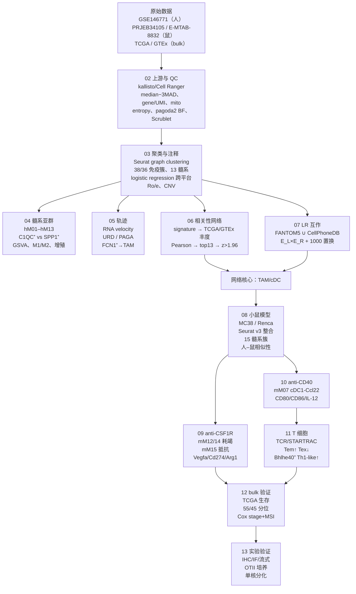

# 00 目录与复现总览

> **目标文献**：Zhang L, Li Z, Skrzypczynska KM, Fang Q, Zhang W, O'Brien SA, He Y, Wang L, Zhang Q, Kim A, Gao R, Orf J, Wang T, Sawant D, Kang J, Bhatt D, Lu D, Li CM, Rapaport AS, Perez K, Ye Y, Wang S, Hu X, Ren X, Ouyang W, Shen Z, Egen JG, Zhang Z, Yu X. *Single-Cell Analyses Inform Mechanisms of Myeloid-Targeted Therapies in Colon Cancer.* **Cell. 2020;181(2):442–459.e29.** DOI: [10.1016/j.cell.2020.03.048](https://doi.org/10.1016/j.cell.2020.03.048)
> **单位**：北京大学 BIOPIC / 北京大学生命科学学院 / 北京大学人民医院胃肠外科；Amgen Research（炎症与肿瘤学系、基因组分析部）。
> **投稿 2019-07-12 / 修回 2020-01-02 / 接收 2020-03-20 / 出版 2020-04-16**
>
> **PDF 原件**：同目录下 `2020_Zhang_L_Cell_Single-Cell_Analyses_Inform_Mechanisms_of_Myeloid-Targeted_Therapies_in_Colon_Cancer.pdf`
>
> **本套文档的性质**：以博士生导师（PI）视角编写的、可逐步执行的**方法学复现方案（Reproduction Protocol）**。全套 16 篇文档，每篇含：
> ① 科学问题与逻辑位置 → ② 背景原理（生物学 + 算法 + 公式） → ③ 原文逐句拆解 → ④ 逐步可运行代码（R 4.5 / Python 3.11） → ⑤ 参数解释与调参空间 → ⑥ 预期结果与 QC 检查点（附原文数值） → ⑦ 常见陷阱与排错表 → ⑧ 与原文图表的对应关系。
>
> **阅读顺序**：`00 → 01 → 02 → … → 13` 是一条完整流水线；`14`（质控与批判）与 `15`（文献精读与背景）建议**先通读**——前者给出结论边界与全部决策裁决，后者补齐免疫学、髓系生物学、轨迹/网络/生存分析的数学背景与逐图精读。
>
> **当前状态**：S3 方案完成，**S4 独立审核通过（有条件，见 `logs/14_review_record.md`）**，**尚未执行 S6**。所有"我方结果"列留空待跑；凡文献数值均可在原文定位，未报告处显式标注「文献未报告」并给出 D 表裁决。

---

## 一、文档清单（目录文件）

> 📌 **开工前必读（两级规范）**
> ① **通用规范 `../REPRO_SPEC.md` v2.1（L0）**：全仓库强制的目录/命名/契约/统计/写作/诚实性规范。
> ② **项目规范 `PROJECT_SPEC.md` v1.0（L1）**：模块编号表、**产物契约表**、**术语表与阳性判定唯一口径**、环境版本、D 表索引（D1–D22）。
> **效力层级：L0 > L1 > 14 号 §六（L2 QC 门槛）> 各模块文档（L3）**；D 表权威位置 = `14_复现质控清单、排错与批判性评述.md` §十一。

| 编号 | 文件名 | 内容一句话描述 | 对应原文图表 |
|---|---|---|---|
| **L0** | `../REPRO_SPEC.md` | 仓库级通用规范 v2.1：工作流、目录/命名、产物契约、环境、统计、写作、变更控制、诚实性红线 | — |
| **L1** | `PROJECT_SPEC.md` | 本项目规范：模块表、产物契约表、术语表、D 表索引（D1–D22）、版本钉死 | — |
| **00** | `00_目录与复现总览.md` | 本文件：文档目录、科学问题、证据链 C1–C8、全流程图、图表映射、数据资产、算力工期、全局门槛 G1–G13 | Fig. 1–7 |
| **01** | `01_环境搭建与数据获取.md` | R/Bioconductor/Python 版本钉死；GSE146771、PRJEB34105、E-MTAB-8832、TCGA/GTEx（Xena）的获取与校验；目录初始化、md5、renv/conda 环境文件 | Data/Code availability；STAR Methods |
| **02** | `02_人类CRC数据接入与统一预处理.md` | Smart-seq2（kallisto 0.43.1 + tximport）与 10x（Cell Ranger 2.1.0）两条上游；QC（median−3 MAD、600–4,000 genes、1,600–25,000 UMIs、线粒体 10%/70%）；熵指标批次评估；pagoda2 batch factor；Scrublet 与 CD14⁺IL32⁺ 双细胞簇 | Fig. S1；Methods「Single-cell RNA-Seq data processing」「Batch effect」「Doublet」 |
| **03** | `03_无监督聚类注释与恶性细胞CNV.md` | Seurat 图聚类（2,000 HVG、10–25 PCs、res 0.6–2.0）；38/36 个免疫簇；13 髓系/4 ILC/18 T/5 B；跨平台 logistic regression 相似性；Ro/e 组织分布；CNV 推断（100-gene moving average、hE02–hE06 baseline、±0.2） | Fig. 1、S2、S3；Methods「Unsupervised clustering」「Similarity」「CNV」 |
| **04** | `04_髓系亚群与TAM二分法.md` | hM01–hM13 的 marker 与组织分布；C1QC⁺ vs SPP1⁺ 的 DEG、GSVA、M1/M2 对照、增殖分数；多色 IHC（CD68/CD80/c-MAF vs CD68/MARCO/VEGFA） | Fig. 2A–2D、3A–3D、S4A–S4D、S4H–S4I；Methods「Signature genes」「GSVA」「M1/M2」 |
| **05** | `05_单核巨噬细胞发育轨迹.md` | RNA velocity（destiny diffusion map + velocyto）、URD（root hM05、control hM06、knn=200、sigma=8 等）、PAGA（2,000 HVG、15 PCs）；FCN1⁺→C1QC⁺/SPP1⁺；人单核细胞体外分化（CSF1/GM-CSF、缺氧、IL-1β/VEGF → MARCO） | Fig. 2E–2F、S4D–S4G；Methods「Developmental trajectory」 |
| **06** | `06_细胞互作网络I_scRNA_bulk相关性网络.md` | **本项目的核心方法学**：24 个组织富集簇 + 3 个基质簇；signature 四条件；TCGA COAD/READ 与 GTEx colon 的丰度估计（z-score 均值）；基因–丰度 Pearson 相关；self-expressed 置 0；top 13 非自表达基因的富集分数 z>1.96 → 网络边；肿瘤 vs 正常网络 | Fig. 3E、S5A–S5C、S8A；Methods「Correlative cell-cell interactions」 |
| **07** | `07_细胞互作网络II_配体受体与置换检验.md` | FANTOM5 ∪ CellPhoneDB；表达阈值 >20% & log2(TPM+1)>3；`Int(A/B)=E_A(L)×E_B(R)`；1,000 次 cluster-label 置换与正态近似；CXCL10–CXCR3、SPP1–ITGAV、SDC2–MMP2、FN1–ITGA5；弦图 | Fig. 3F、S5D–S5F；Methods「Significant ligand-receptor pairs」 |
| **08** | `08_小鼠肿瘤模型与跨物种髓系整合.md` | MC38（C57BL/6）与 Renca（BALB/c）模型、anti-CD40/anti-CSF1R 给药；10x 3′/5′ + TCR；Seurat v3 整合 → 15 个髓系簇 + T 细胞 mT01–mT12；人–鼠 logistic regression 相似性；mM15↔hM13、mM11–14↔hM12、mM06/07↔hM04 | Fig. 3G–3H、S6；Methods 小鼠部分 |
| **09** | `09_antiCSF1R_TAM差异耗竭与耐药.md` | anti-CSF1R（M279，400 µg/鼠，3×/周×4）→ mM12/mM14 近完全丢失、mM11/13/15 保留；F4/80^high 优先耗竭；resistant 簇 Vegfa/Cd274/Arg1↑、贴附血管（CD31/F4/80/MHCII IF）；增殖分数；TCGA C1QC/SPP1 生存 | Fig. 4A–4I、S7A–S7D；Methods |
| **10** | `10_antiCD40_cDC1激活与CD40_CD40LG轴.md` | anti-CD40（FGK45，5 mg/kg i.p.）± anti-PD1；Ccl22⁺ cDC1（mM07）day 2 扩增；CD80/CD86 ↑、IL-12 ↑；CD40–CD40LG 弦图；activated DC signature 与 OS（HR=0.53，P=0.01）；与 anti-PD1 协同 | Fig. 5A–5J、S6G–S6I、S7E；Methods |
| **11** | `11_antiCD40_T细胞动态TCR与STARTRAC.md` | MC38 肿瘤/tdLN T 细胞；day 2/day 10；CD8⁺ Tem↑、Tex↓、PD1↓；TCR αβ 重建（Cell Ranger 2.1.0 vdj，dominant pair，UMI≥2）；STARTRAC expansion/migration/transition；Ccl5⁺ Tem 与 Cxcr6⁺ Trm 的迁移与转变；Bhlhe40⁺ Th1-like 扩增、Cd40lg↑、IFNγ↑；Treg 双相动力学 | Fig. 6A–6J、7A–7J、S7F–S7M；Methods「TCR analysis」 |
| **12** | `12_TCGA_GTEx_bulk验证与生存分析.md` | TCGA COAD+READ 与 GTEx colon；signature mean expression；55th/45th 分位分组；Cox 校正 stage+MSI；KM；C1QC^low SPP1^high 预后最差；activated DC/Th1-like signature 与 OS；MSI-H 富集；Pearson 相关（Th1-like vs cDC1） | Fig. 4I、5J、7J、S5C；Methods「Survival analysis」 |
| **13** | `13_实验验证与湿实验SOP.md` | 人 CRC 组织消化/FACS/多色 IHC（Opal 7-color）；小鼠肿瘤消化/流式/胞内细胞因子（IFNγ、TNFα、IL-12）；CD31/F4/80/MHCII 免疫荧光；OTII 脾细胞培养 + anti-CD40 + Ova 肽 + RT-qPCR（Bhlhe40/Tbx21/Rpl19）；人 CD14⁺ 单核细胞 6 天分化（常氧/5% O2）；MSI 7 位点 PCR；外显子测序 | Fig. 3D、4B–4F、5G–5I、6D–6G、7E–7I；Methods 湿实验 |
| **14** | `14_复现质控清单、排错与批判性评述.md` | **QC 门槛表（L2）**、gap 表、跨模块排错、**D 表（D1–D22 权威全文）**、证据等级与批判性评述（相关性≠因果、轨迹推断的局限、小鼠–人映射的边界、生存分析的选择偏差） | 全文 |
| **15** | `15_文献精读、生物学背景与方法学原理速查.md` | 教授视角逐图精读；CRC 免疫微环境、单核/巨噬/DC 个体发育、TAM 二分、cDC1–Th1–CD8 轴；RNA velocity/URD/PAGA、GSVA、logistic regression、相关性网络、LR 置换、STARTRAC、Cox 的数学速查；术语表与 FAQ | 全文 |
| **原文** | `2020_..._Colon_Cancer.pdf` | 47 页 PDF（正文 18 页 + STAR Methods e1–e12 + 补充图 S1–S8） | — |
| **索引** | `README.md` | 项目一句话、文件清单、目录结构、使用顺序 | — |
| **日志** | `logs/DECISIONS.md` | 运行时决策流水（L0 §10.2） | — |

---

## 二、科学问题与逻辑位置

### 2.1 一句话科学问题

**在结直肠癌（CRC）中，肿瘤相关髓系细胞（TAM、cDC）究竟有哪些功能不同的亚群；这些亚群如何通过细胞–细胞互作塑造肿瘤微环境；以及为何以 CSF1R 阻断（耗竭 TAM）和 CD40 激动（激活 DC）为代表的髓系靶向治疗，在临床单药疗效有限？**

原文的回答分三层：

1. **图谱层**：用 Smart-seq2（基因深度）+ 10x（细胞覆盖）双平台，建立 18 例初治 CRC 患者的肿瘤/癌旁/外周血免疫与非免疫细胞图谱，定义 13 个髓系亚群，其中两类 TAM——`C1QC⁺`（补体/吞噬/抗原提呈）与 `SPP1⁺`（血管生成/ECM/促转移）——呈现罕见的"二分"而非连续谱。
2. **互作层**：把 scRNA-seq 的细胞类型 signature 投射到 TCGA COAD/READ 与 GTEx colon bulk，构建"基因–细胞丰度"相关矩阵，反推细胞–细胞共变网络；再用配体–受体表达 + 1,000 次标签置换，推断分子互作。结论：TAM 与 cDC 是网络核心；SPP1⁺ TAM 连接 CAF/内皮，C1QC⁺ TAM 连接 T 细胞。
3. **机制/治疗层**：在小鼠 MC38/Renca 模型中用 anti-CSF1R 与 anti-CD40 复制人类亚群，证明：
   - anti-CSF1R **优先耗竭增殖中的 C1QC⁺ 样 TAM（mM12/mM14）**，而 **sparing 血管生成型 SPP1⁺ 样 TAM（mM15）** → 单药耐药的细胞学基础；
   - anti-CD40 **优先激活 Ccl22⁺ cDC1（mM07）** → IL-12↑ → **Bhlhe40⁺ Th1-like CD4 T 扩增** → CD8⁺ 记忆 T 增多、耗竭 T 减少 → 与 anti-PD1 协同。

### 2.2 原文证据链（复现时逐条核验）

| # | 原文主张 | 关键图 | 复现判据（14 号 §六） |
|---|---|---|---|
| C1 | 双平台互补：Smart-seq2 基因深度高、10x 细胞覆盖高；联合可最大化稀有/过渡态细胞 | Fig. 1、S1–S3 | G1–G2 |
| C2 | CRC TAM 呈 C1QC⁺/SPP1⁺ 二分；二者转录因子网络、通路、组织分布不同 | Fig. 2、3A–3D | G3–G4 |
| C3 | FCN1⁺ 单核样前体 → C1QC⁺/SPP1⁺；SPP1⁺ 也可来自 NLRP3⁺ RTM | Fig. 2E–2F、S4E–S4F | G5 |
| C4 | TAM/cDC 是相关性互作网络的核心节点；SPP1⁺–CAF/内皮、C1QC⁺–T 细胞 | Fig. 3E、S5、S8A | G6 |
| C5 | CXCL10–CXCR3、SPP1–ITGAV、SDC2–MMP2、FN1–ITGA5 等 LR 对具有细胞类型特异性 | Fig. 3F、S5D–S5F | G7 |
| C6 | 人–鼠髓系亚群可对应；mM15↔hM13、mM11–14↔hM12、mM06/07↔hM04 | Fig. 3G–3H、S6 | G8 |
| C7 | anti-CSF1R 差异耗竭：mM12/mM14 敏感、mM15 抵抗；抵抗簇促血管/免疫抑制；C1QC^low SPP1^high 预后差 | Fig. 4、S7A–S7D | G9–G10 |
| C8 | anti-CD40 激活 cDC1 → Th1-like/CD8 记忆扩增；与 anti-PD1 协同 | Fig. 5–7、S6–S7 | G11–G13 |

### 2.3 方法在证据链中的位置（全流程）

> **关键逻辑**：04–07 的所有结论都共享同一套 `human_annot.rds` 与 `myeloid_human.rds`；08–11 的所有小鼠结论共享 `mouse_myeloid_integrated.rds`（髓系）与 `mouse_t_annot.rds`（T 细胞）。复现时若每个模块各自重聚类、各自改标签，数值与网络必然对不上——这是本项目第一条工程纪律。

---

## 三、原文逐图精读（浓缩版；详解见 15 号）

| 图 | 原文标题/内容 | 一句话结论 | 对应文档 |
|---|---|---|---|
| Fig. 1 | 双平台鉴定人类 CRC 细胞类型 | 38/36 个免疫簇；13 髓系、4 ILC、18 T、5 B；双平台互补 | 02, 03 |
| Fig. 2 | 人类 CRC 髓系细胞特征 | 13 个髓系亚群；TAM 二分；FCN1⁺ 前体；RNA velocity/URD 轨迹 | 04, 05 |
| Fig. 3 | TAM 功能二分与预测互作 | C1QC⁺ 补体/吞噬 vs SPP1⁺ 血管生成/ECM；TAM/cDC 是网络核心；LR 对；人–鼠髓系整合 | 04, 06, 07, 08 |
| Fig. 4 | anti-CSF1R 差异耗竭 | mM12/mM14 敏感、mM15 抵抗；Vegfa/Cd274/Arg1↑；C1QC^low SPP1^high 预后差 | 09, 12 |
| Fig. 5 | anti-CD40 激活 cDC1 | Ccl22⁺ cDC1 扩增；CD80/CD86/IL-12↑；activated DC signature 与 OS 正相关 | 10, 12 |
| Fig. 6 | anti-CD40 扩增 CD8⁺ 记忆 T | Tem↑、Tex↓、PD1↓；TCR 克隆共享；STARTRAC transition | 11 |
| Fig. 7 | anti-CD40 扩增 Bhlhe40⁺ Th1 | Bhlhe40⁺ Th1-like 扩增、Cd40lg↑、IFNγ↑；与 cDC1 相关；MSI-H 富集 | 11, 12 |
| Fig. S1 | 数据质量 | 双平台基因数、dropout、批次熵 | 02 |
| Fig. S2 | 免疫亚群相似性 | 跨平台 cluster 对应；B/ILC 亚群 | 03 |
| Fig. S3 | 免疫与非免疫亚群 | 12 个非免疫簇；CNV 恶性判定；组织分布 | 03 |
| Fig. S4 | 髓系细节 | 13 簇 marker；APC signature；PAGA；体外 MARCO；M1/M2；UC 对照 | 04, 05 |
| Fig. S5 | 细胞互作 | 相关性网络示例；正常黏膜网络；LR 热图/弦图 | 06, 07 |
| Fig. S6 | 小鼠髓系与处理设计 | 给药方案；15 簇；cDC1 亚群；跨数据集 cDC1 热图 | 08, 10 |
| Fig. S7 | 小鼠免疫改变 | F4/80 门控；TAM 频率；T 细胞 UMAP；STARTRAC；OTII | 09, 10, 11, 13 |
| Fig. S8 | 分析框架与总结 | 相关性网络流程图；人/鼠髓系特征总表 | 06, 15 |

---

## 四、数据资产

| 数据集 / 队列 | 样本数 / 细胞数 | 用途 | 获取方式 | 本地路径 |
|---|---|---|---|---|
| 人类 CRC 10x | 10 例患者；43,817 细胞；13,538 基因 | 主图谱、髓系/淋巴/基质聚类、网络、LR | GEO **GSE146771**（processed matrix） | `raw/human_crc_10x/` |
| 人类 CRC Smart-seq2 | 10 例患者；10,468 细胞；15,179 基因；另含 5,126 个既往 T 细胞 | 基因深度、DEG/GSVA、signature、网络 | GEO **GSE146771**；Zhang et al., Nature 2018 | `raw/human_crc_smartseq2/` |
| 小鼠 MC38 anti-CD40 | 119,698 细胞；15,243 基因；TCR 53,499 细胞 | cDC1/T 细胞动态、TCR/STARTRAC | ENA **PRJEB34105**；ArrayExpress **E-MTAB-8832** | `raw/mouse_mc38/` |
| 小鼠 Renca anti-CSF1R | 8,578 细胞；13,328 基因 | TAM 差异耗竭、耐药 | ENA **PRJEB34105**；ArrayExpress **E-MTAB-8832** | `raw/mouse_renca/` |
| TCGA COAD + READ | COAD ~450、READ ~170（以 Xena 实际下载为准） | bulk 丰度、生存、MSI | UCSC Xena（TOIL RSEM + clinical） | `raw/tcga_coadread/` |
| GTEx colon | ~300 例（以 Xena 实际下载为准） | 正常黏膜相关性网络 | UCSC Xena | `raw/gtex_colon/` |
| 外部对照（可选） | Smillie UC（SCP259）、Zilionis NSCLC（GSE127465）、Zhang HCC（EGA） | cDC1/髓系跨数据集比较（Fig. S4J–K、S6I） | 各自门户 | `raw/external/`（可选） |

> **隐私与许可**：人类原始 FASTQ 不公开（原文明确），只提供 processed matrix；小鼠原始 FASTQ 公开。使用时遵守 GEO/ENA/TCGA/GTEx 的数据使用协议。

---

## 五、算力与工期

| 模块 | 预计人日 | 内存 | CPU | GPU | 备注 |
|---|---|---|---|---|---|
| 01 数据获取与环境 | 1–2 | 16 GB | 4 | — | 下载为主 |
| 02 上游与 QC | 2–3 | 32 GB | 8 | — | 10x/Smart-seq2 矩阵；Scrublet 可并行 |
| 03 聚类/注释/CNV | 3–5 | 64 GB | 16 | — | 43,817 + 10,468 细胞；CNV 可按患者并行 |
| 04 髓系与 GSVA | 2–3 | 32 GB | 8 | — | 13 簇；GSVA 按细胞 |
| 05 轨迹 | 3–5 | 64 GB | 8 | 可选 | velocyto 需 BAM；URD 较慢 |
| 06 相关性网络 | 2–3 | 32 GB | 8 | — | TCGA/GTEx bulk；相关矩阵大 |
| 07 LR 置换 | 2–3 | 32 GB | 16 | — | 1,000 次置换可并行 |
| 08 小鼠整合 | 3–5 | 64 GB | 16 | — | 119,698 细胞；Seurat 整合耗时 |
| 09–11 小鼠处理分析 | 4–6 | 64 GB | 16 | — | 丰度/DE/TCR/STARTRAC |
| 12 生存与 bulk | 1–2 | 16 GB | 4 | — | Cox/KM |
| 13 湿实验 SOP | — | — | — | — | 本项目不执行；仅文档 |
| 14–15 质控/精读 | 2–3 | — | — | — | 写作 |
| **合计** | **约 28–40 人日** | **峰值 64 GB** | **16 核** | **可选** | 不含湿实验 |

---

## 六、全局门槛（Go/No-Go）

> 细表见 `14` 号 §六（L2）。此处只列"一票否决"级门槛。

| 编号 | 门槛 | Go | No-Go |
|---|---|---|---|
| G1 | 细胞数 | 10x 43,817 ±5%；Smart-seq2 10,468 ±5%；小鼠 119,698 / 8,578 ±5% | 5–10% 为警告并记录；>10% 或无法解释为 No-Go |
| G2 | 簇数 | 13 髓系、4 ILC、18 T、5 B；小鼠 15 髓系 | 髓系簇数 <11 或 >15 |

> **簇数口径（重要）**：10x 的 38 个免疫簇 = **13 髓系 + 3 ILC + 17 T + 5 B**；Smart-seq2 的 36 个 = **9 髓系 + 4 ILC + 18 T + 5 B**（Smart-seq2 的髓系分辨率较低，Fig. 2A 只显示 9 簇）。`13 髓系/4 ILC/18 T/5 B` 是两平台**合并注释的标签集合**（髓系取并集 13），不能直接相加去校验单平台的 38/36。
| G3 | TAM marker | hM12: C1QC↑/TREM2↑/MERTK↑/CD80↑；hM13: SPP1↑/MARCO↑/VEGFA↑ | 方向相反 |
| G4 | GSVA 方向 | SPP1⁺: angiogenesis/ECM↑；C1QC⁺: complement/antigen presentation↑ | 方向相反且 FDR<0.05 |
| G5 | 轨迹 | FCN1⁺ → C1QC⁺/SPP1⁺；SPP1⁺–NLRP3⁺ 相连 | 无 FCN1⁺ 起点或方向相反 |
| G6 | 网络 | TAM/cDC 节点度数最高；SPP1⁺–CAF/内皮、C1QC⁺–T 边存在 | 核心节点不是 TAM/cDC |
| G7 | LR | CXCL10–CXCR3、SPP1–ITGAV、SDC2–MMP2、FN1–ITGA5 特异（p<0.05） | 全部不显著 |
| G8 | 跨物种 | mM15↔hM13；mM11–14↔hM12；mM06/07↔hM04 | 映射关系错位 |
| G9 | anti-CSF1R | mM12/mM14 减少、mM15 保留；resistant 簇 Vegfa/Cd274/Arg1↑ | 所有簇同等减少或不减少 |
| G10 | 生存 | C1QC^low SPP1^high 最差；HR>1 | 方向相反且显著 |
| G11 | anti-CD40 | mM07 增加；CD80/CD86/IL-12↑；Bhlhe40⁺ Th1-like↑；CD8 Tem↑/Tex↓ | 无 cDC1 激活或 T 细胞无变化 |
| G12 | 激活 DC 生存 | HR<1（原文 0.53，P=0.01） | HR>1 且显著 |
| G13 | 阴性结果 | 全部保留并写入 gap 表 | 只报阳性 |

---

## 七、工程约定（摘要）

1. **`raw/` 只读**；清洗结果写 `processed/`；禁止原地覆盖原始文件。
2. **脚本幂等**：重跑覆盖同名产物；版本对比用 `__v2` 后缀。
3. **图双份**：`.pdf` + `.png`（300 dpi）；图注写 n、检验、p 形式。
4. **随机种子**：全项目 `20261018`；写在各脚本首行并在契约表声明。
5. **契约纪律**：每个产物只有一个生产者；改格式/名 = 改 `PROJECT_SPEC.md` §4 + 通知消费方 + 记 `DECISIONS.md`。
6. **诚实性红线**：跑不出文献的数不叫失败，改参数直到跑出才叫失败；"没复现出来"≠"文献不可复现"；相关性≠因果；阴性结果必须保留（L0 §12）。
7. **S4 独立审核**：写作方与审核方分离；四查（事实/代码/引用/结构）；审核记录写 `logs/14_review_record.md`。
8. **S6 才跑数据**：方案定稿前不跑分析。

---

## 八、本目录文件速查（给后来者）

| 文件/目录 | 一句话 |
|---|---|
| `README.md` | 项目首页：一句话、文件索引、使用顺序 |
| `PROJECT_SPEC.md` | L1 规范：模块表、契约、术语、D 表索引、版本 |
| `00_…` | 本文件：总览与目录 |
| `01_…` | 环境与数据获取 |
| `02_…` | 人类 CRC 上游与 QC |
| `03_…` | 聚类、注释、CNV |
| `04_…` | 髓系亚群与 TAM 二分 |
| `05_…` | 单核–巨噬轨迹 |
| `06_…` | 相关性细胞互作网络（scRNA × bulk） |
| `07_…` | 配体–受体与置换检验 |
| `08_…` | 小鼠模型与跨物种整合 |
| `09_…` | anti-CSF1R 差异耗竭 |
| `10_…` | anti-CD40 cDC1 激活 |
| `11_…` | anti-CD40 T 细胞/TCR/STARTRAC |
| `12_…` | TCGA/GTEx bulk 与生存 |
| `13_…` | 湿实验 SOP |
| `14_…` | QC 门槛、排错、D 表、批判性评述 |
| `15_…` | 文献精读、生物学背景、方法学原理 |
| `code/` | 脚本（S6 实现；编号与文档一致） |
| `processed/` | 中间对象（`.rds`/`.h5ad`） |
| `results/` | 结果表（`.csv/.tsv`） |
| `figures/` | 图（`.pdf`+`.png`） |
| `logs/` | sessionInfo、运行日志、`DECISIONS.md`、`14_review_record.md`、md5 |
| `raw/` | 只读原始数据（见 §四） |
