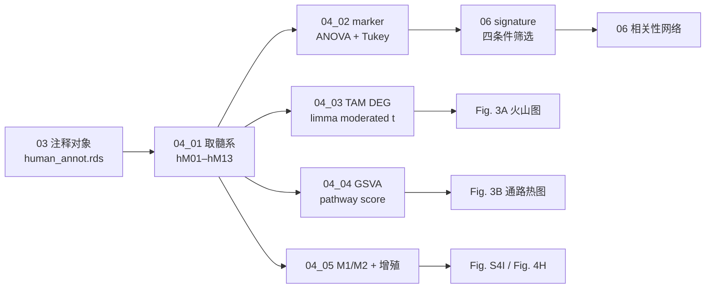

# 04 髓系亚群与 TAM 二分法

> **目标文献**：Zhang L, Li Z, Skrzypczynska KM, et al. *Single-Cell Analyses Inform Mechanisms of Myeloid-Targeted Therapies in Colon Cancer.* Cell. 2020;181(2):442–459.e29. DOI: 10.1016/j.cell.2020.03.048
> **模块对应原文**：Fig. 2A–2D、Fig. 3A–3D、Fig. S4A–S4D、S4H–S4K；STAR Methods「Identification of signature genes」「Gene set enrichment analysis」「Define M1/M2 and proliferation phenotypes」「Multi-color immunohistochemistry of human tissues」；Table S2、S3B
> **前置依赖**：`02_人类CRC数据接入与统一预处理.md`、`03_无监督聚类注释与恶性细胞CNV.md`；契约产物 `processed/myeloid_human.rds`（由本模块 04_01 生成）、`processed/human_smartseq2_norm.rds`、`processed/human_10x_norm.rds`
> **复现难度 / 预计工时 / 计算资源**：★★★☆☆ / 2–3 人日 / 32 GB 内存、8 核；GSVA 可按细胞并行，IHC 量化另计

---

## ① 科学问题与逻辑位置

### 1.1 本模块要回答什么

人类 CRC 肿瘤、癌旁与外周血中的髓系细胞，能否被划分为**功能与发育上可区分**的亚群？其中两类 TAM——`C1QC⁺` 与 `SPP1⁺`——是否真的存在"二分"（而非连续谱），以及这种二分在 marker、转录因子、通路、组织分布和蛋白水平上是否一致？

### 1.2 输入与输出

| 方向 | 对象 | 说明 |
|---|---|---|
| 输入 | `processed/human_annot.rds` | 03 号产出的 **10x** 全细胞注释对象；含 `cluster_id`、`major_type`、`tissue`、`patient_id` |
| 输入 | `processed/human_smartseq2_annot.rds` | 03 号产出的 **Smart-seq2** 全细胞注释对象；用于取 Smart-seq2 髓系子集 |
| 输入 | `processed/human_smartseq2_norm.rds` | Smart-seq2 的 `logtpm`；用于 DEG、GSVA、M1/M2、signature |
| 输入 | `processed/human_10x_norm.rds` | 10x 的 `logtpm`；用于 marker 展示、Ro/e、聚类频率 |
| 输出 | `processed/myeloid_human.rds` | 10x 的 `hM01`–`hM13` 髓系子集（`SingleCellExperiment`）；供 05 轨迹使用 |
| 输出 | `processed/myeloid_human_smartseq2.rds` | Smart-seq2 的 `hM01`–`hM13` 髓系子集（`SingleCellExperiment`）；供 04 的 DEG/GSVA/M1-M2/增殖使用 |
| 输出 | `results/myeloid_markers.tsv` | 每个 gene×cluster 的 ANOVA/Tukey/Wilcoxon 统计与表达比例 |
| 输出 | `results/tam_gsva.tsv` | 契约长表：`cell_id`、`cluster_id`（hM12/hM13）、`pathway`、`gsva_score`（每细胞）、`t`、`p`、`FDR`（每 pathway 的 limma 统计，按 pathway 重复） |
| 输出 | `results/04_tam_gsva_stats.tsv` | 04 号私有统计表：`pathway`、`t`、`P.Value`、`adj.P.Val`、`logFC`（hM12 vs hM13） |
| 输出 | `results/tam_deg.tsv` | hM12 vs hM13 的 limma moderated t 结果 |
| 输出 | `results/m1_m2_proliferation.tsv` | 每细胞的 M1、M2、proliferation score |
| 下游 | 05 号 | 用 `myeloid_human.rds` 做轨迹 |
| 下游 | 06 号 | 用 Smart-seq2 的 marker/signature 标准推导 `celltype_signatures.tsv`（**06 号为该产物的唯一生产者**；04 号只提供 marker 表与判定标准） |
| 下游 | 07 号 | 用 hM12/hM13 的 LR 表达做互作 |
| 下游 | 09/10/12 号 | 用 C1QC/SPP1 基因集做小鼠对应与生存 |

> ⚠️ **契约提醒**：`results/celltype_signatures.tsv` 的生产者是 **06 号**（`code/06_01_signatures.R`），不是 04 号。04 号输出 `results/myeloid_markers.tsv`，并在 §2.7 给出 signature 四条件；06 号按同一标准重新计算并落盘，避免两个生产者写同一文件（L0 §4.2）。

### 1.3 在证据链中的位置



**逻辑位置**：04 号是"图谱层"到"功能层"的转折点。03 号只回答"有哪些簇"，04 号回答"这些簇是什么、凭什么说它们不同"。如果 04 号的 marker/通路方向错了，06–12 号的所有下游结论都会建立在错误的标签上。

---

## ② 背景原理（生物学 + 算法）

### 2.1 髓系细胞的分类逻辑

原文用**两级策略**：

1. **无监督聚类**得到 13 个髓系簇（hM01–hM13）；
2. **marker + 组织分布 + 功能**人工注释为：
   - 肥大细胞（hM01）
   - DC：pDC（hM02）、cDC2（hM03）、cDC1（hM04）
   - 单核：classical（hM05）、non-classical（hM06）、intermediate（hM07）
   - 巨噬：RTM（hM08–hM10）、单核样过渡态（hM11）、TAM（hM12–hM13）

这不是"先验分类再聚类"，而是"聚类后按 marker 解释"。复现时必须保留这个顺序：**先看簇，再看 marker，最后贴标签**；不能先设定 13 个标签再强行找簇。

### 2.2 13 个髓系簇的 marker 与判定规则

| 簇 | 原文标签 | 核心 marker（人类） | 判定规则（本项目） | 组织分布 |
|---|---|---|---|---|
| hM01 | `hM01_Mast-TPSAB1` | `TPSAB1/2`、`CPA3`、`MS4A2`、`KIT`、`HDC`、`SLC18A2`、`GATA2`、`IL1RL1`、`HPGDS`、`VWA5A` | `TPSAB1` 或 `CPA3` 平均表达 >1 且 >20% 细胞表达；`KIT` 阳性 | 肿瘤与正常黏膜相当 |
| hM02 | `hM02_pDC-LILRA4` | `LILRA4`、`LILRB4`、`IL3RA`、`GZMB`、`TCF4`、`JCHAIN`、`MZB1`、`IRF7`、`SLC15A4`、`IRF4`、`SPIB`、`SERPINF1`、`ITM2C`、`PLAC8`、`IRF8`、`AXL` | `LILRA4` 平均 >1 且 >20%；`CD14` 低 | 肿瘤与正常相当 |
| hM03 | `hM03_cDC2-CD1C` | `CD1C`、`FCER1A`、`CD1E`、`CD1A`、`CLEC10A`、`FCGR2B`、`PKIB`、`CST7`、`DAPP1`、`FLT3`、`C1ORF54` | `CD1C` 或 `FCER1A` 平均 >1 且 >20%；`BATF3/XCR1` 低 | 肿瘤与正常相当 |
| hM04 | `hM04_cDC1-BATF3` | `BATF3`、`XCR1`、`ANPEP`、`CCR7`、`IDO1`、`CD40`、`FLT3`、`IRF8` | `BATF3` 或 `XCR1` 平均 >1 且 >20%；`CD1C` 低 | 肿瘤与正常相当 |
| hM05 | `hM05_Mono-CD14` | `CD14`、`S100A8/9/12`、`VCAN`、`CD36`、`TCF7L2`、`IFITM2`、`MTSS1` | `CD14` 高、`FCGR3A` 低 | 血富集 |
| hM06 | `hM06_Mono-CD16` | `FCGR3A`、`SERPINA1`、`SIGLEC10`、`RHOC`、`CX3CR1`、`MS4A7`、`LILRB1`、`LILRA1` | `FCGR3A` 高、`CD14` 低 | 血富集 |
| hM07 | `hM07_Mono-CD14CD16` | `CD14` + `FCGR3A` | 同时满足 `CD14` 与 `FCGR3A` 的中等表达 | 血富集 |
| hM08 | `hM08_Macro-NLRP3` | `NLRP3`、`IL1B`、`EREG`、`ITGAX`、`VEGFA`、`CCL3`、`APOE`、`C1QA/B/C`、`CD81`、`TREM2`、`ACP5`、`APOC1`、`PRDM1`、`CSF1R`、`SLAMF8`、`CSTB` | `NLRP3` 高；`IL1B` 在 RTM 中最高（原文）；`CD68/CD163/MRC1` 阳性 | 正常黏膜相当/富集 |
| hM09 | `hM09_Macro-PLTP` | `PLTP`、`LYVE1`、`IL10`；HLA-DR 较低 | `PLTP` + `LYVE1` + `IL10` 阳性；HLA-DR 低于 hM10 | 正常黏膜富集 |
| hM10 | `hM10_Macro-IL1B` | `IL1B`、HLA-DR 较高；`APOE/APOC1` 低于 hM12 | `IL1B` 阳性；HLA-DR 较高 | 正常黏膜富集 |
| hM11 | `hM11_Monolike-FCN1` | `FCN1`、`CD14`、`S100A8/9`，并共表达 `C1QC`/`SPP1` 等 TAM 基因 | `FCN1` 高；同时具有单核与 TAM 特征 | 肿瘤富集 |
| hM12 | `hM12_TAM-C1QC` | `C1QA/B/C`、`TREM2`、`MERTK`、`CD80`、`APOE`、`APOC1`、HLA-DR；TF：`MAF/MAFB`、`FOS/JUN` | `C1QA/B/C` 平均 >1 且 >20%；`SPP1` 不满足该规则 | 肿瘤富集 |
| hM13 | `hM13_TAM-SPP1` | `SPP1`、`MARCO`、`VEGFA`、`FN1`、`SDC2`；TF：`CEBPB`、`ZEB2`；HLA-DR 低 | `SPP1` + `MARCO` + `VEGFA` 平均 >1 且 >20%；`C1QC` 不满足该规则 | 肿瘤富集 |

> ⚠️ **导师批注**：上表的"判定规则"是为了让复现有唯一口径（`PROJECT_SPEC.md` §5）。原文并没有给出每簇的硬阈值，而是"marker 表达 + 组织分布 + 人工注释"。因此复现时**先用聚类得到簇，再用上表核对**；若某簇 marker 不符，优先检查聚类/QC，而不是改阈值硬贴标签。

### 2.3 组织分布：Ro/e 的定义与解释

对每个 cluster × tissue 组合：

```
O_{c,t} = 该簇在该组织的实际细胞数
E_{c,t} = (该簇总细胞数 × 该组织总细胞数) / 总细胞数   # 卡方期望
Ro/e_{c,t} = O_{c,t} / E_{c,t}
```

- `Ro/e > 1`：该簇在该组织富集；
- `Ro/e = 1`：与整体构成相符；
- `Ro/e < 1`：该簇在该组织耗竭。

原文 Fig. S8B 用 `+++`（>2）、`++`（1–2）、`+`（0.5–1）、`+/−`（0–0.5）、`−`（=0）表示。复现时输出连续值，不要只输出符号，便于审计。

### 2.4 差异表达：为什么原文用 ANOVA + Tukey，而 TAM 二分类用 limma

- **多簇 marker**：13 个簇两两比较，若做 13×12/2 = 78 次 t 检验，假阳性会爆炸。原文用**单因素 ANOVA**（`aov`）筛基因，再用 **Tukey HSD** 做全部簇对比较，天然控制 family-wise error。
  - 基因入选：ANOVA FDR < 0.05；且**任一簇对** `|log2FC| > 1` 且 Tukey adj p < 0.01。
- **两簇比较**（hM12 vs hM13）：只有一次比较，原文用 **limma moderated t**（`lmFit` + `eBayes` + `topTable`），p < 0.05、`|log2FC| ≥ 1.5`（Fig. 3A 图注写 `log2(fold change) ≥ 1.5`）。
- **为什么不用 Wilcoxon 作为主路径**：原文没有用；Wilcoxon 对 dropout/零膨胀更稳健，但会把"表达比例差异"和"表达强度差异"混在一起。复现时 Wilcoxon 只作敏感性，不替代主路径。

### 2.5 GSVA 的数学直觉

给定基因集 `G`（如 "Tumor angiogenesis"）和细胞 `j` 的表达向量 `x_j`：

1. 对每个基因，估计其在所有细胞中的表达分布（核密度，`kcdf="Gaussian"` 对应 log TPM）；
2. 把每个细胞的基因表达转为**秩**；
3. 对基因集内/外的秩做随机游走，得到 enrichment score `S_j(G)`；
4. `S_j(G)` 就是该细胞在该通路上的活性分数。

原文：`GSVA 1.3.0` + `GSEABase 1.44.0`；每细胞 score 后用 `limma` moderated t 比较 hM12 vs hM13。复现时：
- 输入必须是 `log2(TPM+1)`（Smart-seq2），不要用原始 counts；
- `kcdf="Gaussian"`、`mx.diff=TRUE`；
- 基因集版本固定（D22）；
- 对每个 pathway 输出 `t`、`p`、`BH FDR`，并报告 hM12/hM13 的方向。

### 2.6 M1/M2 与 proliferation score

**M1（14 基因）**：
`CCL5, CCR7, CD40, CD86, CXCL9, CXCL10, CXCL11, IDO1, IL1A, IL1B, IL6, IRF1, IRF5, KYNU`

**M2（原文逐字转录，27 基因）**：
`CCL4, CCL13, CCL18, CCL20, CCL22, CD276, CLEC7A, CTSA, CTSB, CTSC, CTSD, FN1, IL4R, IRF4, LYVE1, MMP9, MMP14, MMP19, MSR1, TGFB1, TGFB2, TGFB3, TNFSF8, TNFSF12, VEGFA, VEGFB, VEGFC`

> ⚠️ **计数说明**：原文 Methods 逐字列出的 M2 基因是 **27 个**（含 `CCL13`）。早期草稿曾误写 26 个；`PROJECT_SPEC.md` §5 已同步为 27，本文件以原文为准。复现报告引用时写“原文列出的 M2 基因”，不写死数字。

**Proliferation（23 基因）**：
`AURKA, BUB1, CCNB1, CCND1, CCNE1, DEK, E2F1, FEN1, FOXM1, H2AFZ, HMGB2, MCM2, MCM3, MCM4, MCM5, MCM6, MKI67, MYBL2, PCNA, PLK1, TOP2A, TYMS, ZWINT`

**打分**：`score_j = mean_{g in G} log2(TPM_{g,j}+1)`。原文没有做 z-score/中心化；复现时保持原尺度，便于跨簇比较。M1/M2 只作对照，**不作为主分型**；原文的关键结论是"M1/M2 不能解释 C1QC⁺/SPP1⁺ 二分"。

### 2.7 signature gene 四条标准（06 号会复用）

原文 Methods：
1. ANOVA FDR < 0.05；
2. 任一簇对 Tukey HSD `|log2FC| > 1` 且 adj p < 0.01；
3. AUC > 0.65；
4. 文献典型 marker。

AUC 的定义：以基因表达为 score，区分"该簇 vs 其他簇"的 ROC 曲线下面积；AUC=0.5 无区分，1.0 完美区分。复现时对每个候选基因×簇计算 AUC（`pROC::roc`），只在通过 1–2 的候选基因中计算，避免 15k×13 的暴力计算。

### 2.8 多色 IHC 的生物学意义

原文 Fig. 3D 用两张图证明蛋白水平的存在：
- 上：`CD68⁺CD80⁺MAF⁺` → hM12_TAM-C1QC；
- 下：`CD68⁺MARCO⁺VEGFA⁺` → hM13_TAM-SPP1。

这不是定量共定位，而是"代表性病例"的定性验证。复现时若做 IHC，至少各 1 例；用 Opal 7-color、20×、8–15 个高倍视野；用 InForm 2.3 或等效软件定量阳性细胞比例。湿实验 SOP 见 13 号。

---

## ③ 原文逐句拆解

| 原文句（节选） | 中文转述 | 对应操作 | 原文是否给参数 | 缺失项/复现决策 |
|---|---|---|---|---|
| "We first dissected the gene signatures of all 13 myeloid subsets revealed in this study" | 13 个髓系亚群 | 04_01 取 hM01–hM13 | 给了簇数 | 以 03 号注释为准；若簇数不符，先查 03 |
| "mast cells (hM01) expressed ... TPSAB1/2, CPA3, MS4A2 and KIT" | 肥大细胞 marker | 04_02 marker 表 | 给了基因 | 按表 2.2 |
| "Three DC subsets (hM02-hM04) ... LILRA4/LILRB4, CD1C/FCER1A, and XCR1/BATF3" | pDC/cDC2/cDC1 | marker 注释 | 给了基因 | 按表 2.2 |
| "Three blood-enriched clusters (hM05-hM07) ... CD14hiCD16−, CD14+CD16hi, CD14hiCD16+" | 三类单核 | Ro/e + marker | 给了表型 | 按表 2.2；`FCGR3A` 即 CD16 |
| "clusters showing comparable (hM08) or preferential enrichment (hM09 and hM10) in normal mucosa ... RTMs" | hM08–hM10 为 RTM | Ro/e 判定 | `Ro/e>1` | 照做 |
| "remaining tumor-enriched clusters were denoted as TAMs (hM12-hM13)" | hM12/13 为 TAM | Ro/e 判定 | `Ro/e>1` | 照做 |
| "PLTP+ RTMs exhibited specific expression of LYVE1 and IL10" | hM09 的血管旁/抗炎表型 | marker 展示 | 给了基因 | 不升级为功能结论 |
| "RNA velocity ... directional flow from CD14-expressing monocytes toward FCN1+ monocyte-like cells" | 单核→FCN1⁺ | 05 号 | 见 05 | 轨迹是预测 |
| "URD and PAGA ... FCN1+ ... give rise to C1QC+ and SPP1+ TAM through different RTMs" | FCN1⁺→两类 TAM | 05 号 | 见 05 | 三算法一致才写"支持" |
| "C1QC+ TAMs were connected to IL1B+ RTMs" | C1QC⁺–IL1B⁺ 相连 | 05 号 PAGA/URD | 见 05 | 报告边权 |
| "SPP1+ TAMs were primarily connected to NLRP3+ RTMs" | SPP1⁺–NLRP3⁺ 相连 | 05 号 | 见 05 | 报告 NLRP3⁺ 细胞数 |
| "IL-1β and VEGF family members were able to upregulate MARCO ... under hypoxic conditions" | 体外缺氧 + IL-1β/VEGF → MARCO↑ | 05 号 05_04 | Table S3A | 湿实验未执行则标 D19 |
| "TAMs in CRC exhibited a remarkable dichotomy" | TAM 二分 | 04_03/04_04 | 无正式检验 | 用多分辨率/多方法验证稳健性 |
| "MAF/MAFB and FOS/JUN in C1QC+ TAMs and CEBPB and ZEB2 in SPP1+ TAMs" | 两簇 TF 不同 | TF 热图/小提琴 | 给了基因 | 04_02 展示 |
| "M1/M2 ... did not explain the dichotomy" | M1/M2 不能解释二分 | 04_05 | 给了基因列表 | 报告两簇 M1/M2 无清晰分离 |
| "C1QC+ TAMs exhibit high expression of complement C1Q genes, TREM2, MERTK, and CD80" | C1QC⁺ marker | 04_03 火山图 | p<0.05, |log2FC|≥1.5 | 照做 |
| "SPP1+ TAMs showed specific expression of SPP1, MARCO, and VEGFA" | SPP1⁺ marker | 04_03 | 同上 | 照做 |
| "GSVA revealed ... tumor angiogenesis, ECM receptor interaction, and tumor vasculature ... SPP1+; complement activation and antigen processing ... C1QC+" | 通路方向 | 04_04 | GSVA 1.3.0，limma | 基因集版本 D22 |
| "SPP1+ TAMs additionally exhibited ... colorectal adenoma and metastatic liver cancer pathways" | SPP1⁺ 促肿瘤/转移 | 04_04 | 基因集未报告 | 用 MSigDB 近似；标注"文献未报告" |
| "only C1QC+ TAMs could be identified in ... UC and healthy ... SPP1+ largely absent" | SPP1⁺ 肿瘤特异 | 外部数据投影（可选） | 见 S4J–K | 非主路径；引用原文 |
| "Multicolor imaging ... CD68, CD80, MAF and CD68, MARCO, VEGFA" | 蛋白验证 | 13 号 IHC | 20×；8–15 视野 | 湿实验未执行则 gap |

---

## ④ 逐步可运行代码

> 运行环境：R 4.5.1 / Bioconductor 3.22 / Seurat 5.1.0 / GSVA 1.54.0 / limma 3.62.0 / pROC 1.18.5。
> 所有脚本以项目根为工作目录；首行 `set.seed(20261018)`。
> 输入对象为 `SingleCellExperiment`（SCE）；为兼容 Seurat 5，读取时用 `SeuratObject::as.Seurat()`，但统计检验仍回到 SCE 的 `logtpm` 矩阵，避免 Seurat 的 scale.data 尺度混入。

### 4.1 `code/04_01_subset_myeloid.R`：取髓系子集与质量断言

```r
#!/usr/bin/env Rscript
# code/04_01_subset_myeloid.R
# 用法: Rscript code/04_01_subset_myeloid.R
# 输入: processed/human_annot.rds（10x）; processed/human_smartseq2_annot.rds（Smart-seq2）
# 输出: processed/myeloid_human.rds（10x）; processed/myeloid_human_smartseq2.rds（Smart-seq2）

suppressPackageStartupMessages({
  library(SingleCellExperiment)
  library(SummarizedExperiment)
  library(dplyr)
})

set.seed(20261018)
proj <- "."
myeloid_labels <- c(
  "hM01_Mast-TPSAB1", "hM02_pDC-LILRA4", "hM03_cDC2-CD1C",
  "hM04_cDC1-BATF3", "hM05_Mono-CD14", "hM06_Mono-CD16",
  "hM07_Mono-CD14CD16", "hM08_Macro-NLRP3", "hM09_Macro-PLTP",
  "hM10_Macro-IL1B", "hM11_Monolike-FCN1", "hM12_TAM-C1QC",
  "hM13_TAM-SPP1"
)

subset_mye <- function(path, platform) {
  annot <- readRDS(path)
  stopifnot(inherits(annot, "SingleCellExperiment"),
            "cluster_id" %in% colnames(colData(annot)))
  present <- intersect(myeloid_labels, unique(as.character(annot$cluster_id)))
  missing <- setdiff(myeloid_labels, present)
  if (length(missing) > 0) {
    warning(platform, " 以下髓系簇未找到：", paste(missing, collapse = ", "))
  }
  mye <- annot[, annot$cluster_id %in% present]
  mye$cluster_id <- factor(as.character(mye$cluster_id), levels = myeloid_labels)
  mye$platform <- platform
  tab <- table(mye$cluster_id)
  print(tab)
  if (any(tab < 20)) warning(platform, " 存在细胞数 <20 的髓系簇")
  mye
}

mye_10x <- subset_mye(file.path(proj, "processed", "human_annot.rds"), "10x")
mye_ss2 <- subset_mye(file.path(proj, "processed", "human_smartseq2_annot.rds"), "Smart-seq2")
saveRDS(mye_10x, file.path(proj, "processed", "myeloid_human.rds"))
saveRDS(mye_ss2, file.path(proj, "processed", "myeloid_human_smartseq2.rds"))
cat("10x 髓系：", ncol(mye_10x), "细胞；Smart-seq2 髓系：", ncol(mye_ss2), "细胞\n")
```

### 4.2 `code/04_02_markers.R`：ANOVA + Tukey + Wilcoxon

```r
#!/usr/bin/env Rscript
# code/04_02_markers.R
# 用法: Rscript code/04_02_markers.R
# 输入: processed/myeloid_human_smartseq2.rds（assays$logtpm）
# 输出: results/myeloid_markers.tsv
# 说明:
#   - 主路径：ANOVA aov + TukeyHSD（原文 Methods）
#   - 敏感性：Wilcoxon（Seurat FindAllMarkers 等价实现）
#   - 只对至少在 5% 细胞中表达的基因做检验，降低多重检验负担

suppressPackageStartupMessages({
  library(SingleCellExperiment)
  library(SummarizedExperiment)
  library(dplyr)
  library(tidyr)
  library(purrr)
})

set.seed(20261018)
proj <- "."
mye <- readRDS(file.path(proj, "processed", "myeloid_human_smartseq2.rds"))
stopifnot("logtpm" %in% assayNames(mye))
expr <- assay(mye, "logtpm")
meta <- as.data.frame(colData(mye))
meta$cluster_id <- factor(meta$cluster_id)

# 基因过滤：至少 5% 的细胞表达 >0
keep <- rowMeans(expr > 0) >= 0.05
expr <- expr[keep, , drop = FALSE]
cat("保留基因：", nrow(expr), "\n")

# ---- 主路径：逐基因 ANOVA + Tukey ----
# 注意：aov 对每个基因拟合；13 簇 × 数千基因，单机几分钟到十几分钟。
fit_one_gene <- function(g) {
  y <- as.numeric(expr[g, ])
  d <- data.frame(y = y, cluster = meta$cluster_id)
  fit <- aov(y ~ cluster, data = d)
  a <- anova(fit)
  fdr <- p.adjust(a$`Pr(>F)`[1], method = "BH", n = nrow(expr))  # 基因层面 BH
  tk <- TukeyHSD(fit)$cluster
  # 取绝对 log2FC 最大且 Tukey adj p 最小的簇对
  # Tukey 的 diff 是均值差（log2 TPM 尺度），即 log2FC
  best <- tk[which.max(abs(tk[, "diff"])), , drop = FALSE]
  data.frame(
    gene = g,
    F_value = a$`F value`[1],
    F_p = a$`Pr(>F)`[1],
    FDR_anova = fdr,
    max_abs_log2FC = abs(best[1, "diff"]),
    Tukey_adj_p = best[1, "p adj"],
    pair = rownames(best),
    stringsAsFactors = FALSE
  )
}

genes <- rownames(expr)
res_list <- vector("list", length(genes))
for (i in seq_along(genes)) {
  res_list[[i]] <- tryCatch(fit_one_gene(genes[i]),
                            error = function(e) NULL)
  if (i %% 500 == 0) cat("ANOVA 进度：", i, "/", length(genes), "\n")
}
res <- bind_rows(res_list)

# 每个簇的 marker：该基因在簇内 vs 簇外的 Wilcoxon + 表达比例
# 这一步用于报告 avg_log2FC / pct.1 / pct.2（与 Seurat 口径一致）
cluster_levels <- levels(meta$cluster_id)
marker_rows <- vector("list", length(cluster_levels))
for (k in seq_along(cluster_levels)) {
  cl <- cluster_levels[k]
  in_cl <- meta$cluster_id == cl
  # 对每个基因做 Wilcoxon（仅用于报告，不作为主筛选）
  pv <- apply(expr, 1, function(y) {
    wilcox.test(y[in_cl], y[!in_cl], exact = FALSE)$p.value
  })
  lfc <- rowMeans(expr[, in_cl, drop = FALSE]) -
    rowMeans(expr[, !in_cl, drop = FALSE])
  pct1 <- rowMeans(expr[, in_cl, drop = FALSE] > 0)
  pct2 <- rowMeans(expr[, !in_cl, drop = FALSE] > 0)
  marker_rows[[k]] <- data.frame(
    gene = rownames(expr),
    cluster_id = cl,
    avg_log2FC = lfc,
    pct.1 = pct1,
    pct.2 = pct2,
    p_val = pv,
    p_val_adj = p.adjust(pv, method = "BH"),
    stringsAsFactors = FALSE
  )
}
markers <- bind_rows(marker_rows) %>%
  left_join(res, by = "gene") %>%
  arrange(cluster_id, desc(avg_log2FC))

dir.create(file.path(proj, "results"), showWarnings = FALSE)
write.table(markers, file.path(proj, "results", "myeloid_markers.tsv"),
            sep = "\t", quote = FALSE, row.names = FALSE)

# 质量断言：hM12/hM13 的关键 marker 必须在 top 列表中
key <- c("C1QA", "C1QB", "C1QC", "TREM2", "MERTK", "CD80",
         "SPP1", "MARCO", "VEGFA")
chk <- markers %>% filter(gene %in% key, cluster_id %in% c("hM12_TAM-C1QC", "hM13_TAM-SPP1"))
print(chk %>% select(gene, cluster_id, avg_log2FC, pct.1, pct.2) %>% arrange(gene, cluster_id))
saveRDS(res, file.path(proj, "processed", "anova_tukey_myeloid.rds"))
cat("marker 表写出：", nrow(markers), "行\n")
```

> ⚠️ **性能说明**：逐基因 `aov` + `TukeyHSD` 在 15,000 基因 × 13 簇上可能耗时 10–30 分钟。可先用 `keep`（5% 表达）把基因降到 8,000–10,000；若仍慢，用 `future.apply::future_lapply` 并行，但必须固定 `seed` 并记录 `workers`。并行不影响 ANOVA 的数值，但会影响运行时间。

### 4.3 `code/04_03_deg_tam.R`：hM12 vs hM13 的 limma moderated t

```r
#!/usr/bin/env Rscript
# code/04_03_deg_tam.R
# 用法: Rscript code/04_03_deg_tam.R
# 输入: processed/myeloid_human_smartseq2.rds（优先 Smart-seq2 来源的细胞）
# 输出: results/tam_deg.tsv, figures/Fig3A_volcano_TAM.pdf/png
# 原文: two-sided unpaired limma-moderated t test; p<0.05; |log2FC| >= 1.5

suppressPackageStartupMessages({
  library(SingleCellExperiment)
  library(SummarizedExperiment)
  library(limma)
  library(dplyr)
  library(ggplot2)
  library(ggrepel)
})

set.seed(20261018)
proj <- "."
mye <- readRDS(file.path(proj, "processed", "myeloid_human_smartseq2.rds"))
expr <- assay(mye, "logtpm")
meta <- as.data.frame(colData(mye))

# 只取 hM12/hM13；优先 Smart-seq2（原文 Fig. 3A 用 Smart-seq2）
sel <- meta$cluster_id %in% c("hM12_TAM-C1QC", "hM13_TAM-SPP1")
stopifnot(all(meta$platform[sel] == "Smart-seq2"))
sub <- mye[, sel]
expr <- assay(sub, "logtpm")
grp <- factor(as.character(sub$cluster_id),
              levels = c("hM13_TAM-SPP1", "hM12_TAM-C1QC"))  # 以 SPP1 为参照
cat("分组细胞数：\n"); print(table(grp))

# 基因过滤：至少在 10% 细胞表达
keep <- rowMeans(expr > 0) >= 0.10
expr <- expr[keep, , drop = FALSE]

design <- model.matrix(~ grp)
fit <- lmFit(expr, design)
fit <- eBayes(fit)
tt <- topTable(fit, coef = 2, number = Inf, sort.by = "P")
tt$gene <- rownames(tt)
tt <- tt %>%
  mutate(
    direction = case_when(
      logFC >= 1.5 & P.Value < 0.05 ~ "C1QC_high",
      logFC <= -1.5 & P.Value < 0.05 ~ "SPP1_high",
      TRUE ~ "ns"
    ),
    neg_log10_p = -log10(P.Value)
  )

write.table(tt, file.path(proj, "results", "tam_deg.tsv"),
            sep = "\t", quote = FALSE, row.names = FALSE)

# 火山图（Fig. 3A）
p <- ggplot(tt, aes(x = logFC, y = neg_log10_p, color = direction)) +
  geom_point(size = 0.8, alpha = 0.7) +
  scale_color_manual(values = c(C1QC_high = "#C0392B",
                                SPP1_high = "#2471A3",
                                ns = "grey75")) +
  geom_vline(xintercept = c(-1.5, 1.5), linetype = "dashed", color = "grey40") +
  geom_hline(yintercept = -log10(0.05), linetype = "dashed", color = "grey40") +
  labs(x = "log2 fold change (C1QC+ / SPP1+)",
       y = "-log10(P)",
       title = "hM12_TAM-C1QC vs hM13_TAM-SPP1") +
  theme_bw(base_size = 11) +
  theme(legend.position = "bottom")

ggsave(file.path(proj, "figures", "Fig3A_volcano_TAM.pdf"), p, width = 5.2, height = 5.6)
ggsave(file.path(proj, "figures", "Fig3A_volcano_TAM.png"), p, width = 5.2, height = 5.6, dpi = 300)

# 质量断言：关键基因方向
key <- c("C1QA", "C1QB", "C1QC", "TREM2", "MERTK", "CD80",
         "SPP1", "MARCO", "VEGFA")
print(tt %>% filter(gene %in% key) %>% select(gene, logFC, P.Value, adj.P.Val, direction))
cat("DEG 表写出：", nrow(tt), "行；C1QC_high =",
    sum(tt$direction == "C1QC_high"), "；SPP1_high =",
    sum(tt$direction == "SPP1_high"), "\n")
```

### 4.4 `code/04_04_gsva.R`：GSVA + limma

```r
#!/usr/bin/env Rscript
# code/04_04_gsva.R
# 用法: Rscript code/04_04_gsva.R
# 输入: processed/myeloid_human_smartseq2.rds, raw/gene_sets/msigdb_c2_hallmark.gmt
# 输出: results/tam_gsva.tsv, figures/Fig3B_gsva_TAM.pdf/png
# 原文: GSVA 1.3.0 + GSEABase 1.44.0; per-cell score; limma moderated t
# 本项目: GSVA 1.54.0; kcdf="Gaussian"; mx.diff=TRUE; 基因集版本 D22

suppressPackageStartupMessages({
  library(SingleCellExperiment)
  library(SummarizedExperiment)
  library(GSVA)
  library(GSEABase)
  library(limma)
  library(dplyr)
  library(tidyr)
  library(ggplot2)
  library(pheatmap)
})

set.seed(20261018)
proj <- "."
mye <- readRDS(file.path(proj, "processed", "myeloid_human_smartseq2.rds"))
expr <- assay(mye, "logtpm")
meta <- as.data.frame(colData(mye))

# 只取 hM12/hM13；Smart-seq2 优先
sel <- meta$cluster_id %in% c("hM12_TAM-C1QC", "hM13_TAM-SPP1")
if ("platform" %in% colnames(meta)) sel <- sel & meta$platform == "Smart-seq2"
sub <- mye[, sel]
expr <- assay(sub, "logtpm")
grp <- factor(as.character(sub$cluster_id),
              levels = c("hM13_TAM-SPP1", "hM12_TAM-C1QC"))

# 读 GMT（MSigDB C2 CP + Hallmark；把需要的通路名映射到基因集）
gmt_file <- file.path(proj, "raw", "gene_sets", "msigdb_c2_hallmark.gmt")
stopifnot(file.exists(gmt_file))
gsc <- getGmt(gmt_file)

# 只保留在表达矩阵中至少 10 个基因的集合；记录被丢弃的集合
gsc <- gsc[sapply(gsc, function(x) sum(geneIds(x) %in% rownames(expr)) >= 10)]
cat("用于 GSVA 的基因集：", length(gsc), "\n")

# GSVA（每细胞）
param <- gsvaParam(expr, gsc, kcdf = "Gaussian", mx.diff = TRUE,
                   minSize = 10, maxSize = 500)
gsva_scores <- gsva(param, verbose = TRUE)

# limma 比较 hM12 vs hM13（对每个 pathway）
design <- model.matrix(~ grp)
fit <- lmFit(gsva_scores, design)
fit <- eBayes(fit)
tt <- topTable(fit, coef = 2, number = Inf, sort.by = "P")
tt$pathway <- rownames(tt)
tt$contrast <- "hM12_TAM-C1QC_vs_hM13_TAM-SPP1"

# 契约长表：每个 pathway × 细胞 score + 该 pathway 的 limma 统计
long <- as.data.frame(t(gsva_scores)) %>%
  tibble::rownames_to_column("cell_id") %>%
  pivot_longer(-cell_id, names_to = "pathway", values_to = "gsva_score") %>%
  left_join(data.frame(cell_id = colnames(sub),
                       cluster_id = as.character(sub$cluster_id)),
            by = "cell_id") %>%
  left_join(tt %>% select(pathway, t, P.Value, adj.P.Val),
            by = "pathway") %>%
  rename(p = P.Value, FDR = adj.P.Val)

write.table(long, file.path(proj, "results", "tam_gsva.tsv"),
            sep = "\t", quote = FALSE, row.names = FALSE)
write.table(tt, file.path(proj, "results", "04_tam_gsva_stats.tsv"),
            sep = "\t", quote = FALSE, row.names = FALSE)
saveRDS(list(scores = gsva_scores, stats = tt),
        file.path(proj, "processed", "tam_gsva.rds"))

# 热图：选取显著且方向明确的通路
sig <- tt %>% filter(adj.P.Val < 0.05) %>% arrange(desc(abs(t))) %>% head(30)
mat <- gsva_scores[sig$pathway, , drop = FALSE]
ann <- data.frame(cluster = as.character(sub$cluster_id))
rownames(ann) <- colnames(sub)
pheatmap(mat, annotation_col = ann, show_colnames = FALSE,
         cluster_cols = TRUE, cluster_rows = TRUE,
         filename = file.path(proj, "figures", "Fig3B_gsva_TAM.pdf"),
         width = 7, height = 8)
png(file.path(proj, "figures", "Fig3B_gsva_TAM.png"),
    width = 7, height = 8, units = "in", res = 300)
pheatmap(mat, annotation_col = ann, show_colnames = FALSE,
         cluster_cols = TRUE, cluster_rows = TRUE)
dev.off()

# 质量断言：关键通路方向
print(tt %>% filter(grepl("ANGIOGENESIS|COMPLEMENT|ANTIGEN|ECM|VASCULATURE",
                          pathway, ignore.case = TRUE)) %>%
        select(pathway, t, P.Value, adj.P.Val))
cat("GSVA 表写出：", nrow(tt), "通路\n")
```

**基因集映射（D22）**：原文 Fig. 3B 的通路名并非全部来自 MSigDB，且原文未给版本。复现时按以下映射，并在 `logs/` 记录：

| 原文通路名 | 复现用基因集（主路径） | 敏感性 |
|---|---|---|
| Tumor angiogenesis | `HALLMARK_ANGIOGENESIS` | GO:0001525 |
| Tumor vasculature | `HALLMARK_ANGIOGENESIS` + `GO_VASCULATURE_DEVELOPMENT` | Reactome |
| ECM receptor interaction | `KEGG_ECM_RECEPTOR_INTERACTION` | GO:0030198 |
| Complement cascade | `KEGG_COMPLEMENT_AND_COAGULATION_CASCADES` | Reactome |
| Classical antibody mediated complement activation | `REACTOME_CLASSICAL_ANTIBODY_MEDIATED_COMPLEMENT_ACTIVATION` | GO |
| Antigen processing and presentation | `KEGG_ANTIGEN_PROCESSING_AND_PRESENTATION` | GO |
| Colorectal adenoma | `KEGG_COLORECTAL_CANCER`（近似） | 文献未报告，标"替代" |
| Metastatic liver cancer | `KEGG_PATHWAYS_IN_CANCER`（近似） | 文献未报告，标"替代" |
| TCR signaling / PD1 / CD28 | `KEGG_T_CELL_RECEPTOR_SIGNALING_PATHWAY` 等 | Reactome |
| HIF1 targets | `HALLMARK_HYPOXIA` | GO |
| TGFB1 signaling | `HALLMARK_TGF_BETA_SIGNALING` | Reactome |
| IL1R pathway | `REACTOME_INTERLEUKIN_1_SIGNALING` | GO |

> ⚠️ **导师批注**：`Colorectal adenoma` 与 `Metastatic liver cancer` 不是标准 MSigDB/KEGG 名称，原文很可能用了 MetaCore/GeneGo 或自定义集。复现报告中必须写"替代基因集"，不能声称与原文完全一致（L0 §9.4）。

### 4.5 `code/04_05_proliferation_m1m2.R`

```r
#!/usr/bin/env Rscript
# code/04_05_proliferation_m1m2.R
# 用法: Rscript code/04_05_proliferation_m1m2.R
# 输入: processed/myeloid_human_smartseq2.rds
# 输出: results/m1_m2_proliferation.tsv, figures/FigS4I_M1M2.pdf/png, Fig4H_proliferation.pdf/png
# 原文: mean expression of signature genes; two-sided Wilcoxon test

suppressPackageStartupMessages({
  library(SingleCellExperiment)
  library(SummarizedExperiment)
  library(dplyr)
  library(tidyr)
  library(ggplot2)
  library(ggpubr)
})

set.seed(20261018)
proj <- "."
mye <- readRDS(file.path(proj, "processed", "myeloid_human_smartseq2.rds"))
expr <- assay(mye, "logtpm")
meta <- as.data.frame(colData(mye))

m1_genes <- c("CCL5", "CCR7", "CD40", "CD86", "CXCL9", "CXCL10",
              "CXCL11", "IDO1", "IL1A", "IL1B", "IL6", "IRF1",
              "IRF5", "KYNU")
m2_genes <- c("CCL4", "CCL13", "CCL18", "CCL20", "CCL22", "CD276",
              "CLEC7A", "CTSA", "CTSB", "CTSC", "CTSD", "FN1",
              "IL4R", "IRF4", "LYVE1", "MMP9", "MMP14", "MMP19",
              "MSR1", "TGFB1", "TGFB2", "TGFB3", "TNFSF8", "TNFSF12",
              "VEGFA", "VEGFB", "VEGFC")
prolif_genes <- c("AURKA", "BUB1", "CCNB1", "CCND1", "CCNE1", "DEK",
                  "E2F1", "FEN1", "FOXM1", "H2AFZ", "HMGB2", "MCM2",
                  "MCM3", "MCM4", "MCM5", "MCM6", "MKI67", "MYBL2",
                  "PCNA", "PLK1", "TOP2A", "TYMS", "ZWINT")

score_mean <- function(genes) {
  g <- intersect(genes, rownames(expr))
  if (length(g) == 0) return(rep(NA_real_, ncol(expr)))
  Matrix::colMeans(expr[g, , drop = FALSE])
}

scores <- data.frame(
  cell_id = colnames(mye),
  cluster_id = as.character(mye$cluster_id),
  M1 = score_mean(m1_genes),
  M2 = score_mean(m2_genes),
  proliferation = score_mean(prolif_genes),
  stringsAsFactors = FALSE
)
write.table(scores, file.path(proj, "results", "m1_m2_proliferation.tsv"),
            sep = "\t", quote = FALSE, row.names = FALSE)

# M1/M2 箱线图（Fig. S4I）
plot_df <- scores %>%
  filter(cluster_id %in% c("hM08_Macro-NLRP3", "hM09_Macro-PLTP",
                           "hM10_Macro-IL1B", "hM12_TAM-C1QC",
                           "hM13_TAM-SPP1")) %>%
  pivot_longer(c(M1, M2), names_to = "signature", values_to = "score")
p1 <- ggplot(plot_df, aes(x = cluster_id, y = score, fill = cluster_id)) +
  geom_boxplot(outlier.size = 0.2) +
  facet_wrap(~ signature, scales = "free_y") +
  theme_bw(base_size = 10) +
  theme(axis.text.x = element_text(angle = 45, hjust = 1),
        legend.position = "none") +
  labs(x = NULL, y = "mean log2(TPM+1)")
ggsave(file.path(proj, "figures", "FigS4I_M1M2.pdf"), p1, width = 8, height = 4.2)
ggsave(file.path(proj, "figures", "FigS4I_M1M2.png"), p1, width = 8, height = 4.2, dpi = 300)

# 增殖分数（Fig. 4H 人类部分）
p2 <- scores %>%
  filter(cluster_id %in% c("hM12_TAM-C1QC", "hM13_TAM-SPP1")) %>%
  ggplot(aes(x = cluster_id, y = proliferation, fill = cluster_id)) +
  geom_boxplot(outlier.size = 0.2) +
  theme_bw(base_size = 11) +
  theme(legend.position = "none") +
  labs(x = NULL, y = "Proliferation score") +
  stat_compare_means(method = "wilcox.test", label = "p.format")
ggsave(file.path(proj, "figures", "Fig4H_proliferation_human.pdf"), p2, width = 3.6, height = 4)
ggsave(file.path(proj, "figures", "Fig4H_proliferation_human.png"), p2, width = 3.6, height = 4, dpi = 300)

# 统计：M1/M2 在 hM12 vs hM13 的 Wilcoxon
for (sig in c("M1", "M2", "proliferation")) {
  x <- scores %>% filter(cluster_id == "hM12_TAM-C1QC") %>% pull(sig)
  y <- scores %>% filter(cluster_id == "hM13_TAM-SPP1") %>% pull(sig)
  cat(sig, ": hM12 median =", median(x, na.rm = TRUE),
      "; hM13 median =", median(y, na.rm = TRUE),
      "; Wilcoxon p =", wilcox.test(x, y)$p.value, "\n")
}
```

### 4.6 `code/04_06_export_marker_table.R`：给 06 号的接口

```r
#!/usr/bin/env Rscript
# code/04_06_export_marker_table.R
# 用途: 把 04 号的 marker 表整理成 06 号可消费的候选表（不是 signature 终表）
# 输入: results/myeloid_markers.tsv
# 输出: results/myeloid_marker_candidates.tsv
# 契约: results/celltype_signatures.tsv 的生产者是 06 号，本脚本不写该文件

suppressPackageStartupMessages({ library(readr); library(dplyr) })
proj <- "."
m <- read_tsv(file.path(proj, "results", "myeloid_markers.tsv"),
              show_col_types = FALSE)
cand <- m %>%
  filter(FDR_anova < 0.05,
         max_abs_log2FC > 1,
         Tukey_adj_p < 0.01) %>%
  select(cluster_id, gene, avg_log2FC, pct.1, pct.2,
         p_val_adj, FDR_anova, max_abs_log2FC, Tukey_adj_p)
write_tsv(cand, file.path(proj, "results", "myeloid_marker_candidates.tsv"))
cat("候选 marker：", nrow(cand), "行；06 号仍需补 AUC>0.65 与典型 marker 两条\n")
```

### 4.7 多色 IHC 的定量分析（可选，配合 13 号）

若执行 Fig. 3D 的 IHC，推荐流程（代码在 13 号 `code/13_*.py`，本模块只给判读标准）：

1. Opal 7-color 染色：CD68（KP1，1:100）、CD80（EPR1157(2)，1:200）、c-MAF（EPR16484，1:200）、MARCO（ab231046，1:100）、VEGFA（VG-1，1:200）；DAPI 复染。
2. Mantra 20× 扫描；每例 8–15 个高倍视野。
3. InForm 2.3 或等效软件：先做光谱拆分，再按"细胞核（DAPI）→ 膜/胞质"分割；阳性阈值用同一切片的同型对照/阴性区域校准。
4. 判读：`CD68⁺CD80⁺MAF⁺` 三联阳性细胞比例；`CD68⁺MARCO⁺VEGFA⁺` 三联阳性细胞比例；报告每例的阳性率与视野数。
5. **不要**把 IHC 阳性率与 scRNA 的 cluster 比例直接做数值比较（两种测量尺度不同）；只做"存在性/共表达"验证。

---

## ⑤ 参数解释与调参空间

| 参数 | 原文取值 | 可选范围 | 改变后果 | 本项目裁决 |
|---|---|---|---|---|
| 髓系簇数 | 13 | 11–15 | 过分割/欠分割 | 以 03 号聚类为准；D7 |
| marker 基因过滤 | 原文未报告 | 表达 >0 的细胞 ≥5%–20% | 过滤太严 → 漏掉低表达 marker（如 `PLTP`）；太松 → 多重检验负担 | 5%（ANOVA）、10%（TAM DEG） |
| ANOVA FDR | <0.05 | 0.01–0.1 | 更严 → 候选少；更松 → 假阳性 | 0.05（原文） |
| Tukey |log2FC| | >1 | 0.5–2 | 更严 → 漏掉中等变化；更松 → 噪声 | 1（原文） |
| Tukey adj p | <0.01 | 0.001–0.05 | 同上 | 0.01（原文） |
| TAM DEG | p<0.05, |log2FC|≥1.5 | 0.05–0.1 / 1–2 | 更严 → 关键基因可能不显著；更松 → 火山图噪声 | 原文阈值；另报 FDR |
| GSVA `kcdf` | 原文未写（默认 Gaussian） | Gaussian / Poisson | 对 log TPM 必须 Gaussian；Poisson 用于 counts | Gaussian |
| GSVA `mx.diff` | 默认 TRUE | TRUE/FALSE | FALSE 用 KS 统计量，分数尺度不同 | TRUE |
| GSVA 基因集 | 原文未给版本 | MSigDB C2 CP + Hallmark / GO BP | 不同版本通路名/基因数不同 | C2 CP + Hallmark 主路径；GO BP 敏感性（D22） |
| M1/M2 基因 | 14 + 27 | 原文列表 | 改变打分 | 原文列表；只作对照 |
| 增殖基因 | 23 | 原文列表 | 改变打分 | 原文列表 |
| IHC 视野 | 8–15/例 | 5–20 | 视野少 → 抽样误差；多 → 时间成本 | 8–15（原文） |
| Ro/e 阈值 | >1 | 1–2 | 更严 → 组织富集簇少 | >1（原文） |

---

## ⑥ 预期结果与 QC 检查点

> 对应 14 号 Q16–Q22。文献值均可定位；"S6 实测"列在分析完成后填写。

| # | 指标 | 文献值/方向 | 允许范围 | Go/No-Go | S6 实测 |
|---|---|---|---|---|---|
| Q16 | hM12 高表达 | `C1QA/B/C`、`TREM2`、`MERTK`、`CD80` | 方向一致且 `p_val_adj<0.05` | ✅/⚠️/❌ | |
| Q17 | hM13 高表达 | `SPP1`、`MARCO`、`VEGFA` | 同上 | ✅/⚠️/❌ | |
| Q18 | TAM DEG 阈值 | p<0.05, |log2FC|≥1.5 | 同左 | ✅/⚠️ | |
| Q19 | GSVA 方向 | SPP1⁺: angiogenesis/ECM；C1QC⁺: complement/antigen presentation | 方向一致，FDR<0.05 | ✅/⚠️/❌ | |
| Q20 | M1/M2 | 不能解释二分（两簇无清晰分离） | 方向一致 | ✅/⚠️ | |
| Q21 | 增殖分数 | C1QC⁺ > SPP1⁺（人类） | 方向一致 | ✅/⚠️/❌ | |
| Q22 | 多色 IHC | CD68⁺CD80⁺MAF⁺ 与 CD68⁺MARCO⁺VEGFA⁺ | 至少各 1 例 | ✅/⚠️ | |

### 6.1 额外质量断言（写进脚本，不通过则停止）

| 断言 | 阈值 | 失败处理 |
|---|---|---|
| 13 个髓系簇全部存在 | `length(present)==13` | 回到 03 号查聚类/resolution；不要改标签硬贴 |
| 每簇细胞数 ≥20 | `min(table(cluster_id)) >= 20` | 记录；<20 的簇统计不稳定，报告中标注 |
| hM12 的 `C1QC` 平均表达 > hM13 | `mean(C1QC|hM12) > mean(C1QC|hM13)` | 检查标签是否互换 |
| hM13 的 `SPP1` 平均表达 > hM12 | 同上 | 检查标签是否互换 |
| `TREM2` 在 hM12 高于 hM13 | `logFC > 0` | 检查 Smart-seq2/10x 混用 |
| GSVA 显著通路数 | ≥5（FDR<0.05） | 检查基因集版本/输入尺度 |
| M1/M2 在 hM12 vs hM13 的 AUC | 0.5–0.7（无强区分） | 若 AUC>0.8，检查是否把 M1/M2 基因误当成了 signature |

### 6.2 预期图形

- **Fig. 2A**：Smart-seq2 髓系 t-SNE，9 个簇（原文图只画了 9 个；10x 的 13 簇见 S4A）。复现时两平台都画，但不要混在一个 t-SNE 里。
- **Fig. 2B**：marker bubble heatmap（点大小 = 表达比例，颜色 = z-score）。
- **Fig. 2C**：Ro/e 热图（13 簇 × Tumor/Normal/Blood）。
- **Fig. 2D**：选定基因热图（`APOC1/APOE/HLA-DR/C1QC/IL10/LYVE1/IL1B`）。
- **Fig. 3A**：hM12 vs hM13 火山图；`C1QC`/`TREM2`/`MERTK`/`CD80` 在左/右，`SPP1`/`MARCO`/`VEGFA` 在另一侧。
- **Fig. 3B**：GSVA 热图；SPP1⁺ 富集 angiogenesis/ECM，C1QC⁺ 富集 complement/antigen presentation。
- **Fig. 3C**：URD 图上叠加 angiogenesis/phagocytosis 基因分数（由 05 号提供嵌入）。
- **Fig. 3D**：IHC 代表图（13 号）。
- **Fig. S4A–S4D**：13 簇 t-SNE、marker、APC signature、hM11 双特征。
- **Fig. S4H**：TF 热图（`MAF/MAFB/FOS/JUN` vs `CEBPB/ZEB2`）。
- **Fig. S4I**：M1/M2 箱线图（无清晰分离）。
- **Fig. S4J–S4K**：UC/健康对照投影（可选）。

---

## ⑦ 常见陷阱与排错表

| 现象 | 根因 | 解决 |
|---|---|---|
| 13 个簇只找到 11–12 个 | 聚类分辨率过低；`hM09`/`hM11` 被合并；QC 过滤掉 DC | 提高 resolution 到 2.0；检查 `PLTP`/`LYVE1`/`FCN1` 是否在 HVG；检查 DC 的 gene 数下限 |
| hM12/hM13 标签互换 | `C1QC`/`SPP1` 表达方向判断反了；用 Seurat `FindAllMarkers` 的 `avg_log2FC` 方向与簇顺序不一致 | 用 `C1QC` 与 `SPP1` 的簇均值直接比较；打印两簇 marker top20；不要凭火山图颜色判断 |
| `C1QC` 在 hM12 不显著 | 10x dropout；Smart-seq2/10x 混用；`C1QC` 不在过滤后的基因里 | 用 Smart-seq2 做 DEG；检查 `C1QC` 是否通过 5%/10% 过滤；用 `C1QA/B` 交叉验证 |
| `SPP1` 在 hM13 不显著 | 同上；`SPP1` 在单核也表达 | 用 `MARCO`/`VEGFA` 交叉验证；检查 hM11 是否混入 |
| GSVA 所有通路分数接近 0 | 输入是 counts 或未 log；`kcdf` 用错；基因集与行名不匹配 | 确认 `logtpm`；`kcdf="Gaussian"`；检查 `geneIds(gsc)` 与 `rownames(expr)` 的交集 |
| GSVA 方向与原文相反 | 基因集版本不同；`mx.diff` 设置不同；细胞顺序/分组反了 | 固定 MSigDB 版本；`mx.diff=TRUE`；检查 `grp` 的 levels（hM13 参照） |
| M1/M2 分数在两簇差异很大 | 基因列表混入了 TAM 特异基因（如 `VEGFA` 在 M2 列表） | 这是原文列表的固有特性；报告"M1/M2 不能解释二分"时，同时给出两簇的 M1/M2 分布，不要只报 p 值 |
| 增殖分数 C1QC⁺ 不高于 SPP1⁺ | 用了 10x 而非 Smart-seq2；`MKI67` 在 10x 中 dropout；细胞周期未回归 | 用 Smart-seq2；检查 `MKI67`/`TOP2A` 表达；不要做细胞周期回归（原文没有） |
| ANOVA 太慢 | 15k 基因 × 13 簇 | 先过滤 5% 表达；并行 `future.apply`；记录 workers |
| Tukey 的 `diff` 与 log2FC 不一致 | `aov` 输入是 log2 TPM，`diff` 是均值差，等于 log2FC；但若输入未 log，则是原始尺度差 | 确认 `logtpm`；不要用 counts |
| IHC 三联阳性率极低 | 光谱拆分/阈值不对；切片批次；抗体克隆不同 | 用同型对照校准；报告抗体货号/克隆；至少 2 例 |
| `repro_check.sh` 报断链 | 文档引用了不存在的文件 | 只引用真实存在的 `NN_*.md`；先落盘再引用 |

---

## ⑧ 与文献图表的对应关系表

| 原文图/表 | 本模块产物 | 脚本 | 说明 |
|---|---|---|---|
| Fig. 2A | `figures/Fig2A_myeloid_tsne.pdf/png` | 04_01/04_02 | Smart-seq2 髓系 t-SNE（9 簇） |
| Fig. 2B | `figures/Fig2B_marker_bubble.pdf/png` | 04_02 | marker bubble heatmap |
| Fig. 2C | `figures/Fig2C_Roe.pdf/png` | 04_01/04_02 | Ro/e 组织富集 |
| Fig. 2D | `figures/Fig2D_selected_genes.pdf/png` | 04_02 | 选定基因热图 |
| Fig. 3A | `figures/Fig3A_volcano_TAM.pdf/png` | 04_03 | hM12 vs hM13 火山图 |
| Fig. 3B | `figures/Fig3B_gsva_TAM.pdf/png` | 04_04 | GSVA 通路热图 |
| Fig. 3C | `figures/Fig3C_urd_scores.pdf/png` | 05_02/04_04 | URD 嵌入 + 通路分数（跨模块） |
| Fig. 3D | `figures/Fig3D_IHC_TAM.pdf/png` | 13 号 | 多色 IHC |
| Fig. S4A–S4D | `figures/FigS4A-D_myeloid_details.pdf/png` | 04_01/04_02 | 13 簇、marker、APC、hM11 |
| Fig. S4H | `figures/FigS4H_TF_heatmap.pdf/png` | 04_02 | TF 热图 |
| Fig. S4I | `figures/FigS4I_M1M2.pdf/png` | 04_05 | M1/M2 箱线图 |
| Fig. S4J–S4K | `figures/FigS4J-K_UC_projection.pdf/png` | 04 号可选 | UC/健康对照投影 |
| Table S2 | `results/myeloid_markers.tsv` | 04_02 | 13 簇 marker 全表 |
| Table S3B | `results/tam_deg.tsv` | 04_03 | hM12 vs hM13 DEG |
| Table S4A | 由 06 号生成 | 06_01 | signature 基因（04 号提供标准） |

---

## 附：本模块的交付清单（S6 执行时逐项打钩）

- [ ] `processed/myeloid_human.rds` 含 13 簇、≥20 细胞/簇。
- [ ] `results/myeloid_markers.tsv` 含 ANOVA/Tukey/Wilcoxon 三类统计。
- [ ] `results/tam_deg.tsv` 方向与关键基因正确。
- [ ] `results/tam_gsva.tsv` 为契约长表，含 cell_id、cluster_id、pathway、gsva_score、t、p、FDR。
- [ ] `results/04_tam_gsva_stats.tsv` 含 pathway 级 limma 统计。
- [ ] `results/m1_m2_proliferation.tsv` 含 M1/M2/proliferation 三列。
- [ ] 图 2A–2D、3A–3B、S4H–S4I 均为 `.pdf` + `.png`（300 dpi）。
- [ ] 14 号 Q16–Q22 已填；FAIL/WARN 有 gap 表条目。
- [ ] `logs/04_sessionInfo.txt` 记录 R/GSVA/limma/MSigDB 版本与完整命令。
- [ ] 未修改 `results/celltype_signatures.tsv`（该文件由 06 号生产）。
