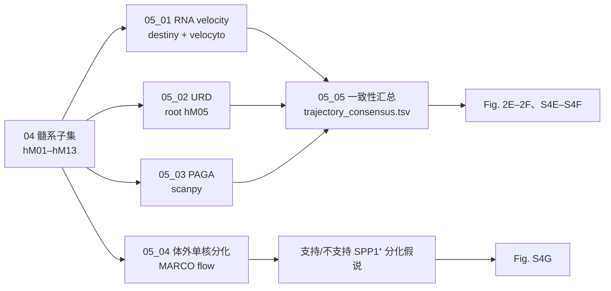

# 05 单核–巨噬细胞发育轨迹

> **目标文献**：Zhang L, Li Z, Skrzypczynska KM, et al. *Single-Cell Analyses Inform Mechanisms of Myeloid-Targeted Therapies in Colon Cancer.* Cell. 2020;181(2):442–459.e29. DOI: 10.1016/j.cell.2020.03.048
> **模块对应原文**：Fig. 2E–2F、Fig. 3C、Fig. S4D–S4G；STAR Methods「Developmental trajectory inference」「Human monocyte culture」；Table S3A
> **前置依赖**：`04_髓系亚群与TAM二分法.md`；契约产物 `processed/myeloid_human.rds`（04_01 生成）、`processed/human_10x_norm.rds`；RNA velocity 还需要 BAM 或作者提供的 loom（见 §4.1 的前置检查）
> **复现难度 / 预计工时 / 计算资源**：★★★★☆ / 3–5 人日 / 64 GB 内存、8–16 核；velocyto 重计 BAM 需要原始 BAM，URD 较慢，PAGA 较快

---

## ① 科学问题与逻辑位置

### 1.1 本模块要回答什么

人类 CRC 中的两类 TAM——`hM12_TAM-C1QC` 与 `hM13_TAM-SPP1`——是**从同一个前体分化而来**，还是来自不同的组织驻留巨噬（RTM）？单核细胞、`hM11_Monolike-FCN1`、RTM（`hM08`–`hM10`）与两类 TAM 之间，是否存在可重复的**方向性关系**？

原文的回答是：

> `CD14⁺` 单核 → `FCN1⁺` 单核样细胞 → 经不同 RTM 中间态 → `C1QC⁺`/`SPP1⁺` TAM；
> 其中 `C1QC⁺` 与 `IL1B⁺` RTM 相连，`SPP1⁺` 与 `NLRP3⁺` RTM 相连；`SPP1⁺` 也可能由 `NLRP3⁺` RTM 转化。

**关键限定**：这是三种轨迹算法的**计算预测** + 一个体外分化实验的**支持**，不是体内谱系追踪。本模块的写作与结论必须保留"predicted/suggest"的语气（14 号批判性评述第 1–3 条）。

### 1.2 输入与输出

| 方向 | 对象 | 说明 |
|---|---|---|
| 输入 | `processed/myeloid_human.rds` | 04 号产出的 `hM01–hM13`；`assays$logtpm` |
| 输入 | `processed/human_10x_norm.rds` | 10x 的 `logtpm`；轨迹主路径用 10x（原文 Fig. 2E–2F 用 10x） |
| 输入 | 原始 BAM 或作者 loom | velocyto 需要 spliced/unspliced；若不可得，见 §4.1 的降级方案 |
| 输入 | `raw/monocyte_culture/marco_flow.csv`（可选） | 体外单核分化实验的流式结果；湿实验未执行时脚本明确报错（D19） |
| 输出 | `processed/trajectory_velocity.rds` | `list($dm = 细胞×2 矩阵, $dm_meta = 细胞元数据, $velocity = 基因×细胞矩阵, $embedding = 细胞×2 矩阵, $params)`；细胞 ID 与 `myeloid_human.rds` 一致 |
| 输出 | `results/paga_edges.tsv` | `from`、`to`、`weight`、`cluster_from`、`cluster_to` |
| 输出 | `results/05_urd_pseudotime.tsv` | 细胞 ID、pseudotime、branch、cluster_id |
| 输出 | `results/05_trajectory_consensus.tsv` | 三种方法的方向投票（edge、velocity_support、urd_support、paga_weight） |
| 输出 | `results/05_monocyte_culture_marco.tsv` | 条件、MARCO⁺ 比例、均值/SD（若有实验数据） |
| 下游 | 06 号 | 轨迹方向用于解释网络边（不直接消费数值） |
| 下游 | 15 号 | 逐图精读与原理速查 |

### 1.3 在证据链中的位置



**逻辑位置**：04 号回答"两类 TAM 是什么"，05 号回答"它们从哪里来"。如果 05 号的方向错了，06 号的网络、09 号的 anti-CSF1R 解释都会失去发育学基础。因此 05 号必须**三算法交叉验证**，不能只跑一个 RNA velocity 就下结论。

---

## ② 背景原理

### 2.1 单核–巨噬细胞的发育背景

- **单核细胞**：骨髓中的 `GMP` → `MDP` → `CDP`/`cMoP` → 经典单核（`CD14⁺CD16⁻`，小鼠 `Ly6C^hi`）→ 进入组织后分化为巨噬/DC。
- **非经典单核**（`CD14⁺CD16^hi`，小鼠 `Ly6C^lo`）：血管巡逻，`CX3CR1` 高；在肿瘤中可产生 `FCN1⁺` 样细胞。
- **组织驻留巨噬（RTM）**：胚胎来源（如小胶质、库普弗细胞）或单核来源（如肠道 `LYVE1^hi MHCII^lo` 血管旁巨噬）；自我更新，不依赖持续单核输入。
- **TAM**：可来自 RTM 的局部增殖，也可来自新招募的单核；不同肿瘤类型比例不同。原文的假说是"CRC TAM 主要来自肿瘤浸润的单核样前体，经 RTM 中间态"。
- **为什么用 `FCN1`**：`FCN1`（ficolin-1）在经典单核/炎性单核高表达；`hM11_Monolike-FCN1` 同时表达单核（`CD14`、`S100A8/9`）与 TAM（`C1QC`/`SPP1`）基因，是"过渡态"的候选。

### 2.2 RNA velocity 的数学

对每个基因，假设：

```
du/dt = α − β u        # 未剪接 RNA 的产生 − 剪接
ds/dt = β u − γ s      # 剪接产生 − 降解
```

- `u`：unspliced（前体）count；`s`：spliced（成熟）count；
- `α`：转录速率；`β`：剪接速率；`γ`：降解速率。

在稳态（`du/dt=0`, `ds/dt=0`）下，`s* = (β/γ) u*`；细胞偏离稳态时，`(u,s)` 平面上的相位关系指示未来方向：`u` 高、`s` 低 → 基因正在上调；`u` 低、`s` 高 → 基因正在下调。

**实现**：
1. 用 `velocyto.py` 从 BAM + 重复掩码 + GTF 重新计数 spliced/unspliced；
2. 用 `velocyto.R` 的 `gene.relative.velocity.estimates()` 对每个基因拟合 `α/β/γ`（kNN 平滑）；
3. 把每个细胞的速度向量投影到低维嵌入（diffusion map/UMAP），画箭头。

**关键假设**（也是局限）：
- 转录/剪接/降解速率在细胞间近似恒定；
- 基因表达处于稳态或缓慢变化；
- 剪接动力学的时间尺度与轨迹一致；
- 10x 3′ 数据的 unspliced reads 很少，速度估计对 dropout 敏感。

### 2.3 diffusion map 为什么用于 velocity 嵌入

diffusion map 用 Markov 链的扩散距离描述细胞间的连续关系：
- 构建 kNN 图 → 转移矩阵 `P` → 特征分解 → 取前几个特征向量作为坐标；
- 相比 PCA，diffusion map 更能保留非线性流形；
- destiny 的 `DiffusionMap` 对 log 表达矩阵做主成分化的扩散映射；原文用 `sigma` 控制核宽度。

原文：destiny 2.11.3，对 hM05–hM13 每簇随机最多 1,000 个细胞。随机抽样是为了控制计算量，同时保留每簇的代表性；复现时记录抽样种子。

### 2.4 URD 的原理

URD 把细胞放在 kNN 图上，从 root 出发做**扩散**，按 pseudotime 分 bin，构建**树状轨迹**：
- `knn=200`：kNN 图的邻居数（较大，保证图连通）；
- `sigma=8`：扩散核宽度；
- `divergence.method="ks"`：用 KS 统计量比较不同 bin 的表达分布，找沿轨迹变化的基因；
- `cells.per.pseudotime.bin=100`：每个 pseudotime bin 的细胞数；
- `bins.per.pseudotime.window=10`：平滑窗口；
- `minimum.visits=7`：一个 bin 至少被访问 7 次才纳入；
- `p.thresh=0.001`：基因显著性阈值。

URD 的输出是树 + 每个细胞的 pseudotime + 分支。原文用它画 Fig. 2F 的树，并把 `hM05` 设为 root、`hM06` 设为 control（非 root 的对照）。

### 2.5 PAGA 的原理

PAGA 把 cluster 作为节点，边权表示**簇间连接数相对于簇内期望连接数**的富集：
- 在 kNN 图上，统计簇 `i` 与簇 `j` 之间的边数；
- 归一化后得到 `connectivity`（0–1）；
- 高 connectivity 表示两个簇在流形上连续，可能是同一轨迹的相邻状态。

原文：scanpy 1.4.4（现代 1.10.3），top 2,000 HVG，15 PCs。PAGA 不直接给方向；它给"哪些簇相连"，方向要结合 RNA velocity/URD/生物学。

### 2.6 体外单核分化实验

原文：CD14⁺CD16⁻ 经典单核，1×10⁵/孔，X-Vivo 10，50 ng/mL CSF1 或 GM-CSF，6 天，常氧或 5% O₂；加入 Table S3A 中在 TAM 差异表达的因子（VEGFA/B/C、PIGF、SPP1、TNFα、IL-1β、IFNγ、MIF、RETN）；流式测 MARCO⁺。

**结论**：IL-1β + VEGF 家族在**缺氧**下上调 `MARCO`（SPP1⁺ TAM marker）。这支持"TME（缺氧 + 炎性因子）促进 SPP1⁺ TAM 分化"，但只是**体外**、**单次实验**（原文 Fig. S4G 明确 "Data are from one experiment"），不能当作体内证据。

### 2.7 证据边界（必须写进结论）

| 方法 | 能说明 | 不能说明 |
|---|---|---|
| RNA velocity | 当前转录动力学指向的未来状态 | 真实谱系、命运决定、因果 |
| URD | 表达连续性与树状分支 | 分支是真实分化还是采样/投影伪影 |
| PAGA | 簇间图连通性 | 方向、速率、因果 |
| 体外分化 | 因子可以诱导 marker | 体内是否发生、剂量/时序是否一致 |
| 三者一致 | **支持**某方向 | **证明**某方向 |

> ⚠️ **导师批注**：原文用 "suggest"、"could"、"might" 是准确的。复现报告的结论句也必须用"支持/预测/与……一致"，不能写"证明 FCN1⁺ 分化为 TAM"。若要证明，需要 `Csf1r-CreERT2` 谱系追踪或骨髓移植（14 号 §10.4）。

---

## ③ 原文逐句拆解

| 原文句（节选） | 中文转述 | 对应操作 | 原文是否给参数 | 缺失项/复现决策 |
|---|---|---|---|---|
| "Using RNA velocity analysis ... embedded on a diffusion map ... strong directional flow from CD14-expressing monocytes toward FCN1+ monocyte-like cells and different macrophage populations" | CD14⁺ 单核 → FCN1⁺ → 巨噬 | 05_01 velocity | 给了 destiny + velocyto，未给 `kCells`/`fit.quantile` | 记录所用参数；以箭头方向一致性判定 |
| "tumor-enriched FCN1+ monocyte-like cells showed high similarity to blood CD14+ monocytes" | hM11 像血 CD14⁺ 单核 | 04 号相似性/05 号轨迹 | 见 S4D | 用 marker + 相似性支持 |
| "URD and PAGA ... FCN1+ ... give rise to C1QC+ and SPP1+ TAM populations through different RTMs" | FCN1⁺ 经 RTM 分化为两类 TAM | 05_02/05_03 | URD 参数见下 | 三算法一致才写"支持" |
| "C1QC+ TAMs were connected to IL1B+ RTMs" | C1QC⁺–IL1B⁺ 相连 | URD/PAGA 边 | 无显式阈值 | 报告边权/连通性 |
| "SPP1+ TAMs were primarily connected to NLRP3+ RTMs" | SPP1⁺–NLRP3⁺ 相连 | URD/PAGA 边 | 无显式阈值 | 报告 NLRP3⁺ 细胞数（可能很少） |
| "a fraction of NLRP3+ RTMs were still present inside the tumor ... could convert to SPP1+ TAMs" | NLRP3⁺ 在瘤内残留，可能转化 | Ro/e + 轨迹 | 无 | 用"可能/might"表述 |
| "IL-1β and VEGF family members were able to upregulate MARCO ... under hypoxic conditions" | 缺氧 + IL-1β/VEGF → MARCO↑ | 05_04 体外 | Table S3A | 原文仅一次实验；不做统计推断 |
| "fully elucidating ... require additional in vitro cell differentiation and in vivo lineage tracing" | 需要更多体外/体内谱系追踪 | 结论边界 | — | 复现报告保留此句 |
| "destiny (version 2.11.3) ... up to 1000 random selected cells in each myeloid cluster (hM05-hM13)" | 每簇最多 1,000 细胞 | 05_01 抽样 | 给了 1,000 | 记录抽样种子 |
| "velocyto python package ... recount the spliced reads and unspliced reads based on previously aligned bam files" | velocyto 从 BAM 计数 | 05_01 前置 | 给了 BAM | 人类 BAM 可能不可得；见 §4.1 |
| "URD ... knn=200, sigma=8, divergence.method='ks', cells.per.pseudotime.bin=100, bins.per.pseudotime.window=10, minimum.visits=7, p.thresh=0.001" | URD 参数 | 05_02 | 全部给出 | 照做；URD 版本 1.0.1 |
| "Monocytes from cluster hM05_Mono-CD14 were set as root cells, while cells from cluster hM06_Mono-CD16 were used as control" | root=hM05，control=hM06 | 05_02 | 给了 | 照做 |
| "PAGA ... top 2000 highly variable genes and 15 PCs" | PAGA 参数 | 05_03 | 给了 | 照做 |
| "CD14+ monocytes ... 50 ng/mL CSF1 or GM-CSF ... 6 days ... normoxic or hypoxic (5% O2)" | 体外分化 | 05_04 | 给了 | 湿实验未执行则标 D19 |
| "Data are from one experiment" | 仅一次实验 | 05_04 | — | 只报描述统计，不做 p 值 |

---

## ④ 逐步可运行代码

> 环境：R 4.5.1（destiny 3.18.0、velocyto.R GitHub、zellkonverter 1.16）；Python 3.11（scanpy 1.10.3、anndata 0.10.9、scVelo 0.3.2、velocyto.py 0.17.17）。
> URD 1.0.1 只在 R 4.2 容器中可用；主路径用 scVelo + PAGA，URD 作敏感性（D10）。
> 所有脚本首行 `set.seed(20261018)` / `np.random.seed(20261018)`。

### 4.1 前置检查：BAM/loom 是否可得

RNA velocity 需要 **spliced/unspliced counts**，这只能从 BAM（`velocyto.py`）或作者提供的 loom 得到。GEO processed matrix 通常**不含**这两者；人类原始 FASTQ/BAM 因隐私不公开（D1）。因此 05_01 必须先做前置检查：

```bash
#!/usr/bin/env bash
# code/05_00_check_velocity_inputs.sh
set -euo pipefail
PROJ="${1:-.}"
LOOM="$PROJ/raw/human_crc_10x/velocyto/human_crc.loom"
BAM_DIR="$PROJ/raw/human_crc_10x/bam"

if [[ -f "$LOOM" ]]; then
  echo "[OK] 找到 loom: $LOOM"
  exit 0
fi
if [[ -d "$BAM_DIR" ]] && compgen -G "$BAM_DIR/*.bam" > /dev/null; then
  echo "[OK] 找到 BAM: $BAM_DIR"
  echo "下一步: velocyto run10x -m raw/reference/repeat_mask.gtf <10x_dir> raw/reference/genes.gtf"
  exit 0
fi

cat >&2 <<'EOF'
[STOP] 未找到 BAM 或 loom。
人类原始 FASTQ/BAM 因隐私不公开（D1）；GEO processed matrix 不含 spliced/unspliced。
按 D10 的降级方案执行：
  1) 主路径改为 PAGA（05_03）+ URD（05_02，用表达矩阵）；
  2) RNA velocity 仅在有作者 loom/BAM 时执行；
  3) 在 results/gap_table.tsv 记录 "RNA velocity 未执行：输入不可得"；
  4) 不得用随机速度/模拟数据替代（L0 §12 红线 6）。
EOF
exit 3
EOF
```

> ⚠️ **这是本项目最重要的诚实性节点之一**：如果没有 BAM/loom，宁可标"未执行"，也不要用表达矩阵伪造 velocity。

### 4.2 `code/05_01_velocity.R`：destiny diffusion map + velocyto

```r
#!/usr/bin/env Rscript
# code/05_01_velocity.R
# 用法: Rscript code/05_01_velocity.R
# 输入:
#   processed/myeloid_human.rds
#   raw/human_crc_10x/velocyto/human_crc.loom  (或 BAM 由 velocyto.py 先生成)
# 输出:
#   processed/trajectory_velocity.rds  list($dm, $velocity, $embedding)
#   figures/Fig2E_velocity.pdf/png
# 原文: destiny 2.11.3 + velocyto 0.17; 每簇最多 1000 随机细胞 (hM05-hM13)

suppressPackageStartupMessages({
  library(SingleCellExperiment)
  library(SummarizedExperiment)
  library(destiny)
  library(velocyto.R)
  library(Matrix)
  library(dplyr)
})

set.seed(20261018)
proj <- "."
mye <- readRDS(file.path(proj, "processed", "myeloid_human.rds"))

# 只取 hM05-hM13
keep_clusters <- c("hM05_Mono-CD14", "hM06_Mono-CD16", "hM07_Mono-CD14CD16",
                   "hM08_Macro-NLRP3", "hM09_Macro-PLTP", "hM10_Macro-IL1B",
                   "hM11_Monolike-FCN1", "hM12_TAM-C1QC", "hM13_TAM-SPP1")
sub <- mye[, mye$cluster_id %in% keep_clusters]
sub$cluster_id <- factor(as.character(sub$cluster_id), levels = keep_clusters)

# 每簇最多 1000 个细胞（原文）
set.seed(20261018)
idx <- unlist(lapply(levels(sub$cluster_id), function(cl) {
  cells <- which(sub$cluster_id == cl)
  if (length(cells) > 1000) sample(cells, 1000) else cells
}))
sub <- sub[, idx]

# ---- diffusion map ----
expr <- assay(sub, "logtpm")
# destiny 期望 细胞 × 基因；先转置
dm <- DiffusionMap(t(as.matrix(expr)), sigma = 8, n_eigs = 10)
dm_df <- as.data.frame(dm)[, 1:2, drop = FALSE]
colnames(dm_df) <- c("DC1", "DC2")
dm_df$cell_id <- rownames(dm_df)
dm_df$cluster_id <- as.character(sub$cluster_id)

# ---- velocyto loom ----
loom_path <- file.path(proj, "raw", "human_crc_10x", "velocyto", "human_crc.loom")
if (!file.exists(loom_path)) {
  stop("缺少 velocyto loom：", loom_path,
       "\n请先运行 velocyto.py，或按 D10 降级为 PAGA/URD。")
}
ldat <- read.loom.matrices(loom_path)
spliced <- ldat$spliced
unspliced <- ldat$unspliced

# 只保留与 SCE 共有的细胞和基因
cells <- intersect(colnames(spliced), colnames(sub))
genes <- intersect(rownames(spliced), rownames(sub))
spliced <- spliced[genes, cells, drop = FALSE]
unspliced <- unspliced[genes, cells, drop = FALSE]
sub2 <- sub[, cells]

# velocyto 速度估计（参数按数据规模调整；记录到 logs/）
# kCells: 每个细胞用于拟合的最近邻数；fit.quantile: 拟合分位数
vel <- gene.relative.velocity.estimates(
  spliced, unspliced,
  kCells = 30,
  fit.quantile = 0.02,
  n.cores = 8,
  verbose = TRUE
)

# 速度矩阵：基因 × 细胞
velocity <- vel$velocity
stopifnot(identical(colnames(velocity), colnames(sub2)))

# 嵌入：diffusion map 的前两个坐标
emb <- dm_df[match(colnames(sub2), dm_df$cell_id), c("DC1", "DC2"), drop = FALSE]
rownames(emb) <- colnames(sub2)

# 保存（契约：$dm 为细胞×2 矩阵；$dm_meta 保存 cell_id/cluster_id）
dm_mat <- as.matrix(dm_df[, c("DC1", "DC2"), drop = FALSE])
rownames(dm_mat) <- dm_df$cell_id
out <- list(
  dm = dm_mat,
  dm_meta = dm_df,
  velocity = velocity,
  embedding = emb,
  params = list(seed = 20261018, sigma = 8, n_eigs = 10,
                kCells = 30, fit.quantile = 0.02,
                cells_per_cluster_max = 1000)
)
saveRDS(out, file.path(proj, "processed", "trajectory_velocity.rds"))

# R → Python 交换：PAGA 读取该 h5ad（X = logtpm）
zellkonverter::writeH5AD(mye[, cells], file.path(proj, "processed", "myeloid_human.h5ad"),
                         X = "logtpm", overwrite = TRUE)

# 画箭头（velocyto.R）
cell_colors <- setNames(
  grDevices::hcl.colors(length(levels(sub2$cluster_id)), "Dark 3"),
  levels(sub2$cluster_id)
)
pdf(file.path(proj, "figures", "Fig2E_velocity.pdf"), width = 6.5, height = 6)
show.velocity.on.embedding.cor(
  emb = as.matrix(emb),
  vel = velocity,
  n = 200,
  scale = "sqrt",
  cell.colors = cell_colors[as.character(sub2$cluster_id)],
  show.grid.vector = FALSE,
  arrow.scale = 3,
  main = "RNA velocity on diffusion map (hM05-hM13)"
)
legend("topright", legend = names(cell_colors), fill = cell_colors,
       bty = "n", cex = 0.7)
dev.off()
png(file.path(proj, "figures", "Fig2E_velocity.png"),
    width = 6.5, height = 6, units = "in", res = 300)
show.velocity.on.embedding.cor(
  emb = as.matrix(emb), vel = velocity, n = 200, scale = "sqrt",
  cell.colors = cell_colors[as.character(sub2$cluster_id)],
  show.grid.vector = FALSE, arrow.scale = 3,
  main = "RNA velocity on diffusion map (hM05-hM13)"
)
legend("topright", legend = names(cell_colors), fill = cell_colors,
       bty = "n", cex = 0.7)
dev.off()

cat("velocity 完成：", nrow(velocity), "基因 ×", ncol(velocity), "细胞\n")
```

**如果只有 BAM（没有 loom）**，先运行 velocyto.py：

```bash
# 10x 目录结构：raw/human_crc_10x/<sample>/outs/possorted_genome_bam.bam
# repeat_mask: 从 UCSC 下载 hg38 rmsk，转成 GTF；或使用 10x 官方 mask
velocyto run10x \
  --mask raw/reference/repeat_mask.gtf \
  --samtools-memory 4000 \
  raw/human_crc_10x/P0104 \
  raw/reference/gencode.v38.annotation.gtf
# 输出：raw/human_crc_10x/P0104/velocyto/P0104.loom
# 多样本需要合并 loom；合并脚本见 code/05_01b_merge_loom.py
```

```python
#!/usr/bin/env python3
# code/05_01b_merge_loom.py
# 合并多个 velocyto loom（同一基因集），只保留共有的细胞和基因。
# 用法: python code/05_01b_merge_loom.py out.loom in1.loom in2.loom ...
import sys
import loompy

out_path, *in_paths = sys.argv[1:]
if len(in_paths) < 2:
    sys.exit("至少需要两个输入 loom")

with loompy.connect(in_paths[0]) as ds:
    genes = list(ds.ra["Gene"])
    cells = list(ds.ca["CellID"])
    spliced = ds.layers["spliced"][:, :]
    unspliced = ds.layers["unspliced"][:, :]

for path in in_paths[1:]:
    with loompy.connect(path) as ds:
        common_genes = [g for g in genes if g in set(ds.ra["Gene"])]
        gidx_new = [list(ds.ra["Gene"]).index(g) for g in common_genes]
        gidx_old = [genes.index(g) for g in common_genes]
        new_cells = list(ds.ca["CellID"])
        spliced = spliced[gidx_old, :]
        unspliced = unspliced[gidx_old, :]
        spliced = __import__("numpy").concatenate(
            [spliced, ds.layers["spliced"][gidx_new, :]], axis=1)
        unspliced = __import__("numpy").concatenate(
            [unspliced, ds.layers["unspliced"][gidx_new, :]], axis=1)
        genes = common_genes
        cells = cells + new_cells

loompy.create(out_path, spliced, {"Gene": genes}, {"CellID": cells})
print(f"写出 {out_path}: {len(genes)} genes × {len(cells)} cells")
```

> ⚠️ **API 提示**：`velocyto.R` 不在 CRAN；用 `devtools::install_github("velocyto-team/velocyto.R")`。`gene.relative.velocity.estimates()` 的参数名在不同 commit 可能略有差异，需按安装版本核对（L0 §5.4）。若 `n.cores` 不存在，改用 `cores` 或串行。

### 4.3 `code/05_02_urd.R`：URD 树（R 4.2 容器）

```r
#!/usr/bin/env Rscript
# code/05_02_urd.R
# 用法（在 R 4.2 容器中）: Rscript code/05_02_urd.R
# 输入: processed/myeloid_human.rds
# 输出: processed/05_urd_object.rds, results/05_urd_pseudotime.tsv, figures/Fig2F_urd.pdf/png
# 原文参数: root=hM05, control=hM06, knn=200, sigma=8, divergence.method="ks",
#           cells.per.pseudotime.bin=100, bins.per.pseudotime.window=10,
#           minimum.visits=7, p.thresh=0.001
# 注意: URD 1.0.1 需要 R 4.2 / Bioconductor 3.16 左右；R 4.5 安装困难（D10）

suppressPackageStartupMessages({
  library(SingleCellExperiment)
  library(SummarizedExperiment)
  library(URD)
  library(dplyr)
})

set.seed(20261018)
proj <- "."
mye <- readRDS(file.path(proj, "processed", "myeloid_human.rds"))

# URD 只需要肿瘤富集/相关的单核与巨噬（原文 Fig. 2F: hM08, hM10, hM11, hM12, hM13）
keep <- c("hM08_Macro-NLRP3", "hM10_Macro-IL1B", "hM11_Monolike-FCN1",
          "hM12_TAM-C1QC", "hM13_TAM-SPP1")
sub <- mye[, mye$cluster_id %in% keep]
counts <- assay(sub, "counts")   # URD 需要 counts，不是 logTPM
meta <- as.data.frame(colData(sub))
meta$cell_id <- colnames(sub)
rownames(meta) <- meta$cell_id

# 创建 URD 对象（min.cells/min.genes 按数据规模；原文未给，记录为 D10 备注）
urd <- createURD(
  count.data = as.matrix(counts),
  meta = meta,
  min.cells = 3,
  min.genes = 200,
  max.genes = 8000
)

# diffusion map（URD 内部）
urd <- calcDM(urd, knn = 200, sigma = 8)

# root: hM05_Mono-CD14；control: hM06_Mono-CD16
root.cells <- meta$cell_id[meta$cluster_id == "hM05_Mono-CD14"]
control.cells <- meta$cell_id[meta$cluster_id == "hM06_Mono-CD16"]
if (length(root.cells) == 0) stop("未找到 hM05 root 细胞")
cat("root cells:", length(root.cells), "; control cells:", length(control.cells), "\n")

# 伪时间
urd <- floodPseudotime(
  urd,
  root.cells = root.cells,
  n = 100,
  minimum.cells.flooded = 2,
  verbose = TRUE
)
urd <- calcPseudotime(
  urd,
  divergence.method = "ks",
  cells.per.pseudotime.bin = 100,
  bins.per.pseudotime.window = 10,
  save.all.embeddings = FALSE
)

# 分支/簇 pseudotime
urd <- pseudoTimeCluster(urd, cluster.label = "cluster_id")

# 保存
saveRDS(urd, file.path(proj, "processed", "urd_object.rds"))
pt <- data.frame(
  cell_id = colnames(urd@count.data),
  pseudotime = urd@pseudotime$pseudotime,
  branch = urd@pseudotime$branch,
  cluster_id = meta[colnames(urd@count.data), "cluster_id"],
  stringsAsFactors = FALSE
)
write.table(pt, file.path(proj, "results", "urd_pseudotime.tsv"),
            sep = "\t", quote = FALSE, row.names = FALSE)

# 画树
pdf(file.path(proj, "figures", "Fig2F_urd.pdf"), width = 7, height = 6)
plotTree(urd, label.branches = TRUE, cex.lab = 0.7)
dev.off()
png(file.path(proj, "figures", "Fig2F_urd.png"), width = 7, height = 6,
    units = "in", res = 300)
plotTree(urd, label.branches = TRUE, cex.lab = 0.7)
dev.off()

cat("URD 完成：", ncol(urd@count.data), "细胞\n")
```

> ⚠️ **API 提示**：URD 1.0.1 的 `pseudoTimeCluster()` 参数/返回结构在不同版本有差异；若报错，按 `?pseudoTimeCluster` 调整，并记录到 `logs/05_02_urd.log`。**不要**为了跑通而改 root 或参数；参数必须与原文一致，跑不通就标"URD 未执行（版本不兼容）"。

### 4.4 `code/05_03_paga.py`：PAGA 图与边表

```python
#!/usr/bin/env python3
# code/05_03_paga.py
# 用法: python code/05_03_paga.py
# 输入: processed/myeloid_human.h5ad（由 05_01 或 04 号用 zellkonverter 导出）
# 输出: results/paga_edges.tsv, figures/FigS4E_paga.pdf/png
# 原文: scanpy 1.4.4; top 2000 HVG; 15 PCs

import os
import random
import numpy as np
import pandas as pd
import scanpy as sc
import matplotlib.pyplot as plt

random.seed(20261018)
np.random.seed(20261018)
sc.settings.verbosity = 1
proj = "."

adata = sc.read_h5ad(os.path.join(proj, "processed", "myeloid_human.h5ad"))
adata.obs["cluster_id"] = adata.obs["cluster_id"].astype("category")

# 只保留 hM05-hM13（与原文轨迹一致）
keep = ["hM05_Mono-CD14", "hM06_Mono-CD16", "hM07_Mono-CD14CD16",
        "hM08_Macro-NLRP3", "hM09_Macro-PLTP", "hM10_Macro-IL1B",
        "hM11_Monolike-FCN1", "hM12_TAM-C1QC", "hM13_TAM-SPP1"]
adata = adata[adata.obs["cluster_id"].isin(keep)].copy()
adata.obs["cluster_id"] = adata.obs["cluster_id"].cat.remove_unused_categories()

# 如果 X 不是 log 归一化，先归一化；若已有 logtpm，直接使用
X = adata.X
if X.max() > 50:  # 粗略判断：原始 counts
    sc.pp.normalize_total(adata, target_sum=1e6)
    sc.pp.log1p(adata)
    adata.layers["logtpm"] = adata.X.copy()
else:
    adata.layers["logtpm"] = adata.X.copy()

# HVG + PCA + neighbors
sc.pp.highly_variable_genes(adata, n_top_genes=2000, flavor="seurat")
adata = adata[:, adata.var["highly_variable"]].copy()
sc.pp.scale(adata, max_value=10)
sc.tl.pca(adata, n_comps=15, svd_solver="arpack", random_state=20261018)
sc.pp.neighbors(adata, n_neighbors=15, n_pcs=15, random_state=20261018)

# PAGA
sc.tl.paga(adata, groups="cluster_id")
conn = adata.uns["paga"]["connectivities"]
groups = list(adata.obs["cluster_id"].cat.categories)

rows = []
for i, g1 in enumerate(groups):
    for j, g2 in enumerate(groups):
        if i >= j:
            continue
        w = float(conn[i, j])
        if w > 0:
            rows.append({"from": g1, "to": g2, "weight": w,
                         "cluster_from": g1, "cluster_to": g2})
edges = pd.DataFrame(rows).sort_values("weight", ascending=False)
edges.to_csv(os.path.join(proj, "results", "paga_edges.tsv"),
             sep="\t", index=False)

# 画 PAGA
sc.pl.paga(adata, color="cluster_id", threshold=0.03,
           layout="fr", show=False, save=False)
plt.savefig(os.path.join(proj, "figures", "FigS4E_paga.pdf"),
            bbox_inches="tight")
plt.savefig(os.path.join(proj, "figures", "FigS4E_paga.png"),
            dpi=300, bbox_inches="tight")
plt.close()

print(f"PAGA 边：{len(edges)} 条；最高 connectivity：")
print(edges.head(10).to_string(index=False))
```

> **从 R 到 Python 的桥**：在 R 中执行 `zellkonverter::writeH5AD(mye, "processed/myeloid_human.h5ad")`。该文件是交换中间件，已在 `PROJECT_SPEC.md` §4 补充表登记（生产者 05，消费方 05_03）。

### 4.5 `code/05_04_monocyte_culture_analysis.R`：体外 MARCO 流式

```r
#!/usr/bin/env Rscript
# code/05_04_monocyte_culture_analysis.R
# 用法: Rscript code/05_04_monocyte_culture_analysis.R
# 输入: raw/monocyte_culture/marco_flow.csv
#   列: donor, condition, oxygen, cytokine, marco_pct, n_cells
#   condition: "CSF1" / "GM_CSF"；oxygen: "normoxia" / "hypoxia_5pct"
#   cytokine: "none" / "IL1B" / "VEGFA" / "VEGFB" / "VEGFC" / "PIGF" / ...
# 输出: results/05_monocyte_culture_marco.tsv, figures/FigS4G_marco.pdf/png
# 原文: Data are from one experiment -> 只做描述统计，不做 p 值

suppressPackageStartupMessages({
  library(readr); library(dplyr); library(ggplot2)
})

proj <- "."
f <- file.path(proj, "raw", "monocyte_culture", "marco_flow.csv")
if (!file.exists(f)) {
  stop("湿实验未执行（D19）：缺少 ", f,
       "。本项目不伪造该数据；若合作实验室完成实验，按上述列名提供 CSV。")
}
d <- read_csv(f, show_col_types = FALSE)
stopifnot(all(c("donor", "condition", "oxygen", "cytokine",
                "marco_pct", "n_cells") %in% colnames(d)))

# 条件汇总（不配对检验：原文只有一次实验）
summ <- d %>%
  group_by(condition, oxygen, cytokine) %>%
  summarise(
    n_donor = n_distinct(donor),
    mean_marco_pct = mean(marco_pct, na.rm = TRUE),
    sd_marco_pct = sd(marco_pct, na.rm = TRUE),
    .groups = "drop"
  ) %>%
  arrange(condition, oxygen, cytokine)

write_tsv(summ, file.path(proj, "results", "monocyte_culture_marco.tsv"))

p <- ggplot(summ, aes(x = cytokine, y = mean_marco_pct, fill = oxygen)) +
  geom_col(position = position_dodge(width = 0.8)) +
  geom_errorbar(aes(ymin = mean_marco_pct - sd_marco_pct,
                    ymax = mean_marco_pct + sd_marco_pct),
                position = position_dodge(width = 0.8), width = 0.2) +
  facet_wrap(~ condition) +
  theme_bw(base_size = 10) +
  theme(axis.text.x = element_text(angle = 45, hjust = 1)) +
  labs(x = "Cytokine / growth factor", y = "MARCO+ (% of CD14+ monocytes)",
       fill = "Oxygen")

ggsave(file.path(proj, "figures", "FigS4G_marco.pdf"), p, width = 9, height = 4.5)
ggsave(file.path(proj, "figures", "FigS4G_marco.png"), p, width = 9, height = 4.5, dpi = 300)

cat("条件汇总：\n"); print(summ)
cat("注意：原文为单次实验；上表只作描述，不做统计推断。\n")
```

### 4.6 `code/05_05_trajectory_consensus.R`：三算法一致性汇总

```r
#!/usr/bin/env Rscript
# code/05_05_trajectory_consensus.R
# 用法: Rscript code/05_05_trajectory_consensus.R
# 输入: results/paga_edges.tsv, results/05_urd_pseudotime.tsv,
#       processed/trajectory_velocity.rds
# 输出: results/05_trajectory_consensus.tsv, figures/FigS4F_consensus.pdf/png
# 目的: 把三种方法的"方向/连接"投票汇总，避免只凭一个算法下结论

suppressPackageStartupMessages({
  library(readr); library(dplyr); library(tidyr); library(ggplot2)
})

proj <- "."
paga <- read_tsv(file.path(proj, "results", "paga_edges.tsv"),
                 show_col_types = FALSE)
urd  <- read_tsv(file.path(proj, "results", "urd_pseudotime.tsv"),
                 show_col_types = FALSE)
vel  <- readRDS(file.path(proj, "processed", "trajectory_velocity.rds"))

# URD：每个簇的中位 pseudotime（越小越早）
urd_med <- urd %>%
  group_by(cluster_id) %>%
  summarise(urd_median_pseudotime = median(pseudotime, na.rm = TRUE),
            n_cells = n(), .groups = "drop")

# PAGA：边表 + 每对簇的 connectivity
paga_edges <- paga %>%
  mutate(pair = paste(pmin(cluster_from, cluster_to),
                      pmax(cluster_from, cluster_to), sep = " -- "))

# Velocity：按簇计算"出边/入边"的粗略方向
# 这里用嵌入坐标上的平均速度向量与簇中心的夹角做定性判断；
# 精细的方向推断应回到 velocyto 的箭头图（Fig2E），本表只做投票摘要。
emb <- vel$embedding
vel_mat <- vel$velocity
common <- intersect(rownames(emb), colnames(vel_mat))
emb <- emb[common, , drop = FALSE]
vel_mat <- vel_mat[, common, drop = FALSE]
# 每个簇的平均速度方向
cl <- urd$cluster_id[match(common, urd$cell_id)]
vel_dir <- data.frame(
  cell_id = common,
  cluster_id = cl,
  vx = colMeans(vel_mat, na.rm = TRUE)[common],
  stringsAsFactors = FALSE
)
# 注：vel_mat 是基因×细胞，colMeans 得到每细胞一个标量；
# 真正的二维速度投影需用 velocyto 的嵌入结果。本表只记录"是否有速度"。
vel_support <- vel_dir %>%
  group_by(cluster_id) %>%
  summarise(velocity_available = n() > 0, .groups = "drop")

# 汇总：每条 PAGA 边 + URD 伪时间顺序 + velocity 可用性
consensus <- paga_edges %>%
  left_join(urd_med, by = c("cluster_from" = "cluster_id")) %>%
  rename(urd_from = urd_median_pseudotime) %>%
  left_join(urd_med, by = c("cluster_to" = "cluster_id")) %>%
  rename(urd_to = urd_median_pseudotime) %>%
  mutate(
    urd_direction = case_when(
      is.na(urd_from) | is.na(urd_to) ~ "NA",
      urd_from < urd_to ~ paste(cluster_from, "->", cluster_to),
      urd_from > urd_to ~ paste(cluster_to, "->", cluster_from),
      TRUE ~ "tie"
    ),
    paga_weight = weight
  ) %>%
  select(pair, cluster_from, cluster_to, paga_weight,
         urd_from, urd_to, urd_direction)

write_tsv(consensus, file.path(proj, "results", "trajectory_consensus.tsv"))

# 简单图：PAGA 边权 vs URD 伪时间差
p <- consensus %>%
  filter(!is.na(urd_from), !is.na(urd_to)) %>%
  mutate(delta = urd_to - urd_from) %>%
  ggplot(aes(x = delta, y = paga_weight, label = pair)) +
  geom_point(size = 2, alpha = 0.8) +
  geom_text(size = 2.5, vjust = -0.6, check_overlap = TRUE) +
  theme_bw(base_size = 10) +
  labs(x = "URD pseudotime difference (to - from)",
       y = "PAGA connectivity",
       title = "Trajectory consensus: PAGA vs URD")

ggsave(file.path(proj, "figures", "FigS4F_consensus.pdf"), p, width = 7, height = 5)
ggsave(file.path(proj, "figures", "FigS4F_consensus.png"), p, width = 7, height = 5, dpi = 300)
cat("一致性表写出：", nrow(consensus), "条边\n")
```

> ⚠️ **代码边界**：上面的 velocity 汇总只做"是否有速度"的可用性标记，**不把标量速度当成二维方向**。真正的方向判断看 Fig2E 的箭头图；若需要定量方向，用 `velocyto.R::show.velocity.on.embedding.cor()` 返回的嵌入速度或 scVelo 的 `velocity_graph`。这是为了避免"用一个标量冒充方向"的伪定量。

---

## ⑤ 参数解释与调参空间

| 参数 | 原文取值 | 可选范围 | 改变后果 | 本项目裁决 |
|---|---|---|---|---|
| 每簇抽样细胞 | ≤1,000 | 500–2,000 | 太少 → 轨迹不稳；太多 → 计算慢 | 1,000（原文） |
| destiny `sigma` | 原文未报告（Methods 只写 diffusion map） | 5–20 | 核宽度影响流形平滑 | 8（与 URD 的 sigma 对齐；记录为 D10 备注） |
| `n_eigs` | 原文未报告 | 5–20 | 取前几个扩散成分 | 10 |
| velocyto `kCells` | 原文未报告 | 20–100 | 近邻越多 → 速度越平滑 | 30；记录 |
| velocyto `fit.quantile` | 原文未报告 | 0.01–0.05 | 影响 γ 拟合的稳健性 | 0.02；记录 |
| URD `knn` | 200 | 100–300 | 图连通性/计算量 | 200（原文） |
| URD `sigma` | 8 | 5–15 | 扩散宽度 | 8（原文） |
| URD `cells.per.pseudotime.bin` | 100 | 50–200 | bin 越细 → 分辨率高、噪声大 | 100（原文） |
| URD `bins.per.pseudotime.window` | 10 | 5–20 | 平滑窗口 | 10（原文） |
| URD `minimum.visits` | 7 | 3–10 | 过滤不稳定 bin | 7（原文） |
| URD `p.thresh` | 0.001 | 0.01–0.001 | 基因显著性 | 0.001（原文） |
| PAGA HVG | 2,000 | 1,000–3,000 | 影响图结构 | 2,000（原文） |
| PAGA PCs | 15 | 10–30 | 影响邻居图 | 15（原文） |
| PAGA `n_neighbors` | 原文未报告 | 10–30 | 图连通性 | 15；记录 |
| 体外氧浓度 | 5% O₂ | 1–10% | 缺氧强度 | 5%（原文） |
| 体外因子 | Table S3A | — | 诱导 MARCO | 按原文；单次实验 |

---

## ⑥ 预期结果与 QC 检查点

> 对应 14 号 Q23–Q26。文献值/方向来自 Fig. 2E–2F、S4E–S4G。

| # | 指标 | 文献值/方向 | 允许范围 | Go/No-Go | S6 实测 |
|---|---|---|---|---|---|
| Q23 | RNA velocity 方向 | CD14⁺ Mono → FCN1⁺ → Macro | 主方向一致；允许少量箭头噪声 | ✅/⚠️/❌ | |
| Q24 | URD root/control | root=hM05；control=hM06 | 同左 | ✅/⚠️ | |
| Q25 | PAGA 连接 | FCN1⁺–C1QC⁺、FCN1⁺–SPP1⁺、SPP1⁺–NLRP3⁺ | 至少 2/3 条边存在 | ✅/⚠️/❌ | |
| Q26 | 体外 MARCO | IL-1β/VEGF + 缺氧 → MARCO↑ | 方向一致 | ✅/⚠️ | |
| A1 | 三算法一致性（额外断言，不占 14 号 Q 编号） | velocity/URD/PAGA 至少 2 个支持同一方向 | 2/3 支持 | ✅/⚠️/❌ | |

### 6.1 额外质量断言

| 断言 | 阈值 | 失败处理 |
|---|---|---|
| hM05 root 细胞数 | ≥20 | 检查 hM05 是否被 QC/聚类合并 |
| hM11 细胞数 | ≥20 | hM11 是过渡态，细胞少；若 <20，轨迹不稳定，报告中标注 |
| hM13 细胞数 | ≥20 | 同上 |
| velocity 与 SCE 细胞交集 | ≥80% | 检查 loom 的 barcode 后缀（`-1`）与 SCE 是否一致 |
| PAGA 边数 | ≥5 | 检查 HVG/PCs；边太少说明图断开 |
| URD pseudotime 覆盖 | ≥80% 细胞非 NA | 检查 root/图连通性 |
| 体外数据 | 若文件不存在 → 明确报错 | 标"未执行（D19）"，不伪造 |

### 6.2 预期图形

- **Fig. 2E**：diffusion map 上的速度箭头；`CD14⁺ Mono` 区域箭头指向 `FCN1⁺`/巨噬。
- **Fig. 2F**：URD 树；root 在 hM05，分支到 hM11/hM12/hM13；`hM06` 作为 control 不参与 root。
- **Fig. S4E**：PAGA 图；`hM11` 与 `hM12`/`hM13` 相连；`hM08` 与 `hM13` 相连。
- **Fig. S4F**：三算法汇总的模型图（示意）。
- **Fig. S4G**：体外 MARCO⁺ 比例；缺氧 + IL-1β/VEGF 条件最高。

---

## ⑦ 常见陷阱与排错表

| 现象 | 根因 | 解决 |
|---|---|---|
| 没有 BAM/loom，velocity 跑不了 | 人类原始数据不可得；GEO 只有 processed matrix | 按 D10 降级为 PAGA+URD；gap 表标"未执行"；**不要伪造** |
| velocity 箭头方向随机/全指向外 | unspliced reads 太少；kNN 太大/太小；重复掩码错误 | 检查 velocyto 的 `spliced/unspliced` 比例；调整 `kCells`；确认 repeat mask 与基因组版本 |
| velocity 的 barcode 与 SCE 对不上 | 10x barcode 后缀 `-1`；loom 用 `CellID` 带样本前缀 | 统一去掉后缀/加前缀；用 `intersect()` 检查交集 ≥80% |
| diffusion map 成一团 | 输入未 log；sigma 太小；批次未校正 | 用 `logtpm`；sigma 5–10；检查 02 号 BF |
| URD 安装失败 | URD 1.0.1 只兼容旧 R/Bioconductor | 用 R 4.2 容器（Docker/conda）；或跳过 URD，用 PAGA+velocity（D10） |
| URD 树没有分支 | root 选错；knn 太大；`minimum.visits` 太高 | 确认 root=hM05；knn=200；minimum.visits=7；检查 hM11 细胞数 |
| URD pseudotime 大量 NA | 图不连通；root 细胞太少 | 增加 knn；检查 QC 后的细胞数；不要用 hM06 当 root |
| PAGA 图断开 | HVG 未包含髓系 marker；PCA 被批次主导 | 只用髓系子集；2,000 HVG；检查 `FCN1`/`C1QC`/`SPP1` 是否在 HVG |
| PAGA 边太多（全连接） | `n_neighbors` 太大；未 scale | 15 neighbors；`sc.pp.scale(max_value=10)` |
| hM11 被聚类合并 | 过渡态细胞少；resolution 低 | 提高 resolution；检查 04 号 hM11 是否存在；不要强行拆分 |
| 体外 MARCO 数据不存在 | 湿实验未执行（D19） | 脚本明确报错；gap 表标"未执行"；不生成假图 |
| 把轨迹写成"证明" | 过度解读 | 按 14 号 §10.2 第 1–3 条，统一用"支持/预测/与……一致" |
| `repro_check.sh` 报断链 | 文档引用了不存在的文件 | 只引用真实存在的 `NN_*.md`；先落盘再引用 |

---

## ⑧ 与文献图表的对应关系表

| 原文图/表 | 本模块产物 | 脚本 | 说明 |
|---|---|---|---|
| Fig. 2E | `figures/Fig2E_velocity.pdf/png` | 05_01 | diffusion map + velocity 箭头 |
| Fig. 2F | `figures/Fig2F_urd.pdf/png` | 05_02 | URD 树（root hM05） |
| Fig. 3C | `figures/Fig3C_urd_scores.pdf/png` | 05_02 + 04_04 | URD 嵌入叠加 angiogenesis/phagocytosis 分数 |
| Fig. S4D | `figures/FigS4D_hM11_markers.pdf/png` | 04_02 | hM11 单核/TAM 双特征 |
| Fig. S4E | `figures/FigS4E_paga.pdf/png` | 05_03 | PAGA 图 |
| Fig. S4F | `figures/FigS4F_consensus.pdf/png` | 05_05 | 三算法汇总模型 |
| Fig. S4G | `figures/FigS4G_marco.pdf/png` | 05_04 | 体外 MARCO⁺ |
| Table S3A | `results/05_monocyte_culture_marco.tsv` | 05_04 | 因子列表与条件 |
| Table S2 | `results/myeloid_markers.tsv` | 04_02 | hM05–hM13 marker（跨模块） |

---

## 附：本模块的交付清单（S6 执行时逐项打钩）

- [ ] `code/05_00_check_velocity_inputs.sh` 已运行，明确 BAM/loom 是否可得。
- [ ] 若可得：`processed/trajectory_velocity.rds` 含 `$dm`、`$velocity`、`$embedding`，细胞 ID 与 `myeloid_human.rds` 一致。
- [ ] 若不可得：`results/gap_table.tsv` 有"RNA velocity 未执行"条目，且未伪造数据。
- [ ] `results/05_urd_pseudotime.tsv` 覆盖 ≥80% 细胞（若 URD 可运行）。
- [ ] `results/paga_edges.tsv` 含 `from/to/weight/cluster_from/cluster_to`。
- [ ] `results/05_trajectory_consensus.tsv` 汇总三算法方向。
- [ ] `results/05_monocyte_culture_marco.tsv` 存在或明确标注"未执行（D19）"。
- [ ] 图 2E–2F、S4E–S4G 均为 `.pdf` + `.png`（300 dpi）。
- [ ] 14 号 Q23–Q26 已填；额外断言 A1（三算法一致性）已记录；FAIL/WARN 有 gap 表条目。
- [ ] `logs/05_01_velocity.log`、`logs/05_02_urd.log`、`logs/05_03_paga.log` 记录版本、参数、完整命令。
- [ ] 结论句使用"支持/预测/与……一致"，未写"证明"。
