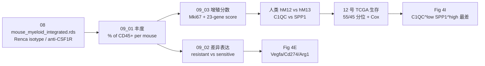

# 09 anti-CSF1R：TAM 差异耗竭与耐药

> **目标文献**：Zhang L, Li Z, Skrzypczynska KM, et al. *Single-Cell Analyses Inform Mechanisms of Myeloid-Targeted Therapies in Colon Cancer.* Cell. 2020;181(2):442–459.e29. DOI: 10.1016/j.cell.2020.03.048
> **模块对应原文**：Fig. 4A–4I；Fig. S7A–S7D；STAR Methods「In vivo mouse models」「Single cell sorting, library preparation, and sequencing for mouse samples」「Tumor dissociation for mouse samples」
> **前置依赖**：`08_小鼠肿瘤模型与跨物种髓系整合.md` 产出的 `processed/mouse_myeloid_integrated.rds`；`06_细胞互作网络I_scRNA_bulk相关性网络.md` 产出的 `results/celltype_signatures.tsv`（C1QC/SPP1 signature）；`01` 下载的 TCGA COAD/READ 与临床表
> **复现难度 / 预计工时 / 计算资源**：★★★★☆ / 4–6 人日 / 64 GB 内存、16 核；无需 GPU

---

## ① 科学问题与逻辑位置

**科学问题**：anti-CSF1R 抗体在临床上能耗竭 TAM，却单药疗效有限（Papadopoulos et al. 2017；Ries et al. 2014）。原因是"所有 TAM 一起被杀"这个假设不成立，还是"有一群 TAM 杀不掉"？

**本模块的回答**：在小鼠 Renca 模型中，anti-CSF1R 只耗竭**增殖中的 mM12_Macro-Maf / mM14_Macro-Mgl2**，而保留 **mM11_Macro-Mafb / mM13_Macro-Ccl12 / mM15_Macro-Vegfa**；保留的细胞表达 `Vegfa`、`Cd274`、`Arg1`，贴附肿瘤血管。对应到人类：C1QC⁺ TAM 增殖分数高于 SPP1⁺ TAM；TCGA 中 C1QC^low SPP1^high 的患者预后最差。

**逻辑位置**：
- 上游：08 号的小鼠髓系整合（15 簇）与人类–小鼠映射；04 号的 C1QC/SPP1 二分。
- 本模块：把"药物扰动"作为第三维，检验哪些簇对 CSF1R 阻断敏感。
- 下游：12 号的 TCGA 生存验证；14 号的批判性评述（小鼠→人外推的边界）；15 号的 CSF1R 生物学背景。



---

## ② 背景原理

### 2.1 CSF1R 生物学

- **CSF1R**（CD115）是 M-CSF（CSF1）与 IL-34 的受体，表达于单核、巨噬、破骨细胞、部分 DC。
- CSF1R 信号通过 PI3K/AKT、ERK、JAK/STAT 促进单核/巨噬的**生存、增殖、分化与招募**。
- anti-CSF1R 抗体（如 emactuzumab、AMG 820、pexidartinib 小分子）可耗竭 TAM；但临床单药疗效有限，可能机制包括：
  1. TAM 亚群异质性：部分亚群低表达 CSF1R 或低增殖，不依赖 CSF1R；
  2. 代偿性招募：CSF1R 阻断后肿瘤可招募 MDSC/Treg；
  3. 残留 TAM 表型更促血管/免疫抑制。
- 原文的贡献：把第 1、3 条落到具体簇（mM12/14 vs mM15）。

### 2.2 Renca 模型

- **Renca**：BALB/c 小鼠肾细胞癌（ATCC CRL-2947），皮下接种 3×10⁵ 细胞，12 天左右成瘤（50–100 mm³）。
- 选择 Renca 的原因：原文筛选多个同系肿瘤模型，Renca 对 anti-CSF1R 敏感（肿瘤生长受抑；Fig. S6A）。
- **注意**：Renca 是肾癌，不是 CRC；anti-CSF1R 的结论是"髓系生物学"层面的，不是"CRC 治疗"层面的。原文用 "may" 外推到人类 CRC。

### 2.3 F4/80 与巨噬异质性

- `ADGRE1`（F4/80）是小鼠成熟巨噬 marker，但表达水平在亚群间不同；F4/80^high 与 F4/80^low 可能对应不同成熟/激活状态。
- 原文用两套门控（Fig. 4B 与 S7A–S7C）证明：anti-CSF1R 优先减少 F4/80^high TAM；scRNA-seq 中 `Adgre1` 表达与簇的敏感性相关（S7D）。
- **复现注意**：F4/80 是流式蛋白，scRNA 的 `Adgre1` 表达受 dropout 影响；不要用 scRNA 的 `Adgre1` 直接替代流式的 F4/80^high 判定。

### 2.4 差异丰度（differential abundance）的统计

- 输入：每个小鼠、每个簇的细胞数 `n_{i,k}` 与 CD45⁺ 总数 `N_i`；比例 `p_{i,k}=n_{i,k}/N_i`。
- 原文用**单侧 t 检验**（anti-CSF1R < isotype 为备择）比较 `p`；n = 小鼠数（不是细胞数）。
- **伪重复陷阱**：把细胞当 n 会极大膨胀显著性；必须按小鼠聚合。
- **组成性陷阱**：所有簇的比例之和为 1；一个簇减少会导致其他簇比例"被动升高"。原文明确说"某些簇频率增加可能是由于大群巨噬丢失导致的总池变化"（Fig. 4D 讨论）。因此：
  - 主分析看**绝对比例** `% of CD45⁺`；
  - 敏感性分析看**相对丰度**（簇内比例 / 总髓系比例）或 CLR 变换；
  - 报告 fold change 与 95% CI，不只看 p。

### 2.5 增殖分数

原文定义：23 个增殖相关基因的平均表达（`AURKA, BUB1, CCNB1, CCND1, CCNE1, DEK, E2F1, FEN1, FOXM1, H2AFZ, HMGB2, MCM2, MCM3, MCM4, MCM5, MCM6, MKI67, MYBL2, PCNA, PLK1, TOP2A, TYMS, ZWINT`）。分数在 cluster 内取平均，或每细胞打分后做 Wilcoxon。

### 2.6 生存分析（本模块只提供簇定义，不生产生存图）

- TCGA COAD + READ；signature mean expression；55th/45th 分位分组；Cox 校正 stage + MSI；KM 用 `ggsurvplot`。
- 四个组合：C1QC^high SPP1^high（n=111）、C1QC^high SPP1^low（n=27）、C1QC^low SPP1^high（n=30）、C1QC^low SPP1^low（n=108）。
- 原文结论：C1QC^low SPP1^high 最差；Group2 vs Group3 HR=0.1，P=0.01（Fig. 4I）。

---

## ③ 原文逐句拆解

| 原文句（节选） | 中文转述 | 我的操作 | 原文是否给参数 | 缺失项/复现决策 |
|---|---|---|---|---|
| "treatment of mice bearing Renca tumors with anti-CSF1R decreased the frequency of TAMs relative to treatment with a control antibody" | anti-CSF1R 降低 TAM 比例 | 09_01：按小鼠算 `% of CD45⁺`，单侧 t | 未给 n、未给具体 p | n 从小鼠 metadata 读取；报双侧 p 与 fold change |
| "a detectable population of TAMs remained following anti-CSF1R treatment" | 仍有残留 TAM | 计算残留簇比例 | 未给残留比例 | 以 `mM11/13/15` 为主 |
| "preferential decrease in macrophages expressing high levels of F4/80" | F4/80^high 优先减少 | 流式 CSV 汇总（13_01） | 未给门控阈值 | 按原文 S7A 门控；记录阈值 |
| "near complete loss of clusters mM12 and mM14, but minimal reduction of TAM clusters mM11, mM13, and mM15" | mM12/14 近完全丢失；mM11/13/15 最小减少 | 09_01 簇丰度 | 未给每个簇的 p/FC | 报每个簇的 p、FDR、FC；D14 |
| "the frequencies of certain clusters increased ... likely due to the loss of a large macrophage population from the total pool" | 某些簇比例被动升高 | 组成性敏感性分析（CLR/相对丰度） | 未给方法 | 主分析绝对比例；敏感性 CLR |
| "anti-CSF1R-resistant TAMs preferentially express genes involved in angiogenesis, such as Vegfa, and immunosuppression, such as Cd274 and Arg1" | 残留 TAM 促血管/免疫抑制 | 09_02：resistant vs sensitive 的基因表达 | 未给统计方法/阈值 | Wilcoxon + BH；报 log2FC |
| "macrophages remaining ... preferentially associated with tumor vasculature" | 残留 TAM 贴附血管 | 13 号 IF 定量（CD31/F4/80） | 未给距离阈值 | 以 CD31⁺ 血管 20 µm 内 F4/80⁺ 比例定义"贴附"；敏感性 10/30 µm |
| "Anti-CSF1R-sensitive populations (mM12, mM14) had elevated expression of Mki67 and a higher proliferation score than resistant populations (mM11, mM13, mM15)" | 敏感簇增殖高 | 09_03：23-gene score | 给了基因列表 | 照做；Wilcoxon |
| "in human tumors, C1QC+ TAMs also have a higher proliferation score than SPP1+ TAMs" | 人类 C1QC⁺ 增殖高 | 09_03：hM12 vs hM13 | 给了基因列表 | 照做 |
| "a low C1QC+ TAM and high SPP1+ TAM gene signature combination correlated with worse prognostic outcome" | C1QC^low SPP1^high 最差 | 12_02：TCGA 四组 KM/Cox（09 提供簇定义与 signature） | 给了 55/45 分位 | 照做；D17 |
| "anti-CSF1R ... 400 mg/mouse three times a week for a total of four doses" | 400 µg/鼠，3×/周×4 | 记录给药方案 | 给了剂量 | 照做（原文 OCR 为 400 mg，按上下文应为 400 µg） |
| "analyzed at 24 h after the last dose on day 8" | 末次后 24 h 取瘤 | 记录时间点 | 给了 | 照做 |
| "Study 2 data were used for quantification of myeloid cluster frequency" | 只用 Study 2 定量 | 09_01 过滤 `study=="Study2"` | 给了 | 照做（D14） |

> ⚠️ **导师批注 1**：原文 Methods 写 "400 mg/mouse"，但抗体剂量按小鼠体重/常规用量应为 **400 µg/mouse**；这是原文单位笔误（C 类）。本项目按 400 µg 记录，并在 14 号 D 表备注。
>
> ⚠️ **导师批注 2**：原文 Fig. 4B 的流式量化用**双侧** t 检验，Fig. 4D 的簇丰度用**单侧** t 检验；复现时两个都报，并注明图注差异。

---

## ④ 逐步可运行代码

> 语言：R 4.5.1 / Seurat 5.1.0 / limma 3.62 / survival 3.8。所有脚本首行 `set.seed(20261018)`。
> 输入契约：`processed/mouse_myeloid_integrated.rds`（08 号产物）、`results/celltype_signatures.tsv`（06 号产物）、`raw/tcga_coadread/`（01 号下载）。

### 4.1 脚本 09_01：簇丰度与差异耗竭

```r
#!/usr/bin/env Rscript
# code/09_01_abundance.R
# 用法: Rscript code/09_01_abundance.R <project_dir>
# 输入: processed/mouse_myeloid_integrated.rds
# 输出: results/csf1r_abundance.tsv, figures/Fig4B_flow_tam.pdf/.png,
#       figures/Fig4D_cluster_abundance.pdf/.png, logs/09_sessionInfo.txt

set.seed(20261018)
suppressPackageStartupMessages({
  library(SingleCellExperiment)
  library(dplyr); library(tidyr); library(ggplot2); library(readr)
})

args <- commandArgs(trailingOnly = TRUE)
proj <- ifelse(length(args) >= 1, args[1], ".")
# 统一取表达矩阵：人类用 logtpm，小鼠用 logcounts，Seurat 转换对象用 data
get_expr <- function(x) {
  for (a in c("logtpm", "logcounts", "data")) {
    if (a %in% SummarizedExperiment::assayNames(x)) return(SummarizedExperiment::assay(x, a))
  }
  stop("对象没有 logtpm/logcounts/data assay：", paste(SummarizedExperiment::assayNames(x), collapse=","))
}

dir.create(file.path(proj, "results"), showWarnings = FALSE)
dir.create(file.path(proj, "figures"), showWarnings = FALSE)

sce <- readRDS(file.path(proj, "processed", "mouse_myeloid_integrated.rds"))
stopifnot("cluster_id" %in% colnames(colData(sce)))
stopifnot(all(c("model", "treatment", "mouse_id", "study") %in% colnames(colData(sce))))

# ---- 1. 只取 Renca、TAM 相关簇、CD45+ ----
cd <- as.data.frame(colData(sce))
tam_clusters <- c("mM11_Macro-Mafb", "mM12_Macro-Maf", "mM13_Macro-Ccl12",
                  "mM14_Macro-Mgl2", "mM15_Macro-Vegfa")
stopifnot(all(tam_clusters %in% cd$cluster_id))

# 每个小鼠的 CD45+ 总数（分母）：来自 08 号全细胞对象，不从髓系子集重算
denom_all <- readr::read_tsv(file.path(proj, "results", "mouse_cd45_counts.tsv"),
                             show_col_types = FALSE)
denom <- denom_all %>%
  filter(model == "Renca") %>%
  select(mouse_id, study, treatment, timepoint, tissue, n_cd45)

# 每个小鼠 × 簇的细胞数
num <- cd %>%
  filter(model == "Renca", cluster_id %in% tam_clusters) %>%
  count(mouse_id, study, treatment, timepoint, tissue, cluster_id, name = "n_cells")

abund <- num %>%
  left_join(denom, by = c("mouse_id", "study", "treatment", "timepoint", "tissue")) %>%
  mutate(pct_of_CD45 = 100 * n_cells / n_cd45)

write_tsv(abund, file.path(proj, "results", "csf1r_abundance.tsv"))

# ---- 2. 主分析：Study 2 only（D14） ----
ab2 <- abund %>% filter(study == "Study2")
stopifnot(n_distinct(ab2$mouse_id[ab2$treatment == "anti-CSF1R"]) >= 3)

# 每个簇：单侧 t（anti-CSF1R < isotype）+ 双侧 t + fold change
stat <- ab2 %>%
  group_by(cluster_id) %>%
  group_modify(~{
    x <- .x$pct_of_CD45[.x$treatment == "anti-CSF1R"]
    y <- .x$pct_of_CD45[.x$treatment == "Isotype"]
    tt1 <- t.test(x, y, alternative = "less", var.equal = FALSE)
    tt2 <- t.test(x, y, alternative = "two.sided", var.equal = FALSE)
    tibble(
      n_treat = length(x), n_iso = length(y),
      mean_treat = mean(x), mean_iso = mean(y),
      log2FC = log2((mean(x) + 1e-6) / (mean(y) + 1e-6)),
      p_one_sided = tt1$p.value, p_two_sided = tt2$p.value,
      ci_low = tt2$conf.int[1], ci_high = tt2$conf.int[2]
    )
  }) %>%
  ungroup() %>%
  mutate(FDR_one_sided = p.adjust(p_one_sided, method = "BH"),
         FDR_two_sided = p.adjust(p_two_sided, method = "BH"))

write_tsv(stat, file.path(proj, "results", "csf1r_abundance_stats.tsv"))

# ---- 3. Fig 4D：簇丰度箱线图 ----
p <- ggplot(ab2, aes(x = cluster_id, y = pct_of_CD45, fill = treatment)) +
  geom_boxplot(outlier.shape = NA, width = 0.7) +
  geom_point(position = position_jitterdodge(jitter.width = 0.15, dodge.width = 0.7),
             size = 1.6, alpha = 0.8) +
  scale_fill_manual(values = c(Isotype = "grey70", `anti-CSF1R` = "#C0392B")) +
  labs(x = NULL, y = "% of CD45+ cells", fill = "Treatment",
       title = "Renca: TAM cluster abundance after anti-CSF1R (Study 2)") +
  theme_bw(base_size = 12) +
  theme(axis.text.x = element_text(angle = 30, hjust = 1))

ggsave(file.path(proj, "figures", "Fig4D_cluster_abundance.pdf"), p, width = 7.5, height = 4.5)
ggsave(file.path(proj, "figures", "Fig4D_cluster_abundance.png"), p, width = 7.5, height = 4.5, dpi = 300)

# ---- 4. 组成性敏感性：CLR 变换 ----
# 对每个小鼠的 TAM 组成做 CLR（centered log-ratio），避免"总和为 1"的伪影
clr <- abund %>%
  filter(study == "Study2") %>%
  group_by(mouse_id) %>%
  mutate(prop = n_cells / sum(n_cells),
         clr = log(prop + 1e-6) - mean(log(prop + 1e-6))) %>%
  ungroup()

clr_stat <- clr %>%
  group_by(cluster_id) %>%
  group_modify(~{
    x <- .x$clr[.x$treatment == "anti-CSF1R"]
    y <- .x$clr[.x$treatment == "Isotype"]
    tibble(mean_clr_treat = mean(x), mean_clr_iso = mean(y),
           p_clr = t.test(x, y)$p.value)
  }) %>%
  ungroup() %>%
  mutate(FDR_clr = p.adjust(p_clr, method = "BH"))

write_tsv(clr_stat, file.path(proj, "results", "csf1r_abundance_clr_stats.tsv"))

# ---- 5. sessionInfo ----
sink(file.path(proj, "logs", "09_sessionInfo.txt"))
print(sessionInfo())
sink()
```

**关键行解释**：
- 分母来自 `results/mouse_cd45_counts.tsv`（08 号从全细胞对象生成）；不要从髓系子集重算 CD45⁺ 总数。
- 分母必须是**同一小鼠的 CD45⁺ 总数**，不是所有细胞；否则比例会被上皮/基质污染。
- `t.test(..., alternative="less")` 对应原文"anti-CSF1R 减少"的单侧备择；同时报双侧，避免单侧检验的偏倚。
- CLR 是组成性数据的标准变换；若某个簇计数为 0，用 `+1e-6` 伪计数，并在结果中标注。

### 4.2 脚本 09_02：resistant vs sensitive 的差异表达

```r
#!/usr/bin/env Rscript
# code/09_02_de.R
# 用法: Rscript code/09_02_de.R <project_dir>
# 输入: processed/mouse_myeloid_integrated.rds
# 输出: results/csf1r_de.tsv, figures/Fig4E_selected_genes.pdf/.png

set.seed(20261018)
suppressPackageStartupMessages({
  library(SingleCellExperiment); library(limma)
  library(dplyr); library(tidyr); library(ggplot2); library(readr)
})

args <- commandArgs(trailingOnly = TRUE)
proj <- ifelse(length(args) >= 1, args[1], ".")

sce <- readRDS(file.path(proj, "processed", "mouse_myeloid_integrated.rds"))
cd <- as.data.frame(colData(sce))

sensitive <- c("mM12_Macro-Maf", "mM14_Macro-Mgl2")
resistant <- c("mM11_Macro-Mafb", "mM13_Macro-Ccl12", "mM15_Macro-Vegfa")

# ---- 1. 取 Renca、anti-CSF1R 组的巨噬细胞 ----
keep <- cd$model == "Renca" &
  cd$treatment == "anti-CSF1R" &
  cd$cluster_id %in% c(sensitive, resistant)
sce_sub <- sce[, keep]
cd_sub <- as.data.frame(colData(sce_sub))
cd_sub$group <- ifelse(cd_sub$cluster_id %in% sensitive, "sensitive", "resistant")

# ---- 2. 按小鼠 × 组做 pseudobulk（避免细胞当重复） ----
# 若小鼠数 <3/组，pseudobulk limma 不稳定；退回细胞级 Wilcoxon 并声明
pb <- scuttle::aggregateAcrossCells(sce_sub, id = DataFrame(
  mouse_id = cd_sub$mouse_id, group = cd_sub$group
), use.assay.type = "counts")
# 注意：scuttle 的 aggregateAcrossCells 返回 SummarizedExperiment；取 counts
cnt <- assay(pb, "counts")
meta <- as.data.frame(colData(pb))

# ---- 3. limma-voom（pseudobulk） ----
if (min(table(meta$group)) >= 3) {
  dge <- edgeR::DGEList(counts = cnt)
  dge <- edgeR::calcNormFactors(dge)
  design <- model.matrix(~ group, data = meta)
  v <- limma::voom(dge, design)
  fit <- limma::lmFit(v, design)
  fit <- limma::eBayes(fit)
  tt <- limma::topTable(fit, coef = "groupresistant", number = Inf, sort.by = "P")
  tt$gene <- rownames(tt)
  tt <- tt %>% mutate(cluster_id = "resistant_vs_sensitive",
                      log2FC = logFC,
                      p = P.Value,
                      FDR = adj.P.Val,
                      direction = ifelse(logFC > 0, "higher_in_resistant", "higher_in_sensitive")) %>%
    select(gene, cluster_id, log2FC, p, FDR, direction, AveExpr, t, B)
  write_tsv(tt, file.path(proj, "results", "csf1r_de.tsv"))
} else {
  # 细胞级 Wilcoxon（只作探索；不把细胞当生物学重复）
  mat <- get_expr(sce_sub)
  genes <- rownames(mat)
  res <- lapply(genes, function(g) {
    x <- mat[g, cd_sub$group == "resistant"]
    y <- mat[g, cd_sub$group == "sensitive"]
    if (sum(x > 0) < 3 || sum(y > 0) < 3) return(NULL)
    w <- wilcox.test(x, y)
    data.frame(gene = g, log2FC = mean(x) - mean(y), p = w$p.value)
  })
  tt <- bind_rows(res) %>%
    mutate(cluster_id = "resistant_vs_sensitive",
           FDR = p.adjust(p, "BH"),
           direction = ifelse(log2FC > 0, "higher_in_resistant", "higher_in_sensitive")) %>%
    select(gene, cluster_id, log2FC, p, FDR, direction)
  write_tsv(tt, file.path(proj, "results", "csf1r_de.tsv"))
}

# ---- 4. Fig 4E：选定基因的表达 ----
sel <- c("Vegfa", "Cd274", "Arg1", "Mki67", "Adgre1", "Csf1r")
expr <- as.data.frame(t(as.matrix(get_expr(sce_sub))))
expr$cluster_id <- cd_sub$cluster_id
expr$group <- cd_sub$group
long <- expr %>%
  pivot_longer(cols = all_of(sel), names_to = "gene", values_to = "expr") %>%
  group_by(cluster_id, gene) %>%
  summarise(mean_expr = mean(expr), pct_expr = mean(expr > 0), .groups = "drop")

p <- ggplot(long, aes(x = cluster_id, y = mean_expr, fill = gene)) +
  geom_col(position = "dodge") +
  labs(x = NULL, y = "mean log-normalized expression", fill = "Gene") +
  theme_bw(base_size = 12) +
  theme(axis.text.x = element_text(angle = 30, hjust = 1))
ggsave(file.path(proj, "figures", "Fig4E_selected_genes.pdf"), p, width = 7, height = 4)
ggsave(file.path(proj, "figures", "Fig4E_selected_genes.png"), p, width = 7, height = 4, dpi = 300)
```

**关键行解释**：
- `aggregateAcrossCells` 把同一小鼠 × 组的细胞 counts 求和；每个小鼠成为独立样本，避免伪重复。
- 若每组小鼠数 <3，limma 的方差估计不可靠；退回细胞级 Wilcoxon 只是探索，必须在结果中标注"细胞级、非生物学重复"。
- `log2FC = mean(x) - mean(y)` 仅适用于 log 表达；若用 counts，需先 `voom`/`logCPM`。

### 4.3 脚本 09_03：增殖分数

```r
#!/usr/bin/env Rscript
# code/09_03_proliferation.R
# 前置：get_expr() 定义见 09_01；单独运行本块时先复制该函数
# 用法: Rscript code/09_03_proliferation.R <project_dir>
# 输入: processed/mouse_myeloid_integrated.rds, processed/myeloid_human.rds
# 输出: results/proliferation_scores.tsv, figures/Fig4G_H_proliferation.pdf/.png

set.seed(20261018)
suppressPackageStartupMessages({
  library(SingleCellExperiment); library(dplyr); library(ggplot2); library(readr)
})

args <- commandArgs(trailingOnly = TRUE)
proj <- ifelse(length(args) >= 1, args[1], ".")

proliferation_genes <- c(
  "AURKA","BUB1","CCNB1","CCND1","CCNE1","DEK","E2F1","FEN1","FOXM1",
  "H2AFZ","HMGB2","MCM2","MCM3","MCM4","MCM5","MCM6","MKI67","MYBL2",
  "PCNA","PLK1","TOP2A","TYMS","ZWINT"
)

score_cluster <- function(sce, genes, cluster_col = "cluster_id") {
  mat <- get_expr(sce)
  g <- intersect(genes, rownames(mat))
  if (length(g) < 10) stop("proliferation genes 交集 <10，检查基因命名/物种")
  sc <- colMeans(mat[g, , drop = FALSE])
  data.frame(cell_id = colnames(sce), cluster_id = colData(sce)[[cluster_col]],
             score = sc) %>%
    group_by(cluster_id) %>%
    summarise(mean_score = mean(score), median_score = median(score),
              n_cells = n(), .groups = "drop")
}

# ---- 1. 小鼠 ----
mouse <- readRDS(file.path(proj, "processed", "mouse_myeloid_integrated.rds"))
m <- score_cluster(mouse[, colData(mouse)$model == "Renca"], proliferation_genes)
m$species <- "mouse"

# ---- 2. 人类 ----
human <- readRDS(file.path(proj, "processed", "myeloid_human.rds"))
h <- score_cluster(human[, colData(human)$cluster_id %in% c("hM12_TAM-C1QC", "hM13_TAM-SPP1")],
                   proliferation_genes)
h$species <- "human"

out <- bind_rows(m, h)
write_tsv(out, file.path(proj, "results", "proliferation_scores.tsv"))

# ---- 3. 图 ----
p1 <- out %>% filter(species == "mouse", grepl("^mM1[1-5]", cluster_id)) %>%
  ggplot(aes(x = reorder(cluster_id, mean_score), y = mean_score, fill = cluster_id)) +
  geom_col() + coord_flip() +
  labs(x = NULL, y = "Proliferation score (23 genes)", title = "Mouse Renca TAM clusters") +
  theme_bw(base_size = 12) + theme(legend.position = "none")

ggsave(file.path(proj, "figures", "Fig4G_mouse_proliferation.pdf"), p1, width = 6, height = 4)
ggsave(file.path(proj, "figures", "Fig4G_mouse_proliferation.png"), p1, width = 6, height = 4, dpi = 300)

# 人类 Fig. 4H 由 04_05 统一生产（04 号定义 proliferation score 与 hM12/hM13 比较）；
# 09 号只把 human 行写入 proliferation_scores.tsv 供交叉核对，不重复出图。

```

### 4.4 与 12 号的契约边界（本模块不生产生存图）

按 `PROJECT_SPEC.md` §4「生产者唯一」，C1QC/SPP1 的 TCGA 生存分析（Fig. 4I、`results/survival_cox.tsv`）由 **12 号**统一生产；09 号只负责：

1. 定义 `hM12_TAM-C1QC` / `hM13_TAM-SPP1` 的 cluster 标签与 marker（来自 04 号）；
2. 把两簇的 signature 基因列表（`results/celltype_signatures.tsv`，06 号生产）作为输入交给 12 号；
3. 在 09 号 ⑥ 节引用 12 号的 Q46–Q47 结果，不重复出图。

这样避免两个模块写同一张 `Fig4I_*` 与同一个 `survival_cox.tsv`。若需在 09 号内部做敏感性预览，输出必须加 `__local` 后缀（如 `Fig4I_km_C1QC_SPP1__local.pdf`），且不得进入契约表。

> ⚠️ **导师批注**：原文 Fig. 4I 的生存分析使用的是 TCGA bulk signature，不是小鼠数据；把它放在 09 号（小鼠处理模块）容易误导读者以为是小鼠生存。12 号统一生产更符合证据链。

---

## ⑤ 参数解释与调参空间

| 参数 | 原文取值 | 可选范围 | 改变后果 | 本项目裁决 |
|---|---|---|---|---|
| anti-CSF1R 剂量 | 400 µg/鼠（原文写 400 mg，按上下文修正） | 200–800 µg | 剂量过低 → 耗竭不完全；过高 → 非特异 | 400 µg（§10.2 第 15 条） |
| 给药频率 | 3×/周 ×4 | 2–5×/周 | 影响稳态耗竭 | 原文 |
| 取瘤时间 | 末次后 24 h（day 8） | 24–72 h | 过早 → 未完全耗竭；过晚 → 代偿 | 原文 |
| 丰度单位 | `% of CD45⁺` | `% of myeloid`、CLR | 组成性效应 | 主分析 `% of CD45⁺`；CLR 敏感性 |
| 检验 | 单侧 t（Fig. 4D）；双侧（Fig. 4B） | 双侧/Wilcoxon | 单侧更易显著 | 主分析单侧；并列双侧 |
| 多重比较 | 原文未报告 | BH | 5 个簇 × 1 次 | BH |
| 差异表达 | 原文只展示 selected genes | Wilcoxon/limma | 细胞级 vs pseudobulk | 主分析 pseudobulk limma；<3 小鼠退回 Wilcoxon |
| 增殖分数 | 23 基因均值 | 10–30 基因 | 基因集版本影响 | 原文 23 基因 |
| 生存分组 | 55/45 | 中位数/三分位 | HR/p 变化 | 主分析 55/45；中位数敏感性 |
| Cox 协变量 | stage + MSI | +age/sex | 过拟合 | 原文 |
| F4/80 门控 | 原文 S7A | 阈值可调 | F4/80^high 比例 | 按原文；记录阈值 |

---

## ⑥ 预期结果与 QC 检查点

> 引用 14 号 §六 Q36–Q40、Q46–Q47。允许波动：计数 ±5%，比例/HR ±10%，p 只比对数量级。

| # | 指标 | 文献值 | 允许范围 | Go/No-Go | 我方值（S6 填） |
|---|---|---|---|---|---|
| Q36 | anti-CSF1R 后 TAM 占 CD45⁺ | 显著下降 | p<0.05 同方向 | ✅/⚠️/❌ | |
| Q37 | mM12_Macro-Maf | 近完全丢失 | 显著下降（FC<0.3） | ✅/⚠️/❌ | |
| Q37 | mM14_Macro-Mgl2 | 近完全丢失 | 显著下降（FC<0.3） | ✅/⚠️/❌ | |
| Q38 | mM11_Macro-Mafb | 最小减少 | 不显著或 FC>0.7 | ✅/⚠️/❌ | |
| Q38 | mM13_Macro-Ccl12 | 最小减少 | 不显著或 FC>0.7 | ✅/⚠️/❌ | |
| Q38 | mM15_Macro-Vegfa | 最小减少/相对增加 | 不显著或 FC>0.7 | ✅/⚠️/❌ | |
| Q39 | resistant 簇 `Vegfa` | 升高 | 方向一致 | ✅/⚠️/❌ | |
| Q39 | resistant 簇 `Cd274` | 升高 | 方向一致 | ✅/⚠️/❌ | |
| Q39 | resistant 簇 `Arg1` | 升高 | 方向一致 | ✅/⚠️/❌ | |
| Q40 | 血管贴附 | F4/80⁺ 近 CD31⁺ 血管 | 定性一致 | ✅/⚠️ | |
| Q46 | TCGA 四组 n | 111/27/30/108 | ±10% | ✅/⚠️ | |
| Q47 | 最差组 | C1QC^low SPP1^high | HR>1，p<0.05 | ✅/⚠️/❌ | |

**预期图形**：
- Fig. 4B：isotype vs anti-CSF1R 的 TAM 百分比箱线图，anti-CSF1R 显著低。
- Fig. 4C：Renca 髓系 UMAP，isotype 组 mM12/14 区域细胞多，anti-CSF1R 组几乎空。
- Fig. 4D：5 个 TAM 簇的丰度箱线图；mM12/14 显著下降，mM11/13/15 不变或相对升高。
- Fig. 4E：UMAP 上 `Vegfa`、`Cd274`、`Arg1` 在残留簇高。
- Fig. 4F：IF 显示 anti-CSF1R 组 F4/80⁺ 细胞贴近 CD31⁺ 血管。
- Fig. 4G：小鼠增殖分数 mM12/14 > mM11/13/15。
- Fig. 4H：人类 C1QC⁺ > SPP1⁺。
- Fig. 4I：KM 四组；C1QC^low SPP1^high 最低。

---

## ⑦ 常见陷阱与排错表

| 现象 | 根因 | 解决 |
|---|---|---|
| 所有簇都"显著下降" | 分母用错（用了所有细胞而非 CD45⁺）；或 anti-CSF1R 组 CD45⁺ 总数也下降 | 分母固定为同鼠 CD45⁺；同时报告 CD45⁺ 绝对数 |
| 某些簇比例升高就以为"扩增" | 组成性效应：大群丢失导致其他簇被动升高 | 用 CLR/相对丰度做敏感性；报告中写明 |
| mM12/14 没有近完全丢失 | 簇标签与 08 号不一致；anti-CSF1R 剂量/时间不对；Study1/2 混合 | 检查 `cluster_id` 字符串；只用 Study2 定量；核对给药 |
| mM15 也显著下降 | mM15 定义被 `Vegfa` 低表达细胞污染；或聚类把 mM15 与 mM13 合并 | 检查 mM15 marker（`Vegfa`、`Maf`?）；提高分辨率/亚聚类 |
| `Vegfa` 在 resistant 簇不高 | 用了 logcounts 但没做 cluster 平均；或 dropout | 用 cluster 平均表达 + 表达比例；必要时 pseudobulk |
| 增殖分数全为 0 | 基因名大小写错（小鼠 `Mki67` 不是 `MKI67`）；或基因不在矩阵 | 用 `intersect` 并打印丢失基因；小鼠用 MGI symbol |
| 人类 C1QC⁺ 增殖分数不高于 SPP1⁺ | 用了 10x 数据（dropout 高）；或 hM12/hM13 标签错 | 用 Smart-seq2；检查标签 |
| TCGA 四组 n 差很多 | 分位计算用了全样本而非 COAD+READ 分开；或临床缺失 | 按 cohort 分层分位；报告缺失 |
| Cox HR 方向反了 | 分组 high/low 写反；参考组不是最差组 | 明确 `factor(group, levels=...)`；报告参考组 |
| KM p 值过小 | 样本量大 + 强效应；或把同一患者多样本当独立 | 检查样本唯一性；报告 HR+CI |
| `cox.zph` p<0.05 | PH 假设不成立 | 报告；用分层 Cox/时间依赖协变量作敏感性 |

---

## ⑧ 与文献图表的对应关系表

| 原文图 | 内容 | 本模块脚本 | 产物 |
|---|---|---|---|
| Fig. 4A | 小鼠巨噬簇 GSVA 热图 | 04/08（上游） | `results/mouse_tam_gsva.tsv`（由 08 产出） |
| Fig. 4B | 流式 TAM 耗竭 | 13_01 + 09_01 | `results/validation_flow_tam.tsv` |
| Fig. 4C | Renca 髓系 UMAP（isotype vs anti-CSF1R） | 08_01（上游） | `figures/Fig4C_umap_treatment.pdf/.png` |
| Fig. 4D | mM12/mM14 等簇丰度 | 09_01 | `results/csf1r_abundance.tsv`、`figures/Fig4D_cluster_abundance.*` |
| Fig. 4E | `Vegfa`/`Cd274`/`Arg1` 表达 | 09_02 | `results/csf1r_de.tsv`、`figures/Fig4E_selected_genes.*` |
| Fig. 4F | CD31/F4/80/MHCII IF | 13_02（SOP） | `figures/Fig4F_if_vasculature.*` |
| Fig. 4G | 小鼠增殖分数 | 09_03 | `results/proliferation_scores.tsv`、`figures/Fig4G_mouse_proliferation.*` |
| Fig. 4H | 人类 C1QC vs SPP1 增殖分数 | 04_05 | `results/m1_m2_proliferation.tsv`、`figures/Fig4H_proliferation_human.*` |
| Fig. 4I | TCGA KM | 12_02 | `results/survival_cox.tsv`、`figures/Fig4I_km_C1QC_SPP1.*` |
| Fig. S7A–S7D | F4/80 门控、F4/80^high 耗竭 | 13_01 | `results/validation_flow_f480.tsv` |
| Fig. S7E | anti-CD40 对 TAM 的影响 | 10 号 | — |

---

## 附：本模块的"诚实性声明"

1. 原文的 anti-CSF1R 结论来自 **Renca（BALB/c 肾癌）**，不是人类 CRC；本项目只复现"髓系亚群差异耗竭"这一生物学现象，**不把它写成 anti-CSF1R 对 CRC 的临床疗效**。
2. 原文用 "may preferentially deplete a fraction of the C1QC+ TAM subset"；我们的报告必须保留 "may/consistent with"，不得写成 "证明"。
3. 若我们的 mM12/14 未显著下降，先检查实现（簇标签、剂量、时间、分母），再用第二套独立实现（如按 F4/80 流式分群）复核；仍不符则入 gap 表，**不得通过调参凑显著性**。
4. 所有 p 值同时给单侧/双侧、raw/BH；所有 HR 给 95% CI 与 n。
