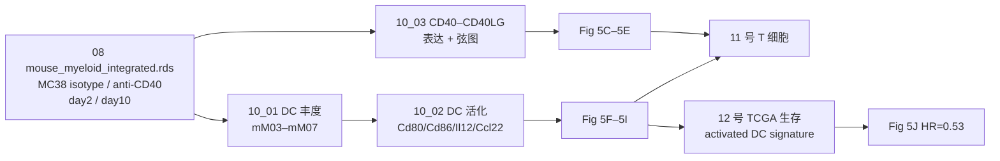

# 10 anti-CD40：cDC1 激活与 CD40–CD40LG 轴

> **目标文献**：Zhang L, Li Z, Skrzypczynska KM, et al. *Single-Cell Analyses Inform Mechanisms of Myeloid-Targeted Therapies in Colon Cancer.* Cell. 2020;181(2):442–459.e29. DOI: 10.1016/j.cell.2020.03.048
> **模块对应原文**：Fig. 5A–5J；Fig. S6G–S6I；Fig. S7E；STAR Methods「In vivo mouse models」「Single cell sorting, library preparation, and sequencing for mouse samples」「Intracellular cytokine staining」
> **前置依赖**：`08_小鼠肿瘤模型与跨物种髓系整合.md` 的 `processed/mouse_myeloid_integrated.rds`；`04_髓系亚群与TAM二分法.md` 的人类 `processed/myeloid_human.rds`；`01` 下载的 TCGA COAD/READ 与临床表
> **复现难度 / 预计工时 / 计算资源**：★★★★☆ / 3–5 人日 / 64 GB 内存、16 核；无需 GPU

---

## ① 科学问题与逻辑位置

**科学问题**：CD40 激动抗体在临床单药疗效有限（Vonderheide 2020），但它究竟作用在**哪一种 DC**、通过**哪一条细胞–细胞轴**、又如何影响 T 细胞？

**本模块的回答**：在 MC38 模型中，anti-CD40 优先扩增并激活 **`mM07_cDC1-Ccl22`**（一种 `Ccl22` 高、`Clec9a/Xcr1` 低的活化 cDC1），上调 CD80/CD86 与 IL-12；人类对应 `hM04_cDC1-BATF3` 的活化态（`LAMP3⁺CCR7⁺`）。CD40 主要表达在 DC/巨噬（尤其 cDC1），CD40LG 主要表达在 CD4 T；因此 anti-CD40 可能放大 **cDC1 ↔ CD4 T（尤其 Bhlhe40⁺ Th1-like）** 的正反馈。activated DC signature 与 CRC 患者 OS 正相关（HR=0.53，P=0.01）。

**逻辑位置**：
- 上游：08 号的小鼠髓系整合（mM01–mM15）与人类髓系注释（hM01–hM13）。
- 本模块：anti-CD40 处理后的 DC 丰度/活化/配体–受体。
- 下游：11 号的 T 细胞动态与 TCR；12 号的生存验证；13 号的流式/IF 验证；14 号的批判性评述（cDC1 活化态 vs 独立亚群）。



---

## ② 背景原理

### 2.1 CD40/CD40LG 生物学

- **CD40**：TNF 受体超家族成员，表达于 DC、巨噬、B 细胞、内皮、部分肿瘤；配体 **CD40LG（CD154）** 主要表达在活化的 CD4 T（Th1、Tfh）、部分 CD8 T、血小板。
- **CD40 信号**：TRAF2/3/6 → NF-κB、MAPK、PI3K；DC 活化（CD80/CD86↑、MHC-II↑、IL-12↑）、生存、细胞因子分泌；B 细胞类别转换。
- **CD40 激动抗体**：模拟 T 细胞帮助，直接激活 DC；临床用于淋巴瘤、实体瘤，单药疗效有限，但与 PD-1/化疗联合有潜力。
- **为什么 cDC1 是关键**：cDC1 交叉提呈肿瘤抗原、启动 CD8 T；IL-12 促进 Th1/IFNγ；cDC1 活化后可把"冷肿瘤"变"热"。

### 2.2 cDC1 的亚群与活化态

- 经典 cDC1：`BATF3`、`IRF8`、`XCR1`、`CLEC9A`；小鼠 `mM06_cDC1-Clec9a`。
- 活化 cDC1：成熟过程中 `Xcr1`/`Clec9a` 下调，`Ccl22`、`Ccr7`、`Lamp3`、`Cd40` 上调；小鼠 `mM07_cDC1-Ccl22`。
- 人类：`hM04_cDC1-BATF3` 再聚类可分未成熟/活化；活化态 `LAMP3⁺CCR7⁺`，与 Zilionis 2019 的 `mDC3/hDC3`、Zhang 2019 的 `DC-c4-LAMP3` 对应。
- **重要**：原文明确说 `Ccl22⁺ cDC1` 可能是 **activated cDC1**，不是发育上独立的亚群（Discussion）。复现报告必须保留这个限定。

### 2.3 MC38 模型

- **MC38**：C57BL/6 小鼠结肠腺癌细胞（NCI/NIH ENH204-EP），皮下接种 3×10⁵，8–10 天成瘤（50–100 mm³）。
- anti-CD40（FGK45）5 mg/kg i.p.；anti-PD1（29F1A.12）15 mg/kg i.p.；day 2/day 10 取肿瘤与 tdLN。
- MC38 对 anti-CD40 敏感（Fig. S6A）；联合 anti-PD1 更强（Fig. 5A–5B）。
- **注意**：MC38 是高度免疫原性的模型；anti-CD40 的效应不能直接外推到人类 MSS CRC。

### 2.4 DC 丰度与活化的统计

- 丰度：每个小鼠、每个 DC 簇的细胞数 / CD45⁺ 总数；单侧 t（anti-CD40 > isotype）。
- 活化：`Cd80`、`Cd86`、`Il12a`、`Il12b`、`Ccl22`、`Ccr7`、`Lamp3` 的 cluster 平均表达/表达比例；流式 MFI。
- **不要用细胞当 n**：DC 数量少，细胞级检验会给出虚假的极小 p；按小鼠聚合。
- **批次**：day 2 与 day 10 分开；tdLN 与 tumor 分开（D15）。

### 2.5 activated DC signature（本模块只导出基因表，生存由 12 号统一分析）

- 原文 Fig. 5J：TCGA COAD+READ，activated DC signature mean expression，55th/45th 分位，Cox 校正 stage+MSI；HR=0.53，P=0.01。
- **基因列表**：原文正文未列全，应在 Table S4 中；若不可得，本项目用 `CCL22`、`CCR7`、`LAMP3`、`CD40`、`CD80`、`CD86`、`IL12A`、`IL12B` 作为暂定 signature，并在结果中标注"暂定，待 Table S4 核对"。
- **解释**：signature 高 = 活化 DC 多 = 预后好；这是相关性，不是"激活 DC 能治疗患者"。

---

## ③ 原文逐句拆解

| 原文句（节选） | 中文转述 | 我的操作 | 原文是否给参数 | 缺失项/复现决策 |
|---|---|---|---|---|
| "Treatment of mice bearing MC38 tumors with anti-CD40 led to reduced tumor growth, which was further enhanced in combination with PD1 blockade" | anti-CD40 抑瘤，联合 PD1 更强 | 10_01 附：肿瘤体积/生存 | 给了剂量 5/15 mg/kg | 照做；Two-way ANOVA/Mantel-Cox |
| "CD40 was expressed on multiple DC and macrophage subsets, especially cDC1 clusters" | CD40 在 DC/巨噬，cDC1 最高 | 10_03 表达矩阵 | 未给阈值 | 报平均表达 + 表达比例 |
| "CD40LG was highly expressed on multiple CD4+ T cell clusters" | CD40LG 在多个 CD4 T | 10_03 | 未给阈值 | 同上 |
| "anti-CD40 agonist-mediated enhancement of Ccl22+ cDC1 cell frequency, while other DC subsets were either decreased or unchanged on day 2" | day 2 mM07 增加，其他 DC 不变/下降 | 10_01 按 timepoint 分层 | 未给每个 DC 的 p | 报每个 DC 簇 p/FC |
| "Anti-CD40 antibody also markedly activated these cDC1 cells, as measured by increased CD80 and CD86 expression" | CD80/CD86 升高 | 10_02 + 流式 | 未给流式阈值 | 按原文门控；记录 MFI |
| "anti-CD40 increased cDC1 cell production of IL-12" | IL-12 升高 | 10_02 + 流式 | 未给 | 照做 |
| "transient reduction of Mafb+ TAMs at day 2 and significant reduction of Maf+ TAMs at day 10" | TAM 也有轻度变化 | 10_01 附：TAM 簇 | 未给 | 作为次要结果报告 |
| "signature genes of activated cDC1s positively correlated with favorable overall survival" | activated DC signature 与 OS 正相关 | 10_04 导出 signature 基因表；12_02 做 KM/Cox | 给了 55/45；未给基因列表 | 用 Table S4；不可得则暂定 8 基因 |
| "only one (mM06) expresses the classical cDC1 markers Clec9a and Xcr1. In contrast, Ccl22+ cDC1s (mM07) bear similarities to the CD40+CCR7+LAMP3+ subpopulation" | mM06 经典，mM07 活化 | 10_02 亚群 marker | 给了 marker | 照做 |
| "Ccl22+ cDC1 cells may be activated cDC1s and not a developmentally distinct subset" | mM07 可能是活化态 | 报告措辞 | — | 不写"新亚群" |

---

## ④ 逐步可运行代码

> 语言：R 4.5.1 / Seurat 5.1.0 / limma 3.62 / survival 3.8 / circlize 0.4.16。所有脚本首行 `set.seed(20261018)`。

### 4.1 脚本 10_01：DC 簇丰度与肿瘤生长

```r
#!/usr/bin/env Rscript
# code/10_01_dc_abundance.R
# 用法: Rscript code/10_01_dc_abundance.R <project_dir>
# 输入: processed/mouse_myeloid_integrated.rds; raw/mouse_mc38/tumor_volume.tsv (可选)
# 输出: results/cd40_dc_abundance.tsv, figures/Fig5A_tumor_growth.pdf/.png,
#       figures/Fig5F_dc_abundance.pdf/.png

set.seed(20261018)
suppressPackageStartupMessages({
  library(SingleCellExperiment); library(dplyr); library(tidyr)
  library(ggplot2); library(readr)
})

args <- commandArgs(trailingOnly = TRUE)
proj <- ifelse(length(args) >= 1, args[1], ".")
# 统一取表达矩阵：人类用 logtpm，小鼠用 logcounts，Seurat 转换对象用 data
get_expr <- function(x) {
  for (a in c("logtpm", "logcounts", "data")) {
    if (a %in% SummarizedExperiment::assayNames(x)) return(SummarizedExperiment::assay(x, a))
  }
  stop("对象没有 logtpm/logcounts/data assay：", paste(SummarizedExperiment::assayNames(x), collapse=","))
}


sce <- readRDS(file.path(proj, "processed", "mouse_myeloid_integrated.rds"))
cd <- as.data.frame(colData(sce))
stopifnot(all(c("model", "treatment", "timepoint", "mouse_id", "tissue") %in% colnames(cd)))

dc_clusters <- c("mM03_pDC-Siglech", "mM04_cDC2-Cd209a", "mM05_cDC2-Itgax",
                 "mM06_cDC1-Clec9a", "mM07_cDC1-Ccl22")
stopifnot(all(dc_clusters %in% cd$cluster_id))

# ---- 1. 每个小鼠的 CD45+ 总数（肿瘤）：来自 08 号全细胞对象 ----
denom_all <- readr::read_tsv(file.path(proj, "results", "mouse_cd45_counts.tsv"),
                             show_col_types = FALSE)
denom <- denom_all %>%
  filter(model == "MC38", tissue == "Tumor") %>%
  select(mouse_id, treatment, timepoint, tissue, n_cd45)

num <- cd %>%
  filter(model == "MC38", tissue == "Tumor", cluster_id %in% dc_clusters) %>%
  count(mouse_id, treatment, timepoint, tissue, cluster_id, name = "n_cells")

abund <- num %>%
  left_join(denom, by = c("mouse_id", "treatment", "timepoint", "tissue")) %>%
  mutate(pct_of_CD45 = 100 * n_cells / n_cd45)

write_tsv(abund, file.path(proj, "results", "cd40_dc_abundance.tsv"))

# ---- 2. day 2：mM07 的 one-sided t（anti-CD40 > isotype） ----
d2 <- abund %>% filter(timepoint == "day2")
stat <- d2 %>%
  group_by(cluster_id) %>%
  group_modify(~{
    x <- .x$pct_of_CD45[.x$treatment == "anti-CD40"]
    y <- .x$pct_of_CD45[.x$treatment == "Isotype"]
    tt1 <- t.test(x, y, alternative = "greater", var.equal = FALSE)
    tt2 <- t.test(x, y, alternative = "two.sided", var.equal = FALSE)
    tibble(n_treat = length(x), n_iso = length(y),
           mean_treat = mean(x), mean_iso = mean(y),
           log2FC = log2((mean(x) + 1e-6) / (mean(y) + 1e-6)),
           p_one_sided = tt1$p.value, p_two_sided = tt2$p.value)
  }) %>% ungroup() %>%
  mutate(FDR_one_sided = p.adjust(p_one_sided, "BH"))
write_tsv(stat, file.path(proj, "results", "cd40_dc_abundance_stats.tsv"))

# ---- 3. Fig 5F ----
p <- ggplot(d2, aes(x = cluster_id, y = pct_of_CD45, fill = treatment)) +
  geom_boxplot(outlier.shape = NA, width = 0.7) +
  geom_point(position = position_jitterdodge(jitter.width = 0.12, dodge.width = 0.7),
             size = 1.5, alpha = 0.8) +
  scale_fill_manual(values = c(Isotype = "grey70", `anti-CD40` = "#2E86C1")) +
  labs(x = NULL, y = "% of CD45+ cells", fill = "Treatment",
       title = "MC38 day 2: DC subsets after anti-CD40") +
  theme_bw(base_size = 12) +
  theme(axis.text.x = element_text(angle = 30, hjust = 1))
ggsave(file.path(proj, "figures", "Fig5F_dc_abundance.pdf"), p, width = 7, height = 4)
ggsave(file.path(proj, "figures", "Fig5F_dc_abundance.png"), p, width = 7, height = 4, dpi = 300)

# ---- 4. 肿瘤生长（可选，若 raw 有逐日体积表） ----
tv_file <- file.path(proj, "raw", "mouse_mc38", "tumor_volume.tsv")
if (file.exists(tv_file)) {
  tv <- read_tsv(tv_file)
  # 期望列: mouse_id, treatment, day, volume_mm3
  tv$treatment <- factor(tv$treatment, levels = c("Isotype", "anti-CD40", "anti-PD1", "Combo"))
  p2 <- ggplot(tv, aes(x = day, y = volume_mm3, color = treatment)) +
    stat_summary(fun = mean, geom = "line", linewidth = 0.9) +
    stat_summary(fun.data = mean_se, geom = "ribbon", alpha = 0.15, aes(fill = treatment), color = NA) +
    labs(x = "Days", y = "Tumor volume (mm3)", color = "Treatment", fill = "Treatment") +
    theme_bw(base_size = 12)
  ggsave(file.path(proj, "figures", "Fig5A_tumor_growth.pdf"), p2, width = 6, height = 4)
  ggsave(file.path(proj, "figures", "Fig5A_tumor_growth.png"), p2, width = 6, height = 4, dpi = 300)
} else {
  message("未找到 tumor_volume.tsv：跳过 Fig 5A；在 gap 表标注‘文献有图、原始体积表未提供’")
}

sink(file.path(proj, "logs", "10_sessionInfo.txt")); print(sessionInfo()); sink()
```

**关键行解释**：
- 分母来自 `results/mouse_cd45_counts.tsv`（08 号从全细胞对象生成）；不要从髓系子集重算 CD45⁺ 总数。
- 分母只用**肿瘤**的 CD45⁺，不含 tdLN；DC 丰度是肿瘤内比例。
- `alternative="greater"` 对应 anti-CD40 增加；同时报双侧。
- 肿瘤生长表若原始数据没有逐日体积，不要伪造；在 gap 表写"原始体积表未提供"，用文献图作定性对照。

### 4.2 脚本 10_02：cDC1 活化分数

```r
#!/usr/bin/env Rscript
# code/10_02_dc_activation.R
# 用法: Rscript code/10_02_dc_activation.R <project_dir>
# 输入: processed/mouse_myeloid_integrated.rds
# 输出: results/cd40_dc_activation.tsv, figures/Fig5G_H_dc_activation.pdf/.png

set.seed(20261018)
suppressPackageStartupMessages({
  library(SingleCellExperiment); library(dplyr); library(tidyr)
  library(ggplot2); library(readr)
})

args <- commandArgs(trailingOnly = TRUE)
proj <- ifelse(length(args) >= 1, args[1], ".")

sce <- readRDS(file.path(proj, "processed", "mouse_myeloid_integrated.rds"))
cd <- as.data.frame(colData(sce))

keep <- cd$model == "MC38" & cd$tissue == "Tumor" &
  cd$cluster_id %in% c("mM06_cDC1-Clec9a", "mM07_cDC1-Ccl22")
sce_sub <- sce[, keep]
cd_sub <- as.data.frame(colData(sce_sub))
mat <- get_expr(sce_sub)

# ---- 1. 每个细胞的活化分数（z-score 均值） ----
act_genes <- c("Cd80", "Cd86", "Il12a", "Il12b", "Ccl22", "Ccr7", "Lamp3", "Cd40")
g <- intersect(act_genes, rownames(mat))
stopifnot(length(g) >= 5)
z <- t(scale(t(as.matrix(mat[g, , drop = FALSE]))))
z[is.na(z)] <- 0
cd_sub$activation_score <- colMeans(z)

# ---- 2. 按 小鼠 × 簇 × 处理 × 时间点 汇总 ----
summ <- cd_sub %>%
  group_by(mouse_id, cluster_id, treatment, timepoint) %>%
  summarise(mean_score = mean(activation_score),
            pct_Cd80 = mean(mat["Cd80", ] > 0),
            pct_Cd86 = mean(mat["Cd86", ] > 0),
            pct_Il12b = if ("Il12b" %in% rownames(mat)) mean(mat["Il12b", ] > 0) else NA_real_,
            .groups = "drop")
write_tsv(summ, file.path(proj, "results", "cd40_dc_activation.tsv"))

# ---- 3. 图：day 2，mM06 vs mM07，isotype vs anti-CD40 ----
d2 <- summ %>% filter(timepoint == "day2")
p <- ggplot(d2, aes(x = cluster_id, y = mean_score, fill = treatment)) +
  geom_boxplot(outlier.shape = NA, width = 0.7) +
  geom_point(position = position_jitterdodge(jitter.width = 0.12, dodge.width = 0.7),
             size = 1.5, alpha = 0.8) +
  scale_fill_manual(values = c(Isotype = "grey70", `anti-CD40` = "#2E86C1")) +
  labs(x = NULL, y = "Activation score (z-score mean)",
       title = "cDC1 activation at day 2") +
  theme_bw(base_size = 12)
ggsave(file.path(proj, "figures", "Fig5G_H_dc_activation.pdf"), p, width = 6, height = 4)
ggsave(file.path(proj, "figures", "Fig5G_H_dc_activation.png"), p, width = 6, height = 4, dpi = 300)

# ---- 4. 统计：每个簇内 anti-CD40 vs isotype（双侧 Wilcoxon） ----
stat <- d2 %>%
  group_by(cluster_id) %>%
  group_modify(~{
    x <- .x$mean_score[.x$treatment == "anti-CD40"]
    y <- .x$mean_score[.x$treatment == "Isotype"]
    tibble(n_treat = length(x), n_iso = length(y),
           delta = mean(x) - mean(y),
           p = wilcox.test(x, y)$p.value)
  }) %>% ungroup() %>% mutate(FDR = p.adjust(p, "BH"))
write_tsv(stat, file.path(proj, "results", "cd40_dc_activation_stats.tsv"))
```

**关键行解释**：
- 活化分数用 z-score 均值，避免不同基因量纲差异；`Cd80`/`Cd86`/`Il12`/`Ccl22`/`Ccr7`/`Lamp3`/`Cd40` 是原文明确提到的活化/成熟基因。
- `scale` 按基因（行）做；若用 `AddModuleScore`，结果会受 bin 影响，且与原文口径不同；本模块用 z-score 均值，并在结果中注明。
- 流式的 CD80/CD86/IL-12 蛋白由 13_01 分析；scRNA 的 mRNA 与蛋白不完全一致，二者并列报告。

### 4.3 脚本 10_03：CD40–CD40LG 表达与弦图

```r
#!/usr/bin/env Rscript
# code/10_03_cd40_chord.R
# 前置：get_expr() 定义见 10_01；单独运行本块时先复制该函数
# 用法: Rscript code/10_03_cd40_chord.R <project_dir>
# 输入: processed/mouse_myeloid_integrated.rds, processed/myeloid_human.rds, processed/human_annot.rds
# 输出: results/cd40_cd40lg_expression.tsv, figures/Fig5C_D_cd40_expression.pdf/.png,
#       figures/Fig5E_cd40_chord.pdf/.png

set.seed(20261018)
suppressPackageStartupMessages({
  library(SingleCellExperiment); library(dplyr); library(tidyr)
  library(ggplot2); library(readr); library(circlize)
})

args <- commandArgs(trailingOnly = TRUE)
proj <- ifelse(length(args) >= 1, args[1], ".")

# ---- 1. 人类：CD40/CD40LG 在髓系与 T 簇 ----
h <- readRDS(file.path(proj, "processed", "human_annot.rds"))
hd <- as.data.frame(colData(h))
hm <- get_expr(h)
genes_h <- intersect(c("CD40", "CD40LG"), rownames(hm))
stopifnot(length(genes_h) == 2)

expr_h <- lapply(genes_h, function(g) {
  data.frame(cluster_id = hd$cluster_id, gene = g, expr = hm[g, ],
             detected = hm[g, ] > 0)
}) %>% bind_rows() %>%
  group_by(cluster_id, gene) %>%
  summarise(mean_expr = mean(expr), pct_expr = mean(detected), .groups = "drop")
write_tsv(expr_h, file.path(proj, "results", "cd40_cd40lg_expression_human.tsv"))

# ---- 2. 小鼠：Cd40/Cd40lg ----
m <- readRDS(file.path(proj, "processed", "mouse_myeloid_integrated.rds"))
md <- as.data.frame(colData(m))
mm <- get_expr(m)
genes_m <- intersect(c("Cd40", "Cd40lg"), rownames(mm))
expr_m <- lapply(genes_m, function(g) {
  data.frame(cluster_id = md$cluster_id, gene = g, expr = mm[g, ],
             detected = mm[g, ] > 0)
}) %>% bind_rows() %>%
  group_by(cluster_id, gene) %>%
  summarise(mean_expr = mean(expr), pct_expr = mean(detected), .groups = "drop")
write_tsv(expr_m, file.path(proj, "results", "cd40_cd40lg_expression_mouse.tsv"))

# ---- 3. 弦图：CD40+ 髓系 → CD40LG+ T（人类） ----
# 行 = 配体细胞（T，CD40LG），列 = 受体细胞（髓系，CD40）
lig_clusters <- expr_h %>% filter(gene == "CD40LG", pct_expr > 0.2) %>% pull(cluster_id)
rec_clusters <- expr_h %>% filter(gene == "CD40", pct_expr > 0.2) %>% pull(cluster_id)
lig_clusters <- intersect(lig_clusters, hd$cluster_id[grepl("^hT", hd$cluster_id)])
rec_clusters <- intersect(rec_clusters, hd$cluster_id[grepl("^hM", hd$cluster_id)])

# 互作强度 = 配体平均表达 × 受体平均表达
grid <- expand.grid(ligand_cell = lig_clusters, receptor_cell = rec_clusters,
                    stringsAsFactors = FALSE)
score <- function(cl, g) {
  idx <- hd$cluster_id == cl
  mean(hm[g, idx])
}
grid$score <- mapply(function(a, b) score(a, "CD40LG") * score(b, "CD40"),
                     grid$ligand_cell, grid$receptor_cell)
grid <- grid[grid$score > 0, ]
write_tsv(grid, file.path(proj, "results", "cd40_chord_edges_human.tsv"))

pdf(file.path(proj, "figures", "Fig5E_cd40_chord.pdf"), width = 6, height = 6)
if (nrow(grid) > 0) {
  chordDiagram(grid[, c("ligand_cell", "receptor_cell", "score")],
               transparency = 0.3,
               annotationTrack = c("name", "grid"),
               preAllocateTracks = list(track.height = 0.1))
  title("CD40LG (T) -> CD40 (myeloid), human CRC")
} else {
  plot.new(); text(0.5, 0.5, "No CD40LG+ T / CD40+ myeloid pairs")
}
dev.off()
png(file.path(proj, "figures", "Fig5E_cd40_chord.png"), width = 6, height = 6, units = "in", res = 300)
if (nrow(grid) > 0) {
  chordDiagram(grid[, c("ligand_cell", "receptor_cell", "score")],
               transparency = 0.3, annotationTrack = c("name", "grid"))
} else { plot.new(); text(0.5, 0.5, "No pairs") }
dev.off()
```

**关键行解释**：
- 配体–受体方向：`CD40LG` 在 T（配体），`CD40` 在髓系（受体）；弦图方向不能反。
- `pct_expr > 0.2` 是原文 LR 表达阈值的简化；严格版见 07 号（>20% & log2(TPM+1)>3）。
- 弦图只展示表达层面兼容，不等于物理互作；图注写"predicted interaction"。

### 4.4 与 12 号的契约边界（本模块只导出 signature，不生产生存图）

按 `PROJECT_SPEC.md` §4「生产者唯一」，Fig. 5J 与 `results/survival_cox.tsv` 由 **12 号**生产；10 号只导出 activated DC signature 基因表 `results/activated_dc_signature_genes.tsv`（列：`gene`、`source`），12 号消费。若 Table S4 不可得，用暂定 8 基因（`CCL22, CCR7, LAMP3, CD40, CD80, CD86, IL12A, IL12B`），必须在表与图注标注“暂定”。

```r
#!/usr/bin/env Rscript
# code/10_04_export_signature.R
# 用法: Rscript code/10_04_export_signature.R <project_dir>
# 输入: results/activated_dc_signature_tableS4.tsv（若有）或内置暂定列表
# 输出: results/activated_dc_signature_genes.tsv

suppressPackageStartupMessages({ library(readr); library(dplyr) })
args <- commandArgs(trailingOnly = TRUE)
proj <- ifelse(length(args) >= 1, args[1], ".")

tab <- file.path(proj, "results", "activated_dc_signature_tableS4.tsv")
if (file.exists(tab)) {
  sig <- read_tsv(tab, show_col_types = FALSE)$gene
  src <- "TableS4"
} else {
  sig <- c("CCL22", "CCR7", "LAMP3", "CD40", "CD80", "CD86", "IL12A", "IL12B")
  src <- "provisional_8_genes"
  warning("Table S4 不可得：使用暂定 8 基因，结果必须标注“暂定”")
}
stopifnot(length(sig) >= 4, !anyDuplicated(sig))
write_tsv(data.frame(gene = sig, source = src),
          file.path(proj, "results", "activated_dc_signature_genes.tsv"))
```

12 号读取该表后按 55th/45th 分位分组做 KM/Cox；10 号不再写 `survival_activated_dc.tsv` 或 `Fig5J_*`。

---

## ⑤ 参数解释与调参空间

| 参数 | 原文取值 | 可选范围 | 改变后果 | 本项目裁决 |
|---|---|---|---|---|
| anti-CD40 剂量 | 5 mg/kg i.p. | 1–10 mg/kg | 剂量过低 → 无激活；过高 → 毒性/非特异 | 原文 |
| anti-PD1 剂量 | 15 mg/kg i.p. | 5–20 mg/kg | 协同强度 | 原文 |
| 取瘤时间 | day 2 / day 10 | 24 h–14 d | day 2 早期激活；day 10 记忆/克隆 | 原文（D15） |
| DC 簇 | mM03–mM07 | 亚聚类 | 影响 mM07 识别 | 原文 15 簇 |
| 活化分数基因 | `Cd80/Cd86/Il12/Ccl22/Ccr7/Lamp3/Cd40` | AddModuleScore/GSVA | 分数尺度 | z-score 均值；与流式并列 |
| 丰度检验 | 单侧 t（Fig. 5F） | 双侧/Wilcoxon | 单侧更易显著 | 主分析单侧；并列双侧 |
| 生存分组 | 55/45 | 中位数/三分位 | HR/p | 原文；中位数敏感性 |
| Cox 协变量 | stage+MSI | +age/sex | 过拟合 | 原文 |
| activated DC signature | Table S4（未给全） | 8 基因暂定 | 生存结果 | 优先 Table S4；否则暂定并标注 |

---

## ⑥ 预期结果与 QC 检查点

| # | 指标 | 文献值 | 允许范围 | Go/No-Go | 我方值 |
|---|---|---|---|---|---|
| Q41 | mM07_cDC1-Ccl22 day 2 比例 | 增加 | p<0.05 同方向 | ✅/⚠️/❌ | |
| Q42 | CD80/CD86（流式 MFI） | 升高 | 方向一致 | ✅/⚠️/❌ | |
| Q42 | IL-12（流式） | 升高 | 方向一致 | ✅/⚠️/❌ | |
| Q48 | activated DC HR | 0.53（P=0.01） | 0.45–0.62，p<0.05 | ✅/⚠️/❌ | |
| — | 其他 DC 簇 day 2 | 不变/下降 | 方向一致 | ✅/⚠️ | |
| — | mM06 经典 cDC1 | `Clec9a/Xcr1` 高 | 方向一致 | ✅/⚠️ | |
| — | mM07 活化 cDC1 | `Ccl22` 高、`Clec9a/Xcr1` 低 | 方向一致 | ✅/⚠️ | |

**预期图形**：
- Fig. 5A：肿瘤生长曲线，anti-CD40 低于 isotype，联合 anti-PD1 最低。
- Fig. 5B：生存曲线，联合组最好。
- Fig. 5C–5D：CD40/CD40LG 小提琴图；CD40 在 cDC1 最高，CD40LG 在 CD4 T 高。
- Fig. 5E：CD40LG（T）→ CD40（DC）弦图。
- Fig. 5F：day 2 mM07 在 anti-CD40 组升高。
- Fig. 5G–5I：CD80/CD86/IL-12 升高。
- Fig. 5J：activated DC high 组 OS 更好。

---

## ⑦ 常见陷阱与排错表

| 现象 | 根因 | 解决 |
|---|---|---|
| mM07 找不到 | cDC1 亚聚类分辨率不够；`Ccl22` dropout；mM06/mM07 合并 | 对 cDC1 单独亚聚类；用 `Ccl22`/`Ccr7`/`Lamp3` 检查；提高 resolution |
| mM07 在 anti-CD40 不增加 | 时间点错（day 10 vs day 2）；DC 门控漏掉 `Ccl22⁺` | 用 day 2；按 `CD11c⁺MHCII⁺` 门控，不要只用 `Clec9a` |
| CD40 在 cDC1 不高 | 用了 10x 数据（dropout）；或基因名错（小鼠 `Cd40`） | 用 Smart-seq2/小鼠 MGI symbol；检查矩阵 |
| CD40LG 在 T 细胞不高 | 只用静息 T；T 细胞亚群未细分 | 看活化 CD4（Th1/Tfh）；用 Smart-seq2 |
| 活化分数组间无差异 | 基因集不含 `Ccl22/Ccr7/Lamp3`；或 z-score 被低表达基因主导 | 用原文明确基因；检查每个基因的表达比例 |
| 流式 CD86 MFI 不升高 | 抗体克隆/剂量/时间不对；门控把 cDC1 与 cDC2 混了 | 按原文 clone GL1、day 2；用 `XCR1`/`Ccl22` 门控 |
| IL-12 流式测不到 | 没有 Brefeldin A；刺激时间不足 | 按原文 3 h Brefeldin A；胞内染色 |
| TCGA HR 方向反了 | signature 基因方向未统一；分组 high/low 写反 | 检查 z-score 方向；明确参考组 |
| HR 不显著 | signature 基因列表不对；stage/MSI 缺失太多 | 用 Table S4；报告 n；敏感性分析 |
| 把 mM07 写成"新亚群" | 过度解读 | 按原文 Discussion 写"activated cDC1"；不写"新亚群" |

---

## ⑧ 与文献图表的对应关系表

| 原文图 | 内容 | 本模块脚本 | 产物 |
|---|---|---|---|
| Fig. 5A | 肿瘤生长（anti-CD40 ± anti-PD1） | 10_01（可选） | `figures/Fig5A_tumor_growth.*` |
| Fig. 5B | 生存（Mantel-Cox） | 10_01（可选） | `figures/Fig5B_survival.*` |
| Fig. 5C | 人类 CD40/CD40LG 小提琴 | 10_03 | `results/cd40_cd40lg_expression_human.tsv` |
| Fig. 5D | 小鼠 Cd40/Cd40lg 小提琴 | 10_03 | `results/cd40_cd40lg_expression_mouse.tsv` |
| Fig. 5E | CD40–CD40LG 弦图 | 10_03 | `results/cd40_chord_edges_human.tsv`、`figures/Fig5E_cd40_chord.*` |
| Fig. 5F | day 2 cDC1 丰度 | 10_01 | `results/cd40_dc_abundance.tsv`、`figures/Fig5F_dc_abundance.*` |
| Fig. 5G | CD80/CD86 流式 | 13_01 | `results/validation_flow_cdc1.tsv` |
| Fig. 5H | CD86 MFI | 13_01 | 同上 |
| Fig. 5I | IL-12 流式 | 13_01 | 同上 |
| Fig. 5J | activated DC KM | 12_02 | `results/survival_cox.tsv`、`figures/Fig5J_km_activated_DC.*`（10 提供 `activated_dc_signature_genes.tsv`） |
| Fig. S6G–S6I | cDC1 亚群/跨数据集 | 08/10 | `figures/FigS6G_cDC1_umap.*` |
| Fig. S7E | anti-CD40 对 TAM 的影响 | 10_01（附） | `results/cd40_tam_abundance.tsv` |

---

## 附：本模块的"诚实性声明"

1. `Ccl22⁺ cDC1` 很可能是 **activated cDC1**，不是独立亚群；原文 Discussion 明确说 "may be activated cDC1s and not a developmentally distinct subset"。本项目不把它写成"新发现的 cDC1 亚群"。
2. anti-CD40 的结论来自 **MC38（C57BL/6 结肠癌）**；MC38 高度免疫原性，不能直接外推到人类 MSS CRC。
3. activated DC signature 的基因列表原文未在正文给全；若 Table S4 不可得，使用暂定 8 基因并在所有图表标注"暂定"。
4. CD40/CD40LG 的表达共现是 **配体–受体兼容性**，不是物理结合/功能证明；需要流式/功能实验（13 号 SOP）验证。
5. 若 mM07 未增加或 CD80/CD86 未升高，先检查亚聚类、时间点、门控；仍不符则入 gap 表，不得调参凑显著性。
