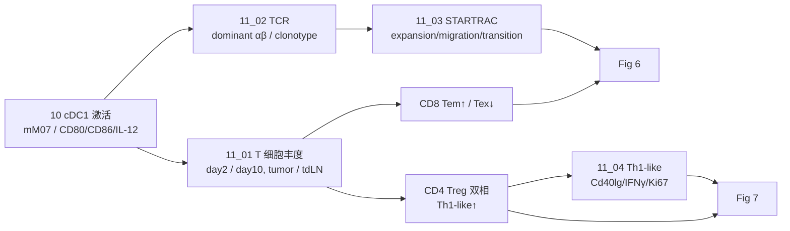

# 11 anti-CD40：T 细胞动态、TCR 与 STARTRAC

> **目标文献**：Zhang L, Li Z, Skrzypczynska KM, et al. *Single-Cell Analyses Inform Mechanisms of Myeloid-Targeted Therapies in Colon Cancer.* Cell. 2020;181(2):442–459.e29. DOI: 10.1016/j.cell.2020.03.048
> **模块对应原文**：Fig. 6A–6J；Fig. 7A–7J；Fig. S7F–S7M；STAR Methods「TCR analysis」「Single cell sorting, library preparation, and sequencing for mouse samples」
> **前置依赖**：`08_小鼠肿瘤模型与跨物种髓系整合.md` 的 `processed/mouse_t_annot.rds`（含 T 细胞、tdLN、TCR 表型）；`10_antiCD40_cDC1激活与CD40_CD40LG轴.md` 的 cDC1 结果；`01` 下载的 TCGA COAD/READ 与临床表（Fig. 7J）
> **复现难度 / 预计工时 / 计算资源**：★★★★★ / 5–7 人日 / 64 GB 内存、16 核；STARTRAC 的置换/克隆计算可并行

---

## ① 科学问题与逻辑位置

**科学问题**：anti-CD40 激活 cDC1 之后，T 细胞发生了什么？是"广泛免疫激活"，还是"特定 CD8 记忆/Th1-like 亚群的选择性扩增"？这些变化是否伴随 TCR 克隆的迁移与状态转变？

**本模块的回答**：
- **CD8**：anti-CD40 增加 `mT09_CD8_Tem-Ccl5`（效应记忆），减少 `mT11_CD8_Tex-Lag3` / `mT12_CD8_Tex-Mki67`（耗竭）；`Ctla4`/`Tigit` 快速下降，`Pdcd1`/`Lag3` 在 day 10 下降；高克隆的 `Ccl5⁺ Tem` 在肿瘤与 tdLN 之间共享更多 TCR；`Ccl5⁺ Tem → Cxcr6⁺ Trm` 的转变指数增强。
- **CD4**：Treg 在 day 2 扩增、day 10 收缩；`mT03_CD4_Th-Bhlhe40`（Bhlhe40⁺ Th1-like）在 day 2 与 day 10 均扩增、克隆扩增、`Cd40lg`↑、IFNγ↑、Ki67↑；OTII 体外证明 anti-CD40 促进 DC 成熟 → CD4 T `Bhlhe40`↑（`Tbx21` 不变）。
- **人类**：Th1-like signature 与 cDC1（尤其活化 cDC1）正相关；cDC1 在 MSI-H 富集（Fig. 7J，详见 12 号）。

**逻辑位置**：
- 上游：10 号的 cDC1 活化；08 号的 T 细胞聚类与 TCR 表。
- 本模块：T 细胞丰度、耗竭标志、TCR 克隆、STARTRAC、Th1-like。
- 下游：12 号的 TCGA 生存/相关性；13 号的流式/OTII 验证；14 号的批判性评述（相关+体外，非因果）。



---

## ② 背景原理

### 2.1 CD8 T 细胞状态

| 状态 | 小鼠簇 | 关键基因 | 功能 |
|---|---|---|---|
| Naive | `mT07_CD8_Tn-Ccr7` | `Ccr7`、`Lef1`、`Tcf7` | 未接触抗原 |
| 中央记忆（Tcm） | `mT08_CD8_Tcm-Ifit3` | `Ifit3`、`Tcf7`、`Ccr7` | 再循环、二次应答 |
| 效应记忆（Tem） | `mT09_CD8_Tem-Ccl5` | `Ccl5`、`Gzmb`、`Ifng` | 外周效应、迁移 |
| 组织驻留记忆（Trm） | `mT10_CD8_Trm-Cxcr6` | `Cxcr6`、`Itgae`、`Cd69` | 组织驻留 |
| 耗竭（Tex） | `mT11_CD8_Tex-Lag3`、`mT12_CD8_Tex-Mki67` | `Pdcd1`、`Lag3`、`Ctla4`、`Tigit`、`Havcr2` | 慢性抗原刺激、功能下降 |

- **Tem vs Trm**：Tem 更迁移（可进出 tdLN），Trm 驻留组织；STARTRAC migration/transition 正是区分二者。
- **耗竭是可逆的**：anti-CD40 后 `Ctla4`/`Tigit` 先降，`Pdcd1`/`Lag3` 后降，提示"去耗竭"是渐进的。
- **注意**：`Mki67⁺ Tex` 是增殖中的耗竭细胞，不是"更好"的 Tex；anti-CD40 减少它，可能是减少慢性刺激下的代偿增殖。

### 2.2 CD4 T 细胞状态

| 状态 | 小鼠簇 | 关键基因 | 功能 |
|---|---|---|---|
| Naive | `mT01_CD4_Tn-Lef1` | `Lef1`、`Tcf7`、`Ccr7` | 未接触抗原 |
| 中央记忆（Tcm） | `mT02_CD4_Tcm-Ifit3`、`mT06_CD4_Tcm-Tcf7` | `Ifit3`、`Tcf7` | 再循环 |
| Th（Th1-like） | `mT03_CD4_Th-Bhlhe40` | `Bhlhe40`、`Ifng`、`Cd40lg` | 帮助 DC/CTL |
| Treg | `mT04_CD4_Treg-Foxp3` | `Foxp3`、`Il2ra`、`Ctla4` | 免疫抑制 |
| Tfh | `mT05_CD4_Tfh-Cxcr5` | `Cxcr5`、`Pdcd1`、`Il21` | 生发中心帮助 |

- **Bhlhe40**：转录因子，标记致病性 Th1/Th17 样细胞；在 MSI CRC 中富集，与 ICB 良好响应相关（Zhang et al., Nature 2018）。
- **Treg 双相**：day 2 扩增可能是 anti-CD40 的直接/间接激活；day 10 收缩可能是 cDC1–Th1 轴增强后的微环境重塑。原文没有解释机制，复现时只描述动力学，不编机制。

### 2.3 TCR 与克隆型

- **TCR αβ**：每条链由 V(D)J 重排产生；同一克隆的细胞共享 dominant αβ 配对。
- **dominant αβ**：一个细胞可能组装出多条 α/β 链；原文取 UMI 最高的 α–β 配对。
- **克隆型（clonotype）**：两个或多个细胞具有相同的 dominant αβ 对 → 同一克隆。
- **高克隆**：在 `Ccl5⁺ Tem` 簇内 ≥3 个细胞为 high clonal（原文 Fig. 6H）。
- **TCR sharing**：同一克隆出现在肿瘤与 tdLN → 迁移/循环的证据（不是直接迁移轨迹）。

### 2.4 STARTRAC 三个指数

STARTRAC（Zhang et al., Nature 2018）用 TCR 克隆型定义 T 细胞的三种动态：

1. **Expansion（扩增）**：某 cluster 内克隆型的扩增程度。直觉：克隆越大，expension 越高。
   - 常用实现：`1 − Σ_i p_i²`（Simpson 多样性；p_i 为克隆 i 在该 cluster 的比例），或用克隆大小的熵。
2. **Migration（迁移）**：某 cluster 的克隆型在多个组织（肿瘤/tdLN）之间共享的程度。
   - 直觉：同一克隆在多组织出现 → 迁移指数高。
3. **Transition（转变）**：两个 cluster 之间共享克隆型的程度。
   - 直觉：同一克隆同时出现在 cluster A 与 B → A/B 之间存在状态转变（或共同前体）。

> ⚠️ **导师批注**：STARTRAC 的具体归一化在不同 commit 可能不同；本项目以官方 `STARTRAC.R` 为主路径，另附"可核对的等价实现"（见 4.3），两者结果方向应一致。若不一致，以官方实现为准并在 gap 表记录。

### 2.5 原文的一个数字矛盾

原文 Methods 写："53,499 cells from 33,114 CD4+ T cells and 37,740 CD8+ T cells." 但 **33,114 + 37,740 = 70,854 ≠ 53,499**。这是原文的内部不一致（C 类）：
- 可能解释：53,499 是"有 TCR 且通过 QC 的 CD4/CD8 T 细胞"，33,114/37,740 是"用于某一步的 CD4/CD8 总数"；或其中一个数字是笔误。
- **本项目处理**：以 `processed/mouse_t_annot.rds` 中实际有 TCR 的 T 细胞数为准；报告 CD4/CD8 各自数量与总数；在 gap 表标注"原文数字不自洽，未据此设门槛"。

---

## ③ 原文逐句拆解

| 原文句（节选） | 中文转述 | 我的操作 | 原文是否给参数 | 缺失项/复现决策 |
|---|---|---|---|---|
| "Anti-CD40 treatment significantly increased the proportion of tumor memory CD8+ T cell subsets but reduced the frequency of exhausted CD8+ T cell subsets, especially at 10 days" | CD8 记忆↑、耗竭↓，day 10 最明显 | 11_01 按 timepoint 分层 | 未给每个簇 p | 报每个簇 p/FC；单侧+双侧 |
| "expression of Ctla4 and Tigit being rapidly reduced upon treatment and a significant reduction in Pdcd1 and Lag3 expression observed at 10 days" | 耗竭标志下降有时序 | 11_01 附：标志基因表达 | 未给统计 | Wilcoxon + BH |
| "anti-CD40 treatment increases effector CD8+ T cells and reduces PD1+ exhausted CD8+ T cells" | 流式验证 | 13_01 | 未给门控 | 按原文；记录 |
| "Ccl5+ Tem CD8+ T cells had a higher migration index than other CD8+ T cell subsets upon anti-CD40 treatment" | Ccl5 Tem 迁移指数高 | 11_03 STARTRAC migration | 未给具体值 | 官方实现 + 等价实现 |
| "anti-CD40 treatment dramatically increased the proportion of Ccl5+ Tem CD8+ T cells, but not the Cxcr6+ Trm population in tdLNs" | tdLN 中 Tem↑、Trm 不变 | 11_01 tdLN | 未给 | 肿瘤/tdLN 分开 |
| "those cells with higher clonal expansion exhibited more TCR sharing between tumor and tdLN" | 高克隆 Tem 的肿瘤–tdLN 共享更多 | 11_02 + Fisher | 高克隆定义 ≥3 | 照做 |
| "the transition index between Ccl5+ Tem and Cxcr6+ Trm CD8+ T cells was significantly higher than that of other pairs ... further enhanced by anti-CD40" | Tem→Trm 转变增强 | 11_03 transition | 未给 | 官方实现；pairwise |
| "anti-CD40 treatment significantly amplified Treg cells at 2 days ... reduced at 10 days" | Treg 双相 | 11_01 CD4 | 未给 | 照做 |
| "anti-CD40 treatment specifically increased the proportion of Bhlhe40+ Th1-like cells on both day 2 and day 10" | Th1-like 双相扩增 | 11_04 | 未给 | 照做 |
| "anti-CD40 treatment significantly induced the expression of Cd40lg on Bhlhe40+ Th1-like cells" | Cd40lg↑ | 11_04 + 流式 | 未给 | 照做 |
| "Bhlhe40+ CD4+ T cells ... produced significantly more IFNg ... expressed Ki67 ... further induced to proliferate by anti-CD40" | IFNγ↑、Ki67↑ | 13_01 流式 | 未给 | 照做 |
| "anti-CD40 treatment promoted DC maturation which further increased the expression of Bhlhe40, but not Tbx21, in CD4+ T cells" | OTII：Bhlhe40↑、Tbx21 不变 | 13_03 | 给了肽浓度/抗体浓度 | 照做 |
| "a gene signature of Th1-like cells exhibited preferentially positive correlation with both mature and immature cDC1 cells" | 人类 Th1-like–cDC1 正相关 | 12_03 | 未给基因列表 | Table S4；暂定 |

---

## ④ 逐步可运行代码

> 语言：R 4.5.1 / Seurat 5.1.0 / STARTRAC（GitHub）/ survival 3.8。所有脚本首行 `set.seed(20261018)`。
> 输入：`processed/mouse_t_annot.rds`（08 号）；TCR 表 `raw/mouse_mc38/filtered_contig_annotations.csv`（Cell Ranger 输出，可能是多个样本合并）。

### 4.1 脚本 11_01：T 细胞丰度与耗竭标志

```r
#!/usr/bin/env Rscript
# code/11_01_t_abundance.R
# 用法: Rscript code/11_01_t_abundance.R <project_dir>
# 输入: processed/mouse_t_annot.rds
# 输出: results/cd40_t_abundance.tsv, results/cd40_exhaustion_markers.tsv,
#       figures/Fig6A_t_umap.pdf/.png, figures/Fig6B_cd8_memory.pdf/.png,
#       figures/Fig7A_cd4_treg_th1.pdf/.png

set.seed(20261018)
suppressPackageStartupMessages({
  library(SingleCellExperiment); library(dplyr); library(tidyr)
  library(ggplot2); library(readr)
})

args <- commandArgs(trailingOnly = TRUE)
proj <- ifelse(length(args) >= 1, args[1], ".")

sce <- readRDS(file.path(proj, "processed", "mouse_t_annot.rds"))
cd <- as.data.frame(colData(sce))
stopifnot(all(c("model", "treatment", "timepoint", "tissue", "mouse_id") %in% colnames(cd)))

t_clusters <- c(
  "mT01_CD4_Tn-Lef1", "mT02_CD4_Tcm-Ifit3", "mT03_CD4_Th-Bhlhe40",
  "mT04_CD4_Treg-Foxp3", "mT05_CD4_Tfh-Cxcr5", "mT06_CD4_Tcm-Tcf7",
  "mT07_CD8_Tn-Ccr7", "mT08_CD8_Tcm-Ifit3", "mT09_CD8_Tem-Ccl5",
  "mT10_CD8_Trm-Cxcr6", "mT11_CD8_Tex-Lag3", "mT12_CD8_Tex-Mki67"
)
stopifnot(all(t_clusters %in% cd$cluster_id))

# ---- 1. 分母：来自 08 号全细胞/CD8 计数表，不从 T 子集重算 ----
denom_cd45 <- readr::read_tsv(file.path(proj, "results", "mouse_cd45_counts.tsv"),
                              show_col_types = FALSE) %>%
  filter(model == "MC38") %>%
  select(mouse_id, treatment, timepoint, tissue, n_cd45)

denom_cd8 <- readr::read_tsv(file.path(proj, "results", "mouse_cd8_counts.tsv"),
                             show_col_types = FALSE) %>%
  filter(model == "MC38") %>%
  select(mouse_id, treatment, timepoint, tissue, n_cd8)

num <- cd %>%
  filter(model == "MC38", cluster_id %in% t_clusters) %>%
  count(mouse_id, treatment, timepoint, tissue, cluster_id, name = "n_cells")

abund <- num %>%
  left_join(denom_cd45, by = c("mouse_id", "treatment", "timepoint", "tissue")) %>%
  left_join(denom_cd8, by = c("mouse_id", "treatment", "timepoint", "tissue")) %>%
  mutate(
    pct_of_CD45 = 100 * n_cells / n_cd45,
    pct_of_CD8 = ifelse(grepl("^mT(07|08|09|10|11|12)", cluster_id),
                        100 * n_cells / n_cd8, NA_real_)
  )
write_tsv(abund, file.path(proj, "results", "cd40_t_abundance.tsv"))

# ---- 2. CD8 记忆/耗竭：按 timepoint 分层，单侧 t（anti-CD40 > isotype for Tem；< for Tex） ----
cd8_clusters <- c("mT09_CD8_Tem-Ccl5", "mT10_CD8_Trm-Cxcr6",
                  "mT11_CD8_Tex-Lag3", "mT12_CD8_Tex-Mki67")
stat <- abund %>%
  filter(cluster_id %in% cd8_clusters, tissue == "Tumor") %>%
  group_by(cluster_id, timepoint) %>%
  group_modify(~{
    x <- .x$pct_of_CD8[.x$treatment == "anti-CD40"]
    y <- .x$pct_of_CD8[.x$treatment == "Isotype"]
    if (length(x) < 2 || length(y) < 2) return(tibble())
    alt <- ifelse(grepl("Tem", .y$cluster_id[1]), "greater", "less")
    tt1 <- t.test(x, y, alternative = alt, var.equal = FALSE)
    tt2 <- t.test(x, y, alternative = "two.sided", var.equal = FALSE)
    tibble(n_treat = length(x), n_iso = length(y),
           mean_treat = mean(x), mean_iso = mean(y),
           log2FC = log2((mean(x) + 1e-6) / (mean(y) + 1e-6)),
           p_one_sided = tt1$p.value, p_two_sided = tt2$p.value)
  }) %>% ungroup() %>%
  group_by(timepoint) %>%
  mutate(FDR_one_sided = p.adjust(p_one_sided, "BH")) %>% ungroup()
write_tsv(stat, file.path(proj, "results", "cd40_t_abundance_stats.tsv"))

# ---- 3. 耗竭标志表达（cluster 平均 + 表达比例） ----
exh_genes <- c("Pdcd1", "Lag3", "Ctla4", "Tigit", "Havcr2", "Tox")
mat <- logcounts(sce)
g <- intersect(exh_genes, rownames(mat))
exh <- lapply(g, function(gene) {
  data.frame(cell_id = colnames(sce), cluster_id = cd$cluster_id,
             treatment = cd$treatment, timepoint = cd$timepoint,
             tissue = cd$tissue, gene = gene, expr = mat[gene, ])
}) %>% bind_rows() %>%
  filter(grepl("^mT1[12]", cluster_id), tissue == "Tumor") %>%
  group_by(cluster_id, treatment, timepoint, gene) %>%
  summarise(mean_expr = mean(expr), pct_expr = mean(expr > 0), .groups = "drop")
write_tsv(exh, file.path(proj, "results", "cd40_exhaustion_markers.tsv"))

# ---- 4. 图 ----
p_cd8 <- abund %>%
  filter(cluster_id %in% cd8_clusters, tissue == "Tumor") %>%
  ggplot(aes(x = cluster_id, y = pct_of_CD8, fill = treatment)) +
  geom_boxplot(outlier.shape = NA, width = 0.7) +
  facet_wrap(~ timepoint) +
  scale_fill_manual(values = c(Isotype = "grey70", `anti-CD40` = "#2E86C1")) +
  labs(x = NULL, y = "% of CD8+ T cells", fill = "Treatment",
       title = "MC38 tumor CD8 T cell subsets") +
  theme_bw(base_size = 11) +
  theme(axis.text.x = element_text(angle = 30, hjust = 1))
ggsave(file.path(proj, "figures", "Fig6B_cd8_memory.pdf"), p_cd8, width = 8, height = 4.5)
ggsave(file.path(proj, "figures", "Fig6B_cd8_memory.png"), p_cd8, width = 8, height = 4.5, dpi = 300)

p_cd4 <- abund %>%
  filter(grepl("^mT0[1-6]", cluster_id), tissue == "Tumor") %>%
  ggplot(aes(x = cluster_id, y = pct_of_CD45, fill = treatment)) +
  geom_boxplot(outlier.shape = NA, width = 0.7) +
  facet_wrap(~ timepoint) +
  scale_fill_manual(values = c(Isotype = "grey70", `anti-CD40` = "#2E86C1")) +
  labs(x = NULL, y = "% of CD45+ cells", fill = "Treatment",
       title = "MC38 tumor CD4 T cell subsets") +
  theme_bw(base_size = 11) +
  theme(axis.text.x = element_text(angle = 30, hjust = 1))
ggsave(file.path(proj, "figures", "Fig7A_cd4_treg_th1.pdf"), p_cd4, width = 8, height = 4.5)
ggsave(file.path(proj, "figures", "Fig7A_cd4_treg_th1.png"), p_cd4, width = 8, height = 4.5, dpi = 300)

sink(file.path(proj, "logs", "11_sessionInfo.txt")); print(sessionInfo()); sink()
```

**关键行解释**：
- CD8 比例用 `pct_of_CD8`（分母 CD8⁺），CD4 比例用 `pct_of_CD45`（原文 Fig. 7A 用 CD45⁺）；两者不要混。
- 单侧方向：Tem 用 `greater`（anti-CD40 增加），Tex 用 `less`（减少）；同时报双侧。
- 耗竭标志只在 Tex 簇（`mT11`/`mT12`）看；不要把所有 T 细胞混在一起。
- 时间点必须分层；day 2 与 day 10 的效应方向可能不同（Treg 就是双相）。

### 4.2 脚本 11_02：TCR 处理与克隆型

```r
#!/usr/bin/env Rscript
# code/11_02_tcr_process.R
# 用法: Rscript code/11_02_tcr_process.R <project_dir>
# 输入: raw/mouse_mc38/filtered_contig_annotations.csv（可多个样本，合并）
# 输出: results/tcr_clonotypes.tsv, results/tcr_sharing.tsv

set.seed(20261018)
suppressPackageStartupMessages({
  library(readr); library(dplyr); library(tidyr); library(stringr)
})

args <- commandArgs(trailingOnly = TRUE)
proj <- ifelse(length(args) >= 1, args[1], ".")

# ---- 1. 读 Cell Ranger contig 表 ----
contig <- read_csv(file.path(proj, "raw", "mouse_mc38", "filtered_contig_annotations.csv"),
                   show_col_types = FALSE)
# 期望列: barcode, chain, v_gene, d_gene, j_gene, c_gene, cdr3, cdr3_nt,
#         productive, full_length, umis, reads, raw_clonotype_id, sample_id
stopifnot(all(c("sample_id", "barcode", "chain", "cdr3", "umis", "productive") %in% colnames(contig)))

# ---- 2. 过滤：低置信、非生产性、UMI<2 ----
contig <- contig %>%
  filter(productive == TRUE | productive == "True" | productive == "true") %>%
  filter(umis >= 2) %>%
  filter(chain %in% c("TRA", "TRB"))

# ---- 3. 每个细胞选 dominant α/β（UMI 最高） ----
dom <- contig %>%
  group_by(sample_id, barcode, chain) %>%   # 不同样本的 barcode 会重复，必须带 sample_id
  arrange(desc(umis), desc(reads)) %>%
  slice(1) %>%
  ungroup() %>%
  select(sample_id, barcode, chain, cdr3, v_gene, j_gene, umis) %>%
  pivot_wider(names_from = chain, values_from = c(cdr3, v_gene, j_gene, umis),
              names_sep = ".")

# 至少要有 TRA 与 TRB 的 CDR3
dom <- dom %>% filter(!is.na(cdr3.TRA), !is.na(cdr3.TRB))
dom$clone_id <- paste(dom$cdr3.TRA, dom$cdr3.TRB, sep = "_")

# ---- 4. 与表达矩阵的 T 细胞 barcode 对齐 ----
sce <- readRDS(file.path(proj, "processed", "mouse_t_annot.rds"))
cd <- as.data.frame(colData(sce))
t_cells <- cd %>% filter(grepl("^mT", cluster_id)) %>%
  select(cell_id, cluster_id, tissue, treatment, timepoint, mouse_id)
# Cell Ranger barcode 可能带样本后缀；按实际列名匹配
# 与表达矩阵保持同一 cell_id 规则：sample_id + "_" + barcode
dom$cell_id <- paste(dom$sample_id, dom$barcode, sep = "_")
tcr <- inner_join(dom, t_cells, by = "cell_id")
if (nrow(tcr) == 0) {
  # 若表达矩阵已带 add.cell.ids 前缀，尝试直接用 barcode 匹配（仅作诊断，不静默替换）
  warning("sample_id_barcode 未匹配到表达矩阵；检查 cell_id 规则（见 08_01 add.cell.ids）")
}
write_tsv(tcr, file.path(proj, "results", "tcr_clonotypes.tsv"))

# ---- 5. 高克隆定义：Ccl5+ Tem 内同一 clone ≥3 cells ----
tem <- tcr %>% filter(cluster_id == "mT09_CD8_Tem-Ccl5")
clone_size <- tem %>% count(clone_id, name = "n_cells_tem")
tem <- tem %>% left_join(clone_size, by = "clone_id") %>%
  mutate(high_clonal = n_cells_tem >= 3)

# 每个 clone 是否在 tumor 与 tdLN 都出现
share <- tem %>%
  group_by(clone_id, high_clonal) %>%
  summarise(in_tumor = any(tissue == "Tumor"),
            in_tdln = any(tissue == "tdLN"), .groups = "drop") %>%
  mutate(shared = in_tumor & in_tdln)
write_tsv(share, file.path(proj, "results", "tcr_sharing.tsv"))

# Fisher exact: high vs low clonal 的共享比例
tab <- table(share$high_clonal, share$shared)
ft <- fisher.test(tab)
saveRDS(ft, file.path(proj, "results", "tcr_sharing_fisher.rds"))
print(ft)
```

**关键行解释**：
- `productive` 列在不同 Cell Ranger 版本可能是逻辑/字符串；代码兼容三种写法。
- `umis >= 2` 是原文阈值；`chain` 只保留 TRA/TRB。
- dominant αβ：每个细胞每条链取 UMI 最高的 contig；若一个细胞有两条 α 或两条 β，只留最高。
- barcode 对齐是最大坑：不同样本的 barcode 可能重复，必须在 `barcode` 前加 `sample_id` 或用 Cell Ranger 的 `barcode` 唯一标识；若 `cell_id` 不匹配，检查后缀（`-1`）与样本合并方式。
- Fisher 的 `table` 是 2×2：high/low × shared/not；`fisher.test` 默认双侧；原文用 Fisher。

### 4.3 脚本 11_03：STARTRAC 与等价实现

```r
#!/usr/bin/env Rscript
# code/11_03_startrac.R
# 用法: Rscript code/11_03_startrac.R <project_dir>
# 输入: results/tcr_clonotypes.tsv
# 输出: results/startrac_indices.tsv, results/startrac_pairwise_transition.tsv,
#       figures/Fig6J_transition.pdf/.png, figures/FigS7H_migration.pdf/.png

set.seed(20261018)
suppressPackageStartupMessages({
  library(dplyr); library(tidyr); library(readr); library(ggplot2)
})

args <- commandArgs(trailingOnly = TRUE)
proj <- ifelse(length(args) >= 1, args[1], ".")

tcr <- read_tsv(file.path(proj, "results", "tcr_clonotypes.tsv"))
# 期望列: cell_id, clone_id, cluster_id, tissue, treatment, timepoint, mouse_id

# ============================================================
# A. 官方 STARTRAC（主路径）
# ============================================================
# 官方包不在 CRAN；从 GitHub 克隆后 source：
#   git clone https://github.com/Japrin/STARTRAC
#   source("STARTRAC/STARTRAC.R")
# 官方函数签名以当前 commit 为准；以下调用需按 README 核对列名。
startrac_file <- file.path(proj, "code", "external", "STARTRAC.R")
if (file.exists(startrac_file)) {
  source(startrac_file)
  # 例：STARTRAC.expansion(data, clone.column="clone_id", cluster.column="cluster_id",
  #                        sample.column="mouse_id")
  # 本项目把官方结果写到 results/startrac_official.tsv，再与下方等价实现比对。
  message("已加载 STARTRAC.R：请按当前 commit 的 README 调用官方函数")
} else {
  message("未找到 code/external/STARTRAC.R：使用下方等价实现；在 gap 表注明")
}

# ============================================================
# B. 可核对的等价实现（方向应与官方一致）
# ============================================================

# ---- B1. Expansion：1 - Simpson 多样性（按 cluster × mouse） ----
expansion <- tcr %>%
  group_by(mouse_id, treatment, timepoint, cluster_id) %>%
  group_modify(~{
    n <- table(.x$clone_id)
    p <- n / sum(n)
    tibble(expansion = 1 - sum(p^2), n_cells = sum(n), n_clones = length(n))
  }) %>% ungroup()

# ---- B2. Migration：每个 clone 出现的组织数；按 cluster × mouse 平均 ----
migration <- tcr %>%
  group_by(mouse_id, treatment, timepoint, cluster_id, clone_id) %>%
  summarise(n_tissues = n_distinct(tissue), .groups = "drop") %>%
  group_by(mouse_id, treatment, timepoint, cluster_id) %>%
  summarise(migration = mean(n_tissues), .groups = "drop")

# ---- B3. Transition：按 mouse × treatment × timepoint 分层，计算共享 clone 的 Jaccard ----
clusters <- sort(unique(tcr$cluster_id))
pairwise <- expand.grid(A = clusters, B = clusters, stringsAsFactors = FALSE) %>%
  filter(A < B)
groups <- tcr %>% distinct(mouse_id, treatment, timepoint)
transition_long <- lapply(seq_len(nrow(groups)), function(gi) {
  g <- groups[gi, ]
  d <- tcr %>% filter(mouse_id == g$mouse_id, treatment == g$treatment,
                      timepoint == g$timepoint)
  lapply(seq_len(nrow(pairwise)), function(i) {
    a <- pairwise$A[i]; b <- pairwise$B[i]
    sa <- unique(d$clone_id[d$cluster_id == a])
    sb <- unique(d$clone_id[d$cluster_id == b])
    inter <- length(intersect(sa, sb)); uni <- length(union(sa, sb))
    data.frame(mouse_id = g$mouse_id, treatment = g$treatment,
               timepoint = g$timepoint, from = a, to = b,
               n_shared = inter, jaccard = ifelse(uni > 0, inter / uni, 0))
  }) %>% bind_rows()
}) %>% bind_rows()

transition <- transition_long %>%
  group_by(from, to) %>%
  summarise(transition_index = mean(jaccard, na.rm = TRUE),
            p = tryCatch(wilcox.test(jaccard, mu = 0)$p.value, error = function(e) NA_real_),
            n_mice = n_distinct(mouse_id), .groups = "drop")

# ---- B4. 合并输出（契约列：from/to/transition_index/p） ----
idx <- expansion %>%
  left_join(migration, by = c("mouse_id", "treatment", "timepoint", "cluster_id"))
write_tsv(idx, file.path(proj, "results", "startrac_indices.tsv"))
write_tsv(transition, file.path(proj, "results", "startrac_pairwise_transition.tsv"))
write_tsv(transition_long, file.path(proj, "results", "startrac_transition_by_mouse.tsv"))

# ---- B5. Fig 6J：day 10，Ccl5 Tem vs Cxcr6 Trm 的 transition（按小鼠展示） ----
pairs_interest <- transition_long %>%
  filter(from == "mT09_CD8_Tem-Ccl5", to == "mT10_CD8_Trm-Cxcr6")
p <- ggplot(pairs_interest, aes(x = treatment, y = jaccard, color = treatment)) +
  geom_boxplot(outlier.shape = NA) +
  geom_point(position = position_jitter(width = 0.1), size = 1.5) +
  labs(x = NULL, y = "TCR sharing (Jaccard)",
       title = "Ccl5+ Tem -> Cxcr6+ Trm transition (per mouse)") +
  theme_bw(base_size = 12) + theme(legend.position = "none")
ggsave(file.path(proj, "figures", "Fig6J_transition.pdf"), p, width = 5, height = 4)
ggsave(file.path(proj, "figures", "Fig6J_transition.png"), p, width = 5, height = 4, dpi = 300)

# ---- B6. Fig S7H：CD8 各簇 migration ----
mig_cd8 <- idx %>% filter(grepl("^mT(07|08|09|10|11|12)", cluster_id)) %>%
  filter(timepoint == "day10")
p2 <- ggplot(mig_cd8, aes(x = cluster_id, y = migration, fill = treatment)) +
  geom_boxplot(outlier.shape = NA, width = 0.7) +
  scale_fill_manual(values = c(Isotype = "grey70", `anti-CD40` = "#2E86C1")) +
  labs(x = NULL, y = "Migration index (mean #tissues per clone)",
       title = "CD8 T cell migration at day 10") +
  theme_bw(base_size = 11) +
  theme(axis.text.x = element_text(angle = 30, hjust = 1))
ggsave(file.path(proj, "figures", "FigS7H_migration.pdf"), p2, width = 7, height = 4)
ggsave(file.path(proj, "figures", "FigS7H_migration.png"), p2, width = 7, height = 4, dpi = 300)
```

**关键行解释**：
- 官方 STARTRAC 的具体函数名/参数以仓库 README 为准；本脚本把官方结果与等价实现并列，方向一致才写"复现"。
- Expansion 用 `1 − Σ p²` 是 Simpson 多样性；官方可能用熵/克隆大小，数值不可直接比较，只比方向/排序。
- Migration 用"每个 clone 出现的组织数"是简化；官方可能按组织间克隆频率加权。
- Transition 用 Jaccard 是简化；官方 transition index 可能归一化到 0–1 并按 cluster size 校正。复现报告必须写清楚"等价实现"与"官方实现"的差异。
- 两两 transition 的 `A < B` 仅避免重复；若要方向性（A→B），需结合 pseudotime/RNA velocity，不能只靠共享克隆。

### 4.4 脚本 11_04：Th1-like 与 Cd40lg/IFNγ

```r
#!/usr/bin/env Rscript
# code/11_04_th1_like.R
# 用法: Rscript code/11_04_th1_like.R <project_dir>
# 输入: processed/mouse_t_annot.rds; results/cd40_t_abundance.tsv
# 输出: results/cd40_th1_like.tsv, figures/Fig7B_Th1_expansion.pdf/.png,
#       figures/Fig7C_D_Cd40lg.pdf/.png

set.seed(20261018)
suppressPackageStartupMessages({
  library(SingleCellExperiment); library(dplyr); library(tidyr)
  library(ggplot2); library(readr)
})

args <- commandArgs(trailingOnly = TRUE)
proj <- ifelse(length(args) >= 1, args[1], ".")

sce <- readRDS(file.path(proj, "processed", "mouse_t_annot.rds"))
cd <- as.data.frame(colData(sce))
mat <- logcounts(sce)

th1 <- cd$cluster_id == "mT03_CD4_Th-Bhlhe40" & cd$tissue == "Tumor"
stopifnot(sum(th1) > 0)

# ---- 1. cluster 平均表达：Bhlhe40、Ifng、Cd40lg、Tbx21、Mki67 ----
genes <- intersect(c("Bhlhe40", "Ifng", "Cd40lg", "Tbx21", "Mki67"), rownames(mat))
summ <- lapply(genes, function(g) {
  data.frame(cell_id = colnames(sce)[th1], cluster_id = cd$cluster_id[th1],
             treatment = cd$treatment[th1], timepoint = cd$timepoint[th1],
             gene = g, expr = mat[g, th1])
}) %>% bind_rows() %>%
  group_by(cluster_id, treatment, timepoint, gene) %>%
  summarise(mean_expr = mean(expr), pct_expr = mean(expr > 0), .groups = "drop")
write_tsv(summ, file.path(proj, "results", "cd40_th1_like.tsv"))

# ---- 2. 图：day 2 / day 10 ----
p <- ggplot(summ, aes(x = gene, y = mean_expr, fill = treatment)) +
  geom_col(position = "dodge") +
  facet_wrap(~ timepoint) +
  scale_fill_manual(values = c(Isotype = "grey70", `anti-CD40` = "#2E86C1")) +
  labs(x = NULL, y = "Mean log-normalized expression", fill = "Treatment",
       title = "Bhlhe40+ Th1-like cells (mT03)") +
  theme_bw(base_size = 12)
ggsave(file.path(proj, "figures", "Fig7C_D_Cd40lg.pdf"), p, width = 7, height = 4)
ggsave(file.path(proj, "figures", "Fig7C_D_Cd40lg.png"), p, width = 7, height = 4, dpi = 300)

# ---- 3. 统计：每个时间点，anti-CD40 vs isotype ----
stat <- lapply(split(summ, list(summ$timepoint, summ$gene), drop = TRUE), function(d) {
  x <- d$mean_expr[d$treatment == "anti-CD40"]
  y <- d$mean_expr[d$treatment == "Isotype"]
  if (length(x) < 2 || length(y) < 2) return(NULL)
  data.frame(timepoint = d$timepoint[1], gene = d$gene[1],
             delta = mean(x) - mean(y), p = wilcox.test(x, y)$p.value)
}) %>% bind_rows() %>% mutate(FDR = p.adjust(p, "BH"))
write_tsv(stat, file.path(proj, "results", "cd40_th1_like_stats.tsv"))
```

**关键行解释**：
- `mT03_CD4_Th-Bhlhe40` 是原文的小鼠 Th1-like 标签；不要用 `mT05_Tfh` 或 `mT02_Tcm` 替代。
- `Cd40lg` 是配体，表达在 T；`Cd40` 在 DC（10 号）。
- `Tbx21` 作为对照：原文 OTII 中 anti-CD40 不上调 `Tbx21`，但 `Bhlhe40` 上调；如果我们的数据 `Tbx21` 也显著上调，需检查 DC 成熟/抗原浓度。
- 若 `Ifng` 在 scRNA 中 dropout 严重，流式（13_01）更可靠。

---

## ⑤ 参数解释与调参空间

| 参数 | 原文取值 | 可选范围 | 改变后果 | 本项目裁决 |
|---|---|---|---|---|
| 时间点 | day 2 / day 10 | 24 h–14 d | 早期激活 vs 记忆/克隆 | 原文（D15） |
| 组织 | 肿瘤 / tdLN | 脾/血 | 迁移/驻留 | 原文 |
| CD8 比例分母 | `% of CD8⁺` | `% of CD45⁺` | 绝对值 vs 相对 | 原文 Fig. 6B 用 CD8⁺ |
| CD4 比例分母 | `% of CD45⁺` | `% of CD4⁺` | 绝对值 vs 相对 | 原文 Fig. 7A 用 CD45⁺ |
| 高克隆阈值 | ≥3 cells in Ccl5 Tem | 2–5 | 共享比例 | 原文 |
| dominant 链 | 最高 UMI | 最高 reads | 克隆型 | 原文 UMI |
| UMI 阈值 | ≥2 | 1–3 | 克隆数 | 原文 |
| STARTRAC | 官方实现 | 等价实现 | 指数尺度 | 官方为主；等价核对 |
| 耗竭标志 | `Pdcd1/Lag3/Ctla4/Tigit` | 加 `Havcr2/Tox` | 时序 | 原文 4 个 + 2 个探索 |
| OTII 肽浓度 | 10/100/1,000 nM | 1–1,000 nM | 亚适刺激 | 原文 |
| anti-CD40 体外 | 10 µg/mL | 1–20 µg/mL | DC 成熟 | 原文 |

---

## ⑥ 预期结果与 QC 检查点

| # | 指标 | 文献值 | 允许范围 | Go/No-Go | 我方值 |
|---|---|---|---|---|---|
| Q43 | CD8 Tem（mT09） | anti-CD40↑ | p<0.05 同方向 | ✅/⚠️/❌ | |
| Q43 | CD8 Tex（mT11/12） | anti-CD40↓ | p<0.05 同方向 | ✅/⚠️/❌ | |
| Q43 | PD1⁺ 耗竭 T（流式） | 下降 | 方向一致 | ✅/⚠️/❌ | |
| Q44 | Bhlhe40⁺ Th1-like（mT03） | day 2 与 day 10 均↑ | 方向一致 | ✅/⚠️/❌ | |
| Q44 | Cd40lg 在 Th1-like | ↑ | 方向一致 | ✅/⚠️/❌ | |
| Q44 | IFNγ / Ki67 | ↑ | 方向一致 | ✅/⚠️ | |
| Q45 | 高克隆 Tem 的肿瘤–tdLN 共享 | ↑（Fisher） | 方向一致，p<0.05 | ✅/⚠️ | |
| Q45 | Ccl5 Tem→Cxcr6 Trm transition | 高于其他配对，anti-CD40 增强 | 方向一致 | ✅/⚠️ | |
| — | Treg | day 2↑、day 10↓ | 双相 | ✅/⚠️ | |
| — | 有 TCR 的 T 细胞数 | 53,499（原文；但 CD4+CD8 数字不自洽） | 以实际为准 | ✅/⚠️ | |

**预期图形**：
- Fig. 6A：T 细胞 UMAP，四个 panel（day2 isotype/anti-CD40、day10 isotype/anti-CD40）。
- Fig. 6B：CD8 记忆亚群比例，anti-CD40 组 Tem↑、Tex↓。
- Fig. 6C：Tex 的 `Ctla4`/`Tigit`/`Pdcd1`/`Lag3` 表达动力学。
- Fig. 6D–6G：流式 CD8 效应/耗竭。
- Fig. 6H–6I：Ccl5 Tem 克隆型分布与肿瘤–tdLN 共享。
- Fig. 6J：CD8 两两 transition。
- Fig. 7A–7B：CD4 亚群比例与 STARTRAC expansion。
- Fig. 7C–7E：Cd40lg 表达/流式。
- Fig. 7F–7H：IFNγ/Ki67 流式。
- Fig. 7I：OTII Bhlhe40。
- Fig. 7J：Th1-like–cDC1 相关（12 号）。

---

## ⑦ 常见陷阱与排错表

| 现象 | 根因 | 解决 |
|---|---|---|
| T 细胞簇数不是 12 | 分辨率/PC 不对；tdLN 与 tumor 混合聚类 | 按原文分别/合并聚类；检查 `mT01–mT12` marker |
| CD8 Tem 不增加 | 时间点不对；把 tdLN 与 tumor 混了；分母用 CD45⁺ | 按 day 2/day 10、tumor/tdLN 分层；用 CD8⁺ 分母 |
| Tex 不减少 | Tex 簇被 Tem 吞并；`Pdcd1/Lag3` dropout | 提高分辨率；用 Smart-seq2/流式验证 |
| TCR barcode 对不上 | 多样本 barcode 重复/后缀不同 | 用 `sample_id + barcode` 唯一键；检查 `-1` 后缀；按 Cell Ranger 的 `filtered_contig_annotations.csv` 的 `barcode` 与 expression 的 `cell_id` 对齐 |
| 克隆型数量爆炸 | 未过滤非生产性/UMI<2；CDR3 含 N 碱基 | 按原文过滤；只保留 TRA+TRB |
| 高克隆共享不显著 | 高克隆阈值太低/太高；tumor/tdLN 细胞数不平衡 | 阈值 ≥3（原文）；报告每组克隆数；Fisher |
| STARTRAC 结果与官方不一致 | 等价实现与官方归一化不同 | 以官方为准；报告差异；不混用 |
| Transition 方向无法确定 | 共享克隆只说明"同克隆"，不说明方向 | 结合 pseudotime/RNA velocity；措辞用"associated with" |
| Treg 双相没看到 | 只取了一个时间点；Treg 比例被 CD45⁺ 分母稀释 | 两个时间点都看；用 CD4⁺ 分母作敏感性 |
| Th1-like 不增加 | 用了 `Tbx21` 而不是 `Bhlhe40`；簇标签错 | 用 `mT03_CD4_Th-Bhlhe40`；检查 `Bhlhe40` |
| OTII 无差异 | 肽浓度太高（所有细胞都激活）；抗体浓度不对 | 用亚适浓度 10–100 nM；anti-CD40 10 µg/mL |

---

## ⑧ 与文献图表的对应关系表

| 原文图 | 内容 | 本模块脚本 | 产物 |
|---|---|---|---|
| Fig. 6A | T 细胞 UMAP（day2/day10） | 08/11_01 | `figures/Fig6A_t_umap.*` |
| Fig. 6B | CD8 记忆亚群比例 | 11_01 | `results/cd40_t_abundance.tsv`、`figures/Fig6B_cd8_memory.*` |
| Fig. 6C | Tex 耗竭标志 | 11_01 | `results/cd40_exhaustion_markers.tsv` |
| Fig. 6D–6G | 流式 CD8 效应/耗竭 | 13_01 | `results/validation_flow_cd8.tsv` |
| Fig. 6H–6I | TCR 克隆分布/共享 | 11_02 | `results/tcr_clonotypes.tsv`、`results/tcr_sharing.tsv` |
| Fig. 6J | CD8 transition | 11_03 | `results/startrac_pairwise_transition.tsv`、`figures/Fig6J_transition.*` |
| Fig. 7A | CD4 亚群比例 | 11_01 | `results/cd40_t_abundance.tsv`、`figures/Fig7A_cd4_treg_th1.*` |
| Fig. 7B | CD4 STARTRAC expansion | 11_03 | `results/startrac_indices.tsv` |
| Fig. 7C–7D | Cd40lg 表达 | 11_04 | `results/cd40_th1_like.tsv`、`figures/Fig7C_D_Cd40lg.*` |
| Fig. 7E | CD4⁺CD40L⁺ 流式 | 13_01 | `results/validation_flow_cd40l.tsv` |
| Fig. 7F–7H | IFNγ/Ki67 流式 | 13_01 | `results/validation_flow_th1.tsv` |
| Fig. 7I | OTII Bhlhe40 | 13_03 | `results/validation_otii_qpcr.tsv` |
| Fig. 7J | Th1-like–cDC1 相关 | 12_03 | `results/th1_cdc1_correlation.tsv` |
| Fig. S7F–S7G | T 细胞 UMAP/相似性 | 08/11_01 | `figures/FigS7F_t_umap.*` |
| Fig. S7H | CD8 migration | 11_03 | `figures/FigS7H_migration.*` |
| Fig. S7I | tdLN CD8 亚群 | 11_01 | `results/cd40_t_abundance.tsv` |
| Fig. S7J | 克隆型分布 | 11_02 | `results/tcr_clonotypes.tsv` |
| Fig. S7K–S7M | Bhlhe40/Tbx21/OTII | 13_03 | `results/validation_otii_qpcr.tsv` |

---

## 附：本模块的"诚实性声明"

1. **STARTRAC 的等价实现不是官方实现**：数值不可与原文直接比较，只比较方向/排序；官方实现为主路径，若无法安装，在 gap 表标注。
2. **TCR sharing ≠ 迁移**：同一克隆在肿瘤与 tdLN 出现，说明克隆共享/可能迁移，不是直接追踪；措辞用"shared/associated with"。
3. **Transition 方向不能只靠共享克隆**：需要 pseudotime/RNA velocity 或实验验证；原文用 "suggesting"。
4. **Th1-like ≠ 经典 Th1**：原文用 `Bhlhe40` 定义，`Tbx21` 不变；不要把 `Bhlhe40⁺` 写成 `Tbx21⁺ Th1`。
5. **原文 CD4/CD8 细胞数不自洽**（33,114 + 37,740 ≠ 53,499）：本项目以实际数据为准，不据此设门槛，并在 gap 表记录。
6. anti-CD40 的 T 细胞结论来自 MC38（高度免疫原性），不能直接外推到人类 MSS CRC；机制链是"相关 + 体外"，不是因果。
