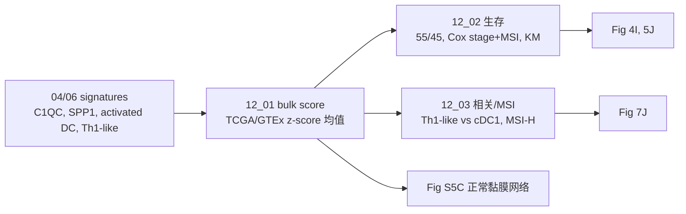

# 12 TCGA/GTEx bulk 验证与生存分析

> **目标文献**：Zhang L, Li Z, Skrzypczynska KM, et al. *Single-Cell Analyses Inform Mechanisms of Myeloid-Targeted Therapies in Colon Cancer.* Cell. 2020;181(2):442–459.e29. DOI: 10.1016/j.cell.2020.03.048
> **模块对应原文**：Fig. 4I；Fig. 5J；Fig. 7J；Fig. S5C；STAR Methods「Correlative cell-cell interactions inferred by combined scRNA-seq and TCGA datasets」「Survival analysis」
> **前置依赖**：`04_髓系亚群与TAM二分法.md` 的 `results/myeloid_markers.tsv`；`06_细胞互作网络I_scRNA_bulk相关性网络.md` 的 `results/celltype_signatures.tsv`；`01` 下载的 TCGA COAD/READ 与 GTEx colon（UCSC Xena）
> **复现难度 / 预计工时 / 计算资源**：★★★☆☆ / 2–3 人日 / 16 GB 内存、4–8 核；无 GPU

---

## ① 科学问题与逻辑位置

**科学问题**：单细胞层面发现的 TAM 二分、cDC1 活化、Th1-like 扩增，能否在**独立的大样本 bulk 队列**中得到"预后关联"的支持？这些关联的边界在哪里？

**本模块的回答**：
1. **C1QC/SPP1 TAM**：TCGA COAD+READ 中，C1QC^low SPP1^high 的患者 OS 最差（Fig. 4I；四组 n=111/27/30/108；Group2 vs Group3 HR=0.1，P=0.01）。
2. **activated DC**：activated DC signature 高表达与更好 OS 相关（Fig. 5J；HR=0.53，P=0.01）。
3. **Th1-like–cDC1**：Th1-like signature 与 BATF3⁺ cDC1、activated cDC1 正相关，与 cDC2 相关性较弱（Fig. 7J）；cDC1 在 MSI-H 中富集。
4. **正常黏膜对照**：GTEx colon 的相关性网络（Fig. S5C）用于说明"肿瘤网络的边不是正常组织也有的通用边"。

**逻辑位置**：
- 上游：04/06 号的 signature 与细胞类型定义；10/11 号的小鼠/人类机制。
- 本模块：把"细胞类型 signature"投射到 bulk，做预后/相关性验证。
- 下游：14 号的批判性评述（bulk signature ≠ 细胞计数、55/45 任意、无外部验证）；15 号的生存分析方法学。



---

## ② 背景原理

### 2.1 为什么用 bulk 验证单细胞发现

- 单细胞队列样本量小（18 例）、随访短；bulk 队列（TCGA）样本量大、随访长，可做预后关联。
- **但 bulk 是"组织平均"**：signature 高不代表某细胞类型数量多，可能反映：
  1. 该细胞类型真的多；
  2. 其他细胞也表达这些基因（signature 不特异）；
  3. 肿瘤纯度、基质比例、RNA 质量；
  4. 治疗/分期/MSI 等混杂。
- 因此 bulk 关联只能作为**支持性证据**，不能替代单细胞/空间/功能验证。

### 2.2 TCGA COAD/READ 与 GTEx colon

- **TCGA COAD**：结肠腺癌 ~450 例；**READ**：直肠腺癌 ~170 例；RNA-seq（Illumina HiSeq）、临床（stage、OS、MSI）。
- **GTEx colon**：正常结肠组织（横结肠/乙状结肠），用于正常黏膜的 signature/网络对照；**无肿瘤随访**，不能做生存。
- **UCSC Xena**：统一处理后的 TOIL RSEM 表达（log2(TPM+1)）与临床表；下载日期记录在 `logs/`。
- **MSI**：TCGA 有 `MSI_status`/`microsatellite_instability` 注释；也可用 MSIsensor 结果。原文 18 例中 3 例 MSI-H。

### 2.3 Signature score

原文（Methods「Correlative cell-cell interactions」）：
- 对每个细胞类型，取其 signature 基因（四条标准：ANOVA FDR<0.05、Tukey |log2FC|>1 & adj p<0.01、AUC>0.65、典型 marker）。
- 对 bulk 样本，计算 signature 基因的 **z-score normalized log expression 的均值**：
  `score_s = (1/|G|) Σ_{g∈G} z_{g,s}`，其中 `z_{g,s} = (log2(TPM_{g,s}+1) − mean_s(log2(TPM_{g,·}+1))) / sd_s(...)`。
- 该 score 是"相对丰度"的代理，不是绝对细胞数。
- 原文的 C1QC/SPP1/activated DC/Th1-like signature 基因列表在 Table S4（C1QC/SPP1）与 Table S4/正文（activated DC、Th1-like）；若不可得，用本模块的 fallback 列表，并标注"暂定"。

### 2.4 55/45 分位分组

- 原文：`high` = ≥55th percentile，`low` = ≤45th percentile；中间 10% 不纳入主分析。
- 为什么不用中位数：避免接近中位数的样本被硬分到高/低，减少错分；但仍是任意选择。
- **禁止**：用最优截断点（`surv_cutpoint`）反复搜索；这会膨胀 I 类错误。
- 敏感性分析：中位数二分；三分位（tertiles）。

### 2.5 Cox 模型

- `h(t|x) = h0(t) exp(β1·group + β2·stage + β3·MSI)`。
- 报告 HR = exp(β)、95% CI、p、n；`cox.zph` 检验 PH 假设。
- **参考组**：四组分析通常以 C1QC^high SPP1^high 或 C1QC^high SPP1^low 为参考；必须明确。
- **不要**把 stage 当连续变量（除非检验线性）；用因子。
- **不要**在模型里加太多协变量（样本量/事件数限制）；原文只校正 stage+MSI。

### 2.6 相关分析

- Pearson（原文明确）用于 Th1-like signature vs cDC1/cDC2 signature；报告 r、p、n。
- 线性回归 `lm(y ~ x)` 画回归线；不要用 `geom_smooth(method="lm")` 隐藏离群点的影响；报告 R²。
- 相关性 ≠ 因果；cDC1 与 Th1-like 可能互为因果/共同受第三因素驱动。

### 2.7 MSI-H 与 cDC1

- MSI-H 肿瘤突变负荷高、新抗原多、T 细胞浸润多；cDC1 可能富集。
- 原文 18 例中 3 例 MSI-H。**背景知识（非原文）**：TCGA COAD 中 MSI-H 约 15%、READ 约 5%；本项目以 TCGA 实际注释为准，不把该比例当论文报告值。
- 用 Wilcoxon 比较 MSI-H vs MSS 的 cDC1 signature；报告 n 与效应量。

---

## ③ 原文逐句拆解

| 原文句（节选） | 中文转述 | 我的操作 | 原文是否给参数 | 缺失项/复现决策 |
|---|---|---|---|---|
| "The TCGA COAD and READ data were used to evaluate the prognostic performance of individual genes or gene sets derived from specific cell clusters" | TCGA COAD+READ 做预后 | 12_01/12_02 | 给了队列 | 照做 |
| "The gene expression data and the clinical data were downloaded from UCSC Xena" | Xena 下载 | 01 号下载 | 给了来源 | 记录 TOIL 版本/日期 |
| "The mean expression of given signatures was grouped into high and low expression groups by the 55th and 45th quantile values" | 55/45 分位 | 12_02 | 给了分位 | 照做；中位数敏感性 |
| "We used the Cox proportional hazards model ... to correct tumor stage and MSI-state" | Cox 校正 stage+MSI | 12_02 | 给了协变量 | 照做；PH 检验 |
| "plotted Kaplan-Meier survival curves using R function ggsurvplot" | KM | 12_02 | 给了函数 | 照做 |
| "a low C1QC+ TAM and high SPP1+ TAM gene signature combination correlated with worse prognostic outcome" | C1QC^low SPP1^high 最差 | 12_02 四组 | 给了分组 | 照做；n=111/27/30/108 |
| "signature genes of activated cDC1s positively correlated with favorable overall survival" | activated DC 高 → OS 好 | 12_02 | 给了 HR=0.53, P=0.01 | 照做；signature 列表待 Table S4 |
| "a gene signature of Th1-like cells exhibited preferentially positive correlation with both mature and immature cDC1 cells" | Th1-like 与 cDC1 正相关 | 12_03 | 未给基因列表 | Table S4/暂定 |
| "These cDC1 cells were also significantly enriched in MSI-H CRC patients" | cDC1 在 MSI-H 富集 | 12_03 | 未给统计 | Wilcoxon |
| "The gene expression from these bulk RNA-seq datasets were downloaded from UCSC Xena" | GTEx 同源 | 12_01/06 | 给了来源 | 照做 |

---

## ④ 逐步可运行代码

> 语言：R 4.5.1 / survival 3.8 / survminer 0.4.9 / ggplot2。所有脚本首行 `set.seed(20261018)`。
> 输入：`raw/tcga_coadread/expr.tsv`（行=样本，列=基因，log2 TPM+1）、`raw/tcga_coadread/clinical.tsv`；`raw/gtex_colon/expr.tsv`；`results/celltype_signatures.tsv`；`results/activated_dc_signature_genes.tsv`（10 号导出，缺失时用暂定 8 基因并标注）。

### 4.1 脚本 12_01：bulk signature score

```r
#!/usr/bin/env Rscript
# code/12_01_bulk_signature.R
# 用法: Rscript code/12_01_bulk_signature.R <project_dir>
# 输入: results/celltype_signatures.tsv; raw/tcga_coadread/expr.tsv; raw/gtex_colon/expr.tsv
# 输出: results/bulk_signature_scores.tsv, results/activated_dc_signature_used.tsv,
#       results/th1_like_signature.tsv

set.seed(20261018)
suppressPackageStartupMessages({
  library(readr); library(dplyr); library(tidyr); library(tibble)
})

args <- commandArgs(trailingOnly = TRUE)
proj <- ifelse(length(args) >= 1, args[1], ".")

sig_tab <- read_tsv(file.path(proj, "results", "celltype_signatures.tsv"),
                    show_col_types = FALSE)

# ---- 1. 从 06 号 signature 表提取 C1QC/SPP1 ----
sig_c1qc <- sig_tab %>% filter(cluster_id == "hM12_TAM-C1QC", is_signature) %>% pull(gene)
sig_spp1 <- sig_tab %>% filter(cluster_id == "hM13_TAM-SPP1", is_signature) %>% pull(gene)
if (length(sig_c1qc) < 3 || length(sig_spp1) < 3) {
  stop("C1QC/SPP1 signature 基因 <3：检查 06 号产物")
}

# ---- 2. activated DC 与 Th1-like signature ----
# 优先读 Table S4 导出的文件；否则用暂定列表（必须在结果中标注）
read_sig <- function(path, fallback) {
  if (file.exists(path)) {
    d <- read_tsv(path, show_col_types = FALSE)
    if ("gene" %in% colnames(d)) return(unique(d$gene))
  }
  fallback
}
sig_act_dc <- read_sig(
  file.path(proj, "results", "activated_dc_signature_genes.tsv"),
  c("CCL22", "CCR7", "LAMP3", "CD40", "CD80", "CD86", "IL12A", "IL12B")
)
sig_th1 <- read_sig(
  file.path(proj, "results", "th1_like_signature.tsv"),
  c("BHLHE40", "IFNG", "CXCR6", "IL23R", "CCL5", "GZMK", "CD40LG")
)
write_tsv(data.frame(gene = sig_act_dc), file.path(proj, "results", "activated_dc_signature_used.tsv"))
write_tsv(data.frame(gene = sig_th1), file.path(proj, "results", "th1_like_signature.tsv"))

# ---- 3. 读 bulk 表达：统一返回“基因 × 样本”矩阵 ----
read_expr <- function(path) {
  d <- read_tsv(path, show_col_types = FALSE)
  if (colnames(d)[1] %in% c("sample", "Sample", "sample_id")) {
    # 第一列是样本：读入后为 样本 × 基因，转置为 基因 × 样本
    m <- t(as.matrix(column_to_rownames(d, var = colnames(d)[1])))
  } else {
    # 第一列是基因：读入后就是 基因 × 样本
    m <- as.matrix(column_to_rownames(d, var = colnames(d)[1]))
  }
  storage.mode(m) <- "double"
  m
}
tcga <- read_expr(file.path(proj, "raw", "tcga_coadread", "expr.tsv"))
gtex <- read_expr(file.path(proj, "raw", "gtex_colon", "expr.tsv"))

# ---- 4. 基因 z-score（按样本跨基因？按基因跨样本） ----
# 原文：log 表达 z-score 后再取 signature 均值 → 按基因跨样本 z-score
zscore_by_gene <- function(mat) {
  z <- t(scale(t(mat)))  # 行=基因，列=样本
  z[is.na(z)] <- 0
  z
}
z_tcga <- zscore_by_gene(tcga)
z_gtex <- zscore_by_gene(gtex)

score_sig <- function(z, genes, label) {
  stopifnot(is.matrix(z), !is.null(rownames(z)))
  g <- intersect(genes, rownames(z))
  if (length(g) < 3) stop(label, "：signature 基因与表达矩阵交集 <3，检查基因 symbol/尺度")
  colMeans(z[g, , drop = FALSE], na.rm = TRUE)
}

scores <- data.frame(
  sample = colnames(z_tcga),
  C1QC = score_sig(z_tcga, sig_c1qc, "C1QC"),
  SPP1 = score_sig(z_tcga, sig_spp1, "SPP1"),
  activated_DC = score_sig(z_tcga, sig_act_dc, "activated_DC"),
  Th1_like = score_sig(z_tcga, sig_th1, "Th1_like")
)
write_tsv(scores, file.path(proj, "results", "bulk_signature_scores.tsv"))

# GTEx 只用于正常对照（无可比生存）
gtex_scores <- data.frame(
  sample = colnames(z_gtex),
  C1QC = score_sig(z_gtex, sig_c1qc, "C1QC"),
  SPP1 = score_sig(z_gtex, sig_spp1, "SPP1"),
  activated_DC = score_sig(z_gtex, sig_act_dc, "activated_DC"),
  Th1_like = score_sig(z_gtex, sig_th1, "Th1_like")
)
write_tsv(gtex_scores, file.path(proj, "results", "bulk_signature_scores_gtex.tsv"))
```

**关键行解释**：
- `read_expr` 兼容 Xena 的两种导出格式；若你的文件是 `gene × sample`，转置后统一为 `sample × gene`。
- `zscore_by_gene` 是按基因跨样本 z-score；原文"z-score normalized log expression"通常指这个。若按样本跨基因 z-score，signature 均值会变成"样本内相对高表达"，语义不同；不要混。
- signature 基因交集 <3 时返回 NA，不要静默用 1–2 个基因。
- GTEx 没有 OS；只用于正常组织对照/负对照。

### 4.2 脚本 12_02：生存分析（C1QC/SPP1 与 activated DC）

```r
#!/usr/bin/env Rscript
# code/12_02_survival.R
# 用法: Rscript code/12_02_survival.R <project_dir>
# 输入: results/bulk_signature_scores.tsv; raw/tcga_coadread/clinical.tsv
# 输出: results/survival_cox.tsv, results/survival_groups.tsv,
#       figures/Fig4I_km_C1QC_SPP1.pdf/.png, figures/Fig5J_km_activated_DC.pdf/.png

set.seed(20261018)
suppressPackageStartupMessages({
  library(readr); library(dplyr); library(tidyr)
  library(survival); library(survminer); library(ggplot2)
})

args <- commandArgs(trailingOnly = TRUE)
proj <- ifelse(length(args) >= 1, args[1], ".")

scores <- read_tsv(file.path(proj, "results", "bulk_signature_scores.tsv"),
                   show_col_types = FALSE)
clin <- read_tsv(file.path(proj, "raw", "tcga_coadread", "clinical.tsv"),
                 show_col_types = FALSE)
stopifnot(all(c("sample", "OS_time", "OS_event") %in% colnames(clin)))

dat_all <- scores %>% inner_join(clin, by = "sample") %>%
  mutate(
    OS_time = as.numeric(OS_time),
    OS_event = as.integer(OS_event),
    stage = factor(stage),
    MSI = factor(MSI)
  ) %>% filter(!is.na(OS_time), OS_time > 0, !is.na(OS_event))

# ---- 1. 四组 C1QC/SPP1（55/45） ----
make_group2 <- function(x, q_high = 0.55, q_low = 0.45) {
  hi <- quantile(x, q_high, na.rm = TRUE)
  lo <- quantile(x, q_low, na.rm = TRUE)
  case_when(x >= hi ~ "high", x <= lo ~ "low", TRUE ~ "mid")
}
dat <- dat_all %>%
  mutate(
    C1QC_group = make_group2(C1QC),
    SPP1_group = make_group2(SPP1),
    C1QC_SPP1 = paste0("C1QC_", C1QC_group, "_SPP1_", SPP1_group)
  ) %>%
  filter(C1QC_group != "mid", SPP1_group != "mid") %>%
  mutate(C1QC_SPP1 = factor(C1QC_SPP1, levels = c(
    "C1QC_high_SPP1_high", "C1QC_high_SPP1_low",
    "C1QC_low_SPP1_high", "C1QC_low_SPP1_low"
  )))
write_tsv(dat %>% count(C1QC_SPP1, name = "n"),
          file.path(proj, "results", "survival_groups.tsv"))

# ---- 2. KM + Cox（四组） ----
fit4 <- survfit(Surv(OS_time, OS_event) ~ C1QC_SPP1, data = dat)
p4 <- ggsurvplot(fit4, data = dat, pval = TRUE, risk.table = TRUE,
                 palette = c("#E41A1C", "#377EB8", "#4DAF4A", "#984EA3"),
                 legend.title = "C1QC/SPP1", xlab = "Overall survival (days)",
                 ylab = "Survival probability")
pdf(file.path(proj, "figures", "Fig4I_km_C1QC_SPP1.pdf"), width = 7.5, height = 6.5); print(p4); dev.off()
png(file.path(proj, "figures", "Fig4I_km_C1QC_SPP1.png"), width = 7.5, height = 6.5, units = "in", res = 300); print(p4); dev.off()

cox4 <- coxph(Surv(OS_time, OS_event) ~ C1QC_SPP1 + stage + MSI, data = dat)
s4 <- summary(cox4)
res4 <- data.frame(
  signature = "C1QC_SPP1", group = rownames(s4$coefficients),
  HR = s4$coefficients[, "exp(coef)"],
  HR_low = s4$conf.int[, "lower .95"],
  HR_high = s4$conf.int[, "upper .95"],
  p = s4$coefficients[, "Pr(>|z|)"], n = s4$n,
  covariates = "stage+MSI", cohort = "TCGA_COAD_READ"
)

# ---- 3. activated DC（55/45，二组） ----
dat2 <- dat_all %>% mutate(act_group = make_group2(activated_DC)) %>%
  filter(act_group != "mid") %>%
  mutate(act_group = factor(act_group, levels = c("low", "high")))
fit2 <- survfit(Surv(OS_time, OS_event) ~ act_group, data = dat2)
p2 <- ggsurvplot(fit2, data = dat2, pval = TRUE, risk.table = TRUE,
                 palette = c("#E41A1C", "#377EB8"),
                 legend.title = "Activated DC", xlab = "Overall survival (days)")
pdf(file.path(proj, "figures", "Fig5J_km_activated_DC.pdf"), width = 7, height = 6); print(p2); dev.off()
png(file.path(proj, "figures", "Fig5J_km_activated_DC.png"), width = 7, height = 6, units = "in", res = 300); print(p2); dev.off()

cox2 <- coxph(Surv(OS_time, OS_event) ~ act_group + stage + MSI, data = dat2)
s2 <- summary(cox2)
res2 <- data.frame(
  signature = "activated_DC", group = rownames(s2$coefficients),
  HR = s2$coefficients[, "exp(coef)"],
  HR_low = s2$conf.int[, "lower .95"],
  HR_high = s2$conf.int[, "upper .95"],
  p = s2$coefficients[, "Pr(>|z|)"], n = s2$n,
  covariates = "stage+MSI", cohort = "TCGA_COAD_READ"
)

res <- bind_rows(res4, res2)
write_tsv(res, file.path(proj, "results", "survival_cox.tsv"))

# ---- 4. PH 假设 ----
ph4 <- cox.zph(cox4)
write_tsv(data.frame(term = rownames(ph4$table), ph4$table),
          file.path(proj, "results", "survival_ph_c1qc_spp1.tsv"))
ph2 <- cox.zph(cox2)
write_tsv(data.frame(term = rownames(ph2$table), ph2$table),
          file.path(proj, "results", "survival_ph_activated_dc.tsv"))

# ---- 5. 敏感性：中位数二分 ----
dat_med <- dat_all %>%
  mutate(C1QC_group = ifelse(C1QC >= median(C1QC), "high", "low"),
         SPP1_group = ifelse(SPP1 >= median(SPP1), "high", "low"),
         C1QC_SPP1 = paste0("C1QC_", C1QC_group, "_SPP1_", SPP1_group))
cox_med <- coxph(Surv(OS_time, OS_event) ~ C1QC_SPP1 + stage + MSI, data = dat_med)
s_med <- summary(cox_med)
write_tsv(data.frame(signature = "C1QC_SPP1_median",
                     group = rownames(s_med$coefficients),
                     HR = s_med$coefficients[, "exp(coef)"],
                     HR_low = s_med$conf.int[, "lower .95"],
                     HR_high = s_med$conf.int[, "upper .95"],
                     p = s_med$coefficients[, "Pr(>|z|)"], n = s_med$n),
          file.path(proj, "results", "survival_cox_median_sensitivity.tsv"))
```

**关键行解释**：
- 四组的 factor levels 决定参考组；默认参考是第一水平 `C1QC_high_SPP1_high`。若要复现"Group2 vs Group3 HR=0.1"，需把 Group3 设为参考，或直接计算 `exp(β_Group2 − β_Group3)` 的对比。
- KM 的 `pval=TRUE` 是 log-rank 总体 p；两组比较的 HR 来自 Cox，不是 KM。
- `cox.zph` 的 p<0.05 说明 PH 不成立；报告中声明，不要隐藏。
- 中位数二分是敏感性分析，不替代主分析。

### 4.3 脚本 12_03：Th1-like–cDC1 相关与 MSI

```r
#!/usr/bin/env Rscript
# code/12_03_correlation_msi.R
# 用法: Rscript code/12_03_correlation_msi.R <project_dir>
# 输入: results/bulk_signature_scores.tsv; raw/tcga_coadread/clinical.tsv;
#       results/celltype_signatures.tsv
# 输出: results/th1_cdc1_correlation.tsv, results/cdc1_msi.tsv,
#       figures/Fig7J_th1_cdc1_correlation.pdf/.png, figures/Fig7J_cdc1_msi.pdf/.png

set.seed(20261018)
suppressPackageStartupMessages({
  library(readr); library(dplyr); library(tidyr); library(tibble)
  library(ggplot2); library(ggpubr)
})

args <- commandArgs(trailingOnly = TRUE)
proj <- ifelse(length(args) >= 1, args[1], ".")

scores <- read_tsv(file.path(proj, "results", "bulk_signature_scores.tsv"),
                   show_col_types = FALSE)
clin <- read_tsv(file.path(proj, "raw", "tcga_coadread", "clinical.tsv"),
                 show_col_types = FALSE)

# ---- 1. 需要 cDC1（BATF3）、activated cDC1、cDC2 的 signature ----
sig_tab <- read_tsv(file.path(proj, "results", "celltype_signatures.tsv"),
                    show_col_types = FALSE)
get_sig <- function(cluster) {
  g <- sig_tab %>% filter(cluster_id == cluster, is_signature) %>% pull(gene)
  if (length(g) < 3) stop(cluster, " signature 基因 <3")
  g
}
# 若 06 号没有 cDC 亚群 signature，用 marker 列表兜底；标注“暂定”
fallback <- list(
  hM04_cDC1_BATF3 = c("BATF3", "XCR1", "CLEC9A", "IRF8", "FLT3", "CD40"),
  activated_cDC1 = c("CCL22", "CCR7", "LAMP3", "CD40", "CD80", "CD86"),
  hM03_cDC2_CD1C = c("CD1C", "FCER1A", "CLEC10A", "IRF4", "CD1E", "CLEC7A")
)
get_sig_safe <- function(cluster, fb) {
  g <- tryCatch(get_sig(cluster), error = function(e) fb)
  if (length(intersect(g, rownames(z))) < 3) fb else g
}

# scores 里目前只有 activated_DC/Th1_like；需要额外计算 cDC1/cDC2 score
expr <- read_tsv(file.path(proj, "raw", "tcga_coadread", "expr.tsv"), show_col_types = FALSE)
if (colnames(expr)[1] %in% c("sample", "Sample", "sample_id")) {
  expr <- t(as.matrix(column_to_rownames(expr, var = colnames(expr)[1])))  # 基因 × 样本
} else {
  expr <- as.matrix(column_to_rownames(expr, var = colnames(expr)[1]))     # 基因 × 样本
}
z <- t(scale(t(expr))); z[is.na(z)] <- 0  # 每个基因跨样本 z-score
score_genes <- function(genes) {
  g <- intersect(genes, rownames(z))
  if (length(g) < 3) return(rep(NA_real_, ncol(z)))
  colMeans(z[g, , drop = FALSE])
}
sc <- data.frame(
  sample = colnames(z),
  Th1_like = scores$Th1_like[match(colnames(z), scores$sample)],
  cDC1_BATF3 = score_genes(get_sig_safe("hM04_cDC1-BATF3", fallback$hM04_cDC1_BATF3)),
  activated_cDC1 = score_genes(get_sig_safe("activated_cDC1", fallback$activated_cDC1)),
  cDC2 = score_genes(get_sig_safe("hM03_cDC2-CD1C", fallback$hM03_cDC2_CD1C))
) %>% filter(!is.na(Th1_like))

# ---- 2. Pearson 相关与线性回归 ----
cor_one <- function(x, y, label) {
  ok <- is.finite(x) & is.finite(y)
  ct <- cor.test(x[ok], y[ok], method = "pearson")
  fit <- lm(y[ok] ~ x[ok])
  data.frame(celltype = label, r = ct$estimate, p = ct$p.value,
             n = sum(ok), R2 = summary(fit)$r.squared)
}
cors <- bind_rows(
  cor_one(sc$Th1_like, sc$cDC1_BATF3, "Th1_like_vs_cDC1_BATF3"),
  cor_one(sc$Th1_like, sc$activated_cDC1, "Th1_like_vs_activated_cDC1"),
  cor_one(sc$Th1_like, sc$cDC2, "Th1_like_vs_cDC2")
)
write_tsv(cors, file.path(proj, "results", "th1_cdc1_correlation.tsv"))

# ---- 3. 三 panel 散点图 ----
long <- sc %>%
  pivot_longer(cols = c(cDC1_BATF3, activated_cDC1, cDC2),
               names_to = "dc_type", values_to = "dc_score")
p <- ggplot(long, aes(x = dc_score, y = Th1_like)) +
  geom_point(size = 1.2, alpha = 0.6) +
  geom_smooth(method = "lm", se = TRUE, color = "#C0392B") +
  facet_wrap(~ dc_type, scales = "free_x") +
  stat_cor(method = "pearson", label.x.npc = "left", label.y.npc = "top") +
  labs(x = "DC signature score", y = "Th1-like signature score") +
  theme_bw(base_size = 12)
ggsave(file.path(proj, "figures", "Fig7J_th1_cdc1_correlation.pdf"), p, width = 9, height = 3.8)
ggsave(file.path(proj, "figures", "Fig7J_th1_cdc1_correlation.png"), p, width = 9, height = 3.8, dpi = 300)

# ---- 4. MSI-H vs MSS 的 cDC1 score ----
dat <- sc %>% inner_join(clin %>% select(sample, MSI), by = "sample") %>%
  filter(!is.na(MSI), MSI %in% c("MSI-H", "MSS"))
if (nrow(dat) > 0 && length(unique(dat$MSI)) == 2) {
  wt <- wilcox.test(cDC1_BATF3 ~ MSI, data = dat)
  write_tsv(data.frame(comparison = "cDC1_BATF3_MSI_H_vs_MSS",
                       n_MSI_H = sum(dat$MSI == "MSI-H"),
                       n_MSS = sum(dat$MSI == "MSS"),
                       median_MSI_H = median(dat$cDC1_BATF3[dat$MSI == "MSI-H"]),
                       median_MSS = median(dat$cDC1_BATF3[dat$MSI == "MSS"]),
                       p = wt$p.value),
            file.path(proj, "results", "cdc1_msi.tsv"))
  p2 <- ggplot(dat, aes(x = MSI, y = cDC1_BATF3, fill = MSI)) +
    geom_boxplot(outlier.shape = NA, width = 0.6) +
    geom_jitter(width = 0.15, size = 1, alpha = 0.5) +
    labs(x = NULL, y = "cDC1 (BATF3) signature score",
         title = "TCGA COAD/READ: cDC1 score by MSI status") +
    theme_bw(base_size = 12) + theme(legend.position = "none")
  ggsave(file.path(proj, "figures", "Fig7J_cdc1_msi.pdf"), p2, width = 4.5, height = 4)
  ggsave(file.path(proj, "figures", "Fig7J_cdc1_msi.png"), p2, width = 4.5, height = 4, dpi = 300)
} else {
  message("MSI 列缺失或只有一个水平：跳过 MSI 分析，gap 表记录")
}
```

**关键行解释**：
- `get_sig_safe` 优先用 06 号的 signature；若没有 cDC 亚群，使用 fallback marker；所有 fallback 必须在结果中标注"暂定"。
- `cor_one` 报告 Pearson r、p、n、R²；`stat_cor` 在图上是同一检验。
- MSI 列的取值可能是 `MSI-H`/`MSS`/`MSI-L`/`NA`；先 `table()` 检查，再决定是否合并 MSI-L。
- `wilcox.test` 是两组；若 MSI-H n<3，p 值不可靠，只作描述。

---

## ⑤ 参数解释与调参空间

| 参数 | 原文取值 | 可选范围 | 改变后果 | 本项目裁决 |
|---|---|---|---|---|
| 队列 | TCGA COAD+READ | 仅 COAD/仅 READ | 样本量/分期 | 原文合并；分队列敏感性 |
| 表达尺度 | log2(TPM+1) | log2(FPKM)、TPM | z-score 尺度 | Xena TOIL RSEM log2(TPM+1) |
| signature 基因 | Table S4 | 本文 fallback | 生存/相关 | Table S4 优先；fallback 标注 |
| 分组 | 55/45 | 中位数/三分位 | HR/p | 原文；中位数敏感性 |
| Cox 协变量 | stage+MSI | +age/sex | 过拟合 | 原文 |
| 参考组 | 未明确 | 四组任一 | HR 解释 | 明确写；可换参考做对比 |
| 相关方法 | Pearson | Spearman | r/p | 原文 Pearson；Spearman 敏感性 |
| MSI 合并 | MSI-H vs MSS | 含 MSI-L | 组间差异 | 主分析 MSI-H vs MSS；MSI-L 敏感性 |
| 多重比较 | 未报告 | BH | p | 本模块探索性，报 raw p + BH |

---

## ⑥ 预期结果与 QC 检查点

| # | 指标 | 文献值 | 允许范围 | Go/No-Go | 我方值 |
|---|---|---|---|---|---|
| Q46 | C1QC/SPP1 四组 n | 111/27/30/108 | ±10% | ✅/⚠️ | |
| Q47 | 最差组 | C1QC^low SPP1^high | HR>1，p<0.05 | ✅/⚠️/❌ | |
| Q47 | Group2 vs Group3 | HR=0.1，P=0.01 | 方向一致 | ✅/⚠️ | |
| Q48 | activated DC HR | 0.53（P=0.01） | 0.45–0.62，p<0.05 | ✅/⚠️/❌ | |
| Q49 | Th1-like–cDC1 相关 | 正相关 | r>0，p<0.05 | ✅/⚠️ | |
| Q50 | cDC1 在 MSI-H 富集 | 是 | 方向一致 | ✅/⚠️ | |
| Q51 | 18 例中 MSI-H | 3 | 3 | ✅/❌ | |

**预期图形**：
- Fig. 4I：四组 KM，C1QC^low SPP1^high 最低。
- Fig. 5J：activated DC high vs low KM，high 更好。
- Fig. 7J：三个散点图（BATF3 cDC1、activated cDC1、cDC2）与 Th1-like 的相关；前两者 r 更高。
- Fig. 7J 附加：MSI-H vs MSS 的 cDC1 score 箱线图。

---

## ⑦ 常见陷阱与排错表

| 现象 | 根因 | 解决 |
|---|---|---|
| 四组 n 与原文差很多 | 生存/分期/MSI 缺失过滤不同；COAD/READ 合并方式不同 | 报告每步过滤；按队列分层；不要为了凑 n 改分位 |
| C1QC^low SPP1^high 不是最差 | 分组写反；signature 基因方向错；参考组不同 | 检查 `high/low` 定义；检查 signature 基因是否高表达于对应细胞 |
| activated DC HR 不显著 | signature 基因列表不对；stage/MSI 缺失 | 用 Table S4；报告 n；敏感性分析 |
| Th1-like 与 cDC1 负相关 | signature 基因列表/方向错；bulk 批次 | 检查基因 symbol；分队列看；Spearman 敏感性 |
| MSI 列全是 NA | Xena 临床表列名不同（`MSI_status`/`microsatellite_instability`） | `grep` 列名；用 TCGA PanCanAtlas MSI 表合并 |
| Cox PH 假设不成立 | 随访长/效应随时间变化 | 报告 `cox.zph`；分层 Cox/时间依赖协变量 |
| p 值过小（<2.2e-16） | 样本量大/强效应；或分组泄漏 | 报告 HR+CI；检查样本唯一性；不要只报 p |
| KM 曲线交叉 | 非比例风险；分组不纯 | 报告；用 RMST/landmark 分析作敏感性 |
| GTEx 被误用于生存 | GTEx 无随访 | 只用正常对照/相关性；不跑 Cox |

---

## ⑧ 与文献图表的对应关系表

| 原文图 | 内容 | 本模块脚本 | 产物 |
|---|---|---|---|
| Fig. 4I | C1QC/SPP1 四组 KM | 12_02 | `results/survival_cox.tsv`、`figures/Fig4I_km_C1QC_SPP1.*` |
| Fig. 5J | activated DC KM | 12_02 | `results/survival_cox.tsv`、`figures/Fig5J_km_activated_DC.*` |
| Fig. 7J | Th1-like–cDC1 相关 | 12_03 | `results/th1_cdc1_correlation.tsv`、`figures/Fig7J_th1_cdc1_correlation.*` |
| Fig. 7J（MSI） | cDC1 在 MSI-H 富集 | 12_03 | `results/cdc1_msi.tsv`、`figures/Fig7J_cdc1_msi.*` |
| Fig. S5C | GTEx 正常黏膜网络 | 06 号 | `results/correlation_network_edges.tsv`（tissue=Normal） |
| Methods | 55/45、Cox stage+MSI、ggsurvplot | 12_02 | `logs/12_sessionInfo.txt` |

---

## 附：本模块的"诚实性声明"

1. **bulk signature ≠ 细胞计数**：signature score 是"相对表达"，受肿瘤纯度、基质、RNA 质量影响；不能写成"TAM 数量"。
2. **55/45 分位是任意选择**：主分析照原文；中位数二分作敏感性；**禁止**用最优截断点搜索。
3. **无外部验证**：TCGA 是回顾性队列，治疗异质、分期偏 II/III；不能把 HR 当作"因果效应"或"临床可用生物标志物"。
4. **相关 ≠ 因果**：Th1-like–cDC1 的 Pearson 相关不能证明 cDC1 驱动 Th1；需要功能实验。
5. **MSI-H 样本少**：TCGA 中 MSI-H 比例有限；原文 18 例仅 3 例；亚组分析只作描述，不做强结论。
6. **GTEx 无生存**：GTEx 只用于正常组织对照；不要跑 Cox/KM。
7. 若 HR 方向与原文不一致，先检查 signature 基因、分组、参考组、协变量；仍不符则入 gap 表，不得调参凑 HR。
