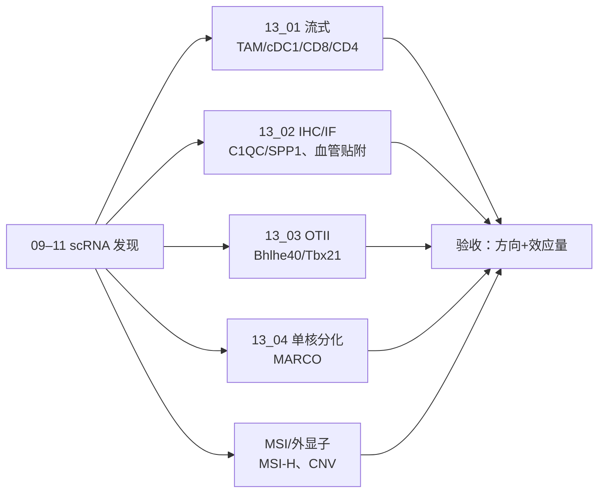

# 13 实验验证与湿实验 SOP

> **目标文献**：Zhang L, Li Z, Skrzypczynska KM, et al. *Single-Cell Analyses Inform Mechanisms of Myeloid-Targeted Therapies in Colon Cancer.* Cell. 2020;181(2):442–459.e29. DOI: 10.1016/j.cell.2020.03.048
> **模块对应原文**：Fig. 3D；Fig. 4B、4F；Fig. 5G–5I；Fig. 6D–6G；Fig. 7E–7I；STAR Methods「Human specimens」「In vivo mouse models」「Tumor dissociation」「Single cell sorting」「Multi-color immunofluorescence」「Intracellular cytokine staining」「Bulk DNA isolation」「Microsatellite instability testing」「Multi-color immunohistochemistry」「Splenic T cell cultures」「Human monocyte culture」
> **前置依赖**：`09`–`11` 的 scRNA-seq 结果（用于确定验证的细胞类型/基因）；`01` 的样本与伦理信息；本模块不依赖上游计算产物即可独立执行
> **复现难度 / 预计工时 / 计算资源**：★★★★★（湿实验）/ 4–8 周（含伦理、样本、动物实验）/ 细胞培养与流式平台；计算仅需 8 GB

---

## ① 科学问题与逻辑位置

**科学问题**：scRNA-seq 推断出的 C1QC⁺/SPP1⁺ TAM、Ccl22⁺ cDC1、Bhlhe40⁺ Th1-like、CD8 Tem/Tex 变化，能否在**蛋白/组织/功能层面**得到验证？

**本模块的回答**（原文的湿实验证据）：
1. **多色 IHC**：CRC 肿瘤中同时存在 `CD68⁺CD80⁺c-MAF⁺`（C1QC⁺ TAM）与 `CD68⁺MARCO⁺VEGFA⁺`（SPP1⁺ TAM）（Fig. 3D）。
2. **流式**：anti-CSF1R 后 TAM 减少、F4/80^high 优先耗竭（Fig. 4B、S7A–S7D）；anti-CD40 后 cDC1 的 CD80/CD86/IL-12 升高（Fig. 5G–5I）、CD8 效应/耗竭变化（Fig. 6D–6G）、CD4⁺CD40L⁺ Th1 的 IFNγ/Ki67 升高（Fig. 7E–7H）。
3. **免疫荧光**：anti-CSF1R 后残留 F4/80⁺ 巨噬贴附 CD31⁺ 血管（Fig. 4F）。
4. **体外功能**：anti-CD40 促进 DC 成熟 → OTII CD4 T `Bhlhe40`↑（`Tbx21` 不变）（Fig. 7I、S7L–S7M）；人 CD14⁺ 单核在缺氧 + IL-1β/VEGF 下 `MARCO`↑（Fig. S4G）。
5. **MSI/外显子**：18 例中 3 例 MSI-H（P0123、P0413、P0825）；外显子用于 CNV/突变背景（Fig. S3E–S3F）。

**逻辑位置**：
- 上游：09–11 的 scRNA-seq 发现；13 号把这些发现转成"可验收的湿实验"。
- 本模块：SOP + 分析脚本 + 验收标准；**S6 不执行**（D19），但文档必须能直接交给实验组。
- 下游：14 号的 gap 表（未执行项）；15 号的免疫学背景。



---

## ② 背景原理

### 2.1 流式细胞术的补偿与门控

- **补偿**：多色 panel 的荧光溢漏必须用单染/补偿微球校正；未补偿会导致假阳性/假阴性。
- **FMO（fluorescence minus one）**：每个门控的阈值用 FMO 对照设定，尤其是 `CD80`、`CD86`、`IL-12`、`IFNγ`、`Ki67`、`Foxp3`。
- **死活染料**：`7-AAD` 或 `Fixable Viability Dye eFluor506` 排除死细胞；死细胞非特异结合抗体。
- **胞内染色**：需要固定/透化；`Foxp3/Transcription Factor Staining Buffer Set` 适用于核内 `Foxp3`、`Ki67`；胞内细胞因子用 `Brefeldin A` 阻断分泌。
- **绝对计数**：流式百分比是相对的；若要绝对数，加计数微球。

### 2.2 多色 IHC/IF

- **Opal 7-color**：酪胺信号放大（TSA）——每个一抗后加 HRP 二抗 + 荧光底物，微波/水浴洗去抗体，再做下一个；避免交叉反应。
- **抗原修复**：AR9（pH 6.0）95–100°C 15 min；不同抗原可能需要不同缓冲液。
- **多光谱成像**：Mantra 20×；InForm 2.3 做光谱拆分、细胞分割、表型定量；每例 8–15 个高倍视野。
- **IF**：冰冻切片 16 µm；直接偶联抗体；DAPI 封片；LSM510 共聚焦。
- **注意**：IHC 的 `c-MAF` 是 C1QC⁺ TAM 的转录因子；`MARCO`/`VEGFA` 是 SPP1⁺ TAM 的 marker；不要用 `CD68` 单独定义 TAM（它是泛巨噬）。

### 2.3 小鼠肿瘤模型与给药

| 模型 | 小鼠 | 细胞 | 接种 | 给药 | 取瘤 |
|---|---|---|---|---|---|
| MC38 + anti-CD40 | C57BL/6（6–8 周，雌性） | MC38（NCI/NIH ENH204-EP） | 3×10⁵ s.c. 右 flank；8–10 天 | FGK45 5 mg/kg i.p.；anti-PD1 15 mg/kg i.p. | day 2 / day 10 |
| Renca + anti-CSF1R | BALB/c（6–8 周，雌性） | Renca（ATCC CRL-2947） | 3×10⁵ s.c.；12 天 | M279 400 µg/鼠 i.p.，3×/周×4 | 末次后 24 h（day 8） |

- 随机化按肿瘤体积 50–100 mm³；肿瘤体积 `V = 0.5 × L × W²`。
- 疗效终点：肿瘤体积（每周 2 次）、生存（isotype 中位生存的 2 倍）。
- **伦理**：IACUC 批准；安乐死标准；肿瘤不超过 2,000 mm³ 或溃疡/坏死。

### 2.4 组织消化与分选

- **人 CRC**：MACS Tumor Dissociation Kit，37°C 30 min 旋转；70 µm 滤网；400 g 10 min；红细胞裂解（冰上 2 min）；PBS 洗 2 次；分选缓冲液（PBS + 1% FBS）。
- **小鼠 MC38**：Collagenase D 0.5 mg/mL + DNase I 40 U/mL；gentleMACS `h_tumor_03` → 37°C 15 min → `h_tumor_02`。
- **小鼠 Renca**：Liberase TL 0.2 mg/mL + DNase I 20 U/mL；`h_tumor_01` → 37°C 15 min → `h_tumor_02`。
- **Renca scRNA-seq**：消化时加 20 µM Actinomycin D，后续染色/分选保持 5 µM，减少转录伪影。
- **分选 gate**：
  - 人：`7-AAD⁻CD45⁺`（免疫）、`7-AAD⁻CD45⁻`（非免疫）；髓系富集 `CD3⁻` 或 `CD3⁻CD19⁻/CD79A⁻` 或 `CD3⁻CD19⁻CD56⁻`；B 细胞 `CD45⁺CD3⁻CD19⁺CD56⁻`；NK `CD45⁺CD3⁻CD19⁻CD56⁺`。
  - 小鼠 MC38：`CD45⁺`（免疫）、`Thy1.2⁺TCRβ⁺`（T）、`CD11c⁺MHCII⁺`（DC）。
  - 小鼠 Renca：`CD45⁺`（bulk）、`CD45⁺CD3⁺`（T）、`CD45⁺CD3⁻B220⁻Ly6G⁻Ly6C⁻`（巨噬/DC 富集）。
  - Renca scRNA 混合比例：Study 1 = 75% 巨噬/DC + 25% bulk CD45⁺；Study 2 = 65% bulk CD45⁺ + 25% 巨噬/DC + 10% T。

### 2.5 Smart-seq2 与 10x 建库

- **Smart-seq2**：96 孔板、4°C；裂解液（1 µL 10 mM dNTP、1 µL 10 µM oligo dT、1.9 µL 1% Triton X-100、0.1 µL 40 U/µL RNase inhibitor）；ERCC 1:4,000,000；反转录/模板切换/预扩增；1× XP 磁珠纯化；GAPDH qPCR（Ct<30）；0.5× XP 纯化；Qubit；TruePrep V2 384-plex；HiSeq 4000 150 bp PE。
- **10x**：细胞浓度 300–350/µL；7,000–10,000 cells/chip；Chromium 3′ v2；HiSeq 4000 150 bp PE；小鼠 5′ + V(D)J，目标 50,000 reads/cell（基因表达）、5,000 reads/cell（TCR）。

### 2.6 MSI 与外显子

- **MSI**：QIAamp DNA Mini；多重荧光 PCR（Promega）；7 位点：NR21、BAT26、BAT25、NR24、Mono27（单核苷酸）+ PentaC、PentaD（五核苷酸）；ABI 3100；与配对正常组织比较；≥2 个单核苷酸位点不稳定 = MSI-H；无位点不稳定 = MSS。
- **外显子**：SureSelectXT Human All Exon V5；HiSeq 4000 150 bp PE；BWA-PICARD/GATK-strelka；ADTex 1.0.4 做体细胞 CNA。

### 2.7 体外功能实验

- **OTII**：OTII 小鼠（B6.Cg-Tg(TcraTcrb)425Cbn/J）脾细胞 2×10⁶/孔（48 孔）；Ova323–339 肽 10/100/1,000 nM；anti-CD40 10 µg/mL；3 天；CD4 磁珠富集；RT-qPCR `Bhlhe40`、`Tbx21`、`Rpl19`。
- **人单核细胞**：全血 1:3 稀释于 Lymphoprep，50 mL Leucosep 管密度离心；CD14⁺CD16⁻ 阴性选择（Classical Monocyte Isolation Kit）；1×10⁵/孔（96 孔）；X-Vivo 10 + 50 ng/mL CSF1 或 GM-CSF + 指定因子；常氧或 5% O2；6 天；流式 `MARCO`。
- **Table S3A 因子**（原文列出）：VEGFA、VEGFB、VEGFC、PIGF、SPP1、TNFα、IL-1β、IFNγ、MIF、RETN；具体浓度见 Table S3A（原文未在正文给全；**文献未报告**）。

---

## ③ 原文逐句拆解

| 原文句（节选） | 中文转述 | 我的操作 | 原文是否给参数 | 缺失项/复现决策 |
|---|---|---|---|---|
| "Eighteen colorectal cancer patients ... fourteen females and four males ... median 68.5" | 18 例，14 女/4 男，中位 68.5 | 样本表 | 给了 | 照做；伦理/知情同意 |
| "fresh tumor and adjacent normal tissue samples (at least 2 cm from matched tumor)" | 癌旁 ≥2 cm | 取材 SOP | 给了 | 照做 |
| "enzymatically digested with MACS tumor Dissociation Kit for 30 min on a rotor at 37°C" | 30 min 37°C 旋转 | 消化 SOP | 给了 | 照做 |
| "single cells were sorted into 96-well plates ... lysis buffer ... ERCC 1:4,000,000" | Smart-seq2 96 孔/ERCC | 建库 SOP | 给了 | 照做；GAPDH Ct<30 |
| "Cells were loaded between 7,000 and 10,000 cells/chip ... 3′ v2" | 10x 上样 | 建库 SOP | 给了 | 照做 |
| "MC38 ... Collagenase D (0.5 mg/mL) and DNase I (40 U/mL)" | MC38 消化 | 小鼠消化 SOP | 给了 | 照做 |
| "Renca ... Liberase TL (0.2 mg/mL) and DNase I (20 U/mL)" | Renca 消化 | 小鼠消化 SOP | 给了 | 照做 |
| "Renca ... 20 µM Actinomycin D ... 5 µM maintained" | 转录抑制 | 小鼠消化 SOP | 给了 | 照做 |
| "anti-CSF1R ... 400 mg/mouse three times a week for a total of four doses" | 400 µg/鼠（笔误） | 给药 SOP | 给了 | 400 µg；见 14 §10.2 第 15 条 |
| "anti-CD40 ... 5 mg/kg ... anti-PD1 ... 15 mg/kg" | 给药剂量 | 给药 SOP | 给了 | 照做 |
| "cells from 3 different tumors and tdLNs were sorted" | 3 个肿瘤/tdLN 混合 | 分选 SOP | 给了 | 照做；记录混合比例 |
| "Optimal cutting temperature ... 16 µm sections ... LSM 510" | 冰冻切片/共聚焦 | IF SOP | 给了 | 照做 |
| "cell stimulation cocktail plus protein transport inhibitors ... 2 h" | IFNγ/TNFα 2 h | 胞内染色 SOP | 给了 | 照做 |
| "Brefeldin A ... 3 h ... IL-12" | IL-12 3 h | 胞内染色 SOP | 给了 | 照做 |
| "Opal 7-Color ... CD68/CD80/c-Maf/MARCO/VEGFA ... 20× ... 8–15 fields" | 多色 IHC | IHC SOP | 给了 | 照做；InForm 2.3 |
| "2 × 10^6 OT-II splenocytes ... 10, 100, 1000 nM Ova323-339 ... anti-CD40 10 µg/ml ... 3 days" | OTII 培养 | 体外 SOP | 给了 | 照做；Rpl19 内参 |
| "CD14+CD16− ... 1 × 10^5 cells/well ... X-Vivo 10 ... 50 ng/mL CSF1 or GM-CSF ... 6 days ... 5% O2" | 单核分化 | 体外 SOP | 给了 | 照做；因子浓度见 Table S3A |
| "7 loci ... 5 mononucleotide ... 2 pentanucleotide ... two or more mononucleotide loci ... MSI-H" | MSI 判定 | MSI SOP | 给了 | 照做 |
| "SureSelectXT Human All Exon V5 ... HiSeq 4000 ... ADTex 1.0.4" | 外显子 | 外显子 SOP | 给了 | 照做 |

---

## ④ 逐步可运行代码（湿实验数据分析）

> 这些脚本分析**实验仪器导出的 CSV**，不直接处理 FASTQ。所有脚本首行 `set.seed(20261018)`。
> **S6 不执行湿实验**（D19）；以下代码用于合作实验室回传数据后的统一分析，保证口径一致。

### 4.1 脚本 13_01：流式门控数据汇总

```r
#!/usr/bin/env Rscript
# code/13_01_flow_gating.R
# 用法: Rscript code/13_01_flow_gating.R <project_dir>
# 输入: raw/validation/flow_counts.csv
#       列: mouse_id, treatment, timepoint, tissue, gate, count, parent_count
# 输出: results/validation_flow_<gate>.tsv, results/validation_flow_summary.tsv

set.seed(20261018)
suppressPackageStartupMessages({
  library(readr); library(dplyr); library(tidyr); library(ggplot2)
})

args <- commandArgs(trailingOnly = TRUE)
proj <- ifelse(length(args) >= 1, args[1], ".")
dir.create(file.path(proj, "results"), showWarnings = FALSE)

flow <- read_csv(file.path(proj, "raw", "validation", "flow_counts.csv"),
                 show_col_types = FALSE)
stopifnot(all(c("mouse_id", "treatment", "timepoint", "tissue",
                "gate", "count", "parent_count") %in% colnames(flow)))

flow <- flow %>%
  mutate(pct = 100 * count / parent_count,
         treatment = factor(treatment, levels = c("Isotype", "anti-CD40", "anti-CSF1R")),
         timepoint = factor(timepoint, levels = c("day2", "day10")))

# ---- 1. 每个 gate 的汇总 ----
summ <- flow %>%
  group_by(gate, treatment, timepoint, tissue) %>%
  summarise(n_mice = n_distinct(mouse_id),
            mean_pct = mean(pct), sd_pct = sd(pct),
            median_pct = median(pct), .groups = "drop")
write_tsv(summ, file.path(proj, "results", "validation_flow_summary.tsv"))

# ---- 2. gate 间比较（按 gate 分文件） ----
gates <- unique(flow$gate)
for (g in gates) {
  d <- flow %>% filter(gate == g)
  # 组间：按 timepoint/tissue 分层，Wilcoxon（n 小）或 t
  stat <- d %>%
    group_by(timepoint, tissue) %>%
    group_modify(~{
      tr <- unique(.x$treatment)
      if (length(tr) < 2) return(tibble())
      # 只比较 Isotype vs 处理组（若有多个处理组，两两比较）
      out <- list()
      for (t in setdiff(tr, "Isotype")) {
        x <- .x$pct[.x$treatment == t]
        y <- .x$pct[.x$treatment == "Isotype"]
        if (length(x) < 2 || length(y) < 2) next
        out[[length(out) + 1]] <- tibble(
          treatment = t, n_treat = length(x), n_iso = length(y),
          mean_treat = mean(x), mean_iso = mean(y),
          delta = mean(x) - mean(y),
          p_wilcox = wilcox.test(x, y)$p.value,
          p_t = t.test(x, y)$p.value
        )
      }
      bind_rows(out)
    }) %>% ungroup()
  write_tsv(stat, file.path(proj, "results", paste0("validation_flow_", g, ".tsv")))
}

# ---- 3. 关键 gate 图 ----
key_gates <- intersect(c("TAM_of_CD45", "F480_high_of_TAM", "cDC1_of_CD45",
                         "cDC1_CD80", "cDC1_CD86", "cDC1_IL12",
                         "CD8_Tem_of_CD8", "CD8_Tex_PD1_of_CD8",
                         "CD4_CD40L_of_CD4", "CD4_IFNg_TNFa_of_CD4",
                         "Treg_of_CD4"), gates)
if (length(key_gates) > 0) {
  p <- flow %>% filter(gate %in% key_gates, tissue == "Tumor") %>%
    ggplot(aes(x = treatment, y = pct, fill = treatment)) +
    geom_boxplot(outlier.shape = NA, width = 0.65) +
    geom_point(position = position_jitter(width = 0.12), size = 1.2, alpha = 0.7) +
    facet_wrap(~ gate, scales = "free_y") +
    labs(x = NULL, y = "% of parent gate", fill = "Treatment") +
    theme_bw(base_size = 10) +
    theme(axis.text.x = element_text(angle = 30, hjust = 1))
  ggsave(file.path(proj, "figures", "Fig_validation_flow.pdf"), p, width = 12, height = 7)
  ggsave(file.path(proj, "figures", "Fig_validation_flow.png"), p, width = 12, height = 7, dpi = 300)
}
```

**关键行解释**：
- `parent_count` 必须是 gate 的父群（如 TAM 的 parent 是 CD45⁺，cDC1 的 parent 是 CD45⁺ 或 CD11c⁺MHCII⁺）；不要用总细胞。
- `n_mice` 是生物学重复；流式细胞数不是 n。
- `wilcox.test` 在 n<5 时 p 值不稳定；同时报 t 检验与效应量，图注写 n。
- gate 名称由 FlowJo 导出模板决定；本脚本用语义名，实验组需在导出时统一命名。

### 4.2 脚本 13_02：IHC/IF 定量（InForm 导出）

```python
#!/usr/bin/env python3
# code/13_02_ihc_quant.py
# 用法: python3 code/13_02_ihc_quant.py <project_dir>
# 输入: raw/validation/inform_cells.csv
#       列: sample_id, phenotype, x_px, y_px, marker_intensity...
#       raw/validation/inform_regions.csv
#       列: sample_id, region_id, area_mm2
# 输出: results/validation_ihc_density.tsv, results/validation_if_proximity.tsv

import sys
import os
import numpy as np
import pandas as pd
from scipy.spatial import cKDTree

proj = sys.argv[1] if len(sys.argv) > 1 else "."
in_dir = os.path.join(proj, "raw", "validation")
out_dir = os.path.join(proj, "results")
os.makedirs(out_dir, exist_ok=True)

cells = pd.read_csv(os.path.join(in_dir, "inform_cells.csv"))
regions = pd.read_csv(os.path.join(in_dir, "inform_regions.csv"))

# ---- 1. 表型密度（每 mm2） ----
# phenotype 例：CD68+CD80+cMAF+、CD68+MARCO+VEGFA+
pheno_counts = (cells.groupby(["sample_id", "phenotype"])
                .size().rename("n_cells").reset_index())
pheno_counts = pheno_counts.merge(regions, on="sample_id", how="left")
pheno_counts["density_per_mm2"] = pheno_counts["n_cells"] / pheno_counts["area_mm2"]
pheno_counts.to_csv(os.path.join(out_dir, "validation_ihc_density.tsv"),
                    sep="\t", index=False)

# ---- 2. IF 邻近：F4/80+ 细胞到 CD31+ 血管的距离 ----
# 需要列：phenotype 含 F4/80+ 或 CD31+；x_px/y_px 为像素坐标；pixel_size_um 由元数据给
if "pixel_size_um" not in cells.columns:
    raise ValueError("inform_cells.csv 缺少 pixel_size_um 列：不得猜默认值")
pixel_size_um = float(cells["pixel_size_um"].iloc[0])
vessels = cells[cells["phenotype"].str.contains("CD31", case=False, na=False)]
macs = cells[cells["phenotype"].str.contains("F4/80", case=False, na=False)]

rows = []
for sid, m in macs.groupby("sample_id"):
    v = vessels[vessels["sample_id"] == sid]
    if len(v) == 0 or len(m) == 0:
        continue
    tree = cKDTree(v[["x_px", "y_px"]].values * pixel_size_um)
    dist, _ = tree.query(m[["x_px", "y_px"]].values * pixel_size_um, k=1)
    rows.append({
        "sample_id": sid,
        "n_macrophages": len(m),
        "n_vessel_pixels": len(v),
        "median_distance_um": float(np.median(dist)),
        "pct_within_10um": float(np.mean(dist <= 10) * 100),
        "pct_within_20um": float(np.mean(dist <= 20) * 100),
        "pct_within_30um": float(np.mean(dist <= 30) * 100),
    })

pd.DataFrame(rows).to_csv(os.path.join(out_dir, "validation_if_proximity.tsv"),
                          sep="\t", index=False)

print("IHC density and IF proximity written to", out_dir)
```

**关键解释**：
- InForm 导出的 `phenotype` 是字符串（如 `CD68+CD80+cMAF+`），需要与实验组约定命名；不要用模糊匹配 `CD80`（会匹配 `CD80-`）。
- `pixel_size_um` 必须由显微镜元数据给出（20× 物镜的像素尺寸因相机而异）；不得猜默认值。
- 邻近分析用 `cKDTree` 最近距离；`CD31` 是血管像素/细胞，不是血管中心线；若要做"贴附血管"，建议用血管分割 mask 的距离变换（见 13_02 可选扩展）。
- `pct_within_20um` 是原文"贴附血管"的定量代理；原文未给具体阈值，D 表记录为项目定义。

### 4.3 脚本 13_03：OTII qPCR（ddCt）

```r
#!/usr/bin/env Rscript
# code/13_03_otii_qpcr.R
# 用法: Rscript code/13_03_otii_qpcr.R <project_dir>
# 输入: raw/validation/otii_qpcr_ct.csv
#       列: sample_id, peptide_nM, antibody, gene, Ct, technical_rep
# 输出: results/validation_otii_qpcr.tsv, figures/Fig7I_otii_Bhlhe40.pdf/.png

set.seed(20261018)
suppressPackageStartupMessages({
  library(readr); library(dplyr); library(tidyr); library(ggplot2)
})

args <- commandArgs(trailingOnly = TRUE)
proj <- ifelse(length(args) >= 1, args[1], ".")

ct <- read_csv(file.path(proj, "raw", "validation", "otii_qpcr_ct.csv"),
               show_col_types = FALSE)
stopifnot(all(c("sample_id", "peptide_nM", "antibody", "gene", "Ct") %in% colnames(ct)))

# ---- 1. 技术重复平均 ----
ct_mean <- ct %>%
  group_by(sample_id, peptide_nM, antibody, gene) %>%
  summarise(Ct = mean(Ct, na.rm = TRUE), .groups = "drop")

# ---- 2. ddCt：目标基因 - Rpl19，再减去对应抗体/肽的对照？ ----
# 原文只报告“相对表达（目标/Rpl19）”；这里先算 dCt，再按抗体组内均值归一化
wide <- ct_mean %>%
  pivot_wider(names_from = gene, values_from = Ct)
stopifnot(all(c("Bhlhe40", "Tbx21", "Rpl19") %in% colnames(wide)))
wide <- wide %>%
  mutate(dCt_Bhlhe40 = Bhlhe40 - Rpl19,
         dCt_Tbx21 = Tbx21 - Rpl19,
         rel_Bhlhe40 = 2^(-dCt_Bhlhe40),
         rel_Tbx21 = 2^(-dCt_Tbx21))

# 按 peptide × antibody 汇总（生物学重复 = sample_id）
summ <- wide %>%
  group_by(peptide_nM, antibody) %>%
  summarise(n = n(),
            mean_Bhlhe40 = mean(rel_Bhlhe40), sd_Bhlhe40 = sd(rel_Bhlhe40),
            mean_Tbx21 = mean(rel_Tbx21), sd_Tbx21 = sd(rel_Tbx21),
            .groups = "drop")
write_tsv(summ, file.path(proj, "results", "validation_otii_qpcr.tsv"))

# ---- 3. 统计：每个 peptide 下 anti-CD40 vs isotype ----
stat <- wide %>%
  group_by(peptide_nM) %>%
  group_modify(~{
    x <- .x$rel_Bhlhe40[.x$antibody == "anti-CD40"]
    y <- .x$rel_Bhlhe40[.x$antibody == "Isotype"]
    if (length(x) < 2 || length(y) < 2) return(tibble())
    tibble(n_treat = length(x), n_iso = length(y),
           mean_treat = mean(x), mean_iso = mean(y),
           p_Bhlhe40 = t.test(x, y)$p.value,
           p_Tbx21 = t.test(.x$rel_Tbx21[.x$antibody == "anti-CD40"],
                            .x$rel_Tbx21[.x$antibody == "Isotype"])$p.value)
  }) %>% ungroup()
write_tsv(stat, file.path(proj, "results", "validation_otii_stats.tsv"))

# ---- 4. 图 ----
long <- wide %>%
  select(sample_id, peptide_nM, antibody, rel_Bhlhe40, rel_Tbx21) %>%
  pivot_longer(cols = c(rel_Bhlhe40, rel_Tbx21),
               names_to = "gene", values_to = "rel_expr")
p <- ggplot(long, aes(x = factor(peptide_nM), y = rel_expr, fill = antibody)) +
  geom_boxplot(outlier.shape = NA, width = 0.65) +
  geom_point(position = position_jitterdodge(jitter.width = 0.12, dodge.width = 0.65),
             size = 1.2, alpha = 0.7) +
  facet_wrap(~ gene, scales = "free_y") +
  scale_fill_manual(values = c(Isotype = "grey70", `anti-CD40` = "#2E86C1")) +
  labs(x = "Ova323-339 peptide (nM)", y = "Relative expression (2^-ddCt, Rpl19)",
       fill = "Antibody") +
  theme_bw(base_size = 12)
ggsave(file.path(proj, "figures", "Fig7I_otii_Bhlhe40.pdf"), p, width = 7, height = 4)
ggsave(file.path(proj, "figures", "Fig7I_otii_Bhlhe40.png"), p, width = 7, height = 4, dpi = 300)
```

**关键解释**：
- 原文用 `Rpl19` 作内参；`2^-dCt` 是相对表达（不是 ddCt，因为没有校准样本）；若要做 ddCt，需指定校准组（如 isotype + 10 nM）。
- 技术重复先平均，再用 `sample_id` 作为生物学重复；不要把技术重复当 n。
- `Tbx21` 是阴性对照：anti-CD40 不应显著上调；若上调，检查肽浓度/DC 成熟状态。

### 4.4 脚本 13_04：人单核细胞 MARCO 流式

```r
#!/usr/bin/env Rscript
# code/13_04_monocyte_marco.R
# 用法: Rscript code/13_04_monocyte_marco.R <project_dir>
# 输入: raw/validation/monocyte_flow.csv
#       列: donor_id, condition, oxygen, cytokine, marco_pct, parent_count
# 输出: results/validation_monocyte_marco.tsv, figures/FigS4G_monocyte_marco.pdf/.png

set.seed(20261018)
suppressPackageStartupMessages({
  library(readr); library(dplyr); library(tidyr); library(ggplot2)
})

args <- commandArgs(trailingOnly = TRUE)
proj <- ifelse(length(args) >= 1, args[1], ".")

d <- read_csv(file.path(proj, "raw", "validation", "monocyte_flow.csv"),
              show_col_types = FALSE)
stopifnot(all(c("donor_id", "condition", "oxygen", "marco_pct") %in% colnames(d)))

summ <- d %>%
  group_by(condition, oxygen) %>%
  summarise(n = n_distinct(donor_id),
            mean_marco = mean(marco_pct), sd_marco = sd(marco_pct),
            .groups = "drop")
write_tsv(summ, file.path(proj, "results", "validation_monocyte_marco.tsv"))

# 条件比较：缺氧 + IL-1β/VEGF vs 对照（按供体配对）
stat <- d %>%
  group_by(condition, oxygen) %>%
  group_modify(~{
    if (length(unique(.x$donor_id)) < 2) return(tibble())
    # 若无配对设计，用单样本 t；有配对则用 paired t
    tibble(n = n_distinct(.x$donor_id),
           mean_marco = mean(.x$marco_pct),
           p_vs_zero = t.test(.x$marco_pct)$p.value)
  }) %>% ungroup()
write_tsv(stat, file.path(proj, "results", "validation_monocyte_marco_stats.tsv"))

p <- ggplot(d, aes(x = condition, y = marco_pct, fill = oxygen)) +
  geom_boxplot(outlier.shape = NA, width = 0.65) +
  geom_point(position = position_jitterdodge(jitter.width = 0.12, dodge.width = 0.65),
             size = 1.2, alpha = 0.7) +
  scale_fill_manual(values = c(Normoxia = "grey70", Hypoxia = "#C0392B")) +
  labs(x = NULL, y = "MARCO+ (% of CD14+ derived macrophages)", fill = "O2") +
  theme_bw(base_size = 12) +
  theme(axis.text.x = element_text(angle = 30, hjust = 1))
ggsave(file.path(proj, "figures", "FigS4G_monocyte_marco.pdf"), p, width = 7, height = 4)
ggsave(file.path(proj, "figures", "FigS4G_monocyte_marco.png"), p, width = 7, height = 4, dpi = 300)
```

**关键解释**：
- 供体配对时用 `paired=TRUE`；代码先给单样本/非配对版本，实验组需在 metadata 里标明配对。
- `marco_pct` 是 MARCO⁺ 占 CD14⁺ 衍生巨噬的百分比；parent gate 要一致。
- 原文 Fig. S4G 是"one experiment"，没有生物学重复；我们的复现应尽量多供体，若只有 1 例，只作描述，不做统计。

---

## ⑤ 参数解释与调参空间

| 参数 | 原文取值 | 可选范围 | 改变后果 | 本项目裁决 |
|---|---|---|---|---|
| 人组织消化 | MACS kit 30 min 37°C | 15–45 min | 细胞活性/表位 | 原文 |
| 红细胞裂解 | 冰上 2 min | 1–5 min | 细胞丢失 | 原文 |
| Smart-seq2 细胞数 | 96 孔 | 96/384 | 通量 | 原文 |
| ERCC 稀释 | 1:4,000,000 | 1:1M–1:10M | 外参 | 原文 |
| GAPDH Ct | <30 | <28–32 | 文库质量 | 原文 |
| 10x 上样 | 7,000–10,000/chip | 5,000–15,000 | 双细胞率 | 原文 |
| MC38 消化 | Collagenase D 0.5 mg/mL + DNase 40 U/mL | 0.2–1 mg/mL | 活性/表位 | 原文 |
| Renca 消化 | Liberase TL 0.2 mg/mL + DNase 20 U/mL | 0.1–0.5 mg/mL | 活性 | 原文 |
| Actinomycin D | 20 µM 消化；5 µM 染色/分选 | 10–50 µM | 转录伪影/毒性 | 原文 |
| anti-CSF1R | 400 µg/鼠，3×/周×4 | 200–800 µg | 耗竭 | 原文 |
| anti-CD40 | 5 mg/kg | 1–10 mg/kg | 激活/毒性 | 原文 |
| anti-PD1 | 15 mg/kg | 5–20 mg/kg | 协同 | 原文 |
| 取瘤时间 | day 2/day 10；Renca day 8+24 h | 24 h–14 d | 动力学 | 原文 |
| IHC 抗原修复 | AR9 pH 6.0 15 min | 不同缓冲液 | 染色强度 | 原文 |
| IHC 视野 | 8–15/例 | 5–20 | 代表性 | 原文 |
| IF 切片 | 16 µm | 5–20 µm | 三维信息 | 原文 |
| 胞内 IFNγ/TNFα | 2 h | 1–6 h | 分泌阻断 | 原文 |
| IL-12 | Brefeldin A 3 h | 2–6 h | 胞内积累 | 原文 |
| OTII 肽 | 10/100/1,000 nM | 1–1,000 nM | 亚适刺激 | 原文 |
| anti-CD40 体外 | 10 µg/mL | 1–20 µg/mL | DC 成熟 | 原文 |
| 单核分化 | 6 days；5% O2 | 4–8 days；1–5% O2 | MARCO | 原文 |
| MSI 位点 | 7 位点 | 5–7 | 判定 | 原文 |
| MSI-H 阈值 | ≥2 单核苷酸 | ≥1–2 | 敏感性 | 原文 |

---

## ⑥ 预期结果与验收标准（QC）

> 本模块 S6 不执行（D19）。以下为"如果执行"的验收标准；未执行项在 gap 表标注"未执行"。

| # | 实验 | 文献值/预期 | 验收标准 | 我方值（S6/合作方填） |
|---|---|---|---|---|
| V01 | 人 CRC 多色 IHC | `CD68⁺CD80⁺c-MAF⁺` 与 `CD68⁺MARCO⁺VEGFA⁺` 两类 TAM | 至少 3 例中可定量；两类密度均 >0 | |
| V02 | anti-CSF1R 流式 TAM | TAM 占 CD45⁺ 下降 | 处理组 vs isotype p<0.05，方向一致 | |
| V03 | F4/80^high | 优先耗竭 | F4/80^high 下降幅度 > F4/80^low | |
| V04 | anti-CSF1R IF | 残留 F4/80⁺ 贴附 CD31⁺ 血管 | 20 µm 内比例处理组 > isotype | |
| V05 | anti-CD40 cDC1 CD80/CD86 | 升高 | MFI 或阳性率 p<0.05 | |
| V06 | anti-CD40 cDC1 IL-12 | 升高 | 阳性率 p<0.05 | |
| V07 | anti-CD40 CD8 Tem/Tex | Tem↑、PD1⁺Tex↓ | 方向一致，p<0.05 | |
| V08 | anti-CD40 CD4⁺CD40L⁺ Th1 | IFNγ↑、Ki67↑ | 方向一致，p<0.05 | |
| V09 | OTII Bhlhe40 | anti-CD40↑（亚适肽） | p<0.05；Tbx21 无显著上调 | |
| V10 | 人单核 MARCO | 缺氧 + IL-1β/VEGF ↑ | 方向一致；≥2 供体 | |
| V11 | MSI | 3/18 MSI-H | 与原文样本一致（若用同队列） | |
| V12 | 外显子 CNV | 恶性细胞 CNV | 与 scRNA CNV 方向一致 | |

**验收原则**：
- 方向优先于 p 值；p 值必须附 n 与效应量。
- 流式 n = 小鼠/供体，不是细胞数。
- 体外实验 n = 独立实验/供体；技术重复先平均。
- 若方向不一致，先排查抗体克隆、门控、时间点、剂量；仍不一致则入 gap 表，不改结论。

---

## ⑦ 常见陷阱与排错表

| 现象 | 根因 | 解决 |
|---|---|---|
| 流式补偿后仍有假阳性 | 未做 FMO；死细胞未排除 | 单染补偿 + FMO；7-AAD/viability dye |
| TAM 比例异常高/低 | 门控把 CD11b⁺ 非巨噬纳入；F4/80 克隆不同 | 用 `CD45⁺CD11b⁺F4/80⁺`；固定克隆 BM8；FMO |
| F4/80^high 分群不明显 | 消化导致表位丢失；抗体滴度不对 | 降低消化时间/温度；滴定抗体 |
| cDC1 门控漏掉 Ccl22⁺ | 只用 `Clec9a/XCR1`；活化 cDC1 下调 | 加 `Ccl22`/`CCR7`/`CD40`；按原文 mM07 表型 |
| IL-12 测不到 | 无 Brefeldin A；刺激不足 | 3 h Brefeldin A；PMA/ionomycin 对照 |
| IHC 背景高 | 抗原修复过度；TSA 放大过强 | 滴定一抗；缩短 TSA；加阴性对照 |
| 多色 IHC 通道串色 | 未做光谱拆分；TSA 顺序不对 | Mantra 光谱库；按 Opal 手册排序 |
| IF 切片无血管 | CD31 抗体克隆/种属不匹配 | 用 MEC13.1（抗小鼠）；直接偶联 |
| OTII 无 Bhlhe40 诱导 | 肽浓度过高/过低；DC 未成熟 | 10–100 nM 亚适；anti-CD40 10 µg/mL；3 天 |
| 单核 MARCO 不升高 | 缺氧不足；因子浓度不对；供体差异 | 5% O2；Table S3A 浓度；≥2 供体 |
| MSI 判定不一致 | 位点/阈值不同；正常对照污染 | 7 位点；配对正常；≥2 单核苷酸 |
| 外显子 CNV 与 scRNA 不一致 | 肿瘤纯度/正常对照 | 用 ADTex；报告纯度；CNV 只作定性 |

---

## ⑧ 与文献图表的对应关系表

| 原文图 | 内容 | 本模块脚本/实验 | 产物 |
|---|---|---|---|
| Fig. 3D | 人 CRC 多色 IHC（C1QC⁺/SPP1⁺ TAM） | 13_02 + IHC SOP | `results/validation_ihc_density.tsv` |
| Fig. 4B | anti-CSF1R TAM 流式 | 13_01 | `results/validation_flow_TAM_of_CD45.tsv` |
| Fig. 4F | CD31/F4/80/MHCII IF | 13_02 | `results/validation_if_proximity.tsv` |
| Fig. 5G–5I | cDC1 CD80/CD86/IL-12 流式 | 13_01 | `results/validation_flow_cDC1_*.tsv` |
| Fig. 6D–6G | CD8 效应/耗竭流式 | 13_01 | `results/validation_flow_CD8_*.tsv` |
| Fig. 7E | CD4⁺CD40L⁺ 流式 | 13_01 | `results/validation_flow_CD4_CD40L_of_CD4.tsv` |
| Fig. 7F–7H | IFNγ/TNFα/Ki67 流式 | 13_01 | `results/validation_flow_CD4_IFNg_TNFa_of_CD4.tsv` |
| Fig. 7I | OTII Bhlhe40 | 13_03 | `results/validation_otii_qpcr.tsv` |
| Fig. S4G | 人单核 MARCO | 13_04 | `results/validation_monocyte_marco.tsv` |
| Fig. S7A–S7D | F4/80 门控/耗竭 | 13_01 | `results/validation_flow_F480_high_of_TAM.tsv` |
| Fig. S7K–S7M | Bhlhe40/Tbx21/OTII | 13_03 | `results/validation_otii_qpcr.tsv` |
| Fig. S3E–S3F | 外显子 CNV | 外显子 SOP | `results/validation_exome_cnv.tsv` |
| Methods | MSI 7 位点 | MSI SOP | `results/validation_msi.tsv` |

---

## 附：本模块的"诚实性声明"与执行边界（D19）

1. **S6 不执行湿实验**：本项目无患者样本、无 IACUC/伦理批件、无流式/共聚焦平台。13 号是 **SOP + 验收标准 + 数据分析脚本**，不是"已完成的实验"。
2. **gap 表标注**：所有 V01–V12 在 S6 结题时标"未执行"；若合作实验室执行，按本 SOP 的 n/对照/统计口径回传。
3. **不能伪造实验数据**：未执行的图不得用文献图冒充"我方结果"；不得编造流式百分比、IHC 密度、qPCR Ct。
4. **小鼠→人外推**：Renca 是肾癌、MC38 是高度免疫原性结肠癌；人类验证需独立队列。
5. **抗体/试剂批次**：记录 clone、Cat#、lot#、浓度；不同批次可能导致表位/背景差异。
6. **伦理**：人样本需知情同意与伦理批件；动物实验需 IACUC 批准；临床信息去标识化。
7. **统计**：n = 生物学重复；技术重复先平均；p 值附效应量与 n；阴性结果保留。

---

## 附：关键试剂/材料速查（来自原文 Key Resources Table）

| 类别 | 试剂/材料 | 来源 | 货号/克隆 |
|---|---|---|---|
| 人 CD45 | Anti-Human CD45 FITC | Thermo Fisher | 11-0459-42（HI30） |
| 人 CD3 | Anti-Human CD3 eFluor 450 | Thermo Fisher | 48-0038-42（UCHT1） |
| 人 CD19 | Anti-Human CD19 APC | Thermo Fisher | 17-0199-42（HIB19） |
| 人 CD56 | Anti-Human CD56 PE | Thermo Fisher | 12-0566-42（TULY56） |
| 人 CD79A | Anti-Human CD79A PE/Cy7 | Thermo Fisher | 333509（HM47） |
| 人 CD14 | Anti-Human CD14 APC/eFluor 780 | Thermo Fisher | 47-0149-41（61D3） |
| 小鼠 CD45 | Anti-mouse CD45 BV786 | BD | 564225（30-F11） |
| 小鼠 TCRβ | Anti-mouse TCRβ BV421 | BD | 562839（H57-597） |
| 小鼠 Thy1.2 | Anti-mouse Thy1.2 APC-Cy7 | Thermo Fisher | 47-0902-82（53-2.1） |
| 小鼠 CD4 | Anti-mouse CD4 BUV395 | BD | 563790（GK1.5） |
| 小鼠 CD8 | Anti-mouse CD8 BV650 | BD | 563234（53-6.7） |
| 小鼠 CD11c | Anti-mouse CD11c APC | BD | 550261（HL3） |
| 小鼠 MHCII | Anti-mouse MHCII Alexa Fluor 700 | Thermo Fisher | 56-5321-82（M5/114.15.2） |
| 小鼠 F4/80 | Anti-mouse F4/80 PE-Cy7 | BioLegend | 123114（BM8） |
| 小鼠 CD80 | Anti-mouse CD80 BV421 | BioLegend | 104725（16-10A1） |
| 小鼠 CD86 | Anti-mouse CD86 PE | BD | 553692（GL1） |
| 小鼠 IL-12 | Anti-mouse IL-12 PE | Thermo Fisher | 12-7123-82（C17.8） |
| 小鼠 IFNγ | Anti-mouse IFNγ PE | Thermo Fisher | 12-7311-82（XMG1.2） |
| 小鼠 TNFα | Anti-mouse TNFα FITC | BD | 554418（MP6-XT22） |
| 小鼠 Ki67 | Anti-mouse Ki67 PerCP-eFluor710 | Thermo Fisher | 46-5698-82（SolA15） |
| 小鼠 CD40L | Anti-mouse CD40L APC | Thermo Fisher | 17-1541-82（MR1） |
| anti-CD40 | FGK45 | BioXCell/Amgen | BE0016-2 |
| anti-CSF1R | M279 | Amgen | N/A |
| anti-PD1 | 29F1A.12 | BioXCell | BE0273 |
| 人 IHC CD68 | Anti-Human CD68 | Abcam | ab955（KP1） |
| 人 IHC CD80 | Anti-Human CD80 | Abcam | ab134120（EPR1157(2)） |
| 人 IHC c-MAF | Anti-Human c-Maf | Abcam | ab19942（EPR16484） |
| 人 IHC MARCO | Anti-Human MARCO | Abcam | ab231046 |
| 人 IHC VEGFA | Anti-Human VEGFA | Abcam | ab1316（VG-1） |
| 小鼠 IF CD31 | Anti-Mouse CD31 Alexa Fluor 594 | BioLegend | 102520（MEC13.1） |
| 小鼠 IF F4/80 | Anti-Mouse F4/80 Alexa Fluor 647 | BioLegend | 123122（BM8） |
| 小鼠 IF MHCII | Anti-Mouse MHC II Alexa Fluor 488 | BioLegend | 107616（M5/114.15.2） |
| 组织消化 | MACS Tumor Dissociation Kit | Miltenyi | 130-095-929 |
| 小鼠 CD4 磁珠 | CD4+ T cell isolation kit | Miltenyi | 130-104-454 |
| 人单核 | Classical Monocyte Isolation Kit | Miltenyi | 130-117-337 |
| Smart-seq2 建库 | TruePrep DNA Library Prep Kit V2 | Vazyme | TD503 |
| 10x 3′ | Chromium Single Cell 3′ Library & Gel Bead Kit | 10x Genomics | PN-120237 |
| 10x 5′ | Chromium Single Cell 5′ Library & Gel Bead Kit | 10x Genomics | 1000006 |
| 多色 IHC | Opal 7-Color Manual IHC Kit | PerkinElmer | NEL811001KT |
| 外显子 | SureSelectXT Human All Exon V5 | Agilent | G9701 |
| TaqMan Bhlhe40 | Mm00478593_m1 | Thermo Fisher | — |
| TaqMan Tbx21 | Mm00450960_m1 | Thermo Fisher | — |
| TaqMan Rpl19 | Mm02601633_g1 | Thermo Fisher | — |

> 试剂货号来自原文 Key Resources Table；使用前核对当前目录/批次。原文未给浓度的（如 Table S3A 因子）标注「文献未报告」，按 Table S3A 或预实验滴定。
