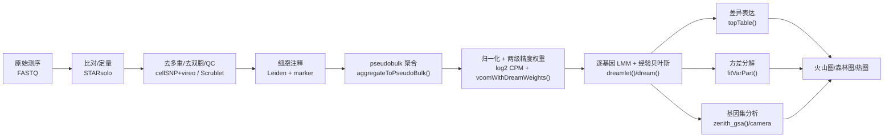
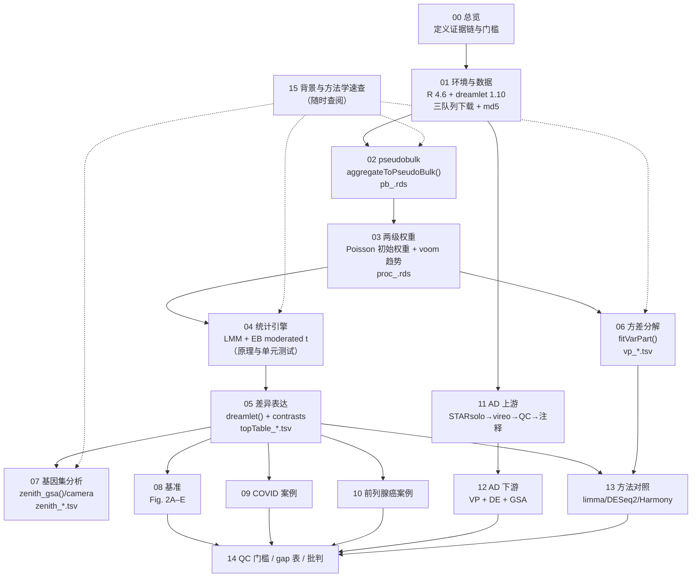

# 文献复现方案总目录与项目总览

> **目标文献**：Hoffman GE, Lee D, Bendl J, Prashant NM, Hong A, Casey C, Alvia M, Shao Z, Argyriou S, Therrien K, Venkatesh S, Voloudakis G, Haroutunian V, Fullard JF, Roussos P. *Efficient differential expression analysis of large-scale single-cell transcriptomics data using Dreamlet.* **Nature Communications (2026) 17:9597.** DOI: [10.1038/s41467-026-75680-8](https://doi.org/10.1038/s41467-026-75680-8)
> 单位：Center for Disease Neurogenomics / Department of Psychiatry / Department of Genetics and Genomic Sciences, Icahn School of Medicine at Mount Sinai；Friedman Brain Institute；James J. Peters VA Medical Center。
> 投稿 2024-11-18 / 接收 2026-05-05 / 出版 2026。
>
> **PDF 原件**：同目录下 `2026_Efficient_differential_expression_analysis_of_large-scale_single-cell_transcriptomics_data_using_Dreamlet.pdf`
>
> **本套文档的性质**：以博士生导师（PI）视角编写的、可逐步执行的**方法学复现方案（Reproduction Protocol）**。全套 16 篇文档，每篇含：
> ① 科学问题与逻辑位置 → ② 背景原理（生物学 + 算法 + 公式） → ③ 原文逐句拆解 → ④ 逐步可运行代码（R 4.6 / Bioconductor） → ⑤ 参数解释与调参空间 → ⑥ 预期结果与 QC 检查点（附原文数值） → ⑦ 常见陷阱与排错表 → ⑧ 与原文图表的对应关系。
>
> **阅读顺序**：`00 → 01 → 02 → … → 13` 是一条完整流水线；`14`（质控与批判）与 `15`（背景速查）建议**先通读**——前者给出结论的边界与全部决策裁决，后者补齐 LMM、voom、经验贝叶斯、方差分解、camera 的数学背景。

---

## 一、文档清单（目录文件）

> 📌 **开工前必读（两级规范）**
> ① **通用规范 `../REPRO_SPEC.md` v2.1（L0）**：全仓库强制的目录/命名/契约/统计/写作/诚实性规范。
> ② **项目规范 `PROJECT_SPEC.md` v1.0（L1）**：本项目的模块编号表、**产物契约表**、**术语与阳性判定唯一口径**、环境版本、D 表索引。
> **效力层级：L0 > L1 > 14 号 §五（L2 QC 门槛）> 各模块文档（L3）**；D 表权威位置 = `14_复现质控清单、排错与批判性评述.md` §八。

| 编号 | 文件名 | 内容一句话描述 | 对应原文图表 |
|---|---|---|---|
| **L0** | `../REPRO_SPEC.md` | 仓库级通用规范 v2.1：工作流、目录/命名、产物契约、环境、统计、写作、变更控制、诚实性红线 | — |
| **L1** | `PROJECT_SPEC.md` | 本项目规范：模块表、产物契约表、术语表、D 表索引（D1–D20）、版本钉死 | — |
| **00** | `00_目录与复现总览.md` | 本文件：文档目录、科学问题、证据链、全流程图、图表映射、数据资产、算力工期、全局门槛 | Fig. 1 |
| **01** | `01_环境搭建与数据获取.md` | R/Bioconductor 版本钉死、`dreamlet` 安装、三个队列（COMBAT / GSE143791 / PsychAD syn51188606）的获取与校验、目录初始化、md5 | Data/Code availability；Methods「Software versions」 |
| **02** | `02_数据接入与pseudobulk聚合.md` | H5AD → `SingleCellExperiment`（`zellkonverter`/DelayedArray）、`aggregateToPseudoBulk()` 的分块/`beachmat` 实现、内存与耗时的实测方法、细胞数矩阵 `cellCounts()` | Fig. 1；Methods「Efficient computation of pseudobulk」；Fig. 2A–B |
| **03** | `03_两阶段精度权重与均值方差趋势.md` | Poisson 生成模型 → 第一级权重（δ 法完整推导）；TMM + 自适应先验计数 log2 CPM；`voomWithDreamWeights()` 的均值–方差趋势 → 第二级权重 `1/ŝ⁴`；`plotVoom()` 判读 | Fig. 1；Fig. 3B、4B、5C；Methods「Two-stage weighting」；theory_sims 代码 |
| **04** | `04_精度加权LMM与经验贝叶斯moderated_t.md` | `dream()` 的 LMM 设定（固定 + 随机效应）、精度权重的加权最小二乘、Smyth 经验贝叶斯先验（`d0`、`s0²`）、LMM 残差自由度 `n − tr(H)` 近似、moderated t 与 F 检验 | Methods「Precision-weighted LMM」「Empirical Bayes shrinkage」 |
| **05** | `05_差异表达分析流程与结果提取.md` | `processAssays()` → `dreamlet()` → `topTable()` 全链路；contrasts（`makeContrastsDream`）；细胞类型内 BH vs **study-wide BH**；`pi0`/`pi1`；结果表字段语义 | Fig. 3E–F、4F、6A–D；作者 `topTable_*.tsv` |
| **06** | `06_方差分解与批次效应量化.md` | `fitVarPart()` + `variancePartition` 原理（随机效应方差分数、固定效应拟合方差）；`sortCols()`/`plotVarPart()`/`plotPercentBars()`；GC 含量与 pool 方差分数的 Spearman 相关 | Fig. 3C–D、4C–E、5D–F；Methods「Batch effect / GC content」 |
| **07** | `07_基因集分析camera与zenith.md` | camera 竞争性检验的统计量（基因集平均 t、基因间相关校正）、`zenith::zenith()` 对 LMM 的适配、`zenith_gsa()` 调用、`plotZenithResults()`、MSigDB Hallmark 与 GO 两套基因集 | Fig. 3G–H、4G–H、6E–F；ref 33（camera）、ref 74（MSigDB） |
| **08** | `08_计算与统计性能基准复现.md` | Fig. 2A–C 的计算基准（`aggregateToPseudoBulk` vs `Matrix.utils`/`muscat`/`pegasus`/naive；1 核 512 GB）、Fig. 2D 的 muscat 模拟框架（AUPR/F1）、Fig. 2E 的真实数据置换 FPR（保留 batch 内比例） | Fig. 2A–E；Fig. S1–S3 |
| **09** | `09_案例I_COVID19重症单核细胞.md` | COMBAT 队列（674K cells / 110 donors）：样本筛选（每 donor 最重症 + 仅 Oxford）、`major_subset` pseudobulk、VP（6 疾病状态 + age + sex）、mild vs healthy 的 1824 DEG、CLU/NFKBIA、zenith 通路 | Fig. 3；Fig. S4 |
| **10** | `10_案例II_前列腺癌骨转移.md` | Kfoury GSE143791：`Status`（Benign/Distal/Involved/Tumor）× `subject.id` 重复测量、三个 contrast、157 DEG、MHC-II 与蛋白折叠 chaperone 上调 | Fig. 4；Fig. S5 |
| **11** | `11_案例III_AD队列数据生成与上游处理.md` | 湿实验：DLPFC 取材、蔗糖梯度核分离、FANS、6 样本 hashing、10x 3' v3.1、HTO 建库；干实验：STARsolo、cellSNP+vireo 去多重、QTLtools-mbv 一致性、Scrublet、三级 QC、Harmony、Leiden、注释、sex check | Fig. 5A–B；Fig. S6；Methods 全部小节 |
| **12** | `12_案例IV_AD差异表达与下游分析.md` | PsychAD（586 samples / 299 donors / 1.4 M nuclei / 22 细胞类型）：pseudobulk、VP（Subject/poolID/Sex/Age/Dx）、1037 microglia DEG、PTPRG（log2FC 1.59、p 2.94e-28）、PDE10A、DUSP10、p38MAPK、突触通路 | Fig. 5C–H、Fig. 6、Fig. S7–S8 |
| **13** | `13_方法对照与跨队列一致性.md` | dreamlet vs limma vs DESeq2 的 logFC 一致性；AD 与 Mathys 2023 的跨队列一致性；10X pool 随机效应 vs Harmony 前 5 个成分作协变量；批次效应解释比例对比 | Fig. S9–S18 |
| **14** | `14_复现质控清单、排错与批判性评述.md` | **QC 门槛表（L2）**、gap 表、排错速查、**D 表（D1–D20 权威全文）**、证据等级与批判性评述（pseudobulk 的信息损失、FPR 的可移植性、PTPRG 的因果缺口） | 全文 |
| **15** | `15_背景知识精讲与方法学原理速查.md` | 单细胞跨受试者 DE 的方法谱系；LMM/REML、voom、经验贝叶斯、方差分解、camera、多重检验的数学速查；生物学背景（AD 小胶质、COVID 单核、骨转移微环境）；术语表 | 全文 |

---

## 二、科学问题与逻辑位置

### 2.1 一句话科学问题

**当单细胞/单核转录组研究扩展到"数百受试者、上百万细胞、多重复与多重混合建库"时，如何在不牺牲统计效力与 FPR 控制的前提下，对每个细胞类型做跨受试者的差异表达？**

原文的回答：把"细胞级计数"先**聚合**为样本×细胞类型的 pseudobulk，再用**精度加权线性混合模型**（`dream`/`dreamlet`）建模；用两级权重刻画"细胞抽样 + reads 抽样"的双重不确定性，用经验贝叶斯 moderated t 借基因间信息稳定小样本方差，用随机效应吸收重复测量与高维批次；配套 H5AD 磁盘后端与 `beachmat` 分块聚合，使 4.1 M 细胞的分析可在单机 26 GB 内存完成。

### 2.2 方法在证据链中的位置

> **关键逻辑**：所有这些下游分析共享**同一个** `dreamletProcessedData`（log2 CPM + 权重）与**同一个**模型拟合结果。复现时若把归一化、权重、模型三步拆开各做一套，数值必然对不上——这是本项目第一条工程纪律。

### 2.3 原文证据链（复现时逐条核验）

| # | 原文主张 | 对应图 | 复现判据（详见 14 号 §五） |
|---|---|---|---|
| C1 | 两级精度权重可刻画"细胞数 + reads 数"带来的测量精度差异 | Fig. 1 | `plotVoom()` 曲线随细胞数上升而下降；权重与细胞数正相关（ρ>0） |
| C2 | pseudobulk 计算在大数据上快一个数量级、内存低一个数量级 | Fig. 2A–B | 相对 naive 的 speedup >10×，峰值内存比 <0.1（原文 "more than an order of magnitude"） |
| C3 | 逐基因 LMM 的 DE 比单细胞 GLMM 快一个数量级以上 | Fig. 2C | 12 细胞类型 × 326 受试者 ≤ 2 h（本机换算） |
| C4 | 模拟数据上 AUPR 不劣于现有方法，效应量最准 | Fig. 2D | AUPR 排名前 2；logFC 的 RMSE 最小 |
| C5 | 真实数据置换标签后 FPR 受控（仅 dreamlet 在可建模随机效应的方法中） | Fig. 2E | FPR ∈ [3.5%, 6.5%] |
| C6 | COVID mild vs healthy：1824 个 DEG；疾病状态中位方差 11.4% | Fig. 3C–E | DEG 数 ±10%；中位方差 ±1.5 个百分点 |
| C7 | 前列腺癌 tumor vs involved：157 个 DEG；525/1899 基因疾病方差 >10% | Fig. 4C、4F | 同上 |
| C8 | AD microglia：1037 个 DEG；PTPRG log2FC 1.59、p 2.94e-28 | Fig. 6A | log2FC ∈ [1.4,1.8]，p 同数量级 |
| C9 | pool 效应显著（932 基因 >5%），且与 GC 含量相关 | Fig. 5D–F | 相关 ρ>0、FDR<5% 的细胞类型数 >5 |
| C10 | 每个受试者细胞数越多，技术重复一致性越高、DEG 越多 | Fig. 5G–H | 回归斜率 >0、p<0.05 |

---

## 三、全流程图（按文档编号）

---

## 四、图表 → 文档映射

| 原文图 | 内容 | 主责文档 | 产物（`figures/`） |
|---|---|---|---|
| Fig. 1 | dreamlet 流程示意：pseudobulk → 权重 → LMM → 下游 | 00/02/03 | `Fig1_workflow.pdf/.png`（示意复刻） |
| Fig. 2A–B | pseudobulk 峰值内存 / CPU 时间（1000 donors × 8 cell types） | 02/08 | `Fig2A_pseudobulk_memory.*`、`Fig2B_pseudobulk_time.*` |
| Fig. 2C | 6 种 DE 方法随受试者数的 CPU 时间 | 08 | `Fig2C_de_cpu_time.*` |
| Fig. 2D | 9 种方法在模拟数据上的 AUPR | 08 | `Fig2D_aupr.*` |
| Fig. 2E | 真实 snRNA 置换标签的 FPR（batch 固定/随机两栏） | 08 | `Fig2E_fpr.*` |
| Fig. 3A | 单核细胞亚群 UMAP | 09 | `Fig3A_mono_umap.*` |
| Fig. 3B | classical monocyte 均值–方差趋势 | 03/09 | `Fig3B_voom_cMono.*` |
| Fig. 3C | classical monocyte 方差分解小提琴图 | 06/09 | `Fig3C_vp_cMono.*` |
| Fig. 3D | 代表性基因的方差来源 | 06 | `Fig3D_vp_examples.*` |
| Fig. 3E | mild COVID vs healthy 火山图 | 05/09 | `Fig3E_volcano_mild.*` |
| Fig. 3F | CLU / NFKBIA 森林图 | 05/09 | `Fig3F_forest.*` |
| Fig. 3G–H | 基因集检验统计量热图 + TNFα/NF-κB 基因热图 | 07/09 | `Fig3G_gsa_covid.*`、`Fig3H_tnfa_genes.*` |
| Fig. 4A–H | 前列腺癌骨转移：UMAP、voom、VP、火山、通路 | 10 | `Fig4*` |
| Fig. 5A–H | AD：实验设计、UMAP、voom、VP、GC 相关、细胞数与效力 | 11/12 | `Fig5*` |
| Fig. 6A–F | AD microglia 火山、跨细胞类型热图、PTPRG/PDE10A 森林、GSA、p38MAPK | 12 | `Fig6*` |
| Fig. S1–S3 | 模拟/批次效应的补充基准 | 08 | `FigS1*`–`FigS3*` |
| Fig. S4–S5 | COVID / Kfoury 的全细胞类型概况 | 09/10 | `FigS4*`、`FigS5*` |
| Fig. S6–S8 | AD 队列人口学、批次、表达基因数与 DEG 数 | 11/12 | `FigS6*`–`FigS8*` |
| Fig. S9–S10 | 与 Mathys 2023 的跨队列一致性 | 13 | `FigS9*`、`FigS10*` |
| Fig. S11–S13 | dreamlet / limma / DESeq2 对照 | 13 | `FigS11*`–`FigS13*` |
| Fig. S14–S18 | Harmony 成分 vs 10X pool 随机效应 | 13 | `FigS14*`–`FigS18*` |

> 图注必须写明：n（样本数/受试者数/细胞数）、检验方法、p 值形式（raw/adj）、效应量定义。缺一不可（L0 §7）。

---

## 五、数据资产清单

| 数据集 | 用途 | 规模（原文报告） | 获取方式 | 存放 |
|---|---|---|---|---|
| COMBAT COVID-19 血液单细胞 | Fig. 3 | 674 K cells / 110 donors；monocyte 亚群 | COMBAT Consortium（Cell 2022）数据门户；作者分析用 h5ad（原始计数在 `X`） | `raw/combat_covid19/` |
| Kfoury 前列腺癌骨转移 | Fig. 4 | 9 例患者 + 7 例良性；GSE143791 | GEO **GSE143791**（作者整理 h5ad） | `raw/kfoury_prostate/` |
| PsychAD / NPS-AD snRNA-seq | Fig. 5–6 | 586 samples / 299 donors / 1.4 M nuclei / 22 细胞类型 | Synapse **syn51188606**（PsychAD_public） | `raw/psychad_ad/` |
| Mathys et al. 2023 AD snRNA | Fig. S9–S10 跨队列 | 原文未在本项目复现全部细胞 | Synapse/作者公开 | `raw/psychad_ad/`（外部对照，可选） |
| MSigDB Hallmark | Fig. 3H、6F | 50 个基因集 | MSigDB（记录版本） | `raw/benchmark/msigdb/` |
| GO（BP/CC/MF） | Fig. 3G、6E | GO.db 版本记录 | Bioconductor `GO.db`/`org.Hs.eg.db` | `raw/benchmark/go/` |
| GC 含量参考 | Fig. 5F | hg38 外显子 | 作者脚本 `compute_GC_content.R` 的逻辑 + BSgenome/fa | `raw/benchmark/gc/` |

> ⚠️ **导师批注**：三个队列的**原始 FASTQ 体量巨大**（AD 单队列即 TB 级）。本项目的默认路径是**从作者/公共门户下载已定量的 h5ad**，把"湿实验 + 比对"作为 11 号的**方案复述与可选重跑**，而不是默认执行。这一取舍必须写进论文方法学（D1）。

---

## 六、算力与工期估算

| 阶段 | 数据规模 | 内存 | CPU | 墙钟（估） |
|---|---|---|---|---|
| 01 数据下载与校验 | 3 个 h5ad（约 100–300 GB） | 磁盘为主 | — | 0.5–2 天（取决于带宽） |
| 02 pseudobulk（AD） | 1.4 M cells × 22 类 | 16–32 GB（on-disk 后端） | 8–16 核 | 1–3 h |
| 03 权重 + 05 DE（AD） | 22 细胞类型 × ~15k 基因 × 586 样本 | 32–64 GB | 16–32 核 | 2–6 h |
| 06 方差分解（AD） | 同上，每基因一个 LMM | 32–64 GB | 16–32 核 | 4–12 h |
| 07 基因集（AD） | 22 × 2 套基因集 | 16 GB | 8 核 | 0.5–1 h |
| 08 基准（pseudobulk） | 1000 donors × 8 类 × 4.1 M cells | **≥256 GB**（naive 对照需 512 GB） | 1 核 × 5 种 pseudobulk 方法 × 10 次 | 1–3 天 |
| 08 基准（模拟/FPR） | 25–75 受试者 × 9 方法 × 20 次置换 | 64 GB | 32 核 | 2–5 天 |
| 11 上游重跑（可选） | 586 样本 FASTQ | 集群 | 数百核时 | 数周（**非默认路径**） |
| **合计（默认路径）** | — | — | — | **约 2–4 周**（含调试） |

> 基准实验的绝对耗时**不可跨硬件比较**（D13）。本机若 <128 GB 内存，08 号只跑"≤200 donors"的子集，并以**相对倍数**报告。

---

## 七、全局 QC 门槛（摘要，L2 全文见 14 号 §五）

| 门槛 | 判据 | Go/No-Go |
|---|---|---|
| G1 数据完整性 | AD 细胞数 1.4 M ±5%、样本 586 ±5%、受试者 299 ±5%；COVID 674 K/110；Kfoury 9 患者 | ❌ 不通过则先查下载版本（D1/D12） |
| G2 表达基因数 | COVID classical monocyte ≈12,472（±10%）；AD microglia 万级 | ❌ 查 `min.count` 与基因 ID 转换（D2/D4） |
| G3 关键基因 | PTPRG：microglia log2FC ∈ [1.4,1.8]、p<1e-20；PDE10A 在 ≥10 个神经元亚型显著下调 | ❌ 查模型公式与 contrast（D5） |
| G4 FPR | dreamlet 置换 FPR 3.5%–6.5%；limma/voom 明显膨胀（>10%） | ❌ 查权重与随机效应设定 |
| G5 性能 | pseudobulk 相对 naive 加速 >10×、内存 <10%；DE 相对 GLMM 加速 >10× | ⚠️ 硬件差异下只比相对值 |
| G6 一致性 | dreamlet 与 limma 的 logFC Spearman ρ>0.9；与 DESeq2 ρ>0.85 | ⚠️ 低则查归一化与过滤 |

---

## 八、工程约定（本项目硬性）

1. **随机种子**：`20261018`，写在每个脚本首行（R `set.seed()` / Python `random.seed()`+`np.random.seed()`）。
2. **单一数据流**：`pb_<dataset>.rds` → `proc_<dataset>.rds` → `fit_<dataset>.rds`；任何模块不得绕过上游自建对象（L0 §4）。
3. **FDR 双口径**：所有 topTable 同时输出「细胞类型内 BH」与「study-wide BH」，图中标注用的是哪一种。
4. **基因 ID**：h5ad 内保留 Ensembl；转 SYMBOL 只在出图/基因集分析前做，且记录丢失数。
5. **并行**：`SnowParam(n)`；`n` 写入 `logs/` 与图注；并行不改变点估计，但浮点末位可能不同。
6. **不覆盖**：`processed/`、`results/` 幂等覆盖同名产物；需要版本时用 `__v2` 后缀。
7. **失败留痕**：任何跑不出的图/数，写进 `14` 号 gap 表 + `logs/DECISIONS.md`，**禁止反向调参凑数**（L0 §12）。
8. **图件双份**：`.pdf`（矢量）+ `.png`（300 dpi）。
9. **会话快照**：每脚本结束 `sessionInfo()` → `logs/<NN>_sessionInfo.txt`。

---

## 九、复现路线图（L0 六阶段）

| 阶段 | 本项目动作 | 完成标志 |
|---|---|---|
| S1 立项 | 读全文（正文 12 页 + 作者代码仓库）→ 拆 16 篇文档 → 写 00 | 本文件 |
| S2 建规范 | `PROJECT_SPEC.md`：契约表、术语表、D1–D20 | L1 定稿 |
| S3 写方案 | 01–13 模块文档 + 14/15 | 全部文档 ✅ |
| S4 独立审核 | 写作方/审核方分离；四查（事实/代码/引用/结构） | 审核记录 |
| S5 定稿与自检 | `tools/repro_check.sh .` 全通过 | 退出码 0 |
| S6 执行与登记 | 跑 01→12；填 14 号 QC 表；记 `DECISIONS.md`；出 gap 表 | 结题报告 |

> **S6 才允许跑数据**：本套方案定稿前不产生任何分析结果，避免"用结果反推方案"（L0 §2）。

---

## 十、角色分工与阅读建议

| 角色 | 先读 | 职责 |
|---|---|---|
| PI / 项目负责人 | 00 → 14 → 15 | 裁决 D 表、审核结论边界、把关诚实性 |
| 统计/方法学 | 15 → 03 → 04 → 05 → 06 → 07 | 保证模型、权重、FDR 口径正确 |
| 计算/工程 | 01 → 02 → 08 | 环境、数据管线、性能与内存 |
| 生物学 | 15 → 09 → 10 → 11 → 12 | 解释细胞类型、基因与通路 |
| 审核人（S4） | 00 → 14 §五/§八 | 四查：数值可溯源、代码可运行、引用可达、结构完整 |

---

> **下一步**：打开 `01_环境搭建与数据获取.md`，按 §2 建立环境；在此之前先把 `14_复现质控清单、排错与批判性评述.md` §八的 D1–D20 读一遍——**这些裁决决定了你跑出来的数是不是原文的数**。
