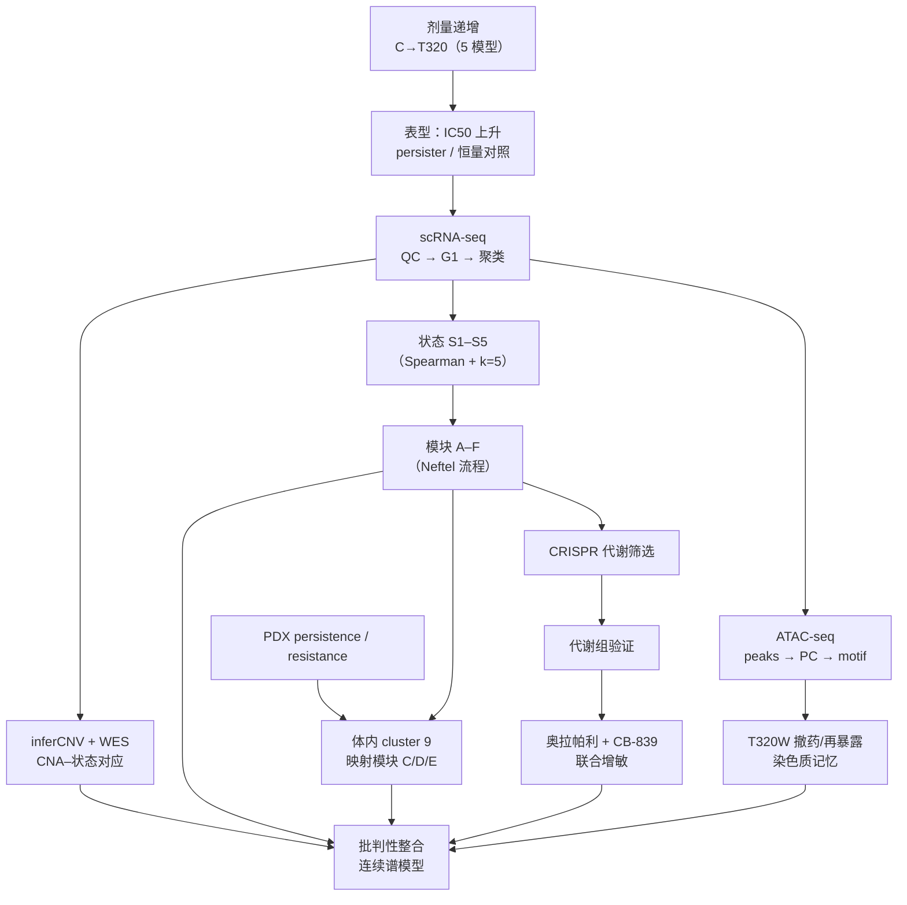

# 00 目录与复现总览 —— 耐药连续谱（Resistance Continuum）

> **目标文献**：França GS, Baron M, King BR, Bossowski JP, Bjornberg A, Pour M, Rao A, Patel AS, Misirlioglu S, Barkley D, Tang KH, Dolgalev I, Liberman DA, Avital G, Kuperwaser F, Chiodin M, Levine DA, Papagiannakopoulos T, Marusyk A, Lionnet T, Yanai I. *Cellular adaptation to cancer therapy along a resistance continuum.* **Nature (2024) 631:876–890.** DOI: 10.1038/s41586-024-07690-9
> **项目目录**：`20261018_resistance_continuum_cancer_therapy/`　**启动日期**：2026-10-18
> **前置依赖**：无（项目入口阅读文档）；后续模块见 §七 文档索引
> **复现难度 / 预计工时 / 计算资源**：索引文档（无计算）；各模块见其头部四要素
> **上位规范**：`../REPRO_SPEC.md`（L0 v2.1）→ `PROJECT_SPEC.md`（L1）→ `10_复现质控清单、排错与批判性评述.md`（L2）→ 各模块文档（L3）
> **随机种子**：`20261018`

---

## 一、一句话概括与科学问题

**原文一句话**：癌症治疗耐药不是一个"敏感→耐药"的二元开关，而是一条由**多个细胞状态逐步转换、适应度逐级升高**组成的"耐药连续谱"；其底层是去分化、应激适应与代谢重编程的逐步组装，并被染色质状态"加固"；连续谱上暴露出的代谢依赖可被治疗性利用（奥拉帕利 + CB-839）。

**科学问题**（复现时逐条回答）：

1. 剂量递增能否在多个癌种/药物模型中稳定产生"连续"而非"跳变"的耐药表型？
2. 这种表型变化是否对应可定义的细胞状态（S1–S5）与基因模块（A–F）？
3. 状态转换是否伴随拷贝数改变（CNA）与染色质可及性重塑？
4. EMT/干性程序是"直接耐药机制"还是"使能可塑性"？
5. 连续谱是否在体内（PDX）重现？
6. 连续谱上是否出现可靶向的代谢依赖？

**原文答案链**：是 → 是 → 部分是（CNA 与状态相关但非充分；染色质渐进重塑）→ 主要是"使能"而非充分 → 是 → 是（NRF2/PPP/核苷酸/铁稳态；CB-839 增敏）。

---

## 二、文献详细精读

### 2.1 研究背景与概念框架

- **传统模型**：耐药 = 预先存在的遗传突变克隆被药物选择（Darwinian selection）。
- **非遗传模型**：药物耐受持久细胞（drug-tolerant persister, DTP）通过转录重编程进入可逆的存活状态；长期暴露后可获得稳定的遗传/表观适应。
- **原文提出的新框架**：把"敏感→耐受→稳定耐药"拆成**连续的状态转换轨迹**，每一步都有不同的表达程序、染色质状态与适应度；因此治疗策略应针对"转换机制"而不仅是终末耐药状态。
- **关键概念区分**（本项目术语以此为准）：
  - **adapted line**：剂量递增终点可在该剂量下汇合的群体（仍对该剂量敏感，属部分耐受）。
  - **persister**：单次高剂量短期暴露后贴壁存活、撤药后可恢复敏感的细胞。
  - **resistant**：仅指 PDX 三轮治疗后再次治疗无反应的肿瘤。

### 2.2 实验体系（Fig. 1a、Extended Data Fig. 1–2）

| 模型 | 背景 | 药物 | 剂量递增范围 | 适应线数 |
|---|---|---|---|---|
| Kuramochi | BRCA2 缺陷 HGSOC | 奥拉帕利（PARP1/2 抑制剂） | 1 → 320 μM | 9（T1–T320）+ C |
| Ovsaho | BRCA2 纯合缺失 HGSOC | 奥拉帕利 | 1 → 40 μM | 6（T1–T40）+ C |
| COV362 | BRCA1 突变 HGSOC | 奥拉帕利 | 1 → 40 μM | 6（T1–T40）+ C |
| A375 | BRAF^V600E 黑色素瘤 | 达拉非尼（BRAF 抑制剂） | 30 nM → 4 μM | 8 + C |
| PC9 | EGFR exon19del 肺腺癌 | 奥希替尼（EGFR 抑制剂） | 8 nM → 1.2 μM | 8 + C |

**剂量递增 SOP**：1×10^6 细胞接种 150 mm 皿 → 24 h 后加药 → 培养至 >70% 汇合 → 0.25% 胰酶消化 → 取 1×10^6 传代并**倍增剂量** → 重复至目标剂量。每一步冻存（10% DMSO + 50% FBS + 40% 培养基）。

**关键对照**：

1. **预存耐药克隆排除**（Extended Data Fig. 2a）：对未处理细胞做两轮 320 μM 9 天处理-恢复；存活细胞 IC50 未显著升高 → 不是预先存在的完全耐药克隆被选择，而是持久细胞表型。
2. **恒量延长 vs 倍增递增**（Extended Data Fig. 2b–d）：固定剂量延长培养可提高耐药，但通常达不到倍增递增群体的水平（T80-E 与 T160 接近，提示时间也重要）。
3. **急性高剂量 vs 递增**（Extended Data Fig. 2e–h）：递增方案能更快达到适应；直接暴露于 5/10 μM 的未处理细胞无法汇合 → **低剂量"预适应"**。

**原文报告的表型数值**：对照 IC50 约 2 μM，T320 约 60 μM（Fig. 1b 正文）。注意：这是"对该剂量部分耐受"，因为最适应系仍对其适应剂量敏感。

### 2.3 单细胞转录组与细胞状态（Fig. 1c–f）

- 平台：Kuramochi C–T320 用 **inDrop**；persisters/其他细胞系/PDX 用 **10X Chromium 3′ v3.1**；部分样本用 **cell hashing**（TotalSeq-A HTO1–5）或 **CellPlex** 多重。
- 处理：TPM（scale factor 10^4）+ log2；过滤（转录本 <500 或 >2 SD、基因 <500、线粒体 >20%）；只保留 **G1 细胞**；Seurat 回归 UMI/线粒体/核糖体比例；DrImpute（k=5:10）；HVG；PCA；UMAP；Louvain（resolution 0.3–0.6）。
- **状态定义**：每个样本内部先聚类并取 top 100 DEG（按 adj P），合并为 1,511 个非冗余基因；计算各亚群平均表达 → **Spearman 相关矩阵** → average-linkage 层次聚类 → **k=5**，得到 S1–S5。
- **观察**：不同适应线的亚群可落入同一状态（如 T2.5-2、T5-0 与 T10-0、T20-0 同属 S2），说明状态是跨样本共享的；沿连续谱，状态频率发生系统性改变（Fig. 1f）。
- **重复性**：Ovsaho、COV362、A375、PC9 均出现类似"渐进状态转换"（Extended Data Fig. 3–4）。

### 2.4 基因模块与程序组装（Fig. 2a–c）

采用 Neftel et al. (Cell 2019) 的思路：对全部 G1 细胞用 1,000 个 HVG、以 1−Pearson 为距离做层次聚类；对每个候选簇做差异表达（>1.8 平均倍数、adj P<0.001、>50 基因）；按 Jaccard >0.75 合并 signature；≥3 signatures 的簇合并为模块；模块间不强制互斥。

| 模块 | 主要基因（原文列举） | 功能 | 沿连续谱趋势 |
|---|---|---|---|
| A | SOX17、PAX8、WT1、KRT8、DSP、IFI6、IFI27 | 谱系身份/上皮/干扰素 | 下降（去分化） |
| B | KRT8、KRT18、FN1 | 上皮–间质混合 | 早期出现 |
| C | COL3A1、SERPINE2、SOX4、VIM、缺氧基因 | ECM 重塑/EMT/缺氧 | 上升 |
| D | CITED2、SGK1、DUSP1、SNAI2、VIM、SMAD3、DAB2、CD44、KLF4 | 缺氧/EMT/TGFβ/干性 | 上升 |
| E | HIF1A、DDIT4、PFKP、GAPDH、RPL14、RPS15A、EIF1、EIF2D、RACK1 | 糖酵解/翻译重编程 | 高耐药期上升 |
| F | TXNRD1、AKR1B1、GGH、HMOX1、GPX4、FTL、TKT、IMPDH2、ASNS、CHAC1、SHMT2 | NRF2/ATF4、PPP、核苷酸、铁死亡/铁稳态 | 高耐药期上升 |

**GSEA**（MSigDB Hallmark / KEGG / Reactome；fgsea；10,000 置换；P<0.05、FDR<0.25）显示：模块 A 富集 IFNα/IFNγ、黏附连接、角化；C/D 富集 EMT、缺氧、TNF/NF-κB；E/F 富集 OXPHOS、PPP、核苷酸/碳水化合物代谢、铁死亡、ROS、翻译。

**persister 映射**（Fig. 2c）：P10/P320 的 DEG 与模块 A 高度重叠；CD44、HMOX1、GPX4、DDIT4、PFKP 在 persister 中已升高但低于 adapted line → 急性暴露只完成"部分重编程"，为后续适应"铺路"。

### 2.5 谱系可塑性与 EMT 的功能定位（Fig. 2d、Extended Data Fig. 5–6）

- **CD24/CD44 分选**：状态 S4 对应 CD24^low CD44^hi；T10 内 S4 比 S2（CD24^low CD44^low）更耐药，但弱于 T40/T320 的 CD24^low CD44^hi → 同一状态标签下，适应度仍随治疗历史升高。
- **SOX17 扰动**：在 T320 中过表达 SOX17 → 对奥拉帕利更敏感；在亲本 C 中敲低 SOX17（shRNA，3 条）→ 更不敏感。说明谱系因子活性可**部分**调节耐药。
- **Slug（SNAI2）过表达**：选择与 T320 侵袭表型相当的表达水平（1 μg/ml dox，C-Slug1）；在 5 μM 奥拉帕利下 54 天活细胞成像显示：Slug 过表达细胞比亲本更耐受，但显著弱于连续谱适应线；3 周后可转为净增长。
- **EMT 评分**：沿连续谱**早期升高**，但耐药程度继续升高而 EMT 评分不继续升高（Extended Data Fig. 6e–i）→ EMT 是"使能"而非"充分"机制。
- **原文措辞**：EMT/干性程序 "enable adaptation, rather than a full resistance mechanism"。

### 2.6 拷贝数改变（Fig. 3a、Extended Data Fig. 7）

- **inferCNV v1.4.0**：以未处理 C 为参考；`cutoff=0.1`；按转录组聚类分组；输出 denoised 矩阵；取每条件 30% 细胞用 ComplexHeatmap 展示。
- **WES**：C、T10、T40、T320；KAPA Hyper Prep；IDT XGen 捕获；NovaSeq；BWA-MEM；GATK 3.8.1；**Control-FREEC**（以未处理样本为对照）；ANNOVAR（gnomAD 3.0、COSMIC 90）。
- **结果**：
  - CNA 与状态亚群大体对应（克隆遗传演化）。
  - chr7、chr9 区域在适应线间保守；包含 **CDKN2A/B 缺失**（WES 验证）。
  - 未见继发 BRCA1/BRCA2 突变。
  - 不同细胞系的 CNA 谱系特异。
  - S5（T160/T320）CNA 谱仍不同 → **CNA 不能完全定义状态**，可能存在多克隆并行演化。
  - persister 未见清晰 CNA。

### 2.7 染色质可及性与"记忆"（Fig. 3b–f、Extended Data Fig. 8）

- **ATAC-seq**：改良 OMNI-ATAC；C、P10、P320、T5–T320、T320W；按 CD24/CD44 分选；生物学重复 2 次；50,000 细胞/条件；Tn5 37°C 40 min。
- **流程**：TrimGalore 0.5.0 → Bowtie2 2.3.4.1（--very-sensitive -k 10 -X 2000）→ 去线粒体/重复 → SAMtools 1.9 → 降采样 → MACS2 2.2.4 → 去 blacklist → IDR 2.0.3（IDR<0.05）→ HOMER v4.15 合并 consensus peaks → deepTools 3.1 计数 → DESeq2 1.18.1。
- **差异 peak**：相对 C，adj P<0.001 且 FC≥3。
- **结果**：
  - PCA（top 2,000 最可变 peak）PC1 80%、PC2 8%，PC1/PC2 捕获从 C 到 T320 的"祖先顺序"→ 可及性变化是累积的。
  - 谱系因子 SOX17、PAX8、WT1 motif 可及性逐步下降；AP1、NRF2、ATF4 motif 逐步上升（数量与比例均增加）。
  - persister 变化较少，与转录组一致。
  - **T320W**（撤药 120 天）：对 10/40 μM 仍耐受，对 320 μM 明显敏感（部分可逆）；增殖无代价（反而更快）。
  - 撤药后"更开放"的 peak 部分关闭；再暴露 320 μM 后重新开放 → 染色质"记忆"。
  - 差异 peak 中约 70%（less）与 80–90%（more）不落在 CNA 区域 → 染色质变化是广泛的、不能仅用 CNA 解释。

### 2.8 体内模型（Fig. 4、Extended Data Fig. 9）

- **PDX**：BRCA2 突变 HGSOC（PDX ID 66799）；NSG 小鼠；1×10^6 细胞 + Matrigel 1:1 植入乳腺脂肪垫；肿瘤 100–200 mm³ 开始治疗； humane endpoint 2,000 mm³。
- **Persistence 实验**：talazoparib 4 个剂量 D1 0.13、D2 0.23、D3 0.33、D4 0.66 mg/kg（5 天/周，口服灌胃），每剂量 2 重复；50–57 天后或终点取瘤。
- **Resistance 实验**：0.33 mg/kg；第一轮治疗→缓解→停药→复发→再治疗无反应（R1）；取 R1* 传第二代（R2）、第三代（R3，含 R3.V 载体对照）。
- **scRNA-seq**：10X；CellRanger multi-species，仅保留 human 细胞；persistence 用 fastMNN 校正批次。
- **结果**：
  - persistence 中不同剂量细胞大多混合；resistance 中出现耐药特异 cluster。**原文对 cluster 7 的归属自相矛盾**：Results 写"second passage (cluster 7)"，随后又写"cluster 7, mostly composed of cells from R1 tumours"；本项目按"以模块重叠判定、不依赖 cluster 编号"处理。
  - cluster 0/6 与体外未处理 Kuramochi 状态重叠；cluster 4 与 persister/模块 A 重叠；cluster 7 为中间态；**cluster 9 与模块 C/D/E 显著重叠** → 体外适应状态在体内出现。
  - cluster 9 表达 CD44、SMAD3、DDIT4、PGK1、PFKP、ACLY、SCD、MBOAT7、CTPS1、TYMS、NQO1、TXNRD1、PRDX1、GGH、GSTM3、GPX4、STEAP3；**CDKN2A 低表达**。
  - 免疫荧光：R3.2 中 SOX17^low CD44^high 区域与 SOX17^high CD44^low 区域共存 → 瘤内异质性。

### 2.9 代谢依赖与可靶向脆弱性（Fig. 5、Extended Data Fig. 10）

- **CRISPR 负筛**：Birsoy 代谢文库（**2,978 基因、29,790 sgRNA、约 10 sgRNA/基因**）；MOI≈0.3；嘌呤霉素 4 μg/ml；~10 个群体倍增；条件：C、T10、T320（±药：CD = C + 1 μM；T320D = T320 + 40 μM）；MAGeCK 0.5.8（count + MLE）。
- **结果**：
  - 从 T10 到 T320 依赖基因数逐步增加。
  - 共同依赖：TXNRD1、PRDX1、PGD、PGK1、ALDOA、ENO1、STEAP3、IMPDH2、GUK1、DTYMK。
  - T320/T320D 额外：TYMS、CAD、CTPS1、FDX1、FXN。
  - T320D 特有：COX5B、CYCS、ACAD9（线粒体氧化磷酸化）。
  - 通路：核苷酸代谢、PPP、胆固醇合成（T320）、OXPHOS（T320D）、铁稳态、饥饿反应。
- **代谢组**：C vs T320（±320 μM 24 h）；ZIC-pHILIC + Q Exactive HF；T320 中核苷酸及前体/衍生物升高（inosine、guanosine、adenosine、uridine、cytidine、hypoxanthine 等）。
- **药物联用**：CB-839（GLS 抑制剂）50 nM + 奥拉帕利 6 天；最适应系 IC50 相对单药下降约 **6 倍**；CB-839 单药仅轻微敏感；Bliss 协同评分支持协同。
- **机制假设**：奥拉帕利→DNA 损伤/ROS→NRF2 抗氧化程序（GSH、PPP）→核苷酸合成前体；GLS 抑制谷氨酰胺→谷氨酸→GSH 与 TCA/核苷酸前体，双向挤压。

### 2.10 原文的局限与批判性提示（详见 10 号文档 §九）

1. **剂量远超临床**：320 μM 奥拉帕利远高于临床血药浓度（通常低 μM 量级），连续谱的终末段是实验性选择压力，不可直接外推临床。
2. **细胞系为主**：5 个模型提高普适性，但仍是体外 2D 培养；PDX 仅 1 例、3 代，样本量小。
3. **相关 ≠ 因果**：状态–适应度关联主要通过分选与扰动实验支持；染色质"记忆"机制未做因果验证（如 dCas9-p300/CRISPRi）。
4. **CNA 推断噪声**：inferCNV 基于表达，WES 仅 4 样本，缺少单细胞 DNA 克隆谱系。
5. **CRISPR 筛选**：单一文库、单一细胞系、~10 倍增；未对关键 hit 做正交验证。
6. **药物联用**：仅体外；CB-839 50 nM 的药理相关性与体内暴露未讨论。
7. **代码可复现性**：公开仓库脚本依赖未公开的本地 `.rda` 中间对象，不能端到端一键运行（见 01 号文档 §三）。

---

## 三、证据链与复现流程图

**复现顺序（依赖关系）**：01 → 03 → 04 →（05、06 并行）→ 07 → 08 → 09；02 为独立湿实验 SOP，09 依赖 02 的 IC50 口径。10、11 贯穿全程。

---

## 四、数据资产与代码可得性

### 4.1 GEO SuperSeries GSE247691（93 样本，8 个子系列）

| 子系列 | 内容 | 样本数 | 已公开的处理数据（suppl） | 对应模块 |
|---|---|---|---|---|
| GSE206125 | Kuramochi scRNA-seq（inDrop，C–T320） | 10 | `kuramochi_all_C_to_T320.csv.gz`（**基因 symbol × 细胞 counts**）、`metadata_g1.tsv.gz`（`cell,nGene,nUMI,orig.ident,percent.mito,State`；**已含 S1–S5 标签**）、inDrop barcode 列表 | 03/04/05 |
| GSE247684 | A375 + PC9 scRNA-seq | 6 | A375/PC9 counts + metadata | 03/04 |
| GSE247685 | Kuramochi ATAC-seq | 28 | **`consensus_peaks_kuramochi_all.tsv.gz` = chr/start/end + 20 样本计数**（缺 T320/T320W 加药 8 样本）；6 个系列级 `.bw` | 06 |
| GSE247686 | Kuramochi 代谢 CRISPR 筛选 | 8 | sgRNA 文库 + `sgrna_counts.tsv.gz`（**10 个样本列，含 T40**） | 08 |
| GSE247687 | Kuramochi WES | 4 | `WES_CNVs.tsv.gz`、`WES_SNVs.tsv.gz` | 05 |
| GSE247688 | Kuramochi persisters scRNA-seq | 10 | counts + metadata + HTO barcode/antibody ref | 03/04 |
| GSE247689 | Ovsaho + COV362 scRNA-seq | 10 | counts + metadata + antibody/barcode | 03/04 |
| GSE247690 | PDX scRNA-seq | 17 | persistence/resistance counts + metadata | 07 |

**说明**：
- 合计 10+6+28+8+4+10+10+17 = **93 样本**，与 GEO SuperSeries 记录一致。
- 处理数据足以完成 **03–08 的计算复现**；若需从头比对（ATAC 的 DESeq2 计数、WES 变异调用），需从 SRA/BioProject **PRJNA1040167** 下载 fastq，成本显著上升（见 D7）。
- **代谢组**：Metabolomics Workbench **ST003102**；若原始强度矩阵不可直接下载，则以原文补充表/图做定性核对（D8）。

### 4.2 代码仓库

- 地址：`https://github.com/yanailab/drug-resistance`
- 顶层文件：`a375_analysis.R`、`cov362_analysis.R`、`gsea_analysis.R`、`ovsaho_analysis.R`、`pc9_analysis.R`、`pdx_adapt.R`、`pdx_per.R`、`plot_cnvs.R`
- 目录：`atac/`（`atac_analysis.R`、`zavit.R`）、`basic_functions/`（`filter_gene_expression.R`、`plotting.R`、`regev_lab_cell_cycle_genes.txt`、`seurat_wrapper.R`、`singleCell_QC.R`）、`modules/`（`gene_modules.R`、`module_analysis.R`）
- **可复现性评估**：
  - ✅ 提供模块识别、GSEA、ATAC、CNA 绘图、各细胞系/PDX 分析脚本，可作为参数与实现细节的权威参考。
  - ⚠️ 脚本 `load()` 本地 `.rda`（如 `kura_all_g1_together_seurat.rda`、`genes_to_remove.rda`），这些中间对象**未随仓库发布**。
  - ⚠️ 未见 Kuramochi 主分析（C–T320 的聚类/状态定义）完整脚本；需按 Methods 重建（D14）。
  - ⚠️ README 无说明；无环境锁定文件（无 `renv.lock` / `sessionInfo`）。
- **项目策略**：把作者脚本作为"参数对照"，从 GEO 处理数据出发重建流程；任何与作者脚本不一致处记入 `logs/DECISIONS.md`。

### 4.3 数据资产清单（S6 执行时填写）

| 数据集 | 样本/文件 | 用途 | 获取方式 | 校验和 |
|---|---|---|---|---|
| GSE206125 | 10 | Kuramochi 状态/模块/CNA | GEO suppl | `logs/00_checksums.md5` |
| GSE247684 | 6 | A375/PC9 普适性 | GEO suppl | 同上 |
| GSE247685 | 28 | ATAC | GEO suppl | 同上 |
| GSE247686 | 8 | CRISPR | GEO suppl | 同上 |
| GSE247687 | 4 | WES | GEO suppl | 同上 |
| GSE247688 | 10 | persisters | GEO suppl | 同上 |
| GSE247689 | 10 | Ovsaho/COV362 | GEO suppl | 同上 |
| GSE247690 | 17 | PDX | GEO suppl | 同上 |
| ST003102 | 6 条件 × 3 重复 | 代谢组 | Metabolomics Workbench | 同上 |
| 参考 | hg38/GRCh38、Ensembl 93、MSigDB、HOMER | 全流程 | 官方 | 同上 |

---

## 五、复现边界（哪些能复现、哪些不能）

| 层级 | 内容 | 本项目做法 | 可行性 |
|---|---|---|---|
| **R1 计算复现** | 03–08：QC、状态、模块、CNA、ATAC、PDX 图谱、CRISPR、代谢组差异 | 用 GEO 处理数据 + 作者脚本参数重建 | ★★★★★ |
| **R2 图表复现** | Fig. 1–5、Extended Data Fig. 1–10 的数值/趋势/热图 | 逐图设 QC 门槛（§六） | ★★★★☆ |
| **R3 湿实验 SOP** | 02、09：剂量递增、IC50、persister、分选、SOX17/Slug 扰动、Transwell、WB/qPCR、CB-839 联用 | 写可执行 SOP 与统计方案；不执行 | ★★★★☆（文档） |
| **R4 体内实验** | 07：PDX 建系、给药、取瘤 | 用公开 scRNA-seq 复现分析；实验仅写方案 | ★★★☆☆（分析）/ ★★☆☆☆（实验） |
| **不可复现** | 原始临床样本纵向队列、未公开中间对象、未公开的 ATAC 计数表 | 明确标注，不伪造 | — |

**诚实性声明**：本项目不声称"重现了全部实验"；计算部分以公开数据为界，湿实验部分为方案文档。任何指标达不到原文值，按 L0 §12 记录 gap，不反向调参。

---

## 六、全局 QC 门槛（L2 摘要）

> 允许波动默认 ±10%（比例类）/ 趋势一致（排序类）；逐项判据见 `10_复现质控清单、排错与批判性评述.md` §六。

| # | 检查点 | 原文报告值 | 复现判据 | Go/No-Go |
|---|---|---|---|---|
| G1 | Kuramochi 适应线数 | 9（T1–T320）+ C | 线名与剂量完全对应 | ✅ 必须 |
| G2 | IC50 范围 | C 约 2 μM → T320 约 60 μM | 单调上升；C 与 T320 在 ±30% 内 | ⚠️ 允许平台差异 |
| G3 | 其他模型适应线数 | Ovsaho/COV362 6；A375 8；PC9 8 | 与原文一致 | ✅ 必须 |
| G4 | persister 不产生稳定耐药 | 两轮 320 μM 后 IC50 无显著升高 | 与 C 差异不显著 | ✅ 必须 |
| G5 | 细胞状态数 | k=5（S1–S5） | 主聚类 k=5 可解释；k=4/6 作敏感性 | ✅ 必须 |
| G6 | 状态跨线共享 | 存在跨线同状态亚群 | 至少 1 组跨线共聚类 | ✅ 必须 |
| G7 | 基因模块数 | 6（A–F） | 6 个模块；基因数 >50/模块 | ⚠️ 允许 5–7 |
| G8 | 模块 A 去分化 | SOX17/PAX8/WT1 下降 | 趋势一致 | ✅ 必须 |
| G9 | 模块 E/F 代谢 | NRF2/ATF4、PPP、核苷酸、铁死亡富集 | GSEA 方向一致（P<0.05, FDR<0.25） | ✅ 必须 |
| G10 | persister 与模块 A 重叠 | 显著超几何重叠 | P<0.05 | ✅ 必须 |
| G11 | CNA–状态对应 | 亚群 CNA 谱可区分 | 聚类与 CNA 热图大体对应 | ⚠️ 允许噪声 |
| G12 | CDKN2A/B 缺失 | WES 验证 | 检出缺失 | ✅ 必须 |
| G13 | 无继发 BRCA1/2 突变 | WES 未见 | 复核 SNV 表 | ✅ 必须 |
| G14 | ATAC PCA 顺序 | PC1 80%、PC2 8% | PC1 沿 C→T320 单调；方差比例 ±10 个百分点 | ⚠️ |
| G15 | motif 方向 | SOX17/PAX8/WT1↓；AP1/NRF2/ATF4↑ | 方向一致 | ✅ 必须 |
| G16 | 差异 peak 数 | less 6,771；more 7,332（T320 vs C） | 同数量级（±30%） | ⚠️ |
| G17 | T320W 部分可逆 | 对 10/40 μM 耐受、320 μM 敏感 | 趋势一致 | ✅ 必须 |
| G18 | PDX cluster 9 | 与模块 C/D/E 重叠 | 超几何 P<0.05 | ✅ 必须 |
| G19 | CRISPR 依赖 | TXNRD1、PRDX1、PGD、PGK1、IMPDH2 等 | 至少 70% 关键基因方向一致 | ⚠️ |
| G20 | 代谢组核苷酸升高 | T320 vs C | 至少 3 个核苷酸/前体升高（P<0.05） | ⚠️ |
| G21 | CB-839 联用 | 最适应系 IC50 降约 6 倍 | 下降 ≥3 倍且方向一致 | ⚠️ |
| G22 | 随机性 | — | 种子 20261018 固定；记录不可控并行波动 | ✅ 必须 |
| G23 | 契约一致性 | — | 产物契约表与脚本读写一致 | ✅ 必须 |
| G24 | 文档一致性 | — | `tools/repro_check.sh` 全通过 | ✅ 必须 |

---

## 七、文档索引

| 编号 | 文档 | 内容 | 主要产物 |
|---|---|---|---|
| 00 | 本文件 | 文献精读、证据链、数据资产、全局 QC、边界 | — |
| 01 | `01_数据与代码可得性、环境搭建.md` | 数据下载、环境、参考文件、目录初始化 | `raw/**`、`logs/00_checksums.md5` |
| 02 | `02_剂量递增实验与耐药表型.md` | 剂量递增、IC50、persister、对照实验 SOP | `results/09_ic50_summary.csv`（共享） |
| 03 | `03_单细胞转录组QC整合与细胞聚类.md` | 平台/多重、QC、G1、DrImpute、聚类、DE | `processed/03_*` |
| 04 | `04_细胞状态与基因模块识别.md` | S1–S5、模块 A–F、GSEA、persister、CD24/CD44 | `results/04_*` |
| 05 | `05_拷贝数推断与全外显子分析.md` | inferCNV、WES/Control-FREEC、重叠检验 | `results/05_*` |
| 06 | `06_ATAC-seq染色质可及性与转录因子motif.md` | 比对/peak/IDR/DESeq2/PCA/motif/T320W | `results/06_*` |
| 07 | `07_PDX体内模型与单细胞图谱.md` | PDX 设计、scRNA-seq、cluster 映射、IF | `results/07_*` |
| 08 | `08_代谢CRISPR筛选与靶向代谢组.md` | 文库/筛选/MAGeCK/代谢组/CB-839 依据 | `results/08_*` |
| 09 | `09_功能验证与药物联用.md` | SOX17/Slug、成像、Transwell、WB/qPCR、联用 | `results/09_*` |
| 10 | `10_复现质控清单、排错与批判性评述.md` | QC 表、gap 表、**D 表**、批判性评述 | — |
| 11 | `11_背景知识精讲与方法学原理速查.md` | 生物学/算法/公式/术语/导读 | — |

---

## 八、工程约定

1. **种子**：全项目 `20261018`；每个脚本首行设置并打印。
2. **产物契约**：见 `PROJECT_SPEC.md` §3；生产者唯一；改格式/名必须同步契约表、全部消费方与 `logs/DECISIONS.md`。
3. **命名**：产物/代码 `snake_case`；禁用空格与 `< > { } : * ? |`；占位符 `<...>` 落盘必须展开；图 `.pdf`+`.png` 双份（dpi=300）。
4. **目录**：`raw/` 只读；`processed/` 中间对象；`results/` 表；`figures/` 图；`code/` 脚本；`logs/` 日志/决策/校验和。
5. **可追溯**：每个图注明脚本、输入产物、参数；每个模块结束写 `logs/<NN>_sessionInfo.txt` 或 `pip freeze`。
6. **质量断言**：关键产物必须检查行数、非空、取值范围、标签水平（如 `levels(state)`）、尺度（log/非 log）。
7. **不静默失败**：上游产物缺失时必须显式报错，禁止自动搜索同名文件。

---

## 九、复现路线图（建议工时与算力）

| 阶段 | 模块 | 预计工时 | 算力 |
|---|---|---|---|
| S1–S3 | 01、02、03 方案 | 2–3 人日 | 无 |
| S4–S5 | 独立审核 + 自检 | 1 人日 | 无 |
| S6-A | 01 下载 + 03/04 计算 | 3–5 人日 | 64 GB RAM；8–16 核 |
| S6-B | 05、06 计算 | 3–4 人日 | 64 GB；ATAC 重跑需 500 GB 磁盘 |
| S6-C | 07、08 计算 | 2–3 人日 | 32–64 GB |
| S6-D | 02、09 湿实验（可选） | 数月 | 细胞房/动物房 |
| S6-E | QC、gap 表、批判性评述 | 2 人日 | 无 |

**风险登记**：

| 风险 | 影响 | 缓解 |
|---|---|---|
| Seurat 4.4 与原文 4.0.5 API 差异 | 聚类细节偏移 | 锁定 4.x 末版；关键步骤做版本敏感性 |
| ATAC 无公开计数表 | 差异 peak 复现受限 | 从 SRA 重跑或 bigwig 近似（D7） |
| 作者代码缺中间对象 | 无法一键复现 | 以 Methods 重建；脚本作参数对照（D14） |
| 代谢组数据不可得 | 定量复现受限 | 用补充表做定性核对（D8） |
| 细胞状态 k=5 不稳定 | 状态标签不可比 | 报告 k=4/5/6 敏感性（D4） |
| 剂量远超临床 | 外推风险 | 批判性评述中显式声明 |

---

## 十、术语与读图速查

- **Fig. 1**：连续谱的建立与状态发现（表型 → 转录组）。
- **Fig. 2**：模块组装与 EMT 的"使能"作用（表达程序 → 功能扰动）。
- **Fig. 3**：遗传（CNA）与表观（ATAC）层面的渐进变化。
- **Fig. 4**：体内（PDX）重现持久/耐药状态。
- **Fig. 5**：代谢依赖与联合用药。
- **Extended Data Fig. 1–2**：其他模型与剂量/时间对照。
- **Extended Data Fig. 3–4**：其他细胞系的 scRNA-seq。
- **Extended Data Fig. 5–6**：CD24/CD44 分选、SOX17/Slug 扰动、EMT 评分。
- **Extended Data Fig. 7–8**：CNA 推断、ATAC 稳定性与 CNA 控制。
- **Extended Data Fig. 9–10**：PDX 生长曲线/组织学、CRISPR 排名、代谢组、CB-839。

> **读图提示**：原文所有"resistance"措辞在体外语境下均指"adapted/部分耐受"；本项目严格区分 adapted / persister / resistant（见 `PROJECT_SPEC.md` §4）。
