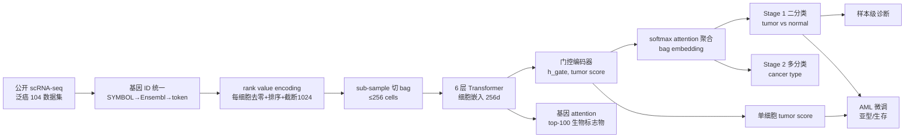
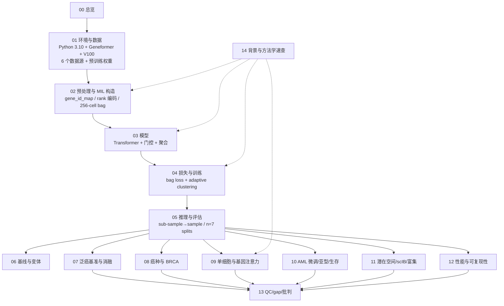

# 文献复现方案总目录与项目总览

> **目标文献**：Tang Z, Wang F, Yang F, Song J, Li Y, Zhou J, Song Y, Chen S, Zhu J, You L, Chen CY-C, Yao J. *scTransMIL bridges patient-level disease states and single-cell transcriptomics for cancer screening and heterogeneity inference.* **Nature Communications (2026) 17:10800.** DOI: [10.1038/s41467-026-77538-5](https://doi.org/10.1038/s41467-026-77538-5)
> 单位：Tencent AI for Life Sciences Lab；Peking University Shenzhen Graduate School；Sun Yat-sen University；Monash University 等。
> 投稿 2025-07-09 / 接收 2026-08-26 / 出版 2026。
>
> **PDF 原件**：同目录下 `2026_scTransMIL_bridges_patient-level_disease_states_and_single-cell_transcriptomics_for_cancer_screening_and_heterogeneity_inference.pdf`
> **代码**：https://github.com/TencentAILabHealthcare/scTransMIL（Zenodo `10.5281/zenodo.21151067`）
>
> **本套文档的性质**：以博士生导师（PI）视角编写的、可逐步执行的**深度学习方法复现方案**。全套 15 篇文档，每篇含：
> ① 科学问题与逻辑位置 → ② 背景原理（生物学 + 算法 + 公式） → ③ 原文逐句拆解 → ④ 逐步可运行代码（Python 3.10 / PyTorch） → ⑤ 参数解释与调参空间 → ⑥ 预期结果与 QC 检查点 → ⑦ 常见陷阱与排错表 → ⑧ 与原文图表的对应关系。
>
> **阅读顺序**：`00 → 01 → … → 12` 是一条完整流水线；`13`（质控与批判）与 `14`（背景速查）建议**先通读**——前者给出"正文 vs 代码"的全部裁决（D1–D23），后者补齐 MIL、Transformer、rank 编码、SmoothTop1SVM、scIB 的数学背景。

---

## 一、文档清单（目录文件）

> 📌 **开工前必读（两级规范）**
> ① **通用规范 `../REPRO_SPEC.md` v2.1（L0）**：全仓库强制的目录/命名/契约/统计/写作/诚实性规范。
> ② **项目规范 `PROJECT_SPEC.md` v1.0（L1）**：模块表、**产物契约表**、**术语表**、环境版本、D 表索引。
> **效力层级：L0 > L1 > 13 号 §五（L2 QC 门槛）> 各模块文档（L3）**；D 表权威位置 = `13_复现质控清单、排错与批判性评述.md` §八。

| 编号 | 文件名 | 内容一句话描述 | 对应原文图表 |
|---|---|---|---|
| **L0** | `../REPRO_SPEC.md` | 仓库级通用规范 v2.1 | — |
| **L1** | `PROJECT_SPEC.md` | 本项目规范：模块表、产物契约表、术语表、D1–D23、版本钉死 | — |
| **00** | `00_目录与复现总览.md` | 本文件：文档目录、科学问题、证据链、全流程图、图表映射、数据资产、算力工期、全局门槛 | Fig. 1 |
| **01** | `01_环境搭建与数据获取.md` | Python 3.10/PyTorch/Geneformer 环境；泛癌图谱、GSE184362、CELLxGENE BRCA、GSE116256、dbGaP bulk AML、预训练权重；目录与校验和 | Data/Code availability |
| **02** | `02_数据预处理与MIL样本构造.md` | 基因 ID 映射 → 去掉零表达 → rank value encoding → 256 细胞切 bag（尾部回绕）→ tokenize（1024 截断）→ bag 索引与标签（CNV/Sample vs Donor） | Methods「Data preprocessing」；`1-process_v3.py` |
| **03** | `03_模型架构_rank编码_Transformer_门控与聚合.md` | 6 层 Transformer 实例编码器、门控 `tanh⊙sigmoid`、tumor score、softmax attention 聚合、二阶段分类头；**正文公式 vs 代码实现差异** | Fig. 1c–d；Methods 三小节 |
| **04** | `04_损失函数与训练策略.md` | bag BCE/CE、adaptive clustering loss（top-B/bottom-B、B=8、smooth SVM τ=1/α=1、β=0.7）、SmoothTop1SVM、weighted sampler、Adam 2e-4/1e-5、早停 | Fig. 1e；Methods「Loss」「Training」 |
| **05** | `05_推理_评估与数据划分.md` | sub-sample → sample 的"任一阳性即阳性"聚合、多分类投票、Acc/AUC/macro-F1、按 donor 80/10/10、n=7 次重复、单细胞 ROC | Methods「Inference」「Statistics」 |
| **06** | `06_基线方法与变体复现.md` | KIDA（pseudo-bulk）、DEGAS（MMD 联合嵌入）、scIDST（instance MIL）、scVI+MIL（bag MIL）、scTransMIL(PCA/FM) | Methods「Comparison methods」「Variants」 |
| **07** | `07_泛癌基准与消融.md` | Fig. 2a–c：50/75/100% 训练量、推理时间、三个消融（clustering loss/gating/max pooling）、gating 的 NMI/ARI/AMI/HOM、Donor setting 噪声鲁棒性 | Fig. 2a–c；Figs. S1–S3 |
| **08** | `08_癌种预测与外部BRCA验证.md` | 30 类原发/转移癌种 Sankey、BRCA 37 samples 外部验证、误分类的生物学解释、bag embedding UMAP、scIB | Fig. 3；Figs. S4–S5 |
| **09** | `09_单细胞可解释性与基因注意力.md` | 单细胞 tumor score（AUC 0.71）、甲状腺 Patient 5（0.64）、ALL B 细胞、top-100 attention 基因（CD79A/PIM1/BLK）、GSEApy 富集 | Fig. 2d–f、Fig. 4；Figs. S6–S7 |
| **10** | `10_AML微调_亚型与生存.md` | GSE116256 微调（20 tumor+3 normal）、6 个 AML 亚型（tumor score>0.2 + kNN）、纵向治疗、bulk 671 例 KM（HSC-like 更差） | Fig. 5；Figs. S8–S12 |
| **11** | `11_潜在空间_scIB与通路富集.md` | bag embedding UMAP、scIB 的 Bio Conservation/Batch Correction 八项指标、PCR/KBET、富集分析细节 | Fig. 3g–j、Fig. 4h |
| **12** | `12_计算性能与可复现性.md` | V100 计时（245.16 s vs DEGAS 720 s）、显存、并行、随机种子、n=7 重复的统计汇总、训练稳定性 | Fig. 2b；Methods「Training」 |
| **13** | `13_复现质控清单、排错与批判性评述.md` | **QC 门槛（L2）**、gap 表、排错、**D1–D23 权威全文**、证据等级与批判性评述（弱监督标签噪声、CNV 参照的循环性、注意力≠因果、dbGaP 受限） | 全文 |
| **14** | `14_背景知识精讲与方法学原理速查.md` | MIL 谱系、Transformer/自注意力、rank 编码、SmoothTop1SVM、scIB、AML 分化、癌症早筛；FAQ 与文献导读 | 全文 |

---

## 二、科学问题与逻辑位置

### 2.1 一句话科学问题

**当只有"患者/样本级"诊断标签、没有单细胞级恶性标签时，能否用一个模型同时做到：① 预测样本是否癌变；② 推断每个细胞的癌相关程度；③ 找出驱动诊断的基因？**

原文的回答：把样本视为 **bag**、细胞视为 **instance**，用 **Transformer + 门控注意力 MIL** 在 bag 标签上端到端训练；门控分支输出实例级 tumor score（softmax 前），bag 聚合使用 softmax attention；Transformer 的自注意力提供基因级**相关性线索**（需实验验证，不是因果）。

### 2.2 方法在证据链中的位置

### 2.3 原文证据链（逐条核验）

| # | 原文主张 | 对应图 | 复现判据 |
|---|---|---|---|
| C1 | rank 编码 + Transformer 的实例编码优于 PCA/基础模型变体 | Fig. 2a–c | **75/100% 训练量下** Acc/AUC/F1 更高；50% 时允许个别指标被反超 |
| C2 | 门控注意力与 adaptive clustering loss 都有贡献 | Fig. 2c | 去任一组件性能下降 |
| C3 | 样本级诊断优于 KIDA/DEGAS/scIDST/scVI+MIL | Fig. 2a | **100% 训练量**下 7 次 split 均值更高（50% 见作者 CSV） |
| C4 | 单细胞 tumor score 与 CNV 注释一致（AUC 0.71） | Fig. 2f | AUC ≥0.68 且高于基线 |
| C5 | 能识别早癌 paratumor（Patient 5，0.64） | Fig. 2d–e | 分数 ∈[0.55,0.75]，高分区在上皮 |
| C6 | 30 类癌种（含转移）可分类，外部 BRCA 泛化 | Fig. 3 | 分类准确率与基线比较 |
| C7 | attention top-100 含 CD79A/PIM1/BLK | Fig. 4f–g | 三基因均在 top-100 |
| C8 | top-20 通路 FDR<0.001 且与 ALL 相关 | Fig. 4h | 通路方向一致 |
| C9 | AML 少标签微调可重建分化轨迹与 6 亚型 | Fig. 5b–e | 6 亚型可复现 |
| C10 | HSC-like 生存差于 GMP-like | Fig. S11 | log-rank p<0.05 |

---

## 三、全流程图（按文档编号）

---

## 四、图表 → 文档映射

| 原文图 | 内容 | 主责文档 | 产物（`figures/`） |
|---|---|---|---|
| Fig. 1 | MIL 数据格式、两阶段流程、门控/聚合、损失 | 00/03/04 | `Fig1_workflow.*`（示意复刻） |
| Fig. 2a | 50/75/100% 训练量的 Acc/AUC/F1（n=7） | 07 | `Fig2A_training_size.*` |
| Fig. 2b | 推理时间（log 尺度） | 12 | `Fig2B_inference_time.*` |
| Fig. 2c | 三个消融 | 07 | `Fig2C_ablation.*` |
| Fig. 2d | 甲状腺样本预测分数 | 09 | `Fig2D_thyroid_scores.*` |
| Fig. 2e | Patient 5 UMAP + tumor score | 09 | `Fig2E_patient5_umap.*` |
| Fig. 2f | 泛癌单细胞 UMAP + ROC | 09 | `Fig2F_cell_roc.*` |
| Fig. 3a–b | 原发/转移癌种 Sankey | 08 | `Fig3AB_sankey.*` |
| Fig. 3c | BRCA Sankey | 08 | `Fig3C_brca_sankey.*` |
| Fig. 3d | 方法间癌种准确率 | 08 | `Fig3D_accuracy.*` |
| Fig. 3e–f | BRCA 细胞类型/肿瘤分数 UMAP | 08/09 | `Fig3EF_brca_umap.*` |
| Fig. 3g–h | bag embedding UMAP（癌种/数据集） | 11 | `Fig3GH_bag_umap.*` |
| Fig. 3i–j | scIB 子指标与总分 | 11 | `Fig3IJ_scib.*` |
| Fig. 4a–e | ALL bag/cell UMAP、CNV/tumor score | 09 | `Fig4AE_all_umap.*` |
| Fig. 4f | top-100 attention 热图 | 09 | `Fig4F_attention_heatmap.*` |
| Fig. 4g | 与 DEA 的 Venn | 09 | `Fig4G_venn.*` |
| Fig. 4h | top-20 通路 | 11 | `Fig4H_enrichment.*` |
| Fig. 5a | 三种微调策略 | 10 | `Fig5A_finetune.*` |
| Fig. 5b–c | AML instance embedding / 微调前后 tumor score | 10 | `Fig5BC_aml_embedding.*` |
| Fig. 5d–e | 6 个 AML 亚型比例与轨迹 | 10 | `Fig5DE_subtypes.*` |
| Fig. 5f | 纵向治疗样本 | 10 | `Fig5F_longitudinal.*` |
| Fig. S1–S3 | 架构、gating 指标、Donor setting | 07 | `FigS1–S3_*` |
| Fig. S4–S5 | 癌种清单、BRCA 误分类 | 08 | `FigS4–S5_*` |
| Fig. S6–S7 | TAM 标志、BLK 表达 | 09 | `FigS6–S7_*` |
| Fig. S8–S12 | AML 数据、微调、亚型基因、生存 | 10 | `FigS8–S12_*` |

> 图注必须写明：n（split 数/样本数/细胞数）、指标定义、是否 mean±s.d.、检验方法。

---

## 五、数据资产清单

| 数据集 | 用途 | 规模（原文） | 获取方式 | 存放 |
|---|---|---|---|---|
| 泛癌图谱（Kang et al. 2024） | 训练/验证/测试 | 4 M cells / 1,563 samples / 999 donors / 30 cancer types / 104 datasets / 30k genes | https://cellatlas.kaist.ac.kr/ecosystem/ | `raw/pancancer/` |
| 甲状腺癌 GSE184362 | 早癌检测案例 | 原文未给细胞数；Patient 5 paratumor | GEO | `raw/thyroid_GSE184362/` |
| 外部 BRCA | 泛化验证 | 40 万 cells / 37 samples / 37 patients | CELLxGENE | `raw/brca_cellxgene/` |
| AML GSE116256 | 微调/亚型 | 35 tumor + 6 normal；30,000 cells；21 donors | GEO | `raw/aml_GSE116256/` |
| Bulk AML | 生存验证 | 671 patients | dbGaP `phs001657.v2.p1`（受控） | `raw/bulk_aml_dbgap/` |
| Geneformer | 实例编码器初始化 | `gf-6L-30M-i2048` | HuggingFace `ctheodoris/Geneformer` | `raw/pretrained/` |
| scGPT | scTransMIL(FM) 变体 | whole-human | 官方权重 | `raw/pretrained/` |
| 预训练 scTransMIL | 直接推理/微调 | 2-class / multi-class | 作者 Google Drive / Zenodo | `raw/pretrained/` |

> ⚠️ **导师批注**：泛癌图谱是 104 个 h5ad 的集合，**不是单一文件**；下载、解压、校验会占数天与数 TB。dbGaP 需要 eRA 申请（数周）。**项目排期必须把这两段算进去**；在数据到位前，可用作者提供的 dummy CSV 与 1–2 个 h5ad 联调管线。

---

## 六、算力与工期估算

| 阶段 | 数据规模 | 显存/内存 | GPU | 墙钟（估） |
|---|---|---|---|---|
| 01 数据下载 | 泛癌 104 h5ad（TB 级） | 磁盘为主 | — | 2–7 天 |
| 02 预处理/tokenize | 4 M cells → 20k bags | 40–80 GB RAM | — | 1–3 天（CPU 多进程） |
| 03–04 训练（二分类） | 20k bags，1 bag/step | 16–32 GB | V100 ×1 | 1–3 天/次；n=7 → 1–3 周 |
| 03–04 训练（多分类） | 同上，29 类 | 同上 | 同上 | 与二分类同量级 |
| 06 基线 | KIDA/DEGAS/scIDST/scVI+MIL | 16–32 GB | V100 | 每个 1–5 天；n=7 |
| 07–08 评估 | 测试集 | — | V100 | 数小时 |
| 09 单细胞/注意力 | 4 M cells 推理 | 32 GB | V100 | 1–2 天 |
| 10 AML 微调 | 30k cells | 16 GB | V100 | 数小时 |
| 10 生存 | 671 bulk | CPU | — | 分钟级 |
| **合计（完整 n=7）** | — | — | — | **约 4–8 周**（含下载与调参） |

> 显存不足时的降级顺序：① `max_len` 1024→512；② bag 256→128；③ batch（仍是 1 bag）内梯度累积；④ 只跑 1 个 split 做联调。**任何降级都要在方法学声明**，且不得与原文数字直接比较。

---

## 七、全局 QC 门槛（摘要，L2 全文见 13 号 §五）

| 门槛 | 判据 | Go/No-Go |
|---|---|---|
| G1 数据完整性 | 4 M cells / 1,563 samples / 999 donors / 30 types / 104 datasets | ❌ 先查版本与过滤 |
| G2 样本级性能 | **100% 训练量**下 Acc/AUC/F1 ≥ 所有基线（7 split 均值） | ❌ 查训练/聚合/类别不平衡 |
| G3 单细胞 | AUC ≥0.68 且 > scVI+MIL | ❌ 查 CNV 参照与 tumor score 排序 |
| G4 甲状腺 | Patient 5 ∈[0.55,0.75] 且高分区在上皮 | ❌ 查样本标签与 token 化 |
| G5 AML | 6 亚型可复现；HSC-like 生存更差（p<0.05） | ❌ 查微调策略与 kNN |
| G6 效率 | 单 bag 推理 / DEGAS < 0.5 | ⚠️ 硬件差异只比相对值 |

---

## 八、工程约定（本项目硬性）

1. **随机种子**：`20261018 + fold`，写入每个脚本首行。
2. **单一数据流**：`bag_index` → `tokenized .pt` → `embedding` → `metrics`；任何模块不得绕过上游重造 bag。
3. **正文 vs 代码**：以代码为准复现，正文公式作为**第二套独立实现**（D3）；两者结果都报。
4. **指标口径**：样本级 Acc/AUC/macro-F1，mean±s.d. across 7 splits；单细胞 AUC 以 CNV 为参照。
5. **不覆盖**：`processed/`、`results/` 幂等覆盖；版本对比用 `__v2`。
6. **失败留痕**：跑不出的数写进 13 号 gap 表 + `logs/DECISIONS.md`，禁止反向调参凑数（L0 §12）。
7. **图件双份**：最终图 `.pdf` + `.png`（300 dpi）。
8. **会话快照**：`pip freeze` + `nvidia-smi` → `logs/<NN>_*`。

---

## 九、复现路线图（L0 六阶段）

| 阶段 | 动作 | 完成标志 |
|---|---|---|
| S1 立项 | 读全文（17 页）+ 作者代码 → 拆 15 篇文档 | 本文件 |
| S2 建规范 | `PROJECT_SPEC.md`：契约表、术语表、D1–D23 | L1 定稿 |
| S3 写方案 | 01–12 模块文档 + 13/14 | 全部文档 ✅ |
| S4 独立审核 | 写作方/审核方分离；四查 | 审核记录 |
| S5 定稿与自检 | `tools/repro_check.sh .` | 退出码 0 |
| S6 执行与登记 | 跑 01→10；填 13 号 QC 表；记 `DECISIONS.md`；出 gap 表 | 结题报告 |

> **S6 才允许跑数据**：本套方案定稿前不产生任何训练结果，避免"用结果反推方案"。

---

## 十、角色分工与阅读建议

| 角色 | 先读 | 职责 |
|---|---|---|
| PI / 项目负责人 | 00 → 13 → 14 | 裁决 D 表、审核结论边界、把关诚实性 |
| 深度学习/算法 | 14 → 03 → 04 → 06 | 保证模型、损失、训练、基线正确 |
| 计算/工程 | 01 → 02 → 12 | 环境、数据管线、显存与并行 |
| 生物学 | 14 → 08 → 09 → 10 | 解释癌种、甲状腺早癌、ALL/AML |
| 审核人（S4） | 00 → 13 §五/§八 | 四查：数值可溯源、代码可运行、引用可达、结构完整 |

---

> **下一步**：打开 `01_环境搭建与数据获取.md` 建立环境；在此之前先把 `13_复现质控清单、排错与批判性评述.md` §八的 D1–D23 读一遍——**尤其是 D3（正文公式 vs 代码实现）**，它决定了你复现的是"论文描述的模型"还是"作者实际训练的模型"。
