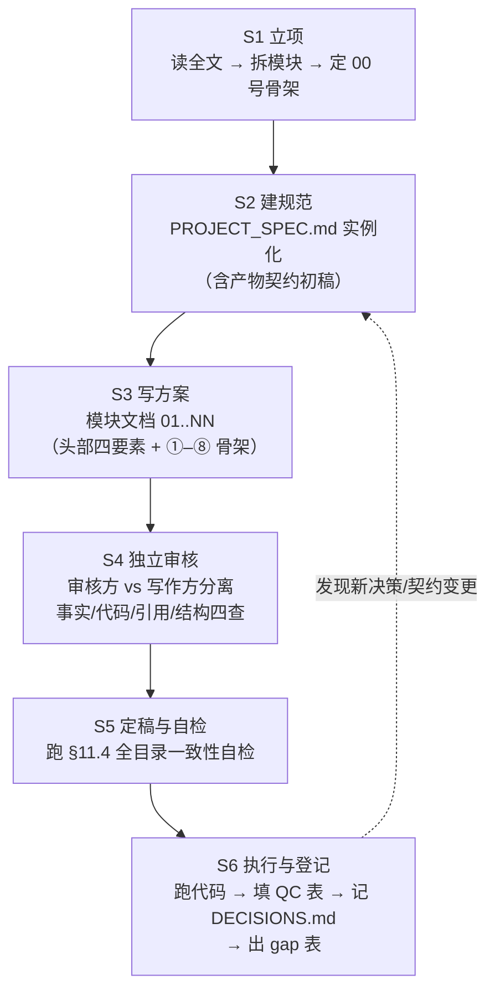
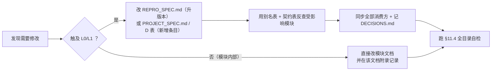

# REPRO_SPEC —— 文献复现项目统一规范（通用）

> **规范等级**：仓库级通用规范（Tier-0）　**版本**：**v2.1**　**生效日期**：2026-10-16　**状态**：✅ 生效中（binding）
> **仓库**：`paper_read/`（文献精读与复现仓库）
> **管辖范围**：本仓库下**所有**以单篇文献为对象的复现项目（每个项目一个目录）
> **本规范解决的问题**：让"复现一篇论文"这件事在**不同论文、不同人、不同时间**之间保持同一套工程标准——同样的目录、同样的命名、同样的可追溯性、同样的诚实性底线。

---

## 0. 术语与效力

### 0.1 术语定义

| 术语 | 含义 |
|---|---|
| **项目（Project）** | 一个复现项目 = **一篇文献** = 一个目录，目录名形如 `<YYYYMMDD>_<slug>` |
| **模块（Module）** | 项目内一个可独立执行的分析环节（如"单细胞 QC 与注释""空间反卷积"），对应一篇编号文档 |
| **模块文档** | 描述某模块的 Markdown 方案文档，命名 `NN_<标题>.md` |
| **产物（Artifact）** | 一切被写入磁盘的中间对象、结果表、图、日志 |
| **契约（Contract）** | 关于"某个产物由谁产出、格式是什么、谁消费"的登记条目 |
| **决策项（Decision, D）** | 文献未写清、缺失或自相矛盾，因而必须由复现者显式拍板的参数/口径 |
| **门槛（Gate）** | 用文献报告数值构造的 Go/No-Go 判据 |

### 0.2 文件分层与效力

| 层级 | 文件 | 位置 | 管辖 |
|---|---|---|---|
| **L0** | **本文件 `REPRO_SPEC.md`** | **仓库根** | 框架与红线：目录、命名、契约机制、环境、随机性、统计、写作、变更流程、诚实性。**全仓库强制，项目不得违背** |
| **L1** | `<项目>/PROJECT_SPEC.md` | 项目目录 | **实例化**：文献信息、项目产物契约表、项目决策登记表（D 表）、术语表、别名清理表 |
| **L2** | 项目质控门槛表 | 项目 `00`/`13` 号文档 | 该项目各模块的 Go/No-Go 数值与允许波动 |
| **L3** | 模块文档 `NN_*.md` | 项目目录 | 该模块的执行细节 |

**冲突裁决**：L0 > L1 > L2 > L3。
**偏离机制**：项目若有正当理由需要偏离 L0 的某条**非红线**规则，必须在 `PROJECT_SPEC.md` 的「§偏离声明」中写明**条目、理由、影响范围**；**§12 诚实性红线不可偏离**。

### 0.3 三条总则（贯穿全部项目）

1. **诚实性优先于一致性**：结果与文献不符时如实记录，**禁止反向调参凑数**（§12）。
2. **口径唯一**：同一概念（分组阈值、细胞标签、文件名）在**一个项目内只有一个定义**，定义写在 L1/L2，模块文档只能引用。
3. **可追溯**：任何偏离规范或文献的操作，必须在项目 `logs/DECISIONS.md` 留下"谁、何时、改了什么、为什么"（§10.2）。

---

## 1. 仓库与项目组织

### 1.1 仓库结构

```
paper_read/                        # 仓库根
├── REPRO_SPEC.md                  # ★ 本文件（通用规范 L0）
├── tools/                         # ★ 跨项目复用脚本（§1.4）
│   ├── repro_check.sh             #   通用一致性自检（§11.4 落地实现）
│   └── <其它可复用脚本>
├── <YYYYMMDD>_<slug>/             # 项目 A（一篇文献一个目录）
│   ├── PROJECT_SPEC.md            #   项目规范（L1，由 §附录 A 模板实例化）
│   ├── <文献>.pdf                  #   原文
│   ├── 00_...md … NN_...md        #   模块文档
│   └── raw/ processed/ results/ figures/ code/ logs/
└── <YYYYMMDD>_<slug>/             # 项目 B
```

### 1.2 项目目录命名

- 格式：**`<YYYYMMDD>_<slug>`**；`YYYYMMDD` = 项目启动日期；`slug` = 3–6 个英文单词的下划线短语，概括主题与组学（例：`multi-omics_and_machine_learning`、`GBM_lactate_NFATc4_SPP1_macrophage`）。
- 原文 PDF 放入项目目录，文件名用`tools/paper_renamer_cli.py`重命名, （可读性优先，不允许空格,  允许中文），并去掉文件系统非法字符（见 §3.2）。

### 1.3 项目文档编号约定

| 编号 | 用途 |
|---|---|
| `00` | **总览与目录**：文档清单、科学问题、全流程、图表→文档映射、数据资产、算力工期、全局门槛、工程约定 |
| `01` | **环境与数据获取**：环境搭建、版本表、数据源下载、基因集/参考文件获取、目录初始化 |
| `02 … NN-2` | **模块文档**：按分析流程顺序编号（单细胞 → 调控 → 轨迹 → 空间 → 通讯 → bulk/生存 → 机器学习 → 延伸分析 → 实验验证） |
| `NN-1` | **复现质控清单、排错与批判性评述**：QC 门槛表、排错表、文献疏漏逐条核对、证据等级、扩展方向、**项目决策登记表（D 表）** |
| `NN` | **背景知识与方法学原理速查**：生物学背景、算法原理、术语表、文献导读 |
| `PROJECT_SPEC.md` | 项目规范（L1），不占编号 |

> 编号一旦分配不得随意变更；新增模块用 `NN+1` 顺延，**不插号**（插号会使全项目的交叉引用失效）。

---

### 1.4 脚本分层：`tools/`（可复用）与 `<项目>/code/`（项目专用）

**这是硬性分工，不允许把可复用脚本复制到各项目。**

| 归属 | 判定标准 | 例子 |
|---|---|---|
| **`tools/`（仓库级，可复用）** | 逻辑与**具体文献/数据无关**，只依赖通用输入（文件路径、参数）；换一个项目照样能用 | 一致性自检、图像配准/拼接的通用封装、多标签（multi-label）分割后处理、空间邻接图构建、置换检验零模型、生存/ROC/校准的绘图封装、格式转换（h5ad↔rds）、校验和 |
| **`<项目>/code/`（项目专用）** | 含项目特有常量（队列名、marker 面板、阈值、文件契约名）、只服务本项目 | `01_tcga_gdc.R`、`02_01_read_qc.R`、`06_rctd_*.R` |

**规则**

1. **复用优先**：写新脚本前先 `ls tools/`；能改造复用就不新写。
2. **提升机制**：项目内脚本被**第二个项目**需要时 → 移入 `tools/`（剥离项目常量，改为参数/配置文件驱动），并在本文件 §附录 D 修订记录登记一次。
3. **`tools/` 脚本的质量要求**：必须有 `--help`/用法注释、参数校验、明确退出码；**不得硬编码任何项目路径或队列名**。
4. **版本与契约**：`tools/` 脚本的**入参/出参格式**属于 L0 契约，变更需按 §11.1 流程通知受影响项目。
5. **文档**：新增 `tools/` 脚本必须在本节表格中登记（脚本名 / 用途 / 用法 / 依赖）。

**当前 `tools/` 清单**

| 脚本 | 用途 | 用法 | 依赖 |
|---|---|---|---|
| `repro_check.sh` | 项目一致性自检（8 项：结构、围栏、交叉引用、占位符、非法文件名、头部四要素、旧名残留、缺失项标注） | `tools/repro_check.sh <项目目录>` 或 `--all` | bash 4+、grep -P |
| `spatial_cn_kmeans.py` | 空间邻域组成（CN）划分：窗口内细胞类型组成比例 → K-means → 每细胞 CN 标签；输出细胞级 CN、CN×类型组成矩阵、每样本 CN 频率（after Wang et al. 2026 bioRxiv, Methods「CN definition」） | `python3 tools/spatial_cn_kmeans.py --cells <细胞表> --group-col sample --window-mode radius --radius-um 70 --pixel-size-um 0.5 --k 15 --out-prefix <前缀>`；无像素尺寸时 `--window-mode knn --knn 70`；自检 `--selftest`（ARI > 0.7） | python3、numpy、pandas、scipy、scikit-learn |
| `spatial_interaction_test.py` | 细胞-细胞空间互作：Delaunay 邻接 → 距离阈值 → 分组内置换（position/label/toroidal）→ Mann–Whitney U → logFC 与 BH-FDR；`logFC = log2(观测距离均值/置换距离均值)`，**负值 = 观测更近 = 空间富集**（after Wang et al. 2026 bioRxiv, Methods「Cell-cell interaction analysis」） | `python3 tools/spatial_interaction_test.py --cells <细胞表> --group-col fov --max-dist 30 --dist-unit um --pixel-size-um 0.5 --n-perm 100 --out-prefix <前缀>`；自检 `--selftest`（功效 > 0.8 且真 H0 FPR < 0.1） | python3、numpy、pandas、scipy、scikit-learn |
| `patch_proximity.py` | Patch 邻近分析：按通道取 patch → HDBSCAN 聚类 → 凹包边界 → 边缘细胞 + k-NN 扩展（anchor）→ 半径环带内异类细胞计数与密度（after Wang et al. 2026 bioRxiv, Methods「Patch proximity analysis」） | `python3 tools/patch_proximity.py --cells <细胞表> --patch-by cn --patch-value cn_1 --cluster-method hdbscan --min-cluster-size 50 --edge-knn 3 --radii-um 5,10,15,20,25 --pixel-size-um 0.5 --out-prefix <前缀>`；自检 `--selftest`（环带计数相对误差 < 15%） | python3、numpy、pandas、scipy、scikit-learn；可选 `hdbscan`（缺失→`sklearn.cluster.HDBSCAN`）、`shapely ≥ 2.1`（缺失→自实现 alpha-shape，再→凸包） |
| `paper_renamer_cli.py` | 学术论文 PDF 智能重命名（命令行版）：融合 PDF 内嵌元数据 / 首页文本 / BibTeX / Crossref(DOI) / arXiv 多源信息，按模板批量重命名——对应 L0 §1.2 的"项目目录命名"与 §3.2 的"原文 PDF 归档"流程 | `python3 tools/paper_renamer_cli.py <pdf> [-r 递归] [-t "{year}_{author}_{title}"] [-n 预览] [-b <bib目录>] [-v]` | python3、PyPDF2、pdfminer.six、pymupdf、bibtexparser、requests（见 `tools/requirements.txt`） |
| `requirements.txt` | `tools/` 脚本的 Python 依赖清单 | `pip install -r tools/requirements.txt` | — |

> 三个 `spatial_*.py` 的共同约定：**长度参数一律以 μm 为单位，必须显式给出 `--pixel-size-um`（μm/px）做换算，缺参数直接报错退出（不猜默认值）**；`--seed` 默认 `20260101`；统计表行序固定、可复现（`*_run_meta.csv` 含 `seconds` 运行耗时，故该文件非逐字节可复现）。退出码统一：`0`=成功、`1`=未预期异常、`2`=参数/输入校验失败、`3`=质量断言失败、`4`=selftest 失败、`5`=缺必需依赖。

## 2. 项目工作流（六阶段）



**阶段规则**

- **S3/S4 必须分离**：写作者与审核者不得是同一轮上下文（`code-reviewer`/`verifier` 独立通道）。审核必须逐条核对"文献报告的数值"与文档中的引用。
- **S4 审核四查**：① 事实（数值/名称/文献引用）；② 代码（API 是否存在、默认值、静默失败）；③ 交叉引用（是否指向真实文件）；④ 结构（头部四要素、①–⑧ 骨架、围栏配对）。
- **S6 才允许跑数据**：方案定稿前不跑分析，避免"用结果反推方案"。

---

## 3. 目录与命名规范（通用）

### 3.1 项目内目录树（强制）

```
<项目>/
├── PROJECT_SPEC.md
├── 00_...md … NN_...md
├── <文献>.pdf
├── raw/          # 原始数据，只读，禁止任何脚本写入
├── processed/    # 中间对象（.rds / .qs / .h5ad / .loom）
├── results/      # 表格类结果（.csv / .tsv / .rds）
├── figures/      # 出图（.pdf + .png 双份，dpi = 300）
├── code/         # 脚本（编号前缀与文档一致）
└── logs/         # sessionInfo / 运行日志 / DECISIONS.md / 校验和
```

- **不使用 `data/` 前缀**（`raw/`、`processed/` 即顶层）；历史项目中出现的 `data/raw/` 一律视为同一处的旧写法，迁移时统一。
- `raw/` 只读；清洗结果写 `processed/`；**禁止原地覆盖原始文件**。
- 代码与产物分离：脚本在 `code/`，输出在 `processed|results|figures|logs/`。
- 全部脚本**幂等**：重跑覆盖同名产物，不做追加式写入；需要版本对比用 `__v2` 显式后缀。

### 3.2 命名语法

```
<前缀>_<语义描述>[__<限定>].<扩展名>
```

| 前缀 | 用途 | 判定标准 |
|---|---|---|
| **无前缀** | **核心共享对象** | 被 ≥2 个模块消费的中间对象（如全项目通用的注释对象、表达矩阵、基因集） |
| `Fig<N><L>_` | 与文献图号一一对应的出图/结果表 | 图注可直接对照原文（`Fig3D_...`、`FigS4B_...`） |
| `<NN>_` | 模块私有产物、辅助图、QC 日志 | 仅该模块及其下游少量消费 |
| `<NN>_<MM>_` | 模块内脚本执行序号 | `code/02_01_read_qc.R`、`logs/04_02_ctx.log` |

**字符与占位规则**

1. **禁用字符（适用 `code/ raw/ processed/ results/ figures/ logs/` 下的一切文件与目录）**：空格、引号、`` < > { } * ? : | `` 及 shell 元字符。
   - **冒号一律改用连字符**：Windows/NTFS（含 WSL 挂载盘）文件名不允许冒号，写入会直接失败。
2. **占位符统一写作 `<...>`**（`<cohort>`、`<GSM>`、`<slice>`、`<sample>`、`<gene>`）。占位符**只允许出现在文档正文与表格**；落盘时**必须展开为实际值**，文件名中不得残留尖括号。
   - 代码块中的变量插值（`f"...{sample}.csv"`、`sprintf("%s", cohort)`）属实现细节，**不受此限**，不得为"统一"去改可运行代码。
3. 语义描述用 `snake_case`；**项目产物不使用中文文件名**。
4. 扩展名约定：`.rds/.qs`（R 对象）、`.h5ad`（Python）、`.loom`（pySCENIC 输入）、`.csv/.tsv`（结果表）、`.pdf`+`.png`（成对出图）、`.log/.txt/.md5`（日志与校验）。
5. **图表双份**：同一张图同时输出矢量 `.pdf`（投稿用）与 `.png`（dpi=300，速览用）。
6. **豁免**：原始文献 PDF 与 `NN_*.md` 方案文档以可读性优先，允许中文与空格。

### 3.3 别名清理机制（通用）

命名变体（同一产物出现两种写法）是复现事故的头号来源。规则：

1. 每个项目在 `PROJECT_SPEC.md` §别名清理表登记"历史变体 → 规范名"。
2. **改名必须同时完成三件事**：① 改所有引用处；② 更新契约表；③ 在 `logs/DECISIONS.md` 记录。
3. 定稿前必须跑一遍 §11.4 自检，确认无旧名残留。

---

## 4. 产物契约（Artifact Contract）机制

> 契约不是文档，是**纪律**：**每个产物只有一个生产者，其他模块只能消费。**

### 4.1 契约表结构（由 `PROJECT_SPEC.md` 维护）

| 字段 | 说明 |
|---|---|
| 产物路径 | 规范名（相对项目根） |
| 生产者 | **唯一**的模块编号；只有它能写这个文件 |
| 格式/结构 | 列名、对象类型、单位、是否 log 化、坐标系等**下游必须知道的一切** |
| 消费方 | 读取该产物的模块清单 |
| 生成脚本 | `code/...` |

### 4.2 契约纪律

1. **生产者唯一**：若两个模块都需要写同名产物 → 说明契约设计错误，改名或合并。
2. **格式即契约**：列名、维度、尺度（log/非 log、TPM/CPM）、单位（天/月）、坐标系（x/y vs imagecol/imagerow）都必须在契约表中写明。**"看起来能跑但尺度不对"是本类项目最隐蔽的失败模式。**
3. **契约变更流程**：改格式/名字 = 改契约表 + 通知全部消费方 + 记录 `DECISIONS.md`；**禁止静默改格式**。
4. **跨语言边界**：R→Python 用 `.h5ad` 或 `.csv`；`.loom` 仅作 pySCENIC 输入，不作通用交换格式。
5. **上游缺失可降级**：消费方应能识别"上游产物不存在"并给出清晰报错，而不是自动猜路径（禁止"自动搜索同名文件"的魔法逻辑）。

---

## 5. 环境与版本

1. **版本钉死**：每个项目在 `01` 号文档中固定主语言与关键包版本，并提供环境文件（`conda env export` / `renv.lock` / `requirements.txt`）。
2. **以文献为准，以环境为辅**：文献指定版本优先；文献未指定时选**当时稳定版**并记录。
3. **版本偏离登记**：任何**主版本**偏离（如 Seurat 5→4、GSVA 新→旧 API）必须记入 `DECISIONS.md` 并在方法学中声明。
4. **已知高发 API 断层**（通用提醒，各项目按需展开）：R 生态的 Seurat 4/5、`GSVA` 新旧形参、Bioconductor 年度 release；Python 生态的 scanpy/anndata、squidpy、scvi-tools 的大版本变更。**写方案时以目标版本为准，遇到不确定 API 显式标注"需按当前包版本核对"。**
5. **依赖参考数据库的版本**（motif 注释、KEGG/GO/MSigDB、GDSC/CTRP/PRISM、参考基因组与注释）：必须在契约表记录**版本与日期**；跨版本结果不可直接比较。
6. **会话快照**：每脚本结束写 `logs/<NN>_sessionInfo.txt` 或 `logs/<NN>_pip_freeze.txt`，并记录**完整执行命令**。

---

## 6. 随机性与可复现性

1. **随机种子**：全项目统一一个常量（建议 `YYYYMMDD` 项目启动日，如 `20260101`），R `set.seed()`、Python `np.random.seed()`/`random.seed()`，**写在各脚本首行并在契约表声明**。
2. **必须固定种子的环节**（通用清单）：
   - 降维与嵌入：PCA（随机 SVD）、t-SNE、UMAP；
   - 聚类：Louvain/Leiden、K-means、共识聚类、混合模型初始化；
   - 重采样：双胞模拟、下采样/平衡、交叉验证折划分、bootstrap；
   - 置换检验：网络/邻域/富集/生存的置换，`nboot` 次数；
   - 模型：随机森林/RSF/SVM/GBM、特征选择中的随机成分（Lasso 稳定性选择）；
   - 图推断：GRN 共表达推断（GENIE3/GRNBoost2）、轨迹的随机初始化。
3. **已知不可完全固定**：分布式/并行实现（dask、多线程 BLAS）即使设种子也可能有微小波动 → 报告中**必须声明**。
4. **下载校验**：`raw/` 全量 `md5sum` 落盘 `logs/00_checksums.md5`，提供 `code/00_checksum.sh` 复核。
5. **失败也留痕**：放弃的实现路径要写进 `logs/`，不要只留在终端历史。

---

## 7. 统计约定

| 场景 | 约定 |
|---|---|
| 连续变量相关 | 正态 → Pearson；否则 Spearman；**必须同时报告 r/ρ、p、n** |
| 两组比较 | 组学数据默认 Wilcoxon rank-sum；正态且满足前提可用 t 检验并说明 |
| 多组比较 | 正态 → one-way ANOVA + Tukey；否则 Kruskal-Wallis + Dunn |
| 多重比较 | 组学层默认 **BH(FDR)**；文献只写 "P < 0.01" 未区分 raw/adj 时，**双口径复现并报告** |
| 生存分析 | KM + log-rank；Cox 需报 PH 假设（`cox.zph`）；HR 必附 95% CI 与 n；**主分析用连续变量或中位数二分，最优截断点仅作探索性分析**（并说明其 I 类错误膨胀） |
| 差异表达 | 默认 Wilcoxon；报告 `p_val_adj`、`avg_log2FC`、`pct.1/pct.2` |
| 空间统计 | 置换零模型**必须保持空间自相关结构**（平移/环面优于标签打乱）；报告置换次数与零分布构造 |
| 模型评价 | **C-index 与 time-dependent AUC 不可混用**；训练集与外部验证集必须分别报告并说明落差；报校准与临床净获益（如适用） |
| 实验数据 | 明确**生物学重复 vs 技术重复**；n 与 SD 必须标注；先做正态性检验再选检验 |
| 显著性标注 | `*p<0.05, **p<0.01, ***p<0.001, ****p<0.0001, ns`（全项目统一） |
| 图表 | 每张图必须可追溯到"脚本 + 输入产物 + 参数"；图注写明 n、检验方法、p 值形式 |

**禁止**：只报 p 不报效应量；只报阳性亚组；用最优截断点反复重跑直到显著；把训练集性能当泛化性能。

---

## 8. 文档写作规范

### 8.1 头部四要素（每个模块文档必填）

```markdown
# <NN> <标题>
> **目标文献**：<作者>. *<标题>.* <期刊> (<年>) <卷>:<页>. DOI: <doi>
> **模块对应原文**：Fig. Xa–Y / Fig. Sx；Methods 中「<小节名>」段；Table Sx
> **前置依赖**：<上游模块文档 + 需要的产物契约名>
> **复现难度 / 预计工时 / 计算资源**：★★★☆☆ / x 人日 / <内存·CPU·GPU>
```

### 8.2 正文骨架 ①–⑧

① **科学问题与逻辑位置**（上游输入什么、下游输出什么）→ ② **背景原理**（生物学 + 算法，含公式与直觉解释）→ ③ **原文逐句拆解**（引用原句 → 中文转述 → 对应操作与参数）→ ④ **逐步可运行代码**（语言+版本，输入/输出/中间对象名，关键行注释）→ ⑤ **参数解释与调参空间**（文献取值、可选范围、改变后果；**文献未写清处给出"我方决策 + 备选方案"**）→ ⑥ **预期结果与 QC 检查点**（文献报告的确切数值 + 允许波动 + Go/No-Go）→ ⑦ **常见陷阱与排错表**（`现象 | 根因 | 解决`）→ ⑧ **与文献图表的对应关系表**。

### 8.3 内容红线

1. **禁止编造**：凡标"文献报告"的数值必须能在原文中定位；未报告的写 **"文献未报告"** 并给出复现决策。**不得伪造文献、数据集内容、试剂货号、序列、API**。
2. **代码必须真实可运行**：API 不确定时显式标注"需按当前包版本核对"；**禁止 TODO / 占位符 / "此处省略"**。
3. **不确定处显式标注**：统一用 `> ⚠️ **导师批注**：...`，并把跨模块需统一的问题登记到 L1 的 D 表。
4. **交叉引用**用相对文件名（`NN_<标题>.md`），**必须指向真实存在的文件**。
5. **术语统一**：项目在 `PROJECT_SPEC.md` 维护**术语表**（细胞类型标签、基因/蛋白命名、分组名、阳性判定规则）；模块文档只能引用。**任何"阳性 (<X>⁺)"标签必须给出判定规则**（表达阈值 or 打分阈值），全项目一致。
6. **篇幅与密度**：模块文档以表格、公式、代码为主；禁止空话与教科书式罗列（原理要为复现服务）。

---

## 9. 文献疏漏的处理方法（通用）

复现的**核心增值**在于补齐文献没写清的部分。统一方法：

1. **逐句拆解表**：把 Methods/Results 中每一句与操作相关的叙述列为一行，标注：`原文句 | 我的操作 | 原文是否给了参数 | 缺失项的复现决策`。
2. **缺失项分类**（用于 D 表编号优先级）：
   - **A 类·口径类**：会改变结论方向的（分组阈值、参考图谱来源、队列构成、随机种子）→ **必须 D 表裁决**；
   - **B 类·实现类**：只影响复现效率/稳健性的（并行度、内存、缓存）→ 记录即可；
   - **C 类·写作类**：函数名/术语不规范（如把包名当函数名）→ 在文档中对照说明，不改结论。
3. **矛盾项**：文献自相矛盾（如 Methods 写 A、Discussion 写 B）→ **两套都跑**，报告一致性，并在 D 表声明主口径。
4. **不可溯源项**：文献引用的数据集/资源在公开渠道不存在 → 在 D 表声明**替代方案**，并在所有图表中标注"替代"。
5. **过度解读项**：文献把相关性表述为因果、把训练性能表述为泛化能力 → 在批判性评述中逐条列出并给出**证据等级分级**。

---

## 10. 决策登记与质控

### 10.1 D 表（决策登记表，项目 L1 的核心）

- **位置**：项目 `PROJECT_SPEC.md`（或独立的质控文档`NN-1`，二选一，全项目唯一）。
- **编号**：`D1, D2, …`，**只增不改号**；废弃的决策标 `~~D5~~` 并注明被谁取代。
- **字段**：`编号 | 决策项 | 涉及模块 | 裁决（主路径） | 备选/敏感性分析 | 依据`。
- **★ 标记**：凡**会改变结论口径**的决策加 ★，必须在论文方法学中显式声明。
- **来源**：每条决策必须能追溯到"文献缺失/矛盾"的证据（引原文句或指出无该信息）。

### 10.2 `logs/DECISIONS.md` 流水（运行时）

```markdown
# 项目决策流水
| 日期 | 决策 | 触发原因 | 依据（D 编号 / 文献 / 实测） | 影响范围 | 决策人 |
|---|---|---|---|---|---|
```

### 10.3 QC 门槛（三层）

| 层 | 内容 | 写法 |
|---|---|---|
| 数值层 | 文献报告的关键数值 | 与文献一致（允许抽样/平台差异，默认 **±10%**，需逐项声明） |
| 判据层 | Go / No-Go | ✅ 通过 → 推进；⚠️ 小幅偏差 → 排查实现细节后记录放行；❌ 显著偏差 → **第二套独立实现复核**，仍不符则登记 gap 表 |
| 结题层 | gap 表 | 逐模块填"文献值 / 我方复现值 / 是否一致 / 差异原因 / 处理方式" |

**禁止**：为了通过门槛而反复调参（见 §12）。

---

## 11. 变更控制与一致性自检

### 11.1 变更流程



### 11.2 版本号规则

- **L0（本文件）**：改框架/红线 → 升 minor（`v2.1`）；改结构或破坏兼容 → 升 major（`v3.0`）。
- **L1（PROJECT_SPEC）**：新增 D 条目或契约变更即升 minor，并在修订记录留痕。

### 11.3 契约与决策的反查方法

改一个产物名/格式时，用三条线索找全受影响处：
```
grep -rn "<旧产物名>" <项目目录>/*.md          # 文档引用
grep -rn "<旧产物名>" <项目目录>/code/          # 代码读写
grep -rn "<旧产物名>" <项目目录>/logs/           # 历史日志（确认历史结论受影响范围）
```

### 11.4 一致性自检清单（每次变更后必跑）

```bash
# 在项目目录下执行，或直接用仓库的 tools/repro_check.sh <项目目录>
for f in *.md; do n=$(grep -c '^```' "$f"); [ $((n%2)) -ne 0 ] && echo "围栏不配对: $f"; done   # ① 代码围栏配对
grep -oh "[0-9][0-9]_[^ )）\`\"]*\.md" *.md | sort -u | while read -r r; do [ -f "$r" ] || echo "断链: $r"; done  # ② 交叉引用
grep -n "TODO\|待补\|待填\|此处省略" *.md                                                      # ③ 占位符残留
ls | grep -E '[<>{}:*?|]'                                                                      # ④ 文件名非法字符
grep -n "原文未报告\|文献未报告" *.md | wc -l                                                   # ⑤ 缺失项是否已显式标注（应为正数）
```

- [ ] ①–⑤ 全通过
- [ ] 别名清理表：无旧名残留
- [ ] 契约表：产物生产者唯一、消费方已同步
- [ ] D 表与 `DECISIONS.md` 已同步
- [ ] 头部四要素齐全、①–⑧ 骨架完整

---

## 12. 诚实性红线（不可偏离）

1. **跑不出文献的数不叫失败；改参数直到跑出文献的数才叫失败。**
2. **区分"我没复现出来"与"文献不可复现"**：下结论前必须用 ≥2 条独立实现路径排除前者。
3. **训练集性能 ≠ 泛化性能**：报告模型时必须同时给出训练与外部验证结果，并显式说明落差。
4. **相关性 ≠ 因果**：共定位、通讯推断、敲低表型都不得升级表述为"证明了机制"。
5. **阴性结果必须出现在报告里**：不显著的队列、方向相反的亚组、失败的敏感性分析一律保留。
6. **不伪造引用与数据**：不得编造文献、数据库条目、试剂货号、序列；不得把"推测"写成"文献报告"。

---

## 附录 A　项目规范模板（`PROJECT_SPEC.md`，复制即用）

```markdown
# PROJECT_SPEC —— <项目名> 项目规范

> **上位规范**：`../REPRO_SPEC.md`（通用规范 v<版本>，L0）
> **本项目**：<文献引用>
> **项目目录**：<路径>　**启动日期**：<YYYY-MM-DD>　**版本**：v1.0

## 1. 项目定义
- 一句话目标 / 科学问题：
- 交付物清单（文档 NN 篇、代码、产物）：
- 模块划分与编号表：

## 2. 目录与命名（本项目的具体化）
- 项目 slug 与目录名：
- 数据源目录细分：raw/{<子目录>}
- 命名特例（如基因集文件、图像文件的特殊约定）：

## 3. 别名清理表
| 历史变体 | ✅ 规范名 | 出处 |

## 4. 产物契约表
| 产物路径 | 生产者(唯一) | 格式/结构（列名·尺度·单位·坐标系） | 消费方 | 生成脚本 |
（核心共享对象、按模块索引）

## 5. 术语表
| 术语 | 本项目定义（含阳性判定规则、阈值） |

## 6. 环境与版本钉死
| 组件 | 版本 | 出处 | 偏离说明 |

## 7. 统计与随机性
- 随机种子常量：<值>
- 项目特有统计约定：

## 8. 决策登记表（D 表）
| # | 决策项 | 涉及模块 | 裁决(主路径) | 备选/敏感性 | 依据 | ★ |
（★ = 改变结论口径，必须写进方法学）

## 9. QC 门槛
（指向项目质控文档的检查点表；列出全局 Go/No-Go）

## 10. 偏离声明（对 L0 的非红线偏离）
| L0 条目 | 偏离内容 | 理由 | 影响范围 |
（无则写"无"）

## 11. 修订记录
| 版本 | 日期 | 修改内容 | 修改人 |
```

## 附录 B　新项目落地清单（Onboarding Checklist）

- [ ] 1. 目录命名 `<YYYYMMDD>_<slug>`，原文 PDF 归档并去掉非法字符
- [ ] 2. 读全文，拆模块（`01` … `NN`），确定 `00` 号骨架
- [ ] 3. 复制附录 A 模板建立 `PROJECT_SPEC.md`，先写 §1/§2/§6
- [ ] 4. 建目录骨架：`raw/ processed/ results/ figures/ code/ logs/` + `logs/DECISIONS.md`；**先 `ls ../tools/` 看有哪些可复用脚本**（§1.4：复用优先，禁止把 `tools/` 的脚本复制进项目）
- [ ] 5. 数据资产清单（数据集/样本数/用途/获取方式）+ `raw/` 校验和
- [ ] 6. 逐模块写方案文档（头部四要素 + ①–⑧）
- [ ] 7. 补全产物契约表 §4（**生产者唯一**，格式写细）
- [ ] 8. 逐条梳理文献缺失/矛盾 → 形成 D 表（★ 标注口径类）
- [ ] 9. 建 QC 门槛表（数值层 / 判据层 / 结题层 gap 表）
- [ ] 10. 独立审核（事实/代码/引用/结构四查），修正后跑 `tools/repro_check.sh`
- [ ] 11. 开跑：按模块执行，逐模块填 QC 表 + 记 `DECISIONS.md`
- [ ] 12. 结题：填 gap 表 + 写批判性评述（证据等级 / 扩展方向）

## 附录 C　通用提醒：跨项目高发的失败模式

| 模式 | 表现 | 预防 |
|---|---|---|
| **静默失败** | 脚本成功退出但产物为空/全零/尺度错 | 每个关键产物写"质量断言"（行数、非 NA 比例、取值范围、直方图） |
| **尺度错配** | log/非 log、TPM/CPM、天/月、概率/计数 | 写进契约表，跨模块交接时断言 |
| **标签错配** | 细胞类型/分组标签大小写、单复数不一致 → 取子集为空 | 术语表 + `print(levels(x))` 断言 |
| **坐标错配** | 图像坐标行/列互换、px/µm 混淆 | 契约表记录坐标系与换算因子 |
| **信息泄漏** | 特征选择/阈值优化用到验证集 | 特征选择放进训练折（嵌套 CV） |
| **选择偏差** | 最优截断点、最优模型挑选 | 主分析用预设规则，优化仅作探索并声明 I 类错误膨胀 |
| **版本漂移** | 参考数据库/注释版本变化导致结果不可比 | 契约表记录版本与日期 |
| **注释漂移（跨语言）** | 基因 ID/symbol 版本不一致 → 基因数悄悄减少 | 交接时断言 `length(intersect())` 并记录丢失清单 |

## 附录 D　修订记录

| 版本 | 日期 | 修订内容 | 说明 |
|---|---|---|---|
| v1.0 | 2026-10-16 | 首版：作为 `20261016_GBM_lactate_NFATc4_SPP1_macrophage` 单个项目的规范（含该项目的 D1–D14、产物契约、别名表） | 已废弃，内容迁入该项目 `PROJECT_SPEC.md` |
| **v2.0** | **2026-10-16** | **通用化重构**：剥离项目特有内容 → 上升为**仓库级通用规范**；新增术语定义、效力分层（L0–L3）、**项目工作流六阶段**、**产物契约机制**（通用）、**文献疏漏处理方法**、**变更控制与自检脚本**、**附录 A 项目规范模板**、**附录 B 新项目落地清单**、**附录 C 跨项目高发失败模式**；诚实性红线由 5 条扩为 6 条 | — |
| **v2.1** | **2026-10-16** | 新增 **§1.4 脚本分层**：明确 `tools/`（仓库级可复用脚本）与 `<项目>/code/`（项目专用）的判定标准、**复用优先**、**提升机制**（第二个项目要用即上移）、`tools/` 脚本质量要求与登记表；附录 B 第 4 步加入"先 `ls ../tools/`" | 本版本 |
